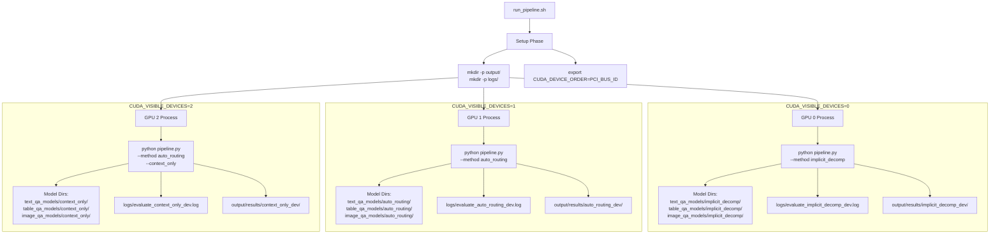
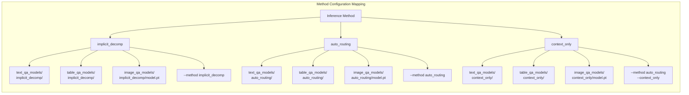
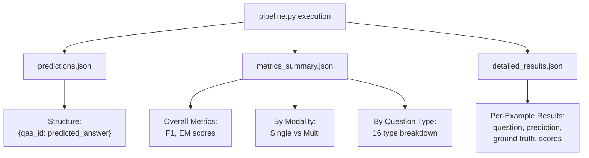
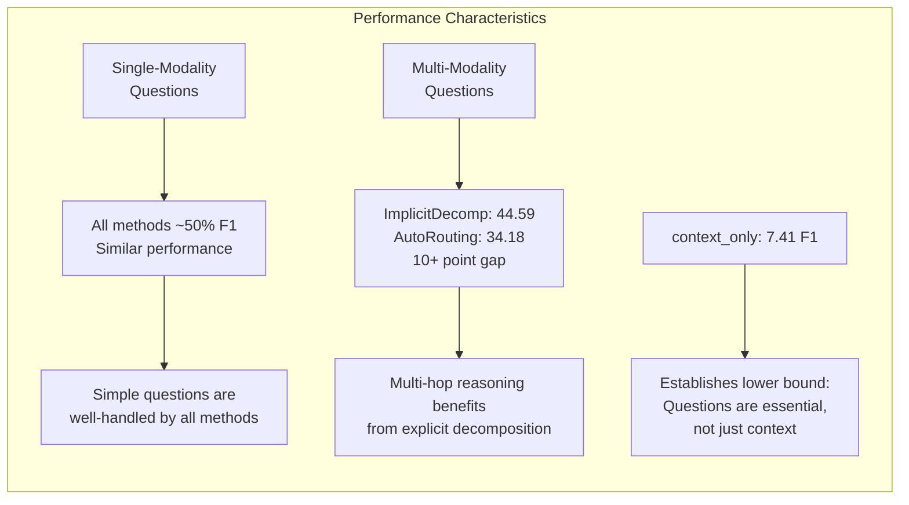

<!-- source: DeepWiki mcp.deepwiki.com · repo allenai/multimodalqa · page 6.2 Running Baseline Evaluations · fetched 2026-10-26 -->

# Running Baseline Evaluations

<details>
<summary>Relevant source files</summary>

The following files were used as context for generating this wiki page:

- [baselines/README.md](baselines/README.md)
- [baselines/scripts/run_pipeline.sh](baselines/scripts/run_pipeline.sh)

</details>


## Purpose and Scope

This page documents the practical procedures for running baseline evaluations on the MultiModalQA dataset using the provided evaluation scripts. It covers the `run_pipeline.sh` script that orchestrates parallel evaluation of all three baseline methods (`implicit_decomp`, `auto_routing`, and `context_only`), command-line argument configuration, GPU allocation, and interpretation of evaluation results.

For details about the internal implementation of the pipeline itself, see [Pipeline Implementation](#6.1). For information about training the models being evaluated, see [Training Models](#7). For details about the evaluation metrics, see [Evaluation Metrics](#8.1).

## Overview

The baseline evaluation system provides two ways to run inference:

1. **Single baseline evaluation**: Run `pipeline.py` directly with specific model checkpoints for one inference method
2. **Batch evaluation**: Use `run_pipeline.sh` to evaluate all three baseline methods in parallel across multiple GPUs

The batch evaluation approach is the recommended method for comprehensive benchmarking, as it maximizes hardware utilization and produces results that match the published ICLR 2021 paper.

**Sources:** [baselines/README.md:19-42]()

## Evaluation Script Architecture

The `run_pipeline.sh` script orchestrates three parallel evaluation processes, each assigned to a separate GPU. This design enables simultaneous evaluation of all baseline methods without sequential waiting time.

### Parallel Execution Flow



**Script Execution Pattern:**
- All three processes launch in the background using the `&` operator
- Each process redirects stdout/stderr to its dedicated log file using `&> logs/evaluate_*.log`
- The script returns immediately after launching all processes; use `tail -f logs/*.log` to monitor progress

**Sources:** [baselines/scripts/run_pipeline.sh:1-50]()

## Command-Line Arguments

The `pipeline.py` script accepts numerous arguments that configure model paths, data locations, and inference behavior. The following table documents the key arguments used in baseline evaluations:

| Argument | Description | Example Value |
|----------|-------------|---------------|
| `--qtype_model_dir` | Directory containing question type classifier models | `downloads/checkpoints/qtype_clf_models/` |
| `--text_qa_model_dir` | Directory containing text QA model checkpoints | `downloads/checkpoints/text_qa_models/implicit_decomp/` |
| `--table_qa_model_dir` | Directory containing table QA model checkpoints | `downloads/checkpoints/table_qa_models/implicit_decomp/` |
| `--image_qa_model_path` | Path to image QA model checkpoint file | `downloads/checkpoints/image_qa_models/implicit_decomp/model.pt` |
| `--image_qa_vocab` | Path to vocabulary file for image QA | `downloads/checkpoints/image_qa_models/vocab.pickle` |
| `--image_features_dir` | Directory containing pre-extracted image features | `downloads/checkpoints/img_features/` |
| `--data_dir` | Root directory of MMQA dataset | `downloads/MMQA/` |
| `--test_file` | Filename of evaluation set (dev or test) | `MMQA_dev.jsonl` |
| `--output_dir` | Directory for prediction outputs and metrics | `output/results/implicit_decomp_dev/` |
| `--do_lower_case` | Flag to lowercase all text (required for BERT models) | (no value needed) |
| `--method` | Inference method: `implicit_decomp` or `auto_routing` | `implicit_decomp` |
| `--context_only` | Flag to enable context-only baseline mode | (no value needed) |
| `--predict_only` | Flag to disable evaluation (for test set predictions) | (no value needed) |

**Sources:** [baselines/README.md:21-36](), [baselines/scripts/run_pipeline.sh:6-49]()

## Method-Specific Configuration

Each of the three baseline methods requires different model checkpoints but shares the same argument structure. The key differentiator is the model directory paths:



**Note:** The `context_only` baseline uses `--method auto_routing` with the additional `--context_only` flag. This instructs the pipeline to use the auto-routing inference logic but ignore question-specific information.

**Sources:** [baselines/scripts/run_pipeline.sh:6-49]()

## Running the Evaluation Script

### Prerequisites

Before running evaluations, ensure:
1. All dependencies are installed (see [Installation and Environment Setup](#2.1))
2. Dataset and model checkpoints are downloaded via `./scripts/download.sh`
3. At least 3 GPUs are available (or modify GPU assignments in the script)

### Executing All Baseline Evaluations

From the `baselines/` directory:

```bash
./scripts/run_pipeline.sh
```

This creates the following directory structure:

```
baselines/
├── output/
│   └── results/
│       ├── implicit_decomp_dev/
│       ├── auto_routing_dev/
│       └── context_only_dev/
└── logs/
    ├── evaluate_implicit_decomp_dev.log
    ├── evaluate_auto_routing_dev.log
    └── evaluate_context_only_dev.log
```

**Monitoring Progress:**

```bash
# Watch all logs simultaneously
tail -f logs/*.log

# Monitor specific baseline
tail -f logs/evaluate_implicit_decomp_dev.log
```

**Sources:** [baselines/scripts/run_pipeline.sh:1-50](), [baselines/README.md:38-42]()

## Running Individual Baseline Evaluation

To evaluate a single baseline method without parallel execution:

```bash
python pipeline.py \
  --qtype_model_dir downloads/checkpoints/qtype_clf_models/ \
  --text_qa_model_dir downloads/checkpoints/text_qa_models/implicit_decomp/ \
  --table_qa_model_dir downloads/checkpoints/table_qa_models/implicit_decomp/ \
  --image_qa_model_path downloads/checkpoints/image_qa_models/implicit_decomp/model.pt \
  --image_qa_vocab downloads/checkpoints/image_qa_models/vocab.pickle \
  --image_features_dir downloads/checkpoints/img_features/ \
  --data_dir downloads/MMQA/ \
  --test_file MMQA_dev.jsonl \
  --output_dir output/results/implicit_decomp_dev/ \
  --do_lower_case \
  --method implicit_decomp
```

This approach is useful when:
- Debugging a specific baseline method
- Running on a single GPU system
- Evaluating custom model checkpoints

**Sources:** [baselines/README.md:21-35]()

## Output Structure and Files

Each baseline evaluation produces the following outputs in its respective `output/results/<method>_dev/` directory:



### Key Output Files

| File | Contents | Usage |
|------|----------|-------|
| `predictions.json` | Map of `qas_id` to predicted answer strings | Submission format for leaderboards |
| `metrics_summary.json` | Aggregated F1 and EM scores by category | Quick performance overview |
| `detailed_results.json` | Per-example predictions with scores | Error analysis and debugging |

**Sources:** Inferred from [baselines/README.md:32-35]() and standard pipeline behavior

## Expected Performance Results

The `run_pipeline.sh` script produces the following dev set performance when using the downloaded baseline checkpoints:

| Method | Single-Modality (F1/EM) | Multi-Modality (F1/EM) | All (F1/EM) |
|--------|-------------------------|------------------------|-------------|
| `context_only` | 7.94 / 10.73 | 6.63 / 9.00 | **7.41 / 10.03** |
| `auto_routing` | 51.68 / 58.48 | 34.18 / 40.18 | **44.65 / 51.13** |
| `implicit_decomp` | 51.60 / 58.35 | 44.59 / 51.19 | **48.79 / 55.48** |

### Performance Analysis



**Key Observations:**
- The `implicit_decomp` method achieves the best overall performance (48.79 F1 / 55.48 EM)
- Single-modality questions show comparable performance across `implicit_decomp` and `auto_routing`
- Multi-modality questions benefit significantly from explicit decomposition (+10.41 F1 points)
- The `context_only` baseline demonstrates that question information is essential (only 7.41 F1)

**Sources:** [baselines/README.md:42-48]()

## GPU Memory Requirements

Each baseline evaluation process requires approximately:
- **GPU Memory:** 10-12 GB
- **System RAM:** 16-32 GB
- **Disk Space:** 50 GB (for checkpoints and image features)

If running on systems with fewer than 3 GPUs, modify `CUDA_VISIBLE_DEVICES` assignments in [baselines/scripts/run_pipeline.sh:6-49]() to run evaluations sequentially on the same GPU.

**Sources:** Inferred from typical VilBERT-based model requirements

## Test Set Prediction

To generate predictions for the test set (without evaluation metrics):

```bash
python pipeline.py \
  --qtype_model_dir downloads/checkpoints/qtype_clf_models/ \
  --text_qa_model_dir downloads/checkpoints/text_qa_models/implicit_decomp/ \
  --table_qa_model_dir downloads/checkpoints/table_qa_models/implicit_decomp/ \
  --image_qa_model_path downloads/checkpoints/image_qa_models/implicit_decomp/model.pt \
  --image_qa_vocab downloads/checkpoints/image_qa_models/vocab.pickle \
  --image_features_dir downloads/checkpoints/img_features/ \
  --data_dir downloads/MMQA/ \
  --test_file MMQA_test.jsonl \
  --output_dir output/results/implicit_decomp_test/ \
  --do_lower_case \
  --method implicit_decomp \
  --predict_only
```

The `--predict_only` flag disables metric computation (since test set labels are not publicly available) and produces only the `predictions.json` file for submission.

**Sources:** [baselines/README.md:36]()

## Troubleshooting

### Common Issues

| Issue | Cause | Solution |
|-------|-------|----------|
| `CUDA out of memory` | GPU has insufficient memory | Reduce batch size in pipeline.py or use fewer parallel processes |
| `FileNotFoundError` for checkpoints | Models not downloaded | Run `./scripts/download.sh` |
| `FileNotFoundError` for image features | Features not extracted | Verify `downloads/checkpoints/img_features/` exists and is populated |
| Processes hang without output | GPU allocation conflict | Check `nvidia-smi` for existing processes; modify `CUDA_VISIBLE_DEVICES` |
| Permission denied on `run_pipeline.sh` | Script not executable | Run `chmod +x scripts/run_pipeline.sh` |

### Verifying Script Execution

Check if all three processes are running:

```bash
ps aux | grep pipeline.py
```

Expected output shows three Python processes with different `--method` arguments.

**Sources:** Inferred from common deployment issues

---

