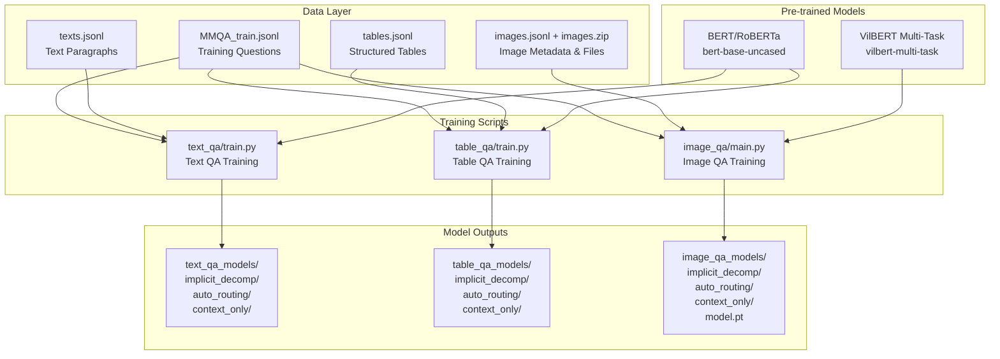
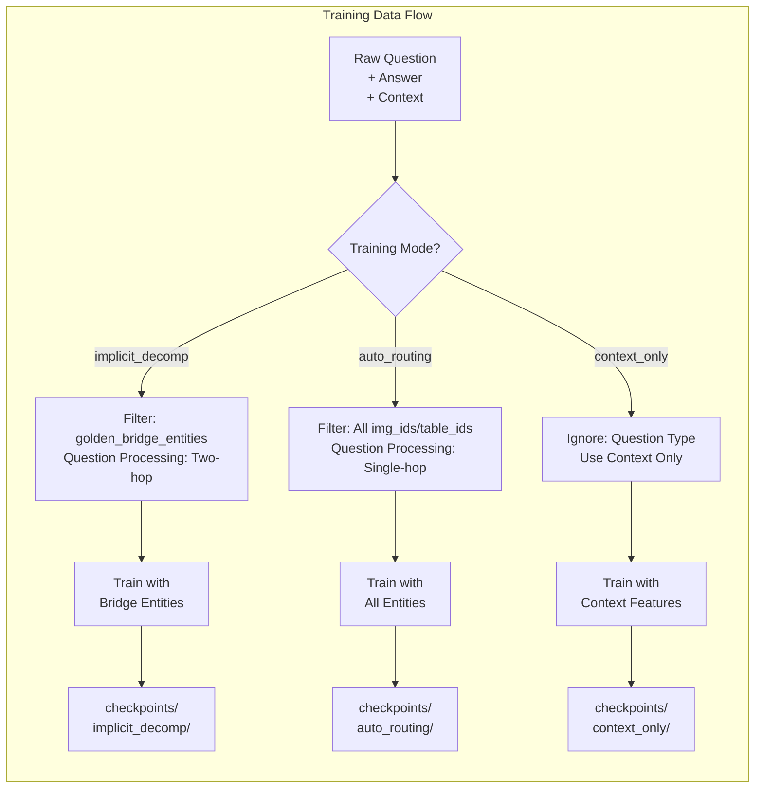
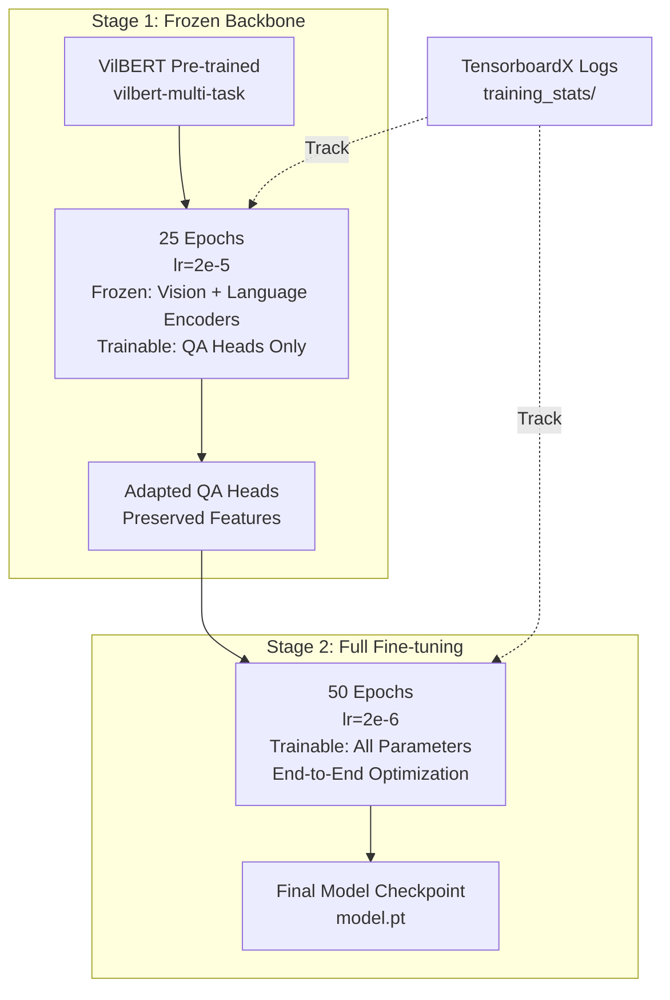
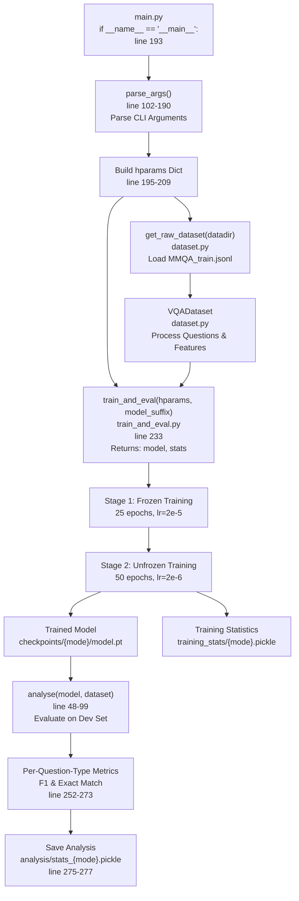
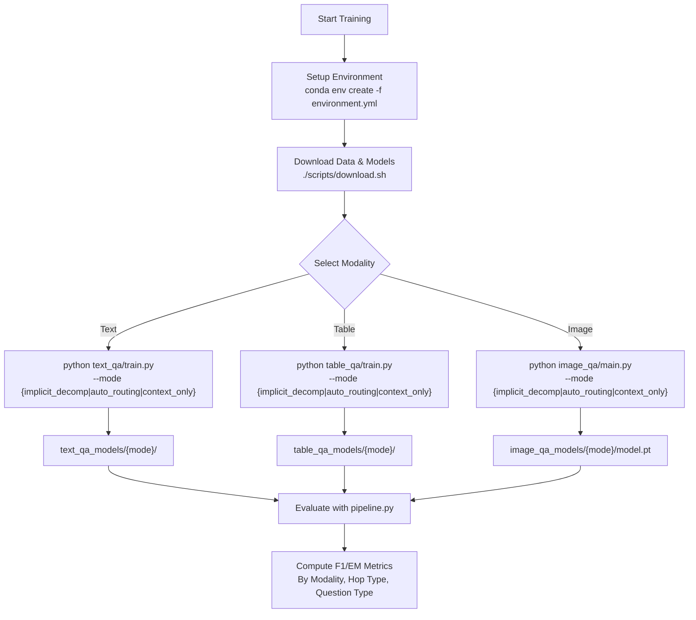

<!-- source: DeepWiki mcp.deepwiki.com · repo allenai/multimodalqa · page 7 Training Models · fetched 2026-10-26 -->

# Training Models

<details>
<summary>Relevant source files</summary>

The following files were used as context for generating this wiki page:

- [baselines/README.md](baselines/README.md)
- [baselines/image_qa/README.md](baselines/image_qa/README.md)
- [baselines/image_qa/main.py](baselines/image_qa/main.py)

</details>


## Purpose and Scope

This page provides an overview of the training procedures for the MultiModalQA baseline models. The system consists of three modality-specific QA models (text, table, and image) that are **trained independently** on their respective data subsets. Each model is fine-tuned from pre-trained checkpoints and supports three distinct inference modes.

For detailed step-by-step training procedures:
- Image QA models: see [Training Image QA Models](#7.1)
- Text and Table QA models: see [Training Text and Table QA Models](#7.2)

For information about the trained models themselves and their architectures, see [Baseline Models](#5).

**Sources:** [baselines/README.md:50-52]()

---

## Training Architecture Overview

The MultiModalQA training infrastructure follows a **modular, modality-specific approach**. Each of the three modalities (text, table, image) has its own training pipeline, dataset preparation logic, and hyperparameter configuration. This design enables independent development and optimization of each component.



**Key Design Principles:**

1. **Independent Training**: Each modality is trained separately with its own hyperparameters and training strategies
2. **Transfer Learning**: All models start from pre-trained checkpoints (BERT/RoBERTa for text/table, VilBERT for images)
3. **Mode-Specific Checkpoints**: Each training produces three separate model checkpoints corresponding to the three inference modes
4. **Modular Data Processing**: Each training script contains its own dataset preparation logic

**Sources:** [baselines/README.md:50-52](), [baselines/image_qa/README.md:1-19]()

---

## Training Modes

The MultiModalQA system supports three distinct inference modes, each requiring a **separate training run** with mode-specific data processing. The primary difference lies in how multi-hop questions are handled during training.

| Mode | Training Data Processing | Multi-Hop Strategy | Use Case |
|------|-------------------------|-------------------|----------|
| `implicit_decomp` | Uses **gold bridge entities** for second-hop questions | Two-stage reasoning with ground truth intermediate entities | Best performance; evaluates multi-hop reasoning capability |
| `auto_routing` | Uses **all available entities** as potential bridges | Direct routing to final modality without decomposition | Tests end-to-end retrieval without gold annotations |
| `context_only` | Ignores question type classification | Routes based only on context modality | Baseline to measure question importance |



### Mode Selection in Code

The training mode is specified via the `--mode` command-line argument:

```bash
python baselines/image_qa/main.py --mode implicit_decomp
python baselines/image_qa/main.py --mode auto_routing
python baselines/image_qa/main.py --mode context_only
```

The mode affects several aspects of training:
- **Data Filtering**: Which bridge entities are used for multi-hop questions ([baselines/image_qa/main.py:59-66]())
- **Question Processing**: How questions are tokenized and paired with context ([baselines/image_qa/dataset.py]())
- **Model Checkpoint Path**: Output directory naming ([baselines/image_qa/main.py:231]())

**Sources:** [baselines/image_qa/main.py:177-181](), [baselines/image_qa/main.py:226](), [baselines/image_qa/main.py:59-66]()

---

## Training Strategy: Two-Stage Fine-Tuning

The image QA training employs a **two-stage fine-tuning strategy** that is standard practice for large vision-language models:

### Stage 1: Frozen Backbone Training
- **Purpose**: Adapt the task-specific heads while preserving pre-trained features
- **Configuration**: VilBERT backbone parameters are frozen; only QA head is trainable
- **Default Hyperparameters**:
  - Epochs: 25 (`--frozen_epochs`)
  - Learning Rate: 2e-5 (`--frozen_lr`)
  - LR Step Size: 15 (`--frozen_lr_step_size`)

### Stage 2: Full Fine-Tuning
- **Purpose**: End-to-end optimization of all model parameters
- **Configuration**: All parameters (backbone + heads) are trainable
- **Default Hyperparameters**:
  - Epochs: 50 (`--unfrozen_epochs`)
  - Learning Rate: 2e-6 (`--unfrozen_lr`) - 10× smaller than frozen stage
  - LR Step Size: 25 (`--unfrozen_lr_step_size`)



This strategy is implemented in [baselines/image_qa/train_and_eval.py]() and controlled via command-line arguments in [baselines/image_qa/main.py:123-156]().

**Sources:** [baselines/image_qa/main.py:123-156](), [baselines/image_qa/main.py:199-204]()

---

## Hyperparameter Configuration

### Command-Line Arguments

Training hyperparameters are specified via command-line arguments to the training scripts. The image QA training script exposes the following key parameters:

| Parameter | Type | Default | Description |
|-----------|------|---------|-------------|
| `--batch_size` | int | 12 | Training batch size |
| `--device` | str | `cuda:0` | GPU device to use |
| `--dropout_prob` | float | 0.01 | Dropout rate for regularization |
| `--frozen_epochs` | int | 25 | Epochs for frozen backbone stage |
| `--frozen_lr` | float | 2e-5 | Learning rate for frozen stage |
| `--frozen_lr_step_size` | float | 15 | LR scheduler step size (frozen) |
| `--unfrozen_epochs` | int | 50 | Epochs for full fine-tuning |
| `--unfrozen_lr` | float | 2e-6 | Learning rate for unfrozen stage |
| `--unfrozen_lr_step_size` | float | 25 | LR scheduler step size (unfrozen) |
| `--sample_distractor_prob` | float | 0.3 | Probability of sampling distractor images |
| `--mask_vis` | bool | False | Ablation: mask visual features |
| `--mask_lang` | bool | False | Ablation: mask language features |
| `--mode` | str | `implicit_decomp` | Training mode (see above) |
| `--data_dir` | str | `../../dataset` | Path to MMQA dataset |

### Hyperparameter Dictionary

Arguments are collected into a `hparams` dictionary for consistency:

```python
# From baselines/image_qa/main.py:195-209
hparams = {
    'batch_size': args.batch_size,
    'device': args.device,
    'dropout_prob': args.dropout_prob,
    'frozen_epochs': args.frozen_epochs,
    'frozen_lr': args.frozen_lr,
    # ... (other parameters)
}
```

**Sources:** [baselines/image_qa/main.py:102-190](), [baselines/image_qa/main.py:195-209]()

---

## Training Workflow and Code Flow

The following diagram shows how the key functions and classes interact during training:



### Key Functions and Their Roles

1. **`parse_args()`** [baselines/image_qa/main.py:102-190]()
   - Parses command-line arguments for hyperparameter configuration
   
2. **`get_raw_dataset(datadir)`** [baselines/image_qa/dataset.py]()
   - Loads and processes the raw MMQA training data
   - Returns datasets dict, idx2answer, and answer2idx mappings

3. **`VQADataset`** [baselines/image_qa/dataset.py]()
   - Dataset class that handles question processing, feature loading, and batching
   - Mode-aware: processes data differently for `implicit_decomp`, `auto_routing`, `context_only`

4. **`train_and_eval(hparams, model_suffix)`** [baselines/image_qa/train_and_eval.py]()
   - Orchestrates the two-stage training process
   - Returns trained model, training statistics, and metadata

5. **`analyse(model, dataset, device, idx2answer, use_distractors, mode)`** [baselines/image_qa/main.py:48-99]()
   - Evaluates trained model on dev set
   - Computes per-question-type F1 and Exact Match scores
   - Prints example predictions for debugging

**Sources:** [baselines/image_qa/main.py:193-278]()

---

## Output Artifacts

Training produces three types of output artifacts:

### 1. Model Checkpoints

Saved to `baselines/image_qa/checkpoints/{mode}_{timestamp}/`:
- `model.pt`: Serialized model state dict
- `vocab.pickle`: Answer vocabulary mappings (shared across modes)

### 2. Training Statistics

Saved to `baselines/image_qa/training_stats/`:
- PNG plots for each metric: `train_acc_{mode}.png`, `train_loss_{mode}.png`, `val_acc_{mode}.png`, `val_loss_{mode}.png`
- Generated from TensorboardX logs [baselines/image_qa/main.py:239-244]()

### 3. Analysis Results

Saved to `baselines/image_qa/analysis/`:
- `stats_{mode}_{timestamp}.pickle`: Comprehensive statistics including:
  - Per-question-type F1 and Exact Match scores
  - Results with and without distractor images
  - Training statistics time series
  
Example output format from analysis:
```
Stats breakdown: (with_distractors)
  TextQ: F1=65.23, EM=71.45 (1234 occurrences)
  ImageQ: F1=42.18, EM=48.92 (856 occurrences)
  Compose(Image, Table): F1=38.76, EM=44.21 (523 occurrences)
  ...
  TOTAL: F1=48.79, EM=55.48 (4567 occurrences)
```

**Sources:** [baselines/image_qa/main.py:239-277]()

---

## Training Requirements and Dependencies

### Environment Setup

Training requires the specialized `multimodalqa_image` conda environment:
```bash
conda env create -f environment.yml
source activate multimodalqa_image
```

### External Dependencies

The image QA training has several external dependencies that must be installed:
1. **APEX**: NVIDIA's mixed precision training library
2. **VilBERT-Multi-Task**: Facebook's vision-language pre-training framework
3. **MaskRCNN-Benchmark**: Feature extraction for image regions

For installation instructions, see [Installation and Environment Setup](#2.1).

### Pre-trained Model Checkpoints

Training requires downloading the VilBERT pre-trained checkpoint:
```bash
./scripts/download.sh  # Downloads to downloads/vilbert/
```

**Sources:** [baselines/README.md:4-16](), [baselines/image_qa/README.md:4-11]()

---

## Text and Table QA Training

The text and table QA models follow similar training procedures but with modality-specific implementations. Detailed training instructions are provided in their respective README files:

- **Text QA**: See `baselines/text_qa/README.md` for training with BERT/RoBERTa on text paragraphs
- **Table QA**: See `baselines/table_qa/README.md` for training with BERT/RoBERTa on linearized tables

Both models:
- Use the same three-mode training strategy (`implicit_decomp`, `auto_routing`, `context_only`)
- Fine-tune from pre-trained BERT/RoBERTa checkpoints
- Support the same hyperparameter configuration patterns as image QA
- Generate mode-specific checkpoints in their respective directories

**Sources:** [baselines/README.md:50-52]()

---

## Summary: Training Pipeline

The complete training pipeline for all modalities can be summarized as:



**Key Points:**
- Three independent training pipelines, one per modality
- Each modality requires three training runs for the three modes
- Total of 9 model checkpoints for complete baseline system
- Training can be parallelized across modalities since they are independent

**Sources:** [baselines/README.md:50-52](), [baselines/image_qa/README.md:13-19]()

---

