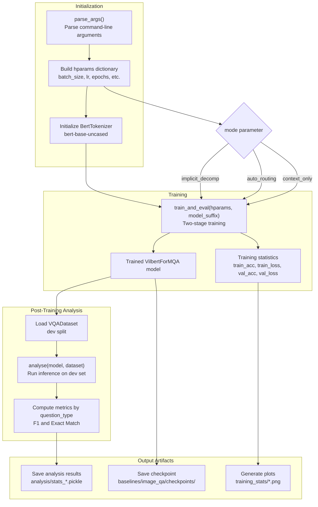
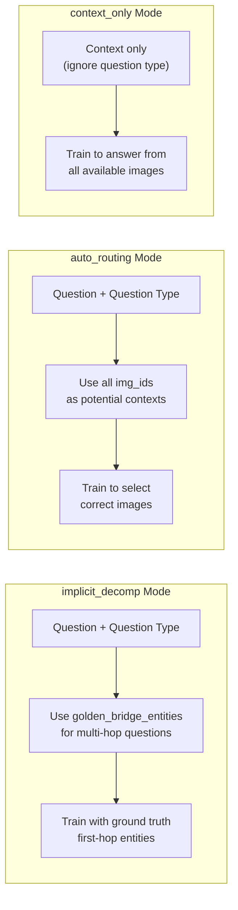
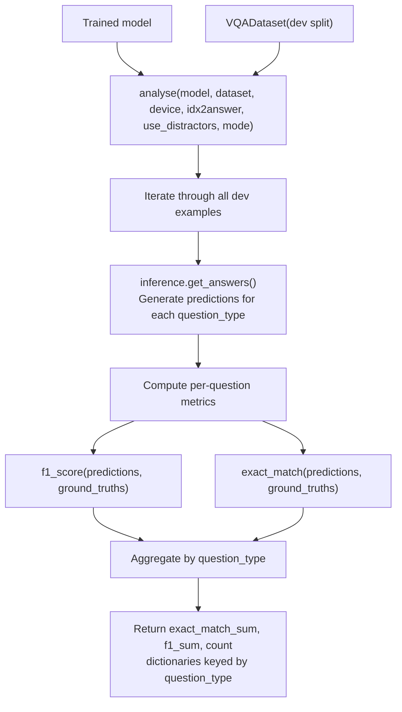
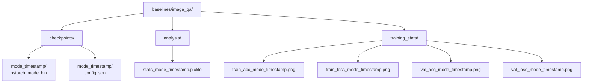

<!-- source: DeepWiki mcp.deepwiki.com · repo allenai/multimodalqa · page 7.1 Training Image QA Models · fetched 2026-10-26 -->

# Training Image QA Models

<details>
<summary>Relevant source files</summary>

The following files were used as context for generating this wiki page:

- [baselines/image_qa/README.md](baselines/image_qa/README.md)
- [baselines/image_qa/main.py](baselines/image_qa/main.py)

</details>


## Purpose and Scope

This page provides a step-by-step guide to training image QA models using the [`baselines/image_qa/main.py`](baselines/image_qa/main.py:1-278) script. It covers hyperparameter configuration, training modes, execution workflow, and post-training analysis.

For detailed information about the image QA model architecture and two-stage training process, see [Image QA Training](#5.1.3). For dataset preparation and feature extraction details, see [Image QA Dataset Preparation](#5.1.1). For running inference with trained models, see [Image QA Inference](#5.1.4).

---

## Prerequisites

Before training, ensure you have completed the environment setup described in [Installation and Environment Setup](#2.1). The key requirements are:

- Conda environment `multimodalqa_image` activated
- VilBERT dependencies installed at `deps/vilbert-multi-task`
- APEX and MaskRCNN libraries configured
- Dataset downloaded to the data directory

**Sources:** [baselines/image_qa/README.md:1-23]()

---

## Training Workflow Overview

The training process orchestrated by `main.py` follows this pipeline:



**Sources:** [baselines/image_qa/main.py:193-278]()

---

## Command-Line Arguments

The `main.py` script accepts the following command-line arguments:

### Training Hyperparameters

| Argument | Type | Default | Description |
|----------|------|---------|-------------|
| `--batch_size` | int | 12 | Batch size for training |
| `--device` | str | `cuda:0` | Device to use for training |
| `--dropout_prob` | float | 0.01 | Dropout rate in model |
| `--frozen_epochs` | int | 25 | Number of epochs with frozen VilBERT backbone |
| `--frozen_lr` | float | 2e-5 | Learning rate for frozen stage |
| `--frozen_lr_step_size` | float | 15 | LR scheduler step size for frozen stage |
| `--unfrozen_epochs` | int | 50 | Number of epochs with unfrozen model |
| `--unfrozen_lr` | float | 2e-6 | Learning rate for unfrozen stage |
| `--unfrozen_lr_step_size` | float | 25 | LR scheduler step size for unfrozen stage |
| `--sample_distractor_prob` | float | 0.3 | Probability of sampling distractor images |

### Model Configuration

| Argument | Type | Default | Description |
|----------|------|---------|-------------|
| `--mask_vis` | bool | False | Mask visual information (ablation study) |
| `--mask_lang` | bool | False | Mask language in context (ablation study) |

### Training Mode

| Argument | Type | Default | Description |
|----------|------|---------|-------------|
| `--mode` | str | `implicit_decomp` | Training mode: `implicit_decomp`, `auto_routing`, or `context_only` |
| `--data_dir` | str | `../../dataset` | Directory containing MMQA dataset |

**Sources:** [baselines/image_qa/main.py:102-190]()

---

## Training Modes

The `--mode` parameter determines how the model processes multi-hop questions and which context it uses:



### Mode Descriptions

- **`implicit_decomp`** (default): For multi-hop questions, uses only the ground truth bridge entities (`golden_bridge_entities`) from the first hop. This trains the model to answer the second hop given the correct intermediate entities. [baselines/image_qa/main.py:179]()

- **`auto_routing`**: Uses all available image IDs (`img_ids`) as potential contexts, allowing the model to learn which images are relevant. More challenging but tests end-to-end reasoning. [baselines/image_qa/main.py:61-63]()

- **`context_only`**: Ignores question-type-specific routing and provides all available images as context. Serves as a baseline to test the model's ability to identify relevant images without explicit guidance. [baselines/image_qa/main.py:179]()

**Sources:** [baselines/image_qa/main.py:177-181](), [baselines/image_qa/main.py:57-67]()

---

## Executing Training

### Basic Command

```bash
python baselines/image_qa/main.py
```

This runs training with default hyperparameters in `implicit_decomp` mode.

### Custom Configuration Example

```bash
python baselines/image_qa/main.py \
    --mode auto_routing \
    --batch_size 16 \
    --device cuda:1 \
    --frozen_epochs 30 \
    --frozen_lr 3e-5 \
    --unfrozen_epochs 60 \
    --unfrozen_lr 1e-6 \
    --sample_distractor_prob 0.4
```

### Training Process

The script executes the following sequence:

1. **Parse Arguments and Build Hyperparameters** [baselines/image_qa/main.py:193-212]()
   - Converts command-line arguments to `hparams` dictionary
   - Prints configuration for verification

2. **Initialize Directories** [baselines/image_qa/main.py:214-219]()
   - Creates `analysis/` directory for statistics
   - Creates `training_stats/` directory for plots

3. **Initialize Tokenizer** [baselines/image_qa/main.py:221-222]()
   - Loads `BertTokenizer` from `bert-base-uncased`
   - Configures padding token

4. **Generate Model Suffix** [baselines/image_qa/main.py:224-231]()
   - Creates timestamp: `mode + '_' + datetime`
   - Used for checkpoint and output file naming

5. **Execute Two-Stage Training** [baselines/image_qa/main.py:233]()
   - Calls `train_and_eval(hparams, model_suffix)`
   - Returns trained model, training statistics, and other artifacts

6. **Post-Training Analysis** [baselines/image_qa/main.py:235-273]()
   - Evaluates model on dev set (detailed below)

**Sources:** [baselines/image_qa/main.py:193-278]()

---

## Post-Training Analysis

After training completes, `main.py` automatically performs comprehensive analysis on the dev set:

### Analysis Workflow



### Analysis Function

The `analyse()` function [baselines/image_qa/main.py:48-99]() performs evaluation:

- **Inputs:**
  - `model`: Trained VilBERT model
  - `dataset`: `VQADataset` instance (dev split)
  - `device`: CUDA device for inference
  - `idx2answer`: Mapping from answer indices to answer strings
  - `use_distractors`: Whether to include distractor images
  - `mode`: One of `implicit_decomp`, `auto_routing`, or `context_only`

- **Process:**
  1. Sets model to eval mode
  2. Iterates through all dev examples [baselines/image_qa/main.py:56]()
  3. Determines bridge entities based on mode and question type [baselines/image_qa/main.py:57-66]()
  4. Calls `inference.get_answers()` to generate predictions [baselines/image_qa/main.py:68-78]()
  5. Computes F1 and Exact Match scores [baselines/image_qa/main.py:79-80]()
  6. Aggregates metrics by `question_type` [baselines/image_qa/main.py:95-97]()
  7. Prints random examples for inspection [baselines/image_qa/main.py:82-92]()

### Metrics Computed

Two metrics are calculated per question:

**F1 Score** [baselines/image_qa/main.py:26-41]()
```python
def f1_score(predictions, ground_truths):
    recall_vec = [1.0 if gt in predictions else 0.0 for gt in ground_truths]
    recall = np.average(recall_vec)
    precision_vec = [1.0 if pred in ground_truths else 0.0 for pred in predictions]
    precision = np.average(precision_vec)
    list_f1 = (2 * precision * recall) / (precision + recall)
    return list_f1
```

**Exact Match** [baselines/image_qa/main.py:43-45]()
```python
def exact_match(predictions, ground_truths):
    match = (sorted(predictions) == sorted(ground_truths))
    return match
```

### Analysis Variants

The script runs analysis twice with different distractor settings [baselines/image_qa/main.py:248-251]():

1. **`with_distractors`**: Includes all available images, testing robustness to irrelevant context
2. **`no_distractors`**: Uses only relevant images, measuring model capability when context is clean

### Output Display

Results are printed by question type [baselines/image_qa/main.py:252-273]():

```
Stats breakdown: (with_distractors)
  TextQ: F1=85.23, EM=79.45 (1234 occurrences)
  ImageQ: F1=72.14, EM=68.90 (2341 occurrences)
  Compose_Image_Text: F1=45.67, EM=42.11 (567 occurrences)
  ...
  TOTAL: F1=67.82, EM=65.34 (15432 occurrences)
```

**Sources:** [baselines/image_qa/main.py:48-99](), [baselines/image_qa/main.py:248-273]()

---

## Output Artifacts

Training generates multiple output files organized in the `baselines/image_qa/` directory:

### Directory Structure



### File Descriptions

| Artifact | Location | Description |
|----------|----------|-------------|
| Model Checkpoint | `checkpoints/{mode}_{timestamp}/` | Trained VilBERT model weights and configuration |
| Training Statistics | `training_stats/*.png` | Plots of training/validation accuracy and loss over epochs |
| Analysis Results | `analysis/stats_{mode}_{timestamp}.pickle` | Pickled dictionary containing F1/EM scores by question type and training statistics |

### Training Statistics Plots

The script generates four plots [baselines/image_qa/main.py:239-244]():

- `train_acc_{suffix}.png`: Training accuracy per epoch
- `train_loss_{suffix}.png`: Training loss per epoch  
- `val_acc_{suffix}.png`: Validation accuracy per epoch
- `val_loss_{suffix}.png`: Validation loss per epoch

These plots use the `training_stats` dictionary returned by `train_and_eval()`, which tracks:
- `epoch`: List of epoch numbers
- `train_acc`: Training accuracy values
- `train_loss`: Training loss values
- `val_acc`: Validation accuracy values
- `val_loss`: Validation loss values

### Analysis Pickle File

The pickle file [baselines/image_qa/main.py:275-277]() contains:

```python
{
    'with_distractors': (exact_match_sums, f1_sums, counts),
    'no_distractors': (exact_match_sums, f1_sums, counts),
    'training_statistics': training_stats
}
```

Where each tuple contains dictionaries keyed by `question_type`.

**Sources:** [baselines/image_qa/main.py:233](), [baselines/image_qa/main.py:239-244](), [baselines/image_qa/main.py:275-277]()

---

## Best Practices and Recommendations

### Hyperparameter Selection

Based on the default values in the codebase:

**Frozen Stage (Training QA heads only):**
- Epochs: 25
- Learning rate: 2e-5
- Purpose: Warm up the task-specific heads without disrupting pre-trained VilBERT weights

**Unfrozen Stage (End-to-end fine-tuning):**
- Epochs: 50
- Learning rate: 2e-6 (10x lower than frozen stage)
- Purpose: Fine-tune the entire model for the MMQA task

**Other Settings:**
- Batch size: 12 (balance between memory and training speed)
- Dropout: 0.01 (minimal dropout due to already regularized pre-training)
- Distractor sampling: 0.3 (30% of training uses distractor images)

**Sources:** [baselines/image_qa/main.py:102-190]()

### Training Mode Selection

Choose the mode based on your evaluation goals:

| Mode | Use Case | Difficulty | Expected Performance |
|------|----------|------------|---------------------|
| `implicit_decomp` | Evaluate with oracle bridge entities | Medium | Best F1/EM scores |
| `auto_routing` | Test end-to-end reasoning | Hard | Lower F1/EM scores |
| `context_only` | Baseline without question-type routing | Easiest | Lowest F1/EM scores |

### Computational Resources

- **GPU Memory**: Minimum 12GB recommended (batch_size=12 with VilBERT)
- **Training Time**: Approximately 8-12 hours for full two-stage training (75 total epochs)
- **Disk Space**: ~5GB for image features cache, ~500MB per checkpoint

### Monitoring Training

During training, monitor the validation accuracy plots to detect:
- **Overfitting**: Validation accuracy plateaus or decreases while training accuracy increases
- **Underfitting**: Both accuracies remain low
- **Optimal stopping**: Validation accuracy peaks then stabilizes

### Debugging Failed Training

If training fails or produces poor results:

1. **Check data loading**: Verify dataset files exist at `--data_dir`
2. **Verify image features**: Ensure image features are cached (see [Image QA Dataset Preparation](#5.1.1))
3. **Check dependencies**: Confirm VilBERT and APEX are properly installed
4. **Reduce batch size**: Lower `--batch_size` if encountering OOM errors
5. **Inspect examples**: Review the randomly printed examples during analysis [baselines/image_qa/main.py:82-92]()

**Sources:** [baselines/image_qa/main.py:1-278](), [baselines/image_qa/README.md:1-23]()

---

## Related Documentation

- [Image QA Model](#5.1) - Overview of the VilBERT-based architecture
- [Image QA Dataset Preparation](#5.1.1) - Feature extraction and caching
- [Image QA Model Architecture](#5.1.2) - VilbertForMQA model details
- [Image QA Training](#5.1.3) - Two-stage training process internals
- [Image QA Inference](#5.1.4) - Using trained models for prediction
- [Training Text and Table QA Models](#7.2) - Training other modality models

---

