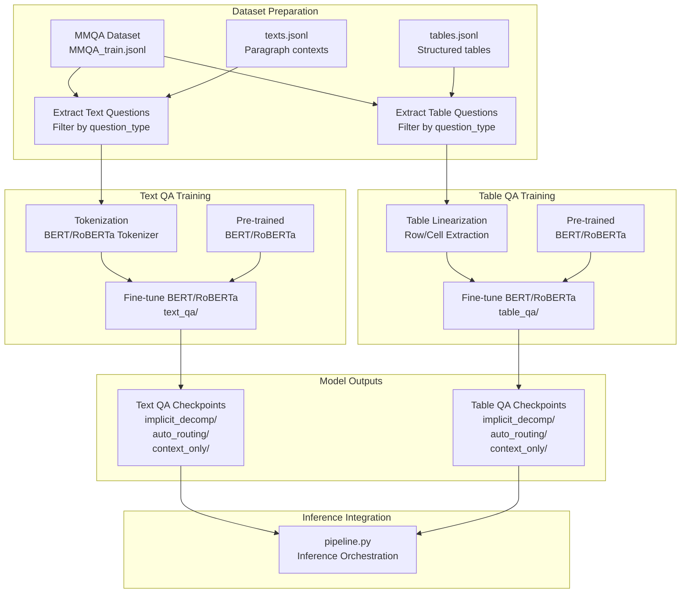
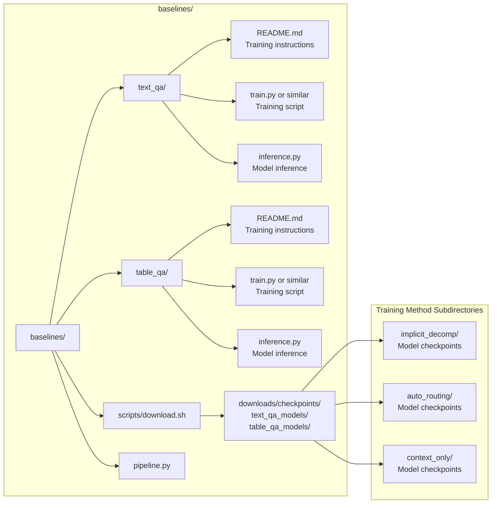
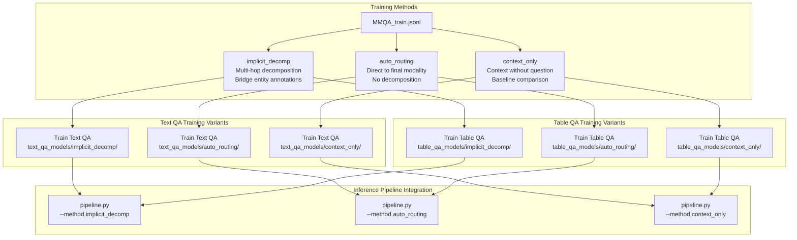
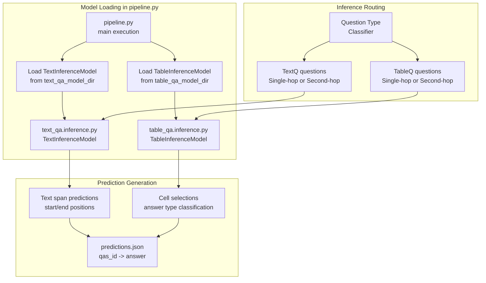

<!-- source: DeepWiki mcp.deepwiki.com · repo allenai/multimodalqa · page 7.2 Training Text and Table QA Models · fetched 2026-10-26 -->

# Training Text and Table QA Models

<details>
<summary>Relevant source files</summary>

The following files were used as context for generating this wiki page:

- [baselines/README.md](baselines/README.md)

</details>


## Purpose and Scope

This page documents the training procedures for the Text QA and Table QA models used in the MultiModalQA baseline system. These models are based on BERT/RoBERTa architectures and are trained separately from the Image QA model. 

For information about the Image QA training process (which is significantly more complex and involves two-stage training with VilBERT), see [Training Image QA Models](#7.1). For details on model inference and architecture, see [Table QA Model](#5.2) and [Text QA Model](#5.3).

**Sources:** [baselines/README.md:50-52]()

---

## Overview

The Text QA and Table QA models follow a simpler training paradigm compared to the Image QA model. Both utilize transformer-based architectures (BERT or RoBERTa) fine-tuned on modality-specific data extracted from the MultiModalQA dataset. The training is performed separately for each modality, with dedicated training scripts and configuration files located in their respective directories.

Unlike the Image QA model which requires:
- Complex feature extraction pipelines (Detectron, VilBERT)
- Two-stage training (frozen then unfrozen)
- Specialized CUDA libraries (APEX)

The Text and Table QA models follow standard transformer fine-tuning procedures:
- Direct training on tokenized input
- Single-stage fine-tuning
- Standard PyTorch dependencies

**Sources:** [baselines/README.md:50-52]()

---

## Training Architecture Overview

The following diagram illustrates how Text and Table QA models are trained separately and integrated into the three baseline inference methods:

**Diagram: Text and Table QA Training Pipeline**



**Sources:** [baselines/README.md:1-52]()

---

## Directory Structure and Key Files

The Text QA and Table QA training code is organized in separate directories, each containing their own README, training scripts, and inference modules:

**Diagram: Training Code Organization**



**Sources:** [baselines/README.md:23-34](), [baselines/README.md:50-52]()

---

## Text QA Model Training

### Training Data Preparation

The Text QA model is trained on questions that require reasoning over text paragraphs. The training process involves:

1. **Question Filtering**: Extract questions with text-related types from `MMQA_train.jsonl`
   - Single-hop: `TextQ`
   - Multi-hop: Questions with text as first or second hop modality

2. **Context Retrieval**: Load relevant text paragraphs from `texts.jsonl` based on `qid` references

3. **Tokenization**: Apply BERT/RoBERTa tokenizer to question-context pairs

4. **Training Method Preparation**: Prepare different datasets for the three training methods:
   - **implicit_decomp**: Multi-hop questions with bridge entity annotations
   - **auto_routing**: Questions routed based on final answer modality
   - **context_only**: Questions without using question text

### Model Architecture

The Text QA model utilizes a standard BERT or RoBERTa architecture fine-tuned for span extraction:

| Component | Configuration |
|-----------|---------------|
| Base Model | BERT-base or RoBERTa-base |
| Input Format | `[CLS] question [SEP] context [SEP]` |
| Output Layer | Span prediction (start/end logits) |
| Loss Function | Cross-entropy over span positions |
| Max Sequence Length | 512 tokens |

### Training Configuration

The text_qa/ directory contains detailed training instructions. Key configuration parameters include:

| Parameter | Typical Value |
|-----------|---------------|
| Learning Rate | 3e-5 to 5e-5 |
| Batch Size | 16-32 |
| Epochs | 3-5 |
| Warmup Steps | 10% of total steps |
| Max Gradient Norm | 1.0 |

### Training Command Structure

Training scripts in the `text_qa/` directory follow this general pattern:

```bash
python text_qa/train.py \
  --model_name_or_path bert-base-uncased \
  --train_file downloads/MMQA/MMQA_train.jsonl \
  --texts_file downloads/MMQA/texts.jsonl \
  --output_dir checkpoints/text_qa_models/implicit_decomp/ \
  --method implicit_decomp \
  --do_lower_case \
  --num_train_epochs 3 \
  --learning_rate 3e-5
```

**Sources:** [baselines/README.md:23-34](), [baselines/README.md:50-52]()

---

## Table QA Model Training

### Training Data Preparation

The Table QA model is trained on questions requiring reasoning over structured tables. The preparation process includes:

1. **Question Filtering**: Extract questions with table-related types from `MMQA_train.jsonl`
   - Single-hop: `TableQ`
   - Multi-hop: Questions with table as first or second hop modality

2. **Table Retrieval**: Load relevant tables from `tables.jsonl` based on `qid` references

3. **Table Linearization**: Convert structured tables to linear sequences
   - Row-wise concatenation: `row1_cell1 | row1_cell2 | ... | row2_cell1 | ...`
   - Column headers included as context
   - Special tokens for structural information

4. **Training Method Preparation**: Similar to Text QA, prepare datasets for:
   - **implicit_decomp**: Multi-hop table reasoning with bridge entities
   - **auto_routing**: Direct table reasoning
   - **context_only**: Table context without question

### Model Architecture

The Table QA model adapts BERT/RoBERTa for table reasoning with additional output layers:

| Component | Configuration |
|-----------|---------------|
| Base Model | BERT-base or RoBERTa-base |
| Input Format | `[CLS] question [SEP] linearized_table [SEP]` |
| Output Layers | Cell selection logits + answer type classifier |
| Answer Types | Span, Count, Sum, Mean, Yes/No |
| Loss Function | Combined loss (span + cell + answer_type) |

### Cell Selection and Answer Types

The Table QA model predicts different answer types based on the question:

| Answer Type | Description | Example Output |
|-------------|-------------|----------------|
| Span | Extract text from selected cells | "New York" |
| Count | Count number of matching rows | "5" |
| Sum | Sum numeric values | "1250" |
| Mean | Average numeric values | "250.0" |
| Yes/No | Boolean answer | "yes" or "no" |

### Training Configuration

The table_qa/ directory provides detailed training documentation. Key parameters:

| Parameter | Typical Value |
|-----------|---------------|
| Learning Rate | 3e-5 to 5e-5 |
| Batch Size | 16-32 |
| Epochs | 3-5 |
| Cell Selection Weight | 1.0 |
| Answer Type Weight | 1.0 |
| Max Table Tokens | 512 tokens |

### Training Command Structure

Training scripts in the `table_qa/` directory follow this pattern:

```bash
python table_qa/train.py \
  --model_name_or_path bert-base-uncased \
  --train_file downloads/MMQA/MMQA_train.jsonl \
  --tables_file downloads/MMQA/tables.jsonl \
  --output_dir checkpoints/table_qa_models/implicit_decomp/ \
  --method implicit_decomp \
  --do_lower_case \
  --num_train_epochs 3 \
  --learning_rate 3e-5
```

**Sources:** [baselines/README.md:23-34](), [baselines/README.md:50-52]()

---

## Training Methods Comparison

Both Text and Table QA models must be trained separately for each of the three baseline methods:

**Diagram: Three Training Method Configurations**



### Method-Specific Training Differences

| Method | Training Data | Question Processing | Bridge Entity Handling |
|--------|---------------|---------------------|------------------------|
| **implicit_decomp** | Multi-hop questions with decomposition annotations | Use full question for first hop, bridge entity for second hop | Extract and use bridge entity as input |
| **auto_routing** | All questions routed to final modality | Use full question without decomposition | Not applicable |
| **context_only** | Questions ignored, context-only training | Context only, question masked | Not applicable |

**Sources:** [baselines/README.md:23-34](), [baselines/README.md:38-48]()

---

## Accessing Training Documentation

The complete training procedures, including detailed command-line arguments, hyperparameter tuning guidelines, and troubleshooting instructions, are documented in the respective README files:

### Text QA Training

Complete training instructions are available in `text_qa/README.md`. This README covers:
- Detailed command-line arguments
- Data preprocessing steps
- Model configuration options
- Training monitoring and checkpointing
- Evaluation on validation sets

### Table QA Training

Complete training instructions are available in `table_qa/README.md`. This README covers:
- Table linearization strategies
- Cell selection training
- Answer type classification
- Handling numeric operations (count, sum, mean)
- Special considerations for multi-hop table reasoning

**Sources:** [baselines/README.md:50-52]()

---

## Model Checkpoints and Outputs

### Checkpoint Organization

Both Text and Table QA models produce checkpoints organized by training method:

```
downloads/checkpoints/
├── text_qa_models/
│   ├── implicit_decomp/
│   │   ├── pytorch_model.bin
│   │   ├── config.json
│   │   └── vocab.txt
│   ├── auto_routing/
│   │   └── ...
│   └── context_only/
│       └── ...
└── table_qa_models/
    ├── implicit_decomp/
    │   ├── pytorch_model.bin
    │   ├── config.json
    │   └── vocab.txt
    ├── auto_routing/
    │   └── ...
    └── context_only/
        └── ...
```

### Checkpoint Contents

Each checkpoint directory contains:

| File | Purpose |
|------|---------|
| `pytorch_model.bin` | Trained model weights |
| `config.json` | Model configuration (hidden size, layers, etc.) |
| `vocab.txt` | Tokenizer vocabulary |
| `training_args.bin` | Saved training arguments |
| `trainer_state.json` | Training statistics and metrics |

### Loading Checkpoints for Inference

The trained models are loaded in `pipeline.py` using these checkpoint paths:

```bash
python pipeline.py \
  --text_qa_model_dir downloads/checkpoints/text_qa_models/implicit_decomp/ \
  --table_qa_model_dir downloads/checkpoints/table_qa_models/implicit_decomp/ \
  ...
```

**Sources:** [baselines/README.md:23-34]()

---

## Integration with Pipeline

The trained Text and Table QA models are integrated into the inference pipeline as follows:

**Diagram: Model Loading and Inference Flow**



**Sources:** [baselines/README.md:23-34]()

---

## Performance Benchmarks

The trained Text and Table QA models contribute to the overall system performance as measured on the dev set:

### Dev Set Results (F1 / EM)

| Method | Single-Modality | Multi-Modality | All |
|--------|----------------|----------------|-----|
| Context-only | 7.94 / 10.73 | 6.63 / 9.00 | 7.41 / 10.03 |
| AutoRouting | 51.68 / 58.48 | 34.18 / 40.18 | 44.65 / 51.13 |
| ImplicitDecomp | 51.60 / 58.35 | 44.59 / 51.19 | 48.79 / 55.48 |

### Performance Breakdown by Modality

The Text and Table QA models handle both single-hop questions (where the modality matches the question type) and second-hop questions (in multi-hop reasoning). The **ImplicitDecomp** method achieves the best multi-modality performance (44.59 F1) by effectively using bridge entities to connect reasoning across hops.

**Sources:** [baselines/README.md:42-48]()

---

## Summary

Training Text and Table QA models for MultiModalQA involves:

1. **Separate Training**: Models are trained independently in `text_qa/` and `table_qa/` directories
2. **Three Methods**: Each model is trained three times for implicit_decomp, auto_routing, and context_only
3. **Standard Fine-tuning**: Unlike Image QA, these models use simple BERT/RoBERTa fine-tuning
4. **Modality-Specific Data**: Text models train on paragraphs, Table models train on linearized tables
5. **Detailed Documentation**: Complete instructions are in respective README files

For implementation details on how these trained models are used during inference, see [Pipeline Implementation](#6.1). For evaluation of the trained models, see [Evaluation Metrics](#8.1).

**Sources:** [baselines/README.md:1-52]()

---

