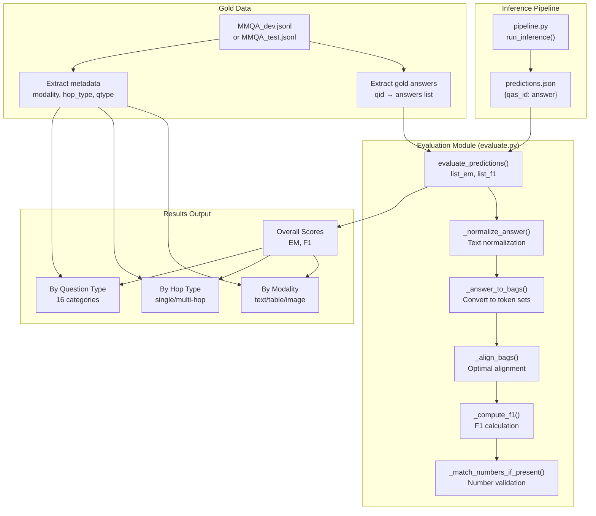
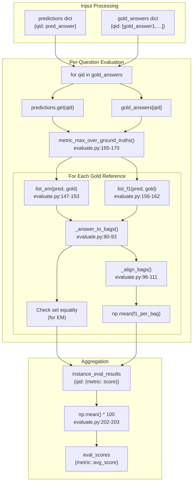
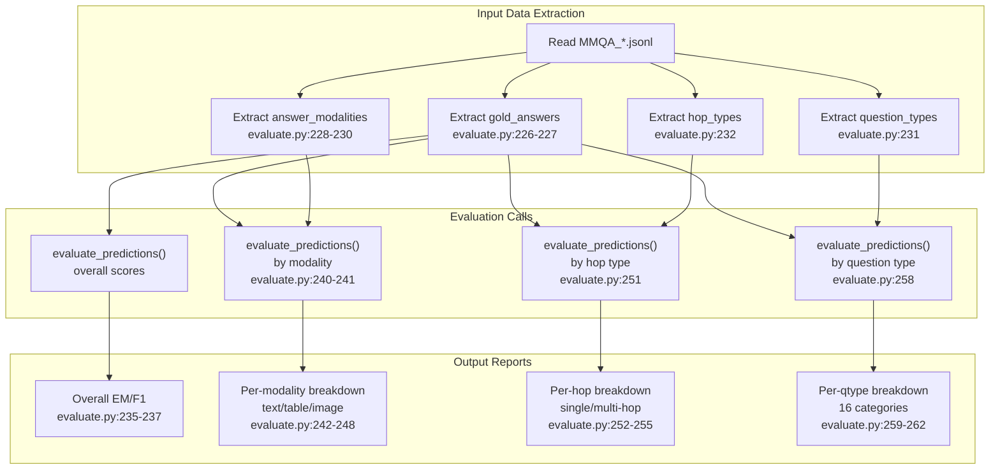

<!-- source: DeepWiki mcp.deepwiki.com · repo allenai/multimodalqa · page 8 Evaluation · fetched 2026-10-26 -->

# Evaluation

<details>
<summary>Relevant source files</summary>

The following files were used as context for generating this wiki page:

- [baselines/README.md](baselines/README.md)
- [baselines/evaluate.py](baselines/evaluate.py)

</details>


## Purpose and Scope

This page provides a comprehensive overview of the evaluation system used in the MultiModalQA framework. It covers the evaluation pipeline, metrics computation, answer normalization, and results analysis. The evaluation system compares model predictions against gold answers and produces detailed performance metrics broken down by modality, hop type, and question type.

For detailed information about specific evaluation metrics and their implementation, see [Evaluation Metrics](#8.1). For guidance on interpreting and analyzing evaluation results, see [Results Analysis](#8.2). For information about running the inference pipeline that produces predictions, see [Running Inference](#6).

## Evaluation Pipeline Overview

The evaluation system is implemented in [baselines/evaluate.py]() and can be invoked either as a standalone script or programmatically from the inference pipeline. The following diagram shows how evaluation integrates with the broader system:

**Diagram: Evaluation System Integration**



**Sources:** [baselines/evaluate.py:1-263](), [baselines/pipeline.py]()

## Core Evaluation Metrics

The MultiModalQA evaluation system uses two primary metrics, both adapted from the DROP dataset evaluation protocol:

| Metric | Function | Description | Use Case |
|--------|----------|-------------|----------|
| **Exact Match (EM)** | `list_em()` | Checks if predicted and gold answer sets are identical | Strict correctness |
| **F1 Score** | `list_f1()` | Token-level F1 with optimal alignment | Partial credit |

Both metrics support:
- **List-valued answers**: Answers can be lists of strings (e.g., multiple entities)
- **Multiple gold references**: Each question can have multiple valid answer sets
- **Normalized comparison**: All text is normalized before comparison

The system computes the maximum score across all gold references for each prediction using the `metric_max_over_ground_truths()` function at [baselines/evaluate.py:165-170]().

For detailed information about metric computation, normalization procedures, and alignment algorithms, see [Evaluation Metrics](#8.1).

**Sources:** [baselines/evaluate.py:147-163](), [baselines/evaluate.py:165-170]()

## Evaluation Workflow

The following diagram shows the detailed workflow of how predictions are evaluated:

**Diagram: Evaluation Workflow with Code Functions**



**Sources:** [baselines/evaluate.py:173-213]()

## Answer Normalization Pipeline

Before computing metrics, all answers undergo normalization to ensure fair comparison. The normalization pipeline consists of the following steps:

**Diagram: Answer Normalization Pipeline**

```mermaid
graph LR
    INPUT["Raw answer string"]
    
    TOKENIZE["_tokenize()<br/>Split on space and hyphen<br/>evaluate.py:38-39"]
    
    subgraph "Per-Token Processing"
        LOWER["_lower()<br/>Lowercase<br/>evaluate.py:34-35"]
        REMOVE_PUNC["_remove_punc()<br/>Strip punctuation<br/>evaluate.py:27-31"]
        NORM_NUM["_normalize_number()<br/>Convert to float<br/>evaluate.py:70-77"]
        REMOVE_ART["_remove_articles()<br/>Remove a/an/the<br/>evaluate.py:15-17"]
        WHITESPACE["_white_space_fix()<br/>Normalize spaces<br/>evaluate.py:20-21"]
    end
    
    JOIN["Join tokens with spaces<br/>evaluate.py:50"]
    OUTPUT["Normalized answer"]
    
    INPUT --> TOKENIZE
    TOKENIZE --> LOWER
    LOWER --> REMOVE_PUNC
    REMOVE_PUNC --> NORM_NUM
    NORM_NUM --> REMOVE_ART
    REMOVE_ART --> WHITESPACE
    WHITESPACE --> JOIN
    JOIN --> OUTPUT
```



Key normalization behaviors:
- **Numbers**: Converted to float strings (e.g., "5" → "5.0")
- **Word numbers**: Converted to numeric form (e.g., "five" → "5.0")
- **Articles**: "a", "an", "the" are removed
- **Punctuation**: Removed from non-numeric tokens
- **Case**: All text lowercased

The complete normalization function is `_normalize_answer()` at [baselines/evaluate.py:42-51](). For more details on answer normalization, see [Answer Normalization](#9.2).

**Sources:** [baselines/evaluate.py:15-77]()

## Multi-Reference and Multi-Answer Evaluation

The evaluation system handles two types of multiple answers:

### List-Valued Answers

A single answer can be a list of strings (e.g., ["Paris", "London", "Berlin"]). The system:

1. Converts each answer to a list of normalized token sets via `_answer_to_bags()` at [baselines/evaluate.py:80-93]()
2. Uses the Hungarian algorithm (`linear_sum_assignment`) to find optimal alignment at [baselines/evaluate.py:106]()
3. Computes per-bag F1 scores and averages them

### Multiple Gold References

Each question can have multiple valid gold answer sets. The system:

1. Evaluates the prediction against each gold reference
2. Takes the maximum score across all references via `metric_max_over_ground_truths()` at [baselines/evaluate.py:165-170]()

This is particularly important for questions with multiple valid formulations.

**Sources:** [baselines/evaluate.py:80-111](), [baselines/evaluate.py:165-170]()

## Results Categorization

The `evaluate_prediction_file()` function at [baselines/evaluate.py:216-263]() produces results broken down by multiple dimensions:

**Diagram: Results Categorization Structure**



**Sources:** [baselines/evaluate.py:216-263]()

### Result Categories

| Category | Source | Examples | Purpose |
|----------|--------|----------|---------|
| **Overall** | All examples | Single aggregate score | Top-level performance |
| **By Modality** | `answer_modalities` dict | text, table, image | Modality-specific performance |
| **By Hop Type** | Derived from question type | Single-hop, Multi-hop | Reasoning complexity |
| **By Question Type** | `metadata.type` | TextQ, ComposeText→Table, etc. | Fine-grained analysis |

The hop type is derived from the question type using the `MULTI_HOP_QUESTION_TYPES` constant from `common_utils.py`, as shown at [baselines/evaluate.py:232]().

For detailed guidance on interpreting these results, see [Results Analysis](#8.2).

**Sources:** [baselines/evaluate.py:239-262]()

## Baseline Performance Results

The repository includes baseline results for three inference methods on the development set. These can be reproduced using `run_pipeline.sh` at [baselines/scripts/run_pipeline.sh]().

**Table: Development Set Performance (F1 / EM)**

| Method | Single-Modality | Multi-Modality | All |
|--------|-----------------|----------------|-----|
| **Context-only** | 7.94 / 10.73 | 6.63 / 9.00 | 7.41 / 10.03 |
| **AutoRouting** | 51.68 / 58.48 | 34.18 / 40.18 | 44.65 / 51.13 |
| **ImplicitDecomp** | 51.60 / 58.35 | 44.59 / 51.19 | 48.79 / 55.48 |

Key observations:
- **ImplicitDecomp** achieves the best overall performance (48.79 F1), particularly on multi-modality questions
- **AutoRouting** performs comparably on single-modality but degrades on multi-hop reasoning
- **Context-only** serves as a lower-bound baseline, demonstrating the necessity of question understanding

These results are documented at [baselines/README.md:42-48]().

**Sources:** [baselines/README.md:42-48]()

## Running Evaluation

### Standalone Evaluation

To evaluate a prediction file against gold answers:

```bash
python evaluate.py \
  --prediction_path predictions.json \
  --gold_path downloads/MMQA/MMQA_dev.jsonl
```

This invokes the `evaluate_prediction_file()` function at [baselines/evaluate.py:216-263]() and prints:
- Overall EM and F1 scores
- Breakdown by modality with example counts
- Breakdown by hop type
- Breakdown by question type

### Integrated with Inference Pipeline

The inference pipeline at [baselines/pipeline.py]() calls `evaluate_predictions()` directly when not in `--predict_only` mode. This enables end-to-end evaluation during inference runs.

### Parallel Evaluation

For comprehensive baseline evaluation, use:

```bash
./scripts/run_pipeline.sh
```

This script runs evaluation for all three methods (implicit_decomp, auto_routing, context_only) in parallel across multiple GPUs, as documented at [baselines/README.md:38-48]().

**Sources:** [baselines/evaluate.py:266-281](), [baselines/README.md:19-48]()

## Implementation Details

### Key Functions

| Function | Location | Purpose |
|----------|----------|---------|
| `evaluate_prediction_file()` | [evaluate.py:216-263]() | Main entry point for file-based evaluation |
| `evaluate_predictions()` | [evaluate.py:173-213]() | Core evaluation logic with categorization |
| `metric_max_over_ground_truths()` | [evaluate.py:165-170]() | Multi-reference scoring |
| `list_em()` | [evaluate.py:147-153]() | Exact match metric |
| `list_f1()` | [evaluate.py:156-162]() | F1 score metric |
| `_align_bags()` | [evaluate.py:96-111]() | Optimal alignment using Hungarian algorithm |
| `_compute_f1()` | [evaluate.py:114-129]() | Token-level F1 computation |
| `_normalize_answer()` | [evaluate.py:42-51]() | Answer normalization pipeline |

### External Dependencies

The evaluation system uses:
- `scipy.optimize.linear_sum_assignment` for optimal bag alignment at [baselines/evaluate.py:8]() and [baselines/evaluate.py:106]()
- `word2number.w2n.word_to_num` for word number conversion at [baselines/evaluate.py:9]() and [baselines/evaluate.py:74]()
- NumPy for score aggregation at [baselines/evaluate.py:6]()

**Sources:** [baselines/evaluate.py:1-11](), [baselines/evaluate.py:96-129]()

## Error Handling

The evaluation system handles missing predictions gracefully:

```python
if qas_id not in predictions:
    print(f"Missing prediction for question {qas_id}, ...")
    instance_eval_results[qas_id] = {
        metric: 0.0 for metric in eval_funcs.keys()
    }
```

This occurs at [baselines/evaluate.py:184-188]() and ensures that evaluation continues even when predictions are incomplete, with missing predictions receiving a score of 0.0 for all metrics.

**Sources:** [baselines/evaluate.py:182-188]()

---

