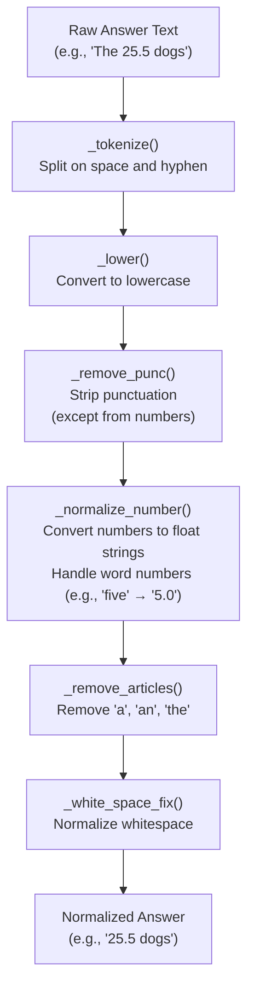
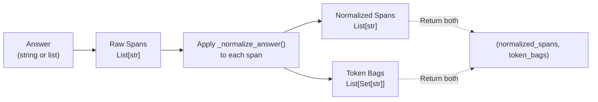
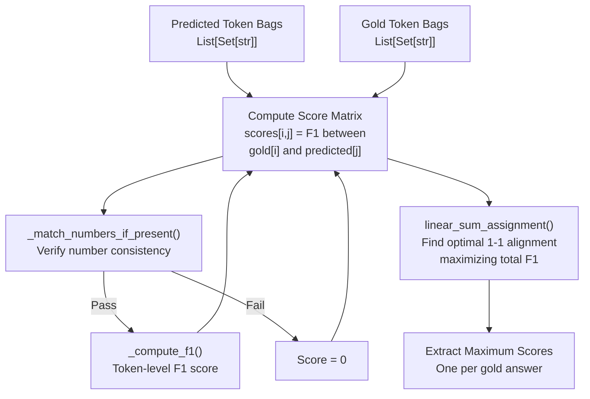
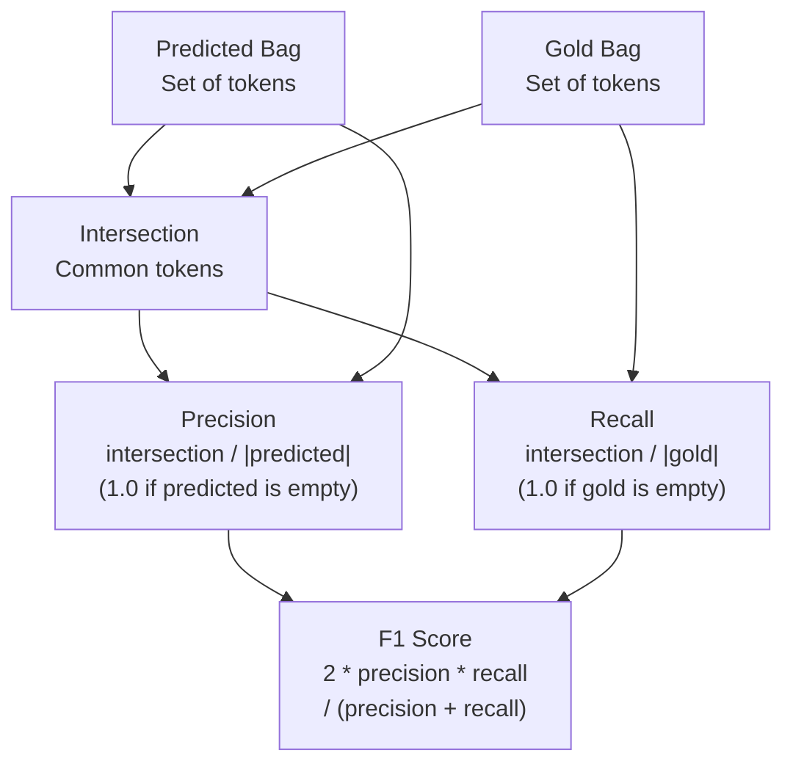
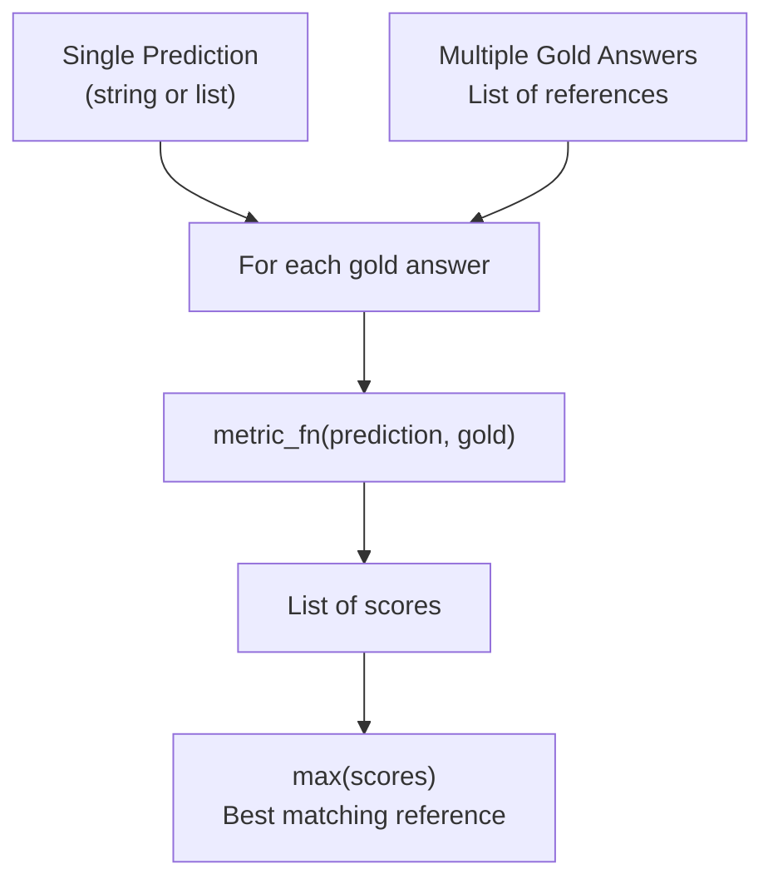
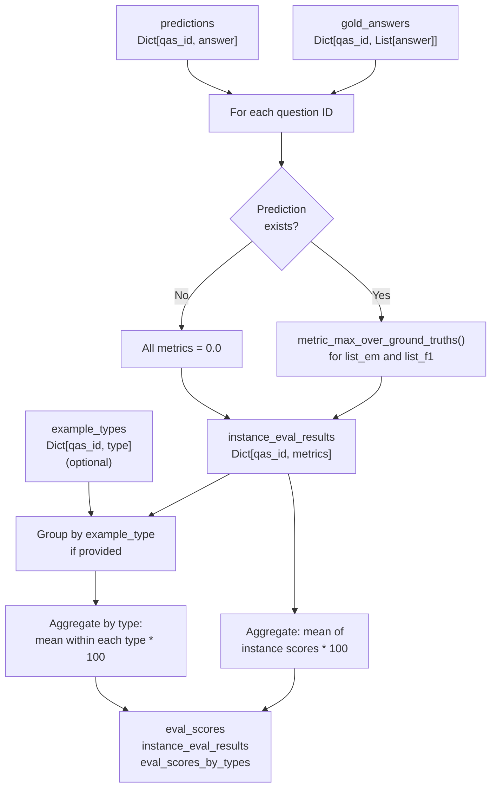

<!-- source: DeepWiki mcp.deepwiki.com · repo allenai/multimodalqa · page 8.1 Evaluation Metrics · fetched 2026-10-26 -->

# Evaluation Metrics

<details>
<summary>Relevant source files</summary>

The following files were used as context for generating this wiki page:

- [baselines/evaluate.py](baselines/evaluate.py)

</details>


This page documents the evaluation metrics used to assess model performance in the MultiModalQA system. The evaluation framework provides two primary metrics: **List Exact Match (list_em)** and **List F1 Score (list_f1)**. These metrics handle list-valued answers (where answers can be single items or lists of items), perform text normalization, and support multiple reference answers. The implementation is based on the DROP dataset evaluation code with extensions for MultiModalQA's specific requirements.

For information about running evaluations and interpreting results across different question types and modalities, see [Results Analysis](#8.2).

---

## Overview of Evaluation Metrics

The MultiModalQA evaluation system implements two complementary metrics defined in [baselines/evaluate.py:147-162]():

| Metric | Function | Description | Characteristics |
|--------|----------|-------------|-----------------|
| **List Exact Match** | `list_em()` | Binary metric (0 or 1) indicating whether predicted and gold answers are identical after normalization | Strict; requires both set equality and count equality |
| **List F1 Score** | `list_f1()` | Token-level F1 score averaged over optimally aligned answer pairs | Soft; provides partial credit for overlapping tokens |

Both metrics operate on normalized answers and support list-valued answers through an optimal alignment algorithm. The evaluation system also computes these metrics across multiple dimensions:
- Overall performance
- By answer modality (text, table, image)
- By hop type (single-hop vs. multi-hop)
- By question type (16 fine-grained categories)

**Sources:** [baselines/evaluate.py:147-162](), [baselines/evaluate.py:173-213]()

---

## Answer Normalization Pipeline

Before computing metrics, all answers undergo a multi-stage normalization process implemented in [baselines/evaluate.py:15-77](). This ensures robust comparison by handling variations in formatting, capitalization, and punctuation.

### Normalization Flow Diagram



**Sources:** [baselines/evaluate.py:42-51](), [baselines/evaluate.py:15-77]()

### Normalization Components

#### Tokenization
[baselines/evaluate.py:38-39]() splits text on spaces and hyphens:
```python
def _tokenize(text: str) -> List[str]:
    return re.split(" |-", text)
```

#### Text Transformations
The pipeline applies these transformations to each token:

1. **Lowercasing** [baselines/evaluate.py:34-35](): Converts all text to lowercase
2. **Punctuation Removal** [baselines/evaluate.py:27-31](): Removes all punctuation except from numeric values
3. **Article Removal** [baselines/evaluate.py:15-17](): Strips articles "a", "an", "the" using regex
4. **Whitespace Normalization** [baselines/evaluate.py:20-21](): Collapses multiple spaces to single spaces

#### Number Normalization
The system includes sophisticated number handling [baselines/evaluate.py:54-77]():

- **Numeric literals**: Converted to float strings (e.g., "25.5" → "25.5")
- **Word numbers**: Converted using `word2number` library (e.g., "twenty-five" → "25.0")
- **Number detection**: Uses `_is_number()` and `_is_word_number()` to identify numeric values

This normalization is crucial for matching answers like "5", "five", and "5.0" as equivalent.

**Sources:** [baselines/evaluate.py:15-77]()

---

## List-Valued Answer Evaluation

MultiModalQA supports list-valued answers where a single question may have multiple answer components (e.g., "What colors appear in the image?" → ["red", "blue", "green"]). The evaluation system converts answers to bag-of-tokens representations and performs optimal alignment.

### Answer-to-Bags Conversion

The `_answer_to_bags()` function [baselines/evaluate.py:80-93]() transforms answers into two representations:



**Example:**
- Input: `["New York City", "Los Angeles"]`
- Normalized spans: `["new york city", "los angeles"]`
- Token bags: `[{"new", "york", "city"}, {"los", "angeles"}]`

**Sources:** [baselines/evaluate.py:80-93]()

---

## Optimal Bag Alignment Algorithm

For list-valued answers, the system must determine which predicted answers correspond to which gold answers. This is solved using the Hungarian algorithm (maximum weighted bipartite matching) implemented in [baselines/evaluate.py:96-111]().

### Alignment Process Diagram



**Sources:** [baselines/evaluate.py:96-111](), [baselines/evaluate.py:132-143]()

### Number Consistency Checking

Before computing F1 scores, the system verifies number consistency [baselines/evaluate.py:132-143]():
- Extracts all numeric tokens from both predicted and gold bags
- If gold contains numbers, predicted must contain at least one matching number
- This prevents spurious matches between answers with different numeric values

**Sources:** [baselines/evaluate.py:132-143]()

---

## F1 Score Computation

The core F1 calculation operates on token bags using standard precision and recall formulas [baselines/evaluate.py:114-129]().

### F1 Formula Implementation



**Edge Cases:**
- Empty predicted bag: Precision = 1.0
- Empty gold bag: Recall = 1.0
- Both precision and recall are 0.0: F1 = 0.0

**Sources:** [baselines/evaluate.py:114-129]()

---

## List Exact Match Metric

The `list_em()` function [baselines/evaluate.py:147-153]() implements a strict binary metric:

```python
def list_em(predicted, gold):
    predicted_bags = _answer_to_bags(predicted)
    gold_bags = _answer_to_bags(gold)
    if set(predicted_bags[0]) == set(gold_bags[0]) and len(predicted_bags[0]) == len(gold_bags[0]):
        return 1.0
    else:
        return 0.0
```

**Requirements for a match:**
1. **Set equality**: All normalized answer strings must match exactly
2. **Count equality**: The number of answer components must match

This prevents partial credit and ensures the predicted answer is completely correct.

**Sources:** [baselines/evaluate.py:147-153]()

---

## List F1 Metric

The `list_f1()` function [baselines/evaluate.py:156-162]() computes token-level F1 with optimal alignment:

```python
def list_f1(predicted, gold):
    predicted_bags = _answer_to_bags(predicted)
    gold_bags = _answer_to_bags(gold)
    f1_per_bag = _align_bags(predicted_bags[1], gold_bags[1])
    f1 = np.mean(f1_per_bag)
    f1 = round(f1, 2)
    return f1
```

**Computation steps:**
1. Convert answers to token bags
2. Compute optimal alignment between predicted and gold bags
3. Average F1 scores across all aligned pairs
4. Round to 2 decimal places

**Sources:** [baselines/evaluate.py:156-162]()

---

## Multi-Reference Answer Handling

The evaluation system supports multiple reference answers per question through the `metric_max_over_ground_truths()` function [baselines/evaluate.py:165-170]().

### Multi-Reference Evaluation Flow



This ensures predictions are evaluated against the best matching reference, accommodating multiple valid phrasings of the same answer.

**Sources:** [baselines/evaluate.py:165-170]()

---

## Evaluation Aggregation and Reporting

The `evaluate_predictions()` function [baselines/evaluate.py:173-213]() orchestrates the complete evaluation process and supports aggregation by example types.

### Evaluation Pipeline



**Sources:** [baselines/evaluate.py:173-213]()

### File-Based Evaluation with Categorization

The `evaluate_prediction_file()` function [baselines/evaluate.py:216-263]() provides a command-line interface with detailed breakdowns:

**Input Files:**
- Prediction file: JSON mapping `{qas_id: predicted_answer}`
- Gold file: JSONL with question data including answers, metadata, and types

**Output Structure:**
1. **Overall metrics**: Average F1 and EM across all questions
2. **By modality**: Separate metrics for text, table, and image answer modalities
3. **By hop type**: Single-hop vs. Multi-hop performance
4. **By question type**: Performance on all 16 fine-grained question types

**Example Output Format:**
```
Overall result with different metrics: 
list_em: 55.48
list_f1: 48.79

Eval results for different modalities:
text
# of examples: 12456
list_em: 58.32
list_f1: 51.24

Type    Count   EM      F1
Single-hop      8234    62.45   54.89
Multi-hop       21684   51.23   45.67

Type                    Count   EM      F1
TextQ                   3456    65.23   57.89
ImageListQ              2134    48.92   42.15
...
```

**Sources:** [baselines/evaluate.py:216-263]()

---

## Metric Computation Details

### Score Calculation Summary

| Component | Implementation | Purpose |
|-----------|----------------|---------|
| Normalization | `_normalize_answer()` | Standardize text format |
| Bag conversion | `_answer_to_bags()` | Convert to token sets |
| Alignment | `_align_bags()` with `linear_sum_assignment()` | Optimal matching |
| F1 computation | `_compute_f1()` | Token overlap metric |
| Number matching | `_match_numbers_if_present()` | Verify numeric consistency |
| Multi-reference | `metric_max_over_ground_truths()` | Handle multiple valid answers |
| Aggregation | `evaluate_predictions()` | Compute averages and breakdowns |

**Sources:** [baselines/evaluate.py:1-263]()

---

## Usage Example

The evaluation script can be invoked from the command line [baselines/evaluate.py:266-281]():

```bash
python baselines/evaluate.py \
    --prediction_path predictions.json \
    --gold_path dataset/MMQA_dev.jsonl
```

**Arguments:**
- `--prediction_path`: Path to JSON file with model predictions (default: `predictions.json`)
- `--gold_path`: Path to JSONL file with gold answers (default: `dev.json`)

The script will:
1. Load predictions and gold answers
2. Extract metadata (modality, hop type, question type) from gold data
3. Compute metrics overall and by category
4. Print formatted results to console

**Sources:** [baselines/evaluate.py:266-281]()

---

## Implementation Notes

### Attribution
The normalization pipeline and core F1 computation logic (lines 12-144) are adapted from the DROP dataset evaluation code:
https://github.com/allenai/allennlp-reading-comprehension/blob/master/allennlp_rc/eval/drop_eval.py

**MultiModalQA Extensions:**
- Word-to-number conversion using `word2number` library [baselines/evaluate.py:62-75]()
- List-valued answer support with optimal alignment
- Multi-reference answer handling
- Categorical aggregation by modality, hop type, and question type

**Sources:** [baselines/evaluate.py:12-13]()

### Dependencies

The evaluation module requires:
- `numpy`: For numerical operations and averaging
- `scipy.optimize.linear_sum_assignment`: For Hungarian algorithm implementation
- `word2number`: For converting word numbers to numeric values
- Standard library: `json`, `re`, `string`, `argparse`, `collections.Counter`

**Sources:** [baselines/evaluate.py:1-10]()

---

