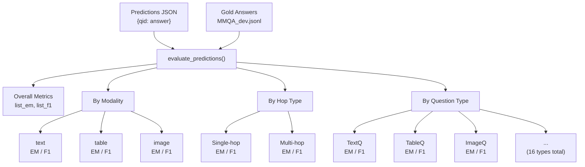
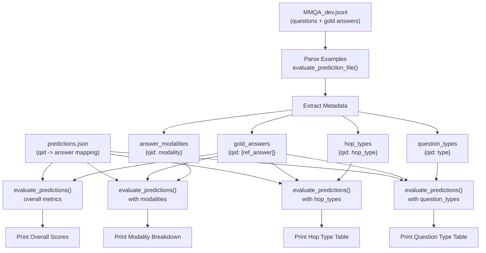
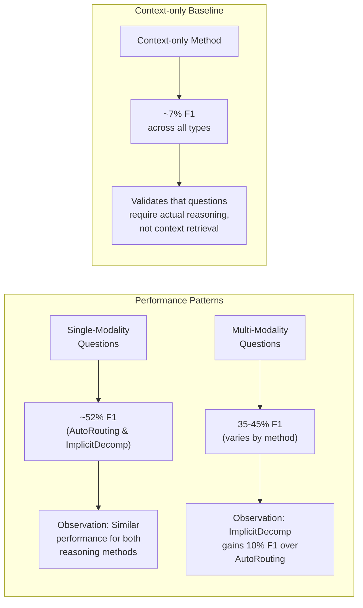

<!-- source: DeepWiki mcp.deepwiki.com · repo allenai/multimodalqa · page 8.2 Results Analysis · fetched 2026-10-26 -->

# Results Analysis

<details>
<summary>Relevant source files</summary>

The following files were used as context for generating this wiki page:

- [baselines/README.md](baselines/README.md)
- [baselines/evaluate.py](baselines/evaluate.py)

</details>


## Purpose and Scope

This document explains how evaluation results are analyzed and categorized in the MultiModalQA system. After predictions are generated and evaluated using the metrics described in [Evaluation Metrics](#8.1), the results are broken down across multiple dimensions to provide fine-grained performance insights. This includes analysis by answer modality (text, table, image), reasoning complexity (single-hop vs. multi-hop), and specific question types.

For information about the evaluation metrics themselves (F1 and Exact Match), see [Evaluation Metrics](#8.1). For details about running the evaluation pipeline, see [Pipeline Implementation](#6.1).

---

## Result Categorization Dimensions

The evaluation system categorizes results across three orthogonal dimensions to enable comprehensive performance analysis:

### Result Breakdown Structure



**Sources:** [baselines/evaluate.py:173-213](), [baselines/evaluate.py:216-263]()

### Dimension 1: Answer Modality

Results are categorized by the modality of the correct answer, extracted from the `"modality"` field in each answer object. This reveals which modality the model handles best.

| Modality | Description | Example Count (Dev) |
|----------|-------------|---------------------|
| `text` | Answer found in text paragraphs | Varies by split |
| `table` | Answer found in table cells | Varies by split |
| `image` | Answer found in image content | Varies by split |

**Implementation:** [baselines/evaluate.py:228-230]() extracts answer modality from the gold examples:
```python
answer_modality = set([item["modality"] for item in example["answers"]])
assert len(answer_modality) == 1
answer_modalities[qid] = answer_modality.pop()
```

### Dimension 2: Hop Type

Results are split into single-hop and multi-hop questions based on the question type metadata. This measures the model's capability for complex multi-step reasoning.

| Hop Type | Description | Question Types Included |
|----------|-------------|-------------------------|
| `Single-hop` | Direct questions answerable from one context | `TextQ`, `TableQ`, `ImageQ`, `ImageListQ` |
| `Multi-hop` | Questions requiring reasoning across multiple contexts | All `Compose_*`, `Intersect_*`, `Compare_*` types |

**Implementation:** [baselines/evaluate.py:232]() determines hop type from question metadata:
```python
hop_types[qid] = "Multi-hop" if example["metadata"]["type"] in MULTI_HOP_QUESTION_TYPES else "Single-hop"
```

### Dimension 3: Question Type

The most fine-grained categorization uses all 16 question types defined in the dataset taxonomy. This reveals performance patterns across different reasoning operations (Compose, Intersect, Compare).

**Sources:** [baselines/evaluate.py:231](), [common_utils.py]() (for `MULTI_HOP_QUESTION_TYPES`)

---

## Evaluation Pipeline Flow

### Result Computation and Aggregation

The evaluation pipeline processes predictions through several stages to compute metrics at different granularities:



**Sources:** [baselines/evaluate.py:216-263]()

### Core Evaluation Function

The `evaluate_predictions()` function at [baselines/evaluate.py:173-213]() serves as the workhorse for all result categorization:

**Function Signature:**
```python
def evaluate_predictions(predictions, gold_answers, example_types=None)
```

**Parameters:**
- `predictions`: Dictionary mapping question IDs to predicted answers
- `gold_answers`: Dictionary mapping question IDs to lists of reference answers
- `example_types`: Optional dictionary mapping question IDs to category labels (modality, hop type, or question type)

**Returns:**
- `eval_scores`: Overall metrics (averaged across all examples)
- `instance_eval_results`: Per-instance metrics for each question
- `eval_scores_by_types`: Metrics grouped by category (if `example_types` provided)

**Key Implementation Details:**

1. **Per-Instance Evaluation:** [baselines/evaluate.py:182-195]() computes metrics for each question by taking the maximum score across all reference answers:
   ```python
   instance_eval_results[qas_id] = {
       metric: metric_max_over_ground_truths(func, pred_answer, ref_answers)
       for metric, func in eval_funcs.items()
   }
   ```

2. **Type-Based Grouping:** [baselines/evaluate.py:196-200]() groups instances by their category:
   ```python
   if example_types is not None:
       example_type = example_types[qas_id]
       if example_type not in instance_eval_results_by_types:
           instance_eval_results_by_types[example_type] = {}
       instance_eval_results_by_types[example_type][qas_id] = instance_eval_results[qas_id]
   ```

3. **Aggregate Computation:** [baselines/evaluate.py:202-210]() averages per-instance scores within each category:
   ```python
   eval_scores_by_types[example_type] = {
       metric: np.mean([result[metric] for result in type_instance_eval_results.values()]) * 100
       for metric in eval_funcs.keys()
   }
   ```

**Sources:** [baselines/evaluate.py:173-213]()

---

## Output Format and Interpretation

### Console Output Structure

The `evaluate_prediction_file()` function at [baselines/evaluate.py:216-263]() produces structured console output with four sections:

#### 1. Overall Results
```
Overall result with different metrics: 
list_em: 55.48
list_f1: 48.79
```
**Location:** [baselines/evaluate.py:235-237]()

#### 2. Results by Modality
```
Eval results for different modalities:
text
# of examples: 12345
list_em: 58.35
list_f1: 51.60
```
**Location:** [baselines/evaluate.py:239-248]()

Each modality section includes:
- Modality name (`text`, `table`, or `image`)
- Count of examples with that answer modality
- EM and F1 scores for that subset

#### 3. Results by Hop Type (Tabular Format)
```
Type        Count   EM      F1
Multi-hop   15000   51.19   44.59
Single-hop  14918   58.35   51.60
```
**Location:** [baselines/evaluate.py:250-255]()

#### 4. Results by Question Type (Tabular Format)
```
Type                    Count   EM      F1
CompareTableTextQ       500     45.2    38.7
ComposeTextImageQ       1200    52.3    46.1
ImageListQ              800     60.5    54.2
...
```
**Location:** [baselines/evaluate.py:257-262]()

This provides the most fine-grained analysis, showing performance for each of the 16 question types.

**Sources:** [baselines/evaluate.py:235-262]()

---

## Baseline Performance Results

The following table summarizes baseline performance on the dev set for the three inference methods described in [Inference Methods](#4.2). These results are generated by running [scripts/run_pipeline.sh]().

### Performance by Inference Method

| Method | Single-Modality (F1 / EM) | Multi-Modality (F1 / EM) | All (F1 / EM) |
|--------|---------------------------|--------------------------|---------------|
| **Context-only** | 7.94 / 10.73 | 6.63 / 9.00 | 7.41 / 10.03 |
| **AutoRouting** | 51.68 / 58.48 | 34.18 / 40.18 | 44.65 / 51.13 |
| **ImplicitDecomp** | 51.60 / 58.35 | 44.59 / 51.19 | **48.79 / 55.48** |

**Sources:** [baselines/README.md:42-48]()

### Key Performance Insights



**Performance Analysis:**

1. **Single-Modality Questions:** Both `AutoRouting` and `ImplicitDecomp` achieve similar F1 scores (~51-52%), indicating that direct routing is sufficient when reasoning stays within one modality.

2. **Multi-Modality Questions:** `ImplicitDecomp` significantly outperforms `AutoRouting` (44.59% vs. 34.18% F1), demonstrating the value of explicit bridge entity extraction for cross-modality reasoning.

3. **Context-only Baseline:** The low performance (7.41% F1) confirms that questions require understanding the question text, not just context matching.

**Sources:** [baselines/README.md:42-48]()

---

## Interpreting Evaluation Outputs

### Using Results for Model Development

The multi-dimensional analysis enables targeted model improvements:

| Analysis Dimension | Use Case | Example Insight |
|--------------------|----------|-----------------|
| **By Modality** | Identify weak modality-specific models | "Image QA model has 10% lower F1 than text QA" |
| **By Hop Type** | Measure multi-hop reasoning capability | "Single-hop: 52% F1, Multi-hop: 35% F1 → reasoning gap" |
| **By Question Type** | Find specific operation weaknesses | "CompareTableImageQ has lowest F1 → improve comparison logic" |
| **Overall** | Track aggregate progress | "ImplicitDecomp improves overall F1 by 4 points" |

### Common Result Patterns

**Pattern 1: Modality Performance Hierarchy**
Typically: `text` ≥ `table` > `image`

This reflects the relative difficulty of each modality, with image understanding being the most challenging.

**Pattern 2: Single-hop vs. Multi-hop Gap**
The performance drop from single-hop to multi-hop questions quantifies the difficulty of multi-step reasoning and bridge entity extraction.

**Pattern 3: Question Type Clusters**
Question types often cluster by performance:
- **High performers:** Simple retrieval types (`TextQ`, `TableQ`)
- **Medium performers:** Composition types (`Compose*`)
- **Low performers:** Complex reasoning types (`Compare*`, `Intersect*`)

**Sources:** [baselines/evaluate.py:239-262]()

---

## Running Your Own Analysis

### Command-Line Evaluation

To evaluate predictions and generate the full breakdown:

```bash
python evaluate.py \
  --prediction_path output/predictions.json \
  --gold_path downloads/MMQA/MMQA_dev.jsonl
```

This executes [baselines/evaluate.py:266-281]() and prints all four output sections.

### Programmatic Access

To access evaluation results programmatically:

```python
from evaluate import evaluate_predictions, evaluate_prediction_file

# Option 1: Direct evaluation with custom categorization
eval_scores, instance_results, scores_by_type = evaluate_predictions(
    predictions, gold_answers, example_types=custom_categories
)

# Option 2: Full pipeline from files
eval_scores = evaluate_prediction_file(
    prediction_path="predictions.json",
    gold_path="MMQA_dev.jsonl"
)
```

The `instance_results` dictionary provides per-question metrics for detailed error analysis.

**Sources:** [baselines/evaluate.py:173-213](), [baselines/evaluate.py:216-263]()

---

## Summary

The MultiModalQA evaluation system provides comprehensive result analysis through:

1. **Multi-dimensional categorization:** Modality, hop type, and question type
2. **Hierarchical aggregation:** From per-instance to category-level to overall metrics
3. **Structured output:** Formatted tables and summaries for easy interpretation
4. **Programmatic access:** APIs for custom analysis and model debugging

This granular analysis enables researchers to identify specific model weaknesses and track progress on targeted capabilities, rather than relying solely on aggregate metrics.

**Sources:** [baselines/evaluate.py](), [baselines/README.md:42-48]()

---

