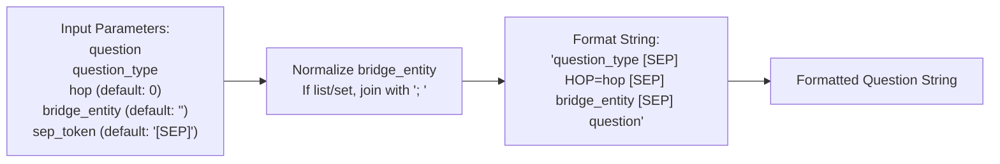
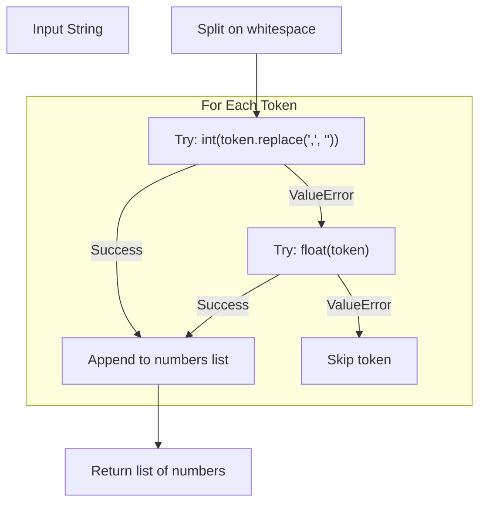
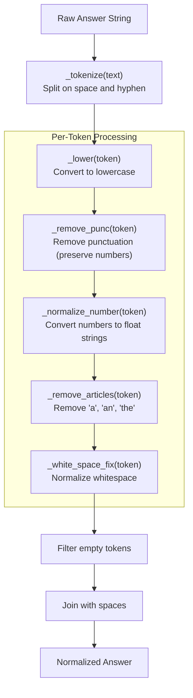
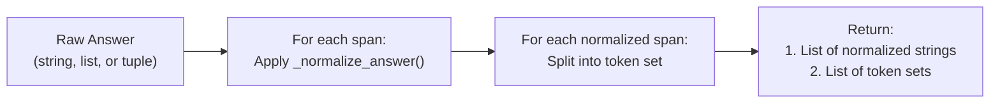
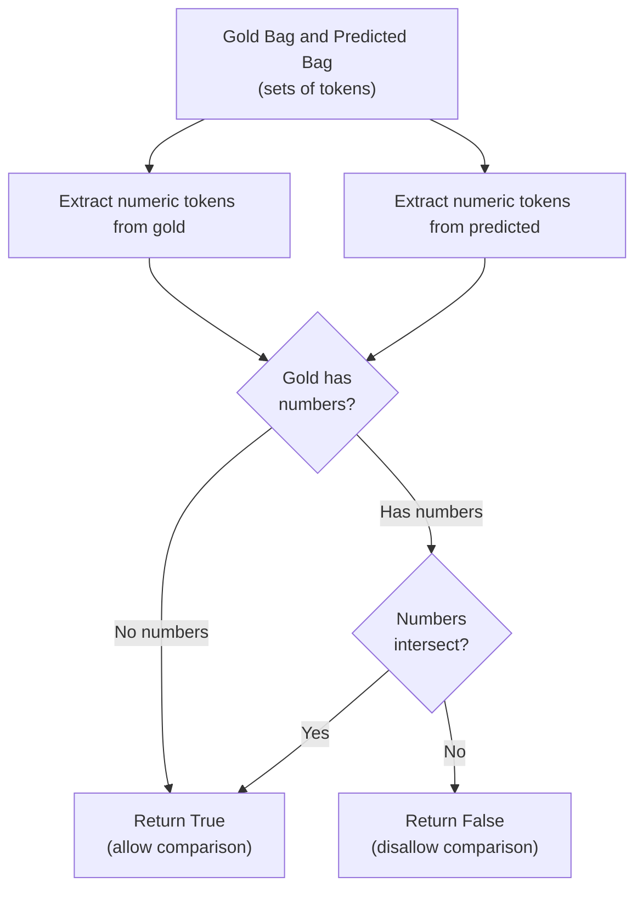
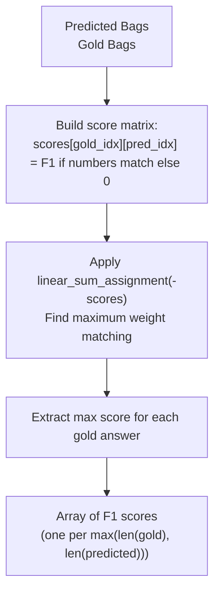
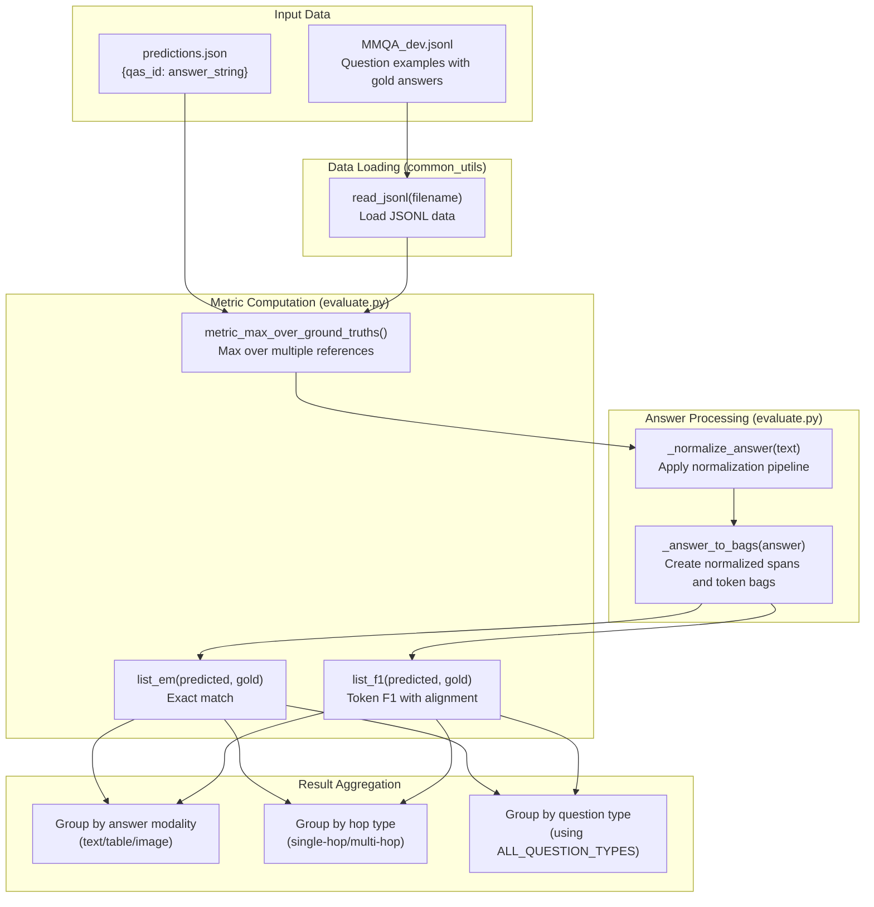

<!-- source: DeepWiki mcp.deepwiki.com · repo allenai/multimodalqa · page 9 Technical Reference · fetched 2026-10-26 -->

# Technical Reference

<details>
<summary>Relevant source files</summary>

The following files were used as context for generating this wiki page:

- [baselines/common_utils.py](baselines/common_utils.py)
- [baselines/evaluate.py](baselines/evaluate.py)

</details>


This page provides detailed technical documentation of utility functions, constants, and implementation details used throughout the MultiModalQA codebase. It serves as a reference for developers who need to understand the low-level building blocks of the system.

For information about model architectures and training procedures, see [Baseline Models](#5). For dataset structure and formats, see [Dataset](#3). For evaluation metrics at a higher level, see [Evaluation](#8).

## Overview

The technical reference covers three main areas:

1. **Question Type Constants**: The complete taxonomy of 16 question types and modality-specific groupings
2. **Common Utilities**: Helper functions for question processing, file I/O, and number extraction
3. **Answer Normalization**: Text preprocessing pipeline for consistent answer comparison
4. **Evaluation Utilities**: Low-level functions for computing F1 scores and aligning answer sets

These utilities are primarily located in two files: `baselines/common_utils.py` for question processing and `baselines/evaluate.py` for answer normalization and evaluation.

## Question Type Constants

### Complete Type Taxonomy

The system defines 16 distinct question types in `ALL_QUESTION_TYPES`, which form the complete taxonomy for classification and routing.

**Sources:** [baselines/common_utils.py:4-21]()

| Category | Question Types | Count |
|----------|---------------|-------|
| **Single-Hop** | `TextQ`, `TableQ`, `ImageQ`, `ImageListQ` | 4 |
| **Compose** | `Compose(TableQ,ImageListQ)`, `Compose(TextQ,ImageListQ)`, `Compose(ImageQ,TableQ)`, `Compose(ImageQ,TextQ)`, `Compose(TextQ,TableQ)`, `Compose(TableQ,TextQ)` | 6 |
| **Intersect** | `Intersect(TableQ,TextQ)`, `Intersect(ImageListQ,TableQ)`, `Intersect(ImageListQ,TextQ)` | 3 |
| **Compare** | `Compare(Compose(TableQ,ImageQ),TableQ)`, `Compare(Compose(TableQ,ImageQ),Compose(TableQ,TextQ))`, `Compare(TableQ,Compose(TableQ,TextQ))` | 3 |

### Modality-Specific Type Groupings

The codebase organizes question types into modality-specific groups based on hop position:

```mermaid
graph TD
    subgraph "Text Modality Groupings"
        TEXT_SINGLE["TEXT_SINGLE_HOP_QUESTION_TYPES<br/>['TextQ']"]
        TEXT_FIRST["TEXT_AS_FIRST_HOP_QUESTION_TYPES<br/>5 types"]
        TEXT_SECOND["TEXT_AS_SECOND_HOP_QUESTION_TYPES<br/>3 types"]
    end
    
    subgraph "Table Modality Groupings"
        TABLE_SINGLE["TABLE_SINGLE_HOP_QUESTION_TYPES<br/>['TableQ']"]
        TABLE_FIRST["TABLE_AS_FIRST_HOP_QUESTION_TYPES<br/>2 types"]
        TABLE_SECOND["TABLE_AS_SECOND_HOP_QUESTION_TYPES<br/>6 types"]
    end
    
    subgraph "Image Modality Groupings"
        IMAGE_SINGLE["IMAGE_SINGLE_HOP_QUESTION_TYPES<br/>['ImageQ', 'ImageListQ']"]
        IMAGE_FIRST["IMAGE_AS_FIRST_HOP_QUESTION_TYPES<br/>5 types"]
        IMAGE_SECOND["IMAGE_AS_SECOND_HOP_QUESTION_TYPES<br/>3 types"]
    end
    
    subgraph "Aggregate Constants"
        SINGLE["SINGLE_HOP_QUESTION_TYPES<br/>4 types total"]
        MULTI["MULTI_HOP_QUESTION_TYPES<br/>12 types total"]
    end
    
    TEXT_SINGLE --> SINGLE
    TABLE_SINGLE --> SINGLE
    IMAGE_SINGLE --> SINGLE
    
    TEXT_SECOND --> MULTI
    TABLE_SECOND --> MULTI
    IMAGE_SECOND --> MULTI
```



**Sources:** [baselines/common_utils.py:23-93]()

The groupings are defined as Python lists:

- **Text Modality**: 
  - `TEXT_SINGLE_HOP_QUESTION_TYPES` [line 23-25]()
  - `TEXT_AS_FIRST_HOP_QUESTION_TYPES` [line 26-32]()
  - `TEXT_AS_SECOND_HOP_QUESTION_TYPES` [line 33-37]()

- **Table Modality**: 
  - `TABLE_SINGLE_HOP_QUESTION_TYPES` [line 39-41]()
  - `TABLE_AS_FIRST_HOP_QUESTION_TYPES` [line 42-45]()
  - `TABLE_AS_SECOND_HOP_QUESTION_TYPES` [line 46-53]()

- **Image Modality**: 
  - `IMAGE_SINGLE_HOP_QUESTION_TYPES` [line 55-58]()
  - `IMAGE_AS_FIRST_HOP_QUESTION_TYPES` [line 59-65]()
  - `IMAGE_AS_SECOND_HOP_QUESTION_TYPES` [line 66-70]()

### Type System Invariants

The codebase includes several assertions to ensure the type taxonomy is consistent:

| Invariant | Verification | Location |
|-----------|--------------|----------|
| Complete coverage | All 16 types appear exactly once across single-hop and multi-hop lists | [line 74-76]() |
| No overlap within modality | Single-hop and second-hop lists are disjoint for each modality | [line 77-79]() |
| Multi-hop symmetry | Every multi-hop type appears in exactly one first-hop list and one second-hop list | [line 87-91]() |
| Total partition | Single-hop + multi-hop = all question types | [line 93]() |

**Sources:** [baselines/common_utils.py:74-93]()

## Question Processing Utilities

### `process_question_for_implicit_decomp`

This function formats questions for the implicit decomposition inference method by concatenating metadata with the question text.



**Function Signature:**
```python
def process_question_for_implicit_decomp(question, question_type, hop=0, bridge_entity='', sep_token='[SEP]')
```

**Implementation Details:**
- If `bridge_entity` is a list or set, it's joined with `"; "` [line 97-98]()
- Returns a formatted string with four `[SEP]`-delimited components [line 99-103]()
- Used exclusively for the `implicit_decomp` inference method to provide hop-specific context

**Sources:** [baselines/common_utils.py:96-103]()

### `extract_numbers_from_str`

Extracts numeric values from a string, attempting to parse each token as either an integer or float.



**Implementation Details:**
- First attempts to parse as integer after removing commas [line 110]()
- Falls back to float parsing if integer parsing fails [line 113]()
- Returns empty list if no numeric tokens found [line 117]()
- Used for extracting numeric answers from text predictions

**Sources:** [baselines/common_utils.py:106-118]()

### `read_jsonl`

Simple utility for reading JSONL (JSON Lines) files into a list of dictionaries.

**Function Signature:**
```python
def read_jsonl(filename)
```

**Implementation:**
- Reads all lines from file [line 122-123]()
- Parses each line with `json.loads()` after stripping whitespace
- Returns list of parsed JSON objects
- Used throughout the codebase for loading dataset files

**Sources:** [baselines/common_utils.py:121-124]()

## Answer Normalization Pipeline

The answer normalization pipeline ensures consistent comparison between predicted and gold answers. The pipeline is adapted from the DROP dataset evaluation code.

### Normalization Function Chain



**Sources:** [baselines/evaluate.py:15-51]()

### Core Normalization Functions

| Function | Purpose | Implementation | Location |
|----------|---------|----------------|----------|
| `_tokenize` | Split text on spaces and hyphens | `re.split(" |-", text)` | [line 38-39]() |
| `_lower` | Convert to lowercase | `text.lower()` | [line 34-35]() |
| `_remove_punc` | Remove punctuation (except in numbers) | Filters `string.punctuation` characters | [line 27-31]() |
| `_normalize_number` | Convert numeric strings to canonical form | `str(float(text))` for numbers and word numbers | [line 70-77]() |
| `_remove_articles` | Remove English articles | Regex: `\b(a|an|the)\b` | [line 15-17]() |
| `_white_space_fix` | Collapse whitespace | `" ".join(text.split())` | [line 20-21]() |

### Number Recognition Functions

The system recognizes both numeric and word-form numbers:

**`_is_number(text)`** [line 54-59]():
- Attempts `float(text)` conversion
- Returns `True` if successful, `False` otherwise

**`_is_word_number(text)`** [line 62-67]():
- Uses `word2number.w2n.word_to_num()` library
- Recognizes words like "five", "twenty-three", etc.
- Returns `True` if word can be converted to number

**`_normalize_number(text)`** [line 70-77]():
- Converts numeric strings to `str(float(text))` format
- Converts word numbers using `word_to_num()`
- Returns original text if neither numeric nor word number

**Sources:** [baselines/evaluate.py:54-77]()

### Answer Bag Conversion

The `_answer_to_bags` function converts answers to two representations for comparison:



**Implementation Details:**
- Accepts single string, list, or tuple of answer strings [line 81-86]()
- Returns tuple of `(normalized_spans, token_bags)` [line 87-93]()
- `normalized_spans`: List of normalized answer strings
- `token_bags`: List of sets, each containing tokens from one normalized span
- Used by evaluation metrics to enable flexible matching

**Sources:** [baselines/evaluate.py:80-93]()

## Evaluation Utilities

### F1 Computation

The `_compute_f1` function calculates token-level F1 score between two token sets:

**Formula:**
- Precision = `|intersection| / |predicted_bag|` (1.0 if predicted empty)
- Recall = `|intersection| / |gold_bag|` (1.0 if gold empty)
- F1 = `2 * precision * recall / (precision + recall)` (0.0 if both are 0)

**Sources:** [baselines/evaluate.py:114-129]()

### Number Matching Constraint

The `_match_numbers_if_present` function enforces that if gold answer contains numbers, predicted answer must contain at least one matching number:



**Implementation:**
- Identifies numeric tokens using `_is_number()` [line 135-140]()
- Returns `True` if gold has no numbers, or if number sets intersect [line 141-143]()
- Used to prevent false matches when answers contain different numbers

**Sources:** [baselines/evaluate.py:132-143]()

### Bag Alignment with Hungarian Algorithm

The `_align_bags` function finds optimal 1-1 alignment between predicted and gold answer bags using the Hungarian algorithm (linear sum assignment):



**Implementation Details:**
- Creates `len(gold) × len(predicted)` score matrix [line 101-106]()
- Only computes F1 if `_match_numbers_if_present` returns `True` [line 104]()
- Uses `scipy.optimize.linear_sum_assignment` with negated scores (for maximization) [line 106]()
- Returns scores array padded to `max(len(gold), len(predicted))` [line 108-111]()
- Ensures each predicted answer aligns to at most one gold answer

**Sources:** [baselines/evaluate.py:96-111]()

## High-Level Evaluation Functions

### `list_em` - List Exact Match

Computes exact match score between predicted and gold answer lists:

**Algorithm:**
1. Convert both answers to normalized bags using `_answer_to_bags()`
2. Check if normalized span sets are equal AND have same length
3. Return `1.0` if exact match, `0.0` otherwise

**Sources:** [baselines/evaluate.py:147-153]()

### `list_f1` - List F1 Score

Computes F1 score between predicted and gold answer lists:

**Algorithm:**
1. Convert both answers to token bags using `_answer_to_bags()`
2. Find optimal alignment using `_align_bags()`
3. Compute mean F1 across aligned pairs
4. Round to 2 decimal places

**Sources:** [baselines/evaluate.py:156-162]()

### `metric_max_over_ground_truths`

Wrapper function that computes a metric against multiple gold answers and returns the maximum:

**Usage Pattern:**
```python
score = metric_max_over_ground_truths(list_f1, prediction, [gold1, gold2, gold3])
# Returns max(list_f1(prediction, gold1), list_f1(prediction, gold2), list_f1(prediction, gold3))
```

**Sources:** [baselines/evaluate.py:165-170]()

## Integration with Evaluation Pipeline

The following diagram shows how these technical utilities integrate into the broader evaluation system:



**Sources:** [baselines/evaluate.py:173-214](), [baselines/common_utils.py:121-124](), [baselines/common_utils.py:4-21]()

## Constants Reference Table

| Constant Name | Type | Size | Purpose | Location |
|---------------|------|------|---------|----------|
| `ALL_QUESTION_TYPES` | `list[str]` | 16 | Complete question type taxonomy | [common_utils.py:4-21]() |
| `SINGLE_HOP_QUESTION_TYPES` | `list[str]` | 4 | All single-hop question types | [common_utils.py:81-83]() |
| `MULTI_HOP_QUESTION_TYPES` | `list[str]` | 12 | All multi-hop question types | [common_utils.py:84-86]() |
| `TEXT_SINGLE_HOP_QUESTION_TYPES` | `list[str]` | 1 | Text single-hop types | [common_utils.py:23-25]() |
| `TEXT_AS_FIRST_HOP_QUESTION_TYPES` | `list[str]` | 5 | Text as first hop in multi-hop | [common_utils.py:26-32]() |
| `TEXT_AS_SECOND_HOP_QUESTION_TYPES` | `list[str]` | 3 | Text as second hop in multi-hop | [common_utils.py:33-37]() |
| `TABLE_SINGLE_HOP_QUESTION_TYPES` | `list[str]` | 1 | Table single-hop types | [common_utils.py:39-41]() |
| `TABLE_AS_FIRST_HOP_QUESTION_TYPES` | `list[str]` | 2 | Table as first hop in multi-hop | [common_utils.py:42-45]() |
| `TABLE_AS_SECOND_HOP_QUESTION_TYPES` | `list[str]` | 6 | Table as second hop in multi-hop | [common_utils.py:46-53]() |
| `IMAGE_SINGLE_HOP_QUESTION_TYPES` | `list[str]` | 2 | Image single-hop types | [common_utils.py:55-58]() |
| `IMAGE_AS_FIRST_HOP_QUESTION_TYPES` | `list[str]` | 5 | Image as first hop in multi-hop | [common_utils.py:59-65]() |
| `IMAGE_AS_SECOND_HOP_QUESTION_TYPES` | `list[str]` | 3 | Image as second hop in multi-hop | [common_utils.py:66-70]() |
| `EXCLUDE` | `set` | 32 | String punctuation characters for removal | [evaluate.py:24]() |

## Usage Examples

### Example 1: Processing Question for Implicit Decomposition

```python
from common_utils import process_question_for_implicit_decomp

# First hop of a multi-hop question
formatted_q1 = process_question_for_implicit_decomp(
    question="What is the capital of France?",
    question_type="Compose(TextQ,TableQ)",
    hop=0,
    bridge_entity=""
)
# Result: "Compose(TextQ,TableQ) [SEP] HOP=0 [SEP]  [SEP] What is the capital of France?"

# Second hop with bridge entity
formatted_q2 = process_question_for_implicit_decomp(
    question="What is the capital of France?",
    question_type="Compose(TextQ,TableQ)",
    hop=1,
    bridge_entity="France"
)
# Result: "Compose(TextQ,TableQ) [SEP] HOP=1 [SEP] France [SEP] What is the capital of France?"
```

### Example 2: Answer Normalization

```python
from evaluate import _normalize_answer

# Various inputs produce normalized forms
assert _normalize_answer("The answer is 42.") == "answer is 42.0"
assert _normalize_answer("twenty-three") == "23.0"
assert _normalize_answer("Paris, France") == "paris france"
```

### Example 3: Evaluating Predictions

```python
from evaluate import list_f1, list_em, metric_max_over_ground_truths

prediction = ["Paris", "France"]
gold_answers = [
    ["Paris", "France"],  # Reference 1
    ["paris"],            # Reference 2
]

# Compute exact match (max over references)
em = metric_max_over_ground_truths(list_em, prediction, gold_answers)

# Compute F1 (max over references)
f1 = metric_max_over_ground_truths(list_f1, prediction, gold_answers)
```

**Sources:** [baselines/common_utils.py:96-103](), [baselines/evaluate.py:42-51](), [baselines/evaluate.py:165-170]()

---

