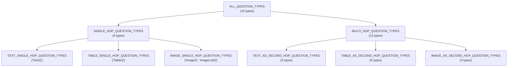
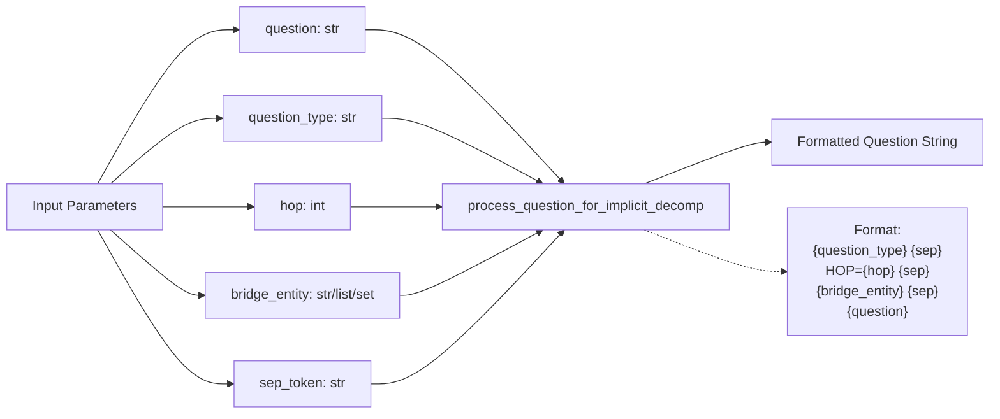
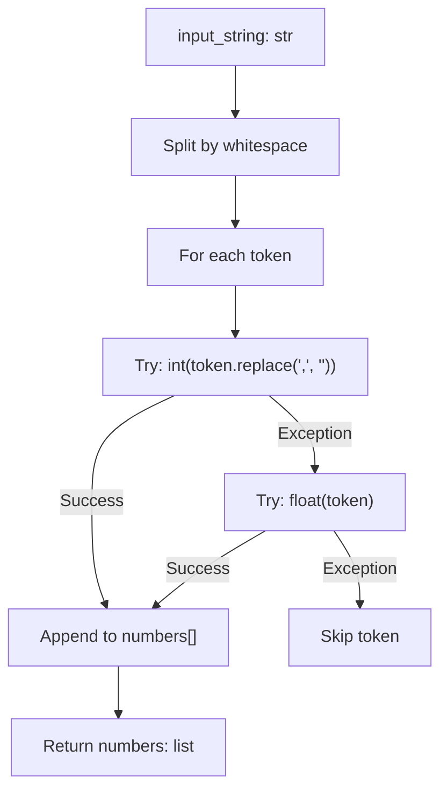
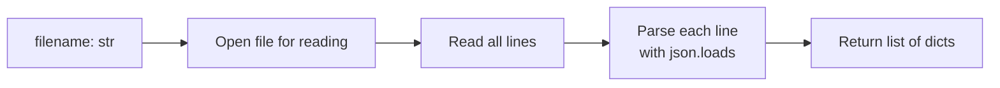

<!-- source: DeepWiki mcp.deepwiki.com · repo allenai/multimodalqa · page 9.1 Common Utilities · fetched 2026-10-26 -->

# Common Utilities

<details>
<summary>Relevant source files</summary>

The following files were used as context for generating this wiki page:

- [baselines/common_utils.py](baselines/common_utils.py)

</details>


## Purpose and Scope

This document describes the common utility functions and constants defined in [baselines/common_utils.py](). These utilities provide foundational support for the MultiModalQA system, including:

- **Question type taxonomy**: A comprehensive set of constants defining all 16 question types and their categorization by modality and hop position
- **Question processing**: Functions for formatting questions according to different inference methods
- **Number extraction**: Utilities for parsing numeric values from text strings
- **File I/O**: Standard functions for reading JSONL dataset files

These utilities are imported and used throughout the baseline models and inference pipeline. For details on how question types drive the inference pipeline, see [Question Type Classification](#4.1). For information on the three inference methods that use these utilities, see [Inference Methods](#4.2).

---

## Question Type Taxonomy

The `common_utils.py` module defines the complete taxonomy of 16 question types supported by the MultiModalQA system. These constants serve as the foundation for question routing and multi-hop reasoning across the entire codebase.

### Complete Question Type List

The master list `ALL_QUESTION_TYPES` contains all 16 question types [baselines/common_utils.py:4-21]():

```
ALL_QUESTION_TYPES = [
    'TextQ',
    'TableQ',
    'ImageQ',
    'ImageListQ',
    'Compose(TableQ,ImageListQ)',
    'Compose(TextQ,ImageListQ)',
    'Compose(ImageQ,TableQ)',
    'Compose(ImageQ,TextQ)',
    'Compose(TextQ,TableQ)',
    'Compose(TableQ,TextQ)',
    'Intersect(TableQ,TextQ)',
    'Intersect(ImageListQ,TableQ)',
    'Intersect(ImageListQ,TextQ)',
    'Compare(Compose(TableQ,ImageQ),TableQ)',
    'Compare(Compose(TableQ,ImageQ),Compose(TableQ,TextQ))',
    'Compare(TableQ,Compose(TableQ,TextQ))',
]
```

### Question Type Categorization Structure

The following diagram shows how question types are organized into single-hop vs. multi-hop categories:



**Sources**: [baselines/common_utils.py:23-86]()

### Modality-Specific Question Type Constants

The taxonomy organizes question types by **modality** (text, table, image) and **hop position** (single-hop, first-hop, second-hop). This structure drives the routing logic in the inference pipeline.

#### Text Question Types

| Constant | Types | Purpose |
|----------|-------|---------|
| `TEXT_SINGLE_HOP_QUESTION_TYPES` | `['TextQ']` | Questions answered directly from text without multi-hop reasoning |
| `TEXT_AS_FIRST_HOP_QUESTION_TYPES` | 5 types | Multi-hop questions that start by querying text to find bridge entities |
| `TEXT_AS_SECOND_HOP_QUESTION_TYPES` | 3 types | Multi-hop questions that end by querying text after extracting bridge entities from another modality |

**Defined at**: [baselines/common_utils.py:23-37]()

#### Table Question Types

| Constant | Types | Purpose |
|----------|-------|---------|
| `TABLE_SINGLE_HOP_QUESTION_TYPES` | `['TableQ']` | Questions answered directly from tables |
| `TABLE_AS_FIRST_HOP_QUESTION_TYPES` | 2 types | Multi-hop questions that start by querying tables |
| `TABLE_AS_SECOND_HOP_QUESTION_TYPES` | 6 types | Multi-hop questions that end by querying tables |

**Defined at**: [baselines/common_utils.py:39-53]()

#### Image Question Types

| Constant | Types | Purpose |
|----------|-------|---------|
| `IMAGE_SINGLE_HOP_QUESTION_TYPES` | `['ImageQ', 'ImageListQ']` | Questions answered directly from images |
| `IMAGE_AS_FIRST_HOP_QUESTION_TYPES` | 5 types | Multi-hop questions that start by querying images |
| `IMAGE_AS_SECOND_HOP_QUESTION_TYPES` | 3 types | Multi-hop questions that end by querying images |

**Defined at**: [baselines/common_utils.py:55-70]()

### Validation and Consistency Checks

The module includes assertion-based validation to ensure the taxonomy is complete and consistent [baselines/common_utils.py:74-93]():

1. **Coverage**: Every question type appears in exactly one single-hop or second-hop category
2. **No overlap**: Single-hop and second-hop categories are mutually exclusive per modality
3. **First-hop completeness**: The union of all first-hop categories equals all multi-hop types
4. **Totality**: Single-hop + multi-hop = all question types

These assertions run at import time, catching configuration errors early.

**Sources**: [baselines/common_utils.py:4-93]()

---

## Question Processing for Inference Methods

The `process_question_for_implicit_decomp` function formats questions for the `implicit_decomp` inference method by prepending metadata tokens that guide the model's reasoning.

### Function: `process_question_for_implicit_decomp`



#### Signature and Parameters

Defined at [baselines/common_utils.py:96-103]():

```python
def process_question_for_implicit_decomp(
    question,           # Original question text
    question_type,      # One of ALL_QUESTION_TYPES
    hop=0,             # 0 for first hop, 1 for second hop
    bridge_entity='',  # Entity extracted from first hop (for second hop)
    sep_token='[SEP]'  # Separator token (model-dependent)
)
```

#### Formatting Logic

The function constructs a formatted string with four components separated by `sep_token`:

1. **Question type**: One of the 16 types from `ALL_QUESTION_TYPES`
2. **Hop indicator**: `HOP=0` for first hop, `HOP=1` for second hop
3. **Bridge entity**: Empty for first hop, populated with first-hop answer for second hop
4. **Original question**: The raw question text

**Bridge entity handling**: If `bridge_entity` is a list or set, it is joined with `"; "` [baselines/common_utils.py:97-98]().

#### Example Output

For a second-hop question:
```
Input:
  question = "Who directed the movie?"
  question_type = "Compose(TableQ,TextQ)"
  hop = 1
  bridge_entity = ["The Godfather", "The Godfather Part II"]
  sep_token = "[SEP]"

Output:
  "Compose(TableQ,TextQ) [SEP] HOP=1 [SEP] The Godfather; The Godfather Part II [SEP] Who directed the movie?"
```

#### Usage in Inference Pipeline

This function is called by:
- **Image QA inference**: [baselines/image_qa/inference.py]() when processing questions in `implicit_decomp` mode
- **Table QA inference**: [baselines/table_qa/inference.py]() when formatting questions with hop metadata
- **Text QA inference**: [baselines/text_qa/inference.py]() for multi-hop reasoning

**Sources**: [baselines/common_utils.py:96-103]()

---

## Number Extraction Utilities

The `extract_numbers_from_str` function parses numeric values from text strings, handling both integers and floats.

### Function: `extract_numbers_from_str`



#### Implementation Details

Defined at [baselines/common_utils.py:106-118]():

**Algorithm**:
1. Split the input string by whitespace
2. For each token:
   - Attempt to parse as integer after removing commas (handles "1,000" format)
   - If that fails, attempt to parse as float
   - If both fail, skip the token
3. Return list of successfully parsed numbers

**Error handling**: Uses bare `except` clauses to silently ignore parsing failures [baselines/common_utils.py:111-115]().

#### Behavior Examples

| Input | Output |
|-------|--------|
| `"The value is 42"` | `[42]` |
| `"Population: 1,234,567"` | `[1234567]` |
| `"Score: 3.14 out of 10"` | `[3.14, 10]` |
| `"No numbers here"` | `[]` |

#### Known Limitations

- Does not handle negative numbers
- Does not parse numbers with units (e.g., "42kg")
- Does not handle numbers embedded in words (e.g., "test123")
- Comma removal is applied before float parsing, which may cause unexpected behavior for European-style decimals (e.g., "1,5" as 1.5)

**Sources**: [baselines/common_utils.py:106-118]()

---

## File I/O Utilities

The `read_jsonl` function provides a standard interface for reading JSON Lines format files, which is the primary data format used throughout the MultiModalQA dataset.

### Function: `read_jsonl`



#### Signature and Usage

Defined at [baselines/common_utils.py:121-124]():

```python
def read_jsonl(filename):
    with open(filename, 'r') as f:
        data = [json.loads(l.strip()) for l in f.readlines()]
    return data
```

**Parameters**:
- `filename`: Path to a `.jsonl` file

**Returns**: List of dictionaries, one per line in the file

#### Usage Throughout Codebase

This function is used to load:
- **Question/answer files**: `MMQA_train.jsonl`, `MMQA_dev.jsonl`, `MMQA_test.jsonl`
- **Context files**: `texts.jsonl`, `tables.jsonl`, `images.jsonl`
- **Prediction files**: Output files from inference runs

The consistent use of this function ensures uniform handling of JSONL files across all components of the system.

#### Alternative: Incremental Reading

For large files, the module does not provide a streaming/generator-based reader. All lines are loaded into memory at once [baselines/common_utils.py:123](). For very large datasets, users may need to implement their own streaming reader.

**Sources**: [baselines/common_utils.py:121-124]()

---

## Code Reference Summary

The following table maps natural language concepts to specific code entities in `common_utils.py`:

| Concept | Code Entity | Type | Line Numbers |
|---------|-------------|------|--------------|
| Complete question type list | `ALL_QUESTION_TYPES` | list[str] | [4-21]() |
| Single-hop text questions | `TEXT_SINGLE_HOP_QUESTION_TYPES` | list[str] | [23-25]() |
| First-hop text questions | `TEXT_AS_FIRST_HOP_QUESTION_TYPES` | list[str] | [26-32]() |
| Second-hop text questions | `TEXT_AS_SECOND_HOP_QUESTION_TYPES` | list[str] | [33-37]() |
| Single-hop table questions | `TABLE_SINGLE_HOP_QUESTION_TYPES` | list[str] | [39-41]() |
| First-hop table questions | `TABLE_AS_FIRST_HOP_QUESTION_TYPES` | list[str] | [42-45]() |
| Second-hop table questions | `TABLE_AS_SECOND_HOP_QUESTION_TYPES` | list[str] | [46-53]() |
| Single-hop image questions | `IMAGE_SINGLE_HOP_QUESTION_TYPES` | list[str] | [55-58]() |
| First-hop image questions | `IMAGE_AS_FIRST_HOP_QUESTION_TYPES` | list[str] | [59-65]() |
| Second-hop image questions | `IMAGE_AS_SECOND_HOP_QUESTION_TYPES` | list[str] | [66-70]() |
| Aggregate single-hop types | `SINGLE_HOP_QUESTION_TYPES` | list[str] | [81-83]() |
| Aggregate multi-hop types | `MULTI_HOP_QUESTION_TYPES` | list[str] | [84-86]() |
| Question formatting for multi-hop | `process_question_for_implicit_decomp()` | function | [96-103]() |
| Number extraction from text | `extract_numbers_from_str()` | function | [106-118]() |
| JSONL file reading | `read_jsonl()` | function | [121-124]() |

**Sources**: [baselines/common_utils.py:1-124]()

---

