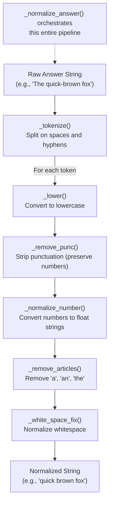
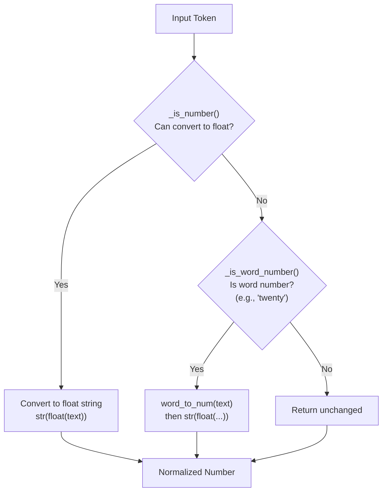
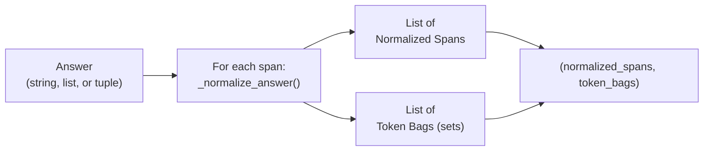
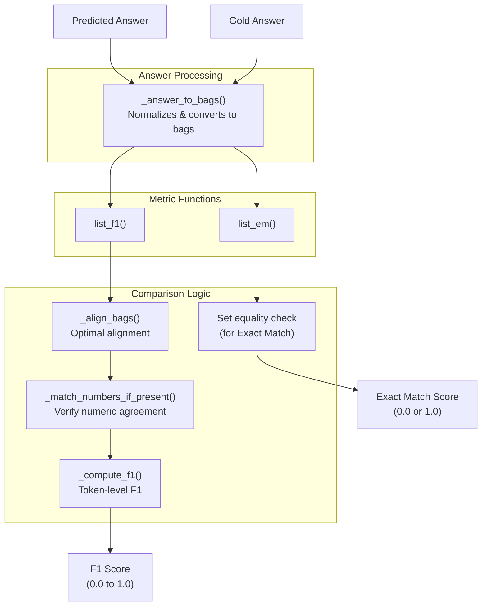

<!-- source: DeepWiki mcp.deepwiki.com · repo allenai/multimodalqa · page 9.2 Answer Normalization · fetched 2026-10-26 -->

# Answer Normalization

<details>
<summary>Relevant source files</summary>

The following files were used as context for generating this wiki page:

- [baselines/evaluate.py](baselines/evaluate.py)

</details>


## Purpose and Scope

This document describes the answer normalization pipeline used in the MultiModalQA evaluation system. Answer normalization is a critical preprocessing step that standardizes predicted and gold answers before computing evaluation metrics. The normalization process ensures fair comparison by removing superficial differences in formatting, casing, and common articles while preserving semantic content.

For information about how normalized answers are used in metric computation, see [Evaluation Metrics](#8.1).

## Overview of the Normalization Pipeline

The answer normalization system is implemented in [baselines/evaluate.py:15-78]() and was originally adapted from the DROP dataset evaluation script. The normalization pipeline applies a sequence of transformations to convert raw answer strings into a canonical form suitable for comparison.



**Sources:** [baselines/evaluate.py:15-78]()

## Tokenization Strategy

The tokenization process splits answers into individual tokens using a simple delimiter-based approach implemented in `_tokenize()`.

| Function | Implementation | Purpose |
|----------|----------------|---------|
| `_tokenize()` | `re.split(" \|-", text)` | Splits text on spaces and hyphens |

This tokenization strategy is specifically designed to handle:
- **Hyphenated terms**: "quick-brown" → ["quick", "brown"]
- **Multi-word answers**: "John Smith" → ["John", "Smith"]
- **Compound entities**: "New York" → ["New", "York"]

Each token is then processed independently through the normalization pipeline, allowing fine-grained control over transformations.

**Sources:** [baselines/evaluate.py:38-39]()

## Core Text Transformations

The normalization pipeline applies four fundamental text transformations to each token:

### Lowercasing

```python
def _lower(text: str) -> str:
    return text.lower()
```

Converts all characters to lowercase to enable case-insensitive matching. This ensures that "Paris" and "paris" are treated as equivalent answers.

### Punctuation Removal

```python
EXCLUDE = set(string.punctuation)

def _remove_punc(text: str) -> str:
    if not _is_number(text):
        return "".join(ch for ch in text if ch not in EXCLUDE)
    else:
        return text
```

Removes all punctuation marks from non-numeric tokens. **Critical exception**: numeric tokens are preserved intact to maintain precision (e.g., "3.14" is not modified).

### Article Removal

```python
def _remove_articles(text: str) -> str:
    regex = re.compile(r"\b(a|an|the)\b", re.UNICODE)
    return re.sub(regex, " ", text)
```

Strips common English articles ("a", "an", "the") that do not contribute semantic meaning. The regex uses word boundaries (`\b`) to avoid partial matches within words.

### Whitespace Normalization

```python
def _white_space_fix(text: str) -> str:
    return " ".join(text.split())
```

Collapses multiple consecutive whitespace characters into single spaces and trims leading/trailing whitespace. This handles artifacts from previous transformation steps.

**Sources:** [baselines/evaluate.py:15-51]()

## Number Handling

The normalization system includes sophisticated logic for detecting and normalizing numeric values to ensure consistent comparison of numerical answers.



### Number Detection

The system employs two detection strategies:

| Function | Implementation | Examples |
|----------|----------------|----------|
| `_is_number()` | Attempts `float()` conversion | "42", "3.14", "1e5" → True |
| `_is_word_number()` | Uses `word2number.w2n.word_to_num()` | "twenty", "forty-two" → True |

### Number Normalization

The `_normalize_number()` function converts all numeric representations to standardized float strings:

- **Numeric strings**: "42" → "42.0"
- **Decimal numbers**: "3.14" → "3.14"
- **Scientific notation**: "1e5" → "100000.0"
- **Word numbers**: "twenty" → "20.0" (via `word2number` library)
- **Non-numbers**: "Paris" → "Paris" (unchanged)

**Important**: This normalization affects downstream number matching in `_match_numbers_if_present()`, which checks for exact numeric agreement between predicted and gold answer bags.

**Sources:** [baselines/evaluate.py:54-78]()

## Complete Normalization Function

The `_normalize_answer()` function orchestrates the entire normalization pipeline:

```python
def _normalize_answer(text: str) -> str:
    """Lower text and remove punctuation, articles and extra whitespace."""
    
    parts = [
        _white_space_fix(_remove_articles(_normalize_number(_remove_punc(_lower(token)))))
        for token in _tokenize(text)
    ]
    parts = [part for part in parts if part.strip()]
    normalized = " ".join(parts).strip()
    return normalized
```

**Processing order per token:**
1. Tokenize the input text
2. Apply to each token: lowercase → remove punctuation → normalize numbers → remove articles → fix whitespace
3. Filter out empty tokens
4. Join tokens with single spaces

### Example Transformations

| Raw Answer | Normalized Answer |
|------------|-------------------|
| "The United States" | "united states" |
| "forty-two" | "42.0" |
| "Dr. John Smith" | "dr john smith" |
| "3.14159" | "3.14159" |
| "New-York" | "new york" |

**Sources:** [baselines/evaluate.py:42-51]()

## Answer-to-Bags Conversion

The normalization pipeline culminates in the `_answer_to_bags()` function, which converts normalized answers into two representations used by evaluation metrics:



### Function Signature

```python
def _answer_to_bags(
    answer: Union[str, List[str], Tuple[str, ...]]
) -> Tuple[List[str], List[Set[str]]]:
```

### Processing Logic

1. **Input handling**: Accepts single strings or lists/tuples of strings (for multi-span answers)
2. **Normalization**: Applies `_normalize_answer()` to each span
3. **Tokenization**: Splits each normalized span into token sets

### Return Value

Returns a tuple containing:
- **`normalized_spans`**: List of normalized answer strings
- **`token_bags`**: List of sets, where each set contains the tokens of one normalized span

### Example

```
Input: ["The quick fox", "forty-two cats"]

normalized_spans: ["quick fox", "42.0 cats"]
token_bags: [{"quick", "fox"}, {"42.0", "cats"}]
```

The token bags are used by `_align_bags()` in the F1 computation to find optimal alignment between predicted and gold answers.

**Sources:** [baselines/evaluate.py:80-93]()

## Integration with Evaluation Metrics

The normalization pipeline is invoked by the evaluation metric functions to ensure consistent comparison:



### Exact Match (EM)

The `list_em()` function uses normalized answers for strict equality checking:

```python
def list_em(predicted, gold):
    predicted_bags = _answer_to_bags(predicted)
    gold_bags = _answer_to_bags(gold)
    if set(predicted_bags[0]) == set(gold_bags[0]) and len(predicted_bags[0]) == len(gold_bags[0]):
        return 1.0
    else:
        return 0.0
```

Returns 1.0 only if the normalized answer strings match exactly as sets with equal cardinality.

### F1 Score

The `list_f1()` function uses token bags for partial credit matching:

```python
def list_f1(predicted, gold):
    predicted_bags = _answer_to_bags(predicted)
    gold_bags = _answer_to_bags(gold)
    f1_per_bag = _align_bags(predicted_bags[1], gold_bags[1])
    f1 = np.mean(f1_per_bag)
    f1 = round(f1, 2)
    return f1
```

Uses optimal alignment of token bags to compute token-level precision and recall.

**Sources:** [baselines/evaluate.py:147-162]()

## Special Handling: Number Matching

The evaluation system includes special logic in `_match_numbers_if_present()` to ensure that answers containing numbers are only matched if their numeric values agree:

```python
def _match_numbers_if_present(gold_bag: Set[str], predicted_bag: Set[str]) -> bool:
    gold_numbers = set()
    predicted_numbers = set()
    for word in gold_bag:
        if _is_number(word):
            gold_numbers.add(word)
    for word in predicted_bag:
        if _is_number(word):
            predicted_numbers.add(word)
    if (not gold_numbers) or gold_numbers.intersection(predicted_numbers):
        return True
    return False
```

### Matching Rules

| Condition | Result |
|-----------|--------|
| Neither answer contains numbers | Match allowed (returns True) |
| Gold contains numbers, prediction has matching numbers | Match allowed (returns True) |
| Gold contains numbers, prediction has different numbers | Match blocked (returns False) |

This prevents spurious matches where non-numeric tokens overlap but critical numeric values differ (e.g., "won 3 medals" vs. "won 5 medals").

**Sources:** [baselines/evaluate.py:132-143]()

## Summary

The answer normalization pipeline provides a robust, standardized approach to comparing answers in the MultiModalQA evaluation system. Key design decisions include:

1. **Token-level processing**: Each token is normalized independently, enabling fine-grained control
2. **Number preservation**: Numeric values are detected and preserved through punctuation removal
3. **Multi-format number support**: Both numeric strings ("42") and word numbers ("forty-two") are normalized to float strings
4. **Article removal**: Common articles are stripped as they do not contribute semantic meaning
5. **Number-aware matching**: Special logic ensures numeric agreement when numbers are present

This normalization strategy, adapted from the DROP dataset evaluation code, provides a fair comparison framework for the diverse answer types encountered in multimodal question answering.

**Sources:** [baselines/evaluate.py:15-143]()