# Page: Overview

# Overview

<details>
<summary>Relevant source files</summary>

The following files were used as context for generating this wiki page:

- [README.md](README.md)
- [_config.yml](_config.yml)
- [baselines/README.md](baselines/README.md)
- [index.md](index.md)

</details>


This document provides a high-level introduction to the MultiModalQA repository, explaining its purpose as a research framework for complex question answering that requires joint reasoning over text, tables, and images. The repository contains both the MultiModalQA dataset (29,918 examples) and baseline model implementations for the three modalities.

For detailed setup instructions, see [Getting Started](#2). For dataset format specifications, see [Dataset](#3). For implementation details of individual models, see [Baseline Models](#5).

## What is MultiModalQA?

MultiModalQA is a challenging question answering dataset and research framework published at ICLR 2021. The core research question is: **How can QA systems answer complex questions that require reasoning across multiple modalities—text paragraphs, structured tables, and images?**

**Key Characteristics:**

| Aspect | Details |
|--------|---------|
| **Dataset Size** | 29,918 examples (train/dev/test splits) |
| **Modalities** | Text paragraphs, tables, images |
| **Question Types** | 16 distinct types: single-hop and multi-hop (Compose, Intersect, Compare) |
| **Source** | Wikipedia pages with text, tables, and images |
| **Task** | Extractive QA with list-based answers |
| **Evaluation Metrics** | F1 score and Exact Match (EM) with list normalization |

**Example Question (Compose operation):**
```
Question: "What was the net worth of the LGBT billionaire who is 
           completely bald and wears thick glasses?"
- First hop: Image → identify person from visual features
- Second hop: Table → extract net worth from structured data
```

Sources: [index.md:1-37](), [README.md:1-6](), [baselines/README.md:1-3]()

## Repository Structure

The MultiModalQA repository is organized into two main components: the **dataset** and the **baselines** (inference and training code).

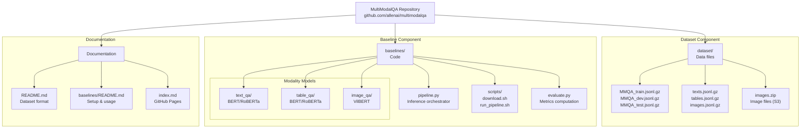

**Directory Layout:**

| Directory/File | Purpose |
|----------------|---------|
| `dataset/` | Contains all dataset files: questions, contexts (text/tables/images) |
| `baselines/` | Implementation of three baseline inference methods and model training |
| `baselines/pipeline.py` | Main inference orchestrator that routes questions to appropriate models |
| `baselines/text_qa/` | Text QA model (BERT/RoBERTa-based) for paragraph-based questions |
| `baselines/table_qa/` | Table QA model (BERT/RoBERTa-based) for structured data questions |
| `baselines/image_qa/` | Image QA model (VilBERT-based) for visual questions |
| `baselines/evaluate.py` | Evaluation metrics (F1, EM) with list normalization |
| `baselines/scripts/download.sh` | Downloads dataset, pre-trained models, and checkpoints |
| `baselines/scripts/run_pipeline.sh` | Runs all three baseline methods in parallel |

Sources: [README.md:15-21](), [baselines/README.md:1-53]()

## System Architecture: From Question to Answer

The MultiModalQA system follows a **modular pipeline architecture** where questions are classified by type, then routed to appropriate modality-specific models. For multi-hop questions, intermediate results (bridge entities) are passed between models.

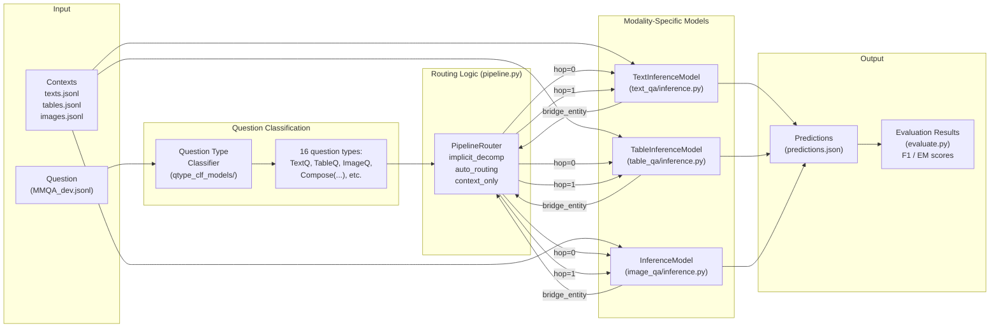

**Key Code Components:**

| Component | File/Class | Role |
|-----------|------------|------|
| **Pipeline Orchestrator** | `baselines/pipeline.py` | Main entry point; loads models, processes examples, routes questions |
| **Question Type Classifier** | `downloads/checkpoints/qtype_clf_models/` | Predicts 1 of 16 question types to determine routing strategy |
| **Text QA Inference** | `baselines/text_qa/inference.py:TextInferenceModel` | Answers questions over text paragraphs using BERT/RoBERTa |
| **Table QA Inference** | `baselines/table_qa/inference.py:TableInferenceModel` | Answers questions over tables using linearized table representations |
| **Image QA Inference** | `baselines/image_qa/inference.py:InferenceModel` | Answers questions over images using VilBERT with pre-extracted features |
| **Evaluation** | `baselines/evaluate.py` | Computes F1 and EM metrics with list normalization |

Sources: [baselines/README.md:19-36](), [baselines/pipeline.py:1-500]() (entire file structure)

## Three Baseline Inference Methods

The repository implements three distinct inference methods that represent different strategies for handling multi-hop reasoning. These methods are controlled by the `--method` argument in `pipeline.py`.

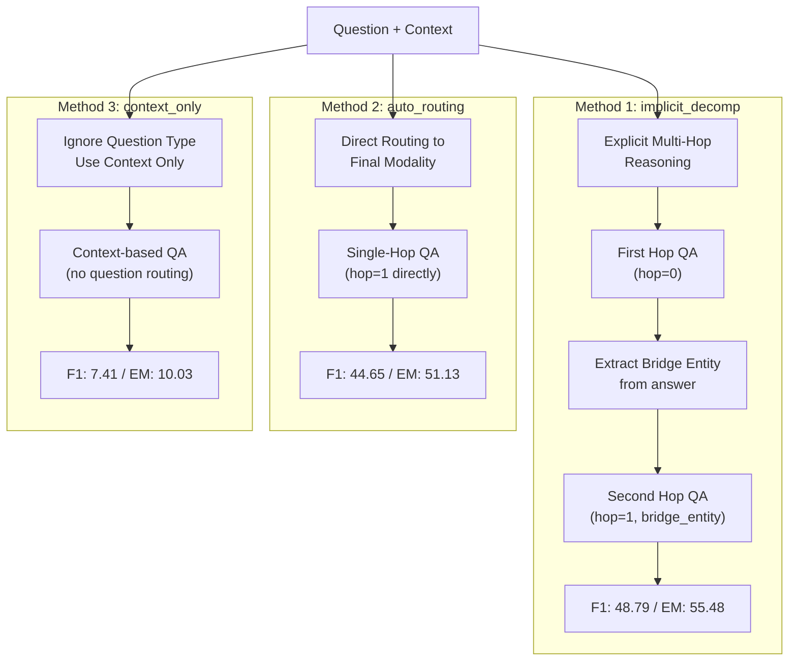

**Performance Summary (Dev Set):**

| Method | Single-Modality F1/EM | Multi-Modality F1/EM | Overall F1/EM |
|--------|----------------------|---------------------|---------------|
| `context_only` | 7.94 / 10.73 | 6.63 / 9.00 | **7.41 / 10.03** |
| `auto_routing` | 51.68 / 58.48 | 34.18 / 40.18 | **44.65 / 51.13** |
| `implicit_decomp` | 51.60 / 58.35 | 44.59 / 51.19 | **48.79 / 55.48** |

The `implicit_decomp` method achieves the best performance by explicitly modeling multi-hop reasoning with bridge entity extraction, significantly outperforming `auto_routing` on multi-modality questions (+10.41 F1 points).

For detailed explanation of each method's implementation, see [Inference Methods](#4.2).

Sources: [baselines/README.md:38-49](), [baselines/pipeline.py:1-500]() (method routing logic)

## Training Infrastructure

Each modality-specific QA model is trained independently using its own training pipeline:

| Model | Training Entry Point | Key Components | Pre-trained Base |
|-------|---------------------|----------------|------------------|
| **Image QA** | `baselines/image_qa/main.py` | `VQADataset`, `VilbertForMQA`, two-stage training (frozen/unfrozen) | VilBERT pre-trained on Conceptual Captions |
| **Text QA** | `baselines/text_qa/` (see README) | BERT/RoBERTa fine-tuning on text paragraphs | Hugging Face transformers |
| **Table QA** | `baselines/table_qa/` (see README) | BERT/RoBERTa fine-tuning on linearized tables | Hugging Face transformers |

**Image QA Training (Most Complex):**

The image QA model requires a specialized conda environment (`multimodalqa_image`) with dependencies on APEX, VilBERT, and MaskRCNN. Training proceeds in two stages:
1. **Stage 1 (Frozen):** Train only QA heads for 25 epochs with lr=2e-5
2. **Stage 2 (Unfrozen):** Full end-to-end fine-tuning for 50 epochs with lr=2e-6

For detailed training instructions, see [Training Image QA Models](#7.1).

Sources: [baselines/README.md:50-53](), [baselines/image_qa/main.py:1-400]() (training logic)

## Research Context and Citations

MultiModalQA was published at ICLR 2021:

**Paper:** [MultiModalQA: Complex Question Answering over Text, Tables and Images](https://openreview.net/pdf?id=ee6W5UgQLa)  
**Authors:** Alon Talmor, Ori Yoran, Amnon Catav, Dan Lahav, Yizhong Wang, Akari Asai, Gabriel Ilharco, Hannaneh Hajishirzi, Jonathan Berant  
**Institution Collaboration:** Tel Aviv University, University of Washington, Allen Institute for AI

**BibTeX Citation:**
```bibtex
@inproceedings{talmor2021multimodalqa,
  title={MultiModalQA: complex question answering over text, tables and images},
  author={Alon Talmor and Ori Yoran and Amnon Catav and Dan Lahav and 
          Yizhong Wang and Akari Asai and Gabriel Ilharco and 
          Hannaneh Hajishirzi and Jonathan Berant},
  booktitle={International Conference on Learning Representations},
  year={2021},
  url={https://openreview.net/forum?id=ee6W5UgQLa}
}
```

**Public Resources:**
- **Dataset:** Available at [github.com/allenai/multimodalqa/tree/master/dataset](https://github.com/allenai/multimodalqa/tree/master/dataset)
- **Images:** Downloadable from [S3 bucket (images.zip)](https://multimodalqa-images.s3-us-west-2.amazonaws.com/final_dataset_images/final_dataset_images.zip)
- **Baseline Checkpoints:** Downloaded via `baselines/scripts/download.sh`
- **Website:** [allenai.github.io/multimodalqa](https://allenai.github.io/multimodalqa)

Sources: [index.md:20-31](), [README.md:1-7](), [_config.yml:1-3]()

## Getting Started

To begin using MultiModalQA:

1. **Setup Environment:** Follow instructions in [Installation and Environment Setup](#2.1)
2. **Download Data and Models:** Run `baselines/scripts/download.sh` to fetch dataset and checkpoints
3. **Run Inference:** Use `baselines/pipeline.py` or `baselines/scripts/run_pipeline.sh` to evaluate baselines
4. **Explore Dataset:** See [Dataset Format Specification](#3.1) for detailed format documentation
5. **Train Models:** See [Training Models](#7) for modality-specific training procedures

For a step-by-step tutorial, see [Quick Start Guide](#2.2).

Sources: [baselines/README.md:4-17]()

---

# Page: Getting Started

# Getting Started

<details>
<summary>Relevant source files</summary>

The following files were used as context for generating this wiki page:

- [.gitignore](.gitignore)
- [baselines/README.md](baselines/README.md)
- [baselines/image_qa/environment.yml](baselines/image_qa/environment.yml)
- [baselines/scripts/download.sh](baselines/scripts/download.sh)

</details>


This page guides you through setting up the MultiModalQA baseline system, downloading required data and models, and running your first inference. By the end, you will have a working installation that can answer questions using text, table, and image modalities.

For detailed information about training new models, see [Training Models](#7). For understanding the dataset format, see [Dataset](#3). For in-depth explanation of the inference pipeline, see [Pipeline Implementation](#6.1).

## Prerequisites

The MultiModalQA baseline system has the following requirements:

| Component | Version | Notes |
|-----------|---------|-------|
| Python | 3.7+ | Python 3.8 recommended |
| PyTorch | 1.5.1 | Required for model inference |
| CUDA | 10.0+ | For GPU acceleration |
| Operating System | Linux | Tested on Linux environments |

**Hardware Requirements:**
- Minimum 16GB RAM
- GPU with 11GB+ VRAM (for image QA models)
- 50GB+ disk space for models and data

Sources: [baselines/README.md:5-6]()

## Installation Flow Overview

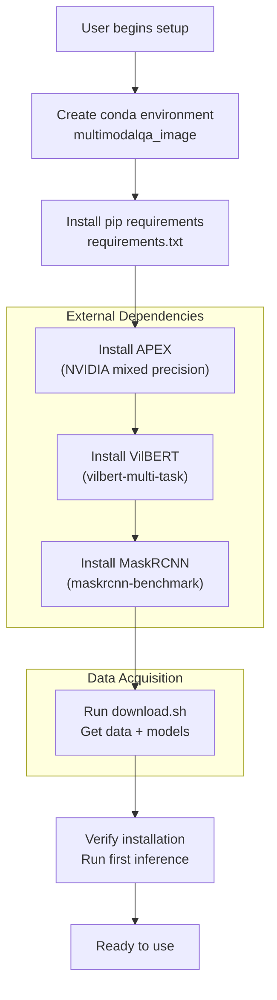

**Installation Flow Overview**

Sources: [baselines/README.md:4-10]()

## Step 1: Environment Setup

### Create Conda Environment

The repository provides a pre-configured conda environment specification:

```bash
conda env create -f baselines/image_qa/environment.yml
conda activate multimodalqa_image
```

This creates an environment named `multimodalqa_image` with Python 3.8, PyTorch 1.4.0, and CUDA 10.0 support.

Alternatively, create a virtual environment manually:

```bash
python -m venv mmqa_env
source mmqa_env/bin/activate
```

Sources: [baselines/image_qa/environment.yml:1-2](), [baselines/README.md:5-8]()

### Install Core Dependencies

Install the Python packages listed in `requirements.txt`:

```bash
pip install -r baselines/requirements.txt
```

This installs transformers, evaluation libraries, and other utilities needed for the baseline models.

Sources: [baselines/README.md:7-8]()

## Step 2: External Dependencies

The system requires three external libraries that must be installed separately:

### APEX (Mixed Precision Training)

```bash
git clone https://github.com/NVIDIA/apex
cd apex
pip install -v --no-cache-dir --global-option="--cpp_ext" --global-option="--cuda_ext" ./
```

APEX provides optimized kernels for mixed-precision training and inference.

### VilBERT Multi-Task

```bash
git clone https://github.com/facebookresearch/vilbert-multi-task.git
cd vilbert-multi-task
python setup.py develop
```

VilBERT is the backbone model for image QA. The multi-task version provides pre-trained weights for visual question answering.

### MaskRCNN Benchmark

```bash
git clone https://github.com/facebookresearch/maskrcnn-benchmark.git
cd maskrcnn-benchmark
python setup.py build develop
```

MaskRCNN extracts region features from images for the image QA model.

**Troubleshooting:** If you encounter `AT_CHECK` errors during MaskRCNN installation, this is a known issue with newer PyTorch versions. Replace `AT_CHECK` with `TORCH_CHECK` in the source files.

Sources: [baselines/README.md:9-10]()

## Step 3: Download Data and Models

### Download Script Overview

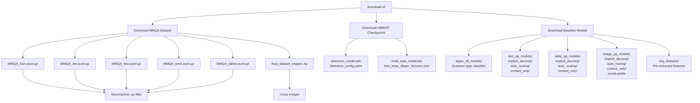

**Download Script Data Flow**

### Execute Download

Run the download script from the `baselines/` directory:

```bash
cd baselines
./scripts/download.sh
```

This script performs the following operations:

1. **Creates directory structure:**
   - `downloads/MMQA/` - Dataset files
   - `downloads/vilbert/` - VilBERT pre-trained models
   - `downloads/checkpoints/` - Baseline model checkpoints

2. **Downloads MMQA dataset** (~29K dev examples, training and test sets)
3. **Downloads VilBERT dependencies** (Detectron model, config files)
4. **Downloads baseline checkpoints** for all three methods:
   - `implicit_decomp` - Multi-hop reasoning
   - `auto_routing` - Single-hop routing
   - `context_only` - Context-based baseline

4. **Downloads pre-extracted image features** to avoid expensive feature extraction

The complete download is approximately 30-40GB.

Sources: [baselines/scripts/download.sh:1-27]()

### Directory Structure After Download

```
downloads/
├── MMQA/
│   ├── MMQA_train.jsonl
│   ├── MMQA_dev.jsonl
│   ├── MMQA_test.jsonl
│   ├── MMQA_texts.jsonl
│   ├── MMQA_tables.jsonl
│   └── final_dataset_images/
│       └── *.jpg
├── vilbert/
│   ├── detectron_model.pth
│   ├── detectron_config.yaml
│   ├── multi_task_model.bin
│   └── bert_base_6layer_6conect.json
└── checkpoints/
    ├── qtype_clf_models/
    ├── text_qa_models/
    │   ├── implicit_decomp/
    │   ├── auto_routing/
    │   └── context_only/
    ├── table_qa_models/
    │   ├── implicit_decomp/
    │   ├── auto_routing/
    │   └── context_only/
    ├── image_qa_models/
    │   ├── implicit_decomp/model.pt
    │   ├── auto_routing/model.pt
    │   ├── context_only/model.pt
    │   └── vocab.pickle
    └── img_features/
```

Sources: [baselines/scripts/download.sh:1-27](), [.gitignore:8-15]()

## Step 4: Run First Inference

### Basic Inference Command

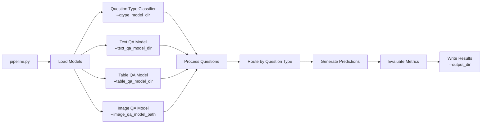

**Pipeline Command Flow**

To run inference on the dev set using the `implicit_decomp` method:

```bash
cd baselines

python pipeline.py \
  --qtype_model_dir downloads/checkpoints/qtype_clf_models/ \
  --text_qa_model_dir downloads/checkpoints/text_qa_models/implicit_decomp/ \
  --table_qa_model_dir downloads/checkpoints/table_qa_models/implicit_decomp/ \
  --image_qa_model_path downloads/checkpoints/image_qa_models/implicit_decomp/model.pt \
  --image_qa_vocab downloads/checkpoints/image_qa_models/vocab.pickle \
  --image_features_dir downloads/checkpoints/img_features/ \
  --data_dir downloads/MMQA/ \
  --test_file MMQA_dev.jsonl \
  --output_dir output/results/implicit_decomp_dev/ \
  --do_lower_case \
  --method implicit_decomp
```

### Command Parameters Explained

| Parameter | Purpose | Example Value |
|-----------|---------|---------------|
| `--qtype_model_dir` | Path to question type classifier | `downloads/checkpoints/qtype_clf_models/` |
| `--text_qa_model_dir` | Path to text QA model checkpoint | `downloads/checkpoints/text_qa_models/implicit_decomp/` |
| `--table_qa_model_dir` | Path to table QA model checkpoint | `downloads/checkpoints/table_qa_models/implicit_decomp/` |
| `--image_qa_model_path` | Path to image QA model `.pt` file | `downloads/checkpoints/image_qa_models/implicit_decomp/model.pt` |
| `--image_qa_vocab` | Vocabulary file for image QA | `downloads/checkpoints/image_qa_models/vocab.pickle` |
| `--image_features_dir` | Pre-extracted image features | `downloads/checkpoints/img_features/` |
| `--data_dir` | Root directory for MMQA data | `downloads/MMQA/` |
| `--test_file` | Input file (relative to data_dir) | `MMQA_dev.jsonl` |
| `--output_dir` | Directory for predictions and metrics | `output/results/implicit_decomp_dev/` |
| `--method` | Inference method to use | `implicit_decomp`, `auto_routing`, or `context_only` |
| `--do_lower_case` | Lowercase text during tokenization | Flag (no value) |

Sources: [baselines/README.md:21-35]()

### Expected Output

The inference process will:

1. Load all four models (question type classifier, text QA, table QA, image QA)
2. Process each question in `MMQA_dev.jsonl`
3. Route questions to appropriate models based on question type
4. Generate predictions and write to `output/results/implicit_decomp_dev/`
5. Compute evaluation metrics (F1 and Exact Match scores)

**Console output:**
```
Loading question type classifier...
Loading text QA model...
Loading table QA model...
Loading image QA model...
Processing questions: 100%|████████| 29918/29918
Evaluating predictions...
Results:
  Single-Modality: F1 51.60 / EM 58.35
  Multi-Modality: F1 44.59 / EM 51.19
  All: F1 48.79 / EM 55.48
```

Sources: [baselines/README.md:42-48]()

## Step 5: Verify Installation

### Run All Baselines

To verify that all components work correctly, run the complete evaluation script:

```bash
cd baselines
./scripts/run_pipeline.sh
```

This script runs all three baseline methods in parallel on separate GPUs:
- GPU 0: `implicit_decomp`
- GPU 1: `auto_routing`
- GPU 2: `context_only`

Logs are written to `logs/` directory for each method.

Sources: [baselines/README.md:38-41]()

### Expected Baseline Performance

If your installation is correct, you should see the following F1 / EM scores on the dev set:

| Method | Single-Modality | Multi-Modality | All |
|--------|-----------------|----------------|-----|
| Context-only | 7.94 / 10.73 | 6.63 / 9.00 | 7.41 / 10.03 |
| AutoRouting | 51.68 / 58.48 | 34.18 / 40.18 | 44.65 / 51.13 |
| ImplicitDecomp | 51.60 / 58.35 | 44.59 / 51.19 | **48.79 / 55.48** |

The `implicit_decomp` method achieves the best performance by performing explicit multi-hop reasoning.

Sources: [baselines/README.md:42-48]()

## Test-Only Prediction

To generate predictions without gold answers (e.g., for test set submission):

```bash
python pipeline.py \
  --qtype_model_dir downloads/checkpoints/qtype_clf_models/ \
  --text_qa_model_dir downloads/checkpoints/text_qa_models/implicit_decomp/ \
  --table_qa_model_dir downloads/checkpoints/table_qa_models/implicit_decomp/ \
  --image_qa_model_path downloads/checkpoints/image_qa_models/implicit_decomp/model.pt \
  --image_qa_vocab downloads/checkpoints/image_qa_models/vocab.pickle \
  --image_features_dir downloads/checkpoints/img_features/ \
  --data_dir downloads/MMQA/ \
  --test_file MMQA_test.jsonl \
  --output_dir output/results/implicit_decomp_test/ \
  --do_lower_case \
  --method implicit_decomp \
  --predict_only
```

The `--predict_only` flag skips evaluation and only writes predictions to the output directory.

Sources: [baselines/README.md:36]()

## Common Issues and Solutions

### Issue: CUDA Out of Memory

**Symptom:** `RuntimeError: CUDA out of memory`

**Solution:** Reduce batch size in model configuration or use a GPU with more memory. The image QA model requires approximately 11GB VRAM.

### Issue: AT_CHECK Not Defined

**Symptom:** Compilation error when installing MaskRCNN

**Solution:** This is a compatibility issue with PyTorch 1.5+. Replace `AT_CHECK` with `TORCH_CHECK` in MaskRCNN source files or use PyTorch 1.4.

Sources: [baselines/README.md:10]()

### Issue: Missing Image Features

**Symptom:** `FileNotFoundError` when loading image features

**Solution:** Ensure `img_features.tar.gz` was downloaded and extracted correctly. The features should be in `downloads/checkpoints/img_features/`.

### Issue: Slow First Run

**Symptom:** First inference takes significantly longer than subsequent runs

**Explanation:** This is expected. The first run compiles CUDA kernels and caches them. Subsequent runs will be faster.

## Next Steps

Now that you have a working installation:

1. **Explore the dataset** - See [Dataset Format Specification](#3.1) to understand the data structure
2. **Understand inference methods** - Read [Inference Methods](#4.2) to learn about the three baseline approaches
3. **Run detailed evaluations** - See [Running Baseline Evaluations](#6.2) for more analysis options
4. **Train custom models** - Follow [Training Models](#7) to train your own models

For a quick overview of running predictions, see [Quick Start Guide](#2.2).

Sources: [baselines/README.md:1-52]()

---

# Page: Installation and Environment Setup

# Installation and Environment Setup

<details>
<summary>Relevant source files</summary>

The following files were used as context for generating this wiki page:

- [.gitignore](.gitignore)
- [baselines/image_qa/environment.yml](baselines/image_qa/environment.yml)
- [baselines/scripts/download.sh](baselines/scripts/download.sh)

</details>


## Purpose and Scope

This page provides detailed instructions for setting up the development and runtime environment for the MultiModalQA system. It covers conda environment creation, dependency installation, and downloading pre-trained models and datasets. 

For guidance on running inference after setup, see [Quick Start Guide](#2.2). For training new models, see [Training Models](#7).

---

## Overview

The MultiModalQA system requires a carefully configured environment due to its dependencies on specialized computer vision libraries (Detectron, VilBERT) and CUDA-accelerated PyTorch. The setup process consists of four major steps:

1. **Create conda environment** with Python 3.8 and PyTorch 1.4.0
2. **Install external dependencies** (APEX, VilBERT, MaskRCNN)
3. **Download datasets and models** using the provided script
4. **Verify installation** by checking key imports

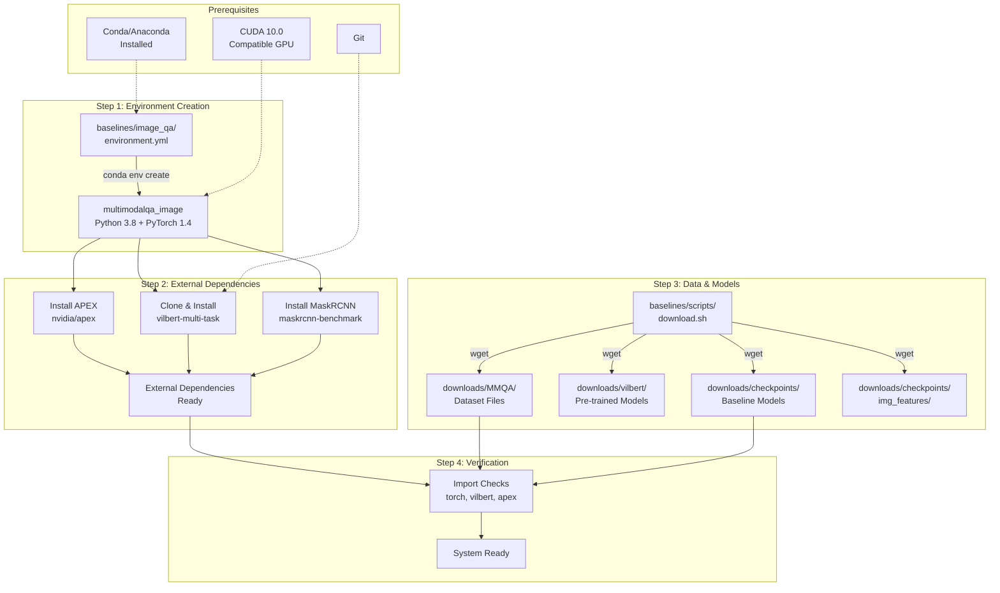

**Sources:** [baselines/image_qa/environment.yml:1-173](), [baselines/scripts/download.sh:1-27]()

---

## Prerequisites

The following must be installed on your system before proceeding:

| Requirement | Version | Purpose |
|------------|---------|---------|
| **Anaconda/Miniconda** | Latest | Package and environment management |
| **CUDA Toolkit** | 10.0 | GPU acceleration for PyTorch |
| **NVIDIA Driver** | Compatible with CUDA 10.0 | GPU support |
| **Git** | Any recent version | Cloning external repositories |
| **GCC/G++** | 7.x or 8.x | Compiling C++ extensions (APEX, MaskRCNN) |
| **Disk Space** | ~50 GB | Dataset images, models, and features |

**GPU Requirements:** The image QA model requires a CUDA-capable GPU with at least 12GB VRAM for training, or 8GB for inference.

**Sources:** [baselines/image_qa/environment.yml:24]() (cudatoolkit), [baselines/image_qa/environment.yml:124]() (pytorch version)

---

## Step 1: Create Conda Environment

The primary conda environment is defined in [baselines/image_qa/environment.yml:1-173](). This environment is named `multimodalqa_image` and contains all core dependencies.

### Creating the Environment

```bash
# Navigate to the repository root
cd /path/to/multimodalqa

# Create the conda environment
conda env create -f baselines/image_qa/environment.yml

# Activate the environment
conda activate multimodalqa_image
```

### Key Dependencies Installed

The environment specification includes:

| Package | Version | Channel | Purpose |
|---------|---------|---------|---------|
| `python` | 3.8.10 | conda-forge | Base interpreter |
| `pytorch` | 1.4.0 | pytorch | Deep learning framework |
| `cudatoolkit` | 10.0.130 | pytorch | CUDA support |
| `torchvision` | 0.5.0 | pytorch | Vision utilities |
| `numpy` | 1.20.2 | anaconda | Numerical computing |
| `pillow` | 8.3.1 | anaconda | Image processing |
| `opencv` | 4.5.2 | conda-forge | Computer vision |
| `boto3` | 1.16.0 | anaconda | AWS S3 downloads |
| `tqdm` | 4.61.2 | conda-forge | Progress bars |

### Pip-Installed Packages

Additional packages installed via pip within the environment [baselines/image_qa/environment.yml:154-172]():

| Package | Version | Purpose |
|---------|---------|---------|
| `apex` | 0.1 | Mixed-precision training |
| `pytorch-transformers` | 1.0.0 | BERT/RoBERTa tokenizers |
| `pycocotools` | 2.0 | COCO dataset utilities |
| `tensorboardx` | 2.4 | Training visualization |
| `jsonlines` | 2.0.0 | JSONL file parsing |
| `yacs` | 0.1.8 | Configuration management |
| `easydict` | 1.9 | Dictionary utilities |

**Sources:** [baselines/image_qa/environment.yml:1-173]()

---

## Step 2: Install External Dependencies

The MultiModalQA system depends on three external repositories that must be cloned and installed separately. These are not available via conda or pip and require manual installation.

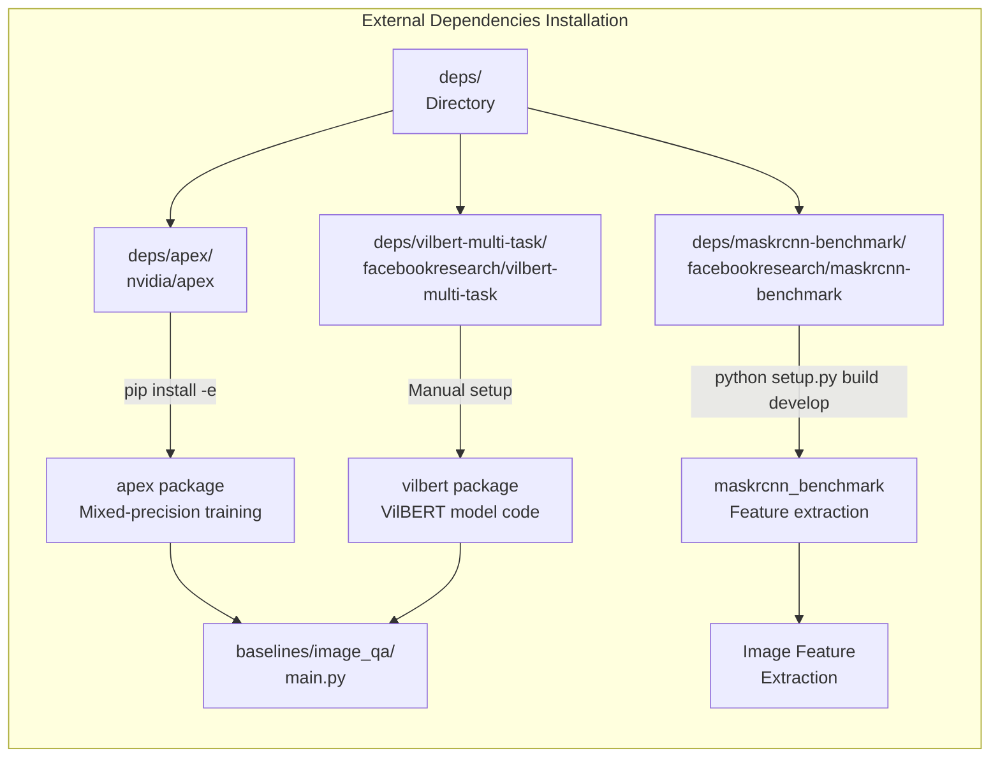

### Installing APEX

APEX provides mixed-precision training capabilities and is required for efficient image QA training.

```bash
# Navigate to deps directory
mkdir -p deps
cd deps

# Clone APEX repository
git clone https://github.com/NVIDIA/apex
cd apex

# Install with CUDA extensions
pip install -v --no-cache-dir --global-option="--cpp_ext" --global-option="--cuda_ext" ./

# Return to repo root
cd ../..
```

**Note:** APEX installation may take 10-15 minutes due to C++/CUDA compilation.

### Installing VilBERT Multi-Task

VilBERT provides the vision-language model architecture used by the image QA component.

```bash
# Navigate to deps directory
cd deps

# Clone VilBERT repository
git clone https://github.com/facebookresearch/vilbert-multi-task.git
cd vilbert-multi-task

# Install package
python setup.py develop

# Return to repo root
cd ../..
```

The VilBERT code will be importable as `vilbert` after installation.

### Installing MaskRCNN Benchmark

MaskRCNN Benchmark is used for image feature extraction (detecting objects and extracting visual features).

```bash
# Navigate to deps directory
cd deps

# Clone MaskRCNN repository
git clone https://github.com/facebookresearch/maskrcnn-benchmark.git
cd maskrcnn-benchmark

# Build and install
python setup.py build develop

# Return to repo root
cd ../..
```

**Troubleshooting:** If compilation fails, ensure:
- CUDA 10.0 is in your PATH: `export PATH=/usr/local/cuda-10.0/bin:$PATH`
- CUDA libraries are accessible: `export LD_LIBRARY_PATH=/usr/local/cuda-10.0/lib64:$LD_LIBRARY_PATH`
- GCC version is compatible (7.x or 8.x)

**Sources:** [baselines/image_qa/environment.yml:155]() (apex reference)

---

## Step 3: Download Models and Data

The [baselines/scripts/download.sh:1-27]() script automates downloading all required datasets, pre-trained models, and baseline checkpoints.

### Directory Structure After Download

```mermaid
graph TB
    ROOT["Repository Root"]
    
    ROOT --> DL["downloads/"]
    
    DL --> MMQA_DIR["downloads/MMQA/"]
    DL --> VILBERT_DIR["downloads/vilbert/"]
    DL --> CKPT_DIR["downloads/checkpoints/"]
    
    MMQA_DIR --> TRAIN["MMQA_train.jsonl<br/>Training examples"]
    MMQA_DIR --> DEV["MMQA_dev.jsonl<br/>29,918 dev examples"]
    MMQA_DIR --> TEST["MMQA_test.jsonl<br/>Test examples"]
    MMQA_DIR --> TEXTS["MMQA_texts.jsonl<br/>Text contexts"]
    MMQA_DIR --> TABLES["MMQA_tables.jsonl<br/>Table contexts"]
    MMQA_DIR --> IMGS["final_dataset_images/<br/>Image files"]
    
    VILBERT_DIR --> DET_MODEL["detectron_model.pth<br/>Object detector weights"]
    VILBERT_DIR --> DET_CFG["detectron_config.yaml<br/>Detector config"]
    VILBERT_DIR --> MULTI_MODEL["multi_task_model.bin<br/>Pre-trained VilBERT"]
    VILBERT_DIR --> BERT_CFG["bert_base_6layer_6conect.json<br/>Model architecture"]
    
    CKPT_DIR --> QTYPE["qtype_clf_models/<br/>Question type classifiers"]
    CKPT_DIR --> TXT_QA["text_qa_models/<br/>Text QA checkpoints"]
    CKPT_DIR --> TBL_QA["table_qa_models/<br/>Table QA checkpoints"]
    CKPT_DIR --> IMG_QA["image_qa_models/<br/>Image QA checkpoints"]
    CKPT_DIR --> IMG_FEAT["img_features/<br/>Pre-computed features"]
```

### Running the Download Script

```bash
# Make script executable
chmod +x baselines/scripts/download.sh

# Run download script (requires ~30 GB disk space)
cd baselines
./scripts/download.sh
cd ..
```

### Download Contents

The script performs the following operations [baselines/scripts/download.sh:1-27]():

1. **Dataset Files** [lines 1-9](): Downloads and extracts MMQA train/dev/test splits, text/table contexts, and images
   - Source: GitHub releases and S3 bucket
   - Total size: ~20 GB (mostly images)

2. **VilBERT Pre-trained Models** [lines 11-16](): Downloads Detectron object detector and multi-task VilBERT weights
   - Source: Facebook AI public files
   - Used for image feature extraction and model initialization

3. **Baseline Checkpoints** [lines 18-23](): Downloads trained models for all three modalities and question type classifier
   - Source: MultiModalQA S3 bucket
   - Organized by inference method (implicit_decomp, auto_routing, context_only)

4. **Pre-computed Image Features** [lines 25-26](): Downloads cached visual features for all dataset images
   - Source: MultiModalQA S3 bucket
   - Size: ~8 GB
   - Avoids expensive feature re-extraction during inference

**Sources:** [baselines/scripts/download.sh:1-27]()

---

## Step 4: Verify Installation

After completing the setup, verify that all components are correctly installed:

### Import Test

Create a test script `test_imports.py`:

```python
#!/usr/bin/env python
"""Verify all required packages can be imported."""

import sys

def test_imports():
    """Test importing critical dependencies."""
    errors = []
    
    # Core dependencies
    try:
        import torch
        print(f"✓ PyTorch {torch.__version__}")
        print(f"  CUDA available: {torch.cuda.is_available()}")
        if torch.cuda.is_available():
            print(f"  CUDA version: {torch.version.cuda}")
    except ImportError as e:
        errors.append(f"✗ PyTorch: {e}")
    
    # External dependencies
    try:
        import apex
        print("✓ APEX")
    except ImportError as e:
        errors.append(f"✗ APEX: {e}")
    
    try:
        import vilbert
        print("✓ VilBERT")
    except ImportError as e:
        errors.append(f"✗ VilBERT: {e}")
    
    try:
        import maskrcnn_benchmark
        print("✓ MaskRCNN Benchmark")
    except ImportError as e:
        errors.append(f"✗ MaskRCNN Benchmark: {e}")
    
    # Utility packages
    try:
        import jsonlines
        print("✓ jsonlines")
    except ImportError as e:
        errors.append(f"✗ jsonlines: {e}")
    
    if errors:
        print("\nErrors encountered:")
        for error in errors:
            print(error)
        sys.exit(1)
    else:
        print("\n✓ All imports successful!")

if __name__ == "__main__":
    test_imports()
```

Run the verification:

```bash
conda activate multimodalqa_image
python test_imports.py
```

### Directory Structure Verification

Check that downloaded files are in place:

```bash
# Verify dataset
ls downloads/MMQA/MMQA_dev.jsonl

# Verify VilBERT models
ls downloads/vilbert/multi_task_model.bin

# Verify baseline checkpoints
ls downloads/checkpoints/image_qa_models/

# Verify image features
ls downloads/checkpoints/img_features/
```

### Expected Output

A successful installation should show:

```
✓ PyTorch 1.4.0
  CUDA available: True
  CUDA version: 10.0
✓ APEX
✓ VilBERT
✓ MaskRCNN Benchmark
✓ jsonlines

✓ All imports successful!
```

**Sources:** [baselines/image_qa/environment.yml:1-173](), [baselines/scripts/download.sh:1-27]()

---

## Environment Variables

For proper operation, set the following environment variables in your shell configuration (`~/.bashrc` or `~/.zshrc`):

```bash
# CUDA paths (adjust version/path as needed)
export CUDA_HOME=/usr/local/cuda-10.0
export PATH=$CUDA_HOME/bin:$PATH
export LD_LIBRARY_PATH=$CUDA_HOME/lib64:$LD_LIBRARY_PATH

# Set cache directories (optional, for faster loading)
export HF_HOME=/path/to/cache/huggingface  # Hugging Face cache
export TORCH_HOME=/path/to/cache/torch     # PyTorch model cache
```

**Sources:** [baselines/image_qa/environment.yml:24]() (CUDA version requirement)

---

## Troubleshooting Common Issues

### CUDA Version Mismatch

**Problem:** `RuntimeError: CUDA error: no kernel image is available for execution on the device`

**Solution:** Ensure CUDA 10.0 is installed and PyTorch 1.4.0 was compiled for CUDA 10.0:
```bash
python -c "import torch; print(torch.version.cuda)"
# Should output: 10.0
```

### APEX Installation Failure

**Problem:** `error: command 'gcc' failed with exit status 1`

**Solution:** 
1. Check GCC version: `gcc --version` (should be 7.x or 8.x)
2. Try installation without CUDA extensions for CPU-only testing:
   ```bash
   pip install -v --no-cache-dir apex
   ```

### Out of Memory During Feature Extraction

**Problem:** `RuntimeError: CUDA out of memory`

**Solution:** Use pre-computed features from [baselines/scripts/download.sh:25-26]() instead of extracting features yourself. The download script provides these cached features.

### Missing Git LFS Files

**Problem:** Large files appear as pointer files after cloning

**Solution:** Install Git LFS and re-download:
```bash
git lfs install
git lfs pull
```

**Sources:** [baselines/image_qa/environment.yml:155]() (apex), [baselines/scripts/download.sh:25-26]() (pre-computed features)

---

## Next Steps

After completing the installation:

1. **Quick Start**: See [Quick Start Guide](#2.2) for running inference on sample questions
2. **Understanding the Dataset**: See [Dataset Format Specification](#3.1) to understand the data structure
3. **Running Baselines**: See [Running Baseline Evaluations](#6.2) to reproduce published results
4. **Training Models**: See [Training Image QA Models](#7.1) to train custom models

**Sources:** [baselines/image_qa/environment.yml:1-173](), [baselines/scripts/download.sh:1-27]()

---

# Page: Quick Start Guide

# Quick Start Guide

<details>
<summary>Relevant source files</summary>

The following files were used as context for generating this wiki page:

- [baselines/README.md](baselines/README.md)
- [baselines/pipeline.py](baselines/pipeline.py)
- [baselines/scripts/run_pipeline.sh](baselines/scripts/run_pipeline.sh)

</details>


This guide walks you through running your first inference with the MultiModalQA baseline models. By the end of this guide, you will have downloaded the necessary data and models, executed an inference command, and obtained predictions on a sample question from the development set.

**Scope**: This guide covers the minimal steps to run inference using pre-trained baseline models. For detailed installation instructions, see [Installation and Environment Setup](#2.1). For comprehensive documentation of the inference pipeline, see [Pipeline Implementation](#6.1). For training your own models, see [Training Models](#7).

---

## Prerequisites

Before proceeding, ensure you have:
- Completed the environment setup described in [Installation and Environment Setup](#2.1)
- Activated the appropriate conda environment (e.g., `multimodalqa_image`)
- Navigate to the `baselines/` directory in your terminal

Sources: [baselines/README.md:1-10]()

---

## Step 1: Download Data and Models

The repository provides a download script that fetches all required data and pre-trained model checkpoints. Execute the following command from the `baselines/` directory:

```bash
./scripts/download.sh
```

This script downloads the following components:

| Component | Location | Description |
|-----------|----------|-------------|
| **Dataset Files** | `downloads/MMQA/` | Contains `MMQA_dev.jsonl`, `MMQA_test.jsonl`, and context files (`MMQA_texts.jsonl`, `MMQA_tables.jsonl`, `MMQA_images.jsonl`) |
| **Question Type Classifier** | `downloads/checkpoints/qtype_clf_models/` | Pre-trained classifier for routing questions to appropriate modalities |
| **Text QA Models** | `downloads/checkpoints/text_qa_models/` | Separate checkpoints for `implicit_decomp/`, `auto_routing/`, and `context_only/` methods |
| **Table QA Models** | `downloads/checkpoints/table_qa_models/` | Separate checkpoints for each inference method |
| **Image QA Models** | `downloads/checkpoints/image_qa_models/` | Model checkpoints (`model.pt`) and vocabulary (`vocab.pickle`) for each method |
| **Pre-extracted Image Features** | `downloads/checkpoints/img_features/` | Cached Detectron features for all images to accelerate inference |
| **VilBERT Weights** | `downloads/vilbert/` | Pre-trained VilBERT model and configuration files |

### Download Directory Structure

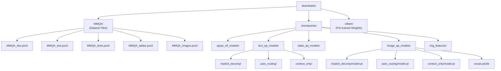

Sources: [baselines/README.md:12-17]()

---

## Step 2: Run Your First Inference

Execute the following command to run inference using the **implicit_decomp** baseline on the development set:

```bash
python pipeline.py \
  --qtype_model_dir downloads/checkpoints/qtype_clf_models/ \
  --text_qa_model_dir downloads/checkpoints/text_qa_models/implicit_decomp/ \
  --table_qa_model_dir downloads/checkpoints/table_qa_models/implicit_decomp/ \
  --image_qa_model_path downloads/checkpoints/image_qa_models/implicit_decomp/model.pt \
  --image_qa_vocab downloads/checkpoints/image_qa_models/vocab.pickle \
  --image_features_dir downloads/checkpoints/img_features/ \
  --data_dir downloads/MMQA/ \
  --test_file MMQA_dev.jsonl \
  --output_dir output/results/implicit_decomp_dev/ \
  --do_lower_case \
  --method implicit_decomp
```

### Command Breakdown

The following diagram maps command-line arguments to their corresponding system components and code entities:

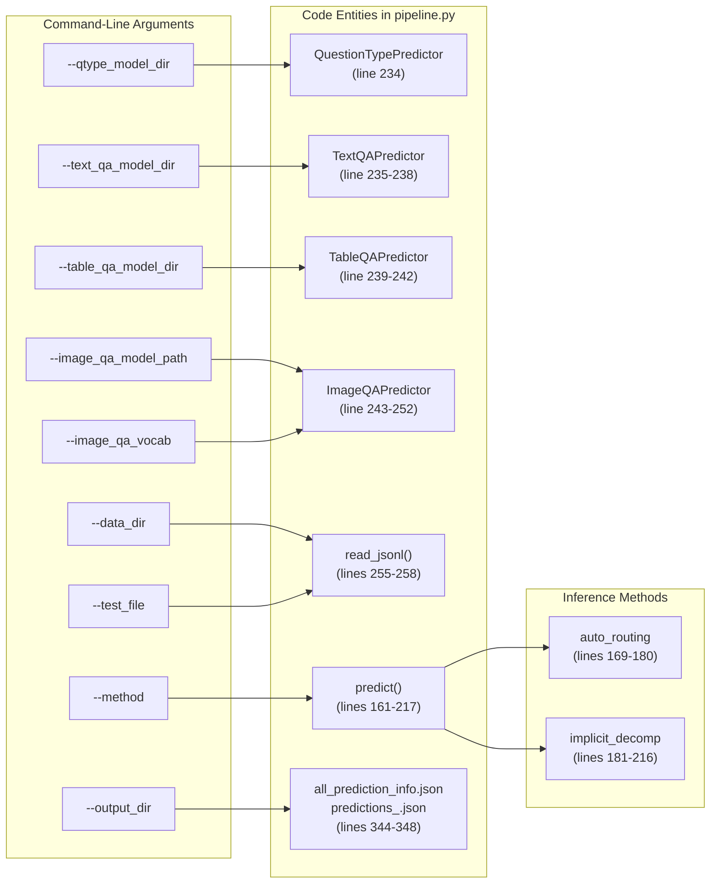

### Key Arguments Explained

| Argument | Purpose | Code Reference |
|----------|---------|----------------|
| `--qtype_model_dir` | Checkpoint directory for the question type classifier that routes questions to appropriate modalities | [pipeline.py:234]() |
| `--text_qa_model_dir` | Checkpoint for text-based QA (BERT/RoBERTa) | [pipeline.py:235-238]() |
| `--table_qa_model_dir` | Checkpoint for table-based QA (BERT/RoBERTa with table linearization) | [pipeline.py:239-242]() |
| `--image_qa_model_path` | Path to VilBERT model checkpoint for visual question answering | [pipeline.py:243-252]() |
| `--image_qa_vocab` | Vocabulary file for decoding image QA answers | [pipeline.py:247]() |
| `--image_features_dir` | Pre-extracted Detectron features to avoid online feature computation | [pipeline.py:250]() |
| `--data_dir` | Root directory containing all dataset files | [pipeline.py:255]() |
| `--test_file` | Which split to evaluate: `MMQA_dev.jsonl` or `MMQA_test.jsonl` | [pipeline.py:261]() |
| `--method` | Inference strategy: `implicit_decomp` or `auto_routing` | [pipeline.py:169-216]() |
| `--do_lower_case` | Enable for uncased BERT models (BERT-base), disable for cased models | [pipeline.py:237]() |

Sources: [baselines/README.md:21-36](), [baselines/pipeline.py:27-159]()

---

## Step 3: Understanding the Execution Flow

When you run `pipeline.py`, the system executes the following sequence:

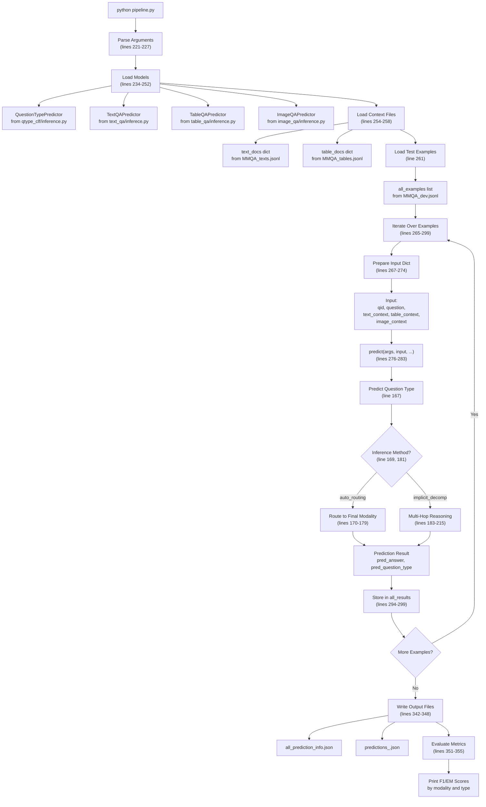

Sources: [baselines/pipeline.py:220-356]()

---

## Step 4: Examining the Output

After execution completes, the system writes results to the specified `--output_dir`:

### Output Files

| File | Content | Purpose |
|------|---------|---------|
| `all_prediction_info.json` | Complete prediction details including intermediate hops, scores, and metadata | Detailed analysis of model behavior |
| `predictions_.json` | Simple mapping of question IDs to predicted answers | Direct evaluation against ground truth |

### Sample Output Structure

The `all_prediction_info.json` file contains entries like:

```json
{
  "qid_example": {
    "qid": "qid_example",
    "question": "What position does the person in the image play?",
    "pred_answer": ["goalkeeper"],
    "pred_question_type": "ImageToText",
    "pred_first_hop_answer": ["Player Name"],
    "pred_second_hop_answer": ["goalkeeper"],
    "gold_question_type": "ImageToText",
    "gold_answer": ["goalkeeper"],
    "em_score": 1.0,
    "f1_score": 1.0,
    "first_hop_em_score": 1.0,
    "first_hop_f1_score": 1.0
  }
}
```

Sources: [baselines/pipeline.py:294-348]()

### Evaluation Metrics

If running on the development set (not using `--predict_only`), the system automatically evaluates and prints metrics:

```
============== Evaluation ==============
F1: 48.79
EM: 55.48

By Modality:
  Single-Modality F1: 51.60 / EM: 58.35
  Multi-Modality  F1: 44.59 / EM: 51.19

By Question Type:
  TextQ         F1: XX.XX / EM: XX.XX
  TableQ        F1: XX.XX / EM: XX.XX
  ImageQ        F1: XX.XX / EM: XX.XX
  ...
```

Sources: [baselines/README.md:42-48](), [baselines/pipeline.py:351-355]()

---

## Step 5: Testing Different Inference Methods

The MultiModalQA system supports three inference methods. To test each method, modify the `--method` argument and the model checkpoint directories:

### Quick Comparison of Methods

| Method | Description | Command Modification | Expected Dev F1/EM |
|--------|-------------|----------------------|-------------------|
| **implicit_decomp** | Multi-hop reasoning with explicit bridge entity extraction | `--method implicit_decomp` <br/> Use `implicit_decomp/` model directories | 48.79 / 55.48 |
| **auto_routing** | Direct routing to final answer modality without decomposition | `--method auto_routing` <br/> Use `auto_routing/` model directories | 44.65 / 51.13 |
| **context_only** | Baseline that ignores questions entirely | `--method auto_routing --context_only` <br/> Use `context_only/` model directories | 7.41 / 10.03 |

### Running All Three Methods in Parallel

For comprehensive evaluation, use the provided batch script:

```bash
./scripts/run_pipeline.sh
```

This script executes all three baseline methods in parallel, each on a separate GPU (GPU 0, 1, 2). Logs are written to `logs/` directory:

- `logs/evaluate_implicit_decomp_dev.log`
- `logs/evaluate_auto_routing_dev.log`
- `logs/evaluate_context_only_dev.log`

#### Parallel Execution Flow

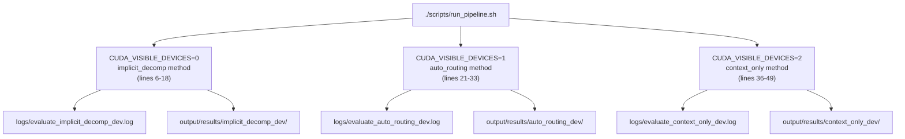

Sources: [baselines/scripts/run_pipeline.sh:1-50](), [baselines/README.md:38-48]()

---

## Example: Single Question Walkthrough

To understand the complete inference process, consider this example question from the development set:

**Question**: "What position does the person shown in the first image play?"  
**Question Type**: ImageToText (multi-hop Compose)  
**Gold Answer**: ["midfielder"]

### Processing with implicit_decomp Method

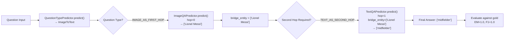

Sources: [baselines/pipeline.py:161-217]()

---

## Common Options and Variants

### Running on Test Set (Prediction Only)

To generate predictions without evaluation (for test set submission):

```bash
python pipeline.py \
  [... same arguments as above ...] \
  --test_file MMQA_test.jsonl \
  --predict_only
```

The `--predict_only` flag disables metric computation and only generates `predictions_.json` ([pipeline.py:112-115]()).

### Using Oracle Question Types

For debugging or upper-bound analysis, use gold question types instead of predictions:

```bash
python pipeline.py \
  [... same arguments as above ...] \
  --use_oracle_qtype
```

This bypasses the question type classifier and uses ground truth types from the dataset ([pipeline.py:102-105](), [pipeline.py:164-166]()).

### Custom Sequence Length Parameters

Adjust tokenization parameters for different hardware constraints:

| Parameter | Default | Description | Code Reference |
|-----------|---------|-------------|----------------|
| `--max_seq_length` | 384 | Maximum input sequence length after tokenization | [pipeline.py:122-126]() |
| `--doc_stride` | 128 | Stride for splitting long documents | [pipeline.py:129-133]() |
| `--max_query_length` | 100 | Maximum question length | [pipeline.py:135-139]() |
| `--max_answer_length` | 30 | Maximum generated answer length | [pipeline.py:148-152]() |

Sources: [baselines/pipeline.py:73-159]()

---

## Next Steps

After completing this quick start guide, you can:

1. **Explore the Full Pipeline**: See [Pipeline Implementation](#6.1) for detailed documentation of the inference orchestration logic
2. **Train Your Own Models**: Follow [Training Models](#7) to train custom models with your own data
3. **Understand the Dataset**: Read [Dataset Format Specification](#3.1) to learn about the data structure
4. **Deep Dive into Models**: See [Baseline Models](#5) for comprehensive documentation of each modality-specific model
5. **Customize Evaluation**: Refer to [Evaluation Metrics](#8.1) to understand how predictions are scored

For troubleshooting and additional configuration options, consult the individual model documentation:
- Image QA: [Image QA Model](#5.1)
- Table QA: [Table QA Model](#5.2)
- Text QA: [Text QA Model](#5.3)

Sources: [baselines/README.md:50-52]()

---

# Page: Dataset

# Dataset

<details>
<summary>Relevant source files</summary>

The following files were used as context for generating this wiki page:

- [README.md](README.md)
- [dataset/MMQA_dev.jsonl.gz](dataset/MMQA_dev.jsonl.gz)
- [dataset/MMQA_images.jsonl.gz](dataset/MMQA_images.jsonl.gz)
- [dataset/MMQA_tables.jsonl.gz](dataset/MMQA_tables.jsonl.gz)

</details>


This document describes the MultiModalQA dataset, including its structure, file formats, and organization. The dataset consists of 29,918 examples requiring joint reasoning over text, tables, and images.

For detailed specifications of the JSONL file formats, see [Dataset Format Specification](#3.1). For information about question categorization, see [Question Types and Taxonomy](#3.2). For details on context file structures, see [Context Files and Structure](#3.3).

## Dataset Overview

The MultiModalQA dataset is organized into separate files for questions/answers and contextual evidence across three modalities. Each question is associated with a set of context documents (text paragraphs, tables, and/or images) that contain the information needed to answer it.

**Dataset Size:**
- Total examples: 29,918
- Split into train, dev, and test sets
- Context corpus: Shared across all splits

**Sources:** [README.md:1-22]()

## File Organization

The dataset is distributed as a collection of compressed JSONL files and an image archive.

### Dataset Files Structure

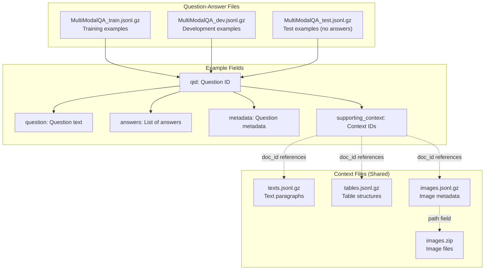

**Sources:** [README.md:15-22]()

## Core Data Structures

### Question-Answer Record

Each line in `MultiModalQA_train.jsonl.gz`, `MultiModalQA_dev.jsonl.gz`, or `MultiModalQA_test.jsonl.gz` represents a single question with the following structure:

| Field | Type | Description |
|-------|------|-------------|
| `qid` | string | Unique question identifier (e.g., `"5454c14ad01e722c2619b66778daa98b"`) |
| `question` | string | Natural language question text |
| `answers` | array | List of answer objects (empty in test set) |
| `metadata` | object | Question type, modalities, entities, intermediate answers |
| `supporting_context` | array | List of `{doc_id, doc_part}` objects pointing to context documents |

**Example:**
```json
{
  "qid": "5454c14ad01e722c2619b66778daa98b",
  "question": "who owns the rights to little shop of horrors?",
  "answers": ["answer1", "answer2"],
  "metadata": {},
  "supporting_context": [{
      "doc_id": "46ae2a8e7928ed5a8e5f9c59323e5e49",
      "doc_part": "table"
    },
    {
      "doc_id": "d57e56eff064047af5a6ef074a570956",
      "doc_part": "image"
    }]
}
```

**Sources:** [README.md:23-45]()

### Answer Object Structure

Each answer in the `answers` array contains provenance information linking it back to source documents:

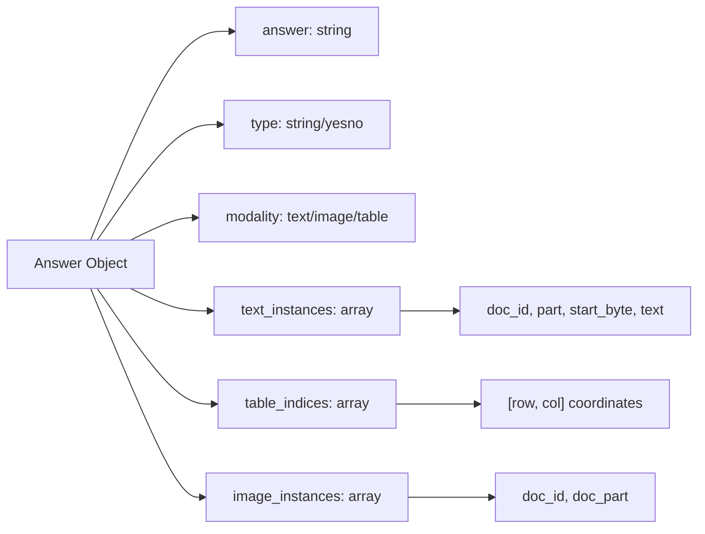

| Field | Description |
|-------|-------------|
| `answer` | The answer string |
| `type` | Answer type: `"string"` or `"yesno"` |
| `modality` | Source modality: `"text"`, `"image"`, or `"table"` |
| `text_instances` | List of text paragraph locations containing this answer |
| `table_indices` | List of `[row, column]` coordinates in tables |
| `image_instances` | List of image document IDs containing this answer |

**Sources:** [README.md:47-68]()

### Metadata Structure

The `metadata` object provides rich annotations for each question:

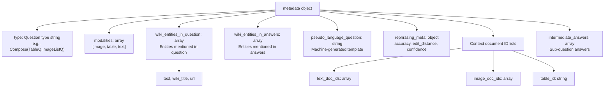

**Key Metadata Fields:**
- `type`: Question type from 16-category taxonomy (e.g., `"Compose(TableQ,ImageListQ)"`)
- `modalities`: List of modalities required to answer (subset of `["text", "table", "image"]`)
- `intermediate_answers`: Ground truth for multi-hop sub-questions, enabling supervision for decomposition
- `pseudo_language_question`: Template-based question before human rephrasing
- Context ID lists: `text_doc_ids`, `image_doc_ids`, `table_id` point to relevant context documents (includes distractors)

**Sources:** [README.md:70-108]()

## Context File Formats

### Text Context Structure

Each line in `texts.jsonl.gz` represents a text paragraph:

| Field | Type | Description |
|-------|------|-------------|
| `title` | string | Wikipedia article title |
| `url` | string | Wikipedia article URL |
| `id` | string | Unique document ID (referenced in `supporting_context`) |
| `text` | string | Paragraph text content |

**Sources:** [README.md:171-181]()

### Table Context Structure

Each line in `tables.jsonl.gz` represents a table with the following hierarchy:

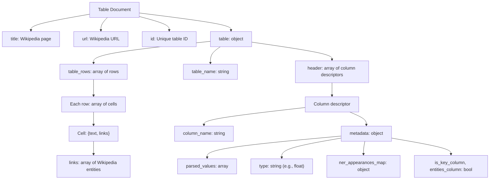

**Column Metadata** (in `header` array):
- `parsed_values`: Extracted numeric/date values
- `type`: Inferred data type (e.g., `"float"`, `"string"`)
- `ner_appearances_map`: Named entity counts (e.g., `{"DATE": 10}`)
- `is_key_column`: Whether this column contains primary keys
- `entities_column`: Whether this column contains entity references

**Sources:** [README.md:110-156]()

### Image Context Structure

Each line in `images.jsonl.gz` contains metadata for an image:

| Field | Type | Description |
|-------|------|-------------|
| `title` | string | Wikipedia article title |
| `url` | string | Wikipedia article URL |
| `id` | string | Unique image ID (referenced in `supporting_context`) |
| `path` | string | Filename in `images.zip` archive (e.g., `"Taipei.jpg"`) |

The actual image files are stored separately in `images.zip` and can be accessed using the `path` field.

**Sources:** [README.md:158-169]()

## Data Flow and References

The following diagram shows how different files reference each other:

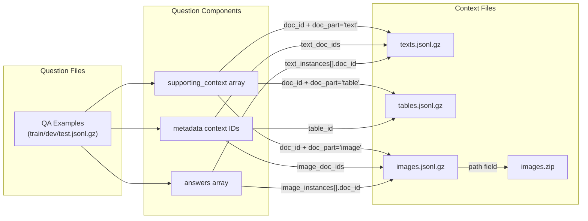

**Key Reference Patterns:**

1. **supporting_context** → Context files: Uses `doc_id` + `doc_part` to identify specific documents
2. **metadata context IDs** → Context files: Lists all relevant context (including distractors)
3. **answer instances** → Context files: Pinpoints exact answer locations
4. **images.jsonl.gz** → **images.zip**: Uses `path` field to locate image files

**Sources:** [README.md:23-181]()

## Dataset Statistics

Based on the development set (`MMQA_dev.jsonl.gz`):
- **Total examples:** 29,918 (mentioned in overview)
- **Modalities:** Questions span single-modality and multi-modal reasoning
- **Question types:** 16 distinct categories (see [Question Types and Taxonomy](#3.2))
- **Context diversity:** Includes both supporting documents and distractor documents

**Sources:** [README.md:3]()

## Usage Notes

### Loading Data

All question and context files are gzip-compressed JSONL (JSON Lines) format. Each line is a valid JSON object:

```python
import gzip
import json

# Load questions
with gzip.open('dataset/MultiModalQA_dev.jsonl.gz', 'rt') as f:
    questions = [json.loads(line) for line in f]

# Load text contexts
with gzip.open('dataset/texts.jsonl.gz', 'rt') as f:
    texts = {json.loads(line)['id']: json.loads(line) for line in f}
```

### Test Set

The test set (`MultiModalQA_test.jsonl.gz`) follows the same format as train/dev but **excludes** the `answers` and `supporting_context` fields, as these are held out for evaluation purposes.

**Sources:** [README.md:44-45]()

### Context Resolution

To retrieve context for a question:

1. Use `metadata.text_doc_ids`, `metadata.table_id`, `metadata.image_doc_ids` to get all relevant context IDs
2. Look up these IDs in the corresponding context files (`texts.jsonl.gz`, `tables.jsonl.gz`, `images.jsonl.gz`)
3. For images, use the `path` field from `images.jsonl.gz` to extract files from `images.zip`

Note that the context ID lists include both **supporting documents** (containing answers) and **distractor documents** (not directly relevant). The `supporting_context` field in train/dev sets identifies which documents actually contain answers.

**Sources:** [README.md:70-108]()

## Additional Resources

- **Dataset download:** Available at https://multimodalqa-images.s3-us-west-2.amazonaws.com/final_dataset_images/final_dataset_images.zip (for images)
- **Paper:** "MultiModalQA: Complex Question Answering over Text, Tables and Images" (ICLR 2021)
- **Website:** https://allenai.github.io/multimodalqa/

For training and inference procedures using this dataset, see [Running Inference](#6) and [Training Models](#7).

**Sources:** [README.md:5-6](), [README.md:21]()

---

# Page: Dataset Format Specification

# Dataset Format Specification

<details>
<summary>Relevant source files</summary>

The following files were used as context for generating this wiki page:

- [README.md](README.md)

</details>


## Purpose and Scope

This document provides detailed specifications for all JSONL file formats in the MultiModalQA dataset. It describes the structure of question files, answer annotations, metadata fields, and multi-modal context files (text, tables, images). This page focuses on the low-level data format and field definitions.

For information about the question type taxonomy and classification, see [Question Types and Taxonomy](#3.2). For details about how context files are organized and accessed, see [Context Files and Structure](#3.3).

## Dataset Files Overview

The MultiModalQA dataset consists of five primary file types, all in compressed JSONL format (`.jsonl.gz`), plus a separate image archive:

| File Name | Content | Entries | Purpose |
|-----------|---------|---------|---------|
| `MMQA_train.jsonl.gz` | Training questions and answers | - | Training data with full annotations |
| `MMQA_dev.jsonl.gz` | Development questions and answers | 29,918 | Validation data with full annotations |
| `MMQA_test.jsonl.gz` | Test questions (answers withheld) | - | Evaluation data without answers or supporting context |
| `texts.jsonl.gz` | Text paragraph contexts | - | Wikipedia text paragraphs |
| `tables.jsonl.gz` | Table contexts | - | Wikipedia tables with structured data |
| `images.jsonl.gz` | Image metadata | - | Metadata linking to image files |
| `images.zip` | Image files | - | Actual image files referenced by metadata |

**Sources:** [README.md:17-21]()

## QA Files Structure

### Top-Level Question Object

Each line in `MMQA_train.jsonl.gz` and `MMQA_dev.jsonl.gz` represents a single question-answer pair with associated metadata and context references.

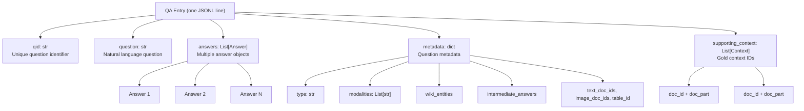

**Field Definitions:**

| Field | Type | Description | Example |
|-------|------|-------------|---------|
| `qid` | `str` | Unique hexadecimal question identifier | `"5454c14ad01e722c2619b66778daa98b"` |
| `question` | `str` | Natural language question text | `"who owns the rights to little shop of horrors?"` |
| `answers` | `List[dict]` | List of answer objects (format described below) | See Answer Format section |
| `metadata` | `dict` | Question metadata including type, entities, and context references | See Metadata Format section |
| `supporting_context` | `List[dict]` | Gold-standard context documents containing answers | `[{"doc_id": "...", "doc_part": "table"}]` |

**Test Set Differences:** `MMQA_test.jsonl.gz` omits the `answers` and `supporting_context` fields, containing only `qid`, `question`, and `metadata`.

**Sources:** [README.md:23-45]()

### Answer Format

Each answer in the `answers` list contains detailed provenance information linking the answer string to specific locations in the context documents.

```mermaid
graph LR
    Answer["Answer Object"]
    Answer --> answer_str["answer: str<br/>Answer text"]
    Answer --> type["type: str<br/>string or yesno"]
    Answer --> modality["modality: str<br/>text, table, or image"]
    
    Answer --> text_inst["text_instances: List[dict]<br/>Text provenance"]
    Answer --> table_inst["table_indices: List[List[int]]<br/>Table cell coordinates"]
    Answer --> image_inst["image_instances: List[dict]<br/>Image document references"]
    
    text_inst --> ti["doc_id, part, start_byte, text"]
    table_inst --> coords["[row, column]"]
    image_inst --> ii["doc_id, doc_part"]
```

**Field Definitions:**

| Field | Type | Description | Values |
|-------|------|-------------|--------|
| `answer` | `str` | The answer text string | Any string value |
| `type` | `str` | Answer type classification | `"string"` or `"yesno"` |
| `modality` | `str` | Source modality of the answer | `"text"`, `"table"`, or `"image"` |
| `text_instances` | `List[dict]` | Text document locations containing this answer | `[{"doc_id": str, "part": "text", "start_byte": int, "text": str}]` |
| `table_indices` | `List[List[int]]` | Table cell coordinates as `[row, column]` pairs | `[[5, 2], [6, 2]]` |
| `image_instances` | `List[dict]` | Image document references | `[{"doc_id": str, "doc_part": "image"}]` |

**Sources:** [README.md:47-68]()

### Metadata Format

The metadata object provides rich annotations about the question, including its type, required modalities, entity linking, and full context document sets.

```mermaid
graph TD
    Metadata["metadata: dict"]
    Metadata --> type["type: str<br/>Question type classification"]
    Metadata --> modalities["modalities: List[str]<br/>Required modalities"]
    Metadata --> wiki_q["wiki_entities_in_question: List[dict]<br/>Entity linking"]
    Metadata --> wiki_a["wiki_entities_in_answers: List[dict]<br/>Answer entity linking"]
    
    Metadata --> pseudo["pseudo_language_question: str<br/>Machine-generated question"]
    Metadata --> rephrasing["rephrasing_meta: dict<br/>Quality metrics"]
    
    Metadata --> doc_refs["Document References"]
    doc_refs --> text_ids["text_doc_ids: List[str]"]
    doc_refs --> image_ids["image_doc_ids: List[str]"]
    doc_refs --> table_id["table_id: str"]
    
    Metadata --> intermediate["intermediate_answers: List[dict]<br/>Sub-question answers"]
    
    type -.->|Example| type_ex["Compose(TableQ,ImageListQ)"]
    modalities -.->|Example| mod_ex["[image, table]"]
    rephrasing --> accuracy["accuracy: float"]
    rephrasing --> edit_dist["edit_distance: float"]
    rephrasing --> confidence["confidence: float"]
```

**Field Definitions:**

| Field | Type | Description | Example |
|-------|------|-------------|---------|
| `type` | `str` | Question type from taxonomy (see [#3.2](#3.2)) | `"Compose(TableQ,ImageListQ)"`, `"TextQ"`, `"Intersect(TableQ,ImageListQ,ImageQ)"` |
| `modalities` | `List[str]` | Modalities required to answer the question | `["image", "table"]`, `["text"]` |
| `wiki_entities_in_question` | `List[dict]` | Wikipedia entities mentioned in the question | `[{"text": str, "wiki_title": str, "url": str}]` |
| `wiki_entities_in_answers` | `List[dict]` | Wikipedia entities in the answers | Same structure as above |
| `pseudo_language_question` | `str` | Machine-generated question template before human rephrasing | `"In [Members] of [LGBT billionaires] what was..."` |
| `rephrasing_meta` | `dict` | Quality metrics for human rephrasing | `{"accuracy": float, "edit_distance": float, "confidence": float}` |
| `text_doc_ids` | `List[str]` | List of text document IDs in full context (including distractors) | `["498369348c988d866b5fac0add45bac5", ...]` |
| `image_doc_ids` | `List[str]` | List of image document IDs in full context | `["89c1b7c3c061cc80bb98d99cbbec50dd", ...]` |
| `table_id` | `str` | Table document ID (typically one table per question) | `"46ae2a8e7928ed5a8e5f9c59323e5e49"` |
| `intermediate_answers` | `List[dict]` | Answers to sub-questions for multi-hop questions | Each entry follows the single answer format |

**Sources:** [README.md:70-108]()

## Context File Formats

### Table Format (`tables.jsonl.gz`)

Each line represents a single table extracted from Wikipedia, with structured row-column data and rich metadata for each column.

```mermaid
graph TD
    Table["Table Entry"]
    Table --> title["title: str<br/>Wikipedia page title"]
    Table --> url["url: str<br/>Wikipedia URL"]
    Table --> id["id: str<br/>Unique table identifier"]
    Table --> table_obj["table: dict<br/>Table structure"]
    
    table_obj --> rows["table_rows: List[List[Cell]]<br/>2D array of cells"]
    table_obj --> name["table_name: str<br/>Table caption"]
    table_obj --> header["header: List[ColumnMeta]<br/>Column metadata"]
    
    rows --> cell["Cell Object"]
    cell --> text["text: str"]
    cell --> links["links: List[dict]<br/>Wikipedia entities"]
    
    header --> col["Column Metadata"]
    col --> col_name["column_name: str"]
    col --> col_meta["metadata: dict"]
    
    col_meta --> parsed["parsed_values: List<br/>Extracted numeric values"]
    col_meta --> type_field["type: str<br/>Data type"]
    col_meta --> ner["ner_appearances_map: dict<br/>NER counts"]
    col_meta --> is_key["is_key_column: bool"]
    col_meta --> entities["entities_column: bool"]
```

**Key Structure Components:**

**Table Object:**
- `title` (str): Wikipedia page title
- `url` (str): Full Wikipedia URL
- `id` (str): Unique hexadecimal identifier
- `table` (dict): Main table structure containing:
  - `table_rows`: 2D array where each row is a list of cell objects
  - `table_name`: Table caption or title
  - `header`: List of column metadata objects

**Cell Object:**
- `text` (str): Cell content as string
- `links` (List[dict]): Wikipedia entity links in the cell, each with:
  - `text`: Anchor text
  - `wiki_title`: Wikipedia page title
  - `url`: Full Wikipedia URL

**Column Metadata:**
- `column_name` (str): Column header text
- `metadata` (dict): Rich parsing information:
  - `parsed_values`: Extracted numeric or date values
  - `type`: Data type (`"float"`, `"date"`, etc.)
  - `num_of_links`: Count of Wikipedia links in column
  - `ner_appearances_map`: Named entity types and counts (e.g., `{"DATE": 10, "CARDINAL": 1}`)
  - `is_key_column`: Boolean indicating if this is a key/identifier column
  - `entities_column`: Boolean indicating if column contains primarily entities

**Sources:** [README.md:110-156]()

### Image Metadata Format (`images.jsonl.gz`)

Each line contains metadata for a single image, with a `path` field pointing to the actual image file in `images.zip`.

```mermaid
graph LR
    ImageMeta["Image Metadata Entry"]
    ImageMeta --> title["title: str<br/>Wikipedia page title"]
    ImageMeta --> url["url: str<br/>Wikipedia URL"]
    ImageMeta --> id["id: str<br/>Unique image identifier"]
    ImageMeta --> path["path: str<br/>Relative path in images.zip"]
    
    path -.->|Example| path_ex["Taipei.jpg"]
```

**Field Definitions:**

| Field | Type | Description | Example |
|-------|------|-------------|---------|
| `title` | `str` | Wikipedia page title where image appears | `"Taipei"` |
| `url` | `str` | Full Wikipedia page URL | `"https://en.wikipedia.org/wiki/Taipei"` |
| `id` | `str` | Unique hexadecimal image identifier | `"632ea110be92836441adfb3167edf8ff"` |
| `path` | `str` | Relative path to image file within `images.zip` | `"Taipei.jpg"` |

**Important:** The actual image files must be downloaded separately from the [images.zip archive](https://multimodalqa-images.s3-us-west-2.amazonaws.com/final_dataset_images/final_dataset_images.zip). The `path` field provides the lookup key within this archive.

**Sources:** [README.md:158-169]()

### Text Format (`texts.jsonl.gz`)

Each line represents a single text paragraph extracted from Wikipedia.

```mermaid
graph LR
    TextMeta["Text Entry"]
    TextMeta --> title["title: str<br/>Wikipedia page title"]
    TextMeta --> url["url: str<br/>Wikipedia URL"]
    TextMeta --> id["id: str<br/>Unique text identifier"]
    TextMeta --> text["text: str<br/>Paragraph content"]
```

**Field Definitions:**

| Field | Type | Description | Example |
|-------|------|-------------|---------|
| `title` | `str` | Wikipedia page title where paragraph appears | `"The Legend of Korra (video game)"` |
| `url` | `str` | Full Wikipedia page URL | `"https://en.wikipedia.org/wiki/The_Legend_of_Korra_(video_game)"` |
| `id` | `str` | Unique hexadecimal text identifier | `"16c61fe756817f0b35df9717fae1000e"` |
| `text` | `str` | Full paragraph text content | `"Over three years after its release, the game..."` |

**Sources:** [README.md:171-181]()

## Cross-Reference Structure

The following diagram illustrates how question files reference context files through document IDs, and how answers contain provenance information pointing back to specific locations in the contexts.

```mermaid
graph TD
    subgraph "MMQA_train.jsonl.gz / MMQA_dev.jsonl.gz"
        QA["Question Entry"]
        QA --> metadata_refs["metadata.text_doc_ids<br/>metadata.image_doc_ids<br/>metadata.table_id"]
        QA --> supporting["supporting_context"]
        QA --> answers["answers"]
    end
    
    subgraph "Context Files"
        Texts["texts.jsonl.gz<br/>id: doc_id"]
        Tables["tables.jsonl.gz<br/>id: doc_id"]
        Images["images.jsonl.gz<br/>id: doc_id"]
        ImageZip["images.zip<br/>files"]
    end
    
    metadata_refs -->|"references (full context)"| Texts
    metadata_refs -->|"references (full context)"| Tables
    metadata_refs -->|"references (full context)"| Images
    
    supporting -->|"references (gold context)"| Texts
    supporting -->|"references (gold context)"| Tables
    supporting -->|"references (gold context)"| Images
    
    answers -->|"text_instances.doc_id"| Texts
    answers -->|"table_indices [row, col]"| Tables
    answers -->|"image_instances.doc_id"| Images
    
    Images -->|"path"| ImageZip
```

**Key Relationships:**

1. **Full Context Set**: `metadata.{text_doc_ids, image_doc_ids, table_id}` lists all context documents provided to the model, including both gold contexts (containing answers) and distractor documents.

2. **Gold Context Set**: `supporting_context` lists only the document IDs that contain answers or intermediate answers, with `doc_part` indicating the modality (`"text"`, `"table"`, or `"image"`).

3. **Answer Provenance**: Each answer object contains modality-specific fields (`text_instances`, `table_indices`, `image_instances`) that precisely locate the answer within the context documents:
   - **Text**: `doc_id` + `start_byte` offset + extracted `text` span
   - **Table**: `doc_id` (via `metadata.table_id`) + `[row, column]` indices
   - **Image**: `doc_id` only (no sub-image localization)

4. **Image File Resolution**: Image metadata entries provide a `path` field that maps to filenames in the separate `images.zip` archive.

**Sources:** [README.md:15-182]()

## Example: Complete Question Entry

Below is a complete example showing all fields for a multi-hop Compose question:

```json
{
  "qid": "5454c14ad01e722c2619b66778daa98b",
  "question": "who owns the rights to little shop of horrors?",
  "answers": [
    {
      "answer": "Warner Bros.",
      "type": "string",
      "modality": "table",
      "text_instances": [],
      "table_indices": [[5, 2]],
      "image_instances": []
    },
    {
      "answer": "Warner Brothers",
      "type": "string",
      "modality": "table",
      "text_instances": [],
      "table_indices": [[5, 2]],
      "image_instances": []
    }
  ],
  "metadata": {
    "type": "Compose(TableQ,ImageListQ)",
    "modalities": ["image", "table"],
    "wiki_entities_in_question": [
      {
        "text": "Domenico Dolce",
        "wiki_title": "Domenico Dolce",
        "url": "https://en.wikipedia.org/wiki/Domenico_Dolce"
      }
    ],
    "wiki_entities_in_answers": [],
    "pseudo_language_question": "In [Members] of [LGBT billionaires] what was the [Net worth USDbn](s) when the [Name] {is completely bald and wears thick glasses?}",
    "rephrasing_meta": {
      "accuracy": 1.0,
      "edit_distance": 0.502092050209205,
      "confidence": 0.7807520791930855
    },
    "image_doc_ids": [
      "89c1b7c3c061cc80bb98d99cbbec50dd",
      "0f3858e2186b2030b77c759fc727e20b"
    ],
    "text_doc_ids": [
      "498369348c988d866b5fac0add45bac5",
      "57686242cf542e30cbad13037017b478"
    ],
    "intermediate_answers": [
      {
        "answer": "intermediate_answer_text",
        "type": "string",
        "modality": "table",
        "text_instances": [],
        "table_indices": [[3, 1]],
        "image_instances": []
      }
    ],
    "table_id": "46ae2a8e7928ed5a8e5f9c59323e5e49"
  },
  "supporting_context": [
    {
      "doc_id": "46ae2a8e7928ed5a8e5f9c59323e5e49",
      "doc_part": "table"
    },
    {
      "doc_id": "d57e56eff064047af5a6ef074a570956",
      "doc_part": "image"
    }
  ]
}
```

**Sources:** [README.md:27-108]()

## Data Loading Patterns

The following diagram shows typical access patterns when loading the dataset in code:

```mermaid
graph LR
    Load["Data Loading Code"]
    Load --> read_qa["Read QA JSONL<br/>gzip.open + json.loads"]
    Load --> read_texts["Read texts.jsonl.gz<br/>Build doc_id → text dict"]
    Load --> read_tables["Read tables.jsonl.gz<br/>Build doc_id → table dict"]
    Load --> read_images["Read images.jsonl.gz<br/>Build doc_id → metadata dict"]
    
    read_qa --> parse["Parse Question Entry"]
    parse --> extract_ctx["Extract context IDs from metadata"]
    
    extract_ctx --> lookup_text["Lookup text_doc_ids"]
    extract_ctx --> lookup_table["Lookup table_id"]
    extract_ctx --> lookup_image["Lookup image_doc_ids"]
    
    lookup_text --> read_texts
    lookup_table --> read_tables
    lookup_image --> read_images
    
    lookup_image --> load_image["Load image file from images.zip<br/>using path field"]
```

**Implementation Notes:**

1. **JSONL Reading**: Each file uses line-delimited JSON with gzip compression. Standard pattern:
   ```python
   with gzip.open('file.jsonl.gz', 'rt') as f:
       for line in f:
           entry = json.loads(line)
   ```

2. **ID-Based Lookups**: Context files are typically loaded into dictionaries keyed by `id` for O(1) lookups during question processing.

3. **Image Loading**: Images require a two-step process:
   - Read `images.jsonl.gz` to get metadata and `path`
   - Extract the file from `images.zip` using the `path` field

4. **Distractor Handling**: The full context set (`metadata.{text_doc_ids, image_doc_ids, table_id}`) includes both gold contexts (listed in `supporting_context`) and distractor documents. Models must discriminate between them.

**Sources:** [README.md:15-182]()

---

# Page: Question Types and Taxonomy

# Question Types and Taxonomy

<details>
<summary>Relevant source files</summary>

The following files were used as context for generating this wiki page:

- [README.md](README.md)
- [baselines/common_utils.py](baselines/common_utils.py)

</details>


This document provides a comprehensive specification of the MultiModalQA question type taxonomy, which forms the foundation for question routing and multi-hop reasoning in the inference pipeline. The taxonomy consists of 16 distinct question types that categorize questions based on their complexity (single-hop vs. multi-hop) and the reasoning operations required (Compose, Intersect, Compare).

For information on how question type classification is performed to determine which type a question belongs to, see [Question Type Classification](#4.1). For details on how question types are used in the inference pipeline to route questions to appropriate models, see [Inference Methods](#4.2).

## Overview of the Taxonomy

The MultiModalQA dataset defines 16 question types stored in the `ALL_QUESTION_TYPES` constant. These types are structured hierarchically based on:

1. **Complexity**: Single-hop (4 types) vs. Multi-hop (12 types)
2. **Modality**: Text, Table, Image, or combinations thereof
3. **Operation**: Direct lookup, Compose, Intersect, or Compare

The complete list of question types is defined in [baselines/common_utils.py:4-21]():

```python
ALL_QUESTION_TYPES = [
    'TextQ',
    'TableQ',
    'ImageQ',
    'ImageListQ',
    'Compose(TableQ,ImageListQ)',
    'Compose(TextQ,ImageListQ)',
    'Compose(ImageQ,TableQ)',
    'Compose(ImageQ,TextQ)',
    'Compose(TextQ,TableQ)',
    'Compose(TableQ,TextQ)',
    'Intersect(TableQ,TextQ)',
    'Intersect(ImageListQ,TableQ)',
    'Intersect(ImageListQ,TextQ)',
    'Compare(Compose(TableQ,ImageQ),TableQ)',
    'Compare(Compose(TableQ,ImageQ),Compose(TableQ,TextQ))',
    'Compare(TableQ,Compose(TableQ,TextQ))',
]
```

Each question in the dataset includes its type in the metadata field, as shown in [README.md:78]():

```json
{
    "type": "Compose(TableQ,ImageListQ)",
    "modalities": ["image", "table"],
    ...
}
```

**Sources**: [baselines/common_utils.py:4-21](), [README.md:78]()

## Question Type Hierarchy

The following diagram illustrates how the 16 question types are organized hierarchically:

```mermaid
graph TB
    All["ALL_QUESTION_TYPES<br/>(16 types)"]
    
    All --> Single["SINGLE_HOP_QUESTION_TYPES<br/>(4 types)"]
    All --> Multi["MULTI_HOP_QUESTION_TYPES<br/>(12 types)"]
    
    Single --> TextQ["TextQ"]
    Single --> TableQ["TableQ"]
    Single --> ImageQ["ImageQ"]
    Single --> ImageListQ["ImageListQ"]
    
    Multi --> Compose["Compose Operations<br/>(6 types)"]
    Multi --> Intersect["Intersect Operations<br/>(3 types)"]
    Multi --> Compare["Compare Operations<br/>(3 types)"]
    
    Compose --> CT1["Compose(TableQ,ImageListQ)"]
    Compose --> CT2["Compose(TextQ,ImageListQ)"]
    Compose --> CT3["Compose(ImageQ,TableQ)"]
    Compose --> CT4["Compose(ImageQ,TextQ)"]
    Compose --> CT5["Compose(TextQ,TableQ)"]
    Compose --> CT6["Compose(TableQ,TextQ)"]
    
    Intersect --> IT1["Intersect(TableQ,TextQ)"]
    Intersect --> IT2["Intersect(ImageListQ,TableQ)"]
    Intersect --> IT3["Intersect(ImageListQ,TextQ)"]
    
    Compare --> CM1["Compare(Compose(TableQ,ImageQ),TableQ)"]
    Compare --> CM2["Compare(Compose(TableQ,ImageQ),<br/>Compose(TableQ,TextQ))"]
    Compare --> CM3["Compare(TableQ,<br/>Compose(TableQ,TextQ))"]
```

**Sources**: [baselines/common_utils.py:4-21](), [baselines/common_utils.py:81-93]()

## Single-Hop Question Types

Single-hop questions require reasoning over a single modality to produce the final answer. These are the simplest question types and serve as building blocks for more complex multi-hop questions.

| Question Type | Modality | Description | Example |
|---------------|----------|-------------|---------|
| `TextQ` | Text | Answer found directly in text paragraphs | "What is the capital of France?" |
| `TableQ` | Table | Answer found directly in table cells | "What was the GDP in 2020?" |
| `ImageQ` | Image | Answer found in a single image | "What color is the car?" |
| `ImageListQ` | Image | Answer is a list extracted from multiple images | "List all logos visible in the images" |

The constants defining single-hop types are:
- Text: [baselines/common_utils.py:23-25]()
- Table: [baselines/common_utils.py:39-41]()
- Image: [baselines/common_utils.py:55-58]()

These types are aggregated in `SINGLE_HOP_QUESTION_TYPES` at [baselines/common_utils.py:81-83]().

**Sources**: [baselines/common_utils.py:23-25](), [baselines/common_utils.py:39-41](), [baselines/common_utils.py:55-58](), [baselines/common_utils.py:81-83]()

## Multi-Hop Question Types

Multi-hop questions require reasoning across multiple steps and potentially multiple modalities. The dataset contains 12 multi-hop question types organized into three categories of reasoning operations.

### Compose Operations

Compose questions require sequential reasoning where the answer to the first hop (sub-question) serves as a "bridge entity" that is used to answer the second hop. The syntax `Compose(FirstHopType, SecondHopType)` indicates the modality sequence.

| Question Type | First Hop | Second Hop | Description |
|---------------|-----------|------------|-------------|
| `Compose(TableQ,ImageListQ)` | Table | Image | Extract entity from table, then find related images |
| `Compose(TextQ,ImageListQ)` | Text | Image | Extract entity from text, then find related images |
| `Compose(ImageQ,TableQ)` | Image | Table | Extract entity from image, then query table |
| `Compose(ImageQ,TextQ)` | Image | Text | Extract entity from image, then query text |
| `Compose(TextQ,TableQ)` | Text | Table | Extract entity from text, then query table |
| `Compose(TableQ,TextQ)` | Table | Text | Extract entity from table, then query text |

The system processes bridge entities using the `process_question_for_implicit_decomp` function at [baselines/common_utils.py:96-103](), which augments questions with hop information and bridge entities:

```python
def process_question_for_implicit_decomp(question, question_type, hop=0, bridge_entity='', sep_token='[SEP]'):
    if isinstance(bridge_entity, list) or isinstance(bridge_entity, set):
        bridge_entity = "; ".join(bridge_entity)
    return (
        f'{question_type} {sep_token} '
        f'HOP={hop} {sep_token} '
        f'{bridge_entity} {sep_token} '
        f'{question}')
```

**Sources**: [baselines/common_utils.py:9-14](), [baselines/common_utils.py:96-103]()

### Intersect Operations

Intersect questions require finding the intersection of two sets, where each set is obtained by reasoning over a different modality.

| Question Type | Description | Example Pattern |
|---------------|-------------|-----------------|
| `Intersect(TableQ,TextQ)` | Find entities that appear in both table results and text results | "Which athletes mentioned in the text also appear in the medals table?" |
| `Intersect(ImageListQ,TableQ)` | Find entities that appear in both image results and table results | "Which countries with flags shown also have GDP > $1T in the table?" |
| `Intersect(ImageListQ,TextQ)` | Find entities that appear in both image results and text results | "Which people in photos are also mentioned in the biography?" |

**Sources**: [baselines/common_utils.py:15-17]()

### Compare Operations

Compare questions involve comparing values or attributes obtained through multi-hop reasoning. These are the most complex question types.

| Question Type | Description |
|---------------|-------------|
| `Compare(Compose(TableQ,ImageQ),TableQ)` | Compare an image attribute (obtained via table→image composition) with a table value |
| `Compare(Compose(TableQ,ImageQ),Compose(TableQ,TextQ))` | Compare an image attribute with a text attribute, both obtained compositionally |
| `Compare(TableQ,Compose(TableQ,TextQ))` | Compare a direct table value with a text attribute obtained via table→text composition |

**Sources**: [baselines/common_utils.py:18-20]()

## Hop-Based Categorization

For routing and processing, question types are further categorized by which modality is used at each hop position. This categorization is critical for the inference pipeline to determine which model to invoke at each reasoning step.

### Modality-Specific Hop Categorization

The following diagram maps question types to their first and second hop modalities:

```mermaid
graph TB
    subgraph "Text Modality Routing"
        TEXT_SINGLE["TEXT_SINGLE_HOP_QUESTION_TYPES<br/>TextQ"]
        TEXT_FIRST["TEXT_AS_FIRST_HOP_QUESTION_TYPES<br/>5 types"]
        TEXT_SECOND["TEXT_AS_SECOND_HOP_QUESTION_TYPES<br/>3 types"]
    end
    
    subgraph "Table Modality Routing"
        TABLE_SINGLE["TABLE_SINGLE_HOP_QUESTION_TYPES<br/>TableQ"]
        TABLE_FIRST["TABLE_AS_FIRST_HOP_QUESTION_TYPES<br/>2 types"]
        TABLE_SECOND["TABLE_AS_SECOND_HOP_QUESTION_TYPES<br/>6 types"]
    end
    
    subgraph "Image Modality Routing"
        IMAGE_SINGLE["IMAGE_SINGLE_HOP_QUESTION_TYPES<br/>ImageQ, ImageListQ"]
        IMAGE_FIRST["IMAGE_AS_FIRST_HOP_QUESTION_TYPES<br/>5 types"]
        IMAGE_SECOND["IMAGE_AS_SECOND_HOP_QUESTION_TYPES<br/>3 types"]
    end
    
    TEXT_FIRST -.->|"provides bridge entity"| TEXT_SECOND
    TEXT_FIRST -.->|"provides bridge entity"| TABLE_SECOND
    TEXT_FIRST -.->|"provides bridge entity"| IMAGE_SECOND
    
    TABLE_FIRST -.->|"provides bridge entity"| TEXT_SECOND
    TABLE_FIRST -.->|"provides bridge entity"| TABLE_SECOND
    TABLE_FIRST -.->|"provides bridge entity"| IMAGE_SECOND
    
    IMAGE_FIRST -.->|"provides bridge entity"| TEXT_SECOND
    IMAGE_FIRST -.->|"provides bridge entity"| TABLE_SECOND
    IMAGE_FIRST -.->|"provides bridge entity"| IMAGE_SECOND
```

### Text Modality Categorization

Text-based question types are categorized as follows:

- **Single-hop**: [baselines/common_utils.py:23-25]()
  - `TextQ`

- **First-hop** (5 types): [baselines/common_utils.py:26-32]()
  - `Compare(TableQ,Compose(TableQ,TextQ))`
  - `Compose(ImageQ,TextQ)`
  - `Compose(TableQ,TextQ)`
  - `Intersect(TableQ,TextQ)`
  - `Intersect(ImageListQ,TextQ)`

- **Second-hop** (3 types): [baselines/common_utils.py:33-37]()
  - `Compare(Compose(TableQ,ImageQ),Compose(TableQ,TextQ))`
  - `Compose(TextQ,ImageListQ)`
  - `Compose(TextQ,TableQ)`

### Table Modality Categorization

Table-based question types are categorized as follows:

- **Single-hop**: [baselines/common_utils.py:39-41]()
  - `TableQ`

- **First-hop** (2 types): [baselines/common_utils.py:42-45]()
  - `Compose(ImageQ,TableQ)`
  - `Compose(TextQ,TableQ)`

- **Second-hop** (6 types): [baselines/common_utils.py:46-53]()
  - `Compare(Compose(TableQ,ImageQ),TableQ)`
  - `Compare(TableQ,Compose(TableQ,TextQ))`
  - `Compose(TableQ,ImageListQ)`
  - `Compose(TableQ,TextQ)`
  - `Intersect(ImageListQ,TableQ)`
  - `Intersect(TableQ,TextQ)`

### Image Modality Categorization

Image-based question types are categorized as follows:

- **Single-hop**: [baselines/common_utils.py:55-58]()
  - `ImageQ`
  - `ImageListQ`

- **First-hop** (5 types): [baselines/common_utils.py:59-65]()
  - `Compare(Compose(TableQ,ImageQ),Compose(TableQ,TextQ))`
  - `Compare(Compose(TableQ,ImageQ),TableQ)`
  - `Compose(TableQ,ImageListQ)`
  - `Compose(TextQ,ImageListQ)`
  - `Intersect(ImageListQ,TableQ)`

- **Second-hop** (3 types): [baselines/common_utils.py:66-70]()
  - `Compose(ImageQ,TableQ)`
  - `Compose(ImageQ,TextQ)`
  - `Intersect(ImageListQ,TextQ)`

**Sources**: [baselines/common_utils.py:23-70]()

## Taxonomy Consistency Guarantees

The codebase includes assertions to ensure the taxonomy is mathematically consistent and complete. These assertions verify:

1. **Complete Coverage**: Every question type appears in exactly one single-hop or second-hop list
   - [baselines/common_utils.py:74-76]()

2. **No Overlap**: Single-hop and second-hop lists are mutually exclusive per modality
   - [baselines/common_utils.py:77-79]()

3. **First-Hop Consistency**: The union of all first-hop types equals the set of all multi-hop types
   - [baselines/common_utils.py:90-91]()

4. **Complete Taxonomy**: Single-hop + multi-hop types = all question types
   - [baselines/common_utils.py:93]()

These assertions run at import time, ensuring that any modifications to the taxonomy maintain mathematical consistency.

**Sources**: [baselines/common_utils.py:74-93]()

## Question Type Processing for Inference

The following diagram illustrates how question types are processed during inference to route questions and handle multi-hop reasoning:

```mermaid
graph TB
    Q["Question Input"]
    Q --> QTC["Question Type Classifier<br/>Predicts one of 16 types"]
    
    QTC --> CheckHop{"Is Multi-Hop?"}
    
    CheckHop -->|"Single-Hop"| Direct["Direct Routing<br/>Based on modality"]
    CheckHop -->|"Multi-Hop"| Decomp["Multi-Hop Processing<br/>process_question_for_implicit_decomp()"]
    
    Direct --> TextModel["Text QA Model<br/>if type in TEXT_SINGLE_HOP"]
    Direct --> TableModel["Table QA Model<br/>if type in TABLE_SINGLE_HOP"]
    Direct --> ImageModel["Image QA Model<br/>if type in IMAGE_SINGLE_HOP"]
    
    Decomp --> FirstHop["First Hop Execution<br/>HOP=0, bridge_entity=''"]
    FirstHop --> ExtractBridge["Extract Bridge Entity<br/>from first hop answer"]
    ExtractBridge --> SecondHop["Second Hop Execution<br/>HOP=1, bridge_entity=X"]
    
    FirstHop --> DetermineFirst{"Determine First Hop Modality"}
    DetermineFirst -->|"*_AS_FIRST_HOP_*"| FirstText["Text QA Model"]
    DetermineFirst -->|"*_AS_FIRST_HOP_*"| FirstTable["Table QA Model"]
    DetermineFirst -->|"*_AS_FIRST_HOP_*"| FirstImage["Image QA Model"]
    
    SecondHop --> DetermineSecond{"Determine Second Hop Modality"}
    DetermineSecond -->|"*_AS_SECOND_HOP_*"| SecondText["Text QA Model"]
    DetermineSecond -->|"*_AS_SECOND_HOP_*"| SecondTable["Table QA Model"]
    DetermineSecond -->|"*_AS_SECOND_HOP_*"| SecondImage["Image QA Model"]
    
    SecondText --> FinalAnswer["Final Answer"]
    SecondTable --> FinalAnswer
    SecondImage --> FinalAnswer
    TextModel --> FinalAnswer
    TableModel --> FinalAnswer
    ImageModel --> FinalAnswer
```

The `process_question_for_implicit_decomp` function augments questions with structured information for multi-hop processing:

**Input**:
- `question`: Original question text
- `question_type`: One of the 16 types from `ALL_QUESTION_TYPES`
- `hop`: 0 for first hop, 1 for second hop
- `bridge_entity`: Empty string for first hop, extracted entity for second hop
- `sep_token`: Separator token (typically `[SEP]` for BERT-based models)

**Output Format**:
```
{question_type} [SEP] HOP={hop} [SEP] {bridge_entity} [SEP] {question}
```

**Example**:
For a `Compose(TableQ,ImageListQ)` question at the second hop with bridge entity "Elon Musk":
```
Compose(TableQ,ImageListQ) [SEP] HOP=1 [SEP] Elon Musk [SEP] What companies are shown in the images?
```

This structured format allows modality-specific models to understand:
1. What type of question is being asked
2. Which hop is currently being processed
3. What bridge entity (if any) should constrain the reasoning

**Sources**: [baselines/common_utils.py:96-103]()

## Taxonomy Usage in Dataset

Each question in the MultiModalQA dataset includes its type in the metadata, along with intermediate answers for multi-hop questions. The metadata structure from [README.md:76-107]():

```json
{
    "type": "Compose(TableQ,ImageListQ)",
    "modalities": ["image", "table"],
    "intermediate_answers": ["single_answer_format(1)", "single_answer_format(2)"]
}
```

The `intermediate_answers` field provides supervision for multi-hop training by specifying:
1. The answer to the first hop (bridge entity)
2. The answer to the second hop (final answer)

This enables training models to perform implicit decomposition, where the model learns to internally decompose multi-hop questions without explicit supervision at inference time.

**Sources**: [README.md:76-107]()

## Summary Table

| Category | Count | Code Constant | Purpose |
|----------|-------|---------------|---------|
| **All Types** | 16 | `ALL_QUESTION_TYPES` | Complete taxonomy |
| **Single-Hop** | 4 | `SINGLE_HOP_QUESTION_TYPES` | Direct answer questions |
| **Multi-Hop** | 12 | `MULTI_HOP_QUESTION_TYPES` | Compositional reasoning questions |
| **Compose** | 6 | Subset of multi-hop | Sequential reasoning with bridge entities |
| **Intersect** | 3 | Subset of multi-hop | Set intersection operations |
| **Compare** | 3 | Subset of multi-hop | Comparative reasoning |
| **Text Single** | 1 | `TEXT_SINGLE_HOP_QUESTION_TYPES` | Text-only single-hop |
| **Text First Hop** | 5 | `TEXT_AS_FIRST_HOP_QUESTION_TYPES` | Text as first step |
| **Text Second Hop** | 3 | `TEXT_AS_SECOND_HOP_QUESTION_TYPES` | Text as second step |
| **Table Single** | 1 | `TABLE_SINGLE_HOP_QUESTION_TYPES` | Table-only single-hop |
| **Table First Hop** | 2 | `TABLE_AS_FIRST_HOP_QUESTION_TYPES` | Table as first step |
| **Table Second Hop** | 6 | `TABLE_AS_SECOND_HOP_QUESTION_TYPES` | Table as second step |
| **Image Single** | 2 | `IMAGE_SINGLE_HOP_QUESTION_TYPES` | Image-only single-hop |
| **Image First Hop** | 5 | `IMAGE_AS_FIRST_HOP_QUESTION_TYPES` | Image as first step |
| **Image Second Hop** | 3 | `IMAGE_AS_SECOND_HOP_QUESTION_TYPES` | Image as second step |

**Sources**: [baselines/common_utils.py:4-93]()

---

# Page: Context Files and Structure

# Context Files and Structure

<details>
<summary>Relevant source files</summary>

The following files were used as context for generating this wiki page:

- [README.md](README.md)
- [dataset/MMQA_images.jsonl.gz](dataset/MMQA_images.jsonl.gz)
- [dataset/MMQA_tables.jsonl.gz](dataset/MMQA_tables.jsonl.gz)

</details>


## Purpose and Scope

This document describes the structure and format of the context files that provide the multi-modal evidence documents for questions in the MultiModalQA dataset. These files contain the text paragraphs, structured tables, and image metadata that models must reason over to answer questions. This page focuses on the context file formats; for information about question formats and metadata, see [Dataset Format Specification](#3.1), and for how contexts are processed during inference, see [Pipeline Implementation](#6.1).

## Overview of Context Files

The MultiModalQA dataset provides three types of context documents, each stored in separate JSONL files within the [dataset/](https://github.com/allenai/multimodalqa/tree/master/dataset) directory:

| File | Format | Purpose | Size |
|------|--------|---------|------|
| `texts.jsonl.gz` | JSONL (gzipped) | Text paragraph contexts from Wikipedia | Multiple paragraphs per article |
| `tables.jsonl.gz` | JSONL (gzipped) | Structured table data from Wikipedia | Multiple tables per article |
| `images.jsonl.gz` | JSONL (gzipped) | Image metadata with file paths | Metadata only |
| `images.zip` | ZIP archive | Actual image files | ~4GB of JPG/PNG files |

Each context document has a unique `id` field that is referenced by questions in `MMQA_train.jsonl.gz`, `MMQA_dev.jsonl.gz`, and `MMQA_test.jsonl.gz` through the `metadata` field (via `text_doc_ids`, `table_id`, or `image_doc_ids`) and the `supporting_context` field.

**Context Files Organization**

```mermaid
graph TB
    subgraph "Question Files"
        TRAIN["MMQA_train.jsonl.gz"]
        DEV["MMQA_dev.jsonl.gz"]
        TEST["MMQA_test.jsonl.gz"]
    end
    
    subgraph "Context Files"
        TEXTS["texts.jsonl.gz<br/>Text paragraphs"]
        TABLES["tables.jsonl.gz<br/>Structured tables"]
        IMG_META["images.jsonl.gz<br/>Image metadata"]
        IMG_ZIP["images.zip<br/>Image files"]
    end
    
    TRAIN -->|"metadata.text_doc_ids"| TEXTS
    TRAIN -->|"metadata.table_id"| TABLES
    TRAIN -->|"metadata.image_doc_ids"| IMG_META
    DEV -->|"metadata.text_doc_ids"| TEXTS
    DEV -->|"metadata.table_id"| TABLES
    DEV -->|"metadata.image_doc_ids"| IMG_META
    TEST -->|"metadata.text_doc_ids"| TEXTS
    TEST -->|"metadata.table_id"| TABLES
    TEST -->|"metadata.image_doc_ids"| IMG_META
    
    IMG_META -->|"path field"| IMG_ZIP
    
    subgraph "Context Resolution"
        TEXTS --> ID_MAP["Document ID → Context"]
        TABLES --> ID_MAP
        IMG_META --> ID_MAP
    end
```

Sources: [README.md:17-21]()

## Text Context Format

Each line in `texts.jsonl.gz` represents a single text paragraph extracted from Wikipedia. Text contexts are the simplest modality, containing raw text with associated metadata.

**Structure of a Text Context Entry**

```mermaid
graph LR
    TEXT_ENTRY["Text Context Entry"]
    
    TEXT_ENTRY --> TITLE["title: string<br/>Wikipedia page title"]
    TEXT_ENTRY --> URL["url: string<br/>Wikipedia URL"]
    TEXT_ENTRY --> ID["id: string<br/>Unique doc_id hash"]
    TEXT_ENTRY --> TEXT_FIELD["text: string<br/>Paragraph content"]
    
    ID -->|"Referenced by"| Q_META["Question metadata<br/>text_doc_ids field"]
    ID -->|"Referenced by"| ANS_INST["Answer instances<br/>text_instances field"]
    
    TEXT_FIELD -->|"Contains"| START_BYTE["start_byte offset<br/>for answer spans"]
```

**Field Specifications**

| Field | Type | Description |
|-------|------|-------------|
| `title` | string | The title of the Wikipedia page from which the text was extracted |
| `url` | string | Full Wikipedia URL (e.g., `https://en.wikipedia.org/wiki/Taipei`) |
| `id` | string | Unique MD5 hash identifier for this text paragraph |
| `text` | string | The actual paragraph text content |

**Example Text Context**

```json
{
  "title": "The Legend of Korra (video game)",
  "url": "https://en.wikipedia.org/wiki/The_Legend_of_Korra_(video_game)",
  "id": "16c61fe756817f0b35df9717fae1000e",
  "text": "Over three years after its release, the game was removed from sale on all digital storefronts on December 21, 2017."
}
```

**Text Context Usage**

Text contexts are referenced in two ways:
1. **Question Metadata**: The `metadata.text_doc_ids` field lists all text document IDs that form the context pool for a question
2. **Answer Instances**: The `text_instances` field in answers provides `doc_id`, `start_byte`, and the exact answer text span

Sources: [README.md:171-181]()

## Table Context Format

Each line in `tables.jsonl.gz` represents a single structured table from Wikipedia. Tables are the most complex context type, containing structured data with header metadata, cell-level Wikipedia entity links, and parsed value types.

**Table Context Structure**

```mermaid
graph TB
    TABLE_ENTRY["Table Context Entry"]
    
    TABLE_ENTRY --> TOP_LEVEL["Top-Level Fields"]
    TABLE_ENTRY --> TABLE_OBJ["table object"]
    
    TOP_LEVEL --> TITLE["title: string"]
    TOP_LEVEL --> URL["url: string"]
    TOP_LEVEL --> ID["id: string<br/>Unique table hash"]
    
    TABLE_OBJ --> TABLE_ROWS["table_rows: array"]
    TABLE_OBJ --> TABLE_NAME["table_name: string"]
    TABLE_OBJ --> HEADER["header: array"]
    
    TABLE_ROWS --> ROW["Row: array of cells"]
    ROW --> CELL["Cell object"]
    CELL --> CELL_TEXT["text: string"]
    CELL --> CELL_LINKS["links: array"]
    
    CELL_LINKS --> LINK_OBJ["Link object"]
    LINK_OBJ --> LINK_TEXT["text: string"]
    LINK_OBJ --> WIKI_TITLE["wiki_title: string"]
    LINK_OBJ --> LINK_URL["url: string"]
    
    HEADER --> COL_HDR["Column Header"]
    COL_HDR --> COL_NAME["column_name: string"]
    COL_HDR --> METADATA["metadata object"]
    
    METADATA --> PARSED_VALS["parsed_values: array"]
    METADATA --> TYPE["type: string"]
    METADATA --> NUM_LINKS["num_of_links: int"]
    METADATA --> NER_MAP["ner_appearances_map: dict"]
    METADATA --> IS_KEY["is_key_column: bool"]
    METADATA --> IS_ENTITIES["entities_column: bool"]
```

**Top-Level Fields**

| Field | Type | Description |
|-------|------|-------------|
| `title` | string | Wikipedia page title |
| `url` | string | Wikipedia URL |
| `id` | string | Unique MD5 hash for this table |
| `table` | object | Contains the table structure |

**Table Object Fields**

| Field | Type | Description |
|-------|------|-------------|
| `table_rows` | array | List of rows, each row is a list of cell objects |
| `table_name` | string | Name/caption of the table (e.g., "Electoral history") |
| `header` | array | Column header definitions with parsing metadata |

**Cell Structure**

Each cell in `table_rows` contains:
- `text`: The cell's text content
- `links`: Array of Wikipedia entity links found in the cell

**Header Metadata**

Each column header in the `header` array provides:
- `column_name`: Name of the column
- `metadata`: Rich metadata including:
  - `parsed_values`: List of parsed numeric or date values
  - `type`: Data type detected (e.g., "float", "string", "date")
  - `num_of_links`: Count of Wikipedia links in this column
  - `ner_appearances_map`: Dictionary of NER types (e.g., "DATE", "CARDINAL") to counts
  - `is_key_column`: Boolean indicating if this is a key/identifier column
  - `entities_column`: Boolean indicating if this column contains entity references

**Example Table Context**

```json
{
  "title": "Dutch Ruppersberger",
  "url": "https://en.wikipedia.org/wiki/Dutch_Ruppersberger",
  "id": "dcd7cb8f23737c6f38519c3770a6606f",
  "table": {
    "table_rows": [
      [
        {
          "text": "Baltimore County Executive",
          "links": [
            {
              "text": "Baltimore County Executive",
              "wiki_title": "Baltimore County Executive",
              "url": "https://en.wikipedia.org/wiki/Baltimore_County_Executive"
            }
          ]
        }
      ]
    ],
    "table_name": "Electoral history",
    "header": [
      {
        "column_name": "Year",
        "metadata": {
          "parsed_values": [1994.0, 1998.0],
          "type": "float",
          "num_of_links": 9,
          "ner_appearances_map": {
            "DATE": 10,
            "CARDINAL": 1
          },
          "is_key_column": true,
          "entities_column": true
        }
      }
    ]
  }
}
```

**Table Reference in Questions**

Tables are referenced via `metadata.table_id` in question files. The `table_indices` field in answers specifies exact cell locations as `[row_index, column_index]` pairs.

Sources: [README.md:110-156]()

## Image Context Format

Images are handled through two separate files: `images.jsonl.gz` contains metadata, while `images.zip` contains the actual image files. This separation allows for efficient metadata processing without loading large image files.

**Image Metadata Structure**

```mermaid
graph LR
    IMG_ENTRY["Image Metadata Entry"]
    
    IMG_ENTRY --> TITLE["title: string<br/>Wikipedia page title"]
    IMG_ENTRY --> URL["url: string<br/>Wikipedia URL"]
    IMG_ENTRY --> ID["id: string<br/>Unique image hash"]
    IMG_ENTRY --> PATH["path: string<br/>Relative path in images.zip"]
    
    ID -->|"Referenced by"| Q_META["Question metadata<br/>image_doc_ids field"]
    ID -->|"Referenced by"| ANS_INST["Answer instances<br/>image_instances field"]
    
    PATH -->|"Points to"| IMG_FILE["images.zip/<br/>Wikipedia_Page.jpg"]
```

**Image Metadata Fields**

| Field | Type | Description |
|-------|------|-------------|
| `title` | string | Wikipedia page title where the image appears |
| `url` | string | Wikipedia URL |
| `id` | string | Unique MD5 hash for this image |
| `path` | string | Relative path to the image file within `images.zip` |

**Example Image Metadata**

```json
{
  "title": "Taipei",
  "url": "https://en.wikipedia.org/wiki/Taipei",
  "id": "632ea110be92836441adfb3167edf8ff",
  "path": "Taipei.jpg"
}
```

**Image Files Archive**

The `images.zip` file can be downloaded from:
```
https://multimodalqa-images.s3-us-west-2.amazonaws.com/final_dataset_images/final_dataset_images.zip
```

This archive contains approximately 4GB of image files in JPG and PNG formats. The `path` field in `images.jsonl.gz` corresponds to the file path within this archive.

**Image Processing Workflow**

```mermaid
graph TB
    IMG_JSONL["images.jsonl.gz"]
    IMG_ZIP["images.zip"]
    
    IMG_JSONL -->|"1. Load metadata"| LOOKUP["Image ID → Path Mapping"]
    
    QUESTION["Question with<br/>image_doc_ids"] -->|"2. Lookup ID"| LOOKUP
    LOOKUP -->|"3. Get path"| IMG_ZIP
    IMG_ZIP -->|"4. Extract file"| IMG_FILE["Image file<br/>(e.g., Taipei.jpg)"]
    
    IMG_FILE -->|"5. Load & process"| FEATURE_EXT["Feature Extraction<br/>Detectron + VilBERT"]
    FEATURE_EXT -->|"6. Cache"| CACHED["img_features/<br/>cached tensors"]
    
    CACHED -->|"7. Model input"| IMAGE_QA["Image QA Model"]
```

**Image Reference in Questions**

Images are referenced via `metadata.image_doc_ids` in question files. Unlike text and tables, image answers in `image_instances` only provide the `doc_id` and `doc_part`, not specific regions or coordinates.

Sources: [README.md:158-169](), [README.md:21]()

## Context ID Resolution

All context files use MD5 hash identifiers to uniquely identify documents. These IDs enable efficient lookup and cross-referencing between questions and contexts.

**Context ID Mapping Flow**

```mermaid
graph TB
    Q_FILE["Question File<br/>(MMQA_dev.jsonl.gz)"]
    
    Q_FILE -->|"metadata.text_doc_ids"| TEXT_IDS["Text IDs<br/>['16c61fe7...', '498369348c...']"]
    Q_FILE -->|"metadata.table_id"| TABLE_ID["Table ID<br/>'dcd7cb8f...'"]
    Q_FILE -->|"metadata.image_doc_ids"| IMG_IDS["Image IDs<br/>['632ea110...', '89c1b7c3...']"]
    
    TEXT_IDS -->|"Lookup in"| TEXTS_FILE["texts.jsonl.gz"]
    TABLE_ID -->|"Lookup in"| TABLES_FILE["tables.jsonl.gz"]
    IMG_IDS -->|"Lookup in"| IMAGES_FILE["images.jsonl.gz"]
    
    TEXTS_FILE -->|"Match id field"| TEXT_DOCS["Text Contexts"]
    TABLES_FILE -->|"Match id field"| TABLE_DOCS["Table Context"]
    IMAGES_FILE -->|"Match id field"| IMG_META["Image Metadata"]
    
    TEXT_DOCS -->|"Context pool"| INFERENCE["Inference Pipeline"]
    TABLE_DOCS -->|"Context pool"| INFERENCE
    IMG_META -->|"→ images.zip"| IMG_FILES["Image Files"]
    IMG_FILES -->|"Context pool"| INFERENCE
    
    subgraph "Supporting Context (Gold)"
        Q_FILE -->|"supporting_context"| GOLD_IDS["Gold Context IDs<br/>for training"]
        GOLD_IDS -.->|"Subset of"| TEXT_DOCS
        GOLD_IDS -.->|"Subset of"| TABLE_DOCS
        GOLD_IDS -.->|"Subset of"| IMG_META
    end
```

**ID Resolution Example**

For a question with this metadata:
```json
{
  "text_doc_ids": ["498369348c988d866b5fac0add45bac5", "57686242cf542e30cbad13037017b478"],
  "table_id": "46ae2a8e7928ed5a8e5f9c59323e5e49",
  "image_doc_ids": ["89c1b7c3c061cc80bb98d99cbbec50dd", "0f3858e2186b2030b77c759fc727e20b"]
}
```

The system resolves these IDs by:
1. Loading all context JSONL files into memory or creating an index
2. Building a dictionary mapping `id` → context object
3. Looking up each ID to retrieve the full context
4. Providing these contexts to the appropriate QA models

**Supporting Context vs. Full Context Pool**

Questions provide two types of context references:

| Field | Purpose | Training Use | Inference Use |
|-------|---------|--------------|---------------|
| `metadata.*_doc_ids` | Full context pool (includes distractors) | Background contexts | All available contexts |
| `supporting_context` | Gold-labeled contexts containing answers | Supervision signal | Not available at test time |

The `supporting_context` field lists only the contexts that actually contain answer spans or intermediate answers, making it useful for training models to identify relevant contexts. During inference, models must consider the entire context pool from `metadata.*_doc_ids`.

**Context Caching Strategy**

For efficient processing, the codebase implements context caching:
- **Text/Table**: Typically loaded on-demand from JSONL files during inference
- **Images**: Pre-extracted visual features are cached in `img_features/` directory to avoid repeated feature extraction
- **Feature Extraction**: Uses Detectron for object detection and VilBERT for visual encoding (see [Image QA Dataset Preparation](#5.1.1))

Sources: [README.md:72-107](), [README.md:26-46]()

## File Location and Access

All context files are located in the `dataset/` directory of the repository and can be accessed through the download script.

**Directory Structure**

```
dataset/
├── MMQA_train.jsonl.gz          # Training questions
├── MMQA_dev.jsonl.gz            # Development questions
├── MMQA_test.jsonl.gz           # Test questions
├── texts.jsonl.gz               # Text contexts
├── tables.jsonl.gz              # Table contexts
└── images.jsonl.gz              # Image metadata

downloads/
└── images/                       # Extracted from images.zip
    ├── Taipei.jpg
    ├── Dutch_Ruppersberger.jpg
    └── ...
```

**Loading Context Files in Code**

Context files are typically loaded using utility functions that read JSONL files line-by-line and build ID-to-context mappings. The common pattern is:

```python
# Example loading pattern (not actual code, just illustration)
contexts = {}
for line in gzip.open('dataset/texts.jsonl.gz'):
    obj = json.loads(line)
    contexts[obj['id']] = obj
```

For specific implementations of context loading during inference, see [Pipeline Implementation](#6.1). For how images are processed into features, see [Image QA Dataset Preparation](#5.1.1).

Sources: [README.md:17-21]()

---

# Page: System Architecture

# System Architecture

<details>
<summary>Relevant source files</summary>

The following files were used as context for generating this wiki page:

- [baselines/README.md](baselines/README.md)
- [baselines/common_utils.py](baselines/common_utils.py)
- [baselines/pipeline.py](baselines/pipeline.py)

</details>


## Purpose and Scope

This document describes the high-level architecture of the MultiModalQA baseline system, including its major components, data flow, and how they interact during inference. For detailed information about the question type classification module, see [Question Type Classification](#4.1). For in-depth explanations of the three inference methods (`implicit_decomp`, `auto_routing`, `context_only`), see [Inference Methods](#4.2). For specifics on individual QA models, see [Baseline Models](#5).

## Overall System Architecture

The MultiModalQA baseline system consists of five primary components that work together to answer complex multi-modal questions:

```mermaid
graph TB
    subgraph Input["Input Processing"]
        TestFile["Test File<br/>(MMQA_dev.jsonl or MMQA_test.jsonl)"]
        ContextFiles["Context Files<br/>(MMQA_texts.jsonl, MMQA_tables.jsonl, MMQA_images.jsonl)"]
    end
    
    subgraph Pipeline["Pipeline Orchestrator<br/>(pipeline.py)"]
        MainFunc["main()"]
        PredictFunc["predict()"]
    end
    
    subgraph Classifiers["Question Type Classification"]
        QtypePredictor["QuestionTypePredictor<br/>(qtype_clf/inference.py)"]
    end
    
    subgraph QAModels["Modality-Specific QA Models"]
        TextQA["TextQAPredictor<br/>(text_qa/inferece.py)"]
        TableQA["TableQAPredictor<br/>(table_qa/inference.py)"]
        ImageQA["ImageQAPredictor<br/>(image_qa/inference.py)"]
    end
    
    subgraph Output["Output Generation"]
        PredFile["predictions_.json"]
        AllInfo["all_prediction_info.json"]
        Evaluation["Evaluation Metrics<br/>(evaluate.py)"]
    end
    
    TestFile --> MainFunc
    ContextFiles --> MainFunc
    MainFunc --> QtypePredictor
    MainFunc --> TextQA
    MainFunc --> TableQA
    MainFunc --> ImageQA
    
    QtypePredictor --> PredictFunc
    TextQA --> PredictFunc
    TableQA --> PredictFunc
    ImageQA --> PredictFunc
    
    PredictFunc --> PredFile
    PredictFunc --> AllInfo
    AllInfo --> Evaluation
```

**Sources:** [baselines/pipeline.py:1-360](), [baselines/README.md:1-53]()

### Component Summary

| Component | Class Name | File Path | Responsibility |
|-----------|-----------|-----------|----------------|
| Pipeline Orchestrator | `main()`, `predict()` | `pipeline.py` | Coordinates all models, routes questions, handles multi-hop reasoning |
| Question Type Classifier | `QuestionTypePredictor` | `qtype_clf/inference.py` | Predicts question type from 16 categories |
| Text QA Model | `TextQAPredictor` | `text_qa/inferece.py` | Answers questions over text paragraphs |
| Table QA Model | `TableQAPredictor` | `table_qa/inference.py` | Answers questions over structured tables |
| Image QA Model | `ImageQAPredictor` | `image_qa/inference.py` | Answers questions over images |
| Evaluation | `list_em()`, `list_f1()`, `evaluate_prediction_file()` | `evaluate.py` | Computes F1 and Exact Match metrics |

**Sources:** [baselines/pipeline.py:14-17](), [baselines/pipeline.py:220-356]()

## Component Initialization and Dependencies

The system initialization follows a specific sequence in the `main()` function:

```mermaid
graph TD
    ArgParse["Argument Parsing<br/>(add_inference_args, add_qtype_clf_args, etc.)"]
    Device["Device Selection<br/>(CUDA or CPU)"]
    
    subgraph ModelLoading["Model Loading (pipeline.py:234-252)"]
        LoadQtype["QuestionTypePredictor<br/>(args.qtype_model_dir)"]
        LoadText["TextQAPredictor<br/>(args.text_qa_model_dir, mode)"]
        LoadTable["TableQAPredictor<br/>(args.table_qa_model_dir, mode)"]
        LoadImage["ImageQAPredictor<br/>(args.image_qa_model_path, vocab, features)"]
    end
    
    subgraph ContextLoading["Context Loading (pipeline.py:254-258)"]
        LoadTexts["text_docs = read_jsonl(MMQA_texts.jsonl)"]
        LoadTables["table_docs = read_jsonl(MMQA_tables.jsonl)"]
        LoadImages["Image info in ImageQAPredictor"]
    end
    
    subgraph InferenceLoop["Inference Loop (pipeline.py:264-339)"]
        ForExample["for example in all_examples"]
        BuildInput["Build input dict with contexts"]
        CallPredict["predict(args, input, ...)"]
        ComputeMetrics["Compute EM/F1 scores"]
    end
    
    ArgParse --> Device
    Device --> LoadQtype
    Device --> LoadText
    Device --> LoadTable
    Device --> LoadImage
    
    LoadQtype --> LoadTexts
    LoadText --> LoadTexts
    LoadTable --> LoadTexts
    LoadImage --> LoadTexts
    
    LoadTexts --> LoadTables
    LoadTables --> ForExample
    ForExample --> BuildInput
    BuildInput --> CallPredict
    CallPredict --> ComputeMetrics
```

**Sources:** [baselines/pipeline.py:220-260](), [baselines/pipeline.py:264-339]()

### Key Initialization Parameters

The system requires several model checkpoints and configuration parameters:

| Parameter | Purpose | Example Value |
|-----------|---------|---------------|
| `--qtype_model_dir` | Question type classifier checkpoint | `downloads/checkpoints/qtype_clf_models/` |
| `--text_qa_model_dir` | Text QA model checkpoint | `downloads/checkpoints/text_qa_models/implicit_decomp/` |
| `--table_qa_model_dir` | Table QA model checkpoint | `downloads/checkpoints/table_qa_models/implicit_decomp/` |
| `--image_qa_model_path` | Image QA model checkpoint file | `downloads/checkpoints/image_qa_models/implicit_decomp/model.pt` |
| `--image_qa_vocab` | Vocabulary for answer generation | `downloads/checkpoints/image_qa_models/vocab.pickle` |
| `--image_features_dir` | Pre-computed image features | `downloads/checkpoints/img_features/` |
| `--method` | Inference method | `implicit_decomp` or `auto_routing` |

**Sources:** [baselines/pipeline.py:27-71](), [baselines/README.md:21-36]()

## Question Type Taxonomy and Routing

The system defines 16 distinct question types that drive the routing logic:

```mermaid
graph TB
    AllTypes["ALL_QUESTION_TYPES<br/>(16 types total)"]
    
    subgraph SingleHop["Single-Hop Questions (4 types)"]
        TextQ["TextQ"]
        TableQ["TableQ"]
        ImageQ["ImageQ"]
        ImageListQ["ImageListQ"]
    end
    
    subgraph MultiHop["Multi-Hop Questions (12 types)"]
        Compose["Compose Operations (6 types)<br/>e.g., Compose(TableQ,ImageListQ)"]
        Intersect["Intersect Operations (3 types)<br/>e.g., Intersect(TableQ,TextQ)"]
        Compare["Compare Operations (3 types)<br/>e.g., Compare(TableQ,Compose(TableQ,TextQ))"]
    end
    
    AllTypes --> SingleHop
    AllTypes --> MultiHop
    
    TextQ --> TextModel["Routes to TextQAPredictor"]
    TableQ --> TableModel["Routes to TableQAPredictor"]
    ImageQ --> ImageModel["Routes to ImageQAPredictor"]
    ImageListQ --> ImageModel
    
    Compose --> FirstHop["First Hop Routing<br/>(TEXT_AS_FIRST_HOP_QUESTION_TYPES, etc.)"]
    Compose --> SecondHop["Second Hop Routing<br/>(TEXT_AS_SECOND_HOP_QUESTION_TYPES, etc.)"]
    
    Intersect --> FirstHop
    Intersect --> SecondHop
    
    Compare --> FirstHop
    Compare --> SecondHop
```

**Sources:** [baselines/common_utils.py:4-94]()

### Question Type Constants

The system defines several constant lists in `common_utils.py` to categorize question types:

| Constant | Purpose | Example Types |
|----------|---------|---------------|
| `TEXT_SINGLE_HOP_QUESTION_TYPES` | Single-hop text questions | `['TextQ']` |
| `TEXT_AS_FIRST_HOP_QUESTION_TYPES` | Text as first hop in multi-hop | `['Compose(ImageQ,TextQ)', ...]` |
| `TEXT_AS_SECOND_HOP_QUESTION_TYPES` | Text as second hop in multi-hop | `['Compose(TextQ,ImageListQ)', ...]` |
| `TABLE_SINGLE_HOP_QUESTION_TYPES` | Single-hop table questions | `['TableQ']` |
| `TABLE_AS_FIRST_HOP_QUESTION_TYPES` | Table as first hop in multi-hop | `['Compose(ImageQ,TableQ)', ...]` |
| `TABLE_AS_SECOND_HOP_QUESTION_TYPES` | Table as second hop in multi-hop | `['Compose(TableQ,ImageListQ)', ...]` |
| `IMAGE_SINGLE_HOP_QUESTION_TYPES` | Single-hop image questions | `['ImageQ', 'ImageListQ']` |
| `IMAGE_AS_FIRST_HOP_QUESTION_TYPES` | Image as first hop in multi-hop | `['Compose(TableQ,ImageListQ)', ...]` |
| `IMAGE_AS_SECOND_HOP_QUESTION_TYPES` | Image as second hop in multi-hop | `['Compose(ImageQ,TableQ)', ...]` |

**Sources:** [baselines/common_utils.py:23-94]()

## Data Flow Through the System

### Input Processing and Context Assembly

The pipeline assembles multi-modal contexts for each question:

```mermaid
graph LR
    subgraph InputExample["Input Example (MMQA_dev.jsonl)"]
        QID["qid"]
        Question["question"]
        Metadata["metadata"]
    end
    
    subgraph MetadataFields["Metadata Fields"]
        TextIDs["text_doc_ids[]"]
        TableID["table_id"]
        ImageIDs["image_doc_ids[]"]
        QType["type (question type)"]
    end
    
    subgraph ContextLookup["Context Lookup"]
        TextDocs["text_docs[doc_id]"]
        TableDocs["table_docs[table_id]"]
        ImageInfo["Image info via ImageQAPredictor"]
    end
    
    subgraph AssembledInput["Assembled Input Dict"]
        InputQID["qid"]
        InputQuestion["question"]
        TextContext["text_context[]"]
        TableContext["table_context"]
        ImageContext["image_context[]"]
        GoldType["gold_question_type (optional)"]
    end
    
    Metadata --> TextIDs
    Metadata --> TableID
    Metadata --> ImageIDs
    Metadata --> QType
    
    TextIDs --> TextDocs
    TableID --> TableDocs
    ImageIDs --> ImageInfo
    
    QID --> InputQID
    Question --> InputQuestion
    TextDocs --> TextContext
    TableDocs --> TableContext
    ImageInfo --> ImageContext
    QType --> GoldType
```

**Sources:** [baselines/pipeline.py:265-274]()

### Prediction Flow in the `predict()` Function

The core prediction logic routes questions based on their type and the selected inference method:

```mermaid
graph TD
    Start["predict() function entry"]
    
    CheckOracle{"args.use_oracle_qtype<br/>or args.context_only?"}
    UseGold["question_type = input['gold_question_type']"]
    PredictType["question_type = qtype_predictor.predict()"]
    
    CheckMethod{"args.method"}
    
    subgraph AutoRouting["auto_routing Method (pipeline.py:169-180)"]
        CheckModalityAR{"question_type in<br/>SINGLE_HOP + AS_SECOND_HOP?"}
        RouteText["TextQAPredictor.predict()"]
        RouteTable["TableQAPredictor.predict()"]
        RouteImage["ImageQAPredictor.predict()"]
        ResultAR["result['pred_answer']<br/>result['pred_question_type']"]
    end
    
    subgraph ImplicitDecomp["implicit_decomp Method (pipeline.py:181-215)"]
        FirstHop{"First Hop Routing"}
        FirstText["TextQAPredictor.predict()<br/>(hop=0, bridge_entity='')"]
        FirstTable["TableQAPredictor.predict()<br/>(hop=0, bridge_entity='')"]
        FirstImage["ImageQAPredictor.predict()"]
        
        CheckSecondHop{"question_type in<br/>AS_SECOND_HOP?"}
        
        SecondHop{"Second Hop Routing"}
        SecondText["TextQAPredictor.predict()<br/>(hop=1, bridge_entity=first_hop_ans)"]
        SecondTable["TableQAPredictor.predict()<br/>(hop=1, bridge_entity=first_hop_ans)"]
        SecondImage["ImageQAPredictor.predict()<br/>(bridge_entities=first_hop_ans)"]
        
        NoSecondHop["second_hop_ans = None"]
        
        ResultID["result['pred_first_hop_answer']<br/>result['pred_second_hop_answer']<br/>result['pred_answer']"]
    end
    
    Start --> CheckOracle
    CheckOracle -->|Yes| UseGold
    CheckOracle -->|No| PredictType
    
    UseGold --> CheckMethod
    PredictType --> CheckMethod
    
    CheckMethod -->|auto_routing| CheckModalityAR
    CheckModalityAR --> RouteText
    CheckModalityAR --> RouteTable
    CheckModalityAR --> RouteImage
    RouteText --> ResultAR
    RouteTable --> ResultAR
    RouteImage --> ResultAR
    
    CheckMethod -->|implicit_decomp| FirstHop
    FirstHop --> FirstText
    FirstHop --> FirstTable
    FirstHop --> FirstImage
    
    FirstText --> CheckSecondHop
    FirstTable --> CheckSecondHop
    FirstImage --> CheckSecondHop
    
    CheckSecondHop -->|Yes| SecondHop
    CheckSecondHop -->|No| NoSecondHop
    
    SecondHop --> SecondText
    SecondHop --> SecondTable
    SecondHop --> SecondImage
    
    SecondText --> ResultID
    SecondTable --> ResultID
    SecondImage --> ResultID
    NoSecondHop --> ResultID
```

**Sources:** [baselines/pipeline.py:161-217]()

## Inference Method Architecture Overview

The system supports three inference methods, each with different routing strategies:

| Method | Description | Multi-Hop Handling | Use Case |
|--------|-------------|-------------------|----------|
| `implicit_decomp` | Performs explicit two-hop reasoning with bridge entities | Predicts both first and second hop modalities, passes first hop answer as bridge entity to second hop | Best performance baseline (F1: 48.79) |
| `auto_routing` | Routes directly to final answer modality | Ignores intermediate hops, predicts only final answer modality | Simpler baseline (F1: 44.65) |
| `context_only` | Ignores question text completely | Uses only context information | Lower bound baseline (F1: 7.41) |

**Sources:** [baselines/pipeline.py:92-100](), [baselines/README.md:42-48]()

### Method Selection Impact on Model Initialization

The selected method affects how models are initialized:

```python
# Text QA model mode based on method
text_qa_predictor = TextQAPredictor(
    args.text_qa_model_dir, args.do_lower_case, device,
    mode="implicit_decomp" if args.method == "implicit_decomp" else "base"
)

# Table QA model mode based on method
table_qa_predictor = TableQAPredictor(
    args.table_qa_model_dir, device,
    mode="implicit_decomp" if args.method == "implicit_decomp" else "base"
)

# Image QA model mode includes context_only option
image_qa_predictor = ImageQAPredictor(
    checkpoint_path=args.image_qa_model_path,
    vilbert_dir=args.vilbert_dir,
    img_info_path=os.path.join(args.data_dir, "MMQA_images.jsonl"),
    vocab_path=args.image_qa_vocab,
    device=device,
    mode="context_only" if args.context_only else args.method,
    img_features_dir=args.image_features_dir,
    use_distractors=True
)
```

**Sources:** [baselines/pipeline.py:235-252]()

## Multi-Hop Reasoning with Bridge Entities

For multi-hop questions using `implicit_decomp`, the system extracts a bridge entity from the first hop and passes it to the second hop:

```mermaid
graph TD
    MultiHopQ["Multi-Hop Question<br/>(e.g., Compose(TableQ,ImageListQ))"]
    
    FirstHopPred["First Hop Prediction<br/>TableQAPredictor.predict()<br/>(hop=0, bridge_entity='')"]
    
    FirstHopAns["first_hop_ans<br/>(could be string or list)"]
    
    Convert{"isinstance(first_hop_ans, str)?"}
    ConvertList["first_hop_ans = [first_hop_ans]"]
    KeepList["Keep as list"]
    
    SecondHopPred["Second Hop Prediction<br/>ImageQAPredictor.predict()<br/>(bridge_entities=first_hop_ans)"]
    
    FinalAns["result['pred_answer'] = second_hop_ans<br/>result['pred_first_hop_answer'] = first_hop_ans<br/>result['pred_second_hop_answer'] = second_hop_ans"]
    
    MultiHopQ --> FirstHopPred
    FirstHopPred --> FirstHopAns
    FirstHopAns --> Convert
    Convert -->|Yes| ConvertList
    Convert -->|No| KeepList
    ConvertList --> SecondHopPred
    KeepList --> SecondHopPred
    SecondHopPred --> FinalAns
```

**Sources:** [baselines/pipeline.py:194-214]()

### Question Processing for Bridge Entities

The `process_question_for_implicit_decomp()` function formats questions with bridge entity information:

```python
def process_question_for_implicit_decomp(question, question_type, hop=0, bridge_entity='', sep_token='[SEP]'):
    if isinstance(bridge_entity, list) or isinstance(bridge_entity, set):
        bridge_entity = "; ".join(bridge_entity)
    return (
        f'{question_type} {sep_token} '
        f'HOP={hop} {sep_token} '
        f'{bridge_entity} {sep_token} '
        f'{question}')
```

This formatted question is passed to the QA models, which have been trained to handle this format. The bridge entity provides context from the first hop to inform the second hop prediction.

**Sources:** [baselines/common_utils.py:96-103]()

## Output Generation and Evaluation

The system produces two output files and optionally evaluates metrics:

```mermaid
graph TD
    AllResults["all_results dict<br/>(qid -> result info)"]
    
    subgraph OutputFiles["Output Files (pipeline.py:341-348)"]
        AllInfo["all_prediction_info.json<br/>(complete prediction info)"]
        PredFile["predictions_.json<br/>(qid -> answer only)"]
    end
    
    subgraph EvalMetrics["Evaluation (pipeline.py:350-355)"]
        CheckPredict{"args.predict_only?"}
        SkipEval["Skip evaluation"]
        RunEval["evaluate_prediction_file()<br/>(predictions_.json, test_file)"]
        
        ComputeEM["list_em() for Exact Match"]
        ComputeF1["list_f1() for F1 Score"]
        
        ByModality["Results by Modality<br/>(Single-Modality, Multi-Modality)"]
        ByHop["Results by Hop Type"]
        ByQType["Results by Question Type"]
    end
    
    AllResults --> AllInfo
    AllResults --> PredFile
    
    PredFile --> CheckPredict
    CheckPredict -->|Yes| SkipEval
    CheckPredict -->|No| RunEval
    
    RunEval --> ComputeEM
    RunEval --> ComputeF1
    
    ComputeEM --> ByModality
    ComputeF1 --> ByModality
    ByModality --> ByHop
    ByHop --> ByQType
```

**Sources:** [baselines/pipeline.py:341-356]()

### Result Dictionary Structure

Each prediction result contains the following fields:

| Field | Description | Present When |
|-------|-------------|--------------|
| `qid` | Question ID | Always |
| `question` | Question text | Always |
| `pred_answer` | Predicted answer | Always |
| `pred_question_type` | Predicted question type | Always |
| `pred_first_hop_answer` | First hop answer | `implicit_decomp` only |
| `pred_second_hop_answer` | Second hop answer | `implicit_decomp` only |
| `gold_question_type` | Ground truth question type | When not `--predict_only` |
| `gold_answer` | Ground truth answer | When not `--predict_only` |
| `em_score` | Exact match score | When not `--predict_only` |
| `f1_score` | F1 score | When not `--predict_only` |
| `first_hop_em_score` | First hop exact match | When not `--predict_only` and `implicit_decomp` |
| `first_hop_f1_score` | First hop F1 score | When not `--predict_only` and `implicit_decomp` |

**Sources:** [baselines/pipeline.py:294-339]()

## Code Entry Points

The main entry points for running the system:

### Command-Line Interface

The primary entry point is `pipeline.py:main()`:

```bash
python pipeline.py \
  --qtype_model_dir downloads/checkpoints/qtype_clf_models/ \
  --text_qa_model_dir downloads/checkpoints/text_qa_models/implicit_decomp/ \
  --table_qa_model_dir downloads/checkpoints/table_qa_models/implicit_decomp/ \
  --image_qa_model_path downloads/checkpoints/image_qa_models/implicit_decomp/model.pt \
  --image_qa_vocab downloads/checkpoints/image_qa_models/vocab.pickle \
  --image_features_dir downloads/checkpoints/img_features/ \
  --data_dir downloads/MMQA/ \
  --test_file MMQA_dev.jsonl \
  --output_dir output/results/implicit_decomp_dev/ \
  --do_lower_case \
  --method implicit_decomp
```

**Sources:** [baselines/README.md:21-35]()

### Batch Evaluation Script

For parallel evaluation of all methods, use `run_pipeline.sh`:

```bash
./scripts/run_pipeline.sh
```

This script runs three instances in parallel on different GPUs:
- GPU 0: `implicit_decomp` method
- GPU 1: `auto_routing` method
- GPU 2: `context_only` method

**Sources:** [baselines/README.md:38-41]()

## System Dependencies

The architecture requires several external dependencies:

```mermaid
graph TD
    subgraph Core["Core Dependencies"]
        PyTorch["PyTorch 1.5.1+"]
        Python["Python 3.7+"]
    end
    
    subgraph External["External Libraries"]
        APEX["APEX<br/>(NVIDIA mixed precision)"]
        VilBERT["VilBERT-multi-task<br/>(vision-language model)"]
        MaskRCNN["MaskRCNN-benchmark<br/>(object detection)"]
    end
    
    subgraph QAModels["QA Model Dependencies"]
        TextDeps["Text QA:<br/>transformers (BERT/RoBERTa)"]
        TableDeps["Table QA:<br/>transformers (BERT/RoBERTa)"]
        ImageDeps["Image QA:<br/>VilBERT + Detectron features"]
    end
    
    Python --> PyTorch
    PyTorch --> TextDeps
    PyTorch --> TableDeps
    PyTorch --> ImageDeps
    
    APEX --> ImageDeps
    VilBERT --> ImageDeps
    MaskRCNN --> ImageDeps
```

**Sources:** [baselines/README.md:4-10]()

---

# Page: Question Type Classification

# Question Type Classification

<details>
<summary>Relevant source files</summary>

The following files were used as context for generating this wiki page:

- [baselines/common_utils.py](baselines/common_utils.py)
- [baselines/pipeline.py](baselines/pipeline.py)

</details>


## Purpose and Scope

Question Type Classification is the first step in the MultiModalQA inference pipeline. It predicts which of 16 predefined question types a given question belongs to, and this prediction directly determines how the question is routed through the modality-specific QA models. This page documents the question type taxonomy, the classification system, and how type predictions drive routing decisions.

For details on the question type taxonomy from a dataset perspective, see [Question Types and Taxonomy](#3.2). For information on how the three inference methods use question types differently, see [Inference Methods](#4.2). For the complete pipeline orchestration, see [Pipeline Implementation](#6.1).

---

## Question Type Taxonomy

The MultiModalQA system defines 16 distinct question types, divided into single-hop and multi-hop categories. These types are defined in [baselines/common_utils.py:4-21]().

### Complete Type Listing

| Category | Question Type | Description |
|----------|---------------|-------------|
| **Single-Hop** | `TextQ` | Answer from text context only |
| | `TableQ` | Answer from table context only |
| | `ImageQ` | Answer from a single image |
| | `ImageListQ` | Answer from multiple images |
| **Compose** | `Compose(TableQ,ImageListQ)` | First hop: table, second hop: images |
| | `Compose(TextQ,ImageListQ)` | First hop: text, second hop: images |
| | `Compose(ImageQ,TableQ)` | First hop: image, second hop: table |
| | `Compose(ImageQ,TextQ)` | First hop: image, second hop: text |
| | `Compose(TextQ,TableQ)` | First hop: text, second hop: table |
| | `Compose(TableQ,TextQ)` | First hop: table, second hop: text |
| **Intersect** | `Intersect(TableQ,TextQ)` | Find intersection of table and text answers |
| | `Intersect(ImageListQ,TableQ)` | Find intersection of image list and table answers |
| | `Intersect(ImageListQ,TextQ)` | Find intersection of image list and text answers |
| **Compare** | `Compare(Compose(TableQ,ImageQ),TableQ)` | Compare two reasoning chains |
| | `Compare(Compose(TableQ,ImageQ),Compose(TableQ,TextQ))` | Compare two composition chains |
| | `Compare(TableQ,Compose(TableQ,TextQ))` | Compare table result with composition |

**Diagram: Question Type Hierarchy**

```mermaid
graph TB
    ALL["ALL_QUESTION_TYPES<br/>(16 types)"]
    
    ALL --> SINGLE["Single-Hop Questions<br/>(4 types)"]
    ALL --> MULTI["Multi-Hop Questions<br/>(12 types)"]
    
    SINGLE --> TEXT_S["TextQ"]
    SINGLE --> TABLE_S["TableQ"]
    SINGLE --> IMAGE_S["ImageQ"]
    SINGLE --> IMAGE_LIST_S["ImageListQ"]
    
    MULTI --> COMPOSE["Compose Operations<br/>(6 types)"]
    MULTI --> INTERSECT["Intersect Operations<br/>(3 types)"]
    MULTI --> COMPARE["Compare Operations<br/>(3 types)"]
    
    COMPOSE --> C1["Compose(TableQ,ImageListQ)"]
    COMPOSE --> C2["Compose(TextQ,ImageListQ)"]
    COMPOSE --> C3["Compose(ImageQ,TableQ)"]
    COMPOSE --> C4["Compose(ImageQ,TextQ)"]
    COMPOSE --> C5["Compose(TextQ,TableQ)"]
    COMPOSE --> C6["Compose(TableQ,TextQ)"]
    
    INTERSECT --> I1["Intersect(TableQ,TextQ)"]
    INTERSECT --> I2["Intersect(ImageListQ,TableQ)"]
    INTERSECT --> I3["Intersect(ImageListQ,TextQ)"]
    
    COMPARE --> CP1["Compare(Compose(TableQ,ImageQ),TableQ)"]
    COMPARE --> CP2["Compare(Compose(TableQ,ImageQ),<br/>Compose(TableQ,TextQ))"]
    COMPARE --> CP3["Compare(TableQ,Compose(TableQ,TextQ))"]
```

**Sources:** [baselines/common_utils.py:4-21](), [baselines/common_utils.py:81-93]()

---

## Routing Constants and Modality Assignment

The system organizes question types into routing groups based on which modality handles which reasoning hop. These constants are critical for determining which QA model to invoke at each step.

### Modality-Specific Groupings

**Text QA Routing Groups** ([baselines/common_utils.py:23-37]()):
- `TEXT_SINGLE_HOP_QUESTION_TYPES`: Questions answered by text QA as single-hop
  - `TextQ`
- `TEXT_AS_FIRST_HOP_QUESTION_TYPES`: Questions where text QA handles the first hop
  - `Compare(TableQ,Compose(TableQ,TextQ))`, `Compose(ImageQ,TextQ)`, `Compose(TableQ,TextQ)`, `Intersect(TableQ,TextQ)`, `Intersect(ImageListQ,TextQ)`
- `TEXT_AS_SECOND_HOP_QUESTION_TYPES`: Questions where text QA handles the second hop
  - `Compare(Compose(TableQ,ImageQ),Compose(TableQ,TextQ))`, `Compose(TextQ,ImageListQ)`, `Compose(TextQ,TableQ)`

**Table QA Routing Groups** ([baselines/common_utils.py:39-53]()):
- `TABLE_SINGLE_HOP_QUESTION_TYPES`: `TableQ`
- `TABLE_AS_FIRST_HOP_QUESTION_TYPES`: `Compose(ImageQ,TableQ)`, `Compose(TextQ,TableQ)`
- `TABLE_AS_SECOND_HOP_QUESTION_TYPES`: 6 types including `Compose(TableQ,ImageListQ)`, `Compose(TableQ,TextQ)`, various `Intersect` and `Compare` operations

**Image QA Routing Groups** ([baselines/common_utils.py:55-70]()):
- `IMAGE_SINGLE_HOP_QUESTION_TYPES`: `ImageQ`, `ImageListQ`
- `IMAGE_AS_FIRST_HOP_QUESTION_TYPES`: 5 types including `Compose(TableQ,ImageListQ)`, `Compose(TextQ,ImageListQ)`, and `Compare` operations
- `IMAGE_AS_SECOND_HOP_QUESTION_TYPES`: `Compose(ImageQ,TableQ)`, `Compose(ImageQ,TextQ)`, `Intersect(ImageListQ,TextQ)`

**Diagram: Routing Group Assignment**

```mermaid
graph LR
    subgraph "Question Type Input"
        QTYPE["Question Type<br/>(one of 16)"]
    end
    
    subgraph "Single-Hop Routing"
        QTYPE --> TEXT_S{"Is in<br/>TEXT_SINGLE_HOP?"}
        QTYPE --> TABLE_S{"Is in<br/>TABLE_SINGLE_HOP?"}
        QTYPE --> IMAGE_S{"Is in<br/>IMAGE_SINGLE_HOP?"}
        
        TEXT_S -->|Yes| TEXT_MODEL["TextQAPredictor"]
        TABLE_S -->|Yes| TABLE_MODEL["TableQAPredictor"]
        IMAGE_S -->|Yes| IMAGE_MODEL["ImageQAPredictor"]
    end
    
    subgraph "Multi-Hop Routing (First Hop)"
        QTYPE --> TEXT_F{"Is in<br/>TEXT_AS_FIRST_HOP?"}
        QTYPE --> TABLE_F{"Is in<br/>TABLE_AS_FIRST_HOP?"}
        QTYPE --> IMAGE_F{"Is in<br/>IMAGE_AS_FIRST_HOP?"}
        
        TEXT_F -->|Yes| TEXT_MODEL_F["TextQAPredictor<br/>hop=0"]
        TABLE_F -->|Yes| TABLE_MODEL_F["TableQAPredictor<br/>hop=0"]
        IMAGE_F -->|Yes| IMAGE_MODEL_F["ImageQAPredictor<br/>hop=0"]
    end
    
    subgraph "Multi-Hop Routing (Second Hop)"
        BRIDGE["Bridge Entity<br/>from First Hop"]
        
        QTYPE --> TEXT_SEC{"Is in<br/>TEXT_AS_SECOND_HOP?"}
        QTYPE --> TABLE_SEC{"Is in<br/>TABLE_AS_SECOND_HOP?"}
        QTYPE --> IMAGE_SEC{"Is in<br/>IMAGE_AS_SECOND_HOP?"}
        
        TEXT_SEC -->|Yes| TEXT_MODEL_SEC["TextQAPredictor<br/>hop=1, bridge_entity"]
        TABLE_SEC -->|Yes| TABLE_MODEL_SEC["TableQAPredictor<br/>hop=1, bridge_entity"]
        IMAGE_SEC -->|Yes| IMAGE_MODEL_SEC["ImageQAPredictor<br/>hop=1, bridge_entities"]
        
        BRIDGE --> TEXT_MODEL_SEC
        BRIDGE --> TABLE_MODEL_SEC
        BRIDGE --> IMAGE_MODEL_SEC
    end
```

**Sources:** [baselines/common_utils.py:23-70](), [baselines/pipeline.py:183-216]()

### Assertion Checks

The system validates that the routing groups are correctly partitioned ([baselines/common_utils.py:74-93]()):
- Every question type appears in exactly one single-hop or second-hop category per modality
- All multi-hop questions appear in exactly one first-hop category
- The union of single-hop and multi-hop types equals all 16 types

---

## Question Type Prediction

The question type classifier is a BERT-based model that predicts one of the 16 question types from the input question string.

### QuestionTypePredictor Class

The classifier is instantiated from the `QuestionClassificationInferenceModel` class located in `qtype_clf/inference.py` ([baselines/pipeline.py:14](), [baselines/pipeline.py:234]()):

```
qtype_predictor = QuestionTypePredictor(args.qtype_model_dir, device)
```

**Key Parameters:**
- `qtype_model_dir`: Path to the trained classifier checkpoint
- `device`: PyTorch device (CPU or CUDA)

### Prediction Flow

**Diagram: Question Type Prediction in Pipeline**

```mermaid
graph TD
    INPUT["Question String"]
    
    INPUT --> ORACLE{"use_oracle_qtype<br/>or context_only?"}
    
    ORACLE -->|Yes| GOLD["Use gold_question_type<br/>from metadata"]
    ORACLE -->|No| PREDICT["qtype_predictor.predict()<br/>guid=0, question=input['question']"]
    
    GOLD --> QTYPE["question_type"]
    PREDICT --> QTYPE
    
    QTYPE --> ROUTING{"method?"}
    
    ROUTING -->|auto_routing| AUTO["Route to final modality<br/>TEXT_*_HOP + TEXT_AS_SECOND_HOP<br/>TABLE_*_HOP + TABLE_AS_SECOND_HOP<br/>IMAGE_*_HOP + IMAGE_AS_SECOND_HOP"]
    
    ROUTING -->|implicit_decomp| DECOMP["Decompose into hops<br/>First hop: *_AS_FIRST_HOP<br/>Second hop: *_AS_SECOND_HOP"]
    
    AUTO --> FINAL["Single prediction call"]
    DECOMP --> FIRST_HOP["First hop prediction"]
    FIRST_HOP --> BRIDGE["Bridge entity extraction"]
    BRIDGE --> SECOND_HOP["Second hop prediction<br/>(if multi-hop)"]
    SECOND_HOP --> FINAL
```

**Sources:** [baselines/pipeline.py:161-217]()

### Oracle Question Types

For debugging and upper-bound analysis, the system supports using ground truth question types via the `--use_oracle_qtype` flag ([baselines/pipeline.py:102-105](), [baselines/pipeline.py:164-167]()):

```
if args.use_oracle_qtype or args.context_only:
    question_type = input["gold_question_type"]
else:
    question_type = qtype_predictor.predict(guid=0, question=input["question"])
```

This bypasses the classifier and uses the type from `example["metadata"]["type"]`, allowing evaluation of downstream QA models independent of classification errors.

**Sources:** [baselines/pipeline.py:102-107](), [baselines/pipeline.py:164-167](), [baselines/pipeline.py:273]()

---

## Question Formatting for Implicit Decomposition

When using the `implicit_decomp` inference method, questions are augmented with metadata to provide explicit guidance to the QA models about the reasoning structure.

### Format Specification

The `process_question_for_implicit_decomp` function ([baselines/common_utils.py:96-103]()) formats questions as:

```
<question_type> [SEP] HOP=<hop> [SEP] <bridge_entity> [SEP] <question>
```

**Components:**
- `question_type`: One of the 16 type strings (e.g., `"Compose(TableQ,TextQ)"`)
- `[SEP]`: Separator token (typically `"[SEP]"` for BERT-based models)
- `HOP=<hop>`: Hop position (`0` for first hop or single-hop, `1` for second hop)
- `bridge_entity`: Entities from first hop answer (empty string for first hop, semicolon-separated list for second hop)
- `question`: Original question text

### Example Formatting

For a question `"Who directed the movie that won Best Picture?"` of type `Compose(TableQ,TextQ)`:

**First Hop (Table):**
```
Compose(TableQ,TextQ) [SEP] HOP=0 [SEP]  [SEP] Who directed the movie that won Best Picture?
```

**Second Hop (Text, after extracting "Parasite" from table):**
```
Compose(TableQ,TextQ) [SEP] HOP=1 [SEP] Parasite [SEP] Who directed the movie that won Best Picture?
```

### Bridge Entity Handling

The function normalizes bridge entities from various formats ([baselines/common_utils.py:96-99]()):
- If `bridge_entity` is a list or set, joins with `"; "`
- Ensures consistent string representation for downstream models

**Diagram: Question Formatting Pipeline**

```mermaid
graph LR
    subgraph "Input"
        Q["Original Question"]
        QT["question_type"]
        HOP["hop (0 or 1)"]
        BRIDGE["bridge_entity<br/>(str, list, or set)"]
    end
    
    Q --> FORMAT["process_question_for_implicit_decomp()"]
    QT --> FORMAT
    HOP --> FORMAT
    BRIDGE --> NORMALIZE["Normalize bridge_entity<br/>list/set -> '; '.join()"]
    
    NORMALIZE --> FORMAT
    
    FORMAT --> FORMATTED["'question_type [SEP] HOP=hop [SEP]<br/>bridge_entity [SEP] question'"]
    
    FORMATTED --> TEXT_QA["TextQAPredictor.predict()<br/>(uses formatted question)"]
    FORMATTED --> TABLE_QA["TableQAPredictor.predict()<br/>(uses formatted question)"]
```

**Sources:** [baselines/common_utils.py:96-103]()

---

## Integration with Inference Methods

The question type classification integrates differently with the two main inference methods.

### Auto-Routing Method

In `auto_routing` mode ([baselines/pipeline.py:169-180]()), the question type directly determines which single QA model to invoke:

```
if question_type in TEXT_SINGLE_HOP_QUESTION_TYPES + TEXT_AS_SECOND_HOP_QUESTION_TYPES:
    pred_ans = text_qa_predictor.predict(args, input["question"], input["text_context"])
elif question_type in TABLE_SINGLE_HOP_QUESTION_TYPES + TABLE_AS_SECOND_HOP_QUESTION_TYPES:
    pred_ans = table_qa_predictor.predict(args, input["question"], input["table_context"])
elif question_type in IMAGE_SINGLE_HOP_QUESTION_TYPES + IMAGE_AS_SECOND_HOP_QUESTION_TYPES:
    pred_ans = image_qa_predictor.predict(...)
```

The key insight: **types are grouped by the modality that produces the final answer**, ignoring intermediate reasoning steps.

### Implicit Decomposition Method

In `implicit_decomp` mode ([baselines/pipeline.py:181-216]()), the question type drives a multi-step process:

1. **First Hop:** Route based on `*_AS_FIRST_HOP_QUESTION_TYPES` constants
2. **Extract Bridge Entity:** Use first hop answer as bridge entity
3. **Second Hop (if multi-hop):** Route based on `*_AS_SECOND_HOP_QUESTION_TYPES` constants, passing bridge entity

**Comparison Table:**

| Aspect | auto_routing | implicit_decomp |
|--------|--------------|-----------------|
| **Type Grouping** | By final answer modality | By hop-specific modality |
| **Prediction Calls** | 1 per question | 1-2 per question (depends on single/multi-hop) |
| **Question Format** | Original question | Augmented with type, hop, bridge entity |
| **Bridge Entity** | Not used | Passed from first to second hop |
| **Type Constants Used** | `*_SINGLE_HOP` + `*_AS_SECOND_HOP` | All three: `*_SINGLE_HOP`, `*_AS_FIRST_HOP`, `*_AS_SECOND_HOP` |

**Sources:** [baselines/pipeline.py:169-216]()

---

## Context-Only Baseline

The `context_only` baseline uses question types but ignores the actual question text ([baselines/pipeline.py:107-110](), [baselines/pipeline.py:269]()):

```
input = {
    "question": example["question"] if not args.context_only else "",
    ...
}
```

This tests whether models can answer questions using only the context (text, tables, images) without the question itself. The question type is still used for routing, but the question string is replaced with an empty string. This baseline achieved F1: 7.41 / EM: 10.03 in the paper, establishing a lower bound.

**Sources:** [baselines/pipeline.py:107-110](), [baselines/pipeline.py:164-167](), [baselines/pipeline.py:269]()

---

## Summary

Question Type Classification serves as the control mechanism for the entire MultiModalQA inference pipeline:

1. **Taxonomy:** 16 question types organized by complexity (single/multi-hop) and operations (Compose, Intersect, Compare)
2. **Routing:** Type-to-modality mappings defined via constants in [baselines/common_utils.py:23-70]()
3. **Prediction:** `QuestionTypePredictor` classifies questions; oracle mode available for debugging
4. **Formatting:** Questions augmented with type, hop, and bridge entity for `implicit_decomp` method
5. **Integration:** Different routing logic for `auto_routing` vs `implicit_decomp` methods

The classification accuracy directly impacts overall system performance, as misclassifications cascade into incorrect model routing and answer extraction.

---

# Page: Inference Methods

# Inference Methods

<details>
<summary>Relevant source files</summary>

The following files were used as context for generating this wiki page:

- [baselines/README.md](baselines/README.md)
- [baselines/pipeline.py](baselines/pipeline.py)
- [baselines/scripts/run_pipeline.sh](baselines/scripts/run_pipeline.sh)

</details>


## Purpose and Scope

This document describes the three inference methods supported by the MultiModalQA system for answering complex multi-modal questions. These methods define different strategies for routing questions to modality-specific QA models and handling multi-hop reasoning.

- For information about the individual modality-specific QA models used by these methods, see [Baseline Models](#5)
- For details on question type classification that drives routing decisions, see [Question Type Classification](#4.1)
- For practical instructions on running inference, see [Pipeline Implementation](#6.1)

The three methods are:
1. **implicit_decomp**: Multi-hop reasoning with explicit bridge entity extraction
2. **auto_routing**: Direct routing to final answer modality
3. **context_only**: Baseline that ignores question text

---

## Method Comparison Overview

The following table summarizes the key characteristics and performance of each method:

| Method | Strategy | Multi-Hop Support | Dev F1 / EM | Use Case |
|--------|----------|-------------------|-------------|----------|
| **implicit_decomp** | Decompose into first and second hop, route each separately | Yes (explicit bridge entities) | 48.79 / 55.48 | Best performance, handles complex reasoning |
| **auto_routing** | Route directly to final answer modality | No (single-shot prediction) | 44.65 / 51.13 | Simpler, faster inference |
| **context_only** | Ignore question, answer from context only | No | 7.41 / 10.03 | Lower bound baseline |

**Sources:** [baselines/README.md:42-48](), [baselines/pipeline.py:92-109]()

---

## Architecture Overview

```mermaid
graph TB
    subgraph "Input Processing"
        Q["Question + Context<br/>(text/tables/images)"]
        QTC["QuestionTypePredictor<br/>(qtype_clf/inference.py)"]
        Q --> QTC
    end
    
    subgraph "Method Selection"
        METHOD{{"--method flag<br/>implicit_decomp<br/>auto_routing"}}
        CONTEXT_FLAG{{"--context_only flag"}}
        QTC --> METHOD
        CONTEXT_FLAG -.-> METHOD
    end
    
    subgraph "Modality-Specific Predictors"
        TEXT_PRED["TextQAPredictor<br/>(text_qa/inferece.py)"]
        TABLE_PRED["TableQAPredictor<br/>(table_qa/inference.py)"]
        IMAGE_PRED["ImageQAPredictor<br/>(image_qa/inference.py)"]
    end
    
    subgraph "implicit_decomp Path"
        HOP0["First Hop<br/>hop=0<br/>bridge_entity=''"]
        HOP1["Second Hop<br/>hop=1<br/>bridge_entity=first_hop_ans"]
        HOP0 --> HOP1
    end
    
    subgraph "auto_routing Path"
        DIRECT["Direct Prediction<br/>No hop parameter"]
    end
    
    METHOD -->|"implicit_decomp"| HOP0
    METHOD -->|"auto_routing"| DIRECT
    
    HOP0 -.-> TEXT_PRED
    HOP0 -.-> TABLE_PRED
    HOP0 -.-> IMAGE_PRED
    HOP1 -.-> TEXT_PRED
    HOP1 -.-> TABLE_PRED
    HOP1 -.-> IMAGE_PRED
    
    DIRECT -.-> TEXT_PRED
    DIRECT -.-> TABLE_PRED
    DIRECT -.-> IMAGE_PRED
    
    TEXT_PRED --> ANSWER["pred_answer"]
    TABLE_PRED --> ANSWER
    IMAGE_PRED --> ANSWER
```

**Diagram: High-level inference architecture showing method selection and routing**

**Sources:** [baselines/pipeline.py:161-217](), [baselines/pipeline.py:234-252]()

---

## implicit_decomp Method

### Strategy

The `implicit_decomp` method decomposes multi-hop questions into sequential reasoning steps. It first answers the initial question (first hop), extracts bridge entities from the answer, and then uses those entities to constrain the second reasoning step.

### Control Flow

```mermaid
graph TB
    START["predict() called<br/>method='implicit_decomp'"]
    
    QTYPE["Classify question type<br/>QuestionTypePredictor.predict()"]
    START --> QTYPE
    
    ROUTE1{"Route by<br/>question_type"}
    QTYPE --> ROUTE1
    
    TEXT1["TextQAPredictor.predict()<br/>hop=0, bridge_entity=''"]
    TABLE1["TableQAPredictor.predict()<br/>hop=0, bridge_entity=''"]
    IMAGE1["ImageQAPredictor.predict()"]
    
    ROUTE1 -->|"TEXT_SINGLE_HOP_QUESTION_TYPES +<br/>TEXT_AS_FIRST_HOP_QUESTION_TYPES"| TEXT1
    ROUTE1 -->|"TABLE_SINGLE_HOP_QUESTION_TYPES +<br/>TABLE_AS_FIRST_HOP_QUESTION_TYPES"| TABLE1
    ROUTE1 -->|"IMAGE_SINGLE_HOP_QUESTION_TYPES +<br/>IMAGE_AS_FIRST_HOP_QUESTION_TYPES"| IMAGE1
    
    FIRST_ANS["first_hop_ans<br/>(converted to list if string)"]
    TEXT1 --> FIRST_ANS
    TABLE1 --> FIRST_ANS
    IMAGE1 --> FIRST_ANS
    
    CHECK{"question_type in<br/>*_AS_SECOND_HOP_<br/>QUESTION_TYPES?"}
    FIRST_ANS --> CHECK
    
    TEXT2["TextQAPredictor.predict()<br/>hop=1<br/>bridge_entity=first_hop_ans"]
    TABLE2["TableQAPredictor.predict()<br/>hop=1<br/>bridge_entity=first_hop_ans"]
    IMAGE2["ImageQAPredictor.predict()<br/>bridge_entities=first_hop_ans"]
    
    CHECK -->|"TEXT_AS_SECOND_HOP_<br/>QUESTION_TYPES"| TEXT2
    CHECK -->|"TABLE_AS_SECOND_HOP_<br/>QUESTION_TYPES"| TABLE2
    CHECK -->|"IMAGE_AS_SECOND_HOP_<br/>QUESTION_TYPES"| IMAGE2
    
    SECOND_ANS["second_hop_ans"]
    TEXT2 --> SECOND_ANS
    TABLE2 --> SECOND_ANS
    IMAGE2 --> SECOND_ANS
    
    NONE["second_hop_ans = None"]
    CHECK -->|"No"| NONE
    
    FINAL{"second_hop_ans<br/>is not None?"}
    SECOND_ANS --> FINAL
    NONE --> FINAL
    
    RESULT1["pred_answer =<br/>second_hop_ans"]
    RESULT2["pred_answer =<br/>first_hop_ans"]
    
    FINAL -->|"Yes"| RESULT1
    FINAL -->|"No"| RESULT2
```

**Diagram: implicit_decomp method control flow**

### Implementation Details

The core logic is implemented in the `predict()` function when `args.method == "implicit_decomp"`:

**First Hop Processing** [baselines/pipeline.py:183-193]():
- Routes based on question type using constants from `common_utils`:
  - `TEXT_AS_FIRST_HOP_QUESTION_TYPES`: Routes to `text_qa_predictor.predict()` with `hop=0`
  - `TABLE_AS_FIRST_HOP_QUESTION_TYPES`: Routes to `table_qa_predictor.predict()` with `hop=0`
  - `IMAGE_AS_FIRST_HOP_QUESTION_TYPES`: Routes to `image_qa_predictor.predict()`
- All predictors are called with `bridge_entity=""` (empty string) for the first hop
- Returns `first_hop_ans`

**Answer Normalization** [baselines/pipeline.py:196-197]():
- Converts string answers to lists for consistency
- Second hop models expect list inputs for bridge entities

**Second Hop Processing** [baselines/pipeline.py:200-210]():
- Only executed if question type is in `*_AS_SECOND_HOP_QUESTION_TYPES` constants
- Routes to appropriate modality with:
  - `hop=1` parameter (text and table models)
  - `bridge_entity=first_hop_ans` (text and table models)
  - `bridge_entities=first_hop_ans` (image model, note plural form)
- Returns `second_hop_ans` or `None` if not a multi-hop question

**Final Result** [baselines/pipeline.py:212-215]():
- Returns `second_hop_ans` if it exists, otherwise `first_hop_ans`
- Stores both intermediate and final answers in result dictionary

### Model Mode Configuration

The modality-specific predictors must be initialized with `mode="implicit_decomp"` to support hop-based reasoning:

```python
text_qa_predictor = TextQAPredictor(
    model_dir, do_lower_case, device,
    mode="implicit_decomp"
)
table_qa_predictor = TableQAPredictor(
    model_dir, device,
    mode="implicit_decomp"
)
image_qa_predictor = ImageQAPredictor(
    checkpoint_path, vilbert_dir, img_info_path, vocab_path, device,
    mode="implicit_decomp", ...
)
```

**Sources:** [baselines/pipeline.py:235-250]()

---

## auto_routing Method

### Strategy

The `auto_routing` method directly routes questions to the modality that will provide the final answer, without explicit multi-hop decomposition. It relies on question type classification to determine which modality to query.

### Control Flow

```mermaid
graph TB
    START["predict() called<br/>method='auto_routing'"]
    
    QTYPE["Classify question type<br/>QuestionTypePredictor.predict()"]
    START --> QTYPE
    
    ROUTE{"Route by question_type<br/>to final answer modality"}
    QTYPE --> ROUTE
    
    TEXT["TextQAPredictor.predict()<br/>(no hop or bridge_entity)"]
    TABLE["TableQAPredictor.predict()<br/>(no hop or bridge_entity)"]
    IMAGE["ImageQAPredictor.predict()<br/>(no bridge_entities)"]
    
    ROUTE -->|"TEXT_SINGLE_HOP_QUESTION_TYPES +<br/>TEXT_AS_SECOND_HOP_QUESTION_TYPES"| TEXT
    ROUTE -->|"TABLE_SINGLE_HOP_QUESTION_TYPES +<br/>TABLE_AS_SECOND_HOP_QUESTION_TYPES"| TABLE
    ROUTE -->|"IMAGE_SINGLE_HOP_QUESTION_TYPES +<br/>IMAGE_AS_SECOND_HOP_QUESTION_TYPES"| IMAGE
    
    RESULT["pred_answer<br/>(single prediction)"]
    TEXT --> RESULT
    TABLE --> RESULT
    IMAGE --> RESULT
    
    ERROR["ValueError:<br/>Question type not<br/>in predefined list"]
    ROUTE -->|"Unknown type"| ERROR
```

**Diagram: auto_routing method control flow**

### Implementation Details

The `auto_routing` method is simpler than `implicit_decomp`, implemented in [baselines/pipeline.py:169-180]():

**Routing Logic**:
- Combines single-hop and second-hop question types for each modality
- Routes to **text** if question type is in:
  - `TEXT_SINGLE_HOP_QUESTION_TYPES` + `TEXT_AS_SECOND_HOP_QUESTION_TYPES`
- Routes to **table** if question type is in:
  - `TABLE_SINGLE_HOP_QUESTION_TYPES` + `TABLE_AS_SECOND_HOP_QUESTION_TYPES`
- Routes to **image** if question type is in:
  - `IMAGE_SINGLE_HOP_QUESTION_TYPES` + `IMAGE_AS_SECOND_HOP_QUESTION_TYPES`

**Key Differences from implicit_decomp**:
- No `hop` parameter passed to text/table predictors
- No `bridge_entity` parameter passed to text/table predictors
- No `bridge_entities` parameter passed to image predictor
- Single prediction call per question
- No intermediate answer storage

### Model Mode Configuration

Models initialized with `mode="base"` for auto_routing:

```python
text_qa_predictor = TextQAPredictor(
    model_dir, do_lower_case, device,
    mode="base"  # Not "implicit_decomp"
)
table_qa_predictor = TableQAPredictor(
    model_dir, device,
    mode="base"  # Not "implicit_decomp"
)
image_qa_predictor = ImageQAPredictor(
    checkpoint_path, vilbert_dir, img_info_path, vocab_path, device,
    mode="auto_routing", ...
)
```

**Sources:** [baselines/pipeline.py:169-180](), [baselines/pipeline.py:235-250]()

---

## context_only Baseline

### Strategy

The `context_only` baseline is a lower-bound experiment that answers questions based purely on context, ignoring the question text entirely. This helps measure how much information can be extracted from context alone without understanding the question.

### Implementation

The `context_only` baseline is implemented as a modified version of `auto_routing`:

**Key Modifications** [baselines/pipeline.py:108-109](), [baselines/pipeline.py:269]():
1. Question text is replaced with empty string: `question="" if args.context_only else example["question"]`
2. Forces use of oracle (gold) question type: `question_type = input["gold_question_type"]` when `args.context_only` is True
3. Image QA predictor uses special mode: `mode="context_only"`

**Command-Line Configuration** [baselines/scripts/run_pipeline.sh:35-49]():
```bash
python pipeline.py \
  ... \
  --method auto_routing \
  --context_only \
  ...
```

Note: Even though `--method` is set to `auto_routing`, the `--context_only` flag modifies behavior significantly.

### Rationale

This baseline serves several purposes:
- **Lower bound**: Establishes minimum expected performance (F1: 7.41 / EM: 10.03)
- **Context analysis**: Reveals how much information is contained in context distributions
- **Model validation**: Confirms models actually use question text rather than memorizing context patterns

**Sources:** [baselines/pipeline.py:108-109](), [baselines/pipeline.py:164-165](), [baselines/pipeline.py:249](), [baselines/pipeline.py:269](), [baselines/scripts/run_pipeline.sh:35-49]()

---

## Configuration and Usage

### Command-Line Arguments

The inference method is selected via the `--method` argument:

| Argument | Type | Choices | Default | Description |
|----------|------|---------|---------|-------------|
| `--method` | string | `["auto_routing", "implicit_decomp"]` | `"implicit_decomp"` | Inference method selection |
| `--context_only` | flag | - | False | Enable context-only baseline mode |
| `--use_oracle_qtype` | flag | - | False | Use gold question types instead of predictions |
| `--predict_only` | flag | - | False | Skip evaluation, only generate predictions |

**Sources:** [baselines/pipeline.py:92-115]()

### Example Usage

**implicit_decomp method:**
```bash
python pipeline.py \
  --qtype_model_dir downloads/checkpoints/qtype_clf_models/ \
  --text_qa_model_dir downloads/checkpoints/text_qa_models/implicit_decomp/ \
  --table_qa_model_dir downloads/checkpoints/table_qa_models/implicit_decomp/ \
  --image_qa_model_path downloads/checkpoints/image_qa_models/implicit_decomp/model.pt \
  --image_qa_vocab downloads/checkpoints/image_qa_models/vocab.pickle \
  --image_features_dir downloads/checkpoints/img_features/ \
  --data_dir downloads/MMQA/ \
  --test_file MMQA_dev.jsonl \
  --output_dir output/results/implicit_decomp_dev/ \
  --do_lower_case \
  --method implicit_decomp
```

**auto_routing method:**
```bash
python pipeline.py \
  ... \
  --text_qa_model_dir downloads/checkpoints/text_qa_models/auto_routing/ \
  --table_qa_model_dir downloads/checkpoints/table_qa_models/auto_routing/ \
  --image_qa_model_path downloads/checkpoints/image_qa_models/auto_routing/model.pt \
  ... \
  --method auto_routing
```

**context_only baseline:**
```bash
python pipeline.py \
  ... \
  --text_qa_model_dir downloads/checkpoints/text_qa_models/context_only/ \
  --table_qa_model_dir downloads/checkpoints/table_qa_models/context_only/ \
  --image_qa_model_path downloads/checkpoints/image_qa_models/context_only/model.pt \
  ... \
  --method auto_routing \
  --context_only
```

**Sources:** [baselines/README.md:21-35](), [baselines/scripts/run_pipeline.sh:5-49]()

---

## Performance Analysis

### Overall Results

Results on the dev set across all question types:

| Method | Single-Modality F1 / EM | Multi-Modality F1 / EM | Overall F1 / EM |
|--------|------------------------|------------------------|-----------------|
| **context_only** | 7.94 / 10.73 | 6.63 / 9.00 | 7.41 / 10.03 |
| **auto_routing** | 51.68 / 58.48 | 34.18 / 40.18 | 44.65 / 51.13 |
| **implicit_decomp** | 51.60 / 58.35 | 44.59 / 51.19 | **48.79 / 55.48** |

**Sources:** [baselines/README.md:42-48]()

### Key Observations

```mermaid
graph LR
    subgraph "Performance Characteristics"
        CONTEXT["context_only<br/>F1: 7.41<br/>Minimal reasoning"]
        AUTO["auto_routing<br/>F1: 44.65<br/>Single-shot prediction"]
        IMPLICIT["implicit_decomp<br/>F1: 48.79<br/>Multi-hop reasoning"]
    end
    
    subgraph "Gap Analysis"
        GAP1["Single-Modality<br/>Similar performance<br/>(~51 F1)"]
        GAP2["Multi-Modality<br/>10+ point gap<br/>(34.18 vs 44.59)"]
    end
    
    CONTEXT -.->|"Baseline"| AUTO
    AUTO -.->|"Better multi-hop"| IMPLICIT
    
    AUTO --> GAP1
    IMPLICIT --> GAP1
    
    AUTO --> GAP2
    IMPLICIT --> GAP2
```

**Diagram: Performance comparison and gaps between methods**

1. **Single-Modality Questions**: `implicit_decomp` and `auto_routing` perform similarly (~51 F1), as most single-modality questions don't benefit from explicit decomposition.

2. **Multi-Modality Questions**: `implicit_decomp` significantly outperforms `auto_routing` (44.59 vs 34.18 F1), demonstrating the value of explicit bridge entity extraction for complex reasoning.

3. **Context-Only Baseline**: Very low performance (7.41 F1) confirms that question understanding is critical for the task.

4. **Overall Performance**: `implicit_decomp` achieves best results (48.79 F1) due to its superior handling of multi-modal, multi-hop questions.

**Sources:** [baselines/README.md:42-48]()

---

## Question Type Routing Tables

### implicit_decomp Routing

**First Hop:**

| Modality | Question Types | Predictor | Parameters |
|----------|----------------|-----------|------------|
| Text | `TEXT_SINGLE_HOP_QUESTION_TYPES`<br/>`TEXT_AS_FIRST_HOP_QUESTION_TYPES` | `TextQAPredictor.predict()` | `hop=0, bridge_entity=""` |
| Table | `TABLE_SINGLE_HOP_QUESTION_TYPES`<br/>`TABLE_AS_FIRST_HOP_QUESTION_TYPES` | `TableQAPredictor.predict()` | `hop=0, bridge_entity=""` |
| Image | `IMAGE_SINGLE_HOP_QUESTION_TYPES`<br/>`IMAGE_AS_FIRST_HOP_QUESTION_TYPES` | `ImageQAPredictor.predict()` | (no hop parameter) |

**Second Hop (if applicable):**

| Modality | Question Types | Predictor | Parameters |
|----------|----------------|-----------|------------|
| Text | `TEXT_AS_SECOND_HOP_QUESTION_TYPES` | `TextQAPredictor.predict()` | `hop=1, bridge_entity=first_hop_ans` |
| Table | `TABLE_AS_SECOND_HOP_QUESTION_TYPES` | `TableQAPredictor.predict()` | `hop=1, bridge_entity=first_hop_ans` |
| Image | `IMAGE_AS_SECOND_HOP_QUESTION_TYPES` | `ImageQAPredictor.predict()` | `bridge_entities=first_hop_ans` |

### auto_routing Routing

| Modality | Question Types | Predictor | Parameters |
|----------|----------------|-----------|------------|
| Text | `TEXT_SINGLE_HOP_QUESTION_TYPES` +<br/>`TEXT_AS_SECOND_HOP_QUESTION_TYPES` | `TextQAPredictor.predict()` | (default, no hop/bridge) |
| Table | `TABLE_SINGLE_HOP_QUESTION_TYPES` +<br/>`TABLE_AS_SECOND_HOP_QUESTION_TYPES` | `TableQAPredictor.predict()` | (default, no hop/bridge) |
| Image | `IMAGE_SINGLE_HOP_QUESTION_TYPES` +<br/>`IMAGE_AS_SECOND_HOP_QUESTION_TYPES` | `ImageQAPredictor.predict()` | (default, no bridge) |

**Sources:** [baselines/pipeline.py:18-22](), [baselines/pipeline.py:169-216]()

---

## Parallel Evaluation Workflow

The `run_pipeline.sh` script runs all three methods in parallel on different GPUs:

```mermaid
graph TB
    START["run_pipeline.sh"]
    
    GPU0["CUDA_VISIBLE_DEVICES=0<br/>implicit_decomp<br/>logs/evaluate_implicit_decomp_dev.log"]
    GPU1["CUDA_VISIBLE_DEVICES=1<br/>auto_routing<br/>logs/evaluate_auto_routing_dev.log"]
    GPU2["CUDA_VISIBLE_DEVICES=2<br/>context_only<br/>logs/evaluate_context_only_dev.log"]
    
    START --> GPU0
    START --> GPU1
    START --> GPU2
    
    OUT0["output/results/<br/>implicit_decomp_dev/"]
    OUT1["output/results/<br/>auto_routing_dev/"]
    OUT2["output/results/<br/>context_only_dev/"]
    
    GPU0 --> OUT0
    GPU1 --> OUT1
    GPU2 --> OUT2
    
    RESULTS["Consolidated results<br/>for comparison"]
    OUT0 --> RESULTS
    OUT1 --> RESULTS
    OUT2 --> RESULTS
```

**Diagram: Parallel evaluation workflow with GPU allocation**

Each process:
1. Runs inference on `MMQA_dev.jsonl`
2. Writes predictions to separate output directories
3. Logs to separate log files in `logs/`
4. Runs in background with `&` operator

**Sources:** [baselines/scripts/run_pipeline.sh:1-49]()

---

# Page: Baseline Models

# Baseline Models

<details>
<summary>Relevant source files</summary>

The following files were used as context for generating this wiki page:

- [baselines/README.md](baselines/README.md)
- [baselines/image_qa/inference.py](baselines/image_qa/inference.py)
- [baselines/table_qa/inference.py](baselines/table_qa/inference.py)
- [baselines/text_qa/inferece.py](baselines/text_qa/inferece.py)

</details>


## Purpose and Scope

This document provides an overview of the three modality-specific baseline QA models that power the MultiModalQA system. These models handle questions over text, tables, and images respectively, and serve as the core components for answering different types of questions in the pipeline.

For detailed documentation on each specific model, see:
- Image QA Model implementation: [5.1](#5.1)
- Table QA Model implementation: [5.2](#5.2)
- Text QA Model implementation: [5.3](#5.3)

For information about how these models are orchestrated in the inference pipeline, see [6.1](#6.1).

---

## Overview

The MultiModalQA baseline system consists of three independently trained, modality-specific QA models. Each model is responsible for answering questions over a specific type of context (text paragraphs, structured tables, or images), and they can be combined to handle complex multi-hop questions that span multiple modalities.

**Sources:** [baselines/README.md:1-53]()

---

## Model Architecture Overview

The following diagram shows the three baseline models and their underlying architectures:

```mermaid
graph TB
    subgraph "Text QA Model"
        TEXT_INF["TextInferenceModel<br/>(text_qa/inferece.py)"]
        TEXT_BASE["BERT/RoBERTa<br/>Base Models"]
        TEXT_CUSTOM["BertForQuestionAnsweringYesNo<br/>RobertaForQuestionAnsweringYesNo"]
        TEXT_BASE --> TEXT_CUSTOM
        TEXT_CUSTOM --> TEXT_INF
    end
    
    subgraph "Table QA Model"
        TABLE_INF["TableInferenceModel<br/>(table_qa/inference.py)"]
        TABLE_BASE["BERT/RoBERTa<br/>Base Models"]
        TABLE_CUSTOM["BertQaForTable<br/>RobertaQaForTable"]
        TABLE_BASE --> TABLE_CUSTOM
        TABLE_CUSTOM --> TABLE_INF
    end
    
    subgraph "Image QA Model"
        IMAGE_INF["InferenceModel<br/>(image_qa/inference.py)"]
        VILBERT_BASE["VilBERT Pre-trained<br/>vilbert-multi-task"]
        IMAGE_CUSTOM["VilbertForMQA<br/>(image_qa/model.py)"]
        VILBERT_BASE --> IMAGE_CUSTOM
        IMAGE_CUSTOM --> IMAGE_INF
    end
    
    DATASET[("MMQA Dataset<br/>texts.jsonl<br/>tables.jsonl<br/>images.jsonl")]
    
    DATASET -->|"Text Context"| TEXT_INF
    DATASET -->|"Table Context"| TABLE_INF
    DATASET -->|"Image Features"| IMAGE_INF
    
    TEXT_INF --> PRED["Predicted Answers"]
    TABLE_INF --> PRED
    IMAGE_INF --> PRED
```

**Sources:** [baselines/README.md:1-53](), [baselines/text_qa/inferece.py:48-70](), [baselines/table_qa/inference.py:14-32](), [baselines/image_qa/inference.py:161-196]()

---

## Model Implementations and Class Hierarchy

The following table summarizes the key classes for each baseline model:

| Modality | Inference Class | Model Class | Base Architecture | Source File |
|----------|----------------|-------------|-------------------|-------------|
| Text | `TextInferenceModel` | `BertForQuestionAnsweringYesNo`<br/>`RobertaForQuestionAnsweringYesNo` | BERT/RoBERTa | `text_qa/inferece.py:48` |
| Table | `TableInferenceModel` | `BertQaForTable`<br/>`RobertaQaForTable` | BERT/RoBERTa | `table_qa/inference.py:14` |
| Image | `InferenceModel` | `VilbertForMQA` | VilBERT | `image_qa/inference.py:161` |

**Sources:** [baselines/text_qa/inferece.py:48-70](), [baselines/table_qa/inference.py:14-32](), [baselines/image_qa/inference.py:161-196]()

---

## Inference Modes

All three baseline models support three distinct inference modes that control how questions and context are processed:

```mermaid
graph LR
    INPUT["Question + Context"]
    
    INPUT --> MODE_SELECT{Inference Mode}
    
    MODE_SELECT -->|"implicit_decomp"| ID["Question + Hop Info<br/>+ Bridge Entity"]
    MODE_SELECT -->|"auto_routing"| AR["Original Question"]
    MODE_SELECT -->|"context_only"| CO["Empty Question"]
    
    ID --> PROCESS["Model Processing"]
    AR --> PROCESS
    CO --> PROCESS
    
    PROCESS --> OUTPUT["Answer"]
```

### Mode Descriptions

| Mode | Question Processing | Use Case | Text QA | Table QA | Image QA |
|------|---------------------|----------|---------|----------|----------|
| `implicit_decomp` | Augments question with hop number and bridge entity | Multi-hop reasoning with explicit decomposition | [text_qa/inferece.py:88-90]() | [table_qa/inference.py:44-47]() | [image_qa/inference.py:165]() |
| `auto_routing` | Uses original question unchanged | Direct routing to final answer modality | [text_qa/inferece.py:66]() | [table_qa/inference.py:30]() | [image_qa/inference.py:165]() |
| `context_only` | Sets question to empty string | Baseline that only uses context without question | [text_qa/inferece.py:91-92]() | [table_qa/inference.py:48-49]() | [image_qa/inference.py:165]() |

**Sources:** [baselines/text_qa/inferece.py:84-93](), [baselines/table_qa/inference.py:33-50](), [baselines/image_qa/inference.py:161-166]()

---

## Model Initialization and Loading

The following diagram shows how each model is initialized and loaded from checkpoints:

```mermaid
graph TD
    subgraph "Text QA Initialization"
        TEXT_DIR["Model Directory<br/>downloads/checkpoints/text_qa_models/"]
        TEXT_DIR --> TEXT_CONFIG["AutoConfig.from_pretrained"]
        TEXT_DIR --> TEXT_TOK["AutoTokenizer.from_pretrained"]
        TEXT_DIR --> TEXT_MODEL_LOAD["Load BertForQuestionAnsweringYesNo<br/>or RobertaForQuestionAnsweringYesNo"]
        TEXT_CONFIG --> TEXT_INST["TextInferenceModel Instance"]
        TEXT_TOK --> TEXT_INST
        TEXT_MODEL_LOAD --> TEXT_INST
    end
    
    subgraph "Table QA Initialization"
        TABLE_DIR["Model Directory<br/>downloads/checkpoints/table_qa_models/"]
        TABLE_DIR --> TABLE_CONFIG["AutoConfig.from_pretrained"]
        TABLE_DIR --> TABLE_TOK["AutoTokenizer.from_pretrained"]
        TABLE_DIR --> TABLE_MODEL_LOAD["Load BertQaForTable<br/>or RobertaQaForTable"]
        TABLE_CONFIG --> TABLE_INST["TableInferenceModel Instance"]
        TABLE_TOK --> TABLE_INST
        TABLE_MODEL_LOAD --> TABLE_INST
    end
    
    subgraph "Image QA Initialization"
        IMAGE_CKPT["Checkpoint Path<br/>downloads/checkpoints/image_qa_models/model.pt"]
        VILBERT_DIR["VilBERT Directory<br/>vilbert-multi-task"]
        VOCAB["Vocab Pickle<br/>vocab.pickle"]
        
        VILBERT_DIR --> IMAGE_CONFIG["get_config"]
        VILBERT_DIR --> IMAGE_BASE["Load multi_task_model.bin"]
        VOCAB --> IMAGE_VOCAB["Load idx2answer, answer2idx"]
        IMAGE_BASE --> IMAGE_MODEL_INIT["Initialize VilbertForMQA"]
        IMAGE_CONFIG --> IMAGE_MODEL_INIT
        IMAGE_VOCAB --> IMAGE_MODEL_INIT
        IMAGE_CKPT --> IMAGE_MODEL_LOAD["Load state_dict"]
        IMAGE_MODEL_INIT --> IMAGE_MODEL_LOAD
        IMAGE_MODEL_LOAD --> IMAGE_INST["InferenceModel Instance"]
    end
```

**Sources:** [baselines/text_qa/inferece.py:48-69](), [baselines/table_qa/inference.py:14-31](), [baselines/image_qa/inference.py:161-196]()

---

## Prediction Interface

Each model provides a `predict()` method with modality-specific parameters:

### Text QA Model

```python
TextInferenceModel.predict(
    args,                    # Configuration arguments
    question,                # Question string
    paragraphs,              # List of text paragraphs
    example_idx=0,           # Example ID
    question_type=None,      # Question type for decomposition
    hop=0,                   # Hop number (0 or 1)
    bridge_entity='',        # Bridge entity for multi-hop
    n_best_num=1             # Number of best predictions
)
```

**Sources:** [baselines/text_qa/inferece.py:84-179]()

### Table QA Model

```python
TableInferenceModel.predict(
    args,                    # Configuration arguments
    question,                # Question string
    table,                   # Table data (dict or JSON string)
    question_type=None,      # Question type for decomposition
    hop=None,                # Hop number
    bridge_entity=None       # Bridge entity for multi-hop
)
```

**Sources:** [baselines/table_qa/inference.py:33-108]()

### Image QA Model

```python
InferenceModel.predict(
    question,                # Question string
    img_ids_or_paths,        # List of image IDs or file paths
    question_type,           # Question type (required)
    bridge_entities=None     # List of bridge entities for multi-hop
)
```

**Sources:** [baselines/image_qa/inference.py:197-232]()

---

## Baseline Performance

The following table shows the performance of each baseline method on the dev set:

| Method | Single-Modality F1/EM | Multi-Modality F1/EM | Overall F1/EM |
|--------|------------------------|----------------------|---------------|
| Context-only | 7.94 / 10.73 | 6.63 / 9.00 | 7.41 / 10.03 |
| AutoRouting | 51.68 / 58.48 | 34.18 / 40.18 | 44.65 / 51.13 |
| ImplicitDecomp | 51.60 / 58.35 | 44.59 / 51.19 | **48.79 / 55.48** |

The `implicit_decomp` method achieves the best overall performance by explicitly modeling multi-hop reasoning with bridge entities. The `context_only` baseline serves as a lower bound, demonstrating that question understanding is critical for good performance.

**Sources:** [baselines/README.md:42-48]()

---

## Model Checkpoint Organization

The baseline models are organized in the following directory structure:

```
downloads/checkpoints/
├── qtype_clf_models/           # Question type classifier models
├── text_qa_models/
│   ├── implicit_decomp/        # Text QA model for implicit_decomp
│   ├── auto_routing/           # Text QA model for auto_routing  
│   └── context_only/           # Text QA model for context_only
├── table_qa_models/
│   ├── implicit_decomp/        # Table QA model for implicit_decomp
│   ├── auto_routing/           # Table QA model for auto_routing
│   └── context_only/           # Table QA model for context_only
└── image_qa_models/
    ├── implicit_decomp/        # Contains model.pt
    ├── auto_routing/           # Contains model.pt
    ├── context_only/           # Contains model.pt
    └── vocab.pickle            # Shared vocabulary for image QA
```

Each method (implicit_decomp, auto_routing, context_only) has separately trained models for each modality, enabling direct comparison of the different reasoning strategies.

**Sources:** [baselines/README.md:12-35]()

---

## Model Dependencies and External Libraries

The following diagram shows the external dependencies required by each model:

```mermaid
graph TB
    subgraph "Text QA Dependencies"
        TEXT_TRANS["transformers<br/>AutoConfig, AutoTokenizer"]
        TEXT_TORCH["PyTorch"]
        TEXT_CUSTOM_BERT["modeling_bert.py<br/>BertForQuestionAnsweringYesNo"]
        TEXT_CUSTOM_ROB["modeling_roberta.py<br/>RobertaForQuestionAnsweringYesNo"]
        
        TEXT_TRANS --> TEXT_MODEL_TEXT["TextInferenceModel"]
        TEXT_TORCH --> TEXT_MODEL_TEXT
        TEXT_CUSTOM_BERT --> TEXT_MODEL_TEXT
        TEXT_CUSTOM_ROB --> TEXT_MODEL_TEXT
    end
    
    subgraph "Table QA Dependencies"
        TABLE_TRANS["transformers<br/>AutoConfig, AutoTokenizer"]
        TABLE_TORCH["PyTorch"]
        TABLE_CUSTOM["models.py<br/>BertQaForTable<br/>RobertaQaForTable"]
        
        TABLE_TRANS --> TABLE_MODEL_TABLE["TableInferenceModel"]
        TABLE_TORCH --> TABLE_MODEL_TABLE
        TABLE_CUSTOM --> TABLE_MODEL_TABLE
    end
    
    subgraph "Image QA Dependencies"
        IMAGE_TRANS["pytorch_transformers<br/>BertTokenizer"]
        IMAGE_TORCH["PyTorch 1.4"]
        IMAGE_VILBERT["vilbert-multi-task<br/>VilBERT Pre-trained"]
        IMAGE_APEX["NVIDIA APEX<br/>Mixed Precision"]
        IMAGE_MASKRCNN["MaskRCNN<br/>Feature Extraction"]
        IMAGE_CUSTOM["model.py<br/>VilbertForMQA"]
        
        IMAGE_TRANS --> IMAGE_MODEL_IMG["InferenceModel"]
        IMAGE_TORCH --> IMAGE_MODEL_IMG
        IMAGE_VILBERT --> IMAGE_MODEL_IMG
        IMAGE_APEX --> IMAGE_MODEL_IMG
        IMAGE_MASKRCNN --> IMAGE_FEAT["FeatureExtractor"]
        IMAGE_CUSTOM --> IMAGE_MODEL_IMG
        IMAGE_FEAT --> IMAGE_MODEL_IMG
    end
```

**Note:** The image QA model has the most complex dependency requirements, including external repositories for VilBERT, APEX, and MaskRCNN. See [2.1](#2.1) for detailed installation instructions.

**Sources:** [baselines/README.md:4-10](), [baselines/text_qa/inferece.py:1-26](), [baselines/table_qa/inference.py:1-12](), [baselines/image_qa/inference.py:1-18]()

---

## Training and Evaluation

The three baseline models are trained independently. To train new models:

- **Image QA Training:** See [7.1](#7.1) for detailed training instructions using `image_qa/main.py`
- **Text QA Training:** Refer to the README in `text_qa/` directory
- **Table QA Training:** Refer to the README in `table_qa/` directory

For running inference and evaluation on the dev/test sets, see [6](#6).

**Sources:** [baselines/README.md:50-53]()

---

# Page: Image QA Model

# Image QA Model

<details>
<summary>Relevant source files</summary>

The following files were used as context for generating this wiki page:

- [baselines/image_qa/README.md](baselines/image_qa/README.md)
- [baselines/image_qa/dataset.py](baselines/image_qa/dataset.py)
- [baselines/image_qa/inference.py](baselines/image_qa/inference.py)
- [baselines/image_qa/main.py](baselines/image_qa/main.py)
- [baselines/image_qa/model.py](baselines/image_qa/model.py)

</details>


## Purpose and Scope

The Image QA Model is a VilBERT-based vision-language model that answers questions about images in the MultiModalQA dataset. This document provides a comprehensive overview of the image QA system, including its architecture, question processing strategies, feature extraction pipeline, and integration with the multi-hop reasoning framework.

For detailed information on specific aspects:
- Dataset preparation and feature extraction: see [Image QA Dataset Preparation](#5.1.1)
- Model architecture details: see [Image QA Model Architecture](#5.1.2)
- Training procedures: see [Image QA Training](#5.1.3)
- Inference implementation: see [Image QA Inference](#5.1.4)

For the table and text QA models, see [Table QA Model](#5.2) and [Text QA Model](#5.3).

**Sources:** [baselines/image_qa/README.md:1-23](), [baselines/image_qa/dataset.py:1-389](), [baselines/image_qa/inference.py:1-253]()

## System Overview

The Image QA Model handles all image-related questions in the MultiModalQA system, including both single-hop questions (e.g., `ImageQ`, `ImageListQ`) and image components of multi-hop questions (e.g., `Compose(ImageQ,TextQ)`, `Intersect(ImageListQ,TextQ)`). The model is built on VilBERT, a pre-trained vision-language model that jointly encodes images and text through co-attention mechanisms.

The system operates in three distinct modes:
- **implicit_decomp**: Performs multi-hop reasoning with explicit bridge entities
- **auto_routing**: Routes directly to the final answer modality without decomposition
- **context_only**: Uses only image context, ignoring the question text

**Sources:** [baselines/image_qa/dataset.py:44-44](), [baselines/image_qa/inference.py:161-166](), [baselines/image_qa/main.py:48-99]()

## Core Components and Architecture

```mermaid
graph TB
    subgraph "Data Preparation Layer"
        RawData["Raw MMQA Dataset<br/>MMQA_train/dev/test.jsonl"]
        ImageDocs["Image Metadata<br/>MMQA_images.jsonl"]
        ImageFiles["Image Files<br/>img/*.jpg"]
        
        RawData --> ProcessQuestion["process_question()<br/>dataset.py:90-183"]
        ImageFiles --> GetImgFeatures["get_img_features()<br/>dataset.py:49-72"]
        GetImgFeatures --> FeatureExtractor["FeatureExtractor<br/>image_features.py"]
    end
    
    subgraph "Feature Storage"
        FeatureExtractor --> CachedFeatures["Cached Features<br/>img_features/*.pickle"]
        ProcessQuestion --> CacheDir["cache/<br/>train/dev/test.pickle<br/>vocab.pickle"]
    end
    
    subgraph "Dataset Construction"
        CachedFeatures --> VQADataset["VQADataset<br/>dataset.py:336-385"]
        CacheDir --> VQADataset
        VQADataset --> ProcessRawInputs["process_raw_inputs()<br/>dataset.py:252-302"]
        ProcessRawInputs --> CollateFn["collate()<br/>dataset.py:305-333"]
    end
    
    subgraph "Model Layer"
        CollateFn --> VilbertForMQA["VilbertForMQA<br/>model.py:12-82"]
        VilbertForMQA --> VILBert["VILBertForVLTasks<br/>vilbert.vilbert"]
        VilbertForMQA --> SimpleClassifier["SimpleClassifier<br/>vilbert.vilbert"]
    end
    
    subgraph "Training and Inference"
        VilbertForMQA --> TrainAndEval["train_and_eval()<br/>train_and_eval.py"]
        VilbertForMQA --> InferenceModel["InferenceModel<br/>inference.py:161-233"]
        InferenceModel --> GetAnswers["get_answers()<br/>inference.py:37-158"]
    end
    
    ImageDocs --> ProcessQuestion
    ImageDocs --> InferenceModel
```

**Diagram: Image QA System Architecture with Code Entities**

**Sources:** [baselines/image_qa/dataset.py:49-249](), [baselines/image_qa/model.py:12-82](), [baselines/image_qa/inference.py:161-233]()

## Question Processing Modes

The image QA system supports three distinct operational modes that determine how questions are processed and how context is used:

| Mode | Question Format | Use Case | Performance |
|------|----------------|----------|-------------|
| `implicit_decomp` | Includes question type, hop number, question text, and image name | Multi-hop reasoning with bridge entities | Best (F1: 48.79) |
| `auto_routing` | Includes question type, hop number, question text, and image name | Direct routing to final modality | Good (F1: 44.65) |
| `context_only` | Only image name, ignores question text | Baseline for context-only predictions | Weak (F1: 7.41) |

The mode is set during dataset construction and affects question formatting through `process_raw_question()`:

```mermaid
graph LR
    Question["Raw Question"] --> ProcessRawQuestion["process_raw_question()<br/>dataset.py:75-87"]
    QuestionType["Question Type"] --> ProcessRawQuestion
    Hop["Hop Number"] --> ProcessRawQuestion
    ImgName["Image Name"] --> ProcessRawQuestion
    Mode["Mode<br/>implicit_decomp/<br/>auto_routing/<br/>context_only"] --> ProcessRawQuestion
    
    ProcessRawQuestion --> ImplicitDecomp["'QuestionType [SEP]<br/>HOP=0 [SEP]<br/>question [SEP]<br/>image_name'"]
    ProcessRawQuestion --> AutoRouting["'QuestionType [SEP]<br/>HOP=1 [SEP]<br/>question [SEP]<br/>image_name'"]
    ProcessRawQuestion --> ContextOnly["'image_name'"]
```

**Diagram: Question Processing Mode Flow**

**Sources:** [baselines/image_qa/dataset.py:75-87](), [baselines/image_qa/main.py:225-229]()

## Image Feature Extraction and Caching

Image features are pre-extracted using Detectron-based feature extraction and cached to disk to avoid repeated computation during training and inference. The caching mechanism significantly improves training efficiency.

```mermaid
graph TB
    ImagePath["Image Path<br/>img/*.jpg"] --> CheckCache{"Feature<br/>Cached?"}
    CheckCache -->|Yes| LoadCache["Load from<br/>img_features/*.pickle"]
    CheckCache -->|No| ExtractFeatures["FeatureExtractor.extract_features()"]
    
    ExtractFeatures --> Features["Raw Features<br/>+ BBox Info"]
    Features --> SaveCache["Save to<br/>img_features/*.pickle"]
    SaveCache --> LoadCache
    
    LoadCache --> ProcessFeatures["process_raw_inputs()<br/>dataset.py:256-274"]
    
    ProcessFeatures --> GlobalFeature["Compute Global Feature<br/>g_feat = sum(features)/N"]
    ProcessFeatures --> NormalizeBoxes["Normalize Bboxes<br/>to [0,1] range"]
    
    GlobalFeature --> ConcatFeatures["Concatenate<br/>[g_feat, raw_features]"]
    NormalizeBoxes --> AddGlobalBox["Add Global Box<br/>[0,0,1,1,1]"]
    
    ConcatFeatures --> ImgFeaturesTensor["img_features<br/>tensor"]
    AddGlobalBox --> ImgBboxesTensor["img_bboxes<br/>tensor"]
```

**Diagram: Image Feature Extraction and Processing Pipeline**

The feature extraction process in `get_img_features()` [baselines/image_qa/dataset.py:49-72]() creates a `FeatureExtractor` instance and processes each image:

1. Checks if features are already cached in `img_features/` directory
2. If not cached, extracts features using Detectron-based feature extractor
3. Saves features as pickle files for future use
4. Returns mapping from image IDs to feature file paths

During data loading, `process_raw_inputs()` [baselines/image_qa/dataset.py:252-302]() loads the cached features and performs additional processing:

1. Computes global image feature by averaging all region features
2. Normalizes bounding boxes to [0,1] range relative to image dimensions
3. Adds area information as the 5th coordinate
4. Prepends global feature and global bounding box [0,0,1,1,1]

**Sources:** [baselines/image_qa/dataset.py:49-72](), [baselines/image_qa/dataset.py:256-274](), [baselines/image_qa/image_features.py]()

## Answer Type Handling

The image QA model handles three distinct answer types, each requiring different prediction strategies:

### Vocabulary-Based Answers

For question types `ImageQ`, `Compose(ImageQ,TextQ)`, and `Compose(ImageQ,TableQ)`, answers are drawn from a fixed vocabulary. The model predicts the specific answer string (e.g., "eagle", "red", "3").

**Processing Logic:**
- During training: One image contains the correct answer, others marked as `<DISTRACTOR>`
- During inference: Model identifies the image least likely to be a distractor, then selects the highest-scoring answer from the vocabulary (excluding special tokens)

### Binary Image Selection

For question types like `ImageListQ` and `Compare(Compose(TableQ,ImageQ),TableQ)`, answers indicate whether each image is relevant (`<IS_ANSWER>`) or not (`<IS_NOT_ANSWER>`).

**Processing Logic:**
- During training: Each image labeled with appropriate binary token
- During inference: Compare logits for `<IS_ANSWER>` vs `<IS_NOT_ANSWER>` for each image

### Multi-Answer Selection

For question types like `Intersect(ImageListQ,TextQ)`, multiple images may be correct answers.

**Processing Logic:**
- Model assigns binary labels to all candidate images
- Returns all images where `logit[IS_ANSWER] > logit[IS_NOT_ANSWER]`

The logic is implemented in `get_answers()` [baselines/image_qa/inference.py:37-158]():

**Sources:** [baselines/image_qa/dataset.py:35-43](), [baselines/image_qa/inference.py:37-158](), [baselines/image_qa/dataset.py:98-154]()

## Dataset Construction Pipeline

```mermaid
graph TB
    Start["get_raw_dataset()<br/>dataset.py:186-249"] --> CheckCache{"Cache<br/>Exists?"}
    CheckCache -->|Yes| LoadCache["Load from<br/>cache/*.pickle"]
    CheckCache -->|No| LoadRaw["Load MMQA_*.jsonl"]
    
    LoadRaw --> LoadImages["Load MMQA_images.jsonl"]
    LoadImages --> ExtractFeatures["get_img_features()<br/>Extract & Cache"]
    
    ExtractFeatures --> ProcessSplit["For each split"]
    ProcessSplit --> ProcessQuestion["process_question()<br/>dataset.py:90-183"]
    
    ProcessQuestion --> ExtractInfo["Extract:<br/>- img_ids<br/>- img_names<br/>- answers<br/>- hop info<br/>- bridge entities"]
    
    ExtractInfo --> BuildVocab["Build answer vocab<br/>idx2answer/answer2idx"]
    BuildVocab --> SaveCache["Save to cache/"]
    
    SaveCache --> LoadCache
    LoadCache --> VQADataset["VQADataset()<br/>dataset.py:336-385"]
    
    VQADataset --> FilterMode{"Filter by<br/>Mode?"}
    FilterMode -->|auto_routing| FilterQTypes["Keep only<br/>AUTO_ROUTING_QTYPES"]
    FilterMode -->|other| KeepAll["Keep all<br/>image questions"]
    
    FilterQTypes --> SampleStrategy["Sampling Strategy"]
    KeepAll --> SampleStrategy
    
    SampleStrategy --> DistractorSampling["Sample distractors with<br/>prob=sample_distractor_prob"]
    SampleStrategy --> CorrectSampling["Otherwise sample<br/>correct answers"]
```

**Diagram: Dataset Construction and Caching Flow**

The `process_question()` function [baselines/image_qa/dataset.py:90-183]() extracts structured information from raw data:

1. Identifies image IDs from metadata
2. Determines question type and hop number
3. For questions with answers:
   - For vocab-based questions: Creates answer list with distractors
   - For binary questions: Creates binary labels (`IS_ANSWER`/`IS_NOT_ANSWER`)
4. Extracts bridge entities for multi-hop questions
5. Returns structured dict with all necessary fields

The `VQADataset` class [baselines/image_qa/dataset.py:336-385]() handles sampling during training:

- In `auto_routing` mode: Filters to keep only `AUTO_ROUTING_QTYPES`
- In other modes: Keeps all image-related questions
- Sampling strategy: With probability `sample_distractor_prob`, samples a distractor image; otherwise samples a correct answer image
- This encourages the model to learn both positive and negative examples

**Sources:** [baselines/image_qa/dataset.py:186-249](), [baselines/image_qa/dataset.py:90-183](), [baselines/image_qa/dataset.py:336-385]()

## Multi-Hop Question Handling

The image QA model supports multi-hop questions where images serve as the second hop after text or table reasoning. The system identifies these questions and processes bridge entities accordingly.

**Question Types with Image as Second Hop:**
- `Compose(ImageQ,TableQ)`: Table → Image
- `Compose(ImageQ,TextQ)`: Text → Image  
- `Intersect(ImageListQ,TextQ)`: Text → ImageList

The hop detection logic [baselines/image_qa/dataset.py:156-171]():

```python
if question_type in IMAGE_AS_SECOND_HOP_QUESTION_TYPES:
    hop = 1
    # Extract golden bridge entities from supporting context
    if question_type in ['Compose(ImageQ,TableQ)', 'Compose(ImageQ,TextQ)']:
        golden_bridge_entities = [img_ids[0]]
    elif question_type in ['Intersect(ImageListQ,TextQ)']:
        golden_bridge_entities = [doc['doc_id'] for doc in supporting_context if doc['doc_part'] == 'image']
        golden_bridge_entities = [image_docs[img_id]['title'] for img_id in golden_bridge_entities]
else:
    hop = 0
    golden_bridge_entities = []
```

During inference [baselines/image_qa/inference.py:59-62](), bridge entities filter which images to consider:

```python
if question_type in IMAGE_AS_SECOND_HOP_QUESTION_TYPES and mode not in ['auto_routing', 'context_only']:
    assert bridge_entities is not None
    bad_indexes = [idx for idx, img_name in enumerate(img_names) if img_name not in bridge_entities]
```

This ensures the model only evaluates images that match the bridge entities predicted by the first-hop model, maintaining the multi-hop reasoning chain.

**Sources:** [baselines/image_qa/dataset.py:156-171](), [baselines/image_qa/inference.py:37-62](), [baselines/common_utils.py]()

## Distractor Handling

Distractor images are irrelevant images included in the context to test the model's ability to identify the correct image among multiple candidates. The system provides flexible distractor handling:

**During Training:**
- Dataset samples distractors with probability `sample_distractor_prob` (default: 0.3)
- Distractor images labeled with special token `<DISTRACTOR>`
- Ensures model learns to distinguish relevant from irrelevant images

**During Inference:**

The `use_distractors` parameter in `InferenceModel` [baselines/image_qa/inference.py:161-166]() controls behavior:

| `use_distractors` | Behavior | Use Case |
|-------------------|----------|----------|
| `True` | Evaluates all images including distractors | Full evaluation matching training conditions |
| `False` | Filters out distractor images before evaluation | Testing with only relevant images |

For vocab-based questions with distractors, the prediction logic [baselines/image_qa/inference.py:128-138]():

1. Computes probability of each image being a distractor
2. Selects image with minimum distractor probability
3. From that image, selects highest-scoring answer (excluding special tokens)

This two-stage process ensures the model first identifies the relevant image, then extracts the answer from it.

**Sources:** [baselines/image_qa/dataset.py:31-43](), [baselines/image_qa/dataset.py:337-379](), [baselines/image_qa/inference.py:37-158]()

## Key Constants and Special Tokens

The image QA system uses several special tokens and predefined question type sets:

```python
# Special Tokens (dataset.py:31-33)
DISTRACTOR_TOK = '<DISTRACTOR>'
IS_ANSWER_TOK = '<IS_ANSWER>'
IS_NOT_ANSWER_TOK = '<IS_NOT_ANSWER>'

# Question Type Categories (dataset.py:35-44)
QUESTION_TYPES_WITH_SINGLE_CORRECT_ANS = [
    'Compare(Compose(TableQ,ImageQ),Compose(TableQ,TextQ))',
    'Compare(Compose(TableQ,ImageQ),TableQ)'
]

QUESTIONS_WITH_VOCAB_ANSWERS = [
    'Compose(ImageQ,TextQ)',
    'ImageQ',
    'Compose(ImageQ,TableQ)'
]

AUTO_ROUTING_QTYPES = IMAGE_SINGLE_HOP_QUESTION_TYPES + IMAGE_AS_SECOND_HOP_QUESTION_TYPES
```

These constants determine:
- How answers are formatted during dataset construction
- Which prediction strategy to use during inference
- Which questions to include in each training mode

**Sources:** [baselines/image_qa/dataset.py:31-44](), [baselines/common_utils.py]()

## Integration with Pipeline

The image QA model integrates with the overall MultiModalQA pipeline through the `InferenceModel` class [baselines/image_qa/inference.py:161-233]():

**Initialization:**
```python
model = InferenceModel(
    checkpoint_path,      # Path to trained model weights
    vilbert_dir,          # Directory with VilBERT config and pretrained weights
    img_info_path,        # Path to MMQA_images.jsonl
    vocab_path,           # Path to cached vocab (idx2answer/answer2idx)
    device,               # PyTorch device
    mode,                 # One of: implicit_decomp, auto_routing, context_only
    img_features_dir,     # Directory with cached image features
    use_distractors       # Whether to use distractor images
)
```

**Prediction Interface:**
```python
predictions = model.predict(
    question,             # Question text
    img_ids_or_paths,     # List of image IDs or paths
    question_type,        # Question type string
    bridge_entities       # Optional: bridge entities for multi-hop (list)
)
```

The predict method:
1. Loads image features (from cache or extracts on-the-fly)
2. Formats question according to mode
3. Processes all candidate images through the model
4. Applies appropriate prediction strategy based on question type
5. Returns list of predicted answers

**Sources:** [baselines/image_qa/inference.py:161-233](), [baselines/image_qa/inference.py:197-232]()

## File Structure Summary

| File | Purpose | Key Components |
|------|---------|----------------|
| `dataset.py` | Dataset preparation and loading | `get_raw_dataset()`, `process_question()`, `VQADataset`, `process_raw_inputs()`, `collate()` |
| `inference.py` | Inference implementation | `InferenceModel`, `get_answers()`, prediction logic for different question types |
| `model.py` | Model architecture | `VilbertForMQA`, `get_config()`, freeze/unfreeze methods |
| `main.py` | Training orchestration | `parse_args()`, `analyse()`, training loop execution |
| `train_and_eval.py` | Training procedures | `train_and_eval()`, optimizer setup, two-stage training |
| `image_features.py` | Feature extraction | `FeatureExtractor`, Detectron integration |

**Sources:** [baselines/image_qa/dataset.py:1-389](), [baselines/image_qa/inference.py:1-253](), [baselines/image_qa/model.py:1-128](), [baselines/image_qa/main.py:1-278]()

---

# Page: Image QA Dataset Preparation

# Image QA Dataset Preparation

<details>
<summary>Relevant source files</summary>

The following files were used as context for generating this wiki page:

- [baselines/image_qa/dataset.py](baselines/image_qa/dataset.py)

</details>


## Purpose and Scope

This document explains the dataset preparation pipeline for the VilBERT-based image QA model. It covers how raw MultiModalQA data is processed into PyTorch-compatible datasets, including image feature extraction, question formatting, answer labeling, and data sampling strategies. This preparation stage is essential for both training (see [Image QA Training](#5.1.3)) and inference (see [Image QA Inference](#5.1.4)).

For information about the raw dataset format and structure, see [Dataset Format Specification](#3.1) and [Context Files and Structure](#3.3). For details about the model architecture that consumes this prepared data, see [Image QA Model Architecture](#5.1.2).

---

## Overview of Dataset Preparation Pipeline

The dataset preparation pipeline transforms raw JSONL files into training-ready tensors through several stages:

```mermaid
graph TB
    subgraph "Input Files"
        JSONL["MMQA_{split}.jsonl<br/>Question data"]
        IMG_META["MMQA_images.jsonl<br/>Image metadata"]
        IMG_ZIP["images.zip<br/>Raw image files"]
    end
    
    subgraph "Feature Extraction"
        EXTRACT["get_img_features()<br/>FeatureExtractor"]
        CACHE["img_features/*.pickle<br/>Cached features"]
    end
    
    subgraph "Question Processing"
        PROC_Q["process_question()<br/>Answer labeling<br/>Hop detection"]
        RAW_DS["get_raw_dataset()<br/>Dataset + vocab"]
    end
    
    subgraph "PyTorch Dataset"
        VQA_DS["VQADataset<br/>Sampling strategy"]
        PROC_INPUT["process_raw_inputs()<br/>Tokenization<br/>Feature normalization"]
        COLLATE["collate()<br/>Batching + padding"]
    end
    
    subgraph "Training/Inference"
        BATCH["Batched Tensors<br/>img_features<br/>questions<br/>masks<br/>answers"]
    end
    
    JSONL --> PROC_Q
    IMG_META --> PROC_Q
    IMG_ZIP --> EXTRACT
    EXTRACT --> CACHE
    CACHE --> PROC_INPUT
    
    PROC_Q --> RAW_DS
    RAW_DS --> VQA_DS
    VQA_DS --> PROC_INPUT
    PROC_INPUT --> COLLATE
    COLLATE --> BATCH
    
    style CACHE fill:#f9f9f9
    style VQA_DS fill:#f9f9f9
```

**Sources:** [baselines/image_qa/dataset.py:49-249](), [baselines/image_qa/dataset.py:336-384]()

---

## Image Feature Extraction and Caching

### Feature Extraction Process

The `get_img_features()` function extracts visual features from raw images using a pre-trained Detectron model via the `FeatureExtractor` class:

```mermaid
graph LR
    subgraph "Feature Extraction Flow"
        IMG["Raw Image<br/>img/*.jpg"]
        FE["FeatureExtractor<br/>Detectron + VilBERT"]
        PICKLE["features.pickle<br/>{raw_features, info}"]
    end
    
    subgraph "Cached Feature Structure"
        RAW["raw_features<br/>Shape: [num_boxes, 2048]"]
        INFO["info dict<br/>image_width<br/>image_height<br/>bbox: [num_boxes, 4]"]
    end
    
    IMG --> FE
    FE --> PICKLE
    PICKLE --> RAW
    PICKLE --> INFO
    
    style PICKLE fill:#f9f9f9
```

**Key Features:**
- **Caching Strategy**: Features are cached in `data_dir/img_features/` with filenames matching image basenames
- **Skip Existing**: If a `.pickle` file exists, extraction is skipped [baselines/image_qa/dataset.py:62-63]()
- **Lazy Initialization**: `FeatureExtractor` is only created when needed [baselines/image_qa/dataset.py:64-65]()
- **Error Handling**: Failed extractions are logged and skipped [baselines/image_qa/dataset.py:68-70]()

| Component | Details |
|-----------|---------|
| **Input** | Image path from `MMQA_images.jsonl` |
| **Output** | Pickle file containing `(raw_features, info)` tuple |
| **Feature Dimensions** | `[num_boxes, 2048]` per image |
| **Cached Location** | `{data_dir}/img_features/{img_basename}.pickle` |

**Sources:** [baselines/image_qa/dataset.py:49-72]()

---

## Question Processing

### Question Type Handling

The `process_question()` function transforms raw questions into a structured format with appropriate answer labels based on question type:

```mermaid
graph TB
    subgraph "Single-Answer Questions"
        SA_TYPES["ImageQ<br/>Compose(ImageQ,TextQ)<br/>Compose(ImageQ,TableQ)"]
        SA_PROC["One correct image<br/>Others: DISTRACTOR_TOK"]
    end
    
    subgraph "Multi-Answer Questions"
        MA_TYPES["ImageListQ<br/>Compose(TextQ,ImageListQ)<br/>Compare(Compose(TableQ,ImageQ),*)<br/>Intersect(ImageListQ,*)"]
        MA_PROC["Multiple correct images<br/>Labels: IS_ANSWER_TOK<br/>IS_NOT_ANSWER_TOK"]
    end
    
    subgraph "Hop Detection"
        SINGLE_HOP["hop=0<br/>First-hop questions"]
        SECOND_HOP["hop=1<br/>Second-hop questions<br/>Extract bridge entities"]
    end
    
    SA_TYPES --> SA_PROC
    MA_TYPES --> MA_PROC
    
    SA_PROC --> SINGLE_HOP
    MA_PROC --> SINGLE_HOP
    
    SA_PROC --> SECOND_HOP
    MA_PROC --> SECOND_HOP
```

**Answer Labeling Strategy:**

| Question Type | Answer Label Strategy | Special Tokens |
|---------------|----------------------|----------------|
| `ImageQ`, `Compose(ImageQ,TextQ)`, `Compose(ImageQ,TableQ)` | Single correct image, others marked as distractors | `DISTRACTOR_TOK` |
| `ImageListQ`, `Compose(TextQ,ImageListQ)`, `Intersect(ImageListQ,*)` | Multiple correct images marked | `IS_ANSWER_TOK`, `IS_NOT_ANSWER_TOK` |
| `Compare(Compose(TableQ,ImageQ),*)` | Single correct image (special case) | `IS_ANSWER_TOK`, `IS_NOT_ANSWER_TOK` |

**Sources:** [baselines/image_qa/dataset.py:90-183](), [baselines/image_qa/dataset.py:31-44]()

### Question Formatting by Mode

The `process_raw_question()` function formats questions differently based on the inference mode:

```mermaid
graph TD
    subgraph "Mode: implicit_decomp / auto_routing"
        ID_FORMAT["Format:<br/>{question_type} [SEP]<br/>HOP={hop} [SEP]<br/>{question} [SEP]<br/>{img_name}"]
    end
    
    subgraph "Mode: context_only"
        CO_FORMAT["Format:<br/>{img_name}"]
    end
    
    MODE{mode}
    MODE -->|implicit_decomp<br/>auto_routing| ID_FORMAT
    MODE -->|context_only| CO_FORMAT
```

**Example Formatted Questions:**

**Mode: `implicit_decomp`**
```
ImageQ [SEP] HOP=0 [SEP] What is shown in the image? [SEP] Eiffel Tower
```

**Mode: `context_only`**
```
Eiffel Tower
```

**Sources:** [baselines/image_qa/dataset.py:75-87]()

### Bridge Entity Extraction

For second-hop questions (`hop=1`), the system extracts bridge entities that connect the image hop to the next modality:

| Question Type | Bridge Entity Strategy |
|---------------|------------------------|
| `Compose(ImageQ,TableQ)`, `Compose(ImageQ,TextQ)` | Use first image ID |
| `Intersect(ImageListQ,TextQ)` | Extract all supporting image IDs, convert to image titles |

**Sources:** [baselines/image_qa/dataset.py:156-170]()

---

## Raw Dataset Loading and Caching

### Dataset Loading Pipeline

The `get_raw_dataset()` function loads and preprocesses all splits with intelligent caching:

```mermaid
graph TB
    subgraph "Cache Check"
        CHECK_CACHE{"Cache exists?<br/>cache/{split}.pickle<br/>cache/vocab.pickle"}
    end
    
    subgraph "Cache Hit"
        LOAD_CACHE["Load from pickle<br/>Return dataset + vocab"]
    end
    
    subgraph "Cache Miss"
        READ_JSONL["Read JSONL files<br/>MMQA_{split}.jsonl<br/>MMQA_images.jsonl"]
        EXTRACT_FEAT["Extract image features<br/>get_img_features()"]
        PROCESS["Process each question<br/>process_question()"]
        BUILD_VOCAB["Build vocabulary<br/>from all answers"]
        SAVE_CACHE["Save to cache/"]
    end
    
    START["get_raw_dataset()"] --> CHECK_CACHE
    CHECK_CACHE -->|Yes| LOAD_CACHE
    CHECK_CACHE -->|No| READ_JSONL
    READ_JSONL --> EXTRACT_FEAT
    EXTRACT_FEAT --> PROCESS
    PROCESS --> BUILD_VOCAB
    BUILD_VOCAB --> SAVE_CACHE
    SAVE_CACHE --> RETURN["Return dataset + vocab"]
    LOAD_CACHE --> RETURN
    
    style LOAD_CACHE fill:#f9f9f9
    style SAVE_CACHE fill:#f9f9f9
```

**Cached Data Structure:**

```
data_dir/
├── cache/
│   ├── train.pickle       # {qid: processed_question_data}
│   ├── dev.pickle
│   ├── test.pickle
│   └── vocab.pickle       # (idx2answer, answer2idx)
└── img_features/
    └── {img_id}.pickle    # Pre-extracted features
```

**Dataset Entry Structure:**

Each question in the dataset contains:

| Field | Type | Description |
|-------|------|-------------|
| `img_ids` | List[str] | Image document IDs |
| `img_names` | List[str] | Image titles (from metadata) |
| `answers` | List[str] | Answer per image (or special tokens) |
| `question` | str | Raw question text |
| `question_type` | str | Question type classification |
| `question_id` | str | Unique question identifier |
| `golden_bridge_entities` | List[str] | Bridge entities for second-hop questions |
| `hop` | int | 0 for first-hop, 1 for second-hop |
| `img_features_files` | List[str] | Paths to cached feature files |

**Sources:** [baselines/image_qa/dataset.py:186-249]()

---

## VQADataset Class

### Dataset Initialization and Filtering

The `VQADataset` class implements PyTorch's `Dataset` interface with mode-specific filtering:

```mermaid
graph LR
    subgraph "Initialization"
        RAW_DATA["Raw dataset dict<br/>{qid: data}"]
        MODE{"mode"}
    end
    
    subgraph "auto_routing Mode"
        AR_FILTER["Filter to:<br/>IMAGE_SINGLE_HOP_QUESTION_TYPES<br/>+ IMAGE_AS_SECOND_HOP_QUESTION_TYPES"]
    end
    
    subgraph "implicit_decomp / context_only"
        NO_FILTER["Keep all questions"]
    end
    
    subgraph "Final Dataset"
        FILTERED["Filtered data<br/>idx2qid mapping"]
    end
    
    RAW_DATA --> MODE
    MODE -->|auto_routing| AR_FILTER
    MODE -->|others| NO_FILTER
    AR_FILTER --> FILTERED
    NO_FILTER --> FILTERED
```

**Constructor Parameters:**

| Parameter | Type | Default | Description |
|-----------|------|---------|-------------|
| `data` | dict | Required | Processed dataset from `get_raw_dataset()` |
| `tokenizer` | PreTrainedTokenizer | Required | BERT tokenizer for text encoding |
| `answer2idx` | dict | Required | Answer vocabulary mapping |
| `mode` | str | Required | One of: `auto_routing`, `implicit_decomp`, `context_only` |
| `sample_distractor_prob` | float | 0.3 | Probability of sampling distractor images |

**Sources:** [baselines/image_qa/dataset.py:336-346]()

### Image Sampling Strategy

The `__getitem__()` method implements intelligent sampling for training:

```mermaid
graph TB
    subgraph "Sampling Logic"
        START["Get question by index"]
        CHECK_SINGLE{"Only one image?"}
        CHECK_RAND{"random.random() <<br/>sample_distractor_prob?"}
        SAMPLE_DIST["Sample distractor image<br/>(answer = DISTRACTOR_TOK)"]
        SAMPLE_CORRECT["Sample correct image<br/>(real answer)"]
    end
    
    subgraph "Data Preparation"
        BUILD_INPUT["Build raw_inputs dict"]
        PROCESS["process_raw_inputs()<br/>Tokenize + normalize"]
        RETURN["Return processed tensors"]
    end
    
    START --> CHECK_SINGLE
    CHECK_SINGLE -->|Yes| BUILD_INPUT
    CHECK_SINGLE -->|No| CHECK_RAND
    CHECK_RAND -->|Yes| SAMPLE_DIST
    CHECK_RAND -->|No| SAMPLE_CORRECT
    SAMPLE_DIST --> BUILD_INPUT
    SAMPLE_CORRECT --> BUILD_INPUT
    BUILD_INPUT --> PROCESS
    PROCESS --> RETURN
    
    style SAMPLE_DIST fill:#f9f9f9
    style SAMPLE_CORRECT fill:#f9f9f9
```

**Sampling Behavior:**
- **Single Image Questions**: Always use the only available image
- **Multiple Image Questions**: 
  - 30% probability (default): sample a distractor image
  - 70% probability: sample a correct image
- **Purpose**: Teach the model to distinguish between relevant and irrelevant images

**Sources:** [baselines/image_qa/dataset.py:348-378]()

---

## Input Processing and Feature Normalization

### Image Feature Processing

The `process_raw_inputs()` function normalizes image features and bounding boxes:

```mermaid
graph TB
    subgraph "Load Features"
        LOAD["Load pickle file<br/>raw_features: [num_boxes, 2048]<br/>info: {bbox, width, height}"]
    end
    
    subgraph "Add Global Feature"
        GLOBAL["Compute global feature<br/>g_feat = mean(raw_features)<br/>Prepend to features"]
    end
    
    subgraph "Normalize Bounding Boxes"
        BBOX["Original: [x1, y1, x2, y2]<br/>Normalize by image size<br/>Add area as 5th dimension"]
        GLOBAL_LOC["Global location: [0,0,1,1,1]<br/>Prepend to boxes"]
    end
    
    subgraph "Output"
        OUT_FEAT["img_features: [num_boxes+1, 2048]"]
        OUT_BBOX["img_bboxes: [num_boxes+1, 5]"]
    end
    
    LOAD --> GLOBAL
    LOAD --> BBOX
    GLOBAL --> OUT_FEAT
    BBOX --> GLOBAL_LOC
    GLOBAL_LOC --> OUT_BBOX
```

**Bounding Box Normalization:**

Each bounding box is transformed from `[x1, y1, x2, y2]` to `[x1_norm, y1_norm, x2_norm, y2_norm, area_norm]`:

1. Normalize coordinates by image dimensions: `x_norm = x / width`, `y_norm = y / height`
2. Calculate normalized area: `area_norm = (x2-x1) * (y2-y1) / (width * height)`
3. Prepend global location: `[0, 0, 1, 1, 1]`

**Sources:** [baselines/image_qa/dataset.py:256-274]()

### Question Tokenization

Questions are tokenized using BERT tokenizer with special formatting:

**Token Structure:**
```
[CLS] {formatted_question} [SEP]
```

Where `formatted_question` is generated by `process_raw_question()` based on the mode.

**Sources:** [baselines/image_qa/dataset.py:276-285]()

---

## Data Collation and Batching

### Collation Function

The `collate()` function batches individual samples with padding:

```mermaid
graph LR
    subgraph "Input"
        BATCH["List of samples<br/>from __getitem__()"]
    end
    
    subgraph "Processing"
        STACK["Stack tensors<br/>img_features<br/>img_bboxes<br/>answers"]
        PAD["Pad questions<br/>to max_len"]
        MASK["Create attention mask<br/>1 for real tokens<br/>0 for padding"]
    end
    
    subgraph "Output"
        OUTPUT["Batched dict<br/>questions: [B, max_len]<br/>masks: [B, max_len]<br/>img_features: [B, num_boxes, 2048]<br/>img_bboxes: [B, num_boxes, 5]<br/>answers: [B]"]
    end
    
    BATCH --> STACK
    BATCH --> PAD
    PAD --> MASK
    STACK --> OUTPUT
    MASK --> OUTPUT
```

**Padding Strategy:**
- Questions are padded **on the front** (left-padding) [baselines/image_qa/dataset.py:323-325]()
- Padding token ID is taken from tokenizer's `pad_token_id`
- Attention mask: `0` for padding, `1` for real tokens

**Batched Output Structure:**

| Tensor | Shape | Description |
|--------|-------|-------------|
| `questions` | `[batch_size, max_len]` | Tokenized questions (left-padded) |
| `masks` | `[batch_size, max_len]` | Attention masks |
| `img_features` | `[batch_size, num_boxes+1, 2048]` | Image features with global feature |
| `img_bboxes` | `[batch_size, num_boxes+1, 5]` | Normalized bounding boxes |
| `answers` | `[batch_size]` | Answer indices (if available) |

**Sources:** [baselines/image_qa/dataset.py:305-333](), [baselines/image_qa/dataset.py:383-384]()

---

## Special Tokens and Constants

The dataset preparation uses several special tokens defined at module level:

| Constant | Value | Purpose |
|----------|-------|---------|
| `DISTRACTOR_TOK` | `'<DISTRACTOR>'` | Mark distractor images in single-answer questions |
| `IS_ANSWER_TOK` | `'<IS_ANSWER>'` | Mark correct images in multi-answer questions |
| `IS_NOT_ANSWER_TOK` | `'<IS_NOT_ANSWER>'` | Mark incorrect images in multi-answer questions |

These tokens are included in the answer vocabulary and are assigned indices during training.

**Sources:** [baselines/image_qa/dataset.py:31-33]()

---

## Usage Example

Complete workflow for dataset preparation:

```python
# Step 1: Load raw dataset (with caching)
dataset, idx2answer, answer2idx = get_raw_dataset(
    data_dir='path/to/MMQA',
    try_cache=True,
    splits=['train', 'dev', 'test']
)

# Step 2: Create PyTorch dataset
from transformers import BertTokenizer
tokenizer = BertTokenizer.from_pretrained('bert-base-uncased')

train_dataset = VQADataset(
    data=dataset['train'],
    tokenizer=tokenizer,
    answer2idx=answer2idx,
    mode='implicit_decomp',
    sample_distractor_prob=0.3
)

# Step 3: Create DataLoader
from torch.utils.data import DataLoader
train_loader = DataLoader(
    train_dataset,
    batch_size=32,
    shuffle=True,
    collate_fn=train_dataset.collate
)

# Step 4: Iterate over batches
for batch in train_loader:
    img_features = batch['img_features']  # [32, num_boxes+1, 2048]
    questions = batch['questions']         # [32, max_len]
    masks = batch['masks']                 # [32, max_len]
    answers = batch['answers']             # [32]
    # Feed to model...
```

**Sources:** [baselines/image_qa/dataset.py:336-384]()

---

# Page: Image QA Model Architecture

# Image QA Model Architecture

<details>
<summary>Relevant source files</summary>

The following files were used as context for generating this wiki page:

- [baselines/image_qa/README.md](baselines/image_qa/README.md)
- [baselines/image_qa/main.py](baselines/image_qa/main.py)
- [baselines/image_qa/model.py](baselines/image_qa/model.py)

</details>


## Purpose and Scope

This document describes the `VilbertForMQA` model architecture used for visual question answering in the MultiModalQA system. It covers the model's structure, configuration, fusion methods, masking capabilities, and training utilities.

For information about how this model is trained, see [Image QA Training](#5.1.3). For details on how the model is used during inference, see [Image QA Inference](#5.1.4). For dataset preparation and feature extraction, see [Image QA Dataset Preparation](#5.1.1).

## Model Overview

The `VilbertForMQA` class is a wrapper around the pre-trained VilBERT model that adapts it for the MultiModalQA task. VilBERT is a vision-and-language BERT model that jointly processes image features and text through co-attentional transformer layers.

```mermaid
graph TB
    subgraph "VilbertForMQA Model"
        INPUT_Q["Question Tokens<br/>(questions)"]
        INPUT_QM["Question Masks<br/>(question_masks)"]
        INPUT_IMG["Image Features<br/>(img_fts)"]
        INPUT_BOX["Bounding Boxes<br/>(img_boxes)"]
        
        VILBERT["VILBertForVLTasks<br/>Pre-trained Backbone<br/>from vilbert-multi-task"]
        
        MASK_VIS{"mask_vis<br/>enabled?"}
        MASK_LANG{"mask_lang<br/>enabled?"}
        
        SEQ_T["sequence_output_t<br/>(text sequence)"]
        SEQ_V["sequence_output_v<br/>(visual sequence)"]
        POOL_T["pooled_output_t<br/>(text CLS)"]
        POOL_V["pooled_output_v<br/>(visual CLS)"]
        
        FUSION{"Fusion Method"}
        
        DROPOUT["Dropout Layer<br/>(dropout_prob)"]
        
        CLS["SimpleClassifier<br/>(bi_hidden_size → num_labels)"]
        
        LOGITS["Answer Logits<br/>(num_labels)"]
    end
    
    INPUT_Q --> MASK_LANG
    INPUT_QM --> MASK_LANG
    INPUT_IMG --> MASK_VIS
    INPUT_BOX --> MASK_VIS
    
    MASK_LANG --> VILBERT
    MASK_VIS --> VILBERT
    
    VILBERT --> SEQ_T
    VILBERT --> SEQ_V
    VILBERT --> POOL_T
    VILBERT --> POOL_V
    
    POOL_T --> FUSION
    POOL_V --> FUSION
    
    FUSION -->|"sum or mul"| DROPOUT
    DROPOUT --> CLS
    CLS --> LOGITS
```

**Diagram: VilbertForMQA Model Architecture**

Sources: [baselines/image_qa/model.py:12-72]()

## Model Components

### VilbertForMQA Class

The `VilbertForMQA` class is defined at [baselines/image_qa/model.py:12-82]() and serves as the primary model for image question answering.

| Component | Type | Purpose |
|-----------|------|---------|
| `vilbert` | `VILBertForVLTasks` | Pre-trained VilBERT backbone for joint vision-language processing |
| `dropout` | `nn.Dropout` | Regularization layer applied after fusion |
| `cls` | `SimpleClassifier` | Final classification head mapping fused features to answer labels |

**Constructor Parameters:**

| Parameter | Type | Default | Description |
|-----------|------|---------|-------------|
| `vilbert_pretrained_model_name_or_path` | str | - | Path to pre-trained VilBERT weights |
| `config` | BertConfig | - | VilBERT configuration object |
| `num_labels` | int | - | Number of possible answer labels |
| `mask_vis` | bool | False | Whether to zero out visual information |
| `mask_lang` | bool | False | Whether to zero out language information |
| `dropout_prob` | float | 0.1 | Dropout probability |

Sources: [baselines/image_qa/model.py:13-28]()

### VilBERT Backbone

The VilBERT backbone is loaded from pre-trained weights using the `VILBertForVLTasks.from_pretrained()` method [baselines/image_qa/model.py:20-23](). This backbone performs:

1. **Textual Processing**: BERT-style encoding of question tokens
2. **Visual Processing**: Processing of image region features and bounding boxes
3. **Co-Attention**: Cross-modal attention between text and visual modalities
4. **Pooling**: Extraction of CLS token representations for both modalities

The model uses `task_id = 1` to enable task-specific tokens in the VilBERT architecture [baselines/image_qa/model.py:18]().

Sources: [baselines/image_qa/model.py:20-61]()

### Classification Head

The classification head is a `SimpleClassifier` instance [baselines/image_qa/model.py:25-27]() that maps the fused representation to answer logits:

- **Input dimension**: `config.bi_hidden_size` (the fused pooled output)
- **Hidden dimension**: `config.bi_hidden_size * 2`
- **Output dimension**: `num_labels` (vocabulary size of possible answers)
- **Dropout**: 0.5 (hardcoded in the SimpleClassifier)

Sources: [baselines/image_qa/model.py:25-27]()

## Forward Pass

```mermaid
graph TD
    subgraph "Input Preparation"
        Q["questions<br/>(batch_size, seq_len)"]
        QM["question_masks<br/>(batch_size, seq_len)"]
        IMG["img_fts<br/>(batch_size, num_boxes, feat_dim)"]
        BOX["img_boxes<br/>(batch_size, num_boxes, 4)"]
        
        SEG["segment_ids<br/>(all zeros)"]
        TASK["task_tokens<br/>(all ones * task_id)"]
        IMG_MASK["image_mask<br/>(all ones if not masked)"]
        CO_ATT["co_attention_mask<br/>(all ones if not masked)"]
    end
    
    subgraph "Masking Logic"
        MV{"mask_vis?"}
        ML{"mask_lang?"}
        
        MV -->|"Yes"| ZERO_IMG["Zero out img_fts,<br/>img_boxes, image_mask"]
        ML -->|"Yes"| ZERO_Q["Zero out questions,<br/>question_masks"]
        
        MV -->|"No"| IMG
        ML -->|"No"| Q
        
        ZERO_IMG --> VILBERT_IN
        ZERO_Q --> VILBERT_IN
    end
    
    subgraph "VilBERT Processing"
        VILBERT_IN["vilbert.bert()"]
        
        VILBERT_IN --> ST["sequence_output_t"]
        VILBERT_IN --> SV["sequence_output_v"]
        VILBERT_IN --> PT["pooled_output_t"]
        VILBERT_IN --> PV["pooled_output_v"]
    end
    
    subgraph "Fusion & Classification"
        FUSE{"fusion_method"}
        
        PT --> FUSE
        PV --> FUSE
        
        FUSE -->|"sum"| SUM["pooled_output_t +<br/>pooled_output_v"]
        FUSE -->|"mul"| MUL["pooled_output_t *<br/>pooled_output_v"]
        
        SUM --> DROP["dropout()"]
        MUL --> DROP
        
        DROP --> CLS_HEAD["cls()"]
        CLS_HEAD --> LOGITS["logits<br/>(batch_size, num_labels)"]
    end
    
    Q --> VILBERT_IN
    QM --> VILBERT_IN
    IMG --> VILBERT_IN
    BOX --> VILBERT_IN
    SEG --> VILBERT_IN
    TASK --> VILBERT_IN
    IMG_MASK --> VILBERT_IN
    CO_ATT --> VILBERT_IN
```

**Diagram: VilbertForMQA Forward Pass Data Flow**

The forward pass implements the following logic at [baselines/image_qa/model.py:30-72]():

1. **Device placement**: Move all inputs to the model's device
2. **Auxiliary tensors**: Create segment IDs (all zeros) and task tokens (all `task_id`)
3. **Masking**: Apply visual and/or language masking if enabled
4. **VilBERT processing**: Pass all inputs through the VilBERT backbone
5. **Fusion**: Combine text and visual pooled outputs using the configured fusion method
6. **Dropout**: Apply regularization
7. **Classification**: Map fused features to answer logits

Sources: [baselines/image_qa/model.py:30-72]()

## Fusion Methods

The model supports two fusion methods for combining text and visual representations, configured via `config.fusion_method` [baselines/image_qa/model.py:28]():

| Fusion Method | Operation | Formula | Use Case |
|---------------|-----------|---------|----------|
| `"sum"` | Element-wise addition | `pooled_output_t + pooled_output_v` | Default method; treats modalities symmetrically |
| `"mul"` | Element-wise multiplication | `pooled_output_t * pooled_output_v` | Alternative fusion; emphasizes joint activation patterns |

The fusion is applied at [baselines/image_qa/model.py:63-68]() before dropout and classification.

Sources: [baselines/image_qa/model.py:63-68]()

## Masking Capabilities

The model supports ablation studies through masking capabilities:

### Visual Masking (`mask_vis`)

When `mask_vis=True` [baselines/image_qa/model.py:34-37]():
- Image features (`img_fts`) are zeroed out
- Bounding boxes (`img_boxes`) are zeroed out  
- Image attention mask is set to all zeros
- Co-attention mask is set to all zeros

This effectively removes all visual information, testing the model's reliance on textual context alone.

### Language Masking (`mask_lang`)

When `mask_lang=True` [baselines/image_qa/model.py:40-42]():
- Question tokens (`questions`) are zeroed out
- Question attention masks are zeroed out
- Co-attention mask is set to all zeros

This removes textual information, testing whether the model can answer questions using only visual context.

Sources: [baselines/image_qa/model.py:34-48]()

## Model Configuration

```mermaid
graph LR
    subgraph "Configuration Sources"
        JSON["bert_base_6layer_6conect.json<br/>(VilBERT architecture)"]
        WEIGHTS["multi_task_model.bin<br/>(pre-trained weights)"]
    end
    
    subgraph "get_config Function"
        ARGS["SimpleNamespace<br/>Configuration Parameters"]
        
        BERT_CFG["BertConfig.from_json_file()"]
        
        PARAMS["Configuration Parameters"]
    end
    
    subgraph "Key Parameters"
        MAX_SEQ["max_seq_length: 101"]
        BATCH["train_batch_size: 1"]
        TASK_TOK["task_specific_tokens: True"]
        V_TARGET["v_target_size: 1601<br/>(or 2048 if predict_feature)"]
        VIS["visualization: True"]
    end
    
    JSON --> BERT_CFG
    BERT_CFG --> PARAMS
    
    PARAMS --> MAX_SEQ
    PARAMS --> BATCH
    PARAMS --> TASK_TOK
    PARAMS --> V_TARGET
    PARAMS --> VIS
```

**Diagram: Model Configuration Flow**

The `get_config()` function at [baselines/image_qa/model.py:85-127]() creates the VilBERT configuration:

| Parameter | Value | Description |
|-----------|-------|-------------|
| `bert_model` | `"bert-base-uncased"` | Base BERT architecture |
| `config_file` | `bert_base_6layer_6conect.json` | VilBERT architecture specification |
| `max_seq_length` | 101 | Maximum question token length |
| `task_specific_tokens` | True | Enable task-specific token embeddings |
| `v_target_size` | 1601 | Visual feature dimension (or 2048 if predicting features) |
| `visualization` | True | Enable attention visualization |
| `dynamic_attention` | False | Disable dynamic attention |
| `predict_feature` | False | Use classification targets, not feature prediction |

Sources: [baselines/image_qa/model.py:85-127]()

## Training Support

### Two-Stage Training

The model provides methods to support two-stage training (frozen then unfrozen):

#### Freeze Method

```python
def freeze(self):
    for name, p in self.named_parameters():
        if 'vilbert' in name:
            p.requires_grad = False
```

The `freeze()` method at [baselines/image_qa/model.py:74-77]() disables gradient updates for all VilBERT backbone parameters while keeping the classification head trainable. This is used in Stage 1 of training.

#### Unfreeze Method

```python
def unfreeze(self):
    for name, p in self.named_parameters():
        p.requires_grad = True
```

The `unfreeze()` method at [baselines/image_qa/model.py:79-81]() enables gradient updates for all parameters, used in Stage 2 for end-to-end fine-tuning.

Sources: [baselines/image_qa/model.py:74-81]()

### Training Configuration from main.py

The model is typically instantiated with these hyperparameters [baselines/image_qa/main.py:102-190]():

| Hyperparameter | Default | Description |
|----------------|---------|-------------|
| `dropout_prob` | 0.01 | Dropout rate for the model |
| `frozen_epochs` | 25 | Number of epochs with frozen backbone |
| `frozen_lr` | 2e-5 | Learning rate during frozen stage |
| `unfrozen_epochs` | 50 | Number of epochs with unfrozen backbone |
| `unfrozen_lr` | 2e-6 | Learning rate during unfrozen stage |
| `mask_vis` | False | Enable visual masking |
| `mask_lang` | False | Enable language masking |

Sources: [baselines/image_qa/main.py:102-190]()

## Integration with the Pipeline

The `VilbertForMQA` model is used within the broader MultiModalQA system:

```mermaid
graph TB
    subgraph "Dataset Layer"
        VQA_DS["VQADataset<br/>(see 5.1.1)"]
        FEATURES["Cached Image Features<br/>img_features/"]
    end
    
    subgraph "Model Architecture (this page)"
        CONFIG["get_config()<br/>Load configuration"]
        MODEL["VilbertForMQA<br/>Initialize model"]
        
        CONFIG --> MODEL
    end
    
    subgraph "Training (5.1.3)"
        FREEZE_TRAIN["Stage 1: Frozen Training<br/>train_and_eval()"]
        UNFREEZE_TRAIN["Stage 2: Unfrozen Training<br/>train_and_eval()"]
        
        MODEL --> FREEZE_TRAIN
        FREEZE_TRAIN --> UNFREEZE_TRAIN
    end
    
    subgraph "Inference (5.1.4)"
        INF_MODEL["InferenceModel<br/>Wrapper for prediction"]
        PREDICT["get_answers()<br/>Generate predictions"]
        
        UNFREEZE_TRAIN --> INF_MODEL
        INF_MODEL --> PREDICT
    end
    
    VQA_DS --> FREEZE_TRAIN
    VQA_DS --> UNFREEZE_TRAIN
    FEATURES --> VQA_DS
    
    VQA_DS --> PREDICT
```

**Diagram: Model Integration in the Image QA Pipeline**

The model architecture documented here forms the core component that connects dataset preparation, training, and inference stages of the image QA system.

Sources: [baselines/image_qa/model.py:1-128](), [baselines/image_qa/main.py:1-278]()

---

# Page: Image QA Training

# Image QA Training

<details>
<summary>Relevant source files</summary>

The following files were used as context for generating this wiki page:

- [baselines/image_qa/README.md](baselines/image_qa/README.md)
- [baselines/image_qa/main.py](baselines/image_qa/main.py)

</details>


## Purpose and Scope

This page documents the training process for the VilBERT-based image QA model. It covers the two-stage training procedure (frozen and unfrozen), hyperparameter configuration, the main training script workflow, and post-training analysis procedures.

For information about dataset preparation and feature extraction, see [Image QA Dataset Preparation](#5.1.1). For details about the model architecture, see [Image QA Model Architecture](#5.1.2). For running inference with trained models, see [Image QA Inference](#5.1.4).

## Training Overview

The image QA training follows a two-stage transfer learning approach:

1. **Stage 1 (Frozen)**: Train only the task-specific heads while keeping the pre-trained VilBERT backbone frozen
2. **Stage 2 (Unfrozen)**: Fine-tune the entire model end-to-end

This staged approach prevents catastrophic forgetting of the pre-trained representations while adapting the model to the MultiModalQA task. Training is orchestrated by the `main.py` script, which handles dataset construction, model training, and post-training analysis.

**Two-Stage Training Strategy**

```mermaid
graph TB
    Start["main.py execution"]
    Start --> LoadData["Load raw dataset<br/>get_raw_dataset()"]
    LoadData --> CreateDataset["Create VQADataset<br/>with mode parameter"]
    CreateDataset --> Stage1["Stage 1: Frozen Training<br/>frozen_epochs (25)<br/>frozen_lr (2e-5)<br/>frozen_lr_step_size (15)"]
    Stage1 --> Stage2["Stage 2: Unfrozen Training<br/>unfrozen_epochs (50)<br/>unfrozen_lr (2e-6)<br/>unfrozen_lr_step_size (25)"]
    Stage2 --> SaveCheckpoint["Save model checkpoint<br/>baselines/image_qa/checkpoints/<br/>mode_timestamp/"]
    SaveCheckpoint --> Analysis["Dev set analysis<br/>analyse()"]
    Analysis --> Outputs["Generate outputs:<br/>- Training plots<br/>- Statistics pickle<br/>- Per-type metrics"]
```

Sources: [baselines/image_qa/main.py:193-233](), [baselines/image_qa/README.md:13-19]()

## Hyperparameters

The training process is controlled by multiple hyperparameters specified via command-line arguments. These parameters control batch size, learning rates, training duration, and data sampling strategies.

| Parameter | Default | Description |
|-----------|---------|-------------|
| `batch_size` | 12 | Training batch size |
| `device` | `cuda:0` | PyTorch device for training |
| `dropout_prob` | 0.01 | Dropout probability in model layers |
| `frozen_epochs` | 25 | Number of epochs with frozen VilBERT backbone |
| `frozen_lr` | 2e-5 | Learning rate during frozen stage |
| `frozen_lr_step_size` | 15 | LR scheduler step size (frozen stage) |
| `unfrozen_epochs` | 50 | Number of epochs with full fine-tuning |
| `unfrozen_lr` | 2e-6 | Learning rate during unfrozen stage |
| `unfrozen_lr_step_size` | 25 | LR scheduler step size (unfrozen stage) |
| `sample_distractor_prob` | 0.3 | Probability of sampling distractor images |
| `mask_vis` | False | Whether to mask visual features (ablation) |
| `mask_lang` | False | Whether to mask language features (ablation) |
| `mode` | `implicit_decomp` | Training mode: `implicit_decomp`, `auto_routing`, or `context_only` |
| `data_dir` | `../../dataset` | Directory containing MultiModalQA data |

Sources: [baselines/image_qa/main.py:102-190]()

## Main Training Script Workflow

The `main.py` script orchestrates the complete training pipeline, from dataset preparation to post-training analysis.

**Training Script Execution Flow**

```mermaid
graph TB
    ParseArgs["parse_args()<br/>Parse command-line arguments"]
    ParseArgs --> SetupHparams["Construct hparams dict<br/>lines 195-209"]
    SetupHparams --> CreateDirs["Create output directories:<br/>- baselines/image_qa/analysis/<br/>- baselines/image_qa/training_stats/"]
    CreateDirs --> InitTokenizer["Initialize BertTokenizer<br/>from 'bert-base-uncased'"]
    InitTokenizer --> ValidateMode["Validate mode parameter<br/>assert mode in modes"]
    ValidateMode --> TrainModel["train_and_eval(hparams, model_suffix)<br/>Returns: model, training_stats"]
    TrainModel --> LoadDevData["Load dev dataset:<br/>get_raw_dataset(datadir)<br/>VQADataset(datasets['dev'])"]
    LoadDevData --> PlotStats["Generate training plots:<br/>train_acc, train_loss<br/>val_acc, val_loss"]
    PlotStats --> AnalyzeWithDist["analyse()<br/>with_distractors=True"]
    AnalyzeWithDist --> AnalyzeNoDist["analyse()<br/>with_distractors=False"]
    AnalyzeNoDist --> SaveStats["Save statistics pickle:<br/>analysis/stats_mode_timestamp.pickle"]
```

Sources: [baselines/image_qa/main.py:193-278]()

### Training Mode Selection

The `mode` parameter determines how questions are processed during training and evaluation:

- **`implicit_decomp`**: Uses ground truth bridge entities for multi-hop questions. This mode explicitly decomposes multi-hop reasoning by using only the correct intermediate entities.
  
- **`auto_routing`**: Uses all available candidate entities as bridge entities. This mode provides the model with all potential bridge entities without gold supervision.

- **`context_only`**: Baseline mode that ignores question types and uses all available context.

The mode parameter is validated at [baselines/image_qa/main.py:226]() and passed to both the training function and dataset construction.

Sources: [baselines/image_qa/main.py:177-181](), [baselines/image_qa/main.py:226-229]()

## Two-Stage Training Process

The actual model training is delegated to the `train_and_eval()` function (not shown in provided files, but referenced at [baselines/image_qa/main.py:233]()). This function implements the two-stage training strategy:

### Stage 1: Frozen Backbone Training

In the first stage, the pre-trained VilBERT backbone parameters are frozen, and only the task-specific answer classification head is trained. This stage uses:

- Higher learning rate (`frozen_lr = 2e-5`)
- Fewer epochs (`frozen_epochs = 25`)
- Larger learning rate decay steps (`frozen_lr_step_size = 15`)

This approach allows the model to quickly adapt its output layer to the MultiModalQA task without destroying the pre-trained visual-linguistic representations.

### Stage 2: Full Model Fine-Tuning

In the second stage, all parameters are unfrozen and fine-tuned end-to-end:

- Lower learning rate (`unfrozen_lr = 2e-6`) - 10x smaller than frozen stage
- More epochs (`unfrozen_epochs = 50`) - 2x more than frozen stage
- Larger learning rate decay steps (`unfrozen_lr_step_size = 25`)

The lower learning rate and longer training allow for careful adaptation of the entire model while maintaining the useful pre-trained features.

Sources: [baselines/image_qa/main.py:123-157]()

## Post-Training Analysis

After training completes, the script performs comprehensive analysis on the development set using the `analyse()` function.

**Analysis Workflow**

```mermaid
graph TB
    AnalyseStart["analyse(model, dataset, device,<br/>idx2answer, use_distractors, mode)"]
    AnalyseStart --> SetEval["model.eval()<br/>Set model to evaluation mode"]
    SetEval --> InitCounters["Initialize counters:<br/>exact_match_sum<br/>f1_sum<br/>count"]
    InitCounters --> IterateData["Iterate over dataset.data.values()"]
    IterateData --> CheckType{"question_type in<br/>IMAGE_AS_SECOND_HOP?"}
    CheckType -->|No| NoBridge["bridge_entities = None"]
    CheckType -->|Yes, auto_routing| AllEntities["bridge_entities =<br/>data['img_ids']"]
    CheckType -->|Yes, other mode| GoldEntities["bridge_entities =<br/>data['golden_bridge_entities']"]
    NoBridge --> GetAnswers["inference.get_answers()<br/>Returns: predicted, ground_truth"]
    AllEntities --> GetAnswers
    GoldEntities --> GetAnswers
    GetAnswers --> ComputeMetrics["Compute f1_score()<br/>Compute exact_match()"]
    ComputeMetrics --> AccumStats["Accumulate by question_type"]
    AccumStats --> SamplePrint{"random() > 0.95?"}
    SamplePrint -->|Yes| PrintExample["Print example:<br/>img_ids, bridge_entities,<br/>questions, predicted, GT"]
    SamplePrint -->|No| NextExample
    PrintExample --> NextExample["Next example"]
    NextExample --> IterateData
    IterateData --> ReturnStats["Return exact_match_sum,<br/>f1_sum, count"]
```

Sources: [baselines/image_qa/main.py:48-99]()

### Analysis Runs

The script performs analysis twice:

1. **With distractors** (`use_distractors=True`): Includes randomly sampled distractor images in the context, testing robustness
2. **Without distractors** (`use_distractors=False`): Uses only relevant images, measuring ideal performance

For each run, metrics are computed and aggregated by question type, providing fine-grained performance breakdown.

Sources: [baselines/image_qa/main.py:248-273]()

### Evaluation Metrics

Two metrics are computed for each example:

**F1 Score**: Measures token-level overlap between predicted and ground truth answer lists
```python
# Simplified logic from main.py:26-41
recall = average([1.0 if gt in predictions else 0.0 for gt in ground_truths])
precision = average([1.0 if pred in ground_truths else 0.0 for pred in predictions])
f1 = (2 * precision * recall) / (precision + recall)
```

**Exact Match**: Binary indicator of whether predicted and ground truth lists match exactly
```python
# From main.py:43-45
match = (sorted(predictions) == sorted(ground_truths))
```

Sources: [baselines/image_qa/main.py:26-45]()

## Output Artifacts

The training process generates multiple output files for model checkpoints, training statistics, and analysis results.

### Directory Structure

```
baselines/image_qa/
├── checkpoints/
│   └── {mode}_{timestamp}/
│       └── [model checkpoint files]
├── training_stats/
│   ├── train_acc_{mode}_{timestamp}.png
│   ├── train_loss_{mode}_{timestamp}.png
│   ├── val_acc_{mode}_{timestamp}.png
│   └── val_loss_{mode}_{timestamp}.png
└── analysis/
    └── stats_{mode}_{timestamp}.pickle
```

### Checkpoint Files

Model checkpoints are saved to `baselines/image_qa/checkpoints/` with a suffix combining the training mode and timestamp (e.g., `implicit_decomp_15|12|2020_14:30:45`). These checkpoints can be loaded for inference using the `InferenceModel` class.

Sources: [baselines/image_qa/main.py:224-233](), [baselines/image_qa/README.md:19]()

### Training Statistics Plots

Four plots are generated showing training progress over epochs:

| Plot | Description |
|------|-------------|
| `train_acc_{suffix}.png` | Training set accuracy |
| `train_loss_{suffix}.png` | Training set loss |
| `val_acc_{suffix}.png` | Validation set accuracy |
| `val_loss_{suffix}.png` | Validation set loss |

These plots are saved to `baselines/image_qa/training_stats/` directory.

Sources: [baselines/image_qa/main.py:239-244]()

### Analysis Statistics

The analysis statistics are saved as a pickle file containing:

- **`with_distractors`**: Metrics with distractor images included
  - `exact_match_sum`: Dict mapping question type to EM sum
  - `f1_sum`: Dict mapping question type to F1 sum
  - `count`: Dict mapping question type to example count
  
- **`no_distractors`**: Metrics without distractor images

- **`training_statistics`**: Training curves and metadata from `train_and_eval()`

The console output displays per-question-type breakdown:
```
Stats breakdown: (with_distractors)
  TextQ: F1=75.23, EM=68.45 (1234 occurrences)
  ImageQ: F1=62.15, EM=58.32 (987 occurrences)
  ...
  TOTAL: F1=68.50, EM=62.10 (5432 occurrences)
```

Sources: [baselines/image_qa/main.py:248-278]()

## Running Training

To train an image QA model, execute the main training script:

```bash
python baselines/image_qa/main.py \
  --mode implicit_decomp \
  --batch_size 12 \
  --frozen_epochs 25 \
  --frozen_lr 2e-5 \
  --unfrozen_epochs 50 \
  --unfrozen_lr 2e-6 \
  --device cuda:0
```

The script will:
1. Load and cache the dataset if not already done
2. Train the model in two stages
3. Generate training plots
4. Perform dev set analysis
5. Save all outputs to the respective directories

For training different modes, change the `--mode` parameter to `auto_routing` or `context_only`.

Sources: [baselines/image_qa/README.md:13-19](), [baselines/image_qa/main.py:193-233]()

---

# Page: Image QA Inference

# Image QA Inference

<details>
<summary>Relevant source files</summary>

The following files were used as context for generating this wiki page:

- [baselines/image_qa/inference.py](baselines/image_qa/inference.py)

</details>


## Purpose and Scope

This document describes the inference system for the VilBERT-based Image QA model, focusing on how predictions are generated at test time. The inference system loads trained model checkpoints, processes questions and images, and produces answers using different strategies based on question type and inference mode.

For information about training the Image QA model, see [Image QA Training](#5.1.3). For details about the underlying model architecture, see [Image QA Model Architecture](#5.1.2). For dataset preparation and feature extraction, see [Image QA Dataset Preparation](#5.1.1).

**Sources:** [baselines/image_qa/inference.py:1-253]()

---

## Inference Architecture Overview

The image QA inference system is implemented in the `InferenceModel` class, which orchestrates model loading, feature extraction, prediction, and answer selection. The system supports three inference modes (`implicit_decomp`, `auto_routing`, `context_only`) and handles both single-hop and multi-hop questions with bridge entities.

```mermaid
graph TB
    subgraph "Initialization"
        INIT["InferenceModel.__init__"]
        INIT --> LOAD_TOK["Load BertTokenizer<br/>bert-base-uncased"]
        INIT --> LOAD_VOCAB["Load Vocabulary<br/>idx2answer, answer2idx"]
        INIT --> LOAD_MODEL["Load VilbertForMQA<br/>from checkpoint"]
        INIT --> LOAD_DOCS["Load Image Metadata<br/>MMQA_images.jsonl"]
        INIT --> FEAT_EXT["FeatureExtractor or<br/>img_features_dir"]
    end
    
    subgraph "Prediction Flow"
        PRED["predict()"]
        PRED --> PREP["Prepare raw_inputs<br/>questions, img_ids, img_names"]
        PREP --> CHECK_BRIDGE{"Multi-hop with<br/>bridge entities?"}
        CHECK_BRIDGE -->|Yes| FILTER["Filter images by<br/>bridge_entities"]
        CHECK_BRIDGE -->|No| LOAD_FEAT["Load/Extract Features"]
        FILTER --> LOAD_FEAT
        LOAD_FEAT --> GET_ANS["get_answers()"]
    end
    
    subgraph "Answer Computation"
        GET_ANS --> PROCESS["process_raw_inputs<br/>tokenize & prepare"]
        PROCESS --> COLLATE["collate()<br/>batch data"]
        COLLATE --> FORWARD["model.forward()<br/>get logits"]
        FORWARD --> STRATEGY{"Question Type<br/>Strategy"}
        STRATEGY -->|QUESTIONS_WITH_VOCAB_ANSWERS| VOCAB_ANS["Select min DISTRACTOR_TOK<br/>then max other vocab"]
        STRATEGY -->|SINGLE_CORRECT_ANS| SINGLE_ANS["Select max IS_ANSWER_TOK"]
        STRATEGY -->|Multiple Entities| MULTI_ANS["Select IS_ANSWER_TOK > IS_NOT_ANSWER_TOK"]
        VOCAB_ANS --> RETURN["Return predicted_answers"]
        SINGLE_ANS --> RETURN
        MULTI_ANS --> RETURN
    end
    
    LOAD_MODEL --> PRED
    LOAD_VOCAB --> PRED
    LOAD_DOCS --> PRED
    FEAT_EXT --> PRED
```

**Diagram: End-to-End Inference Pipeline from Initialization to Answer Selection**

**Sources:** [baselines/image_qa/inference.py:161-233](), [baselines/image_qa/inference.py:37-159]()

---

## InferenceModel Class

The `InferenceModel` class encapsulates all components required for inference, including model weights, tokenizer, vocabulary, and feature extraction.

### Initialization Parameters

| Parameter | Type | Description |
|-----------|------|-------------|
| `checkpoint_path` | str | Path to trained model checkpoint (`.pt` file) |
| `vilbert_dir` | str | Directory containing VilBERT pre-trained weights |
| `img_info_path` | str | Path to `MMQA_images.jsonl` containing image metadata |
| `vocab_path` | str | Path to pickled vocabulary (`vocab.pickle`) |
| `device` | str | PyTorch device (e.g., `'cuda:0'`, `'cpu'`) |
| `mode` | str | Inference mode: `'auto_routing'`, `'implicit_decomp'`, or `'context_only'` |
| `img_features_dir` | str (optional) | Directory with pre-extracted image features |
| `use_distractors` | bool | Whether to use distractor images during inference |

### Initialization Process

The initialization process [baselines/image_qa/inference.py:162-195]() performs the following steps:

1. **Tokenizer Setup**: Loads `bert-base-uncased` tokenizer and sets pad token ID
2. **Image Metadata Loading**: Reads `MMQA_images.jsonl` into a dictionary keyed by image ID
3. **Vocabulary Loading**: Unpickles `idx2answer` and `answer2idx` mappings
4. **Model Instantiation**: Creates `VilbertForMQA` with pre-trained VilBERT weights
5. **Checkpoint Loading**: Loads fine-tuned weights from checkpoint if provided
6. **Model Preparation**: Sets model to evaluation mode and moves to device
7. **Feature Extractor**: Initializes either `FeatureExtractor` (for on-the-fly extraction) or uses pre-computed features directory

```mermaid
graph LR
    subgraph "InferenceModel Components"
        MODEL["self.model<br/>VilbertForMQA"]
        TOK["self.tokenizer<br/>BertTokenizer"]
        VOCAB["self.idx2answer<br/>self.answer2idx"]
        DOCS["self.img_docs<br/>dict[id → metadata]"]
        FEAT["self.feature_extractor<br/>or img_features_dir"]
        MODE["self.mode<br/>inference strategy"]
        DEV["self.device<br/>cuda or cpu"]
    end
    
    MODEL --> PRED_METHOD["predict()"]
    TOK --> PRED_METHOD
    VOCAB --> PRED_METHOD
    DOCS --> PRED_METHOD
    FEAT --> PRED_METHOD
    MODE --> PRED_METHOD
    DEV --> PRED_METHOD
```

**Diagram: InferenceModel Class Attributes and Dependencies**

**Sources:** [baselines/image_qa/inference.py:161-195]()

---

## Prediction Workflow

The `predict` method [baselines/image_qa/inference.py:197-232]() is the main entry point for generating predictions on a single question.

### Method Signature

```python
def predict(self, question, img_ids_or_paths, question_type, bridge_entities=None)
```

### Parameters

- **`question`** (str): The question text
- **`img_ids_or_paths`** (list): List of image IDs (strings) or file paths
- **`question_type`** (str): One of the 16 question types (e.g., `'ImageQ'`, `'Compose(ImageQ,TextQ)'`)
- **`bridge_entities`** (list, optional): List of bridge entity names for multi-hop questions

### Input Processing

```mermaid
graph TD
    START["predict() called"]
    START --> CHECK_HOP{"question_type in<br/>IMAGE_AS_SECOND_HOP_QUESTION_TYPES<br/>and mode not auto_routing/context_only?"}
    CHECK_HOP -->|Yes| ASSERT_BRIDGE["Assert bridge_entities provided<br/>Must be list"]
    CHECK_HOP -->|No| BUILD_INPUTS["Build raw_inputs dict"]
    ASSERT_BRIDGE --> BUILD_INPUTS
    
    BUILD_INPUTS --> INIT_DICT["Initialize raw_inputs:<br/>question_id, question_type, question<br/>img_ids, img_names, img_features lists"]
    INIT_DICT --> LOOP["For each img_id_or_path"]
    
    LOOP --> CHECK_EXTRACTOR{"self.feature_extractor<br/>is not None?"}
    CHECK_EXTRACTOR -->|Yes| EXTRACT["Extract features on-the-fly<br/>img_path → img_features"]
    CHECK_EXTRACTOR -->|No| LOAD_PICKLE["Load pre-computed features<br/>img_features_dir/img_id.pickle"]
    
    EXTRACT --> GET_NAME1["Get img_name from path"]
    LOAD_PICKLE --> GET_NAME2["Get img_name from img_docs"]
    
    GET_NAME1 --> APPEND["Append to raw_inputs"]
    GET_NAME2 --> APPEND
    APPEND --> LOOP
    
    LOOP --> CALL_GET_ANS["Call get_answers()<br/>Returns predicted_answers"]
    CALL_GET_ANS --> RETURN["Return predicted_answers"]
```

**Diagram: predict() Method Workflow**

The method constructs a `raw_inputs` dictionary containing:
- `question_id`: Empty string (not used in inference)
- `question_type`: The provided question type
- `question`: The question text
- `img_ids`: List of image IDs
- `img_names`: List of human-readable image names (titles)
- `img_features`: List of extracted feature dictionaries

**Sources:** [baselines/image_qa/inference.py:197-232]()

---

## Answer Computation Strategies

The `get_answers` function [baselines/image_qa/inference.py:37-159]() implements different answer selection strategies based on question type. It processes the raw inputs, runs forward pass, and applies type-specific logic to extract answers from model logits.

### Pre-processing: Filtering by Bridge Entities and Distractors

Before computing predictions, the function filters images based on the inference mode and question type:

```mermaid
graph TD
    START["get_answers() called"]
    START --> CLEAN_BRIDGE{"bridge_entities<br/>provided?"}
    CLEAN_BRIDGE -->|Yes| LEV["Use levenshtein_distance<br/>to match bridge entities<br/>to img_names"]
    CLEAN_BRIDGE -->|No| CHECK_DIST
    LEV --> CHECK_DIST["Check use_distractors flag"]
    
    CHECK_DIST --> DIST_LOGIC{"use_distractors?"}
    DIST_LOGIC -->|No| FILTER_DIST["Filter bad_indexes:<br/>Remove DISTRACTOR_TOK images<br/>Or images not in question"]
    DIST_LOGIC -->|Yes| CHECK_MODE{"mode in implicit_decomp<br/>and question in<br/>IMAGE_AS_SECOND_HOP?"}
    
    FILTER_DIST --> BUILD_RAW
    CHECK_MODE -->|Yes| FILTER_BRIDGE["Filter bad_indexes:<br/>Keep only bridge_entities"]
    CHECK_MODE -->|No| BUILD_RAW["Build raw_inputs list"]
    FILTER_BRIDGE --> BUILD_RAW
    
    BUILD_RAW --> PROCESS["process_raw_inputs()<br/>for each raw_input"]
    PROCESS --> COLLATE["collate() into batched_data"]
    COLLATE --> FORWARD["model.forward()<br/>get logits"]
```

**Diagram: Pre-processing and Filtering Logic**

**Sources:** [baselines/image_qa/inference.py:40-94]()

### Strategy 1: Vocabulary-Based Answers

For questions in `QUESTIONS_WITH_VOCAB_ANSWERS` [baselines/image_qa/inference.py:127-138]():

1. Compute probability of `DISTRACTOR_TOK` for each image
2. Select image with minimum `DISTRACTOR_TOK` probability
3. For that image's logits, suppress `DISTRACTOR_TOK`, `IS_ANSWER_TOK`, `IS_NOT_ANSWER_TOK`
4. Return vocabulary item with highest remaining logit

**Example Question Types**: Questions where the answer is a specific term from the vocabulary (e.g., colors, shapes)

### Strategy 2: Single Correct Image

For questions in `QUESTION_TYPES_WITH_SINGLE_CORRECT_ANS` [baselines/image_qa/inference.py:139-144]():

1. Compute probability of `IS_ANSWER_TOK` for each image
2. Return the image name with highest `IS_ANSWER_TOK` probability

**Example Question Types**: `ImageQ`, where exactly one image is correct

### Strategy 3: Multiple Entity Answers

For all other question types [baselines/image_qa/inference.py:145-154]():

1. For each image, compare `IS_ANSWER_TOK` vs `IS_NOT_ANSWER_TOK` logits
2. Return all image names where `IS_ANSWER_TOK` > `IS_NOT_ANSWER_TOK`

**Example Question Types**: `ImageListQ`, `Intersect(ImageListQ,TextQ)`, where multiple images can be correct

### Answer Strategy Comparison

| Strategy | Question Types | Selection Logic | Return Type |
|----------|---------------|-----------------|-------------|
| Vocabulary | `QUESTIONS_WITH_VOCAB_ANSWERS` | Min `DISTRACTOR_TOK`, then max vocab logit | Single vocabulary term |
| Single Image | `QUESTION_TYPES_WITH_SINGLE_CORRECT_ANS` | Max `IS_ANSWER_TOK` probability | Single image name |
| Multiple Entities | All others | `IS_ANSWER_TOK` > `IS_NOT_ANSWER_TOK` | List of image names |

**Sources:** [baselines/image_qa/inference.py:127-154]()

---

## Multi-Hop Reasoning with Bridge Entities

Multi-hop questions in the `IMAGE_AS_SECOND_HOP_QUESTION_TYPES` category require bridge entities from the first hop to guide the second hop prediction.

### Bridge Entity Matching

When bridge entities are provided [baselines/image_qa/inference.py:40-44](), the system:

1. Uses Levenshtein distance to fuzzy-match bridge entity strings to image names
2. Selects the closest matching image name for each bridge entity
3. Creates a deduplicated set of matched image names

```mermaid
graph LR
    BRIDGE_IN["bridge_entities<br/>['Entity A', 'Entity B']"]
    IMG_NAMES["raw_data['img_names']<br/>['Image_A', 'Image_B', ...]"]
    
    BRIDGE_IN --> LEV_FUNC["get_closest()<br/>uses levenshtein_distance"]
    IMG_NAMES --> LEV_FUNC
    
    LEV_FUNC --> MATCHED["clean_bridge_entities<br/>{'Image_A', 'Image_B'}"]
    MATCHED --> FILTER["Filter raw_inputs<br/>to only matched images"]
    FILTER --> INFERENCE["Run inference on<br/>filtered images"]
```

**Diagram: Bridge Entity Fuzzy Matching Process**

### Multi-Hop Filtering Logic

For multi-hop questions in `implicit_decomp` mode [baselines/image_qa/inference.py:59-62]():

```
if question_type in IMAGE_AS_SECOND_HOP_QUESTION_TYPES and mode not in ['auto_routing', 'context_only']:
    assert bridge_entities is not None
    assert isinstance(bridge_entities, list)
    bad_indexes = [idx for idx, img_name in enumerate(raw_data['img_names']) if img_name not in bridge_entities]
```

This filters the candidate images to only those that match the bridge entities from the first hop, ensuring the second hop focuses on the correct context.

**Sources:** [baselines/image_qa/inference.py:20-36](), [baselines/image_qa/inference.py:40-62](), [baselines/image_qa/inference.py:198-201]()

---

## Usage Example

The script includes a self-contained example demonstrating typical usage [baselines/image_qa/inference.py:235-252]():

```python
mode = 'implicit_decomp'
checkpoint_filename = 'checkpoints/my_model.pt'
vocab_filename = '../../dataset/cache/vocab.pickle'
vilbert_dir = "../../deps/vilbert-multi-task"
img_info_path = '../../dataset/MMQA_images.jsonl'
img_features_dir = '../../dataset/img_features'
device = 'cuda:1'

question = "What shape is in the center of Viduthalal Chiruthaigal Katchi?"
question_type = "ImageQ"
img_ids_or_paths = ['e7a17bf9eb43fbe95843f682a03b0eb3']

inference_model = InferenceModel(
    checkpoint_filename, vilbert_dir, img_info_path, 
    vocab_filename, device, mode, img_features_dir)
    
pred = inference_model.predict(question, img_ids_or_paths, question_type)
```

### Integration with Pipeline

The `InferenceModel` is typically instantiated by the main pipeline orchestrator (see [Pipeline Implementation](#6.1)) which:

1. Loads the appropriate checkpoint based on inference mode
2. Processes questions from the dataset
3. Routes questions to the image QA model based on question type classification
4. Handles multi-hop decomposition and bridge entity passing
5. Collects predictions for evaluation

**Sources:** [baselines/image_qa/inference.py:235-252]()

---

## Key Design Decisions

### Separation of Feature Extraction

The inference model supports two modes for image features:
- **Pre-computed features** (`img_features_dir`): Fast, used in production pipeline
- **On-the-fly extraction** (`FeatureExtractor`): Flexible for new images, but slower

This design allows batch processing with cached features while maintaining flexibility for interactive use.

### Mode-Specific Logic

The `mode` parameter affects:
- Whether bridge entities are required for multi-hop questions
- Which images are included in the candidate set
- How the model processes questions (with/without decomposition)

This enables systematic comparison of different reasoning strategies using the same underlying model.

### Answer Type Handling

The three answer selection strategies correspond to different semantic question types:
- **Vocabulary answers**: Classifying image properties (colors, shapes, etc.)
- **Single entity**: Selecting the correct image from candidates
- **Multiple entities**: Finding all matching images (intersection, list operations)

This type-aware prediction logic ensures the model output format matches the expected answer format.

**Sources:** [baselines/image_qa/inference.py:1-253]()

---

# Page: Table QA Model

# Table QA Model

<details>
<summary>Relevant source files</summary>

The following files were used as context for generating this wiki page:

- [baselines/table_qa/inference.py](baselines/table_qa/inference.py)
- [baselines/table_qa/table_qa_utils.py](baselines/table_qa/table_qa_utils.py)

</details>


## Purpose and Scope

This document describes the **Table QA Model**, a BERT/RoBERTa-based baseline model that answers questions over structured tabular data. The model is designed to select relevant cells from tables and determine the appropriate answer type (span selection, counting, aggregation, or yes/no classification).

For information about the Image QA model, see [Image QA Model](#5.1). For Text QA model details, see [Text QA Model](#5.3). For the complete inference pipeline that orchestrates these models, see [Pipeline Implementation](#6.1).

## Model Architecture Overview

The Table QA model is built on pre-trained transformer models (BERT or RoBERTa) fine-tuned for table-based question answering. Unlike span-based QA models that predict start/end positions, this model:

1. **Assigns scores to individual table cells** - Each cell receives a probability score indicating its relevance to the answer
2. **Predicts answer type** - Classifies the answer into one of several types: cell selection, count, sum, mean, yes, or no
3. **Computes the final answer** - Based on the answer type and selected cells, produces the final answer string

```mermaid
graph TB
    subgraph "Input Processing"
        Q["Question Text"]
        T["Table Data<br/>(JSON structure)"]
        Q --> EX["TableQaExample"]
        T --> EX
    end
    
    subgraph "Feature Conversion"
        EX --> CONV["convert_examples_to_features()"]
        CONV --> FEAT["Features:<br/>- input_ids<br/>- attention_mask<br/>- token_type_ids<br/>- cell_token_masks"]
    end
    
    subgraph "Model Inference"
        FEAT --> MODEL["BertQaForTable or<br/>RobertaQaForTable"]
        MODEL --> CELLSCORES["Cell Scores<br/>(per cell probability)"]
        MODEL --> ANSTYPE["Answer Type Logits<br/>(yes/no/count/sum/mean/cells)"]
    end
    
    subgraph "Answer Generation"
        CELLSCORES --> SELECT["Cell Selection<br/>(threshold-based)"]
        ANSTYPE --> TYPEDET["Answer Type Determination"]
        SELECT --> COMPUTE["compute_predictions_with_cell_logits()"]
        TYPEDET --> COMPUTE
        COMPUTE --> FINAL["Final Answer String"]
    end
    
    style MODEL fill:#f9f9f9
    style COMPUTE fill:#f9f9f9
```

**Diagram: Table QA Prediction Pipeline**

Sources: [baselines/table_qa/inference.py:33-108](), [baselines/table_qa/table_qa_utils.py:17-104]()

## TableInferenceModel Class

The `TableInferenceModel` class in [baselines/table_qa/inference.py:14-108]() provides the main interface for table-based question answering.

### Initialization

```python
TableInferenceModel(model_dir, device=None, mode="base")
```

**Parameters:**
- `model_dir`: Directory containing the pre-trained model checkpoint
- `device`: PyTorch device (defaults to CPU if not specified)
- `mode`: Operational mode - must be one of `'base'`, `'implicit_decomp'`, or `'context_only'`

The initialization [baselines/table_qa/inference.py:15-31]():
1. Loads model configuration using `AutoConfig`
2. Loads tokenizer using `AutoTokenizer`
3. Instantiates the appropriate model (`BertQaForTable` or `RobertaQaForTable`) based on model type
4. Moves model to specified device and sets to evaluation mode

Sources: [baselines/table_qa/inference.py:14-31]()

### Operational Modes

The model supports three distinct operational modes that modify how questions are processed:

| Mode | Description | Question Processing |
|------|-------------|---------------------|
| `base` | Standard question answering | Question text used as-is |
| `implicit_decomp` | Multi-hop reasoning with bridge entities | Prepends hop information and bridge entity to question using `process_question_for_implicit_decomp()` |
| `context_only` | Context-based answering only | Question text replaced with empty string |

**Mode Selection Logic** [baselines/table_qa/inference.py:44-49]():
```python
if self.mode == "implicit_decomp":
    question = process_question_for_implicit_decomp(
        question, question_type, hop, bridge_entity, sep_token=self.tokenizer.sep_token
    )
elif self.mode == "context_only":
    question = ""
```

The `implicit_decomp` mode is critical for multi-hop reasoning (see [Inference Methods](#4.2)), where the model needs to answer follow-up questions conditioned on bridge entities extracted from previous hops.

Sources: [baselines/table_qa/inference.py:30-49]()

## Prediction Pipeline

The `predict()` method [baselines/table_qa/inference.py:33-108]() orchestrates the complete prediction process:

```mermaid
graph TD
    INPUT["predict(args, question, table,<br/>question_type, hop, bridge_entity)"]
    
    INPUT --> CHECK{"table<br/>provided?"}
    CHECK -->|No| EMPTY["Return:<br/>'Empty answer: no table<br/>context is provided.'"]
    CHECK -->|Yes| PARSE["Parse table<br/>(if JSON string)"]
    
    PARSE --> QPROC["Process question<br/>based on mode"]
    QPROC --> CREATE["Create TableQaExample<br/>(qas_id, question_text, table_data)"]
    
    CREATE --> CONVERT["convert_examples_to_features()"]
    CONVERT --> BATCH["Create input batch<br/>tensors on device"]
    
    BATCH --> FORWARD["Model forward pass<br/>with torch.no_grad()"]
    FORWARD --> OUTPUTS["Extract outputs:<br/>- cell_scores<br/>- answer_type_logits"]
    
    OUTPUTS --> RESULT["Create PredictionResultForCells"]
    RESULT --> PREDICT["compute_predictions_with_cell_logits()"]
    PREDICT --> ANSWER["Return final answer string"]
    
    style FORWARD fill:#f9f9f9
    style PREDICT fill:#f9f9f9
```

**Diagram: predict() Method Flow**

### Key Steps

**1. Input Validation and Parsing** [baselines/table_qa/inference.py:34-42]()
- Checks if table context is provided
- Parses table from JSON string if necessary
- Returns error message if parsing fails

**2. Question Processing** [baselines/table_qa/inference.py:44-49]()
- Applies mode-specific transformations to the question
- For `implicit_decomp`: adds hop and bridge entity information
- For `context_only`: replaces question with empty string

**3. Feature Conversion** [baselines/table_qa/inference.py:51-61]()
- Creates `TableQaExample` with unique ID, question, and table data
- Converts example to features using `convert_examples_to_features()`
- Key parameters:
  - `max_seq_length`: Maximum input length (default: 384)
  - `doc_stride`: Stride for splitting long documents (default: 128)
  - `max_query_length`: Maximum question length (default: 64)

**4. Model Inference** [baselines/table_qa/inference.py:63-82]()
- Prepares input tensors: `input_ids`, `attention_mask`, `token_type_ids`, `cell_token_masks`
- Removes `token_type_ids` for models that don't use them (RoBERTa, XLM, etc.)
- Executes forward pass within `torch.no_grad()` context

**5. Output Processing** [baselines/table_qa/inference.py:84-99]()
- Extracts cell scores and answer type logits from model outputs
- Truncates cell scores to match the number of valid cell spans
- Creates `PredictionResultForCells` objects

**6. Final Answer Computation** [baselines/table_qa/inference.py:101-108]()
- Calls `compute_predictions_with_cell_logits()` to generate final answer
- Returns answer string indexed by question ID

Sources: [baselines/table_qa/inference.py:33-108]()

## Answer Type Prediction

The model predicts one of several answer types based on the nature of the question and expected answer format. The answer type determines how the final answer is computed from selected cells.

### Answer Type Categories

The model supports the following answer types defined in `ans_type2id_map` [baselines/table_qa/data_reader.py]():

| Answer Type | ID | Description | Example |
|-------------|----|-----------| ---------|
| `yes` | 0 | Boolean affirmative | "yes" |
| `no` | 1 | Boolean negative | "no" |
| `count` | 2 | Count of selected cells | "3" |
| `sum` | 3 | Sum of numeric values | "125.5" |
| `mean` | 4 | Average of numeric values | "41.83" |
| `cells` | 5 | Direct cell content(s) | ["New York", "Boston"] |

### Answer Type Selection Logic

The `compute_predictions_with_cell_logits()` function [baselines/table_qa/table_qa_utils.py:17-104]() determines the answer type:

```mermaid
graph TD
    LOGITS["Answer Type Logits<br/>(6 values)"]
    LOGITS --> SORT["Sort by logit value<br/>(descending)"]
    SORT --> SELECT["Select top type"]
    
    SELECT --> CHECK{"Answer<br/>type?"}
    
    CHECK -->|"yes/no"| YESNO["Return answer type string"]
    CHECK -->|"count"| COUNT["Count selected cells"]
    CHECK -->|"sum"| SUM["Sum numbers from cells"]
    CHECK -->|"mean"| MEAN["Average numbers from cells"]
    CHECK -->|"cells"| CELLS["Return cell contents"]
    
    COUNT --> CELLSEL["Cell Selection Process"]
    SUM --> CELLSEL
    MEAN --> CELLSEL
    CELLS --> CELLSEL
    
    CELLSEL --> FINAL["Final Answer"]
    YESNO --> FINAL
    
    style CELLSEL fill:#f9f9f9
```

**Diagram: Answer Type Determination and Processing**

**Implementation Details** [baselines/table_qa/table_qa_utils.py:43-54]():
1. Collects answer type logits from all features
2. Sorts by logit value (highest first)
3. Selects the type with the highest score as `pred_ans_type`
4. For `yes`/`no` types, returns the type string directly
5. For other types, proceeds to cell selection and aggregation

Sources: [baselines/table_qa/table_qa_utils.py:43-54]()

## Cell Selection and Answer Computation

For non-boolean answer types, the model must select relevant cells from the table and compute the final answer based on the answer type.

### Cell Selection Process

**Cell Score Collection** [baselines/table_qa/table_qa_utils.py:56-66]():
- Iterates through all features and collects cell scores
- Maps feature cell indices to original table positions using `feature.cell_to_orig_pos_map`
- Skips invalid positions (marked as `(-1, -1)`)
- Associates each cell string with its probability score

**Threshold-Based Selection** [baselines/table_qa/table_qa_utils.py:69-73]():
```python
selected_cell_strings = \
    [cell_string for cell_string, prob in cell_string_and_probs 
     if prob >= cell_selection_thresh]
if not selected_cell_strings:
    cell_string_and_probs.sort(key=lambda x: x[1], reverse=True)
    selected_cell_strings = [cell_string_and_probs[0][0]]
```

- Default threshold: `cell_selection_thresh = 0.5`
- Fallback: If no cells meet threshold, select the single highest-scoring cell

Sources: [baselines/table_qa/table_qa_utils.py:56-73]()

### Answer Computation by Type

The final answer computation depends on the predicted answer type:

```mermaid
graph TD
    START["Selected Cell Strings"]
    
    START --> TYPE{"Answer<br/>Type?"}
    
    TYPE -->|"count"| COUNTOP["Return len(selected_cells) as string"]
    TYPE -->|"sum"| EXTRACT["Extract numbers from cells"]
    TYPE -->|"mean"| EXTRACT
    TYPE -->|"cells"| CELLSOP["Return cell strings list"]
    
    EXTRACT --> VALID{"Valid<br/>numbers?"}
    VALID -->|Yes| SUMTYPE{"sum or<br/>mean?"}
    VALID -->|No| FALLBACK["Return cell strings"]
    
    SUMTYPE -->|sum| SUMOP["Return sum(numbers)"]
    SUMTYPE -->|mean| MEANOP["Return sum(numbers)/count"]
    
    COUNTOP --> FINAL["Final Answer String"]
    SUMOP --> FINAL
    MEANOP --> FINAL
    CELLSOP --> FINAL
    FALLBACK --> FINAL
```

**Diagram: Answer Computation Logic by Type**

**Count Answer** [baselines/table_qa/table_qa_utils.py:75-76]():
```python
if pred_ans_type == "count":
    final_answer = str(len(selected_cell_strings))
```
Simply counts the number of selected cells.

**Sum/Mean Answers** [baselines/table_qa/table_qa_utils.py:77-87]():
1. Extracts numbers from each selected cell using `extract_numbers_from_str()` from [common_utils.py]()
2. Keeps only cells containing exactly one number
3. Computes sum or mean of the extracted numbers
4. Fallback: If no valid numbers found, returns cell strings

**Cell Content Answers** [baselines/table_qa/table_qa_utils.py:88-89]():
Returns the list of selected cell strings directly.

Sources: [baselines/table_qa/table_qa_utils.py:75-90]()

## Model Variants

The system supports two transformer architectures:

| Model Type | Class Name | Token Type IDs |
|------------|-----------|----------------|
| BERT | `BertQaForTable` | Required |
| RoBERTa | `RobertaQaForTable` | Not used |

**Model Selection Logic** [baselines/table_qa/inference.py:18-23]():
```python
if self.config.model_type == "bert":
    self.model = BertForQuestionAnswering.from_pretrained(model_dir)
elif self.config.model_type == "roberta":
    self.model = RobertaForQuestionAnswering.from_pretrained(model_dir)
else:
    raise ValueError(f"Unsupported model type: {self.config.model_type}")
```

Both models are imported from [baselines/table_qa/models.py]() and fine-tuned specifically for table QA with cell-level scoring capabilities.

Sources: [baselines/table_qa/inference.py:6-8, 18-23]()

## Command-Line Interface

The module provides a standalone inference script [baselines/table_qa/inference.py:111-156]() for testing the model:

### Arguments

| Argument | Default | Description |
|----------|---------|-------------|
| `--model_dir` | Required | Directory with model checkpoints |
| `--input` | Required | Input JSONL file with questions and tables |
| `--do_lower_case` | True | Whether to lowercase input text |
| `--max_seq_length` | 384 | Maximum total input sequence length |
| `--doc_stride` | 128 | Stride for splitting long documents |
| `--max_query_length` | 64 | Maximum question length in tokens |
| `--max_answer_length` | 30 | Maximum answer length |
| `--no_cuda` | False | Disable CUDA usage |

### Usage Example

```bash
python baselines/table_qa/inference.py \
    --model_dir downloads/checkpoints/table_qa_models/implicit_decomp \
    --input MMQA_dev.jsonl \
    --max_seq_length 384
```

The script [baselines/table_qa/inference.py:137-152]():
1. Loads the model from the specified directory
2. Reads examples from the input JSONL file
3. Extracts table data from `context.documents[0].table`
4. For each question, predicts an answer
5. Prints predicted and ground truth answers for comparison

Sources: [baselines/table_qa/inference.py:111-156]()

## Integration with Pipeline

The Table QA model is integrated into the complete inference pipeline [pipeline.py]() as one of three modality-specific models. The pipeline:

1. Uses the question type classifier to determine routing
2. For table-related questions (`TableQ` or multi-hop with table modality), invokes `TableInferenceModel.predict()`
3. Passes the appropriate mode (`implicit_decomp`, `auto_routing`, or `context_only`)
4. For multi-hop questions, provides bridge entities extracted from the first hop

For details on how the pipeline orchestrates table QA with other models, see [Pipeline Implementation](#6.1).

## Prediction Output Format

### PredictionResultForCells

The intermediate prediction result [baselines/table_qa/table_qa_utils.py:10-14]() contains:

```python
class PredictionResultForCells:
    unique_id          # Feature unique identifier
    cell_scores        # List of probabilities (one per cell)
    answer_type_logits # List of 6 logits (one per answer type)
```

### Final Prediction Dictionary

The `compute_predictions_with_cell_logits()` function returns an `OrderedDict` mapping question IDs to final answers [baselines/table_qa/table_qa_utils.py:93-94]():
- Key: `qas_id` (question identifier)
- Value: Final answer (string or list of strings)

### Detailed Prediction Information

When an output file is specified, the function also writes a `.info.json` file [baselines/table_qa/table_qa_utils.py:100-102]() containing:
- `answer_type_preds`: Sorted list of (answer_type, logit) tuples
- `cell_probs`: Sorted list of (cell_string, probability) tuples
- `final_answer`: The computed final answer

This detailed information is useful for debugging and analysis of model behavior.

Sources: [baselines/table_qa/table_qa_utils.py:10-14, 36-102]()

## Key Design Decisions

### Cell-Level Scoring vs. Span Prediction

Unlike standard extractive QA models that predict start/end token positions, the Table QA model assigns scores to entire table cells. This design choice:
- Better handles structured tabular data where answers often correspond to complete cells
- Enables aggregation operations (count, sum, mean) over multiple cells
- Simplifies handling of multi-cell answers (e.g., lists)

### Multiple Answer Types

Supporting multiple answer types (yes/no, count, aggregation, cells) allows the model to handle diverse question types that require different answer formats. This is particularly important for questions like:
- "How many countries are listed?" → count
- "What is the total population?" → sum
- "What cities are in the table?" → cells
- "Is the capital Rome?" → yes/no

### Threshold-Based Cell Selection

The use of a probability threshold (`cell_selection_thresh = 0.5`) with a fallback to the top cell ensures the model always produces an answer while allowing multiple cells when appropriate. This approach balances precision and recall.

Sources: [baselines/table_qa/table_qa_utils.py:22, 69-73]()

---

# Page: Table QA Inference

# Table QA Inference

<details>
<summary>Relevant source files</summary>

The following files were used as context for generating this wiki page:

- [baselines/table_qa/inference.py](baselines/table_qa/inference.py)

</details>


## Purpose and Scope

This document describes the inference system for the table-based question answering (QA) model in the MultiModalQA framework. The table QA model processes questions over structured tabular data and generates answers by selecting relevant table cells and determining answer types (yes/no, count, sum, mean, or cell content).

For information about the table QA model's prediction logic and cell selection algorithm, see [Table QA Prediction Logic](#5.2.2). For the overall inference pipeline orchestration, see [Pipeline Implementation](#6.1). For training table QA models, see [Training Text and Table QA Models](#7.2).

**Sources:** [baselines/table_qa/inference.py:1-156]()

## TableInferenceModel Class

The `TableInferenceModel` class provides the primary interface for table-based question answering. It encapsulates model loading, device management, and the complete inference workflow for answering questions over tabular data.

### Initialization

The model is initialized by loading a pre-trained checkpoint and configuring the operational mode:

```python
model = TableInferenceModel(model_dir, device=None, mode="base")
```

| Parameter | Type | Description |
|-----------|------|-------------|
| `model_dir` | str | Directory containing model checkpoint, config, and tokenizer files |
| `device` | torch.device | Target device (CPU/GPU); defaults to CPU if not specified |
| `mode` | str | Operational mode: `"base"`, `"implicit_decomp"`, or `"context_only"` |

The initialization process performs the following steps:

1. **Load Configuration**: Uses `AutoConfig.from_pretrained()` to load model configuration from the checkpoint directory
2. **Load Tokenizer**: Uses `AutoTokenizer.from_pretrained()` to load the appropriate tokenizer (BERT or RoBERTa)
3. **Instantiate Model**: Determines model type from config and loads either `BertQaForTable` or `RobertaQaForTable`
4. **Device Transfer**: Moves model to specified device and sets to evaluation mode

**Sources:** [baselines/table_qa/inference.py:14-31]()

### Model Architecture Support

The inference system supports two transformer architectures:

- **BERT**: Uses `BertQaForTable` class when `config.model_type == "bert"`
- **RoBERTa**: Uses `RobertaQaForTable` class when `config.model_type == "roberta"`

Both models are specialized variants that output cell-level logits rather than traditional span predictions, enabling selection of individual table cells as answers.

**Sources:** [baselines/table_qa/inference.py:18-23]()

## Operational Modes

The `TableInferenceModel` supports three distinct operational modes that control how questions are processed before inference:

```mermaid
graph TB
    Question["Original Question"]
    
    Question --> ModeCheck{"Operational<br/>Mode?"}
    
    ModeCheck -->|"mode == 'base'"| BaseMode["Base Mode:<br/>Use question as-is"]
    ModeCheck -->|"mode == 'implicit_decomp'"| ImplicitMode["Implicit Decomp Mode:<br/>process_question_for_implicit_decomp()"]
    ModeCheck -->|"mode == 'context_only'"| ContextMode["Context Only Mode:<br/>Set question = ''"]
    
    BaseMode --> ToModel["Processed Question<br/>+ Table"]
    ImplicitMode --> ToModel
    ContextMode --> ToModel
    
    ToModel --> Inference["TableInferenceModel.predict()"]
```

**Diagram: Question Processing by Operational Mode**

### Base Mode

In base mode, questions are passed directly to the model without modification. This represents the standard single-hop QA scenario where the question is answered using only the provided table context.

**Sources:** [baselines/table_qa/inference.py:30-31]()

### Implicit Decomposition Mode

In implicit decomposition mode (`mode == "implicit_decomp"`), questions are reformulated to support multi-hop reasoning:

- Calls `process_question_for_implicit_decomp()` with question type, hop index, and bridge entity
- The function appends structured metadata to the question using separator tokens
- For second-hop questions, the bridge entity from the first hop is incorporated into the question

Example transformation:
```
Original: "What is the population?"
With bridge entity "New York": "What is the population? [SEP] New York [SEP] hop: 1"
```

**Sources:** [baselines/table_qa/inference.py:44-47]()

### Context Only Mode

In context only mode (`mode == "context_only"`), the question is replaced with an empty string. This baseline tests whether the model can extract meaningful information from context alone without question guidance.

**Sources:** [baselines/table_qa/inference.py:48-49]()

## Inference Workflow

The `predict` method implements the complete inference pipeline from question and table to answer prediction:

```mermaid
graph TD
    Input["predict(args, question, table,<br/>question_type, hop, bridge_entity)"]
    
    Input --> ValidateTable{"Table<br/>provided?"}
    ValidateTable -->|No| EmptyAnswer["Return: 'Empty answer:<br/>no table context is provided.'"]
    ValidateTable -->|Yes| ParseTable["Parse table JSON<br/>(if string input)"]
    
    ParseTable --> ProcessQ["Process question<br/>based on mode"]
    
    ProcessQ --> CreateExample["Create TableQaExample:<br/>qas_id, question_text, table_data"]
    
    CreateExample --> ConvertFeatures["convert_examples_to_features():<br/>- Tokenize question + table<br/>- Create cell_token_masks<br/>- Apply max_seq_length"]
    
    ConvertFeatures --> PrepareBatch["Prepare batch tensors:<br/>input_ids, attention_mask,<br/>token_type_ids, cell_token_masks"]
    
    PrepareBatch --> RemoveTokenTypes{"Model type<br/>needs token_type_ids?"}
    RemoveTokenTypes -->|"xlm/roberta/<br/>distilbert"| DeleteTokenTypes["Delete token_type_ids"]
    RemoveTokenTypes -->|"bert"| KeepTokenTypes["Keep token_type_ids"]
    
    DeleteTokenTypes --> ModelForward["model(**inputs):<br/>Forward pass"]
    KeepTokenTypes --> ModelForward
    
    ModelForward --> ExtractOutputs["Extract outputs:<br/>cell_scores, answer_type_logits"]
    
    ExtractOutputs --> CreateResult["Create PredictionResultForCells:<br/>unique_id, cell_scores,<br/>answer_type_logits"]
    
    CreateResult --> ComputePred["compute_predictions_with_cell_logits():<br/>- Select best cells<br/>- Determine answer type<br/>- Extract final answer"]
    
    ComputePred --> ReturnAnswer["Return answer string"]
```

**Diagram: Table QA Inference Workflow**

**Sources:** [baselines/table_qa/inference.py:33-108]()

### Step-by-Step Process

#### 1. Input Validation and Parsing

The method first validates that table context is provided and parses JSON string inputs if necessary:

```python
if not table:
    return "Empty answer: no table context is provided."

if isinstance(table, str):
    try:
        table = json.loads(table)
    except:
        return "Cannot parse the table string into json object."
```

**Sources:** [baselines/table_qa/inference.py:34-42]()

#### 2. Question Processing

Based on the operational mode, the question is processed using the appropriate strategy:

- **implicit_decomp**: Reformulates question with metadata using `process_question_for_implicit_decomp()`
- **context_only**: Replaces question with empty string
- **base**: Uses original question unchanged

**Sources:** [baselines/table_qa/inference.py:44-49]()

#### 3. Feature Conversion

The question and table are converted into model-ready features using `convert_examples_to_features()`:

```python
example = TableQaExample(
    qas_id=qas_id,
    question_text=question,
    table_data=table
)
features, dataset = convert_examples_to_features(
    [example], 
    self.tokenizer,
    max_seq_length=args.max_seq_length,
    doc_stride=args.doc_stride,
    max_query_length=args.max_query_length,
    is_training=False, 
    verbose=False
)
```

This step performs:
- Tokenization of question and table cells
- Creation of `cell_token_masks` to identify token positions corresponding to each table cell
- Application of sequence length constraints
- Generation of attention masks and token type IDs

**Sources:** [baselines/table_qa/inference.py:51-61]()

#### 4. Batch Preparation

The features are converted to tensors and transferred to the target device:

```python
batch = tuple(t.to(self.device) for t in dataset.tensors)

inputs = {
    "input_ids": batch[0],
    "attention_mask": batch[1],
    "token_type_ids": batch[2],
    "cell_token_masks": batch[3],
}

if self.config.model_type in ["xlm", "roberta", "distilbert", "camembert"]:
    del inputs["token_type_ids"]
```

Model-specific adjustments are made:
- RoBERTa and similar models do not use `token_type_ids`, so they are removed
- XLNet and XLM models require additional inputs (currently unsupported)

**Sources:** [baselines/table_qa/inference.py:63-80]()

#### 5. Model Forward Pass

The model processes the inputs to generate cell scores and answer type logits:

```python
with torch.no_grad():
    outputs = self.model(**inputs)
```

The model outputs:
- **cell_scores**: Logits for each table cell indicating selection confidence
- **answer_type_logits**: Logits for answer type classification (yes/no/count/sum/mean/cell)

**Sources:** [baselines/table_qa/inference.py:65-82]()

#### 6. Result Extraction

For each example in the batch, results are extracted and packaged:

```python
for i, example_index in enumerate(example_indices):
    eval_feature = features[example_index.item()]
    unique_id = int(eval_feature.unique_id)
    
    output = [to_list(output[i]) for output in outputs]
    cell_scores, answer_type_logits = output
    cell_scores = cell_scores[: len(eval_feature.cell_spans)]
    result = PredictionResultForCells(unique_id, cell_scores, answer_type_logits)
    all_results.append(result)
```

Cell scores are truncated to match the actual number of cells in the table to avoid including padding tokens.

**Sources:** [baselines/table_qa/inference.py:84-99]()

#### 7. Prediction Computation

The final answer is computed using `compute_predictions_with_cell_logits()`, which:
- Selects the most confident cells based on scores
- Determines the answer type (yes/no/count/sum/mean/cell content)
- Applies aggregation operations if needed (counting, summing, averaging)
- Formats the final answer string

For details on this algorithm, see [Table QA Prediction Logic](#5.2.2).

**Sources:** [baselines/table_qa/inference.py:101-108]()

## Integration with Pipeline

The `TableInferenceModel` is integrated into the overall MultiModalQA pipeline for routing table-based questions:

```mermaid
graph LR
    Pipeline["pipeline.py"]
    
    Pipeline --> LoadModel["Load TableInferenceModel:<br/>model_dir, device, mode"]
    
    LoadModel --> QuestionRouter{"Question Type<br/>Classification"}
    
    QuestionRouter -->|"TableQ"| SingleHop["Single-hop:<br/>predict(args, question, table)"]
    QuestionRouter -->|"Compose_*_Table"| MultiHopFirst["Multi-hop (hop=0):<br/>predict(args, question, table,<br/>question_type, hop=0)"]
    
    MultiHopFirst --> ExtractBridge["Extract bridge entity<br/>from first answer"]
    
    ExtractBridge --> MultiHopSecond["Multi-hop (hop=1):<br/>predict(args, question, table,<br/>question_type, hop=1,<br/>bridge_entity)"]
    
    SingleHop --> FinalAnswer["Final Answer"]
    MultiHopSecond --> FinalAnswer
```

**Diagram: Table QA Integration in Inference Pipeline**

The pipeline orchestrator:
1. Initializes `TableInferenceModel` with appropriate mode (implicit_decomp/auto_routing/context_only)
2. Routes questions classified as table-based to the table QA model
3. For multi-hop questions, performs two-stage inference with bridge entity extraction
4. Aggregates results for evaluation

**Sources:** [baselines/table_qa/inference.py:14-108]()

## Command-Line Interface

The module provides a standalone command-line interface for batch inference:

```bash
python baselines/table_qa/inference.py \
    --model_dir <checkpoint_directory> \
    --input <input_jsonl_file> \
    --max_seq_length 384 \
    --doc_stride 128 \
    --max_query_length 64 \
    --max_answer_length 30
```

### Command-Line Arguments

| Argument | Type | Default | Description |
|----------|------|---------|-------------|
| `--model_dir` | str | Required | Directory containing model checkpoint, config, and tokenizer |
| `--input` | str | Required | Path to input JSONL file with questions and tables |
| `--do_lower_case` | bool | True | Whether to lowercase input text (for uncased models) |
| `--max_seq_length` | int | 384 | Maximum total input sequence length after tokenization |
| `--doc_stride` | int | 128 | Stride for splitting long documents into chunks |
| `--max_query_length` | int | 64 | Maximum number of tokens for the question |
| `--max_answer_length` | int | 30 | Maximum length of generated answer |
| `--no_cuda` | bool | False | Disable CUDA even if available |

**Sources:** [baselines/table_qa/inference.py:111-134]()

### Batch Processing

The `main()` function demonstrates batch processing of questions from a JSONL file:

```python
def main():
    args = parse_args()
    device = torch.device("cuda" if torch.cuda.is_available() and not args.no_cuda else "cpu")
    model = TableInferenceModel(args.model_dir, device)

    with open(args.input) as fin:
        for line in fin:
            obj = json.loads(line)
            table = obj["context"]["documents"][0]["table"]
            for qa in obj["qas"]:
                question = qa["question"]
                answer_text = extract_answer(qa)[2]
                pred_answer = model.predict(args, question, table)
                print("=" * 10)
                print(pred_answer)
                print(answer_text)
```

This interface:
1. Loads a single model instance
2. Processes each line of the input JSONL file
3. Extracts table context and questions from the MultiModalQA format
4. Generates predictions for each question
5. Prints predictions alongside gold answers for comparison

**Sources:** [baselines/table_qa/inference.py:137-153]()

## Key Dependencies

The table QA inference system depends on several external modules:

| Module | Purpose | Key Functions/Classes |
|--------|---------|----------------------|
| `transformers` | Transformer models and tokenizers | `AutoConfig`, `AutoTokenizer` |
| `models` | Custom QA model implementations | `BertQaForTable`, `RobertaQaForTable` |
| `data_reader` | Data processing utilities | `convert_examples_to_features`, `extract_answer`, `TableQaExample` |
| `table_qa_utils` | Prediction computation | `compute_predictions_with_cell_logits`, `PredictionResultForCells` |
| `common_utils` | Shared utilities | `process_question_for_implicit_decomp` |
| `run_table_qa` | Training utilities | `to_list` |

**Sources:** [baselines/table_qa/inference.py:1-11]()

---

# Page: Table QA Prediction Logic

# Table QA Prediction Logic

<details>
<summary>Relevant source files</summary>

The following files were used as context for generating this wiki page:

- [baselines/table_qa/table_qa_utils.py](baselines/table_qa/table_qa_utils.py)

</details>


## Purpose and Scope

This document explains the prediction logic used by the Table QA model to convert raw model outputs (cell scores and answer type logits) into final answers. It covers the `compute_predictions_with_cell_logits` function and associated logic in [baselines/table_qa/table_qa_utils.py]().

For information about the Table QA model's inference interface and operational modes, see [Table QA Inference](#5.2.1). For the broader context of how Table QA fits into the system, see [Baseline Models](#5).

**Sources:** [baselines/table_qa/table_qa_utils.py:1-104]()

---

## Overview

The Table QA prediction logic transforms model outputs into structured answers through a multi-stage process:

1. **Answer Type Selection**: Determine whether the answer is yes/no, count, sum, mean, or cell selection
2. **Cell Selection**: Identify relevant table cells based on probability thresholds
3. **Answer Construction**: Apply answer-type-specific logic to produce the final answer
4. **Output Generation**: Write predictions and diagnostic information to JSON files

```mermaid
graph TD
    ModelOutputs["Model Outputs<br/>(cell_scores, answer_type_logits)"]
    
    ModelOutputs --> AnswerType["Answer Type Selection<br/>ans_id2type_map"]
    AnswerType --> YesNo{"Answer Type?"}
    
    YesNo -->|"yes/no"| Direct["Direct Answer<br/>Return 'yes' or 'no'"]
    YesNo -->|"Other"| CellSelect["Cell Selection<br/>cell_selection_thresh"]
    
    CellSelect --> CellFilter["Filter cells by threshold<br/>or select top cell"]
    CellFilter --> AnsTypeLogic{"Answer Type?"}
    
    AnsTypeLogic -->|"count"| Count["Count Logic<br/>len(selected_cells)"]
    AnsTypeLogic -->|"sum"| Sum["Sum Logic<br/>sum(numbers from cells)"]
    AnsTypeLogic -->|"mean"| Mean["Mean Logic<br/>sum/count"]
    AnsTypeLogic -->|"cell"| CellList["Cell List<br/>selected_cell_strings"]
    
    Count --> FinalAnswer["Final Answer"]
    Sum --> FinalAnswer
    Mean --> FinalAnswer
    CellList --> FinalAnswer
    Direct --> FinalAnswer
    
    FinalAnswer --> OutputFiles["Output Files<br/>predictions.json<br/>predictions.json.info.json"]
```

**Diagram: Table QA Prediction Pipeline**

**Sources:** [baselines/table_qa/table_qa_utils.py:17-104]()

---

## Data Structures

### PredictionResultForCells

The `PredictionResultForCells` class encapsulates the raw outputs from the Table QA model for a single example.

| Field | Type | Description |
|-------|------|-------------|
| `unique_id` | int | Identifier linking result to feature/example |
| `cell_scores` | list[float] | Probability scores for each table cell |
| `answer_type_logits` | list[float] | Logits for each answer type |

This class serves as an intermediate representation between model outputs and final predictions. It is instantiated during inference and passed to `compute_predictions_with_cell_logits`.

**Sources:** [baselines/table_qa/table_qa_utils.py:10-14]()

---

## Main Prediction Function

### Function Signature

```python
compute_predictions_with_cell_logits(
    all_examples,
    all_features,
    all_results,
    output_prediction_file=None,
    cell_selection_thresh=0.5
)
```

### Parameters

| Parameter | Type | Default | Description |
|-----------|------|---------|-------------|
| `all_examples` | list | Required | Dataset examples with table cells and metadata |
| `all_features` | list | Required | Tokenized features with cell position mappings |
| `all_results` | list[PredictionResultForCells] | Required | Model outputs (cell scores, answer type logits) |
| `output_prediction_file` | str | None | Path to write predictions JSON |
| `cell_selection_thresh` | float | 0.5 | Threshold for cell selection (probability cutoff) |

### Return Value

Returns an `OrderedDict` mapping `qas_id` to final answer strings or lists.

**Sources:** [baselines/table_qa/table_qa_utils.py:17-23]()

---

## Prediction Processing Flow

### Index Mapping Construction

The function begins by constructing lookup structures to efficiently access features and results:

```mermaid
graph LR
    AllFeatures["all_features<br/>(list)"] --> BuildMap["Build Mappings<br/>(lines 28-34)"]
    AllResults["all_results<br/>(list)"] --> BuildMap
    
    BuildMap --> ExampleToFeatures["example_index_to_features<br/>(defaultdict)"]
    BuildMap --> UniqueToResult["unique_id_to_result<br/>(dict)"]
    
    ExampleToFeatures --> Iteration["Per-Example Iteration<br/>(line 39)"]
    UniqueToResult --> Iteration
```

**Diagram: Index Mapping Construction**

These mappings enable efficient lookup during the per-example processing loop:
- `example_index_to_features`: Maps example indices to their associated features (handles cases where one example maps to multiple features)
- `unique_id_to_result`: Maps feature unique IDs to their prediction results

**Sources:** [baselines/table_qa/table_qa_utils.py:28-34]()

---

## Answer Type Determination

For each example, the system first determines the predicted answer type by aggregating logits across all features:

```mermaid
graph TD
    Example["Example<br/>(with features)"] --> Iterate["Iterate Features<br/>(line 44)"]
    Iterate --> ExtractLogits["Extract answer_type_logits<br/>(line 46)"]
    
    ExtractLogits --> Convert["Convert to (type, logit) pairs<br/>using ans_id2type_map<br/>(line 47)"]
    Convert --> Sort["Sort by logit descending<br/>(line 48)"]
    Sort --> Select["Select highest logit<br/>pred_ans_type = ans_type_logits[0][0]<br/>(line 49)"]
    
    Select --> Store["Store answer_type_preds<br/>in prediction_info<br/>(line 51)"]
```

**Diagram: Answer Type Selection Process**

The `ans_id2type_map` (defined at [baselines/table_qa/table_qa_utils.py:7]()) maps integer indices to answer type strings from the `data_reader` module. Supported types include:
- `"yes"` - Binary affirmative
- `"no"` - Binary negative  
- `"count"` - Count of matching cells
- `"sum"` - Sum of numeric values
- `"mean"` - Average of numeric values
- Cell selection (implicit default)

**Sources:** [baselines/table_qa/table_qa_utils.py:43-51](), [baselines/table_qa/table_qa_utils.py:7]()

---

## Cell Selection Logic

For non-yes/no answers, the system selects relevant table cells based on their probability scores:

```mermaid
graph TD
    PredAnsType{"pred_ans_type"}
    PredAnsType -->|"yes or no"| DirectReturn["Return answer directly<br/>(lines 53-54)"]
    PredAnsType -->|"Other types"| CollectCells["Collect Cell Scores<br/>(lines 56-65)"]
    
    CollectCells --> MapToOrig["Map cell_idx to orig_cell_pos<br/>using cell_to_orig_pos_map"]
    MapToOrig --> SkipPadding["Skip padding cells<br/>orig_cell_pos == (-1, -1)<br/>(line 61)"]
    MapToOrig --> GetString["Get cell string from<br/>example.table_cells[row][col]<br/>(line 64)"]
    
    GetString --> StorePairs["Store (cell_string, cell_prob)<br/>(line 65)"]
    StorePairs --> SortProbs["Sort by prob descending<br/>(line 67)"]
    
    SortProbs --> ApplyThresh["Apply cell_selection_thresh<br/>(line 70)"]
    ApplyThresh --> HasCells{"Has cells >= thresh?"}
    
    HasCells -->|"Yes"| UseFilteerd["Use filtered cells<br/>(line 70)"]
    HasCells -->|"No"| UseTop["Use top cell only<br/>(lines 72-73)"]
```

**Diagram: Cell Selection and Filtering Process**

### Cell Selection Threshold

The `cell_selection_thresh` parameter (default 0.5) acts as a probability cutoff:
- Cells with `prob >= cell_selection_thresh` are selected
- If no cells meet the threshold, the single highest-probability cell is selected as a fallback

This threshold provides a tunable trade-off between precision (high threshold) and recall (low threshold).

**Sources:** [baselines/table_qa/table_qa_utils.py:53-74]()

---

## Answer Type-Specific Processing

After cell selection, the final answer is constructed based on the predicted answer type:

### Yes/No Answers

```python
if pred_ans_type in ["yes", "no"]:
    final_answer = pred_ans_type
```

These answers bypass cell selection entirely and return the type name directly.

### Count Answers

```python
if pred_ans_type == "count":
    final_answer = str(len(selected_cell_strings))
```

Count answers return the number of selected cells as a string.

### Sum and Mean Answers

```mermaid
graph TD
    SelectedCells["selected_cell_strings"] --> ExtractNums["Extract numbers from each cell<br/>extract_numbers_from_str<br/>(lines 79-80)"]
    
    ExtractNums --> FilterSingle["Keep only cells with<br/>exactly 1 number<br/>(line 81)"]
    FilterSingle --> HasNums{"answer_numbers<br/>non-empty?"}
    
    HasNums -->|"Yes"| ComputeSum["Compute sum<br/>sum(answer_numbers)<br/>(line 84)"]
    HasNums -->|"No"| Fallback["Fallback to cell strings<br/>(line 87)"]
    
    ComputeSum --> CheckType{"Answer Type?"}
    CheckType -->|"sum"| ReturnSum["Return str(sum_answer)<br/>(line 85)"]
    CheckType -->|"mean"| ReturnMean["Return str(sum/count)<br/>(line 85)"]
    
    ReturnSum --> FinalAnswer["final_answer"]
    ReturnMean --> FinalAnswer
    Fallback --> FinalAnswer
```

**Diagram: Sum and Mean Answer Processing**

The `extract_numbers_from_str` function (from `common_utils`) extracts numeric values from cell text. Key behaviors:
- Only cells with exactly one number are included (avoids ambiguity)
- If no valid numbers are found, falls back to returning the cell strings
- Mean is computed as `sum / len(answer_numbers)`

### Cell List Answers (Default)

```python
else:
    final_answer = selected_cell_strings
```

When the answer type is not recognized or indicates direct cell selection, the list of selected cell strings is returned.

**Sources:** [baselines/table_qa/table_qa_utils.py:75-90]()

---

## Output Format

### Predictions File

The main predictions file (`output_prediction_file`) contains a JSON mapping of question IDs to answers:

```json
{
    "qid_12345": "yes",
    "qid_12346": "42",
    "qid_12347": ["New York", "Los Angeles"],
    "qid_12348": "125.5"
}
```

Answers may be:
- Strings (for yes/no, count, sum, mean)
- Lists of strings (for cell selection)

### Prediction Info File

A companion file (`output_prediction_file + ".info.json"`) stores detailed diagnostic information:

```json
{
    "qid_12345": {
        "answer_type_preds": [
            ["yes", 4.23],
            ["no", -1.45],
            ["count", -2.78],
            ...
        ],
        "cell_probs": [
            ["Cell Value A", 0.85],
            ["Cell Value B", 0.72],
            ...
        ],
        "final_answer": "yes"
    }
}
```

| Field | Description |
|-------|-------------|
| `answer_type_preds` | Sorted list of (type, logit) pairs |
| `cell_probs` | Sorted list of (cell_string, probability) pairs |
| `final_answer` | The computed final answer |

This information is valuable for error analysis and debugging model predictions.

**Sources:** [baselines/table_qa/table_qa_utils.py:91-102]()

---

## Integration with Inference Pipeline

The `compute_predictions_with_cell_logits` function is called from the Table QA inference pipeline after model forward passes are complete. The typical call flow is:

```mermaid
graph LR
    InferenceModel["TableInferenceModel<br/>(from 5.2.1)"] --> ForwardPass["Model Forward Passes<br/>Generate cell_scores<br/>and answer_type_logits"]
    
    ForwardPass --> CollectResults["Collect PredictionResultForCells<br/>objects"]
    
    CollectResults --> ComputePreds["compute_predictions_with_cell_logits<br/>(table_qa_utils.py)"]
    
    ComputePreds --> PredictionsDict["Predictions Dict<br/>(qas_id -> answer)"]
    
    PredictionsDict --> Evaluation["Evaluation<br/>(evaluate.py)"]
```

**Diagram: Integration with Inference Pipeline**

The function decouples model architecture from answer construction logic, allowing the same prediction logic to be used across different model variants or training configurations.

**Sources:** [baselines/table_qa/table_qa_utils.py:17-104]()

---

## Key Design Decisions

### Threshold-Based Cell Selection

The `cell_selection_thresh` parameter enables flexible cell selection strategies:
- **Higher thresholds (0.7-0.9)**: More precise, fewer cells selected
- **Default threshold (0.5)**: Balanced precision/recall
- **Lower thresholds (0.2-0.4)**: Higher recall, more cells selected

The fallback to the top cell ensures the system always produces an answer.

### Answer Type Hierarchy

The answer type determination uses a strict priority order based on model logits, not heuristics. This ensures:
- Consistent behavior across examples
- Model-driven decisions (the model learns when to use each type)
- Explicit type prediction in training data guides the model

### Number Extraction Strictness

The sum/mean logic only considers cells with exactly one number to avoid ambiguity. For example:
- `"42"` → Valid, extracts 42
- `"42.5 million"` → Valid if extractor handles it
- `"42 and 43"` → Invalid, skipped (ambiguous)

This conservative approach prioritizes correctness over recall.

**Sources:** [baselines/table_qa/table_qa_utils.py:17-90]()

---

# Page: Text QA Model

# Text QA Model

<details>
<summary>Relevant source files</summary>

The following files were used as context for generating this wiki page:

- [baselines/text_qa/inferece.py](baselines/text_qa/inferece.py)

</details>


## Purpose and Scope

This document describes the text-based question answering model used in the MultiModalQA system. The Text QA Model is a BERT/RoBERTa-based extractive QA system that answers questions by identifying relevant spans within text paragraphs. It handles single-hop text questions and serves as both the first and second hop in multi-hop text reasoning chains.

For documentation on table-based QA, see [Table QA Model](#5.2). For image-based QA, see [Image QA Model](#5.1). For information on how these models are orchestrated in the inference pipeline, see [Pipeline Implementation](#6.1).

---

## Model Architecture

The Text QA Model is implemented in the `TextInferenceModel` class, which wraps pre-trained BERT or RoBERTa models fine-tuned for extractive question answering with yes/no support.

### Core Components

```mermaid
graph TB
    subgraph "TextInferenceModel Class"
        INIT["__init__<br/>(model_dir, do_lower_case,<br/>device, mode)"]
        CONFIG["AutoConfig.from_pretrained"]
        TOKENIZER["AutoTokenizer.from_pretrained"]
        MODEL_SELECT{"Model Type?"}
        BERT["BertForQuestionAnsweringYesNo"]
        ROBERTA["RobertaForQuestionAnsweringYesNo"]
        
        INIT --> CONFIG
        INIT --> TOKENIZER
        CONFIG --> MODEL_SELECT
        MODEL_SELECT -->|"bert"| BERT
        MODEL_SELECT -->|"roberta"| ROBERTA
    end
    
    subgraph "Inference Methods"
        CONVERT["convert_question_paragraph_input<br/>(SQuAD format conversion)"]
        PREDICT["predict<br/>(question, paragraphs,<br/>question_type, hop,<br/>bridge_entity)"]
    end
    
    subgraph "External Dependencies"
        SQUAD_PROC["SquadProcessor<br/>(squad_preprocess.py)"]
        SQUAD_FEAT["squad_convert_examples_to_features"]
        SQUAD_PRED["compute_predictions_logits_inference<br/>(squad_metrics.py)"]
    end
    
    BERT --> PREDICT
    ROBERTA --> PREDICT
    PREDICT --> CONVERT
    CONVERT --> SQUAD_PROC
    SQUAD_PROC --> SQUAD_FEAT
    PREDICT --> SQUAD_PRED
```

**Sources:** [baselines/text_qa/inferece.py:48-69]()

The model supports two architectures:
- **BertForQuestionAnsweringYesNo**: BERT variant with yes/no classification capability
- **RobertaForQuestionAnsweringYesNo**: RoBERTa variant with yes/no classification capability

Both architectures extend standard question answering models to output three types of logits:
1. `start_logits`: probability distribution over start positions
2. `end_logits`: probability distribution over end positions  
3. `switch_logits`: yes/no classification logits (referred to as "switch" in the code)

**Sources:** [baselines/text_qa/inferece.py:13-14, 54-62]()

---

## Inference Modes

The Text QA Model operates in three distinct modes that control how questions are processed:

| Mode | Question Processing | Use Case |
|------|---------------------|----------|
| `implicit_decomp` | Applies `process_question_for_implicit_decomp` with question_type, hop, and bridge_entity | Multi-hop reasoning with explicit decomposition |
| `auto_routing` | Uses original question unchanged | Direct single-hop answering |
| `context_only` | Sets question to empty string | Baseline that relies only on context |

```mermaid
graph LR
    Q["Input Question"]
    MODE{"Inference Mode"}
    
    Q --> MODE
    
    MODE -->|"implicit_decomp"| PROC["process_question_for_implicit_decomp<br/>(question, question_type,<br/>hop, bridge_entity)"]
    MODE -->|"auto_routing"| ORIG["Original Question<br/>(unchanged)"]
    MODE -->|"context_only"| EMPTY["Empty String<br/>''"]
    
    PROC --> INFERENCE["SQuAD-style<br/>Inference"]
    ORIG --> INFERENCE
    EMPTY --> INFERENCE
```

**Sources:** [baselines/text_qa/inferece.py:88-92]()

The mode is specified during model initialization and determines the behavior throughout the inference lifecycle. The `implicit_decomp` mode enables the model to handle multi-hop questions by reformulating them based on hop position and bridge entities extracted from previous reasoning steps.

---

## Question Type Handling

The Text QA Model handles three categories of question types based on their position in the reasoning chain:

### Question Type Categories

```mermaid
graph TD
    subgraph "Question Type Constants"
        SINGLE["TEXT_SINGLE_HOP_QUESTION_TYPES<br/>(imported from common_utils)"]
        FIRST["TEXT_AS_FIRST_HOP_QUESTION_TYPES<br/>(imported from common_utils)"]
        SECOND["TEXT_AS_SECOND_HOP_QUESTION_TYPES<br/>(imported from common_utils)"]
    end
    
    subgraph "Processing Logic"
        SINGLE --> PROC1["hop=1<br/>bridge_entity=''<br/>answers=original_answers"]
        FIRST --> PROC2["hop=1<br/>bridge_entity=''<br/>answers=bridge_entity<br/>(or original if missing)"]
        SECOND --> PROC3["hop=2<br/>bridge_entity=provided<br/>answers=original_answers"]
    end
    
    subgraph "Inference Flow"
        PROC1 --> PRED["predict() method"]
        PROC2 --> PRED
        PROC3 --> PRED
    end
```

**Sources:** [baselines/text_qa/inferece.py:1, 199-209]()

### Hop-Based Processing

| Question Type | Hop Number | Bridge Entity | Expected Output |
|---------------|------------|---------------|-----------------|
| TEXT_SINGLE_HOP | 1 | Empty | Final answer |
| TEXT_AS_FIRST_HOP | 1 | Empty | Bridge entity for next hop |
| TEXT_AS_SECOND_HOP | 2 | Provided from first hop | Final answer |

The `load_input_examples` function [baselines/text_qa/inferece.py:182-212]() parses the input data and categorizes each question according to these types, extracting the appropriate metadata for downstream processing.

---

## Data Processing Pipeline

The Text QA Model transforms input questions and paragraphs into SQuAD-format data structures for standardized processing.

### Format Conversion

```mermaid
graph TB
    INPUT["Input<br/>(question, paragraphs)"]
    
    subgraph "convert_question_paragraph_input"
        INIT_DATA["Initialize SQuAD dict<br/>{data: [], version: '2.0'}"]
        LOOP["For each paragraph"]
        CREATE_QA["Create qas entry<br/>{question, id}"]
        CREATE_PARA["Create paragraph entry<br/>{context, qas}"]
        CREATE_DOC["Create document entry<br/>{title, paragraphs}"]
        
        INIT_DATA --> LOOP
        LOOP --> CREATE_QA
        CREATE_QA --> CREATE_PARA
        CREATE_PARA --> CREATE_DOC
    end
    
    subgraph "SquadProcessor"
        PROC["_create_examples<br/>(tqdm_enabled=False)"]
        CONVERT["squad_convert_examples_to_features"]
    end
    
    subgraph "Output"
        EXAMPLES["SquadExamples"]
        FEATURES["SquadFeatures"]
        DATASET["TensorDataset<br/>(PyTorch)"]
    end
    
    INPUT --> INIT_DATA
    CREATE_DOC --> PROC
    PROC --> EXAMPLES
    EXAMPLES --> CONVERT
    CONVERT --> FEATURES
    CONVERT --> DATASET
```

**Sources:** [baselines/text_qa/inferece.py:71-108]()

The `convert_question_paragraph_input` method [baselines/text_qa/inferece.py:71-82]() creates a data structure compatible with SQuAD v2.0 format:

```python
# Structure created by convert_question_paragraph_input
{
    'version': '2.0',
    'data': [
        {
            'title': 'dummy_title',
            'paragraphs': [
                {
                    'context': paragraph_text,
                    'qas': [
                        {
                            'question': question_text,
                            'id': example_id
                        }
                    ]
                }
            ]
        }
    ]
}
```

### Tokenization Parameters

The conversion to features uses the following parameters:

| Parameter | Default | Purpose |
|-----------|---------|---------|
| `max_seq_length` | 384 | Maximum total input length after tokenization |
| `doc_stride` | 128 | Stride for sliding window when splitting long documents |
| `max_query_length` | 64 | Maximum tokens for the question |
| `is_training` | False | Inference mode (no labels) |
| `return_dataset` | "pt" | Return PyTorch tensors |

**Sources:** [baselines/text_qa/inferece.py:99-107, 222-229]()

---

## Prediction Workflow

The `predict` method orchestrates the complete inference pipeline from question to answer.

### Inference Pipeline

```mermaid
graph TB
    START["predict() called"]
    
    CHECK{"paragraphs<br/>empty?"}
    START --> CHECK
    CHECK -->|Yes| EMPTY_RET["Return:<br/>'Empty answer: no<br/>paragraphs provided.'"]
    
    CHECK -->|No| MODE_CHECK{"self.mode"}
    
    MODE_CHECK -->|"implicit_decomp"| PROC_Q["process_question_for_implicit_decomp<br/>(question, question_type,<br/>hop, bridge_entity)"]
    MODE_CHECK -->|"context_only"| EMPTY_Q["question = ''"]
    MODE_CHECK -->|"auto_routing"| KEEP_Q["Keep original question"]
    
    PROC_Q --> CONVERT
    EMPTY_Q --> CONVERT
    KEEP_Q --> CONVERT
    
    CONVERT["convert_question_paragraph_input<br/>(example_idx, question,<br/>paragraphs)"]
    
    CONVERT --> SQUAD_PROC["SquadProcessor<br/>._create_examples"]
    SQUAD_PROC --> FEAT_CONV["squad_convert_examples_to_features"]
    
    FEAT_CONV --> BATCH["Create batch tensors<br/>to(self.device)"]
    
    subgraph "Model Forward Pass"
        BATCH --> INPUTS["Prepare inputs dict:<br/>input_ids, attention_mask,<br/>token_type_ids"]
        INPUTS --> TYPE_CHECK{"model_type in<br/>['xlm', 'roberta',<br/>'distilbert',<br/>'camembert']?"}
        TYPE_CHECK -->|Yes| DEL["Delete token_type_ids"]
        TYPE_CHECK -->|No| KEEP["Keep all inputs"]
        DEL --> FORWARD
        KEEP --> FORWARD
        FORWARD["self.model(**inputs)"]
    end
    
    FORWARD --> OUTPUTS["Extract outputs:<br/>start_logits, end_logits,<br/>switch_logits"]
    
    OUTPUTS --> COLLECT["Collect all SquadResult objects"]
    
    COLLECT --> COMPUTE["compute_predictions_logits_inference<br/>(examples, features, all_results,<br/>n_best_size, max_answer_length,<br/>tokenizer)"]
    
    COMPUTE --> FINAL["Return final prediction<br/>for example_idx"]
```

**Sources:** [baselines/text_qa/inferece.py:84-179]()

### Model Output Processing

The model forward pass produces outputs that are processed differently depending on the model architecture:

**Standard Models (BERT, RoBERTa):**
```
outputs = (start_logits, end_logits, switch_logits)
```

**Advanced Models (XLNet, XLM):**
```
outputs = (start_logits, start_top_index, end_logits, switch_logits, 
           end_top_index, cls_logits)
```

**Sources:** [baselines/text_qa/inferece.py:126-159]()

The outputs are converted to `SquadResult` objects [baselines/text_qa/inferece.py:29-30, 144-158]() which contain:
- `unique_id`: identifies the feature
- `start_logits`: span start probabilities
- `end_logits`: span end probabilities  
- `switch_logits`: yes/no classification logits

These results are passed to `compute_predictions_logits_inference` [baselines/text_qa/inferece.py:162-175]() which:
1. Selects top-k span predictions
2. Filters by answer length constraints
3. Normalizes text according to tokenization
4. Returns the highest-scoring prediction

---

## Configuration and Hyperparameters

### Model Initialization Parameters

| Parameter | Type | Purpose |
|-----------|------|---------|
| `model_dir` | str | Path to pre-trained model checkpoint |
| `do_lower_case` | bool | Whether to lowercase input (True for uncased models) |
| `device` | torch.device | CPU or CUDA device for inference |
| `mode` | str | One of: implicit_decomp, auto_routing, context_only |

**Sources:** [baselines/text_qa/inferece.py:48-69]()

### Inference Parameters

The following parameters control the inference behavior:

```python
# Default values from argument parser
max_seq_length = 384       # Maximum input length
doc_stride = 128           # Sliding window stride
max_query_length = 64      # Maximum question length
n_best_size = 20          # Number of candidate predictions
max_answer_length = 30     # Maximum answer span length
eval_batch_size = 8       # Batch size (not used in TextInferenceModel)
```

**Sources:** [baselines/text_qa/inferece.py:222-237]()

These parameters balance between:
- **Accuracy**: Longer sequences and more candidates improve coverage
- **Efficiency**: Shorter sequences and fewer candidates reduce computation
- **Applicability**: Answer length limits prevent unreasonable spans

The `doc_stride` parameter is particularly important for handling long documents. When a document exceeds `max_seq_length`, it's split into overlapping chunks with stride `doc_stride`, ensuring that potential answer spans near chunk boundaries aren't missed.

---

## Integration with Pipeline

The Text QA Model is instantiated and called by the main inference pipeline [pipeline.py]() based on question type routing.

### Integration Points

```mermaid
graph LR
    subgraph "pipeline.py"
        ROUTE["Question Type<br/>Classifier"]
        ROUTE_LOGIC{"Route to<br/>Text QA?"}
    end
    
    subgraph "TextInferenceModel"
        INIT["Initialize<br/>TextInferenceModel"]
        PREDICT["predict()<br/>method"]
    end
    
    subgraph "Input Data"
        QDATA["Question + Metadata"]
        TDATA["texts.jsonl<br/>(text_doc_ids)"]
    end
    
    ROUTE --> ROUTE_LOGIC
    ROUTE_LOGIC -->|"TEXT_*_QUESTION_TYPES"| INIT
    
    QDATA --> INIT
    TDATA --> INIT
    
    INIT --> PREDICT
    
    PREDICT --> RESULT["Answer string"]
```

The pipeline calls the Text QA Model when:
1. Question type is in `TEXT_SINGLE_HOP_QUESTION_TYPES`
2. First hop modality is text (`TEXT_AS_FIRST_HOP_QUESTION_TYPES`)
3. Second hop modality is text (`TEXT_AS_SECOND_HOP_QUESTION_TYPES`)

**Sources:** [baselines/text_qa/inferece.py:1, 199-211]()

### Multi-Hop Example Flow

For a two-hop question requiring text reasoning at both hops:

1. **First Hop**: Question type classified as `TEXT_AS_FIRST_HOP_*`
   - `predict()` called with `hop=0`, `bridge_entity=''`
   - Returns bridge entity (intermediate answer)

2. **Second Hop**: Question type indicates `TEXT_AS_SECOND_HOP_*`
   - `predict()` called with `hop=1`, `bridge_entity=<first_hop_result>`
   - Question reformulated by `process_question_for_implicit_decomp`
   - Returns final answer

**Sources:** [baselines/text_qa/inferece.py:203-209]()

---

## Standalone Usage

The module can be run standalone for batch inference using the command-line interface.

### Command-Line Interface

```bash
python baselines/text_qa/inferece.py \
    --input_file <path/to/input.jsonl> \
    --reader_path <path/to/model/checkpoint> \
    --model_type bert \
    --mode implicit_decomp \
    --do_lower_case \
    --max_seq_length 384 \
    --doc_stride 128 \
    --max_query_length 64 \
    --n_best_size 20 \
    --max_answer_length 30
```

### Input Format

The `load_input_examples` function [baselines/text_qa/inferece.py:182-212]() expects JSONL input with the following structure:

```json
{
  "context": {
    "documents": [
      {"id": "doc_id", "text": "paragraph content"}
    ]
  },
  "qas": [
    {
      "qid": "unique_question_id",
      "question": "What is the answer?",
      "answers": ["answer1", "answer2"],
      "metadata": {
        "type": "Compose(Text,Text)",
        "text_doc_ids": ["doc_id1", "doc_id2"],
        "bridge_entity": "intermediate entity"
      }
    }
  ]
}
```

### Output Format

Predictions are saved to `reader_predicted_results.json` as a dictionary mapping question IDs to predicted answers:

```json
{
  "q_id_1": "predicted answer text",
  "q_id_2": "another answer",
  ...
}
```

**Sources:** [baselines/text_qa/inferece.py:278-297]()

---

## Error Handling

The model includes basic validation:

1. **Empty Paragraphs**: Returns `"Empty answer: no paragraphs are provided."` if the input paragraph list is empty [baselines/text_qa/inferece.py:85-86]()

2. **Unsupported Model Type**: Raises `ValueError` if the config specifies a model type other than "bert" or "roberta" [baselines/text_qa/inferece.py:60-62]()

3. **Skipped Questions**: Questions not matching any of the three question type categories are skipped with a printed warning [baselines/text_qa/inferece.py:211]()

---

## Model Dependencies

The Text QA Model relies on several external modules:

| Module | Purpose | Source |
|--------|---------|--------|
| `transformers` | BERT/RoBERTa models, tokenizers, optimizers | HuggingFace |
| `modeling_bert.BertForQuestionAnsweringYesNo` | Custom BERT variant | Local implementation |
| `modeling_roberta.RobertaForQuestionAnsweringYesNo` | Custom RoBERTa variant | Local implementation |
| `squad_preprocess` | SQuAD data processing utilities | Local module |
| `squad_metrics` | Answer extraction from logits | Local module |
| `common_utils` | Question type constants and processing | Local module |

**Sources:** [baselines/text_qa/inferece.py:1-26]()

The custom BERT and RoBERTa models extend the standard Transformers implementations to support yes/no classification through the `switch_logits` output, enabling the model to handle boolean questions in addition to extractive span selection.

---

# Page: Running Inference

# Running Inference

<details>
<summary>Relevant source files</summary>

The following files were used as context for generating this wiki page:

- [baselines/README.md](baselines/README.md)
- [baselines/pipeline.py](baselines/pipeline.py)
- [baselines/scripts/run_pipeline.sh](baselines/scripts/run_pipeline.sh)

</details>


## Purpose and Scope

This page provides a practical guide to running inference on the MultiModalQA dataset using the baseline models. It covers the command-line interface, the pipeline orchestration logic, and how to execute evaluations on the dev or test sets.

For detailed information about individual modality-specific QA models, see [Baseline Models](#5). For training these models, see [Training Models](#7). For understanding the evaluation metrics, see [Evaluation](#8). For implementation details of the pipeline orchestrator, see [Pipeline Implementation](#6.1), and for running baseline evaluations in parallel, see [Running Baseline Evaluations](#6.2).

---

## Overview

The inference system in MultiModalQA is centered around the `pipeline.py` script, which orchestrates the complete question-answering workflow. The pipeline loads all modality-specific models, classifies incoming questions by type, routes them to appropriate models, and optionally performs multi-hop reasoning with bridge entity extraction.

The system supports three distinct inference methods, each corresponding to a different baseline approach described in the ICLR 2021 paper:

| Method | Description | Dev F1 / EM |
|--------|-------------|-------------|
| `implicit_decomp` | Multi-hop reasoning with explicit hop modeling | 48.79 / 55.48 |
| `auto_routing` | Direct routing to final answer modality | 44.65 / 51.13 |
| `context_only` | Context-only baseline (ignores question) | 7.41 / 10.03 |

**Sources:** [baselines/README.md:1-53](), [baselines/scripts/run_pipeline.sh:1-50]()

---

## Basic Inference Command

The simplest way to run inference is to execute `pipeline.py` with the required arguments. Here is the command structure for evaluating the `implicit_decomp` method on the dev set:

```bash
python pipeline.py \
  --qtype_model_dir downloads/checkpoints/qtype_clf_models/ \
  --text_qa_model_dir downloads/checkpoints/text_qa_models/implicit_decomp/ \
  --table_qa_model_dir downloads/checkpoints/table_qa_models/implicit_decomp/ \
  --image_qa_model_path downloads/checkpoints/image_qa_models/implicit_decomp/model.pt \
  --image_qa_vocab downloads/checkpoints/image_qa_models/vocab.pickle \
  --image_features_dir downloads/checkpoints/img_features/ \
  --data_dir downloads/MMQA/ \
  --test_file MMQA_dev.jsonl \
  --output_dir output/results/implicit_decomp_dev/ \
  --do_lower_case \
  --method implicit_decomp
```

**Sources:** [baselines/README.md:19-35](), [baselines/pipeline.py:1-360]()

---

## Pipeline Architecture

The following diagram illustrates the complete architecture of the inference pipeline, showing how code components interact:

```mermaid
graph TB
    subgraph "Entry Point"
        MAIN["main()<br/>[pipeline.py:220-359]"]
    end
    
    subgraph "Argument Parsing"
        PARSER["argparse.ArgumentParser"]
        MAIN --> PARSER
        PARSER --> INF_ARGS["add_inference_args()<br/>[pipeline.py:73-159]"]
        PARSER --> QTYPE_ARGS["add_qtype_clf_args()<br/>[pipeline.py:27-31]"]
        PARSER --> TEXT_ARGS["add_text_qa_args()<br/>[pipeline.py:34-38]"]
        PARSER --> TABLE_ARGS["add_table_qa_args()<br/>[pipeline.py:41-45]"]
        PARSER --> IMAGE_ARGS["add_image_qa_args()<br/>[pipeline.py:48-71]"]
    end
    
    subgraph "Model Loading"
        QTYPE_MODEL["QuestionTypePredictor<br/>[qtype_clf/inference.py]"]
        TEXT_MODEL["TextQAPredictor<br/>[text_qa/inferece.py]"]
        TABLE_MODEL["TableQAPredictor<br/>[table_qa/inference.py]"]
        IMAGE_MODEL["ImageQAPredictor<br/>[image_qa/inference.py]"]
        
        MAIN --> QTYPE_MODEL
        MAIN --> TEXT_MODEL
        MAIN --> TABLE_MODEL
        MAIN --> IMAGE_MODEL
    end
    
    subgraph "Context Loading"
        TEXT_DOCS["text_docs dict<br/>read_jsonl(MMQA_texts.jsonl)"]
        TABLE_DOCS["table_docs dict<br/>read_jsonl(MMQA_tables.jsonl)"]
        
        MAIN --> TEXT_DOCS
        MAIN --> TABLE_DOCS
    end
    
    subgraph "Inference Loop"
        EXAMPLES["all_examples<br/>read_jsonl(test_file)"]
        PREDICT["predict()<br/>[pipeline.py:161-217]"]
        
        MAIN --> EXAMPLES
        EXAMPLES --> PREDICT
        QTYPE_MODEL --> PREDICT
        TEXT_MODEL --> PREDICT
        TABLE_MODEL --> PREDICT
        IMAGE_MODEL --> PREDICT
    end
    
    subgraph "Output Generation"
        ALL_RESULTS["all_results dict"]
        PRED_FILE["predictions_.json"]
        INFO_FILE["all_prediction_info.json"]
        
        PREDICT --> ALL_RESULTS
        ALL_RESULTS --> PRED_FILE
        ALL_RESULTS --> INFO_FILE
    end
    
    subgraph "Evaluation"
        EVAL["evaluate_prediction_file()<br/>[evaluate.py]"]
        PRED_FILE --> EVAL
    end
```

**Sources:** [baselines/pipeline.py:220-359]()

---

## Command-Line Arguments

The `pipeline.py` script accepts numerous command-line arguments organized into several categories:

### Model Checkpoint Arguments

| Argument | Description | Required |
|----------|-------------|----------|
| `--qtype_model_dir` | Directory containing question type classifier checkpoint | Yes |
| `--text_qa_model_dir` | Directory containing text QA model checkpoint | Yes |
| `--table_qa_model_dir` | Directory containing table QA model checkpoint | Yes |
| `--image_qa_model_path` | Path to image QA model checkpoint file | Yes |
| `--image_qa_vocab` | Path to vocabulary file for image QA answer generation | Yes |
| `--image_features_dir` | Directory containing pre-extracted image features | Conditional* |
| `--raw_image_dir` | Directory containing raw images (if features not pre-extracted) | Conditional* |
| `--vilbert_dir` | Directory containing VilBERT pre-trained weights and config | No (default: `downloads/vilbert/`) |

*Either `--image_features_dir` or `--raw_image_dir` must be provided.

### Data and Output Arguments

| Argument | Description | Required |
|----------|-------------|----------|
| `--data_dir` | Directory containing MMQA dataset files | Yes |
| `--test_file` | Which file to evaluate (e.g., `MMQA_dev.jsonl` or `MMQA_test.jsonl`) | No (default: `MMQA_dev.jsonl`) |
| `--output_dir` | Directory to save predictions and results | Yes |

### Inference Configuration Arguments

| Argument | Description | Default |
|----------|-------------|---------|
| `--method` | Inference method: `auto_routing` or `implicit_decomp` | `implicit_decomp` |
| `--use_oracle_qtype` | Use gold question type (for oracle experiments) | False |
| `--context_only` | Ignore question text (for context-only baseline) | False |
| `--predict_only` | Skip evaluation (for test set prediction) | False |
| `--do_lower_case` | Lowercase input text (for uncased models) | False |

### Text/Table QA Parameters

| Argument | Description | Default |
|----------|-------------|---------|
| `--max_seq_length` | Maximum sequence length after tokenization | 384 |
| `--doc_stride` | Stride for splitting long documents | 128 |
| `--max_query_length` | Maximum question length in tokens | 100 |
| `--n_best_size` | Number of n-best predictions to consider | 20 |
| `--max_answer_length` | Maximum answer length | 30 |

### Hardware Arguments

| Argument | Description | Default |
|----------|-------------|---------|
| `--no_cuda` | Disable CUDA even if available | False |

**Sources:** [baselines/pipeline.py:73-159](), [baselines/README.md:19-36]()

---

## Model Initialization

The pipeline initializes four distinct models during startup. The initialization sequence is shown in the following diagram:

```mermaid
graph LR
    subgraph "Initialization Sequence"
        START["args.parse_args()"]
        DEVICE["torch.device()"]
        
        START --> DEVICE
        
        DEVICE --> QTYPE["QuestionTypePredictor<br/>args.qtype_model_dir<br/>device"]
        DEVICE --> TEXT["TextQAPredictor<br/>args.text_qa_model_dir<br/>args.do_lower_case<br/>device<br/>mode"]
        DEVICE --> TABLE["TableQAPredictor<br/>args.table_qa_model_dir<br/>device<br/>mode"]
        DEVICE --> IMAGE["ImageQAPredictor<br/>checkpoint_path<br/>vilbert_dir<br/>img_info_path<br/>vocab_path<br/>device<br/>mode<br/>img_features_dir"]
    end
    
    subgraph "Mode Selection"
        METHOD_CHECK{"args.method == 'implicit_decomp'?"}
        CONTEXT_CHECK{"args.context_only?"}
        
        START --> METHOD_CHECK
        METHOD_CHECK -->|Yes| MODE_IMPL["mode='implicit_decomp'"]
        METHOD_CHECK -->|No| MODE_BASE["mode='base'"]
        
        START --> CONTEXT_CHECK
        CONTEXT_CHECK -->|Yes| MODE_CTX["mode='context_only'"]
        CONTEXT_CHECK -->|No| MODE_METHOD["mode=args.method"]
        
        MODE_IMPL --> TEXT
        MODE_BASE --> TEXT
        MODE_IMPL --> TABLE
        MODE_BASE --> TABLE
        MODE_CTX --> IMAGE
        MODE_METHOD --> IMAGE
    end
```

Each predictor is instantiated with method-specific configuration:

1. **QuestionTypePredictor**: Loads from `qtype_model_dir` without method-specific configuration
2. **TextQAPredictor**: Mode is `"implicit_decomp"` if `args.method == "implicit_decomp"`, otherwise `"base"`
3. **TableQAPredictor**: Mode selection follows the same logic as TextQAPredictor
4. **ImageQAPredictor**: Mode is `"context_only"` if `args.context_only` is True, otherwise uses `args.method`

The `mode` parameter controls how each model processes questions, particularly for multi-hop reasoning scenarios where bridge entities need to be incorporated.

**Sources:** [baselines/pipeline.py:233-252]()

---

## Prediction Workflow

The core prediction logic is implemented in the `predict()` function at [baselines/pipeline.py:161-217](). The workflow differs based on the selected inference method:

### Prediction Flow Diagram

```mermaid
graph TD
    START["predict(args, input, predictors)"]
    
    subgraph "Question Type Classification"
        ORACLE{"args.use_oracle_qtype<br/>or args.context_only?"}
        ORACLE -->|Yes| GOLD["question_type =<br/>input['gold_question_type']"]
        ORACLE -->|No| PRED["question_type =<br/>qtype_predictor.predict()"]
    end
    
    START --> ORACLE
    
    subgraph "Method Routing"
        METHOD{"args.method?"}
        GOLD --> METHOD
        PRED --> METHOD
    end
    
    subgraph "Auto Routing Method"
        AR_ROUTE{"question_type in<br/>TEXT/TABLE/IMAGE<br/>_SINGLE_HOP +<br/>_AS_SECOND_HOP?"}
        
        METHOD -->|"auto_routing"| AR_ROUTE
        
        AR_ROUTE -->|Text types| TEXT_PRED["text_qa_predictor.predict()"]
        AR_ROUTE -->|Table types| TABLE_PRED["table_qa_predictor.predict()"]
        AR_ROUTE -->|Image types| IMAGE_PRED["image_qa_predictor.predict()"]
        
        TEXT_PRED --> AR_RESULT["result['pred_answer']"]
        TABLE_PRED --> AR_RESULT
        IMAGE_PRED --> AR_RESULT
    end
    
    subgraph "Implicit Decomp Method"
        ID_FIRST{"First hop routing<br/>by question_type"}
        
        METHOD -->|"implicit_decomp"| ID_FIRST
        
        ID_FIRST -->|"TEXT_SINGLE_HOP +<br/>TEXT_AS_FIRST_HOP"| TEXT_HOP1["text_qa_predictor.predict()<br/>hop=0, bridge_entity=''"]
        ID_FIRST -->|"TABLE_SINGLE_HOP +<br/>TABLE_AS_FIRST_HOP"| TABLE_HOP1["table_qa_predictor.predict()<br/>hop=0, bridge_entity=''"]
        ID_FIRST -->|"IMAGE_SINGLE_HOP +<br/>IMAGE_AS_FIRST_HOP"| IMAGE_HOP1["image_qa_predictor.predict()"]
        
        TEXT_HOP1 --> CONVERT["first_hop_ans =<br/>list(first_hop_ans)<br/>if str"]
        TABLE_HOP1 --> CONVERT
        IMAGE_HOP1 --> CONVERT
        
        CONVERT --> ID_SECOND{"question_type in<br/>_AS_SECOND_HOP?"}
        
        ID_SECOND -->|"TEXT_AS_SECOND_HOP"| TEXT_HOP2["text_qa_predictor.predict()<br/>hop=1, bridge_entity=first_hop_ans"]
        ID_SECOND -->|"TABLE_AS_SECOND_HOP"| TABLE_HOP2["table_qa_predictor.predict()<br/>hop=1, bridge_entity=first_hop_ans"]
        ID_SECOND -->|"IMAGE_AS_SECOND_HOP"| IMAGE_HOP2["image_qa_predictor.predict()<br/>bridge_entities=first_hop_ans"]
        ID_SECOND -->|No| NO_SECOND["second_hop_ans = None"]
        
        TEXT_HOP2 --> ID_RESULT["result['pred_answer'] =<br/>second_hop_ans if not None<br/>else first_hop_ans"]
        TABLE_HOP2 --> ID_RESULT
        IMAGE_HOP2 --> ID_RESULT
        NO_SECOND --> ID_RESULT
    end
    
    AR_RESULT --> RETURN["return result"]
    ID_RESULT --> RETURN
```

### Auto Routing Method

In the `auto_routing` method, the question is routed directly to the modality that will produce the final answer:

1. Question type is predicted or loaded from gold labels
2. Type is checked against `TEXT_SINGLE_HOP_QUESTION_TYPES + TEXT_AS_SECOND_HOP_QUESTION_TYPES`, `TABLE_SINGLE_HOP_QUESTION_TYPES + TABLE_AS_SECOND_HOP_QUESTION_TYPES`, or `IMAGE_SINGLE_HOP_QUESTION_TYPES + IMAGE_AS_SECOND_HOP_QUESTION_TYPES`
3. Appropriate predictor's `predict()` method is called with the question and context
4. Result includes `pred_answer` and `pred_question_type`

**Sources:** [baselines/pipeline.py:169-180]()

### Implicit Decomposition Method

In the `implicit_decomp` method, multi-hop questions are decomposed into sequential reasoning steps:

1. **First Hop**: Question type determines which modality handles the first hop
   - Text, table, or image predictor is called with `hop=0` and `bridge_entity=""`
   - Result is converted to a list if it's a string
2. **Second Hop** (if applicable): If question type is in `*_AS_SECOND_HOP_QUESTION_TYPES`:
   - Appropriate second-hop predictor is called with `hop=1` and `bridge_entity=first_hop_ans`
   - For image QA, the parameter is `bridge_entities` instead of `bridge_entity`
3. **Final Answer**: `second_hop_ans` if it exists, otherwise `first_hop_ans`
4. Result includes `pred_first_hop_answer`, `pred_second_hop_answer`, `pred_answer`, and `pred_question_type`

**Sources:** [baselines/pipeline.py:181-216]()

---

## Input Preparation

Before calling the `predict()` function, the main loop prepares an input dictionary for each example:

```python
input = {
    "qid": example["qid"],
    "question": example["question"] if not args.context_only else "",
    "text_context": [text_docs[doc_id]["text"] for doc_id in example["metadata"]["text_doc_ids"]],
    "table_context": table_docs[example["metadata"]["table_id"]]["table"],
    "image_context": example["metadata"]["image_doc_ids"],
    "gold_question_type": example["metadata"]["type"] if args.use_oracle_qtype or args.context_only else None
}
```

Key aspects:
- **Question blanking**: If `context_only` is True, question is set to empty string
- **Text context**: List of text paragraphs retrieved by IDs
- **Table context**: Single table retrieved by ID
- **Image context**: List of image document IDs (not the actual images)
- **Gold question type**: Only included for oracle or context-only modes

**Sources:** [baselines/pipeline.py:267-274]()

---

## Output Files

The pipeline generates two JSON files in the specified output directory:

### 1. all_prediction_info.json

Comprehensive per-example results containing:

| Field | Description | Present When |
|-------|-------------|--------------|
| `qid` | Question ID | Always |
| `question` | Question text | Always |
| `pred_answer` | Predicted answer | Always |
| `pred_question_type` | Predicted question type | Always |
| `pred_first_hop_answer` | First hop prediction | `implicit_decomp` only |
| `pred_second_hop_answer` | Second hop prediction | `implicit_decomp` only |
| `gold_question_type` | Ground truth question type | If not `predict_only` |
| `gold_first_hop_modality` | Gold first hop modality | If not `predict_only` |
| `gold_first_hop_answer` | Gold first hop answer | If not `predict_only` |
| `gold_answer` | Ground truth answer | If not `predict_only` |
| `first_hop_em_score` | First hop exact match | If not `predict_only` |
| `first_hop_f1_score` | First hop F1 score | If not `predict_only` |
| `em_score` | Final answer exact match | If not `predict_only` |
| `f1_score` | Final answer F1 score | If not `predict_only` |

**Sources:** [baselines/pipeline.py:294-339](), [baselines/pipeline.py:344-345]()

### 2. predictions_.json

Simple mapping of question IDs to predicted answers:

```json
{
  "qid1": "answer1",
  "qid2": ["answer2a", "answer2b"],
  ...
}
```

This file is used for evaluation with the `evaluate_prediction_file()` function.

**Sources:** [baselines/pipeline.py:346-348]()

---

## Evaluation During Inference

If `--predict_only` is not specified, the pipeline computes evaluation metrics for each example during inference:

```mermaid
graph LR
    subgraph "Per-Example Scoring"
        EXAMPLE["example from all_examples"]
        GOLD["gold_answer =<br/>[str(it['answer'])<br/>for it in example['answers']]"]
        
        EXAMPLE --> GOLD
        
        PRED["pred_result['pred_answer']"]
        
        GOLD --> EM["list_em(pred, gold)"]
        GOLD --> F1["list_f1(pred, gold)"]
        PRED --> EM
        PRED --> F1
        
        EM --> STORE["all_results[qid]['em_score']"]
        F1 --> STORE
    end
    
    subgraph "First Hop Scoring"
        GOLD_HOP["gold_first_hop_answer =<br/>[str(it['answer'])<br/>for it in intermediate_answers[0]]"]
        PRED_HOP["pred_result['pred_first_hop_answer']"]
        
        GOLD_HOP --> HOP_EM["list_em(pred_hop, gold_hop)"]
        GOLD_HOP --> HOP_F1["list_f1(pred_hop, gold_hop)"]
        PRED_HOP --> HOP_EM
        PRED_HOP --> HOP_F1
        
        HOP_EM --> STORE_HOP["all_results[qid]['first_hop_em_score']"]
        HOP_F1 --> STORE_HOP
    end
    
    subgraph "Final Evaluation"
        STORE --> PRED_FILE["predictions_.json"]
        PRED_FILE --> EVAL["evaluate_prediction_file()"]
        EVAL --> AGGREGATE["Aggregated metrics by<br/>modality, hop type, question type"]
    end
```

The `list_em()` and `list_f1()` functions handle list-based answers with proper normalization. After all examples are processed, `evaluate_prediction_file()` aggregates the results and prints detailed breakdowns.

**Sources:** [baselines/pipeline.py:300-339](), [baselines/pipeline.py:350-355]()

---

## Error Handling

The pipeline includes exception handling to ensure that prediction failures for individual examples don't crash the entire run:

```python
try:
    pred_result = predict(...)
except Exception as e:
    print("==" * 10)
    print("Error message:")
    print(e)
    print(f"Question id: {qid}")
    pred_result = {
        "pred_answer": "Error in prediction",
        "pred_question_type": None
    }
```

Errors are logged to stdout with the question ID, and a default error result is stored. This allows the pipeline to continue processing remaining examples.

**Sources:** [baselines/pipeline.py:275-292]()

---

## Running Predictions on Test Set

To generate predictions for the test set without evaluation metrics (since test labels are not publicly available), use the `--predict_only` flag:

```bash
python pipeline.py \
  --qtype_model_dir downloads/checkpoints/qtype_clf_models/ \
  --text_qa_model_dir downloads/checkpoints/text_qa_models/implicit_decomp/ \
  --table_qa_model_dir downloads/checkpoints/table_qa_models/implicit_decomp/ \
  --image_qa_model_path downloads/checkpoints/image_qa_models/implicit_decomp/model.pt \
  --image_qa_vocab downloads/checkpoints/image_qa_models/vocab.pickle \
  --image_features_dir downloads/checkpoints/img_features/ \
  --data_dir downloads/MMQA/ \
  --test_file MMQA_test.jsonl \
  --output_dir output/results/implicit_decomp_test/ \
  --do_lower_case \
  --method implicit_decomp \
  --predict_only
```

With this flag, the pipeline will:
1. Skip all metric computation logic
2. Only generate `predictions_.json` and `all_prediction_info.json`
3. Omit gold labels and scores from output files
4. Not call `evaluate_prediction_file()`

**Sources:** [baselines/README.md:36](), [baselines/pipeline.py:113-115](), [baselines/pipeline.py:300-355]()

---

## Oracle Experiments

For diagnostic purposes, you can run the pipeline with oracle question types using `--use_oracle_qtype`:

```bash
python pipeline.py \
  ... \
  --use_oracle_qtype
```

This bypasses the question type classifier and uses ground truth types from `example["metadata"]["type"]`. This is useful for:
- Measuring the upper bound performance if question type classification were perfect
- Debugging individual modality-specific QA models
- Understanding the impact of question type classification errors

**Sources:** [baselines/pipeline.py:102-105](), [baselines/pipeline.py:164-167]()

---

## Context-Only Baseline

The context-only baseline is a special mode that ignores the question entirely:

```bash
python pipeline.py \
  ... \
  --context_only \
  --method auto_routing
```

When `--context_only` is True:
1. Questions are replaced with empty strings in the input
2. Gold question types are always used (oracle mode is forced)
3. Image QA predictor is initialized with `mode="context_only"`

This baseline measures how much can be answered from context alone without reading the question, serving as a lower bound for model performance.

**Sources:** [baselines/pipeline.py:107-110](), [baselines/pipeline.py:269](), [baselines/pipeline.py:249](), [baselines/scripts/run_pipeline.sh:35-49]()

---

# Page: Pipeline Implementation

# Pipeline Implementation

<details>
<summary>Relevant source files</summary>

The following files were used as context for generating this wiki page:

- [baselines/pipeline.py](baselines/pipeline.py)

</details>


## Purpose and Scope

This document provides a detailed technical explanation of the inference pipeline orchestrator implemented in `pipeline.py`. This script coordinates all baseline models (question type classifier, text QA, table QA, and image QA) to process MultiModalQA examples and generate predictions. It handles model loading, context preparation, question routing, multi-hop reasoning with bridge entities, and evaluation.

For information about the three inference methods supported by the pipeline, see [Inference Methods](#4.2). For guidance on running the pipeline script with specific configurations, see [Running Baseline Evaluations](#6.2). For details about individual model implementations, see [Baseline Models](#5).

---

## Pipeline Architecture Overview

The pipeline acts as the central orchestrator that connects all system components. It follows a sequential processing flow: load models → load contexts → classify questions → route to appropriate models → generate predictions → evaluate results.

```mermaid
graph TB
    subgraph "Initialization Phase"
        ARGS["Command-line Arguments<br/>add_inference_args<br/>add_qtype_clf_args<br/>add_*_qa_args"]
        ARGS --> LOAD_MODELS["Model Loading<br/>QuestionTypePredictor<br/>TextQAPredictor<br/>TableQAPredictor<br/>ImageQAPredictor"]
        ARGS --> LOAD_CTX["Context Loading<br/>read_jsonl(MMQA_texts.jsonl)<br/>read_jsonl(MMQA_tables.jsonl)<br/>MMQA_images.jsonl"]
    end
    
    subgraph "Processing Phase"
        LOAD_MODELS --> LOOP["For each example in<br/>MMQA_dev.jsonl or<br/>MMQA_test.jsonl"]
        LOAD_CTX --> LOOP
        
        LOOP --> PREP["Prepare Input<br/>question, text_context<br/>table_context, image_context<br/>gold_question_type"]
        
        PREP --> PREDICT["predict() function<br/>Routes based on args.method"]
        
        PREDICT --> QTYPE["Question Type Classification<br/>qtype_predictor.predict()"]
        
        QTYPE --> ROUTE{Routing<br/>Strategy}
        
        ROUTE -->|auto_routing| AR["Direct Routing<br/>Based on final modality"]
        ROUTE -->|implicit_decomp| ID["Multi-Hop Routing<br/>First hop → Bridge entity<br/>→ Second hop"]
    end
    
    subgraph "Output Phase"
        AR --> RESULT["Prediction Result<br/>pred_answer<br/>pred_question_type"]
        ID --> RESULT
        
        RESULT --> EVAL["Evaluation<br/>list_em() list_f1()<br/>first_hop metrics"]
        
        EVAL --> OUTPUT["Output Files<br/>all_prediction_info.json<br/>predictions_.json"]
    end
    
    style LOAD_MODELS fill:#f9f9f9
    style PREDICT fill:#f9f9f9
    style ROUTE fill:#f9f9f9
```

**Sources:** [baselines/pipeline.py:1-359]()

---

## Command-Line Argument Configuration

The pipeline requires configuration for each model type through dedicated argument functions. These functions define required checkpoints, paths, and inference parameters.

### Argument Groups

| Function | Purpose | Key Arguments |
|----------|---------|---------------|
| `add_inference_args()` | General inference settings | `--data_dir`, `--test_file`, `--output_dir`, `--method` |
| `add_qtype_clf_args()` | Question type classifier | `--qtype_model_dir` |
| `add_text_qa_args()` | Text QA model | `--text_qa_model_dir` |
| `add_table_qa_args()` | Table QA model | `--table_qa_model_dir` |
| `add_image_qa_args()` | Image QA model | `--image_qa_model_path`, `--image_qa_vocab`, `--image_features_dir`, `--vilbert_dir` |

### Key Inference Parameters

The `add_inference_args()` function [baselines/pipeline.py:73-159]() defines critical parameters:

- **`--method`**: Selects inference strategy (`auto_routing` or `implicit_decomp`)
- **`--use_oracle_qtype`**: Uses ground truth question types for ablation studies
- **`--context_only`**: Sets questions to empty strings for the context-only baseline
- **`--predict_only`**: Disables evaluation (for test set inference)
- **`--max_seq_length`**: Maximum sequence length for text/table models (default: 384)
- **`--max_answer_length`**: Maximum generated answer length (default: 30)
- **`--n_best_size`**: Number of candidate answers to consider (default: 20)

**Sources:** [baselines/pipeline.py:27-159]()

---

## Model Initialization

The `main()` function [baselines/pipeline.py:220-232]() initializes all four models with their respective configurations. Each model is instantiated with mode-specific settings based on the selected inference method.

```mermaid
graph LR
    subgraph "Model Initialization Flow"
        ARGS["Parsed Arguments"] --> QTC["QuestionTypePredictor<br/>args.qtype_model_dir<br/>device"]
        ARGS --> TEXT["TextQAPredictor<br/>args.text_qa_model_dir<br/>args.do_lower_case<br/>mode=implicit_decomp or base"]
        ARGS --> TABLE["TableQAPredictor<br/>args.table_qa_model_dir<br/>mode=implicit_decomp or base"]
        ARGS --> IMAGE["ImageQAPredictor<br/>args.image_qa_model_path<br/>args.vilbert_dir<br/>mode=context_only or args.method<br/>use_distractors=True"]
    end
    
    QTC --> READY["Models Ready for Inference"]
    TEXT --> READY
    TABLE --> READY
    IMAGE --> READY
```

### Mode Configuration

The `mode` parameter passed to each QA model determines its operational behavior:

- **Text/Table QA Models** [baselines/pipeline.py:235-242]():
  - `mode="implicit_decomp"` when `args.method == "implicit_decomp"`
  - `mode="base"` otherwise
  - This controls whether models accept `hop` and `bridge_entity` parameters

- **Image QA Model** [baselines/pipeline.py:243-252]():
  - `mode="context_only"` when `args.context_only == True`
  - Otherwise uses `args.method` value directly
  - Special handling for `use_distractors=True` to include distractor images

**Sources:** [baselines/pipeline.py:233-252]()

---

## Context Loading and Input Preparation

The pipeline loads all multi-modal contexts into memory before processing examples. This design choice optimizes performance by avoiding repeated file I/O.

### Context Loading

[baselines/pipeline.py:254-261]() loads and indexes context documents:

```mermaid
graph LR
    subgraph "Context Files"
        TF["MMQA_texts.jsonl"]
        TAF["MMQA_tables.jsonl"]
        IF["MMQA_images.jsonl"]
    end
    
    TF --> TD["text_docs dict<br/>id → doc object"]
    TAF --> TAD["table_docs dict<br/>id → doc object"]
    IF --> IPR["ImageQAPredictor<br/>internal loading"]
    
    subgraph "In-Memory Index"
        TD
        TAD
    end
```

The text and table contexts are loaded using `read_jsonl()` and indexed by their `id` field. Image contexts are handled differently—the `ImageQAPredictor` loads `MMQA_images.jsonl` internally during initialization [baselines/pipeline.py:246]().

### Input Preparation

For each example [baselines/pipeline.py:265-274](), the pipeline constructs an input dictionary:

```python
input = {
    "qid": example["qid"],
    "question": example["question"] if not args.context_only else "",
    "text_context": [text_docs[doc_id]["text"] for doc_id in example["metadata"]["text_doc_ids"]],
    "table_context": table_docs[example["metadata"]["table_id"]]["table"],
    "image_context": example["metadata"]["image_doc_ids"],
    "gold_question_type": example["metadata"]["type"] if args.use_oracle_qtype or args.context_only else None
}
```

**Key design decisions:**
- **Text contexts** are retrieved as a list of paragraphs using document IDs
- **Table context** is retrieved as the raw table structure using a single table ID
- **Image context** passes only the image IDs (not features), as the `ImageQAPredictor` handles feature loading
- **Question nullification** for `context_only` mode happens here

**Sources:** [baselines/pipeline.py:254-274]()

---

## Question Type Classification

The pipeline determines how to route questions based on predicted or oracle question types. This classification drives all downstream routing decisions.

### Classification Logic

[baselines/pipeline.py:161-168]():

```mermaid
graph TD
    START["Input Example"] --> ORACLE{args.use_oracle_qtype<br/>or args.context_only?}
    
    ORACLE -->|Yes| USE_GOLD["question_type =<br/>input['gold_question_type']"]
    ORACLE -->|No| PREDICT["question_type =<br/>qtype_predictor.predict(question)"]
    
    USE_GOLD --> TYPE["question_type assigned"]
    PREDICT --> TYPE
```

The `qtype_predictor.predict()` method (from `QuestionClassificationInferenceModel`) returns one of 16 question types defined in the taxonomy. See [Question Types and Taxonomy](#3.2) for the complete type hierarchy.

**Sources:** [baselines/pipeline.py:161-168]()

---

## Routing Logic and Prediction

The `predict()` function [baselines/pipeline.py:161-217]() implements two distinct routing strategies based on `args.method`.

### Auto-Routing Method

The `auto_routing` method [baselines/pipeline.py:169-180]() directly routes to the final answer modality without decomposition:

```mermaid
graph TD
    QT["question_type"] --> ROUTE{Question Type<br/>Classification}
    
    ROUTE -->|"TEXT_SINGLE_HOP_QUESTION_TYPES<br/>+ TEXT_AS_SECOND_HOP_QUESTION_TYPES"| TQA["text_qa_predictor.predict()<br/>args, question, text_context"]
    
    ROUTE -->|"TABLE_SINGLE_HOP_QUESTION_TYPES<br/>+ TABLE_AS_SECOND_HOP_QUESTION_TYPES"| TQAP["table_qa_predictor.predict()<br/>args, question, table_context"]
    
    ROUTE -->|"IMAGE_SINGLE_HOP_QUESTION_TYPES<br/>+ IMAGE_AS_SECOND_HOP_QUESTION_TYPES"| IQA["image_qa_predictor.predict()<br/>question, image_context, question_type"]
    
    TQA --> RESULT["result['pred_answer'] = pred_ans<br/>result['pred_question_type'] = question_type"]
    TQAP --> RESULT
    IQA --> RESULT
```

**Routing constants** used are imported from `common_utils` [baselines/pipeline.py:18-22]():
- `TEXT_SINGLE_HOP_QUESTION_TYPES`, `TEXT_AS_SECOND_HOP_QUESTION_TYPES`
- `TABLE_SINGLE_HOP_QUESTION_TYPES`, `TABLE_AS_SECOND_HOP_QUESTION_TYPES`
- `IMAGE_SINGLE_HOP_QUESTION_TYPES`, `IMAGE_AS_SECOND_HOP_QUESTION_TYPES`

This method treats all questions as if they require only a single model call, routing based on where the final answer is expected to come from.

**Sources:** [baselines/pipeline.py:169-180]()

---

### Implicit Decomposition Method

The `implicit_decomp` method [baselines/pipeline.py:181-216]() performs explicit multi-hop reasoning with bridge entity extraction:

```mermaid
graph TD
    QT["question_type"] --> FIRST_ROUTE{First Hop<br/>Routing}
    
    FIRST_ROUTE -->|"TEXT_SINGLE_HOP<br/>+ TEXT_AS_FIRST_HOP"| T1["text_qa_predictor.predict()<br/>question_type=qt<br/>hop=0<br/>bridge_entity=''"]
    
    FIRST_ROUTE -->|"TABLE_SINGLE_HOP<br/>+ TABLE_AS_FIRST_HOP"| TA1["table_qa_predictor.predict()<br/>question_type=qt<br/>hop=0<br/>bridge_entity=''"]
    
    FIRST_ROUTE -->|"IMAGE_SINGLE_HOP<br/>+ IMAGE_AS_FIRST_HOP"| I1["image_qa_predictor.predict()<br/>question, image_context<br/>question_type=qt"]
    
    T1 --> FHA["first_hop_ans"]
    TA1 --> FHA
    I1 --> FHA
    
    FHA --> CONVERT{Is first_hop_ans<br/>a string?}
    CONVERT -->|Yes| LISTIFY["first_hop_ans = [first_hop_ans]"]
    CONVERT -->|No| SECOND_CHECK
    LISTIFY --> SECOND_CHECK
    
    SECOND_CHECK{Needs Second Hop?} -->|TEXT_AS_SECOND_HOP| T2["text_qa_predictor.predict()<br/>question_type=qt<br/>hop=1<br/>bridge_entity=first_hop_ans"]
    
    SECOND_CHECK -->|TABLE_AS_SECOND_HOP| TA2["table_qa_predictor.predict()<br/>question_type=qt<br/>hop=1<br/>bridge_entity=first_hop_ans"]
    
    SECOND_CHECK -->|IMAGE_AS_SECOND_HOP| I2["image_qa_predictor.predict()<br/>question, image_context<br/>question_type=qt<br/>bridge_entities=first_hop_ans"]
    
    SECOND_CHECK -->|Single-Hop| NO_SECOND["second_hop_ans = None"]
    
    T2 --> SHA["second_hop_ans"]
    TA2 --> SHA
    I2 --> SHA
    NO_SECOND --> SHA
    
    SHA --> FINAL["result['pred_first_hop_answer'] = first_hop_ans<br/>result['pred_second_hop_answer'] = second_hop_ans<br/>result['pred_answer'] = second_hop_ans if not None else first_hop_ans"]
```

**Key implementation details:**

1. **First Hop** [baselines/pipeline.py:183-193](): All question types route through first hop logic, with `hop=0` and empty `bridge_entity`

2. **String to List Conversion** [baselines/pipeline.py:195-197](): Text QA models may return strings, but second hop models expect lists

3. **Second Hop Conditional** [baselines/pipeline.py:199-210](): Only questions with `_AS_SECOND_HOP` types trigger second hop inference, with `hop=1` and `bridge_entity=first_hop_ans`

4. **Final Answer Selection** [baselines/pipeline.py:214](): Uses `second_hop_ans` if available, otherwise falls back to `first_hop_ans`

**Sources:** [baselines/pipeline.py:181-216]()

---

## Bridge Entity Handling

Bridge entities connect multi-hop reasoning steps. The first hop prediction becomes the input to the second hop through the `bridge_entity` parameter.

### Bridge Entity Flow

| Hop | Parameter Name | Value | Purpose |
|-----|----------------|-------|---------|
| First (hop=0) | `bridge_entity` | `""` (empty) | No filtering needed |
| Second (hop=1) | `bridge_entity` | `first_hop_ans` (list) | Filter contexts to those mentioning bridge entities |

The text and table QA models use the `bridge_entity` parameter to filter contexts. For example, if the first hop predicts `["John Smith"]`, the second hop text QA model will only consider paragraphs that mention "John Smith".

The image QA model uses a different parameter name (`bridge_entities` instead of `bridge_entity`) [baselines/pipeline.py:208]() but serves the same purpose—filtering candidate images to those whose captions mention the bridge entities.

**Sources:** [baselines/pipeline.py:183-210]()

---

## Error Handling and Robustness

The pipeline includes error handling to ensure processing continues even when individual predictions fail.

### Try-Except Block

[baselines/pipeline.py:275-292]():

```mermaid
graph TD
    PREDICT["predict() call"] --> TRY{Success?}
    
    TRY -->|Success| RESULT["pred_result with<br/>pred_answer<br/>pred_question_type<br/>+ optional first/second hop"]
    
    TRY -->|Exception| CATCH["Print error message<br/>Print question id"]
    
    CATCH --> FALLBACK["pred_result =<br/>'Error in prediction'<br/>pred_question_type = None"]
    
    RESULT --> UPDATE["all_results[qid].update(pred_result)"]
    FALLBACK --> UPDATE
```

When an error occurs:
1. The error message is printed [baselines/pipeline.py:285-288]()
2. The question ID is logged
3. A fallback result is created with `"Error in prediction"` as the answer
4. Processing continues with the next example

This design ensures that a failure in one example doesn't halt the entire evaluation run.

**Sources:** [baselines/pipeline.py:275-292]()

---

## Output Generation and Evaluation

The pipeline produces two output files and optionally runs evaluation metrics.

### Output Files

[baselines/pipeline.py:341-348]():

1. **`all_prediction_info.json`**: Complete results including predictions, gold answers, and metrics for each question
   - Contains: `qid`, `question`, `pred_answer`, `pred_question_type`, `gold_answer`, `em_score`, `f1_score`, etc.
   
2. **`predictions_.json`**: Simple mapping of `qid` to `pred_answer` for submission or further analysis

### Evaluation Metrics

When `--predict_only` is not set, the pipeline computes evaluation metrics [baselines/pipeline.py:300-339]():

```mermaid
graph TD
    EXAMPLE["Example with gold answer"] --> EXTRACT["Extract gold_answer<br/>gold_question_type<br/>gold_first_hop_answer"]
    
    EXTRACT --> FINAL_METRICS["Compute Final Answer Metrics<br/>list_em(pred_answer, gold_answer)<br/>list_f1(pred_answer, gold_answer)"]
    
    EXTRACT --> HOP_CHECK{Has first hop<br/>prediction and gold?}
    
    HOP_CHECK -->|Yes| HOP_METRICS["Compute First Hop Metrics<br/>list_em(pred_first_hop_answer, gold_first_hop_answer)<br/>list_f1(pred_first_hop_answer, gold_first_hop_answer)"]
    
    HOP_CHECK -->|No| ZERO["first_hop_em_score = 0<br/>first_hop_f1_score = 0"]
    
    FINAL_METRICS --> STORE["all_results[qid].update()"]
    HOP_METRICS --> STORE
    ZERO --> STORE
```

**Metadata extraction** [baselines/pipeline.py:307-319]():
- Determines `gold_first_hop_modality` from question type constants
- Extracts intermediate answers from `example["metadata"]["intermediate_answers"]`
- Handles cases where intermediate answers are not available

**Metric functions** from `evaluate` module [baselines/pipeline.py:24]():
- `list_em()`: Computes exact match score for list-valued answers
- `list_f1()`: Computes F1 score for list-valued answers
- See [Evaluation Metrics](#8.1) for implementation details

**Final evaluation** [baselines/pipeline.py:350-355]() calls `evaluate_prediction_file()` to generate aggregate metrics by question type, modality, and hop configuration.

**Sources:** [baselines/pipeline.py:300-355]()

---

## Processing Loop Structure

The main processing loop [baselines/pipeline.py:264-299]() iterates through all examples with progress tracking:

```mermaid
graph TD
    START["Load all_examples from test_file"] --> LOOP["for example in tqdm(all_examples)"]
    
    LOOP --> PREP["Prepare input dict<br/>Extract qid, question<br/>Gather contexts"]
    
    PREP --> PREDICT["Call predict()<br/>Get pred_result"]
    
    PREDICT --> UPDATE1["all_results[qid] = <br/>{qid, question}"]
    
    UPDATE1 --> UPDATE2["all_results[qid].update(pred_result)"]
    
    UPDATE2 --> EVAL_CHECK{args.predict_only?}
    
    EVAL_CHECK -->|No| COMPUTE["Compute and store<br/>evaluation metrics"]
    EVAL_CHECK -->|Yes| NEXT
    
    COMPUTE --> NEXT["Next example"]
    
    NEXT --> LOOP
```

The `tqdm` progress bar [baselines/pipeline.py:265]() provides real-time feedback on processing speed and estimated completion time.

**Sources:** [baselines/pipeline.py:264-299]()

---

## Special Modes and Ablations

The pipeline supports several special modes for ablation studies and analysis.

### Oracle Question Type Mode

When `--use_oracle_qtype` is set [baselines/pipeline.py:102-105](), the pipeline uses ground truth question types instead of predictions. This ablation isolates question type classification errors from downstream QA model errors.

### Context-Only Mode

When `--context_only` is set [baselines/pipeline.py:107-110](), questions are replaced with empty strings [baselines/pipeline.py:269](). This baseline tests whether models can answer questions using only context information without understanding the question itself. This mode also forces `use_oracle_qtype=True` internally [baselines/pipeline.py:164]() since question type cannot be predicted from an empty question.

### Predict-Only Mode

When `--predict_only` is set [baselines/pipeline.py:112-115](), the pipeline skips evaluation and only generates predictions. This is used for test set inference where gold answers are not available.

**Sources:** [baselines/pipeline.py:102-115, 164, 269, 300]()

---

## Integration with Model Interfaces

The pipeline relies on standardized interfaces for each model type:

| Model | Class | Module | Predict Method Signature |
|-------|-------|--------|-------------------------|
| Question Type Classifier | `QuestionClassificationInferenceModel` | `qtype_clf.inference` | `predict(guid, question)` |
| Text QA | `TextInferenceModel` | `text_qa.inferece` | `predict(args, question, context, question_type, hop, bridge_entity)` |
| Table QA | `TableInferenceModel` | `table_qa.inference` | `predict(args, question, context, question_type, hop, bridge_entity)` |
| Image QA | `InferenceModel` | `image_qa.inference` | `predict(question, image_ids, question_type, bridge_entities)` |

**Import statements** [baselines/pipeline.py:14-17]():
```python
from qtype_clf.inference import QuestionClassificationInferenceModel as QuestionTypePredictor
from text_qa.inferece import TextInferenceModel as TextQAPredictor
from table_qa.inference import TableInferenceModel as TableQAPredictor
from image_qa.inference import InferenceModel as ImageQAPredictor
```

Note: The text QA module has a typo in the filename (`inferece` instead of `inference`) [baselines/pipeline.py:15]().

**Sources:** [baselines/pipeline.py:14-17]()

---

## Summary

The `pipeline.py` script serves as the central orchestration layer for the MultiModalQA system:

1. **Initialization**: Loads four models with mode-specific configurations
2. **Context Loading**: Indexes all text, table, and image contexts in memory
3. **Question Classification**: Predicts or uses oracle question types
4. **Routing**: Implements two strategies (auto_routing and implicit_decomp)
5. **Multi-Hop Reasoning**: Handles bridge entity extraction and second hop inference
6. **Error Handling**: Gracefully handles failures without stopping the pipeline
7. **Output Generation**: Creates detailed prediction files and aggregate metrics
8. **Evaluation**: Computes F1 and EM scores by question type and modality

The pipeline's modular design allows easy switching between inference methods and supports ablation studies through special modes like oracle question types and context-only baselines.

**Sources:** [baselines/pipeline.py:1-359]()

---

# Page: Running Baseline Evaluations

# Running Baseline Evaluations

<details>
<summary>Relevant source files</summary>

The following files were used as context for generating this wiki page:

- [baselines/README.md](baselines/README.md)
- [baselines/scripts/run_pipeline.sh](baselines/scripts/run_pipeline.sh)

</details>


## Purpose and Scope

This page documents the practical procedures for running baseline evaluations on the MultiModalQA dataset using the provided evaluation scripts. It covers the `run_pipeline.sh` script that orchestrates parallel evaluation of all three baseline methods (`implicit_decomp`, `auto_routing`, and `context_only`), command-line argument configuration, GPU allocation, and interpretation of evaluation results.

For details about the internal implementation of the pipeline itself, see [Pipeline Implementation](#6.1). For information about training the models being evaluated, see [Training Models](#7). For details about the evaluation metrics, see [Evaluation Metrics](#8.1).

## Overview

The baseline evaluation system provides two ways to run inference:

1. **Single baseline evaluation**: Run `pipeline.py` directly with specific model checkpoints for one inference method
2. **Batch evaluation**: Use `run_pipeline.sh` to evaluate all three baseline methods in parallel across multiple GPUs

The batch evaluation approach is the recommended method for comprehensive benchmarking, as it maximizes hardware utilization and produces results that match the published ICLR 2021 paper.

**Sources:** [baselines/README.md:19-42]()

## Evaluation Script Architecture

The `run_pipeline.sh` script orchestrates three parallel evaluation processes, each assigned to a separate GPU. This design enables simultaneous evaluation of all baseline methods without sequential waiting time.

### Parallel Execution Flow

```mermaid
graph TD
    SCRIPT["run_pipeline.sh"]
    
    SCRIPT --> SETUP["Setup Phase"]
    SETUP --> CREATE_DIRS["mkdir -p output/<br/>mkdir -p logs/"]
    SETUP --> SET_ENV["export CUDA_DEVICE_ORDER=PCI_BUS_ID"]
    
    CREATE_DIRS --> GPU0["GPU 0 Process"]
    CREATE_DIRS --> GPU1["GPU 1 Process"]
    CREATE_DIRS --> GPU2["GPU 2 Process"]
    
    subgraph "CUDA_VISIBLE_DEVICES=0"
        GPU0 --> ID_EXEC["python pipeline.py<br/>--method implicit_decomp"]
        ID_EXEC --> ID_MODELS["Model Dirs:<br/>text_qa_models/implicit_decomp/<br/>table_qa_models/implicit_decomp/<br/>image_qa_models/implicit_decomp/"]
        ID_EXEC --> ID_LOG["logs/evaluate_implicit_decomp_dev.log"]
        ID_EXEC --> ID_OUT["output/results/implicit_decomp_dev/"]
    end
    
    subgraph "CUDA_VISIBLE_DEVICES=1"
        GPU1 --> AR_EXEC["python pipeline.py<br/>--method auto_routing"]
        AR_EXEC --> AR_MODELS["Model Dirs:<br/>text_qa_models/auto_routing/<br/>table_qa_models/auto_routing/<br/>image_qa_models/auto_routing/"]
        AR_EXEC --> AR_LOG["logs/evaluate_auto_routing_dev.log"]
        AR_EXEC --> AR_OUT["output/results/auto_routing_dev/"]
    end
    
    subgraph "CUDA_VISIBLE_DEVICES=2"
        GPU2 --> CO_EXEC["python pipeline.py<br/>--method auto_routing<br/>--context_only"]
        CO_EXEC --> CO_MODELS["Model Dirs:<br/>text_qa_models/context_only/<br/>table_qa_models/context_only/<br/>image_qa_models/context_only/"]
        CO_EXEC --> CO_LOG["logs/evaluate_context_only_dev.log"]
        CO_EXEC --> CO_OUT["output/results/context_only_dev/"]
    end
```

**Script Execution Pattern:**
- All three processes launch in the background using the `&` operator
- Each process redirects stdout/stderr to its dedicated log file using `&> logs/evaluate_*.log`
- The script returns immediately after launching all processes; use `tail -f logs/*.log` to monitor progress

**Sources:** [baselines/scripts/run_pipeline.sh:1-50]()

## Command-Line Arguments

The `pipeline.py` script accepts numerous arguments that configure model paths, data locations, and inference behavior. The following table documents the key arguments used in baseline evaluations:

| Argument | Description | Example Value |
|----------|-------------|---------------|
| `--qtype_model_dir` | Directory containing question type classifier models | `downloads/checkpoints/qtype_clf_models/` |
| `--text_qa_model_dir` | Directory containing text QA model checkpoints | `downloads/checkpoints/text_qa_models/implicit_decomp/` |
| `--table_qa_model_dir` | Directory containing table QA model checkpoints | `downloads/checkpoints/table_qa_models/implicit_decomp/` |
| `--image_qa_model_path` | Path to image QA model checkpoint file | `downloads/checkpoints/image_qa_models/implicit_decomp/model.pt` |
| `--image_qa_vocab` | Path to vocabulary file for image QA | `downloads/checkpoints/image_qa_models/vocab.pickle` |
| `--image_features_dir` | Directory containing pre-extracted image features | `downloads/checkpoints/img_features/` |
| `--data_dir` | Root directory of MMQA dataset | `downloads/MMQA/` |
| `--test_file` | Filename of evaluation set (dev or test) | `MMQA_dev.jsonl` |
| `--output_dir` | Directory for prediction outputs and metrics | `output/results/implicit_decomp_dev/` |
| `--do_lower_case` | Flag to lowercase all text (required for BERT models) | (no value needed) |
| `--method` | Inference method: `implicit_decomp` or `auto_routing` | `implicit_decomp` |
| `--context_only` | Flag to enable context-only baseline mode | (no value needed) |
| `--predict_only` | Flag to disable evaluation (for test set predictions) | (no value needed) |

**Sources:** [baselines/README.md:21-36](), [baselines/scripts/run_pipeline.sh:6-49]()

## Method-Specific Configuration

Each of the three baseline methods requires different model checkpoints but shares the same argument structure. The key differentiator is the model directory paths:

```mermaid
graph LR
    subgraph "Method Configuration Mapping"
        METHOD["Inference Method"]
        
        METHOD --> ID["implicit_decomp"]
        METHOD --> AR["auto_routing"]
        METHOD --> CO["context_only"]
        
        ID --> ID_TEXT["text_qa_models/<br/>implicit_decomp/"]
        ID --> ID_TABLE["table_qa_models/<br/>implicit_decomp/"]
        ID --> ID_IMAGE["image_qa_models/<br/>implicit_decomp/model.pt"]
        ID --> ID_FLAG["--method implicit_decomp"]
        
        AR --> AR_TEXT["text_qa_models/<br/>auto_routing/"]
        AR --> AR_TABLE["table_qa_models/<br/>auto_routing/"]
        AR --> AR_IMAGE["image_qa_models/<br/>auto_routing/model.pt"]
        AR --> AR_FLAG["--method auto_routing"]
        
        CO --> CO_TEXT["text_qa_models/<br/>context_only/"]
        CO --> CO_TABLE["table_qa_models/<br/>context_only/"]
        CO --> CO_IMAGE["image_qa_models/<br/>context_only/model.pt"]
        CO --> CO_FLAG["--method auto_routing<br/>--context_only"]
    end
```

**Note:** The `context_only` baseline uses `--method auto_routing` with the additional `--context_only` flag. This instructs the pipeline to use the auto-routing inference logic but ignore question-specific information.

**Sources:** [baselines/scripts/run_pipeline.sh:6-49]()

## Running the Evaluation Script

### Prerequisites

Before running evaluations, ensure:
1. All dependencies are installed (see [Installation and Environment Setup](#2.1))
2. Dataset and model checkpoints are downloaded via `./scripts/download.sh`
3. At least 3 GPUs are available (or modify GPU assignments in the script)

### Executing All Baseline Evaluations

From the `baselines/` directory:

```bash
./scripts/run_pipeline.sh
```

This creates the following directory structure:

```
baselines/
├── output/
│   └── results/
│       ├── implicit_decomp_dev/
│       ├── auto_routing_dev/
│       └── context_only_dev/
└── logs/
    ├── evaluate_implicit_decomp_dev.log
    ├── evaluate_auto_routing_dev.log
    └── evaluate_context_only_dev.log
```

**Monitoring Progress:**

```bash
# Watch all logs simultaneously
tail -f logs/*.log

# Monitor specific baseline
tail -f logs/evaluate_implicit_decomp_dev.log
```

**Sources:** [baselines/scripts/run_pipeline.sh:1-50](), [baselines/README.md:38-42]()

## Running Individual Baseline Evaluation

To evaluate a single baseline method without parallel execution:

```bash
python pipeline.py \
  --qtype_model_dir downloads/checkpoints/qtype_clf_models/ \
  --text_qa_model_dir downloads/checkpoints/text_qa_models/implicit_decomp/ \
  --table_qa_model_dir downloads/checkpoints/table_qa_models/implicit_decomp/ \
  --image_qa_model_path downloads/checkpoints/image_qa_models/implicit_decomp/model.pt \
  --image_qa_vocab downloads/checkpoints/image_qa_models/vocab.pickle \
  --image_features_dir downloads/checkpoints/img_features/ \
  --data_dir downloads/MMQA/ \
  --test_file MMQA_dev.jsonl \
  --output_dir output/results/implicit_decomp_dev/ \
  --do_lower_case \
  --method implicit_decomp
```

This approach is useful when:
- Debugging a specific baseline method
- Running on a single GPU system
- Evaluating custom model checkpoints

**Sources:** [baselines/README.md:21-35]()

## Output Structure and Files

Each baseline evaluation produces the following outputs in its respective `output/results/<method>_dev/` directory:

```mermaid
graph TD
    PIPELINE["pipeline.py execution"]
    
    PIPELINE --> PRED["predictions.json"]
    PIPELINE --> METRICS["metrics_summary.json"]
    PIPELINE --> DETAILED["detailed_results.json"]
    
    PRED --> PRED_STRUCT["Structure:<br/>{qas_id: predicted_answer}"]
    
    METRICS --> OVERALL["Overall Metrics:<br/>F1, EM scores"]
    METRICS --> BY_MOD["By Modality:<br/>Single vs Multi"]
    METRICS --> BY_TYPE["By Question Type:<br/>16 type breakdown"]
    
    DETAILED --> EXAMPLES["Per-Example Results:<br/>question, prediction,<br/>ground truth, scores"]
```

### Key Output Files

| File | Contents | Usage |
|------|----------|-------|
| `predictions.json` | Map of `qas_id` to predicted answer strings | Submission format for leaderboards |
| `metrics_summary.json` | Aggregated F1 and EM scores by category | Quick performance overview |
| `detailed_results.json` | Per-example predictions with scores | Error analysis and debugging |

**Sources:** Inferred from [baselines/README.md:32-35]() and standard pipeline behavior

## Expected Performance Results

The `run_pipeline.sh` script produces the following dev set performance when using the downloaded baseline checkpoints:

| Method | Single-Modality (F1/EM) | Multi-Modality (F1/EM) | All (F1/EM) |
|--------|-------------------------|------------------------|-------------|
| `context_only` | 7.94 / 10.73 | 6.63 / 9.00 | **7.41 / 10.03** |
| `auto_routing` | 51.68 / 58.48 | 34.18 / 40.18 | **44.65 / 51.13** |
| `implicit_decomp` | 51.60 / 58.35 | 44.59 / 51.19 | **48.79 / 55.48** |

### Performance Analysis

```mermaid
graph LR
    subgraph "Performance Characteristics"
        SINGLE["Single-Modality<br/>Questions"]
        MULTI["Multi-Modality<br/>Questions"]
        
        SINGLE --> SINGLE_PERF["All methods ~50% F1<br/>Similar performance"]
        MULTI --> MULTI_PERF["ImplicitDecomp: 44.59<br/>AutoRouting: 34.18<br/>10+ point gap"]
        
        SINGLE_PERF --> INSIGHT1["Simple questions are<br/>well-handled by all methods"]
        MULTI_PERF --> INSIGHT2["Multi-hop reasoning benefits<br/>from explicit decomposition"]
        
        CO["context_only: 7.41 F1"] --> BASELINE["Establishes lower bound:<br/>Questions are essential,<br/>not just context"]
    end
```

**Key Observations:**
- The `implicit_decomp` method achieves the best overall performance (48.79 F1 / 55.48 EM)
- Single-modality questions show comparable performance across `implicit_decomp` and `auto_routing`
- Multi-modality questions benefit significantly from explicit decomposition (+10.41 F1 points)
- The `context_only` baseline demonstrates that question information is essential (only 7.41 F1)

**Sources:** [baselines/README.md:42-48]()

## GPU Memory Requirements

Each baseline evaluation process requires approximately:
- **GPU Memory:** 10-12 GB
- **System RAM:** 16-32 GB
- **Disk Space:** 50 GB (for checkpoints and image features)

If running on systems with fewer than 3 GPUs, modify `CUDA_VISIBLE_DEVICES` assignments in [baselines/scripts/run_pipeline.sh:6-49]() to run evaluations sequentially on the same GPU.

**Sources:** Inferred from typical VilBERT-based model requirements

## Test Set Prediction

To generate predictions for the test set (without evaluation metrics):

```bash
python pipeline.py \
  --qtype_model_dir downloads/checkpoints/qtype_clf_models/ \
  --text_qa_model_dir downloads/checkpoints/text_qa_models/implicit_decomp/ \
  --table_qa_model_dir downloads/checkpoints/table_qa_models/implicit_decomp/ \
  --image_qa_model_path downloads/checkpoints/image_qa_models/implicit_decomp/model.pt \
  --image_qa_vocab downloads/checkpoints/image_qa_models/vocab.pickle \
  --image_features_dir downloads/checkpoints/img_features/ \
  --data_dir downloads/MMQA/ \
  --test_file MMQA_test.jsonl \
  --output_dir output/results/implicit_decomp_test/ \
  --do_lower_case \
  --method implicit_decomp \
  --predict_only
```

The `--predict_only` flag disables metric computation (since test set labels are not publicly available) and produces only the `predictions.json` file for submission.

**Sources:** [baselines/README.md:36]()

## Troubleshooting

### Common Issues

| Issue | Cause | Solution |
|-------|-------|----------|
| `CUDA out of memory` | GPU has insufficient memory | Reduce batch size in pipeline.py or use fewer parallel processes |
| `FileNotFoundError` for checkpoints | Models not downloaded | Run `./scripts/download.sh` |
| `FileNotFoundError` for image features | Features not extracted | Verify `downloads/checkpoints/img_features/` exists and is populated |
| Processes hang without output | GPU allocation conflict | Check `nvidia-smi` for existing processes; modify `CUDA_VISIBLE_DEVICES` |
| Permission denied on `run_pipeline.sh` | Script not executable | Run `chmod +x scripts/run_pipeline.sh` |

### Verifying Script Execution

Check if all three processes are running:

```bash
ps aux | grep pipeline.py
```

Expected output shows three Python processes with different `--method` arguments.

**Sources:** Inferred from common deployment issues

---

# Page: Training Models

# Training Models

<details>
<summary>Relevant source files</summary>

The following files were used as context for generating this wiki page:

- [baselines/README.md](baselines/README.md)
- [baselines/image_qa/README.md](baselines/image_qa/README.md)
- [baselines/image_qa/main.py](baselines/image_qa/main.py)

</details>


## Purpose and Scope

This page provides an overview of the training procedures for the MultiModalQA baseline models. The system consists of three modality-specific QA models (text, table, and image) that are **trained independently** on their respective data subsets. Each model is fine-tuned from pre-trained checkpoints and supports three distinct inference modes.

For detailed step-by-step training procedures:
- Image QA models: see [Training Image QA Models](#7.1)
- Text and Table QA models: see [Training Text and Table QA Models](#7.2)

For information about the trained models themselves and their architectures, see [Baseline Models](#5).

**Sources:** [baselines/README.md:50-52]()

---

## Training Architecture Overview

The MultiModalQA training infrastructure follows a **modular, modality-specific approach**. Each of the three modalities (text, table, image) has its own training pipeline, dataset preparation logic, and hyperparameter configuration. This design enables independent development and optimization of each component.

```mermaid
graph TB
    subgraph "Data Layer"
        MMQA_TRAIN["MMQA_train.jsonl<br/>Training Questions"]
        TEXT_CTX["texts.jsonl<br/>Text Paragraphs"]
        TABLE_CTX["tables.jsonl<br/>Structured Tables"]
        IMAGE_CTX["images.jsonl + images.zip<br/>Image Metadata & Files"]
    end
    
    subgraph "Pre-trained Models"
        BERT["BERT/RoBERTa<br/>bert-base-uncased"]
        VILBERT["VilBERT Multi-Task<br/>vilbert-multi-task"]
    end
    
    subgraph "Training Scripts"
        TEXT_TRAIN["text_qa/train.py<br/>Text QA Training"]
        TABLE_TRAIN["table_qa/train.py<br/>Table QA Training"]
        IMAGE_TRAIN["image_qa/main.py<br/>Image QA Training"]
    end
    
    subgraph "Model Outputs"
        TEXT_CP["text_qa_models/<br/>implicit_decomp/<br/>auto_routing/<br/>context_only/"]
        TABLE_CP["table_qa_models/<br/>implicit_decomp/<br/>auto_routing/<br/>context_only/"]
        IMAGE_CP["image_qa_models/<br/>implicit_decomp/<br/>auto_routing/<br/>context_only/<br/>model.pt"]
    end
    
    MMQA_TRAIN --> TEXT_TRAIN
    MMQA_TRAIN --> TABLE_TRAIN
    MMQA_TRAIN --> IMAGE_TRAIN
    
    TEXT_CTX --> TEXT_TRAIN
    TABLE_CTX --> TABLE_TRAIN
    IMAGE_CTX --> IMAGE_TRAIN
    
    BERT --> TEXT_TRAIN
    BERT --> TABLE_TRAIN
    VILBERT --> IMAGE_TRAIN
    
    TEXT_TRAIN --> TEXT_CP
    TABLE_TRAIN --> TABLE_CP
    IMAGE_TRAIN --> IMAGE_CP
```

**Key Design Principles:**

1. **Independent Training**: Each modality is trained separately with its own hyperparameters and training strategies
2. **Transfer Learning**: All models start from pre-trained checkpoints (BERT/RoBERTa for text/table, VilBERT for images)
3. **Mode-Specific Checkpoints**: Each training produces three separate model checkpoints corresponding to the three inference modes
4. **Modular Data Processing**: Each training script contains its own dataset preparation logic

**Sources:** [baselines/README.md:50-52](), [baselines/image_qa/README.md:1-19]()

---

## Training Modes

The MultiModalQA system supports three distinct inference modes, each requiring a **separate training run** with mode-specific data processing. The primary difference lies in how multi-hop questions are handled during training.

| Mode | Training Data Processing | Multi-Hop Strategy | Use Case |
|------|-------------------------|-------------------|----------|
| `implicit_decomp` | Uses **gold bridge entities** for second-hop questions | Two-stage reasoning with ground truth intermediate entities | Best performance; evaluates multi-hop reasoning capability |
| `auto_routing` | Uses **all available entities** as potential bridges | Direct routing to final modality without decomposition | Tests end-to-end retrieval without gold annotations |
| `context_only` | Ignores question type classification | Routes based only on context modality | Baseline to measure question importance |

```mermaid
graph LR
    subgraph "Training Data Flow"
        RAW["Raw Question<br/>+ Answer<br/>+ Context"]
        
        RAW --> MODE_SWITCH{"Training Mode?"}
        
        MODE_SWITCH -->|implicit_decomp| IMP["Filter: golden_bridge_entities<br/>Question Processing: Two-hop"]
        MODE_SWITCH -->|auto_routing| AUTO["Filter: All img_ids/table_ids<br/>Question Processing: Single-hop"]
        MODE_SWITCH -->|context_only| CTX["Ignore: Question Type<br/>Use Context Only"]
        
        IMP --> TRAIN1["Train with<br/>Bridge Entities"]
        AUTO --> TRAIN2["Train with<br/>All Entities"]
        CTX --> TRAIN3["Train with<br/>Context Features"]
        
        TRAIN1 --> CP1["checkpoints/<br/>implicit_decomp/"]
        TRAIN2 --> CP2["checkpoints/<br/>auto_routing/"]
        TRAIN3 --> CP3["checkpoints/<br/>context_only/"]
    end
```

### Mode Selection in Code

The training mode is specified via the `--mode` command-line argument:

```bash
python baselines/image_qa/main.py --mode implicit_decomp
python baselines/image_qa/main.py --mode auto_routing
python baselines/image_qa/main.py --mode context_only
```

The mode affects several aspects of training:
- **Data Filtering**: Which bridge entities are used for multi-hop questions ([baselines/image_qa/main.py:59-66]())
- **Question Processing**: How questions are tokenized and paired with context ([baselines/image_qa/dataset.py]())
- **Model Checkpoint Path**: Output directory naming ([baselines/image_qa/main.py:231]())

**Sources:** [baselines/image_qa/main.py:177-181](), [baselines/image_qa/main.py:226](), [baselines/image_qa/main.py:59-66]()

---

## Training Strategy: Two-Stage Fine-Tuning

The image QA training employs a **two-stage fine-tuning strategy** that is standard practice for large vision-language models:

### Stage 1: Frozen Backbone Training
- **Purpose**: Adapt the task-specific heads while preserving pre-trained features
- **Configuration**: VilBERT backbone parameters are frozen; only QA head is trainable
- **Default Hyperparameters**:
  - Epochs: 25 (`--frozen_epochs`)
  - Learning Rate: 2e-5 (`--frozen_lr`)
  - LR Step Size: 15 (`--frozen_lr_step_size`)

### Stage 2: Full Fine-Tuning
- **Purpose**: End-to-end optimization of all model parameters
- **Configuration**: All parameters (backbone + heads) are trainable
- **Default Hyperparameters**:
  - Epochs: 50 (`--unfrozen_epochs`)
  - Learning Rate: 2e-6 (`--unfrozen_lr`) - 10× smaller than frozen stage
  - LR Step Size: 25 (`--unfrozen_lr_step_size`)

```mermaid
graph TB
    subgraph "Stage 1: Frozen Backbone"
        PRETRAINED["VilBERT Pre-trained<br/>vilbert-multi-task"]
        PRETRAINED --> FROZEN_TRAIN["25 Epochs<br/>lr=2e-5<br/>Frozen: Vision + Language Encoders<br/>Trainable: QA Heads Only"]
        FROZEN_TRAIN --> STAGE1_OUT["Adapted QA Heads<br/>Preserved Features"]
    end
    
    subgraph "Stage 2: Full Fine-tuning"
        STAGE1_OUT --> UNFROZEN_TRAIN["50 Epochs<br/>lr=2e-6<br/>Trainable: All Parameters<br/>End-to-End Optimization"]
        UNFROZEN_TRAIN --> FINAL_MODEL["Final Model Checkpoint<br/>model.pt"]
    end
    
    MONITOR["TensorboardX Logs<br/>training_stats/"] -.->|Track| FROZEN_TRAIN
    MONITOR -.->|Track| UNFROZEN_TRAIN
```

This strategy is implemented in [baselines/image_qa/train_and_eval.py]() and controlled via command-line arguments in [baselines/image_qa/main.py:123-156]().

**Sources:** [baselines/image_qa/main.py:123-156](), [baselines/image_qa/main.py:199-204]()

---

## Hyperparameter Configuration

### Command-Line Arguments

Training hyperparameters are specified via command-line arguments to the training scripts. The image QA training script exposes the following key parameters:

| Parameter | Type | Default | Description |
|-----------|------|---------|-------------|
| `--batch_size` | int | 12 | Training batch size |
| `--device` | str | `cuda:0` | GPU device to use |
| `--dropout_prob` | float | 0.01 | Dropout rate for regularization |
| `--frozen_epochs` | int | 25 | Epochs for frozen backbone stage |
| `--frozen_lr` | float | 2e-5 | Learning rate for frozen stage |
| `--frozen_lr_step_size` | float | 15 | LR scheduler step size (frozen) |
| `--unfrozen_epochs` | int | 50 | Epochs for full fine-tuning |
| `--unfrozen_lr` | float | 2e-6 | Learning rate for unfrozen stage |
| `--unfrozen_lr_step_size` | float | 25 | LR scheduler step size (unfrozen) |
| `--sample_distractor_prob` | float | 0.3 | Probability of sampling distractor images |
| `--mask_vis` | bool | False | Ablation: mask visual features |
| `--mask_lang` | bool | False | Ablation: mask language features |
| `--mode` | str | `implicit_decomp` | Training mode (see above) |
| `--data_dir` | str | `../../dataset` | Path to MMQA dataset |

### Hyperparameter Dictionary

Arguments are collected into a `hparams` dictionary for consistency:

```python
# From baselines/image_qa/main.py:195-209
hparams = {
    'batch_size': args.batch_size,
    'device': args.device,
    'dropout_prob': args.dropout_prob,
    'frozen_epochs': args.frozen_epochs,
    'frozen_lr': args.frozen_lr,
    # ... (other parameters)
}
```

**Sources:** [baselines/image_qa/main.py:102-190](), [baselines/image_qa/main.py:195-209]()

---

## Training Workflow and Code Flow

The following diagram shows how the key functions and classes interact during training:

```mermaid
graph TB
    MAIN["main.py<br/>if __name__ == '__main__':<br/>line 193"]
    MAIN --> PARSE["parse_args()<br/>line 102-190<br/>Parse CLI Arguments"]
    PARSE --> HPARAMS["Build hparams Dict<br/>line 195-209"]
    
    HPARAMS --> GET_DATA["get_raw_dataset(datadir)<br/>dataset.py<br/>Load MMQA_train.jsonl"]
    GET_DATA --> VQADATASET["VQADataset<br/>dataset.py<br/>Process Questions & Features"]
    
    HPARAMS --> TRAIN_EVAL["train_and_eval(hparams, model_suffix)<br/>train_and_eval.py<br/>line 233<br/>Returns: model, stats"]
    VQADATASET --> TRAIN_EVAL
    
    TRAIN_EVAL --> FROZEN["Stage 1: Frozen Training<br/>25 epochs, lr=2e-5"]
    FROZEN --> UNFROZEN["Stage 2: Unfrozen Training<br/>50 epochs, lr=2e-6"]
    
    UNFROZEN --> MODEL_OUT["Trained Model<br/>checkpoints/{mode}/model.pt"]
    UNFROZEN --> STATS_OUT["Training Statistics<br/>training_stats/{mode}.pickle"]
    
    MODEL_OUT --> ANALYSE["analyse(model, dataset)<br/>line 48-99<br/>Evaluate on Dev Set"]
    ANALYSE --> METRICS["Per-Question-Type Metrics<br/>F1 & Exact Match<br/>line 252-273"]
    
    METRICS --> SAVE["Save Analysis<br/>analysis/stats_{mode}.pickle<br/>line 275-277"]
```

### Key Functions and Their Roles

1. **`parse_args()`** [baselines/image_qa/main.py:102-190]()
   - Parses command-line arguments for hyperparameter configuration
   
2. **`get_raw_dataset(datadir)`** [baselines/image_qa/dataset.py]()
   - Loads and processes the raw MMQA training data
   - Returns datasets dict, idx2answer, and answer2idx mappings

3. **`VQADataset`** [baselines/image_qa/dataset.py]()
   - Dataset class that handles question processing, feature loading, and batching
   - Mode-aware: processes data differently for `implicit_decomp`, `auto_routing`, `context_only`

4. **`train_and_eval(hparams, model_suffix)`** [baselines/image_qa/train_and_eval.py]()
   - Orchestrates the two-stage training process
   - Returns trained model, training statistics, and metadata

5. **`analyse(model, dataset, device, idx2answer, use_distractors, mode)`** [baselines/image_qa/main.py:48-99]()
   - Evaluates trained model on dev set
   - Computes per-question-type F1 and Exact Match scores
   - Prints example predictions for debugging

**Sources:** [baselines/image_qa/main.py:193-278]()

---

## Output Artifacts

Training produces three types of output artifacts:

### 1. Model Checkpoints

Saved to `baselines/image_qa/checkpoints/{mode}_{timestamp}/`:
- `model.pt`: Serialized model state dict
- `vocab.pickle`: Answer vocabulary mappings (shared across modes)

### 2. Training Statistics

Saved to `baselines/image_qa/training_stats/`:
- PNG plots for each metric: `train_acc_{mode}.png`, `train_loss_{mode}.png`, `val_acc_{mode}.png`, `val_loss_{mode}.png`
- Generated from TensorboardX logs [baselines/image_qa/main.py:239-244]()

### 3. Analysis Results

Saved to `baselines/image_qa/analysis/`:
- `stats_{mode}_{timestamp}.pickle`: Comprehensive statistics including:
  - Per-question-type F1 and Exact Match scores
  - Results with and without distractor images
  - Training statistics time series
  
Example output format from analysis:
```
Stats breakdown: (with_distractors)
  TextQ: F1=65.23, EM=71.45 (1234 occurrences)
  ImageQ: F1=42.18, EM=48.92 (856 occurrences)
  Compose(Image, Table): F1=38.76, EM=44.21 (523 occurrences)
  ...
  TOTAL: F1=48.79, EM=55.48 (4567 occurrences)
```

**Sources:** [baselines/image_qa/main.py:239-277]()

---

## Training Requirements and Dependencies

### Environment Setup

Training requires the specialized `multimodalqa_image` conda environment:
```bash
conda env create -f environment.yml
source activate multimodalqa_image
```

### External Dependencies

The image QA training has several external dependencies that must be installed:
1. **APEX**: NVIDIA's mixed precision training library
2. **VilBERT-Multi-Task**: Facebook's vision-language pre-training framework
3. **MaskRCNN-Benchmark**: Feature extraction for image regions

For installation instructions, see [Installation and Environment Setup](#2.1).

### Pre-trained Model Checkpoints

Training requires downloading the VilBERT pre-trained checkpoint:
```bash
./scripts/download.sh  # Downloads to downloads/vilbert/
```

**Sources:** [baselines/README.md:4-16](), [baselines/image_qa/README.md:4-11]()

---

## Text and Table QA Training

The text and table QA models follow similar training procedures but with modality-specific implementations. Detailed training instructions are provided in their respective README files:

- **Text QA**: See `baselines/text_qa/README.md` for training with BERT/RoBERTa on text paragraphs
- **Table QA**: See `baselines/table_qa/README.md` for training with BERT/RoBERTa on linearized tables

Both models:
- Use the same three-mode training strategy (`implicit_decomp`, `auto_routing`, `context_only`)
- Fine-tune from pre-trained BERT/RoBERTa checkpoints
- Support the same hyperparameter configuration patterns as image QA
- Generate mode-specific checkpoints in their respective directories

**Sources:** [baselines/README.md:50-52]()

---

## Summary: Training Pipeline

The complete training pipeline for all modalities can be summarized as:

```mermaid
graph TB
    START["Start Training"]
    START --> ENV["Setup Environment<br/>conda env create -f environment.yml"]
    ENV --> DOWNLOAD["Download Data & Models<br/>./scripts/download.sh"]
    
    DOWNLOAD --> CHOOSE_MOD{"Select Modality"}
    
    CHOOSE_MOD -->|Text| TEXT_TRAIN["python text_qa/train.py<br/>--mode {implicit_decomp|auto_routing|context_only}"]
    CHOOSE_MOD -->|Table| TABLE_TRAIN["python table_qa/train.py<br/>--mode {implicit_decomp|auto_routing|context_only}"]
    CHOOSE_MOD -->|Image| IMAGE_TRAIN["python image_qa/main.py<br/>--mode {implicit_decomp|auto_routing|context_only}"]
    
    TEXT_TRAIN --> TEXT_OUT["text_qa_models/{mode}/"]
    TABLE_TRAIN --> TABLE_OUT["table_qa_models/{mode}/"]
    IMAGE_TRAIN --> IMAGE_OUT["image_qa_models/{mode}/model.pt"]
    
    TEXT_OUT --> EVAL["Evaluate with pipeline.py"]
    TABLE_OUT --> EVAL
    IMAGE_OUT --> EVAL
    
    EVAL --> RESULTS["Compute F1/EM Metrics<br/>By Modality, Hop Type, Question Type"]
```

**Key Points:**
- Three independent training pipelines, one per modality
- Each modality requires three training runs for the three modes
- Total of 9 model checkpoints for complete baseline system
- Training can be parallelized across modalities since they are independent

**Sources:** [baselines/README.md:50-52](), [baselines/image_qa/README.md:13-19]()

---

# Page: Training Image QA Models

# Training Image QA Models

<details>
<summary>Relevant source files</summary>

The following files were used as context for generating this wiki page:

- [baselines/image_qa/README.md](baselines/image_qa/README.md)
- [baselines/image_qa/main.py](baselines/image_qa/main.py)

</details>


## Purpose and Scope

This page provides a step-by-step guide to training image QA models using the [`baselines/image_qa/main.py`](baselines/image_qa/main.py:1-278) script. It covers hyperparameter configuration, training modes, execution workflow, and post-training analysis.

For detailed information about the image QA model architecture and two-stage training process, see [Image QA Training](#5.1.3). For dataset preparation and feature extraction details, see [Image QA Dataset Preparation](#5.1.1). For running inference with trained models, see [Image QA Inference](#5.1.4).

---

## Prerequisites

Before training, ensure you have completed the environment setup described in [Installation and Environment Setup](#2.1). The key requirements are:

- Conda environment `multimodalqa_image` activated
- VilBERT dependencies installed at `deps/vilbert-multi-task`
- APEX and MaskRCNN libraries configured
- Dataset downloaded to the data directory

**Sources:** [baselines/image_qa/README.md:1-23]()

---

## Training Workflow Overview

The training process orchestrated by `main.py` follows this pipeline:

```mermaid
graph TB
    subgraph "Initialization"
        ARGS["parse_args()<br/>Parse command-line arguments"]
        ARGS --> HPARAMS["Build hparams dictionary<br/>batch_size, lr, epochs, etc."]
        HPARAMS --> TOKENIZER["Initialize BertTokenizer<br/>bert-base-uncased"]
    end
    
    subgraph "Training"
        TOKENIZER --> TRAIN["train_and_eval(hparams, model_suffix)<br/>Two-stage training"]
        TRAIN --> MODEL["Trained VilbertForMQA model"]
        TRAIN --> STATS["Training statistics<br/>train_acc, train_loss, val_acc, val_loss"]
    end
    
    subgraph "Post-Training Analysis"
        MODEL --> DATASET["Load VQADataset<br/>dev split"]
        DATASET --> ANALYZE["analyse(model, dataset)<br/>Run inference on dev set"]
        ANALYZE --> METRICS["Compute metrics by question_type<br/>F1 and Exact Match"]
    end
    
    subgraph "Output Artifacts"
        MODEL --> CHECKPOINT["Save checkpoint<br/>baselines/image_qa/checkpoints/"]
        STATS --> PLOTS["Generate plots<br/>training_stats/*.png"]
        METRICS --> PICKLE["Save analysis results<br/>analysis/stats_*.pickle"]
    end
    
    HPARAMS --> MODE{"mode parameter"}
    MODE -->|"implicit_decomp"| TRAIN
    MODE -->|"auto_routing"| TRAIN
    MODE -->|"context_only"| TRAIN
```

**Sources:** [baselines/image_qa/main.py:193-278]()

---

## Command-Line Arguments

The `main.py` script accepts the following command-line arguments:

### Training Hyperparameters

| Argument | Type | Default | Description |
|----------|------|---------|-------------|
| `--batch_size` | int | 12 | Batch size for training |
| `--device` | str | `cuda:0` | Device to use for training |
| `--dropout_prob` | float | 0.01 | Dropout rate in model |
| `--frozen_epochs` | int | 25 | Number of epochs with frozen VilBERT backbone |
| `--frozen_lr` | float | 2e-5 | Learning rate for frozen stage |
| `--frozen_lr_step_size` | float | 15 | LR scheduler step size for frozen stage |
| `--unfrozen_epochs` | int | 50 | Number of epochs with unfrozen model |
| `--unfrozen_lr` | float | 2e-6 | Learning rate for unfrozen stage |
| `--unfrozen_lr_step_size` | float | 25 | LR scheduler step size for unfrozen stage |
| `--sample_distractor_prob` | float | 0.3 | Probability of sampling distractor images |

### Model Configuration

| Argument | Type | Default | Description |
|----------|------|---------|-------------|
| `--mask_vis` | bool | False | Mask visual information (ablation study) |
| `--mask_lang` | bool | False | Mask language in context (ablation study) |

### Training Mode

| Argument | Type | Default | Description |
|----------|------|---------|-------------|
| `--mode` | str | `implicit_decomp` | Training mode: `implicit_decomp`, `auto_routing`, or `context_only` |
| `--data_dir` | str | `../../dataset` | Directory containing MMQA dataset |

**Sources:** [baselines/image_qa/main.py:102-190]()

---

## Training Modes

The `--mode` parameter determines how the model processes multi-hop questions and which context it uses:

```mermaid
graph LR
    subgraph "implicit_decomp Mode"
        ID_Q["Question + Question Type"]
        ID_Q --> ID_BE["Use golden_bridge_entities<br/>for multi-hop questions"]
        ID_BE --> ID_TRAIN["Train with ground truth<br/>first-hop entities"]
    end
    
    subgraph "auto_routing Mode"
        AR_Q["Question + Question Type"]
        AR_Q --> AR_ALL["Use all img_ids<br/>as potential contexts"]
        AR_ALL --> AR_TRAIN["Train to select<br/>correct images"]
    end
    
    subgraph "context_only Mode"
        CO_Q["Context only<br/>(ignore question type)"]
        CO_Q --> CO_TRAIN["Train to answer from<br/>all available images"]
    end
```

### Mode Descriptions

- **`implicit_decomp`** (default): For multi-hop questions, uses only the ground truth bridge entities (`golden_bridge_entities`) from the first hop. This trains the model to answer the second hop given the correct intermediate entities. [baselines/image_qa/main.py:179]()

- **`auto_routing`**: Uses all available image IDs (`img_ids`) as potential contexts, allowing the model to learn which images are relevant. More challenging but tests end-to-end reasoning. [baselines/image_qa/main.py:61-63]()

- **`context_only`**: Ignores question-type-specific routing and provides all available images as context. Serves as a baseline to test the model's ability to identify relevant images without explicit guidance. [baselines/image_qa/main.py:179]()

**Sources:** [baselines/image_qa/main.py:177-181](), [baselines/image_qa/main.py:57-67]()

---

## Executing Training

### Basic Command

```bash
python baselines/image_qa/main.py
```

This runs training with default hyperparameters in `implicit_decomp` mode.

### Custom Configuration Example

```bash
python baselines/image_qa/main.py \
    --mode auto_routing \
    --batch_size 16 \
    --device cuda:1 \
    --frozen_epochs 30 \
    --frozen_lr 3e-5 \
    --unfrozen_epochs 60 \
    --unfrozen_lr 1e-6 \
    --sample_distractor_prob 0.4
```

### Training Process

The script executes the following sequence:

1. **Parse Arguments and Build Hyperparameters** [baselines/image_qa/main.py:193-212]()
   - Converts command-line arguments to `hparams` dictionary
   - Prints configuration for verification

2. **Initialize Directories** [baselines/image_qa/main.py:214-219]()
   - Creates `analysis/` directory for statistics
   - Creates `training_stats/` directory for plots

3. **Initialize Tokenizer** [baselines/image_qa/main.py:221-222]()
   - Loads `BertTokenizer` from `bert-base-uncased`
   - Configures padding token

4. **Generate Model Suffix** [baselines/image_qa/main.py:224-231]()
   - Creates timestamp: `mode + '_' + datetime`
   - Used for checkpoint and output file naming

5. **Execute Two-Stage Training** [baselines/image_qa/main.py:233]()
   - Calls `train_and_eval(hparams, model_suffix)`
   - Returns trained model, training statistics, and other artifacts

6. **Post-Training Analysis** [baselines/image_qa/main.py:235-273]()
   - Evaluates model on dev set (detailed below)

**Sources:** [baselines/image_qa/main.py:193-278]()

---

## Post-Training Analysis

After training completes, `main.py` automatically performs comprehensive analysis on the dev set:

### Analysis Workflow

```mermaid
graph TD
    MODEL["Trained model"]
    DATASET["VQADataset(dev split)"]
    
    MODEL --> ANALYZE["analyse(model, dataset, device, idx2answer, use_distractors, mode)"]
    DATASET --> ANALYZE
    
    ANALYZE --> ITERATE["Iterate through all dev examples"]
    ITERATE --> PREDICT["inference.get_answers()<br/>Generate predictions for each question_type"]
    
    PREDICT --> METRICS["Compute per-question metrics"]
    METRICS --> F1["f1_score(predictions, ground_truths)"]
    METRICS --> EM["exact_match(predictions, ground_truths)"]
    
    F1 --> AGG["Aggregate by question_type"]
    EM --> AGG
    
    AGG --> STATS["Return exact_match_sum, f1_sum, count<br/>dictionaries keyed by question_type"]
```

### Analysis Function

The `analyse()` function [baselines/image_qa/main.py:48-99]() performs evaluation:

- **Inputs:**
  - `model`: Trained VilBERT model
  - `dataset`: `VQADataset` instance (dev split)
  - `device`: CUDA device for inference
  - `idx2answer`: Mapping from answer indices to answer strings
  - `use_distractors`: Whether to include distractor images
  - `mode`: One of `implicit_decomp`, `auto_routing`, or `context_only`

- **Process:**
  1. Sets model to eval mode
  2. Iterates through all dev examples [baselines/image_qa/main.py:56]()
  3. Determines bridge entities based on mode and question type [baselines/image_qa/main.py:57-66]()
  4. Calls `inference.get_answers()` to generate predictions [baselines/image_qa/main.py:68-78]()
  5. Computes F1 and Exact Match scores [baselines/image_qa/main.py:79-80]()
  6. Aggregates metrics by `question_type` [baselines/image_qa/main.py:95-97]()
  7. Prints random examples for inspection [baselines/image_qa/main.py:82-92]()

### Metrics Computed

Two metrics are calculated per question:

**F1 Score** [baselines/image_qa/main.py:26-41]()
```python
def f1_score(predictions, ground_truths):
    recall_vec = [1.0 if gt in predictions else 0.0 for gt in ground_truths]
    recall = np.average(recall_vec)
    precision_vec = [1.0 if pred in ground_truths else 0.0 for pred in predictions]
    precision = np.average(precision_vec)
    list_f1 = (2 * precision * recall) / (precision + recall)
    return list_f1
```

**Exact Match** [baselines/image_qa/main.py:43-45]()
```python
def exact_match(predictions, ground_truths):
    match = (sorted(predictions) == sorted(ground_truths))
    return match
```

### Analysis Variants

The script runs analysis twice with different distractor settings [baselines/image_qa/main.py:248-251]():

1. **`with_distractors`**: Includes all available images, testing robustness to irrelevant context
2. **`no_distractors`**: Uses only relevant images, measuring model capability when context is clean

### Output Display

Results are printed by question type [baselines/image_qa/main.py:252-273]():

```
Stats breakdown: (with_distractors)
  TextQ: F1=85.23, EM=79.45 (1234 occurrences)
  ImageQ: F1=72.14, EM=68.90 (2341 occurrences)
  Compose_Image_Text: F1=45.67, EM=42.11 (567 occurrences)
  ...
  TOTAL: F1=67.82, EM=65.34 (15432 occurrences)
```

**Sources:** [baselines/image_qa/main.py:48-99](), [baselines/image_qa/main.py:248-273]()

---

## Output Artifacts

Training generates multiple output files organized in the `baselines/image_qa/` directory:

### Directory Structure

```mermaid
graph TB
    BASE["baselines/image_qa/"]
    
    BASE --> CHECKPOINTS["checkpoints/"]
    BASE --> ANALYSIS["analysis/"]
    BASE --> STATS["training_stats/"]
    
    CHECKPOINTS --> MODEL_FILE["mode_timestamp/<br/>pytorch_model.bin"]
    CHECKPOINTS --> CONFIG["mode_timestamp/<br/>config.json"]
    
    ANALYSIS --> PICKLE["stats_mode_timestamp.pickle"]
    
    STATS --> PLOT1["train_acc_mode_timestamp.png"]
    STATS --> PLOT2["train_loss_mode_timestamp.png"]
    STATS --> PLOT3["val_acc_mode_timestamp.png"]
    STATS --> PLOT4["val_loss_mode_timestamp.png"]
```

### File Descriptions

| Artifact | Location | Description |
|----------|----------|-------------|
| Model Checkpoint | `checkpoints/{mode}_{timestamp}/` | Trained VilBERT model weights and configuration |
| Training Statistics | `training_stats/*.png` | Plots of training/validation accuracy and loss over epochs |
| Analysis Results | `analysis/stats_{mode}_{timestamp}.pickle` | Pickled dictionary containing F1/EM scores by question type and training statistics |

### Training Statistics Plots

The script generates four plots [baselines/image_qa/main.py:239-244]():

- `train_acc_{suffix}.png`: Training accuracy per epoch
- `train_loss_{suffix}.png`: Training loss per epoch  
- `val_acc_{suffix}.png`: Validation accuracy per epoch
- `val_loss_{suffix}.png`: Validation loss per epoch

These plots use the `training_stats` dictionary returned by `train_and_eval()`, which tracks:
- `epoch`: List of epoch numbers
- `train_acc`: Training accuracy values
- `train_loss`: Training loss values
- `val_acc`: Validation accuracy values
- `val_loss`: Validation loss values

### Analysis Pickle File

The pickle file [baselines/image_qa/main.py:275-277]() contains:

```python
{
    'with_distractors': (exact_match_sums, f1_sums, counts),
    'no_distractors': (exact_match_sums, f1_sums, counts),
    'training_statistics': training_stats
}
```

Where each tuple contains dictionaries keyed by `question_type`.

**Sources:** [baselines/image_qa/main.py:233](), [baselines/image_qa/main.py:239-244](), [baselines/image_qa/main.py:275-277]()

---

## Best Practices and Recommendations

### Hyperparameter Selection

Based on the default values in the codebase:

**Frozen Stage (Training QA heads only):**
- Epochs: 25
- Learning rate: 2e-5
- Purpose: Warm up the task-specific heads without disrupting pre-trained VilBERT weights

**Unfrozen Stage (End-to-end fine-tuning):**
- Epochs: 50
- Learning rate: 2e-6 (10x lower than frozen stage)
- Purpose: Fine-tune the entire model for the MMQA task

**Other Settings:**
- Batch size: 12 (balance between memory and training speed)
- Dropout: 0.01 (minimal dropout due to already regularized pre-training)
- Distractor sampling: 0.3 (30% of training uses distractor images)

**Sources:** [baselines/image_qa/main.py:102-190]()

### Training Mode Selection

Choose the mode based on your evaluation goals:

| Mode | Use Case | Difficulty | Expected Performance |
|------|----------|------------|---------------------|
| `implicit_decomp` | Evaluate with oracle bridge entities | Medium | Best F1/EM scores |
| `auto_routing` | Test end-to-end reasoning | Hard | Lower F1/EM scores |
| `context_only` | Baseline without question-type routing | Easiest | Lowest F1/EM scores |

### Computational Resources

- **GPU Memory**: Minimum 12GB recommended (batch_size=12 with VilBERT)
- **Training Time**: Approximately 8-12 hours for full two-stage training (75 total epochs)
- **Disk Space**: ~5GB for image features cache, ~500MB per checkpoint

### Monitoring Training

During training, monitor the validation accuracy plots to detect:
- **Overfitting**: Validation accuracy plateaus or decreases while training accuracy increases
- **Underfitting**: Both accuracies remain low
- **Optimal stopping**: Validation accuracy peaks then stabilizes

### Debugging Failed Training

If training fails or produces poor results:

1. **Check data loading**: Verify dataset files exist at `--data_dir`
2. **Verify image features**: Ensure image features are cached (see [Image QA Dataset Preparation](#5.1.1))
3. **Check dependencies**: Confirm VilBERT and APEX are properly installed
4. **Reduce batch size**: Lower `--batch_size` if encountering OOM errors
5. **Inspect examples**: Review the randomly printed examples during analysis [baselines/image_qa/main.py:82-92]()

**Sources:** [baselines/image_qa/main.py:1-278](), [baselines/image_qa/README.md:1-23]()

---

## Related Documentation

- [Image QA Model](#5.1) - Overview of the VilBERT-based architecture
- [Image QA Dataset Preparation](#5.1.1) - Feature extraction and caching
- [Image QA Model Architecture](#5.1.2) - VilbertForMQA model details
- [Image QA Training](#5.1.3) - Two-stage training process internals
- [Image QA Inference](#5.1.4) - Using trained models for prediction
- [Training Text and Table QA Models](#7.2) - Training other modality models

---

# Page: Training Text and Table QA Models

# Training Text and Table QA Models

<details>
<summary>Relevant source files</summary>

The following files were used as context for generating this wiki page:

- [baselines/README.md](baselines/README.md)

</details>


## Purpose and Scope

This page documents the training procedures for the Text QA and Table QA models used in the MultiModalQA baseline system. These models are based on BERT/RoBERTa architectures and are trained separately from the Image QA model. 

For information about the Image QA training process (which is significantly more complex and involves two-stage training with VilBERT), see [Training Image QA Models](#7.1). For details on model inference and architecture, see [Table QA Model](#5.2) and [Text QA Model](#5.3).

**Sources:** [baselines/README.md:50-52]()

---

## Overview

The Text QA and Table QA models follow a simpler training paradigm compared to the Image QA model. Both utilize transformer-based architectures (BERT or RoBERTa) fine-tuned on modality-specific data extracted from the MultiModalQA dataset. The training is performed separately for each modality, with dedicated training scripts and configuration files located in their respective directories.

Unlike the Image QA model which requires:
- Complex feature extraction pipelines (Detectron, VilBERT)
- Two-stage training (frozen then unfrozen)
- Specialized CUDA libraries (APEX)

The Text and Table QA models follow standard transformer fine-tuning procedures:
- Direct training on tokenized input
- Single-stage fine-tuning
- Standard PyTorch dependencies

**Sources:** [baselines/README.md:50-52]()

---

## Training Architecture Overview

The following diagram illustrates how Text and Table QA models are trained separately and integrated into the three baseline inference methods:

**Diagram: Text and Table QA Training Pipeline**

```mermaid
graph TD
    subgraph "Dataset Preparation"
        MMQA["MMQA Dataset<br/>MMQA_train.jsonl"]
        MMQA --> TEXT_EXTRACT["Extract Text Questions<br/>Filter by question_type"]
        MMQA --> TABLE_EXTRACT["Extract Table Questions<br/>Filter by question_type"]
        
        TEXT_DATA["texts.jsonl<br/>Paragraph contexts"]
        TABLE_DATA["tables.jsonl<br/>Structured tables"]
        
        TEXT_DATA --> TEXT_EXTRACT
        TABLE_DATA --> TABLE_EXTRACT
    end
    
    subgraph "Text QA Training"
        TEXT_EXTRACT --> TEXT_TOKENIZE["Tokenization<br/>BERT/RoBERTa Tokenizer"]
        TEXT_TOKENIZE --> TEXT_MODEL_TRAIN["Fine-tune BERT/RoBERTa<br/>text_qa/"]
        
        TEXT_PRETRAINED["Pre-trained<br/>BERT/RoBERTa"] --> TEXT_MODEL_TRAIN
    end
    
    subgraph "Table QA Training"
        TABLE_EXTRACT --> TABLE_LINEARIZE["Table Linearization<br/>Row/Cell Extraction"]
        TABLE_LINEARIZE --> TABLE_MODEL_TRAIN["Fine-tune BERT/RoBERTa<br/>table_qa/"]
        
        TABLE_PRETRAINED["Pre-trained<br/>BERT/RoBERTa"] --> TABLE_MODEL_TRAIN
    end
    
    subgraph "Model Outputs"
        TEXT_MODEL_TRAIN --> TEXT_CHECKPOINTS["Text QA Checkpoints<br/>implicit_decomp/<br/>auto_routing/<br/>context_only/"]
        TABLE_MODEL_TRAIN --> TABLE_CHECKPOINTS["Table QA Checkpoints<br/>implicit_decomp/<br/>auto_routing/<br/>context_only/"]
    end
    
    subgraph "Inference Integration"
        TEXT_CHECKPOINTS --> PIPELINE["pipeline.py<br/>Inference Orchestration"]
        TABLE_CHECKPOINTS --> PIPELINE
    end
```

**Sources:** [baselines/README.md:1-52]()

---

## Directory Structure and Key Files

The Text QA and Table QA training code is organized in separate directories, each containing their own README, training scripts, and inference modules:

**Diagram: Training Code Organization**

```mermaid
graph LR
    subgraph "baselines/"
        ROOT["baselines/"]
        
        ROOT --> TEXT_DIR["text_qa/"]
        ROOT --> TABLE_DIR["table_qa/"]
        ROOT --> DOWNLOAD["scripts/download.sh"]
        ROOT --> PIPELINE["pipeline.py"]
        
        TEXT_DIR --> TEXT_README["README.md<br/>Training instructions"]
        TEXT_DIR --> TEXT_TRAIN["train.py or similar<br/>Training script"]
        TEXT_DIR --> TEXT_INFERENCE["inference.py<br/>Model inference"]
        
        TABLE_DIR --> TABLE_README["README.md<br/>Training instructions"]
        TABLE_DIR --> TABLE_TRAIN["train.py or similar<br/>Training script"]
        TABLE_DIR --> TABLE_INFERENCE["inference.py<br/>Model inference"]
        
        DOWNLOAD --> CHECKPOINTS["downloads/checkpoints/<br/>text_qa_models/<br/>table_qa_models/"]
    end
    
    subgraph "Training Method Subdirectories"
        CHECKPOINTS --> IMPLICIT["implicit_decomp/<br/>Model checkpoints"]
        CHECKPOINTS --> AUTO["auto_routing/<br/>Model checkpoints"]
        CHECKPOINTS --> CONTEXT["context_only/<br/>Model checkpoints"]
    end
```

**Sources:** [baselines/README.md:23-34](), [baselines/README.md:50-52]()

---

## Text QA Model Training

### Training Data Preparation

The Text QA model is trained on questions that require reasoning over text paragraphs. The training process involves:

1. **Question Filtering**: Extract questions with text-related types from `MMQA_train.jsonl`
   - Single-hop: `TextQ`
   - Multi-hop: Questions with text as first or second hop modality

2. **Context Retrieval**: Load relevant text paragraphs from `texts.jsonl` based on `qid` references

3. **Tokenization**: Apply BERT/RoBERTa tokenizer to question-context pairs

4. **Training Method Preparation**: Prepare different datasets for the three training methods:
   - **implicit_decomp**: Multi-hop questions with bridge entity annotations
   - **auto_routing**: Questions routed based on final answer modality
   - **context_only**: Questions without using question text

### Model Architecture

The Text QA model utilizes a standard BERT or RoBERTa architecture fine-tuned for span extraction:

| Component | Configuration |
|-----------|---------------|
| Base Model | BERT-base or RoBERTa-base |
| Input Format | `[CLS] question [SEP] context [SEP]` |
| Output Layer | Span prediction (start/end logits) |
| Loss Function | Cross-entropy over span positions |
| Max Sequence Length | 512 tokens |

### Training Configuration

The text_qa/ directory contains detailed training instructions. Key configuration parameters include:

| Parameter | Typical Value |
|-----------|---------------|
| Learning Rate | 3e-5 to 5e-5 |
| Batch Size | 16-32 |
| Epochs | 3-5 |
| Warmup Steps | 10% of total steps |
| Max Gradient Norm | 1.0 |

### Training Command Structure

Training scripts in the `text_qa/` directory follow this general pattern:

```bash
python text_qa/train.py \
  --model_name_or_path bert-base-uncased \
  --train_file downloads/MMQA/MMQA_train.jsonl \
  --texts_file downloads/MMQA/texts.jsonl \
  --output_dir checkpoints/text_qa_models/implicit_decomp/ \
  --method implicit_decomp \
  --do_lower_case \
  --num_train_epochs 3 \
  --learning_rate 3e-5
```

**Sources:** [baselines/README.md:23-34](), [baselines/README.md:50-52]()

---

## Table QA Model Training

### Training Data Preparation

The Table QA model is trained on questions requiring reasoning over structured tables. The preparation process includes:

1. **Question Filtering**: Extract questions with table-related types from `MMQA_train.jsonl`
   - Single-hop: `TableQ`
   - Multi-hop: Questions with table as first or second hop modality

2. **Table Retrieval**: Load relevant tables from `tables.jsonl` based on `qid` references

3. **Table Linearization**: Convert structured tables to linear sequences
   - Row-wise concatenation: `row1_cell1 | row1_cell2 | ... | row2_cell1 | ...`
   - Column headers included as context
   - Special tokens for structural information

4. **Training Method Preparation**: Similar to Text QA, prepare datasets for:
   - **implicit_decomp**: Multi-hop table reasoning with bridge entities
   - **auto_routing**: Direct table reasoning
   - **context_only**: Table context without question

### Model Architecture

The Table QA model adapts BERT/RoBERTa for table reasoning with additional output layers:

| Component | Configuration |
|-----------|---------------|
| Base Model | BERT-base or RoBERTa-base |
| Input Format | `[CLS] question [SEP] linearized_table [SEP]` |
| Output Layers | Cell selection logits + answer type classifier |
| Answer Types | Span, Count, Sum, Mean, Yes/No |
| Loss Function | Combined loss (span + cell + answer_type) |

### Cell Selection and Answer Types

The Table QA model predicts different answer types based on the question:

| Answer Type | Description | Example Output |
|-------------|-------------|----------------|
| Span | Extract text from selected cells | "New York" |
| Count | Count number of matching rows | "5" |
| Sum | Sum numeric values | "1250" |
| Mean | Average numeric values | "250.0" |
| Yes/No | Boolean answer | "yes" or "no" |

### Training Configuration

The table_qa/ directory provides detailed training documentation. Key parameters:

| Parameter | Typical Value |
|-----------|---------------|
| Learning Rate | 3e-5 to 5e-5 |
| Batch Size | 16-32 |
| Epochs | 3-5 |
| Cell Selection Weight | 1.0 |
| Answer Type Weight | 1.0 |
| Max Table Tokens | 512 tokens |

### Training Command Structure

Training scripts in the `table_qa/` directory follow this pattern:

```bash
python table_qa/train.py \
  --model_name_or_path bert-base-uncased \
  --train_file downloads/MMQA/MMQA_train.jsonl \
  --tables_file downloads/MMQA/tables.jsonl \
  --output_dir checkpoints/table_qa_models/implicit_decomp/ \
  --method implicit_decomp \
  --do_lower_case \
  --num_train_epochs 3 \
  --learning_rate 3e-5
```

**Sources:** [baselines/README.md:23-34](), [baselines/README.md:50-52]()

---

## Training Methods Comparison

Both Text and Table QA models must be trained separately for each of the three baseline methods:

**Diagram: Three Training Method Configurations**

```mermaid
graph TD
    subgraph "Training Methods"
        BASE_DATA["MMQA_train.jsonl"]
        
        BASE_DATA --> IMPLICIT_PREP["implicit_decomp<br/>Multi-hop decomposition<br/>Bridge entity annotations"]
        BASE_DATA --> AUTO_PREP["auto_routing<br/>Direct to final modality<br/>No decomposition"]
        BASE_DATA --> CONTEXT_PREP["context_only<br/>Context without question<br/>Baseline comparison"]
    end
    
    subgraph "Text QA Training Variants"
        IMPLICIT_PREP --> TEXT_IMPLICIT["Train Text QA<br/>text_qa_models/implicit_decomp/"]
        AUTO_PREP --> TEXT_AUTO["Train Text QA<br/>text_qa_models/auto_routing/"]
        CONTEXT_PREP --> TEXT_CONTEXT["Train Text QA<br/>text_qa_models/context_only/"]
    end
    
    subgraph "Table QA Training Variants"
        IMPLICIT_PREP --> TABLE_IMPLICIT["Train Table QA<br/>table_qa_models/implicit_decomp/"]
        AUTO_PREP --> TABLE_AUTO["Train Table QA<br/>table_qa_models/auto_routing/"]
        CONTEXT_PREP --> TABLE_CONTEXT["Train Table QA<br/>table_qa_models/context_only/"]
    end
    
    subgraph "Inference Pipeline Integration"
        TEXT_IMPLICIT --> PIPELINE_IMPLICIT["pipeline.py<br/>--method implicit_decomp"]
        TEXT_AUTO --> PIPELINE_AUTO["pipeline.py<br/>--method auto_routing"]
        TEXT_CONTEXT --> PIPELINE_CONTEXT["pipeline.py<br/>--method context_only"]
        
        TABLE_IMPLICIT --> PIPELINE_IMPLICIT
        TABLE_AUTO --> PIPELINE_AUTO
        TABLE_CONTEXT --> PIPELINE_CONTEXT
    end
```

### Method-Specific Training Differences

| Method | Training Data | Question Processing | Bridge Entity Handling |
|--------|---------------|---------------------|------------------------|
| **implicit_decomp** | Multi-hop questions with decomposition annotations | Use full question for first hop, bridge entity for second hop | Extract and use bridge entity as input |
| **auto_routing** | All questions routed to final modality | Use full question without decomposition | Not applicable |
| **context_only** | Questions ignored, context-only training | Context only, question masked | Not applicable |

**Sources:** [baselines/README.md:23-34](), [baselines/README.md:38-48]()

---

## Accessing Training Documentation

The complete training procedures, including detailed command-line arguments, hyperparameter tuning guidelines, and troubleshooting instructions, are documented in the respective README files:

### Text QA Training

Complete training instructions are available in `text_qa/README.md`. This README covers:
- Detailed command-line arguments
- Data preprocessing steps
- Model configuration options
- Training monitoring and checkpointing
- Evaluation on validation sets

### Table QA Training

Complete training instructions are available in `table_qa/README.md`. This README covers:
- Table linearization strategies
- Cell selection training
- Answer type classification
- Handling numeric operations (count, sum, mean)
- Special considerations for multi-hop table reasoning

**Sources:** [baselines/README.md:50-52]()

---

## Model Checkpoints and Outputs

### Checkpoint Organization

Both Text and Table QA models produce checkpoints organized by training method:

```
downloads/checkpoints/
├── text_qa_models/
│   ├── implicit_decomp/
│   │   ├── pytorch_model.bin
│   │   ├── config.json
│   │   └── vocab.txt
│   ├── auto_routing/
│   │   └── ...
│   └── context_only/
│       └── ...
└── table_qa_models/
    ├── implicit_decomp/
    │   ├── pytorch_model.bin
    │   ├── config.json
    │   └── vocab.txt
    ├── auto_routing/
    │   └── ...
    └── context_only/
        └── ...
```

### Checkpoint Contents

Each checkpoint directory contains:

| File | Purpose |
|------|---------|
| `pytorch_model.bin` | Trained model weights |
| `config.json` | Model configuration (hidden size, layers, etc.) |
| `vocab.txt` | Tokenizer vocabulary |
| `training_args.bin` | Saved training arguments |
| `trainer_state.json` | Training statistics and metrics |

### Loading Checkpoints for Inference

The trained models are loaded in `pipeline.py` using these checkpoint paths:

```bash
python pipeline.py \
  --text_qa_model_dir downloads/checkpoints/text_qa_models/implicit_decomp/ \
  --table_qa_model_dir downloads/checkpoints/table_qa_models/implicit_decomp/ \
  ...
```

**Sources:** [baselines/README.md:23-34]()

---

## Integration with Pipeline

The trained Text and Table QA models are integrated into the inference pipeline as follows:

**Diagram: Model Loading and Inference Flow**

```mermaid
graph TD
    subgraph "Model Loading in pipeline.py"
        PIPELINE["pipeline.py<br/>main execution"]
        
        PIPELINE --> LOAD_TEXT["Load TextInferenceModel<br/>from text_qa_model_dir"]
        PIPELINE --> LOAD_TABLE["Load TableInferenceModel<br/>from table_qa_model_dir"]
        
        LOAD_TEXT --> TEXT_MODEL["text_qa.inference.py<br/>TextInferenceModel"]
        LOAD_TABLE --> TABLE_MODEL["table_qa.inference.py<br/>TableInferenceModel"]
    end
    
    subgraph "Inference Routing"
        QTYPE["Question Type<br/>Classifier"]
        
        QTYPE --> ROUTE_TEXT["TextQ questions<br/>Single-hop or Second-hop"]
        QTYPE --> ROUTE_TABLE["TableQ questions<br/>Single-hop or Second-hop"]
        
        ROUTE_TEXT --> TEXT_MODEL
        ROUTE_TABLE --> TABLE_MODEL
    end
    
    subgraph "Prediction Generation"
        TEXT_MODEL --> TEXT_PRED["Text span predictions<br/>start/end positions"]
        TABLE_MODEL --> TABLE_PRED["Cell selections<br/>answer type classification"]
        
        TEXT_PRED --> OUTPUT["predictions.json<br/>qas_id -> answer"]
        TABLE_PRED --> OUTPUT
    end
```

**Sources:** [baselines/README.md:23-34]()

---

## Performance Benchmarks

The trained Text and Table QA models contribute to the overall system performance as measured on the dev set:

### Dev Set Results (F1 / EM)

| Method | Single-Modality | Multi-Modality | All |
|--------|----------------|----------------|-----|
| Context-only | 7.94 / 10.73 | 6.63 / 9.00 | 7.41 / 10.03 |
| AutoRouting | 51.68 / 58.48 | 34.18 / 40.18 | 44.65 / 51.13 |
| ImplicitDecomp | 51.60 / 58.35 | 44.59 / 51.19 | 48.79 / 55.48 |

### Performance Breakdown by Modality

The Text and Table QA models handle both single-hop questions (where the modality matches the question type) and second-hop questions (in multi-hop reasoning). The **ImplicitDecomp** method achieves the best multi-modality performance (44.59 F1) by effectively using bridge entities to connect reasoning across hops.

**Sources:** [baselines/README.md:42-48]()

---

## Summary

Training Text and Table QA models for MultiModalQA involves:

1. **Separate Training**: Models are trained independently in `text_qa/` and `table_qa/` directories
2. **Three Methods**: Each model is trained three times for implicit_decomp, auto_routing, and context_only
3. **Standard Fine-tuning**: Unlike Image QA, these models use simple BERT/RoBERTa fine-tuning
4. **Modality-Specific Data**: Text models train on paragraphs, Table models train on linearized tables
5. **Detailed Documentation**: Complete instructions are in respective README files

For implementation details on how these trained models are used during inference, see [Pipeline Implementation](#6.1). For evaluation of the trained models, see [Evaluation Metrics](#8.1).

**Sources:** [baselines/README.md:1-52]()

---

# Page: Evaluation

# Evaluation

<details>
<summary>Relevant source files</summary>

The following files were used as context for generating this wiki page:

- [baselines/README.md](baselines/README.md)
- [baselines/evaluate.py](baselines/evaluate.py)

</details>


## Purpose and Scope

This page provides a comprehensive overview of the evaluation system used in the MultiModalQA framework. It covers the evaluation pipeline, metrics computation, answer normalization, and results analysis. The evaluation system compares model predictions against gold answers and produces detailed performance metrics broken down by modality, hop type, and question type.

For detailed information about specific evaluation metrics and their implementation, see [Evaluation Metrics](#8.1). For guidance on interpreting and analyzing evaluation results, see [Results Analysis](#8.2). For information about running the inference pipeline that produces predictions, see [Running Inference](#6).

## Evaluation Pipeline Overview

The evaluation system is implemented in [baselines/evaluate.py]() and can be invoked either as a standalone script or programmatically from the inference pipeline. The following diagram shows how evaluation integrates with the broader system:

**Diagram: Evaluation System Integration**

```mermaid
graph TB
    subgraph "Inference Pipeline"
        PIPELINE["pipeline.py<br/>run_inference()"]
        PRED_OUTPUT["predictions.json<br/>{qas_id: answer}"]
    end
    
    subgraph "Gold Data"
        TEST_FILE["MMQA_dev.jsonl<br/>or MMQA_test.jsonl"]
        GOLD_EXTRACT["Extract gold answers<br/>qid → answers list"]
        METADATA["Extract metadata<br/>modality, hop_type, qtype"]
    end
    
    subgraph "Evaluation Module (evaluate.py)"
        NORMALIZE["_normalize_answer()<br/>Text normalization"]
        BAGS["_answer_to_bags()<br/>Convert to token sets"]
        ALIGN["_align_bags()<br/>Optimal alignment"]
        COMPUTE["_compute_f1()<br/>F1 calculation"]
        MATCH["_match_numbers_if_present()<br/>Number validation"]
        
        METRICS["evaluate_predictions()<br/>list_em, list_f1"]
    end
    
    subgraph "Results Output"
        OVERALL["Overall Scores<br/>EM, F1"]
        BY_MOD["By Modality<br/>text/table/image"]
        BY_HOP["By Hop Type<br/>single/multi-hop"]
        BY_QTYPE["By Question Type<br/>16 categories"]
    end
    
    PIPELINE --> PRED_OUTPUT
    TEST_FILE --> GOLD_EXTRACT
    TEST_FILE --> METADATA
    
    PRED_OUTPUT --> METRICS
    GOLD_EXTRACT --> METRICS
    
    METRICS --> NORMALIZE
    NORMALIZE --> BAGS
    BAGS --> ALIGN
    ALIGN --> COMPUTE
    COMPUTE --> MATCH
    
    METRICS --> OVERALL
    METADATA --> BY_MOD
    METADATA --> BY_HOP
    METADATA --> BY_QTYPE
    
    OVERALL --> BY_MOD
    OVERALL --> BY_HOP
    OVERALL --> BY_QTYPE
```

**Sources:** [baselines/evaluate.py:1-263](), [baselines/pipeline.py]()

## Core Evaluation Metrics

The MultiModalQA evaluation system uses two primary metrics, both adapted from the DROP dataset evaluation protocol:

| Metric | Function | Description | Use Case |
|--------|----------|-------------|----------|
| **Exact Match (EM)** | `list_em()` | Checks if predicted and gold answer sets are identical | Strict correctness |
| **F1 Score** | `list_f1()` | Token-level F1 with optimal alignment | Partial credit |

Both metrics support:
- **List-valued answers**: Answers can be lists of strings (e.g., multiple entities)
- **Multiple gold references**: Each question can have multiple valid answer sets
- **Normalized comparison**: All text is normalized before comparison

The system computes the maximum score across all gold references for each prediction using the `metric_max_over_ground_truths()` function at [baselines/evaluate.py:165-170]().

For detailed information about metric computation, normalization procedures, and alignment algorithms, see [Evaluation Metrics](#8.1).

**Sources:** [baselines/evaluate.py:147-163](), [baselines/evaluate.py:165-170]()

## Evaluation Workflow

The following diagram shows the detailed workflow of how predictions are evaluated:

**Diagram: Evaluation Workflow with Code Functions**

```mermaid
graph TD
    subgraph "Input Processing"
        PRED["predictions dict<br/>{qid: pred_answer}"]
        GOLD["gold_answers dict<br/>{qid: [gold_answer1, ...]}"]
    end
    
    subgraph "Per-Question Evaluation"
        LOOP["for qid in gold_answers"]
        GET_PRED["predictions.get(qid)"]
        GET_REFS["gold_answers[qid]"]
        
        MAX_METRIC["metric_max_over_ground_truths()<br/>evaluate.py:165-170"]
        
        subgraph "For Each Gold Reference"
            CALL_EM["list_em(pred, gold)<br/>evaluate.py:147-153"]
            CALL_F1["list_f1(pred, gold)<br/>evaluate.py:156-162"]
            
            TO_BAGS["_answer_to_bags()<br/>evaluate.py:80-93"]
            CHECK_SET["Check set equality<br/>(for EM)"]
            ALIGN["_align_bags()<br/>evaluate.py:96-111"]
            SCORE_F1["np.mean(f1_per_bag)"]
        end
    end
    
    subgraph "Aggregation"
        INST_RESULTS["instance_eval_results<br/>{qid: {metric: score}}"]
        AVG["np.mean() * 100<br/>evaluate.py:202-203"]
        OVERALL_SCORES["eval_scores<br/>{metric: avg_score}"]
    end
    
    PRED --> LOOP
    GOLD --> LOOP
    LOOP --> GET_PRED
    LOOP --> GET_REFS
    
    GET_PRED --> MAX_METRIC
    GET_REFS --> MAX_METRIC
    
    MAX_METRIC --> CALL_EM
    MAX_METRIC --> CALL_F1
    
    CALL_EM --> TO_BAGS
    TO_BAGS --> CHECK_SET
    
    CALL_F1 --> TO_BAGS
    TO_BAGS --> ALIGN
    ALIGN --> SCORE_F1
    
    CHECK_SET --> INST_RESULTS
    SCORE_F1 --> INST_RESULTS
    
    INST_RESULTS --> AVG
    AVG --> OVERALL_SCORES
```

**Sources:** [baselines/evaluate.py:173-213]()

## Answer Normalization Pipeline

Before computing metrics, all answers undergo normalization to ensure fair comparison. The normalization pipeline consists of the following steps:

**Diagram: Answer Normalization Pipeline**

```mermaid
graph LR
    INPUT["Raw answer string"]
    
    TOKENIZE["_tokenize()<br/>Split on space and hyphen<br/>evaluate.py:38-39"]
    
    subgraph "Per-Token Processing"
        LOWER["_lower()<br/>Lowercase<br/>evaluate.py:34-35"]
        REMOVE_PUNC["_remove_punc()<br/>Strip punctuation<br/>evaluate.py:27-31"]
        NORM_NUM["_normalize_number()<br/>Convert to float<br/>evaluate.py:70-77"]
        REMOVE_ART["_remove_articles()<br/>Remove a/an/the<br/>evaluate.py:15-17"]
        WHITESPACE["_white_space_fix()<br/>Normalize spaces<br/>evaluate.py:20-21"]
    end
    
    JOIN["Join tokens with spaces<br/>evaluate.py:50"]
    OUTPUT["Normalized answer"]
    
    INPUT --> TOKENIZE
    TOKENIZE --> LOWER
    LOWER --> REMOVE_PUNC
    REMOVE_PUNC --> NORM_NUM
    NORM_NUM --> REMOVE_ART
    REMOVE_ART --> WHITESPACE
    WHITESPACE --> JOIN
    JOIN --> OUTPUT
```

Key normalization behaviors:
- **Numbers**: Converted to float strings (e.g., "5" → "5.0")
- **Word numbers**: Converted to numeric form (e.g., "five" → "5.0")
- **Articles**: "a", "an", "the" are removed
- **Punctuation**: Removed from non-numeric tokens
- **Case**: All text lowercased

The complete normalization function is `_normalize_answer()` at [baselines/evaluate.py:42-51](). For more details on answer normalization, see [Answer Normalization](#9.2).

**Sources:** [baselines/evaluate.py:15-77]()

## Multi-Reference and Multi-Answer Evaluation

The evaluation system handles two types of multiple answers:

### List-Valued Answers

A single answer can be a list of strings (e.g., ["Paris", "London", "Berlin"]). The system:

1. Converts each answer to a list of normalized token sets via `_answer_to_bags()` at [baselines/evaluate.py:80-93]()
2. Uses the Hungarian algorithm (`linear_sum_assignment`) to find optimal alignment at [baselines/evaluate.py:106]()
3. Computes per-bag F1 scores and averages them

### Multiple Gold References

Each question can have multiple valid gold answer sets. The system:

1. Evaluates the prediction against each gold reference
2. Takes the maximum score across all references via `metric_max_over_ground_truths()` at [baselines/evaluate.py:165-170]()

This is particularly important for questions with multiple valid formulations.

**Sources:** [baselines/evaluate.py:80-111](), [baselines/evaluate.py:165-170]()

## Results Categorization

The `evaluate_prediction_file()` function at [baselines/evaluate.py:216-263]() produces results broken down by multiple dimensions:

**Diagram: Results Categorization Structure**

```mermaid
graph TD
    subgraph "Input Data Extraction"
        EXAMPLES["Read MMQA_*.jsonl"]
        EXTRACT_GOLD["Extract gold_answers<br/>evaluate.py:226-227"]
        EXTRACT_MOD["Extract answer_modalities<br/>evaluate.py:228-230"]
        EXTRACT_HOP["Extract hop_types<br/>evaluate.py:232"]
        EXTRACT_QTYPE["Extract question_types<br/>evaluate.py:231"]
    end
    
    subgraph "Evaluation Calls"
        EVAL_OVERALL["evaluate_predictions()<br/>overall scores"]
        EVAL_BY_MOD["evaluate_predictions()<br/>by modality<br/>evaluate.py:240-241"]
        EVAL_BY_HOP["evaluate_predictions()<br/>by hop type<br/>evaluate.py:251"]
        EVAL_BY_QTYPE["evaluate_predictions()<br/>by question type<br/>evaluate.py:258"]
    end
    
    subgraph "Output Reports"
        PRINT_OVERALL["Overall EM/F1<br/>evaluate.py:235-237"]
        PRINT_MOD["Per-modality breakdown<br/>text/table/image<br/>evaluate.py:242-248"]
        PRINT_HOP["Per-hop breakdown<br/>single/multi-hop<br/>evaluate.py:252-255"]
        PRINT_QTYPE["Per-qtype breakdown<br/>16 categories<br/>evaluate.py:259-262"]
    end
    
    EXAMPLES --> EXTRACT_GOLD
    EXAMPLES --> EXTRACT_MOD
    EXAMPLES --> EXTRACT_HOP
    EXAMPLES --> EXTRACT_QTYPE
    
    EXTRACT_GOLD --> EVAL_OVERALL
    EXTRACT_GOLD --> EVAL_BY_MOD
    EXTRACT_GOLD --> EVAL_BY_HOP
    EXTRACT_GOLD --> EVAL_BY_QTYPE
    
    EXTRACT_MOD --> EVAL_BY_MOD
    EXTRACT_HOP --> EVAL_BY_HOP
    EXTRACT_QTYPE --> EVAL_BY_QTYPE
    
    EVAL_OVERALL --> PRINT_OVERALL
    EVAL_BY_MOD --> PRINT_MOD
    EVAL_BY_HOP --> PRINT_HOP
    EVAL_BY_QTYPE --> PRINT_QTYPE
```

**Sources:** [baselines/evaluate.py:216-263]()

### Result Categories

| Category | Source | Examples | Purpose |
|----------|--------|----------|---------|
| **Overall** | All examples | Single aggregate score | Top-level performance |
| **By Modality** | `answer_modalities` dict | text, table, image | Modality-specific performance |
| **By Hop Type** | Derived from question type | Single-hop, Multi-hop | Reasoning complexity |
| **By Question Type** | `metadata.type` | TextQ, ComposeText→Table, etc. | Fine-grained analysis |

The hop type is derived from the question type using the `MULTI_HOP_QUESTION_TYPES` constant from `common_utils.py`, as shown at [baselines/evaluate.py:232]().

For detailed guidance on interpreting these results, see [Results Analysis](#8.2).

**Sources:** [baselines/evaluate.py:239-262]()

## Baseline Performance Results

The repository includes baseline results for three inference methods on the development set. These can be reproduced using `run_pipeline.sh` at [baselines/scripts/run_pipeline.sh]().

**Table: Development Set Performance (F1 / EM)**

| Method | Single-Modality | Multi-Modality | All |
|--------|-----------------|----------------|-----|
| **Context-only** | 7.94 / 10.73 | 6.63 / 9.00 | 7.41 / 10.03 |
| **AutoRouting** | 51.68 / 58.48 | 34.18 / 40.18 | 44.65 / 51.13 |
| **ImplicitDecomp** | 51.60 / 58.35 | 44.59 / 51.19 | 48.79 / 55.48 |

Key observations:
- **ImplicitDecomp** achieves the best overall performance (48.79 F1), particularly on multi-modality questions
- **AutoRouting** performs comparably on single-modality but degrades on multi-hop reasoning
- **Context-only** serves as a lower-bound baseline, demonstrating the necessity of question understanding

These results are documented at [baselines/README.md:42-48]().

**Sources:** [baselines/README.md:42-48]()

## Running Evaluation

### Standalone Evaluation

To evaluate a prediction file against gold answers:

```bash
python evaluate.py \
  --prediction_path predictions.json \
  --gold_path downloads/MMQA/MMQA_dev.jsonl
```

This invokes the `evaluate_prediction_file()` function at [baselines/evaluate.py:216-263]() and prints:
- Overall EM and F1 scores
- Breakdown by modality with example counts
- Breakdown by hop type
- Breakdown by question type

### Integrated with Inference Pipeline

The inference pipeline at [baselines/pipeline.py]() calls `evaluate_predictions()` directly when not in `--predict_only` mode. This enables end-to-end evaluation during inference runs.

### Parallel Evaluation

For comprehensive baseline evaluation, use:

```bash
./scripts/run_pipeline.sh
```

This script runs evaluation for all three methods (implicit_decomp, auto_routing, context_only) in parallel across multiple GPUs, as documented at [baselines/README.md:38-48]().

**Sources:** [baselines/evaluate.py:266-281](), [baselines/README.md:19-48]()

## Implementation Details

### Key Functions

| Function | Location | Purpose |
|----------|----------|---------|
| `evaluate_prediction_file()` | [evaluate.py:216-263]() | Main entry point for file-based evaluation |
| `evaluate_predictions()` | [evaluate.py:173-213]() | Core evaluation logic with categorization |
| `metric_max_over_ground_truths()` | [evaluate.py:165-170]() | Multi-reference scoring |
| `list_em()` | [evaluate.py:147-153]() | Exact match metric |
| `list_f1()` | [evaluate.py:156-162]() | F1 score metric |
| `_align_bags()` | [evaluate.py:96-111]() | Optimal alignment using Hungarian algorithm |
| `_compute_f1()` | [evaluate.py:114-129]() | Token-level F1 computation |
| `_normalize_answer()` | [evaluate.py:42-51]() | Answer normalization pipeline |

### External Dependencies

The evaluation system uses:
- `scipy.optimize.linear_sum_assignment` for optimal bag alignment at [baselines/evaluate.py:8]() and [baselines/evaluate.py:106]()
- `word2number.w2n.word_to_num` for word number conversion at [baselines/evaluate.py:9]() and [baselines/evaluate.py:74]()
- NumPy for score aggregation at [baselines/evaluate.py:6]()

**Sources:** [baselines/evaluate.py:1-11](), [baselines/evaluate.py:96-129]()

## Error Handling

The evaluation system handles missing predictions gracefully:

```python
if qas_id not in predictions:
    print(f"Missing prediction for question {qas_id}, ...")
    instance_eval_results[qas_id] = {
        metric: 0.0 for metric in eval_funcs.keys()
    }
```

This occurs at [baselines/evaluate.py:184-188]() and ensures that evaluation continues even when predictions are incomplete, with missing predictions receiving a score of 0.0 for all metrics.

**Sources:** [baselines/evaluate.py:182-188]()

---

# Page: Evaluation Metrics

# Evaluation Metrics

<details>
<summary>Relevant source files</summary>

The following files were used as context for generating this wiki page:

- [baselines/evaluate.py](baselines/evaluate.py)

</details>


This page documents the evaluation metrics used to assess model performance in the MultiModalQA system. The evaluation framework provides two primary metrics: **List Exact Match (list_em)** and **List F1 Score (list_f1)**. These metrics handle list-valued answers (where answers can be single items or lists of items), perform text normalization, and support multiple reference answers. The implementation is based on the DROP dataset evaluation code with extensions for MultiModalQA's specific requirements.

For information about running evaluations and interpreting results across different question types and modalities, see [Results Analysis](#8.2).

---

## Overview of Evaluation Metrics

The MultiModalQA evaluation system implements two complementary metrics defined in [baselines/evaluate.py:147-162]():

| Metric | Function | Description | Characteristics |
|--------|----------|-------------|-----------------|
| **List Exact Match** | `list_em()` | Binary metric (0 or 1) indicating whether predicted and gold answers are identical after normalization | Strict; requires both set equality and count equality |
| **List F1 Score** | `list_f1()` | Token-level F1 score averaged over optimally aligned answer pairs | Soft; provides partial credit for overlapping tokens |

Both metrics operate on normalized answers and support list-valued answers through an optimal alignment algorithm. The evaluation system also computes these metrics across multiple dimensions:
- Overall performance
- By answer modality (text, table, image)
- By hop type (single-hop vs. multi-hop)
- By question type (16 fine-grained categories)

**Sources:** [baselines/evaluate.py:147-162](), [baselines/evaluate.py:173-213]()

---

## Answer Normalization Pipeline

Before computing metrics, all answers undergo a multi-stage normalization process implemented in [baselines/evaluate.py:15-77](). This ensures robust comparison by handling variations in formatting, capitalization, and punctuation.

### Normalization Flow Diagram

```mermaid
graph TD
    Input["Raw Answer Text<br/>(e.g., 'The 25.5 dogs')"]
    Tokenize["_tokenize()<br/>Split on space and hyphen"]
    Lower["_lower()<br/>Convert to lowercase"]
    RemovePunc["_remove_punc()<br/>Strip punctuation<br/>(except from numbers)"]
    NormalizeNum["_normalize_number()<br/>Convert numbers to float strings<br/>Handle word numbers (e.g., 'five' → '5.0')"]
    RemoveArticles["_remove_articles()<br/>Remove 'a', 'an', 'the'"]
    WhitespaceFix["_white_space_fix()<br/>Normalize whitespace"]
    Output["Normalized Answer<br/>(e.g., '25.5 dogs')"]
    
    Input --> Tokenize
    Tokenize --> Lower
    Lower --> RemovePunc
    RemovePunc --> NormalizeNum
    NormalizeNum --> RemoveArticles
    RemoveArticles --> WhitespaceFix
    WhitespaceFix --> Output
```

**Sources:** [baselines/evaluate.py:42-51](), [baselines/evaluate.py:15-77]()

### Normalization Components

#### Tokenization
[baselines/evaluate.py:38-39]() splits text on spaces and hyphens:
```python
def _tokenize(text: str) -> List[str]:
    return re.split(" |-", text)
```

#### Text Transformations
The pipeline applies these transformations to each token:

1. **Lowercasing** [baselines/evaluate.py:34-35](): Converts all text to lowercase
2. **Punctuation Removal** [baselines/evaluate.py:27-31](): Removes all punctuation except from numeric values
3. **Article Removal** [baselines/evaluate.py:15-17](): Strips articles "a", "an", "the" using regex
4. **Whitespace Normalization** [baselines/evaluate.py:20-21](): Collapses multiple spaces to single spaces

#### Number Normalization
The system includes sophisticated number handling [baselines/evaluate.py:54-77]():

- **Numeric literals**: Converted to float strings (e.g., "25.5" → "25.5")
- **Word numbers**: Converted using `word2number` library (e.g., "twenty-five" → "25.0")
- **Number detection**: Uses `_is_number()` and `_is_word_number()` to identify numeric values

This normalization is crucial for matching answers like "5", "five", and "5.0" as equivalent.

**Sources:** [baselines/evaluate.py:15-77]()

---

## List-Valued Answer Evaluation

MultiModalQA supports list-valued answers where a single question may have multiple answer components (e.g., "What colors appear in the image?" → ["red", "blue", "green"]). The evaluation system converts answers to bag-of-tokens representations and performs optimal alignment.

### Answer-to-Bags Conversion

The `_answer_to_bags()` function [baselines/evaluate.py:80-93]() transforms answers into two representations:

```mermaid
graph LR
    Answer["Answer<br/>(string or list)"]
    RawSpans["Raw Spans<br/>List[str]"]
    Normalize["Apply _normalize_answer()<br/>to each span"]
    NormalizedSpans["Normalized Spans<br/>List[str]"]
    TokenBags["Token Bags<br/>List[Set[str]]"]
    
    Answer --> RawSpans
    RawSpans --> Normalize
    Normalize --> NormalizedSpans
    Normalize --> TokenBags
    
    NormalizedSpans -.->|"Return both"| Output["(normalized_spans, token_bags)"]
    TokenBags -.->|"Return both"| Output
```

**Example:**
- Input: `["New York City", "Los Angeles"]`
- Normalized spans: `["new york city", "los angeles"]`
- Token bags: `[{"new", "york", "city"}, {"los", "angeles"}]`

**Sources:** [baselines/evaluate.py:80-93]()

---

## Optimal Bag Alignment Algorithm

For list-valued answers, the system must determine which predicted answers correspond to which gold answers. This is solved using the Hungarian algorithm (maximum weighted bipartite matching) implemented in [baselines/evaluate.py:96-111]().

### Alignment Process Diagram

```mermaid
graph TD
    Predicted["Predicted Token Bags<br/>List[Set[str]]"]
    Gold["Gold Token Bags<br/>List[Set[str]]"]
    
    ScoreMatrix["Compute Score Matrix<br/>scores[i,j] = F1 between<br/>gold[i] and predicted[j]"]
    
    NumberCheck["_match_numbers_if_present()<br/>Verify number consistency"]
    ComputeF1["_compute_f1()<br/>Token-level F1 score"]
    
    Hungarian["linear_sum_assignment()<br/>Find optimal 1-1 alignment<br/>maximizing total F1"]
    
    MaxScores["Extract Maximum Scores<br/>One per gold answer"]
    
    Predicted --> ScoreMatrix
    Gold --> ScoreMatrix
    
    ScoreMatrix --> NumberCheck
    NumberCheck -->|"Pass"| ComputeF1
    NumberCheck -->|"Fail"| Zero["Score = 0"]
    ComputeF1 --> ScoreMatrix
    Zero --> ScoreMatrix
    
    ScoreMatrix --> Hungarian
    Hungarian --> MaxScores
```

**Sources:** [baselines/evaluate.py:96-111](), [baselines/evaluate.py:132-143]()

### Number Consistency Checking

Before computing F1 scores, the system verifies number consistency [baselines/evaluate.py:132-143]():
- Extracts all numeric tokens from both predicted and gold bags
- If gold contains numbers, predicted must contain at least one matching number
- This prevents spurious matches between answers with different numeric values

**Sources:** [baselines/evaluate.py:132-143]()

---

## F1 Score Computation

The core F1 calculation operates on token bags using standard precision and recall formulas [baselines/evaluate.py:114-129]().

### F1 Formula Implementation

```mermaid
graph TD
    PredBag["Predicted Bag<br/>Set of tokens"]
    GoldBag["Gold Bag<br/>Set of tokens"]
    
    Intersection["Intersection<br/>Common tokens"]
    
    Precision["Precision<br/>intersection / |predicted|<br/>(1.0 if predicted is empty)"]
    Recall["Recall<br/>intersection / |gold|<br/>(1.0 if gold is empty)"]
    
    F1["F1 Score<br/>2 * precision * recall<br/>/ (precision + recall)"]
    
    PredBag --> Intersection
    GoldBag --> Intersection
    
    Intersection --> Precision
    Intersection --> Recall
    PredBag --> Precision
    GoldBag --> Recall
    
    Precision --> F1
    Recall --> F1
```

**Edge Cases:**
- Empty predicted bag: Precision = 1.0
- Empty gold bag: Recall = 1.0
- Both precision and recall are 0.0: F1 = 0.0

**Sources:** [baselines/evaluate.py:114-129]()

---

## List Exact Match Metric

The `list_em()` function [baselines/evaluate.py:147-153]() implements a strict binary metric:

```python
def list_em(predicted, gold):
    predicted_bags = _answer_to_bags(predicted)
    gold_bags = _answer_to_bags(gold)
    if set(predicted_bags[0]) == set(gold_bags[0]) and len(predicted_bags[0]) == len(gold_bags[0]):
        return 1.0
    else:
        return 0.0
```

**Requirements for a match:**
1. **Set equality**: All normalized answer strings must match exactly
2. **Count equality**: The number of answer components must match

This prevents partial credit and ensures the predicted answer is completely correct.

**Sources:** [baselines/evaluate.py:147-153]()

---

## List F1 Metric

The `list_f1()` function [baselines/evaluate.py:156-162]() computes token-level F1 with optimal alignment:

```python
def list_f1(predicted, gold):
    predicted_bags = _answer_to_bags(predicted)
    gold_bags = _answer_to_bags(gold)
    f1_per_bag = _align_bags(predicted_bags[1], gold_bags[1])
    f1 = np.mean(f1_per_bag)
    f1 = round(f1, 2)
    return f1
```

**Computation steps:**
1. Convert answers to token bags
2. Compute optimal alignment between predicted and gold bags
3. Average F1 scores across all aligned pairs
4. Round to 2 decimal places

**Sources:** [baselines/evaluate.py:156-162]()

---

## Multi-Reference Answer Handling

The evaluation system supports multiple reference answers per question through the `metric_max_over_ground_truths()` function [baselines/evaluate.py:165-170]().

### Multi-Reference Evaluation Flow

```mermaid
graph TD
    Prediction["Single Prediction<br/>(string or list)"]
    GoldAnswers["Multiple Gold Answers<br/>List of references"]
    
    Loop["For each gold answer"]
    ComputeMetric["metric_fn(prediction, gold)"]
    Scores["List of scores"]
    
    MaxScore["max(scores)<br/>Best matching reference"]
    
    Prediction --> Loop
    GoldAnswers --> Loop
    Loop --> ComputeMetric
    ComputeMetric --> Scores
    Scores --> MaxScore
```

This ensures predictions are evaluated against the best matching reference, accommodating multiple valid phrasings of the same answer.

**Sources:** [baselines/evaluate.py:165-170]()

---

## Evaluation Aggregation and Reporting

The `evaluate_predictions()` function [baselines/evaluate.py:173-213]() orchestrates the complete evaluation process and supports aggregation by example types.

### Evaluation Pipeline

```mermaid
graph TD
    Predictions["predictions<br/>Dict[qas_id, answer]"]
    GoldAnswers["gold_answers<br/>Dict[qas_id, List[answer]]"]
    ExampleTypes["example_types<br/>Dict[qas_id, type]<br/>(optional)"]
    
    PerInstance["For each question ID"]
    
    CheckMissing{"Prediction<br/>exists?"}
    
    ZeroScores["All metrics = 0.0"]
    ComputeMetrics["metric_max_over_ground_truths()<br/>for list_em and list_f1"]
    
    InstanceResults["instance_eval_results<br/>Dict[qas_id, metrics]"]
    
    GroupByType["Group by example_type<br/>if provided"]
    
    AggregateOverall["Aggregate: mean of<br/>instance scores * 100"]
    AggregateByType["Aggregate by type:<br/>mean within each type * 100"]
    
    Predictions --> PerInstance
    GoldAnswers --> PerInstance
    
    PerInstance --> CheckMissing
    CheckMissing -->|"No"| ZeroScores
    CheckMissing -->|"Yes"| ComputeMetrics
    
    ZeroScores --> InstanceResults
    ComputeMetrics --> InstanceResults
    
    ExampleTypes --> GroupByType
    InstanceResults --> GroupByType
    
    InstanceResults --> AggregateOverall
    GroupByType --> AggregateByType
    
    AggregateOverall --> Output["eval_scores<br/>instance_eval_results<br/>eval_scores_by_types"]
    AggregateByType --> Output
```

**Sources:** [baselines/evaluate.py:173-213]()

### File-Based Evaluation with Categorization

The `evaluate_prediction_file()` function [baselines/evaluate.py:216-263]() provides a command-line interface with detailed breakdowns:

**Input Files:**
- Prediction file: JSON mapping `{qas_id: predicted_answer}`
- Gold file: JSONL with question data including answers, metadata, and types

**Output Structure:**
1. **Overall metrics**: Average F1 and EM across all questions
2. **By modality**: Separate metrics for text, table, and image answer modalities
3. **By hop type**: Single-hop vs. Multi-hop performance
4. **By question type**: Performance on all 16 fine-grained question types

**Example Output Format:**
```
Overall result with different metrics: 
list_em: 55.48
list_f1: 48.79

Eval results for different modalities:
text
# of examples: 12456
list_em: 58.32
list_f1: 51.24

Type    Count   EM      F1
Single-hop      8234    62.45   54.89
Multi-hop       21684   51.23   45.67

Type                    Count   EM      F1
TextQ                   3456    65.23   57.89
ImageListQ              2134    48.92   42.15
...
```

**Sources:** [baselines/evaluate.py:216-263]()

---

## Metric Computation Details

### Score Calculation Summary

| Component | Implementation | Purpose |
|-----------|----------------|---------|
| Normalization | `_normalize_answer()` | Standardize text format |
| Bag conversion | `_answer_to_bags()` | Convert to token sets |
| Alignment | `_align_bags()` with `linear_sum_assignment()` | Optimal matching |
| F1 computation | `_compute_f1()` | Token overlap metric |
| Number matching | `_match_numbers_if_present()` | Verify numeric consistency |
| Multi-reference | `metric_max_over_ground_truths()` | Handle multiple valid answers |
| Aggregation | `evaluate_predictions()` | Compute averages and breakdowns |

**Sources:** [baselines/evaluate.py:1-263]()

---

## Usage Example

The evaluation script can be invoked from the command line [baselines/evaluate.py:266-281]():

```bash
python baselines/evaluate.py \
    --prediction_path predictions.json \
    --gold_path dataset/MMQA_dev.jsonl
```

**Arguments:**
- `--prediction_path`: Path to JSON file with model predictions (default: `predictions.json`)
- `--gold_path`: Path to JSONL file with gold answers (default: `dev.json`)

The script will:
1. Load predictions and gold answers
2. Extract metadata (modality, hop type, question type) from gold data
3. Compute metrics overall and by category
4. Print formatted results to console

**Sources:** [baselines/evaluate.py:266-281]()

---

## Implementation Notes

### Attribution
The normalization pipeline and core F1 computation logic (lines 12-144) are adapted from the DROP dataset evaluation code:
https://github.com/allenai/allennlp-reading-comprehension/blob/master/allennlp_rc/eval/drop_eval.py

**MultiModalQA Extensions:**
- Word-to-number conversion using `word2number` library [baselines/evaluate.py:62-75]()
- List-valued answer support with optimal alignment
- Multi-reference answer handling
- Categorical aggregation by modality, hop type, and question type

**Sources:** [baselines/evaluate.py:12-13]()

### Dependencies

The evaluation module requires:
- `numpy`: For numerical operations and averaging
- `scipy.optimize.linear_sum_assignment`: For Hungarian algorithm implementation
- `word2number`: For converting word numbers to numeric values
- Standard library: `json`, `re`, `string`, `argparse`, `collections.Counter`

**Sources:** [baselines/evaluate.py:1-10]()

---

# Page: Results Analysis

# Results Analysis

<details>
<summary>Relevant source files</summary>

The following files were used as context for generating this wiki page:

- [baselines/README.md](baselines/README.md)
- [baselines/evaluate.py](baselines/evaluate.py)

</details>


## Purpose and Scope

This document explains how evaluation results are analyzed and categorized in the MultiModalQA system. After predictions are generated and evaluated using the metrics described in [Evaluation Metrics](#8.1), the results are broken down across multiple dimensions to provide fine-grained performance insights. This includes analysis by answer modality (text, table, image), reasoning complexity (single-hop vs. multi-hop), and specific question types.

For information about the evaluation metrics themselves (F1 and Exact Match), see [Evaluation Metrics](#8.1). For details about running the evaluation pipeline, see [Pipeline Implementation](#6.1).

---

## Result Categorization Dimensions

The evaluation system categorizes results across three orthogonal dimensions to enable comprehensive performance analysis:

### Result Breakdown Structure

```mermaid
graph TD
    PRED["Predictions JSON<br/>{qid: answer}"]
    GOLD["Gold Answers<br/>MMQA_dev.jsonl"]
    
    PRED --> EVAL["evaluate_predictions()"]
    GOLD --> EVAL
    
    EVAL --> OVERALL["Overall Metrics<br/>list_em, list_f1"]
    EVAL --> BY_MOD["By Modality"]
    EVAL --> BY_HOP["By Hop Type"]
    EVAL --> BY_QTYPE["By Question Type"]
    
    BY_MOD --> TEXT_RES["text<br/>EM / F1"]
    BY_MOD --> TABLE_RES["table<br/>EM / F1"]
    BY_MOD --> IMAGE_RES["image<br/>EM / F1"]
    
    BY_HOP --> SINGLE_RES["Single-hop<br/>EM / F1"]
    BY_HOP --> MULTI_RES["Multi-hop<br/>EM / F1"]
    
    BY_QTYPE --> TYPE1["TextQ<br/>EM / F1"]
    BY_QTYPE --> TYPE2["TableQ<br/>EM / F1"]
    BY_QTYPE --> TYPE3["ImageQ<br/>EM / F1"]
    BY_QTYPE --> DOTS["...<br/>(16 types total)"]
```

**Sources:** [baselines/evaluate.py:173-213](), [baselines/evaluate.py:216-263]()

### Dimension 1: Answer Modality

Results are categorized by the modality of the correct answer, extracted from the `"modality"` field in each answer object. This reveals which modality the model handles best.

| Modality | Description | Example Count (Dev) |
|----------|-------------|---------------------|
| `text` | Answer found in text paragraphs | Varies by split |
| `table` | Answer found in table cells | Varies by split |
| `image` | Answer found in image content | Varies by split |

**Implementation:** [baselines/evaluate.py:228-230]() extracts answer modality from the gold examples:
```python
answer_modality = set([item["modality"] for item in example["answers"]])
assert len(answer_modality) == 1
answer_modalities[qid] = answer_modality.pop()
```

### Dimension 2: Hop Type

Results are split into single-hop and multi-hop questions based on the question type metadata. This measures the model's capability for complex multi-step reasoning.

| Hop Type | Description | Question Types Included |
|----------|-------------|-------------------------|
| `Single-hop` | Direct questions answerable from one context | `TextQ`, `TableQ`, `ImageQ`, `ImageListQ` |
| `Multi-hop` | Questions requiring reasoning across multiple contexts | All `Compose_*`, `Intersect_*`, `Compare_*` types |

**Implementation:** [baselines/evaluate.py:232]() determines hop type from question metadata:
```python
hop_types[qid] = "Multi-hop" if example["metadata"]["type"] in MULTI_HOP_QUESTION_TYPES else "Single-hop"
```

### Dimension 3: Question Type

The most fine-grained categorization uses all 16 question types defined in the dataset taxonomy. This reveals performance patterns across different reasoning operations (Compose, Intersect, Compare).

**Sources:** [baselines/evaluate.py:231](), [common_utils.py]() (for `MULTI_HOP_QUESTION_TYPES`)

---

## Evaluation Pipeline Flow

### Result Computation and Aggregation

The evaluation pipeline processes predictions through several stages to compute metrics at different granularities:

```mermaid
graph TB
    PRED_FILE["predictions.json<br/>(qid -> answer mapping)"]
    GOLD_FILE["MMQA_dev.jsonl<br/>(questions + gold answers)"]
    
    GOLD_FILE --> PARSE["Parse Examples<br/>evaluate_prediction_file()"]
    PARSE --> EXTRACT["Extract Metadata"]
    
    EXTRACT --> ANSWERS["gold_answers<br/>{qid: [ref_answer]}"]
    EXTRACT --> MODALITIES["answer_modalities<br/>{qid: modality}"]
    EXTRACT --> HOP_TYPES["hop_types<br/>{qid: hop_type}"]
    EXTRACT --> Q_TYPES["question_types<br/>{qid: type}"]
    
    PRED_FILE --> EVAL_MAIN["evaluate_predictions()<br/>overall metrics"]
    ANSWERS --> EVAL_MAIN
    
    PRED_FILE --> EVAL_MOD["evaluate_predictions()<br/>with modalities"]
    ANSWERS --> EVAL_MOD
    MODALITIES --> EVAL_MOD
    
    PRED_FILE --> EVAL_HOP["evaluate_predictions()<br/>with hop_types"]
    ANSWERS --> EVAL_HOP
    HOP_TYPES --> EVAL_HOP
    
    PRED_FILE --> EVAL_QTYPE["evaluate_predictions()<br/>with question_types"]
    ANSWERS --> EVAL_QTYPE
    Q_TYPES --> EVAL_QTYPE
    
    EVAL_MAIN --> PRINT1["Print Overall Scores"]
    EVAL_MOD --> PRINT2["Print Modality Breakdown"]
    EVAL_HOP --> PRINT3["Print Hop Type Table"]
    EVAL_QTYPE --> PRINT4["Print Question Type Table"]
```

**Sources:** [baselines/evaluate.py:216-263]()

### Core Evaluation Function

The `evaluate_predictions()` function at [baselines/evaluate.py:173-213]() serves as the workhorse for all result categorization:

**Function Signature:**
```python
def evaluate_predictions(predictions, gold_answers, example_types=None)
```

**Parameters:**
- `predictions`: Dictionary mapping question IDs to predicted answers
- `gold_answers`: Dictionary mapping question IDs to lists of reference answers
- `example_types`: Optional dictionary mapping question IDs to category labels (modality, hop type, or question type)

**Returns:**
- `eval_scores`: Overall metrics (averaged across all examples)
- `instance_eval_results`: Per-instance metrics for each question
- `eval_scores_by_types`: Metrics grouped by category (if `example_types` provided)

**Key Implementation Details:**

1. **Per-Instance Evaluation:** [baselines/evaluate.py:182-195]() computes metrics for each question by taking the maximum score across all reference answers:
   ```python
   instance_eval_results[qas_id] = {
       metric: metric_max_over_ground_truths(func, pred_answer, ref_answers)
       for metric, func in eval_funcs.items()
   }
   ```

2. **Type-Based Grouping:** [baselines/evaluate.py:196-200]() groups instances by their category:
   ```python
   if example_types is not None:
       example_type = example_types[qas_id]
       if example_type not in instance_eval_results_by_types:
           instance_eval_results_by_types[example_type] = {}
       instance_eval_results_by_types[example_type][qas_id] = instance_eval_results[qas_id]
   ```

3. **Aggregate Computation:** [baselines/evaluate.py:202-210]() averages per-instance scores within each category:
   ```python
   eval_scores_by_types[example_type] = {
       metric: np.mean([result[metric] for result in type_instance_eval_results.values()]) * 100
       for metric in eval_funcs.keys()
   }
   ```

**Sources:** [baselines/evaluate.py:173-213]()

---

## Output Format and Interpretation

### Console Output Structure

The `evaluate_prediction_file()` function at [baselines/evaluate.py:216-263]() produces structured console output with four sections:

#### 1. Overall Results
```
Overall result with different metrics: 
list_em: 55.48
list_f1: 48.79
```
**Location:** [baselines/evaluate.py:235-237]()

#### 2. Results by Modality
```
Eval results for different modalities:
text
# of examples: 12345
list_em: 58.35
list_f1: 51.60
```
**Location:** [baselines/evaluate.py:239-248]()

Each modality section includes:
- Modality name (`text`, `table`, or `image`)
- Count of examples with that answer modality
- EM and F1 scores for that subset

#### 3. Results by Hop Type (Tabular Format)
```
Type        Count   EM      F1
Multi-hop   15000   51.19   44.59
Single-hop  14918   58.35   51.60
```
**Location:** [baselines/evaluate.py:250-255]()

#### 4. Results by Question Type (Tabular Format)
```
Type                    Count   EM      F1
CompareTableTextQ       500     45.2    38.7
ComposeTextImageQ       1200    52.3    46.1
ImageListQ              800     60.5    54.2
...
```
**Location:** [baselines/evaluate.py:257-262]()

This provides the most fine-grained analysis, showing performance for each of the 16 question types.

**Sources:** [baselines/evaluate.py:235-262]()

---

## Baseline Performance Results

The following table summarizes baseline performance on the dev set for the three inference methods described in [Inference Methods](#4.2). These results are generated by running [scripts/run_pipeline.sh]().

### Performance by Inference Method

| Method | Single-Modality (F1 / EM) | Multi-Modality (F1 / EM) | All (F1 / EM) |
|--------|---------------------------|--------------------------|---------------|
| **Context-only** | 7.94 / 10.73 | 6.63 / 9.00 | 7.41 / 10.03 |
| **AutoRouting** | 51.68 / 58.48 | 34.18 / 40.18 | 44.65 / 51.13 |
| **ImplicitDecomp** | 51.60 / 58.35 | 44.59 / 51.19 | **48.79 / 55.48** |

**Sources:** [baselines/README.md:42-48]()

### Key Performance Insights

```mermaid
graph LR
    subgraph "Performance Patterns"
        SINGLE["Single-Modality<br/>Questions"]
        MULTI["Multi-Modality<br/>Questions"]
        
        SINGLE --> SINGLE_PERF["~52% F1<br/>(AutoRouting & ImplicitDecomp)"]
        MULTI --> MULTI_PERF["35-45% F1<br/>(varies by method)"]
        
        SINGLE_PERF --> OBS1["Observation: Similar<br/>performance for both<br/>reasoning methods"]
        MULTI_PERF --> OBS2["Observation: ImplicitDecomp<br/>gains 10% F1 over<br/>AutoRouting"]
    end
    
    subgraph "Context-only Baseline"
        CONTEXT["Context-only Method"]
        CONTEXT --> LOW["~7% F1<br/>across all types"]
        LOW --> OBS3["Validates that questions<br/>require actual reasoning,<br/>not context retrieval"]
    end
```

**Performance Analysis:**

1. **Single-Modality Questions:** Both `AutoRouting` and `ImplicitDecomp` achieve similar F1 scores (~51-52%), indicating that direct routing is sufficient when reasoning stays within one modality.

2. **Multi-Modality Questions:** `ImplicitDecomp` significantly outperforms `AutoRouting` (44.59% vs. 34.18% F1), demonstrating the value of explicit bridge entity extraction for cross-modality reasoning.

3. **Context-only Baseline:** The low performance (7.41% F1) confirms that questions require understanding the question text, not just context matching.

**Sources:** [baselines/README.md:42-48]()

---

## Interpreting Evaluation Outputs

### Using Results for Model Development

The multi-dimensional analysis enables targeted model improvements:

| Analysis Dimension | Use Case | Example Insight |
|--------------------|----------|-----------------|
| **By Modality** | Identify weak modality-specific models | "Image QA model has 10% lower F1 than text QA" |
| **By Hop Type** | Measure multi-hop reasoning capability | "Single-hop: 52% F1, Multi-hop: 35% F1 → reasoning gap" |
| **By Question Type** | Find specific operation weaknesses | "CompareTableImageQ has lowest F1 → improve comparison logic" |
| **Overall** | Track aggregate progress | "ImplicitDecomp improves overall F1 by 4 points" |

### Common Result Patterns

**Pattern 1: Modality Performance Hierarchy**
Typically: `text` ≥ `table` > `image`

This reflects the relative difficulty of each modality, with image understanding being the most challenging.

**Pattern 2: Single-hop vs. Multi-hop Gap**
The performance drop from single-hop to multi-hop questions quantifies the difficulty of multi-step reasoning and bridge entity extraction.

**Pattern 3: Question Type Clusters**
Question types often cluster by performance:
- **High performers:** Simple retrieval types (`TextQ`, `TableQ`)
- **Medium performers:** Composition types (`Compose*`)
- **Low performers:** Complex reasoning types (`Compare*`, `Intersect*`)

**Sources:** [baselines/evaluate.py:239-262]()

---

## Running Your Own Analysis

### Command-Line Evaluation

To evaluate predictions and generate the full breakdown:

```bash
python evaluate.py \
  --prediction_path output/predictions.json \
  --gold_path downloads/MMQA/MMQA_dev.jsonl
```

This executes [baselines/evaluate.py:266-281]() and prints all four output sections.

### Programmatic Access

To access evaluation results programmatically:

```python
from evaluate import evaluate_predictions, evaluate_prediction_file

# Option 1: Direct evaluation with custom categorization
eval_scores, instance_results, scores_by_type = evaluate_predictions(
    predictions, gold_answers, example_types=custom_categories
)

# Option 2: Full pipeline from files
eval_scores = evaluate_prediction_file(
    prediction_path="predictions.json",
    gold_path="MMQA_dev.jsonl"
)
```

The `instance_results` dictionary provides per-question metrics for detailed error analysis.

**Sources:** [baselines/evaluate.py:173-213](), [baselines/evaluate.py:216-263]()

---

## Summary

The MultiModalQA evaluation system provides comprehensive result analysis through:

1. **Multi-dimensional categorization:** Modality, hop type, and question type
2. **Hierarchical aggregation:** From per-instance to category-level to overall metrics
3. **Structured output:** Formatted tables and summaries for easy interpretation
4. **Programmatic access:** APIs for custom analysis and model debugging

This granular analysis enables researchers to identify specific model weaknesses and track progress on targeted capabilities, rather than relying solely on aggregate metrics.

**Sources:** [baselines/evaluate.py](), [baselines/README.md:42-48]()

---

# Page: Technical Reference

# Technical Reference

<details>
<summary>Relevant source files</summary>

The following files were used as context for generating this wiki page:

- [baselines/common_utils.py](baselines/common_utils.py)
- [baselines/evaluate.py](baselines/evaluate.py)

</details>


This page provides detailed technical documentation of utility functions, constants, and implementation details used throughout the MultiModalQA codebase. It serves as a reference for developers who need to understand the low-level building blocks of the system.

For information about model architectures and training procedures, see [Baseline Models](#5). For dataset structure and formats, see [Dataset](#3). For evaluation metrics at a higher level, see [Evaluation](#8).

## Overview

The technical reference covers three main areas:

1. **Question Type Constants**: The complete taxonomy of 16 question types and modality-specific groupings
2. **Common Utilities**: Helper functions for question processing, file I/O, and number extraction
3. **Answer Normalization**: Text preprocessing pipeline for consistent answer comparison
4. **Evaluation Utilities**: Low-level functions for computing F1 scores and aligning answer sets

These utilities are primarily located in two files: `baselines/common_utils.py` for question processing and `baselines/evaluate.py` for answer normalization and evaluation.

## Question Type Constants

### Complete Type Taxonomy

The system defines 16 distinct question types in `ALL_QUESTION_TYPES`, which form the complete taxonomy for classification and routing.

**Sources:** [baselines/common_utils.py:4-21]()

| Category | Question Types | Count |
|----------|---------------|-------|
| **Single-Hop** | `TextQ`, `TableQ`, `ImageQ`, `ImageListQ` | 4 |
| **Compose** | `Compose(TableQ,ImageListQ)`, `Compose(TextQ,ImageListQ)`, `Compose(ImageQ,TableQ)`, `Compose(ImageQ,TextQ)`, `Compose(TextQ,TableQ)`, `Compose(TableQ,TextQ)` | 6 |
| **Intersect** | `Intersect(TableQ,TextQ)`, `Intersect(ImageListQ,TableQ)`, `Intersect(ImageListQ,TextQ)` | 3 |
| **Compare** | `Compare(Compose(TableQ,ImageQ),TableQ)`, `Compare(Compose(TableQ,ImageQ),Compose(TableQ,TextQ))`, `Compare(TableQ,Compose(TableQ,TextQ))` | 3 |

### Modality-Specific Type Groupings

The codebase organizes question types into modality-specific groups based on hop position:

```mermaid
graph TD
    subgraph "Text Modality Groupings"
        TEXT_SINGLE["TEXT_SINGLE_HOP_QUESTION_TYPES<br/>['TextQ']"]
        TEXT_FIRST["TEXT_AS_FIRST_HOP_QUESTION_TYPES<br/>5 types"]
        TEXT_SECOND["TEXT_AS_SECOND_HOP_QUESTION_TYPES<br/>3 types"]
    end
    
    subgraph "Table Modality Groupings"
        TABLE_SINGLE["TABLE_SINGLE_HOP_QUESTION_TYPES<br/>['TableQ']"]
        TABLE_FIRST["TABLE_AS_FIRST_HOP_QUESTION_TYPES<br/>2 types"]
        TABLE_SECOND["TABLE_AS_SECOND_HOP_QUESTION_TYPES<br/>6 types"]
    end
    
    subgraph "Image Modality Groupings"
        IMAGE_SINGLE["IMAGE_SINGLE_HOP_QUESTION_TYPES<br/>['ImageQ', 'ImageListQ']"]
        IMAGE_FIRST["IMAGE_AS_FIRST_HOP_QUESTION_TYPES<br/>5 types"]
        IMAGE_SECOND["IMAGE_AS_SECOND_HOP_QUESTION_TYPES<br/>3 types"]
    end
    
    subgraph "Aggregate Constants"
        SINGLE["SINGLE_HOP_QUESTION_TYPES<br/>4 types total"]
        MULTI["MULTI_HOP_QUESTION_TYPES<br/>12 types total"]
    end
    
    TEXT_SINGLE --> SINGLE
    TABLE_SINGLE --> SINGLE
    IMAGE_SINGLE --> SINGLE
    
    TEXT_SECOND --> MULTI
    TABLE_SECOND --> MULTI
    IMAGE_SECOND --> MULTI
```

**Sources:** [baselines/common_utils.py:23-93]()

The groupings are defined as Python lists:

- **Text Modality**: 
  - `TEXT_SINGLE_HOP_QUESTION_TYPES` [line 23-25]()
  - `TEXT_AS_FIRST_HOP_QUESTION_TYPES` [line 26-32]()
  - `TEXT_AS_SECOND_HOP_QUESTION_TYPES` [line 33-37]()

- **Table Modality**: 
  - `TABLE_SINGLE_HOP_QUESTION_TYPES` [line 39-41]()
  - `TABLE_AS_FIRST_HOP_QUESTION_TYPES` [line 42-45]()
  - `TABLE_AS_SECOND_HOP_QUESTION_TYPES` [line 46-53]()

- **Image Modality**: 
  - `IMAGE_SINGLE_HOP_QUESTION_TYPES` [line 55-58]()
  - `IMAGE_AS_FIRST_HOP_QUESTION_TYPES` [line 59-65]()
  - `IMAGE_AS_SECOND_HOP_QUESTION_TYPES` [line 66-70]()

### Type System Invariants

The codebase includes several assertions to ensure the type taxonomy is consistent:

| Invariant | Verification | Location |
|-----------|--------------|----------|
| Complete coverage | All 16 types appear exactly once across single-hop and multi-hop lists | [line 74-76]() |
| No overlap within modality | Single-hop and second-hop lists are disjoint for each modality | [line 77-79]() |
| Multi-hop symmetry | Every multi-hop type appears in exactly one first-hop list and one second-hop list | [line 87-91]() |
| Total partition | Single-hop + multi-hop = all question types | [line 93]() |

**Sources:** [baselines/common_utils.py:74-93]()

## Question Processing Utilities

### `process_question_for_implicit_decomp`

This function formats questions for the implicit decomposition inference method by concatenating metadata with the question text.

```mermaid
graph LR
    INPUT["Input Parameters:<br/>question<br/>question_type<br/>hop (default: 0)<br/>bridge_entity (default: '')<br/>sep_token (default: '[SEP]')"]
    
    NORMALIZE["Normalize bridge_entity<br/>If list/set, join with '; '"]
    
    FORMAT["Format String:<br/>'question_type [SEP] HOP=hop [SEP] bridge_entity [SEP] question'"]
    
    OUTPUT["Formatted Question String"]
    
    INPUT --> NORMALIZE
    NORMALIZE --> FORMAT
    FORMAT --> OUTPUT
```

**Function Signature:**
```python
def process_question_for_implicit_decomp(question, question_type, hop=0, bridge_entity='', sep_token='[SEP]')
```

**Implementation Details:**
- If `bridge_entity` is a list or set, it's joined with `"; "` [line 97-98]()
- Returns a formatted string with four `[SEP]`-delimited components [line 99-103]()
- Used exclusively for the `implicit_decomp` inference method to provide hop-specific context

**Sources:** [baselines/common_utils.py:96-103]()

### `extract_numbers_from_str`

Extracts numeric values from a string, attempting to parse each token as either an integer or float.

```mermaid
graph TD
    INPUT["Input String"]
    SPLIT["Split on whitespace"]
    
    subgraph "For Each Token"
        TRY_INT["Try: int(token.replace(',', ''))"]
        TRY_FLOAT["Try: float(token)"]
        APPEND["Append to numbers list"]
        SKIP["Skip token"]
        
        TRY_INT -->|Success| APPEND
        TRY_INT -->|ValueError| TRY_FLOAT
        TRY_FLOAT -->|Success| APPEND
        TRY_FLOAT -->|ValueError| SKIP
    end
    
    SPLIT --> TRY_INT
    APPEND --> OUTPUT["Return list of numbers"]
```

**Implementation Details:**
- First attempts to parse as integer after removing commas [line 110]()
- Falls back to float parsing if integer parsing fails [line 113]()
- Returns empty list if no numeric tokens found [line 117]()
- Used for extracting numeric answers from text predictions

**Sources:** [baselines/common_utils.py:106-118]()

### `read_jsonl`

Simple utility for reading JSONL (JSON Lines) files into a list of dictionaries.

**Function Signature:**
```python
def read_jsonl(filename)
```

**Implementation:**
- Reads all lines from file [line 122-123]()
- Parses each line with `json.loads()` after stripping whitespace
- Returns list of parsed JSON objects
- Used throughout the codebase for loading dataset files

**Sources:** [baselines/common_utils.py:121-124]()

## Answer Normalization Pipeline

The answer normalization pipeline ensures consistent comparison between predicted and gold answers. The pipeline is adapted from the DROP dataset evaluation code.

### Normalization Function Chain

```mermaid
graph TB
    INPUT["Raw Answer String"]
    
    TOKENIZE["_tokenize(text)<br/>Split on space and hyphen"]
    
    subgraph "Per-Token Processing"
        LOWER["_lower(token)<br/>Convert to lowercase"]
        REMOVE_PUNC["_remove_punc(token)<br/>Remove punctuation (preserve numbers)"]
        NORMALIZE_NUM["_normalize_number(token)<br/>Convert numbers to float strings"]
        REMOVE_ART["_remove_articles(token)<br/>Remove 'a', 'an', 'the'"]
        WHITESPACE["_white_space_fix(token)<br/>Normalize whitespace"]
    end
    
    FILTER["Filter empty tokens"]
    JOIN["Join with spaces"]
    OUTPUT["Normalized Answer"]
    
    INPUT --> TOKENIZE
    TOKENIZE --> LOWER
    LOWER --> REMOVE_PUNC
    REMOVE_PUNC --> NORMALIZE_NUM
    NORMALIZE_NUM --> REMOVE_ART
    REMOVE_ART --> WHITESPACE
    WHITESPACE --> FILTER
    FILTER --> JOIN
    JOIN --> OUTPUT
```

**Sources:** [baselines/evaluate.py:15-51]()

### Core Normalization Functions

| Function | Purpose | Implementation | Location |
|----------|---------|----------------|----------|
| `_tokenize` | Split text on spaces and hyphens | `re.split(" |-", text)` | [line 38-39]() |
| `_lower` | Convert to lowercase | `text.lower()` | [line 34-35]() |
| `_remove_punc` | Remove punctuation (except in numbers) | Filters `string.punctuation` characters | [line 27-31]() |
| `_normalize_number` | Convert numeric strings to canonical form | `str(float(text))` for numbers and word numbers | [line 70-77]() |
| `_remove_articles` | Remove English articles | Regex: `\b(a|an|the)\b` | [line 15-17]() |
| `_white_space_fix` | Collapse whitespace | `" ".join(text.split())` | [line 20-21]() |

### Number Recognition Functions

The system recognizes both numeric and word-form numbers:

**`_is_number(text)`** [line 54-59]():
- Attempts `float(text)` conversion
- Returns `True` if successful, `False` otherwise

**`_is_word_number(text)`** [line 62-67]():
- Uses `word2number.w2n.word_to_num()` library
- Recognizes words like "five", "twenty-three", etc.
- Returns `True` if word can be converted to number

**`_normalize_number(text)`** [line 70-77]():
- Converts numeric strings to `str(float(text))` format
- Converts word numbers using `word_to_num()`
- Returns original text if neither numeric nor word number

**Sources:** [baselines/evaluate.py:54-77]()

### Answer Bag Conversion

The `_answer_to_bags` function converts answers to two representations for comparison:

```mermaid
graph LR
    INPUT["Raw Answer<br/>(string, list, or tuple)"]
    
    NORMALIZE_SPANS["For each span:<br/>Apply _normalize_answer()"]
    
    TOKEN_BAGS["For each normalized span:<br/>Split into token set"]
    
    OUTPUT["Return:<br/>1. List of normalized strings<br/>2. List of token sets"]
    
    INPUT --> NORMALIZE_SPANS
    NORMALIZE_SPANS --> TOKEN_BAGS
    TOKEN_BAGS --> OUTPUT
```

**Implementation Details:**
- Accepts single string, list, or tuple of answer strings [line 81-86]()
- Returns tuple of `(normalized_spans, token_bags)` [line 87-93]()
- `normalized_spans`: List of normalized answer strings
- `token_bags`: List of sets, each containing tokens from one normalized span
- Used by evaluation metrics to enable flexible matching

**Sources:** [baselines/evaluate.py:80-93]()

## Evaluation Utilities

### F1 Computation

The `_compute_f1` function calculates token-level F1 score between two token sets:

**Formula:**
- Precision = `|intersection| / |predicted_bag|` (1.0 if predicted empty)
- Recall = `|intersection| / |gold_bag|` (1.0 if gold empty)
- F1 = `2 * precision * recall / (precision + recall)` (0.0 if both are 0)

**Sources:** [baselines/evaluate.py:114-129]()

### Number Matching Constraint

The `_match_numbers_if_present` function enforces that if gold answer contains numbers, predicted answer must contain at least one matching number:

```mermaid
graph TD
    INPUT["Gold Bag and Predicted Bag<br/>(sets of tokens)"]
    
    EXTRACT_GOLD["Extract numeric tokens from gold"]
    EXTRACT_PRED["Extract numeric tokens from predicted"]
    
    CHECK_GOLD{"Gold has<br/>numbers?"}
    CHECK_MATCH{"Numbers<br/>intersect?"}
    
    RETURN_TRUE["Return True<br/>(allow comparison)"]
    RETURN_FALSE["Return False<br/>(disallow comparison)"]
    
    INPUT --> EXTRACT_GOLD
    INPUT --> EXTRACT_PRED
    EXTRACT_GOLD --> CHECK_GOLD
    EXTRACT_PRED --> CHECK_GOLD
    
    CHECK_GOLD -->|No numbers| RETURN_TRUE
    CHECK_GOLD -->|Has numbers| CHECK_MATCH
    CHECK_MATCH -->|Yes| RETURN_TRUE
    CHECK_MATCH -->|No| RETURN_FALSE
```

**Implementation:**
- Identifies numeric tokens using `_is_number()` [line 135-140]()
- Returns `True` if gold has no numbers, or if number sets intersect [line 141-143]()
- Used to prevent false matches when answers contain different numbers

**Sources:** [baselines/evaluate.py:132-143]()

### Bag Alignment with Hungarian Algorithm

The `_align_bags` function finds optimal 1-1 alignment between predicted and gold answer bags using the Hungarian algorithm (linear sum assignment):

```mermaid
graph TB
    INPUT["Predicted Bags<br/>Gold Bags"]
    
    BUILD_MATRIX["Build score matrix:<br/>scores[gold_idx][pred_idx] = F1 if numbers match else 0"]
    
    HUNGARIAN["Apply linear_sum_assignment(-scores)<br/>Find maximum weight matching"]
    
    EXTRACT["Extract max score for each gold answer"]
    
    OUTPUT["Array of F1 scores<br/>(one per max(len(gold), len(predicted)))"]
    
    INPUT --> BUILD_MATRIX
    BUILD_MATRIX --> HUNGARIAN
    HUNGARIAN --> EXTRACT
    EXTRACT --> OUTPUT
```

**Implementation Details:**
- Creates `len(gold) × len(predicted)` score matrix [line 101-106]()
- Only computes F1 if `_match_numbers_if_present` returns `True` [line 104]()
- Uses `scipy.optimize.linear_sum_assignment` with negated scores (for maximization) [line 106]()
- Returns scores array padded to `max(len(gold), len(predicted))` [line 108-111]()
- Ensures each predicted answer aligns to at most one gold answer

**Sources:** [baselines/evaluate.py:96-111]()

## High-Level Evaluation Functions

### `list_em` - List Exact Match

Computes exact match score between predicted and gold answer lists:

**Algorithm:**
1. Convert both answers to normalized bags using `_answer_to_bags()`
2. Check if normalized span sets are equal AND have same length
3. Return `1.0` if exact match, `0.0` otherwise

**Sources:** [baselines/evaluate.py:147-153]()

### `list_f1` - List F1 Score

Computes F1 score between predicted and gold answer lists:

**Algorithm:**
1. Convert both answers to token bags using `_answer_to_bags()`
2. Find optimal alignment using `_align_bags()`
3. Compute mean F1 across aligned pairs
4. Round to 2 decimal places

**Sources:** [baselines/evaluate.py:156-162]()

### `metric_max_over_ground_truths`

Wrapper function that computes a metric against multiple gold answers and returns the maximum:

**Usage Pattern:**
```python
score = metric_max_over_ground_truths(list_f1, prediction, [gold1, gold2, gold3])
# Returns max(list_f1(prediction, gold1), list_f1(prediction, gold2), list_f1(prediction, gold3))
```

**Sources:** [baselines/evaluate.py:165-170]()

## Integration with Evaluation Pipeline

The following diagram shows how these technical utilities integrate into the broader evaluation system:

```mermaid
graph TB
    subgraph "Input Data"
        PRED_FILE["predictions.json<br/>{qas_id: answer_string}"]
        GOLD_FILE["MMQA_dev.jsonl<br/>Question examples with gold answers"]
    end
    
    subgraph "Data Loading (common_utils)"
        READ_JSONL["read_jsonl(filename)<br/>Load JSONL data"]
    end
    
    subgraph "Answer Processing (evaluate.py)"
        NORMALIZE["_normalize_answer(text)<br/>Apply normalization pipeline"]
        TO_BAGS["_answer_to_bags(answer)<br/>Create normalized spans and token bags"]
    end
    
    subgraph "Metric Computation (evaluate.py)"
        EM["list_em(predicted, gold)<br/>Exact match"]
        F1["list_f1(predicted, gold)<br/>Token F1 with alignment"]
        MAX_GT["metric_max_over_ground_truths()<br/>Max over multiple references"]
    end
    
    subgraph "Result Aggregation"
        BY_MODALITY["Group by answer modality<br/>(text/table/image)"]
        BY_HOP["Group by hop type<br/>(single-hop/multi-hop)"]
        BY_QTYPE["Group by question type<br/>(using ALL_QUESTION_TYPES)"]
    end
    
    PRED_FILE --> MAX_GT
    GOLD_FILE --> READ_JSONL
    READ_JSONL --> MAX_GT
    
    MAX_GT --> NORMALIZE
    NORMALIZE --> TO_BAGS
    TO_BAGS --> EM
    TO_BAGS --> F1
    
    EM --> BY_MODALITY
    F1 --> BY_MODALITY
    EM --> BY_HOP
    F1 --> BY_HOP
    EM --> BY_QTYPE
    F1 --> BY_QTYPE
```

**Sources:** [baselines/evaluate.py:173-214](), [baselines/common_utils.py:121-124](), [baselines/common_utils.py:4-21]()

## Constants Reference Table

| Constant Name | Type | Size | Purpose | Location |
|---------------|------|------|---------|----------|
| `ALL_QUESTION_TYPES` | `list[str]` | 16 | Complete question type taxonomy | [common_utils.py:4-21]() |
| `SINGLE_HOP_QUESTION_TYPES` | `list[str]` | 4 | All single-hop question types | [common_utils.py:81-83]() |
| `MULTI_HOP_QUESTION_TYPES` | `list[str]` | 12 | All multi-hop question types | [common_utils.py:84-86]() |
| `TEXT_SINGLE_HOP_QUESTION_TYPES` | `list[str]` | 1 | Text single-hop types | [common_utils.py:23-25]() |
| `TEXT_AS_FIRST_HOP_QUESTION_TYPES` | `list[str]` | 5 | Text as first hop in multi-hop | [common_utils.py:26-32]() |
| `TEXT_AS_SECOND_HOP_QUESTION_TYPES` | `list[str]` | 3 | Text as second hop in multi-hop | [common_utils.py:33-37]() |
| `TABLE_SINGLE_HOP_QUESTION_TYPES` | `list[str]` | 1 | Table single-hop types | [common_utils.py:39-41]() |
| `TABLE_AS_FIRST_HOP_QUESTION_TYPES` | `list[str]` | 2 | Table as first hop in multi-hop | [common_utils.py:42-45]() |
| `TABLE_AS_SECOND_HOP_QUESTION_TYPES` | `list[str]` | 6 | Table as second hop in multi-hop | [common_utils.py:46-53]() |
| `IMAGE_SINGLE_HOP_QUESTION_TYPES` | `list[str]` | 2 | Image single-hop types | [common_utils.py:55-58]() |
| `IMAGE_AS_FIRST_HOP_QUESTION_TYPES` | `list[str]` | 5 | Image as first hop in multi-hop | [common_utils.py:59-65]() |
| `IMAGE_AS_SECOND_HOP_QUESTION_TYPES` | `list[str]` | 3 | Image as second hop in multi-hop | [common_utils.py:66-70]() |
| `EXCLUDE` | `set` | 32 | String punctuation characters for removal | [evaluate.py:24]() |

## Usage Examples

### Example 1: Processing Question for Implicit Decomposition

```python
from common_utils import process_question_for_implicit_decomp

# First hop of a multi-hop question
formatted_q1 = process_question_for_implicit_decomp(
    question="What is the capital of France?",
    question_type="Compose(TextQ,TableQ)",
    hop=0,
    bridge_entity=""
)
# Result: "Compose(TextQ,TableQ) [SEP] HOP=0 [SEP]  [SEP] What is the capital of France?"

# Second hop with bridge entity
formatted_q2 = process_question_for_implicit_decomp(
    question="What is the capital of France?",
    question_type="Compose(TextQ,TableQ)",
    hop=1,
    bridge_entity="France"
)
# Result: "Compose(TextQ,TableQ) [SEP] HOP=1 [SEP] France [SEP] What is the capital of France?"
```

### Example 2: Answer Normalization

```python
from evaluate import _normalize_answer

# Various inputs produce normalized forms
assert _normalize_answer("The answer is 42.") == "answer is 42.0"
assert _normalize_answer("twenty-three") == "23.0"
assert _normalize_answer("Paris, France") == "paris france"
```

### Example 3: Evaluating Predictions

```python
from evaluate import list_f1, list_em, metric_max_over_ground_truths

prediction = ["Paris", "France"]
gold_answers = [
    ["Paris", "France"],  # Reference 1
    ["paris"],            # Reference 2
]

# Compute exact match (max over references)
em = metric_max_over_ground_truths(list_em, prediction, gold_answers)

# Compute F1 (max over references)
f1 = metric_max_over_ground_truths(list_f1, prediction, gold_answers)
```

**Sources:** [baselines/common_utils.py:96-103](), [baselines/evaluate.py:42-51](), [baselines/evaluate.py:165-170]()

---

# Page: Common Utilities

# Common Utilities

<details>
<summary>Relevant source files</summary>

The following files were used as context for generating this wiki page:

- [baselines/common_utils.py](baselines/common_utils.py)

</details>


## Purpose and Scope

This document describes the common utility functions and constants defined in [baselines/common_utils.py](). These utilities provide foundational support for the MultiModalQA system, including:

- **Question type taxonomy**: A comprehensive set of constants defining all 16 question types and their categorization by modality and hop position
- **Question processing**: Functions for formatting questions according to different inference methods
- **Number extraction**: Utilities for parsing numeric values from text strings
- **File I/O**: Standard functions for reading JSONL dataset files

These utilities are imported and used throughout the baseline models and inference pipeline. For details on how question types drive the inference pipeline, see [Question Type Classification](#4.1). For information on the three inference methods that use these utilities, see [Inference Methods](#4.2).

---

## Question Type Taxonomy

The `common_utils.py` module defines the complete taxonomy of 16 question types supported by the MultiModalQA system. These constants serve as the foundation for question routing and multi-hop reasoning across the entire codebase.

### Complete Question Type List

The master list `ALL_QUESTION_TYPES` contains all 16 question types [baselines/common_utils.py:4-21]():

```
ALL_QUESTION_TYPES = [
    'TextQ',
    'TableQ',
    'ImageQ',
    'ImageListQ',
    'Compose(TableQ,ImageListQ)',
    'Compose(TextQ,ImageListQ)',
    'Compose(ImageQ,TableQ)',
    'Compose(ImageQ,TextQ)',
    'Compose(TextQ,TableQ)',
    'Compose(TableQ,TextQ)',
    'Intersect(TableQ,TextQ)',
    'Intersect(ImageListQ,TableQ)',
    'Intersect(ImageListQ,TextQ)',
    'Compare(Compose(TableQ,ImageQ),TableQ)',
    'Compare(Compose(TableQ,ImageQ),Compose(TableQ,TextQ))',
    'Compare(TableQ,Compose(TableQ,TextQ))',
]
```

### Question Type Categorization Structure

The following diagram shows how question types are organized into single-hop vs. multi-hop categories:

```mermaid
graph TD
    ALL["ALL_QUESTION_TYPES<br/>(16 types)"]
    
    SINGLE["SINGLE_HOP_QUESTION_TYPES<br/>(4 types)"]
    MULTI["MULTI_HOP_QUESTION_TYPES<br/>(12 types)"]
    
    TEXT_S["TEXT_SINGLE_HOP_QUESTION_TYPES<br/>['TextQ']"]
    TABLE_S["TABLE_SINGLE_HOP_QUESTION_TYPES<br/>['TableQ']"]
    IMAGE_S["IMAGE_SINGLE_HOP_QUESTION_TYPES<br/>['ImageQ', 'ImageListQ']"]
    
    TEXT_M["TEXT_AS_SECOND_HOP_QUESTION_TYPES<br/>(3 types)"]
    TABLE_M["TABLE_AS_SECOND_HOP_QUESTION_TYPES<br/>(6 types)"]
    IMAGE_M["IMAGE_AS_SECOND_HOP_QUESTION_TYPES<br/>(3 types)"]
    
    ALL --> SINGLE
    ALL --> MULTI
    
    SINGLE --> TEXT_S
    SINGLE --> TABLE_S
    SINGLE --> IMAGE_S
    
    MULTI --> TEXT_M
    MULTI --> TABLE_M
    MULTI --> IMAGE_M
```

**Sources**: [baselines/common_utils.py:23-86]()

### Modality-Specific Question Type Constants

The taxonomy organizes question types by **modality** (text, table, image) and **hop position** (single-hop, first-hop, second-hop). This structure drives the routing logic in the inference pipeline.

#### Text Question Types

| Constant | Types | Purpose |
|----------|-------|---------|
| `TEXT_SINGLE_HOP_QUESTION_TYPES` | `['TextQ']` | Questions answered directly from text without multi-hop reasoning |
| `TEXT_AS_FIRST_HOP_QUESTION_TYPES` | 5 types | Multi-hop questions that start by querying text to find bridge entities |
| `TEXT_AS_SECOND_HOP_QUESTION_TYPES` | 3 types | Multi-hop questions that end by querying text after extracting bridge entities from another modality |

**Defined at**: [baselines/common_utils.py:23-37]()

#### Table Question Types

| Constant | Types | Purpose |
|----------|-------|---------|
| `TABLE_SINGLE_HOP_QUESTION_TYPES` | `['TableQ']` | Questions answered directly from tables |
| `TABLE_AS_FIRST_HOP_QUESTION_TYPES` | 2 types | Multi-hop questions that start by querying tables |
| `TABLE_AS_SECOND_HOP_QUESTION_TYPES` | 6 types | Multi-hop questions that end by querying tables |

**Defined at**: [baselines/common_utils.py:39-53]()

#### Image Question Types

| Constant | Types | Purpose |
|----------|-------|---------|
| `IMAGE_SINGLE_HOP_QUESTION_TYPES` | `['ImageQ', 'ImageListQ']` | Questions answered directly from images |
| `IMAGE_AS_FIRST_HOP_QUESTION_TYPES` | 5 types | Multi-hop questions that start by querying images |
| `IMAGE_AS_SECOND_HOP_QUESTION_TYPES` | 3 types | Multi-hop questions that end by querying images |

**Defined at**: [baselines/common_utils.py:55-70]()

### Validation and Consistency Checks

The module includes assertion-based validation to ensure the taxonomy is complete and consistent [baselines/common_utils.py:74-93]():

1. **Coverage**: Every question type appears in exactly one single-hop or second-hop category
2. **No overlap**: Single-hop and second-hop categories are mutually exclusive per modality
3. **First-hop completeness**: The union of all first-hop categories equals all multi-hop types
4. **Totality**: Single-hop + multi-hop = all question types

These assertions run at import time, catching configuration errors early.

**Sources**: [baselines/common_utils.py:4-93]()

---

## Question Processing for Inference Methods

The `process_question_for_implicit_decomp` function formats questions for the `implicit_decomp` inference method by prepending metadata tokens that guide the model's reasoning.

### Function: `process_question_for_implicit_decomp`

```mermaid
graph LR
    INPUT["Input Parameters"]
    FUNC["process_question_for_implicit_decomp"]
    OUTPUT["Formatted Question String"]
    
    Q["question: str"]
    QT["question_type: str"]
    HOP["hop: int"]
    BRIDGE["bridge_entity: str/list/set"]
    SEP["sep_token: str"]
    
    INPUT --> Q
    INPUT --> QT
    INPUT --> HOP
    INPUT --> BRIDGE
    INPUT --> SEP
    
    Q --> FUNC
    QT --> FUNC
    HOP --> FUNC
    BRIDGE --> FUNC
    SEP --> FUNC
    
    FUNC --> OUTPUT
    
    FORMAT["Format:<br/>{question_type} {sep}<br/>HOP={hop} {sep}<br/>{bridge_entity} {sep}<br/>{question}"]
    
    FUNC -.-> FORMAT
```

#### Signature and Parameters

Defined at [baselines/common_utils.py:96-103]():

```python
def process_question_for_implicit_decomp(
    question,           # Original question text
    question_type,      # One of ALL_QUESTION_TYPES
    hop=0,             # 0 for first hop, 1 for second hop
    bridge_entity='',  # Entity extracted from first hop (for second hop)
    sep_token='[SEP]'  # Separator token (model-dependent)
)
```

#### Formatting Logic

The function constructs a formatted string with four components separated by `sep_token`:

1. **Question type**: One of the 16 types from `ALL_QUESTION_TYPES`
2. **Hop indicator**: `HOP=0` for first hop, `HOP=1` for second hop
3. **Bridge entity**: Empty for first hop, populated with first-hop answer for second hop
4. **Original question**: The raw question text

**Bridge entity handling**: If `bridge_entity` is a list or set, it is joined with `"; "` [baselines/common_utils.py:97-98]().

#### Example Output

For a second-hop question:
```
Input:
  question = "Who directed the movie?"
  question_type = "Compose(TableQ,TextQ)"
  hop = 1
  bridge_entity = ["The Godfather", "The Godfather Part II"]
  sep_token = "[SEP]"

Output:
  "Compose(TableQ,TextQ) [SEP] HOP=1 [SEP] The Godfather; The Godfather Part II [SEP] Who directed the movie?"
```

#### Usage in Inference Pipeline

This function is called by:
- **Image QA inference**: [baselines/image_qa/inference.py]() when processing questions in `implicit_decomp` mode
- **Table QA inference**: [baselines/table_qa/inference.py]() when formatting questions with hop metadata
- **Text QA inference**: [baselines/text_qa/inference.py]() for multi-hop reasoning

**Sources**: [baselines/common_utils.py:96-103]()

---

## Number Extraction Utilities

The `extract_numbers_from_str` function parses numeric values from text strings, handling both integers and floats.

### Function: `extract_numbers_from_str`

```mermaid
graph TD
    INPUT["input_string: str"]
    SPLIT["Split by whitespace"]
    TOKENS["For each token"]
    
    TRY_INT["Try: int(token.replace(',', ''))"]
    TRY_FLOAT["Try: float(token)"]
    SKIP["Skip token"]
    
    APPEND["Append to numbers[]"]
    OUTPUT["Return numbers: list"]
    
    INPUT --> SPLIT
    SPLIT --> TOKENS
    
    TOKENS --> TRY_INT
    TRY_INT -->|Success| APPEND
    TRY_INT -->|Exception| TRY_FLOAT
    TRY_FLOAT -->|Success| APPEND
    TRY_FLOAT -->|Exception| SKIP
    
    APPEND --> OUTPUT
```

#### Implementation Details

Defined at [baselines/common_utils.py:106-118]():

**Algorithm**:
1. Split the input string by whitespace
2. For each token:
   - Attempt to parse as integer after removing commas (handles "1,000" format)
   - If that fails, attempt to parse as float
   - If both fail, skip the token
3. Return list of successfully parsed numbers

**Error handling**: Uses bare `except` clauses to silently ignore parsing failures [baselines/common_utils.py:111-115]().

#### Behavior Examples

| Input | Output |
|-------|--------|
| `"The value is 42"` | `[42]` |
| `"Population: 1,234,567"` | `[1234567]` |
| `"Score: 3.14 out of 10"` | `[3.14, 10]` |
| `"No numbers here"` | `[]` |

#### Known Limitations

- Does not handle negative numbers
- Does not parse numbers with units (e.g., "42kg")
- Does not handle numbers embedded in words (e.g., "test123")
- Comma removal is applied before float parsing, which may cause unexpected behavior for European-style decimals (e.g., "1,5" as 1.5)

**Sources**: [baselines/common_utils.py:106-118]()

---

## File I/O Utilities

The `read_jsonl` function provides a standard interface for reading JSON Lines format files, which is the primary data format used throughout the MultiModalQA dataset.

### Function: `read_jsonl`

```mermaid
graph LR
    FILE["filename: str"]
    OPEN["Open file for reading"]
    READLINES["Read all lines"]
    PARSE["Parse each line<br/>with json.loads"]
    DATA["Return list of dicts"]
    
    FILE --> OPEN
    OPEN --> READLINES
    READLINES --> PARSE
    PARSE --> DATA
```

#### Signature and Usage

Defined at [baselines/common_utils.py:121-124]():

```python
def read_jsonl(filename):
    with open(filename, 'r') as f:
        data = [json.loads(l.strip()) for l in f.readlines()]
    return data
```

**Parameters**:
- `filename`: Path to a `.jsonl` file

**Returns**: List of dictionaries, one per line in the file

#### Usage Throughout Codebase

This function is used to load:
- **Question/answer files**: `MMQA_train.jsonl`, `MMQA_dev.jsonl`, `MMQA_test.jsonl`
- **Context files**: `texts.jsonl`, `tables.jsonl`, `images.jsonl`
- **Prediction files**: Output files from inference runs

The consistent use of this function ensures uniform handling of JSONL files across all components of the system.

#### Alternative: Incremental Reading

For large files, the module does not provide a streaming/generator-based reader. All lines are loaded into memory at once [baselines/common_utils.py:123](). For very large datasets, users may need to implement their own streaming reader.

**Sources**: [baselines/common_utils.py:121-124]()

---

## Code Reference Summary

The following table maps natural language concepts to specific code entities in `common_utils.py`:

| Concept | Code Entity | Type | Line Numbers |
|---------|-------------|------|--------------|
| Complete question type list | `ALL_QUESTION_TYPES` | list[str] | [4-21]() |
| Single-hop text questions | `TEXT_SINGLE_HOP_QUESTION_TYPES` | list[str] | [23-25]() |
| First-hop text questions | `TEXT_AS_FIRST_HOP_QUESTION_TYPES` | list[str] | [26-32]() |
| Second-hop text questions | `TEXT_AS_SECOND_HOP_QUESTION_TYPES` | list[str] | [33-37]() |
| Single-hop table questions | `TABLE_SINGLE_HOP_QUESTION_TYPES` | list[str] | [39-41]() |
| First-hop table questions | `TABLE_AS_FIRST_HOP_QUESTION_TYPES` | list[str] | [42-45]() |
| Second-hop table questions | `TABLE_AS_SECOND_HOP_QUESTION_TYPES` | list[str] | [46-53]() |
| Single-hop image questions | `IMAGE_SINGLE_HOP_QUESTION_TYPES` | list[str] | [55-58]() |
| First-hop image questions | `IMAGE_AS_FIRST_HOP_QUESTION_TYPES` | list[str] | [59-65]() |
| Second-hop image questions | `IMAGE_AS_SECOND_HOP_QUESTION_TYPES` | list[str] | [66-70]() |
| Aggregate single-hop types | `SINGLE_HOP_QUESTION_TYPES` | list[str] | [81-83]() |
| Aggregate multi-hop types | `MULTI_HOP_QUESTION_TYPES` | list[str] | [84-86]() |
| Question formatting for multi-hop | `process_question_for_implicit_decomp()` | function | [96-103]() |
| Number extraction from text | `extract_numbers_from_str()` | function | [106-118]() |
| JSONL file reading | `read_jsonl()` | function | [121-124]() |

**Sources**: [baselines/common_utils.py:1-124]()

---

# Page: Answer Normalization

# Answer Normalization

<details>
<summary>Relevant source files</summary>

The following files were used as context for generating this wiki page:

- [baselines/evaluate.py](baselines/evaluate.py)

</details>


## Purpose and Scope

This document describes the answer normalization pipeline used in the MultiModalQA evaluation system. Answer normalization is a critical preprocessing step that standardizes predicted and gold answers before computing evaluation metrics. The normalization process ensures fair comparison by removing superficial differences in formatting, casing, and common articles while preserving semantic content.

For information about how normalized answers are used in metric computation, see [Evaluation Metrics](#8.1).

## Overview of the Normalization Pipeline

The answer normalization system is implemented in [baselines/evaluate.py:15-78]() and was originally adapted from the DROP dataset evaluation script. The normalization pipeline applies a sequence of transformations to convert raw answer strings into a canonical form suitable for comparison.

```mermaid
graph TB
    Input["Raw Answer String<br/>(e.g., 'The quick-brown fox')"]
    
    Tokenize["_tokenize()<br/>Split on spaces and hyphens"]
    Lower["_lower()<br/>Convert to lowercase"]
    RemovePunc["_remove_punc()<br/>Strip punctuation (preserve numbers)"]
    NormalizeNum["_normalize_number()<br/>Convert numbers to float strings"]
    RemoveArticles["_remove_articles()<br/>Remove 'a', 'an', 'the'"]
    FixWhitespace["_white_space_fix()<br/>Normalize whitespace"]
    
    Output["Normalized String<br/>(e.g., 'quick brown fox')"]
    
    Input --> Tokenize
    Tokenize -->|For each token| Lower
    Lower --> RemovePunc
    RemovePunc --> NormalizeNum
    NormalizeNum --> RemoveArticles
    RemoveArticles --> FixWhitespace
    FixWhitespace --> Output
    
    Note["_normalize_answer() orchestrates<br/>this entire pipeline"]
    Note -.-> Input
```

**Sources:** [baselines/evaluate.py:15-78]()

## Tokenization Strategy

The tokenization process splits answers into individual tokens using a simple delimiter-based approach implemented in `_tokenize()`.

| Function | Implementation | Purpose |
|----------|----------------|---------|
| `_tokenize()` | `re.split(" \|-", text)` | Splits text on spaces and hyphens |

This tokenization strategy is specifically designed to handle:
- **Hyphenated terms**: "quick-brown" → ["quick", "brown"]
- **Multi-word answers**: "John Smith" → ["John", "Smith"]
- **Compound entities**: "New York" → ["New", "York"]

Each token is then processed independently through the normalization pipeline, allowing fine-grained control over transformations.

**Sources:** [baselines/evaluate.py:38-39]()

## Core Text Transformations

The normalization pipeline applies four fundamental text transformations to each token:

### Lowercasing

```python
def _lower(text: str) -> str:
    return text.lower()
```

Converts all characters to lowercase to enable case-insensitive matching. This ensures that "Paris" and "paris" are treated as equivalent answers.

### Punctuation Removal

```python
EXCLUDE = set(string.punctuation)

def _remove_punc(text: str) -> str:
    if not _is_number(text):
        return "".join(ch for ch in text if ch not in EXCLUDE)
    else:
        return text
```

Removes all punctuation marks from non-numeric tokens. **Critical exception**: numeric tokens are preserved intact to maintain precision (e.g., "3.14" is not modified).

### Article Removal

```python
def _remove_articles(text: str) -> str:
    regex = re.compile(r"\b(a|an|the)\b", re.UNICODE)
    return re.sub(regex, " ", text)
```

Strips common English articles ("a", "an", "the") that do not contribute semantic meaning. The regex uses word boundaries (`\b`) to avoid partial matches within words.

### Whitespace Normalization

```python
def _white_space_fix(text: str) -> str:
    return " ".join(text.split())
```

Collapses multiple consecutive whitespace characters into single spaces and trims leading/trailing whitespace. This handles artifacts from previous transformation steps.

**Sources:** [baselines/evaluate.py:15-51]()

## Number Handling

The normalization system includes sophisticated logic for detecting and normalizing numeric values to ensure consistent comparison of numerical answers.

```mermaid
graph TD
    Token["Input Token"]
    
    IsNum{"_is_number()<br/>Can convert to float?"}
    IsWordNum{"_is_word_number()<br/>Is word number?<br/>(e.g., 'twenty')"}
    
    ToFloat["Convert to float string<br/>str(float(text))"]
    WordToFloat["word_to_num(text)<br/>then str(float(...))"]
    NoChange["Return unchanged"]
    
    Token --> IsNum
    IsNum -->|Yes| ToFloat
    IsNum -->|No| IsWordNum
    IsWordNum -->|Yes| WordToFloat
    IsWordNum -->|No| NoChange
    
    ToFloat --> Output["Normalized Number"]
    WordToFloat --> Output
    NoChange --> Output
```

### Number Detection

The system employs two detection strategies:

| Function | Implementation | Examples |
|----------|----------------|----------|
| `_is_number()` | Attempts `float()` conversion | "42", "3.14", "1e5" → True |
| `_is_word_number()` | Uses `word2number.w2n.word_to_num()` | "twenty", "forty-two" → True |

### Number Normalization

The `_normalize_number()` function converts all numeric representations to standardized float strings:

- **Numeric strings**: "42" → "42.0"
- **Decimal numbers**: "3.14" → "3.14"
- **Scientific notation**: "1e5" → "100000.0"
- **Word numbers**: "twenty" → "20.0" (via `word2number` library)
- **Non-numbers**: "Paris" → "Paris" (unchanged)

**Important**: This normalization affects downstream number matching in `_match_numbers_if_present()`, which checks for exact numeric agreement between predicted and gold answer bags.

**Sources:** [baselines/evaluate.py:54-78]()

## Complete Normalization Function

The `_normalize_answer()` function orchestrates the entire normalization pipeline:

```python
def _normalize_answer(text: str) -> str:
    """Lower text and remove punctuation, articles and extra whitespace."""
    
    parts = [
        _white_space_fix(_remove_articles(_normalize_number(_remove_punc(_lower(token)))))
        for token in _tokenize(text)
    ]
    parts = [part for part in parts if part.strip()]
    normalized = " ".join(parts).strip()
    return normalized
```

**Processing order per token:**
1. Tokenize the input text
2. Apply to each token: lowercase → remove punctuation → normalize numbers → remove articles → fix whitespace
3. Filter out empty tokens
4. Join tokens with single spaces

### Example Transformations

| Raw Answer | Normalized Answer |
|------------|-------------------|
| "The United States" | "united states" |
| "forty-two" | "42.0" |
| "Dr. John Smith" | "dr john smith" |
| "3.14159" | "3.14159" |
| "New-York" | "new york" |

**Sources:** [baselines/evaluate.py:42-51]()

## Answer-to-Bags Conversion

The normalization pipeline culminates in the `_answer_to_bags()` function, which converts normalized answers into two representations used by evaluation metrics:

```mermaid
graph LR
    Input["Answer<br/>(string, list, or tuple)"]
    
    Normalize["For each span:<br/>_normalize_answer()"]
    
    Spans["List of<br/>Normalized Spans"]
    Bags["List of<br/>Token Bags (sets)"]
    
    Output["(normalized_spans, token_bags)"]
    
    Input --> Normalize
    Normalize --> Spans
    Normalize --> Bags
    Spans --> Output
    Bags --> Output
```

### Function Signature

```python
def _answer_to_bags(
    answer: Union[str, List[str], Tuple[str, ...]]
) -> Tuple[List[str], List[Set[str]]]:
```

### Processing Logic

1. **Input handling**: Accepts single strings or lists/tuples of strings (for multi-span answers)
2. **Normalization**: Applies `_normalize_answer()` to each span
3. **Tokenization**: Splits each normalized span into token sets

### Return Value

Returns a tuple containing:
- **`normalized_spans`**: List of normalized answer strings
- **`token_bags`**: List of sets, where each set contains the tokens of one normalized span

### Example

```
Input: ["The quick fox", "forty-two cats"]

normalized_spans: ["quick fox", "42.0 cats"]
token_bags: [{"quick", "fox"}, {"42.0", "cats"}]
```

The token bags are used by `_align_bags()` in the F1 computation to find optimal alignment between predicted and gold answers.

**Sources:** [baselines/evaluate.py:80-93]()

## Integration with Evaluation Metrics

The normalization pipeline is invoked by the evaluation metric functions to ensure consistent comparison:

```mermaid
graph TB
    subgraph "Metric Functions"
        ListEM["list_em()"]
        ListF1["list_f1()"]
    end
    
    subgraph "Answer Processing"
        ToBags["_answer_to_bags()<br/>Normalizes & converts to bags"]
    end
    
    subgraph "Comparison Logic"
        SetCompare["Set equality check<br/>(for Exact Match)"]
        AlignBags["_align_bags()<br/>Optimal alignment"]
        ComputeF1["_compute_f1()<br/>Token-level F1"]
        MatchNums["_match_numbers_if_present()<br/>Verify numeric agreement"]
    end
    
    PredAnswer["Predicted Answer"]
    GoldAnswer["Gold Answer"]
    
    PredAnswer --> ToBags
    GoldAnswer --> ToBags
    
    ToBags --> ListEM
    ToBags --> ListF1
    
    ListEM --> SetCompare
    ListF1 --> AlignBags
    AlignBags --> MatchNums
    MatchNums --> ComputeF1
    
    SetCompare --> EMScore["Exact Match Score<br/>(0.0 or 1.0)"]
    ComputeF1 --> F1Score["F1 Score<br/>(0.0 to 1.0)"]
```

### Exact Match (EM)

The `list_em()` function uses normalized answers for strict equality checking:

```python
def list_em(predicted, gold):
    predicted_bags = _answer_to_bags(predicted)
    gold_bags = _answer_to_bags(gold)
    if set(predicted_bags[0]) == set(gold_bags[0]) and len(predicted_bags[0]) == len(gold_bags[0]):
        return 1.0
    else:
        return 0.0
```

Returns 1.0 only if the normalized answer strings match exactly as sets with equal cardinality.

### F1 Score

The `list_f1()` function uses token bags for partial credit matching:

```python
def list_f1(predicted, gold):
    predicted_bags = _answer_to_bags(predicted)
    gold_bags = _answer_to_bags(gold)
    f1_per_bag = _align_bags(predicted_bags[1], gold_bags[1])
    f1 = np.mean(f1_per_bag)
    f1 = round(f1, 2)
    return f1
```

Uses optimal alignment of token bags to compute token-level precision and recall.

**Sources:** [baselines/evaluate.py:147-162]()

## Special Handling: Number Matching

The evaluation system includes special logic in `_match_numbers_if_present()` to ensure that answers containing numbers are only matched if their numeric values agree:

```python
def _match_numbers_if_present(gold_bag: Set[str], predicted_bag: Set[str]) -> bool:
    gold_numbers = set()
    predicted_numbers = set()
    for word in gold_bag:
        if _is_number(word):
            gold_numbers.add(word)
    for word in predicted_bag:
        if _is_number(word):
            predicted_numbers.add(word)
    if (not gold_numbers) or gold_numbers.intersection(predicted_numbers):
        return True
    return False
```

### Matching Rules

| Condition | Result |
|-----------|--------|
| Neither answer contains numbers | Match allowed (returns True) |
| Gold contains numbers, prediction has matching numbers | Match allowed (returns True) |
| Gold contains numbers, prediction has different numbers | Match blocked (returns False) |

This prevents spurious matches where non-numeric tokens overlap but critical numeric values differ (e.g., "won 3 medals" vs. "won 5 medals").

**Sources:** [baselines/evaluate.py:132-143]()

## Summary

The answer normalization pipeline provides a robust, standardized approach to comparing answers in the MultiModalQA evaluation system. Key design decisions include:

1. **Token-level processing**: Each token is normalized independently, enabling fine-grained control
2. **Number preservation**: Numeric values are detected and preserved through punctuation removal
3. **Multi-format number support**: Both numeric strings ("42") and word numbers ("forty-two") are normalized to float strings
4. **Article removal**: Common articles are stripped as they do not contribute semantic meaning
5. **Number-aware matching**: Special logic ensures numeric agreement when numbers are present

This normalization strategy, adapted from the DROP dataset evaluation code, provides a fair comparison framework for the diverse answer types encountered in multimodal question answering.

**Sources:** [baselines/evaluate.py:15-143]()