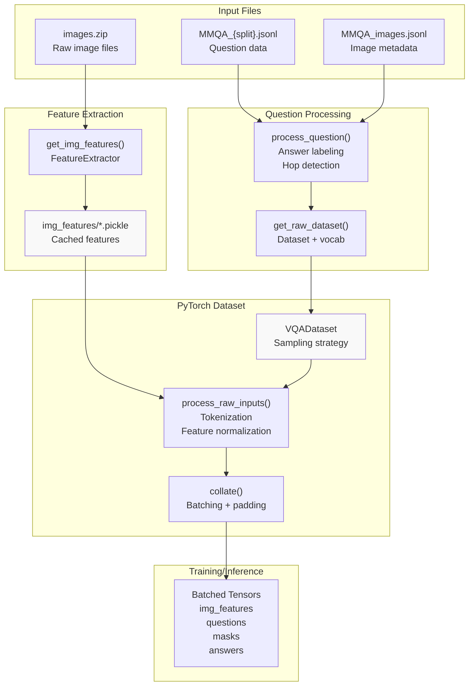
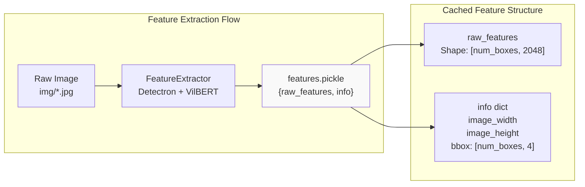
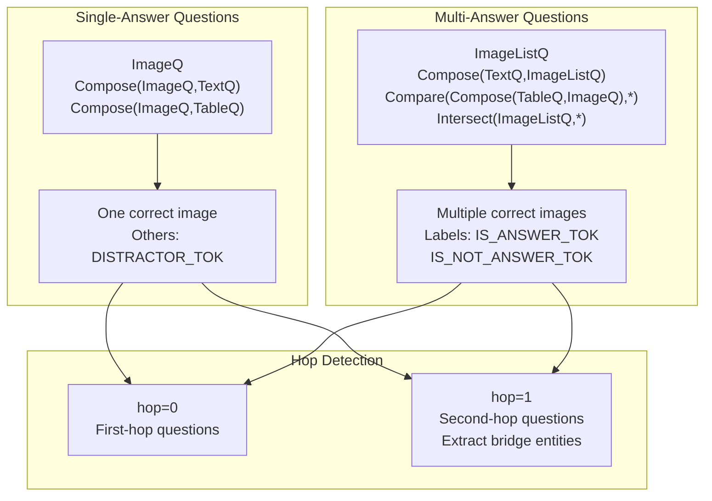
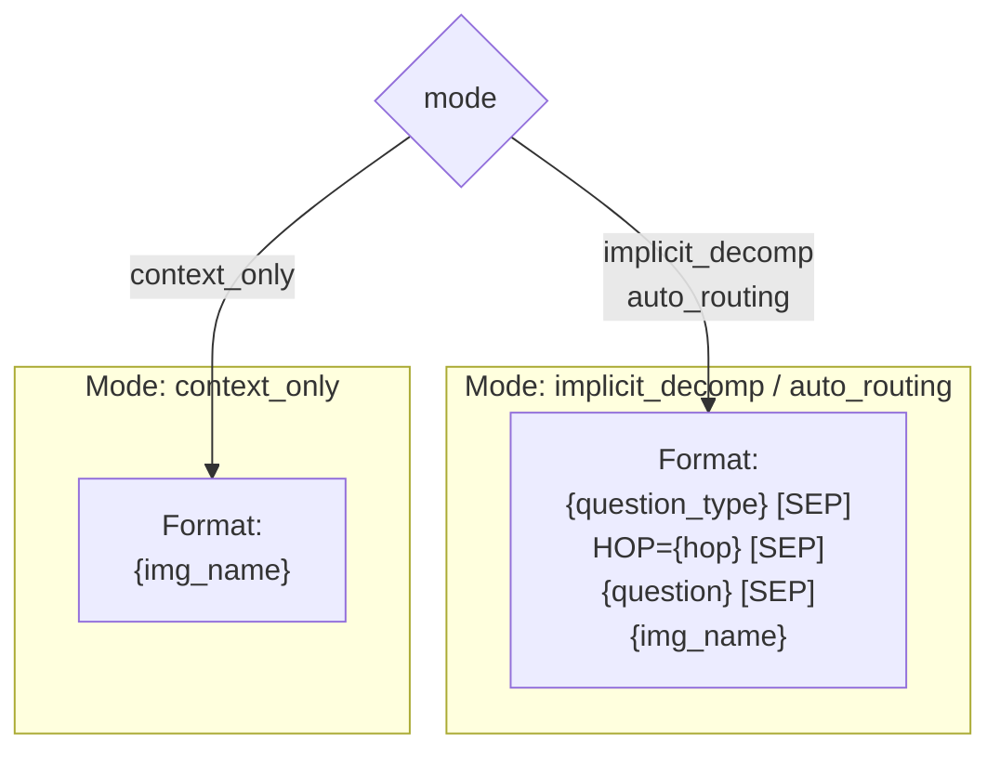
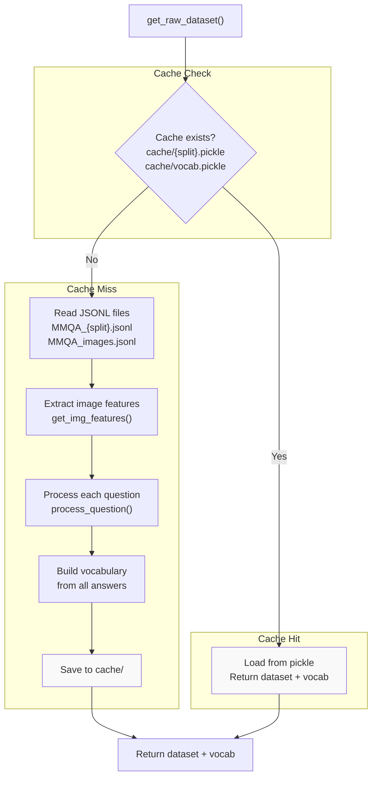
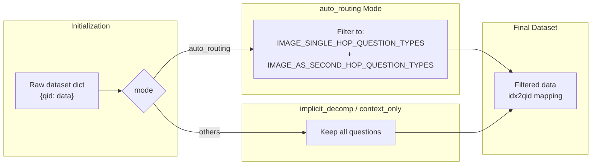
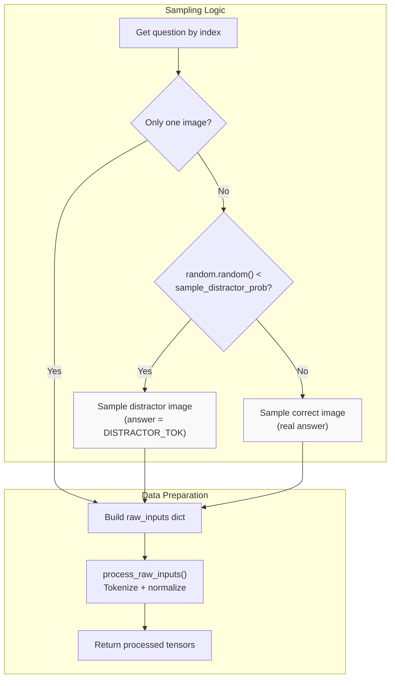
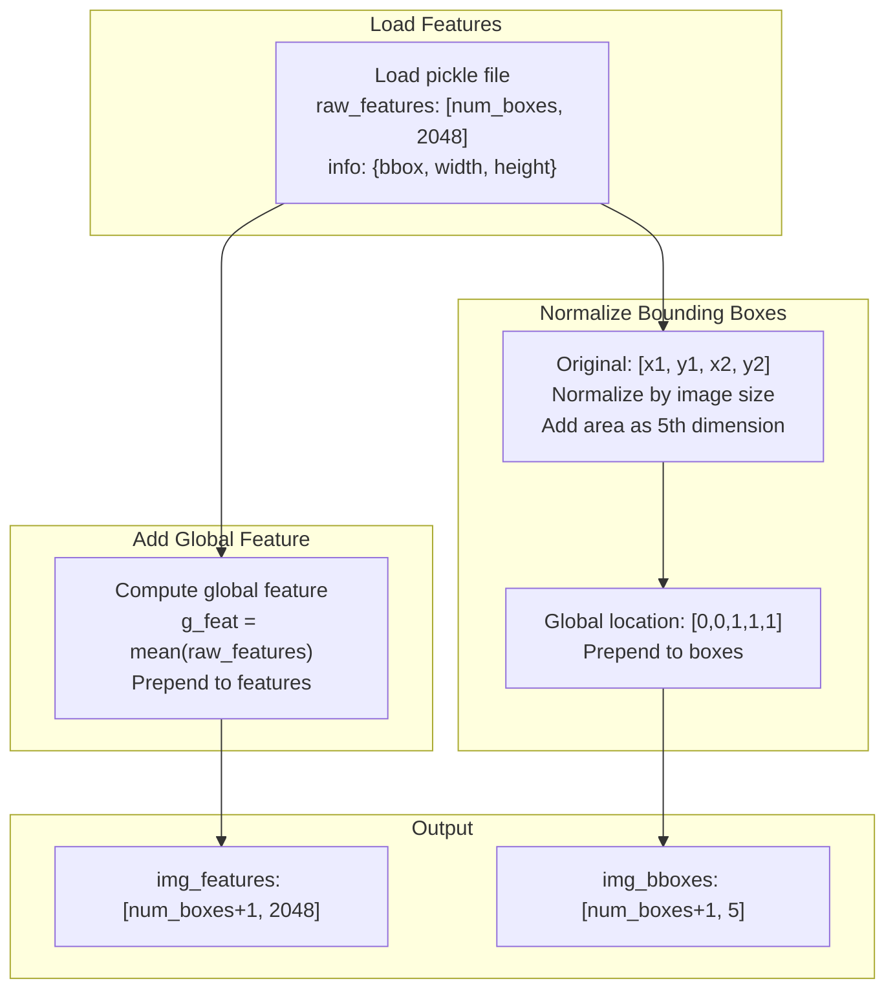
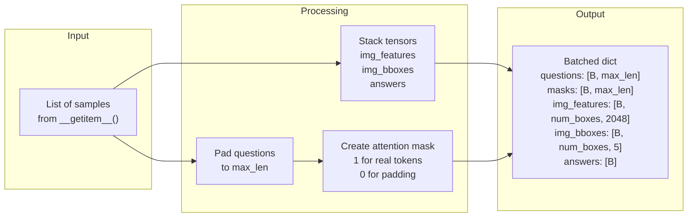

<!-- source: DeepWiki mcp.deepwiki.com · repo allenai/multimodalqa · extra page Image QA Dataset Preparation · fetched 2026-10-26 -->

# Image QA Dataset Preparation

<details>
<summary>Relevant source files</summary>

The following files were used as context for generating this wiki page:

- [baselines/image_qa/dataset.py](baselines/image_qa/dataset.py)

</details>


## Purpose and Scope

This document explains the dataset preparation pipeline for the VilBERT-based image QA model. It covers how raw MultiModalQA data is processed into PyTorch-compatible datasets, including image feature extraction, question formatting, answer labeling, and data sampling strategies. This preparation stage is essential for both training (see [Image QA Training](#5.1.3)) and inference (see [Image QA Inference](#5.1.4)).

For information about the raw dataset format and structure, see [Dataset Format Specification](#3.1) and [Context Files and Structure](#3.3). For details about the model architecture that consumes this prepared data, see [Image QA Model Architecture](#5.1.2).

---

## Overview of Dataset Preparation Pipeline

The dataset preparation pipeline transforms raw JSONL files into training-ready tensors through several stages:



**Sources:** [baselines/image_qa/dataset.py:49-249](), [baselines/image_qa/dataset.py:336-384]()

---

## Image Feature Extraction and Caching

### Feature Extraction Process

The `get_img_features()` function extracts visual features from raw images using a pre-trained Detectron model via the `FeatureExtractor` class:



**Key Features:**
- **Caching Strategy**: Features are cached in `data_dir/img_features/` with filenames matching image basenames
- **Skip Existing**: If a `.pickle` file exists, extraction is skipped [baselines/image_qa/dataset.py:62-63]()
- **Lazy Initialization**: `FeatureExtractor` is only created when needed [baselines/image_qa/dataset.py:64-65]()
- **Error Handling**: Failed extractions are logged and skipped [baselines/image_qa/dataset.py:68-70]()

| Component | Details |
|-----------|---------|
| **Input** | Image path from `MMQA_images.jsonl` |
| **Output** | Pickle file containing `(raw_features, info)` tuple |
| **Feature Dimensions** | `[num_boxes, 2048]` per image |
| **Cached Location** | `{data_dir}/img_features/{img_basename}.pickle` |

**Sources:** [baselines/image_qa/dataset.py:49-72]()

---

## Question Processing

### Question Type Handling

The `process_question()` function transforms raw questions into a structured format with appropriate answer labels based on question type:



**Answer Labeling Strategy:**

| Question Type | Answer Label Strategy | Special Tokens |
|---------------|----------------------|----------------|
| `ImageQ`, `Compose(ImageQ,TextQ)`, `Compose(ImageQ,TableQ)` | Single correct image, others marked as distractors | `DISTRACTOR_TOK` |
| `ImageListQ`, `Compose(TextQ,ImageListQ)`, `Intersect(ImageListQ,*)` | Multiple correct images marked | `IS_ANSWER_TOK`, `IS_NOT_ANSWER_TOK` |
| `Compare(Compose(TableQ,ImageQ),*)` | Single correct image (special case) | `IS_ANSWER_TOK`, `IS_NOT_ANSWER_TOK` |

**Sources:** [baselines/image_qa/dataset.py:90-183](), [baselines/image_qa/dataset.py:31-44]()

### Question Formatting by Mode

The `process_raw_question()` function formats questions differently based on the inference mode:



**Example Formatted Questions:**

**Mode: `implicit_decomp`**
```
ImageQ [SEP] HOP=0 [SEP] What is shown in the image? [SEP] Eiffel Tower
```

**Mode: `context_only`**
```
Eiffel Tower
```

**Sources:** [baselines/image_qa/dataset.py:75-87]()

### Bridge Entity Extraction

For second-hop questions (`hop=1`), the system extracts bridge entities that connect the image hop to the next modality:

| Question Type | Bridge Entity Strategy |
|---------------|------------------------|
| `Compose(ImageQ,TableQ)`, `Compose(ImageQ,TextQ)` | Use first image ID |
| `Intersect(ImageListQ,TextQ)` | Extract all supporting image IDs, convert to image titles |

**Sources:** [baselines/image_qa/dataset.py:156-170]()

---

## Raw Dataset Loading and Caching

### Dataset Loading Pipeline

The `get_raw_dataset()` function loads and preprocesses all splits with intelligent caching:



**Cached Data Structure:**

```
data_dir/
├── cache/
│   ├── train.pickle       # {qid: processed_question_data}
│   ├── dev.pickle
│   ├── test.pickle
│   └── vocab.pickle       # (idx2answer, answer2idx)
└── img_features/
    └── {img_id}.pickle    # Pre-extracted features
```

**Dataset Entry Structure:**

Each question in the dataset contains:

| Field | Type | Description |
|-------|------|-------------|
| `img_ids` | List[str] | Image document IDs |
| `img_names` | List[str] | Image titles (from metadata) |
| `answers` | List[str] | Answer per image (or special tokens) |
| `question` | str | Raw question text |
| `question_type` | str | Question type classification |
| `question_id` | str | Unique question identifier |
| `golden_bridge_entities` | List[str] | Bridge entities for second-hop questions |
| `hop` | int | 0 for first-hop, 1 for second-hop |
| `img_features_files` | List[str] | Paths to cached feature files |

**Sources:** [baselines/image_qa/dataset.py:186-249]()

---

## VQADataset Class

### Dataset Initialization and Filtering

The `VQADataset` class implements PyTorch's `Dataset` interface with mode-specific filtering:



**Constructor Parameters:**

| Parameter | Type | Default | Description |
|-----------|------|---------|-------------|
| `data` | dict | Required | Processed dataset from `get_raw_dataset()` |
| `tokenizer` | PreTrainedTokenizer | Required | BERT tokenizer for text encoding |
| `answer2idx` | dict | Required | Answer vocabulary mapping |
| `mode` | str | Required | One of: `auto_routing`, `implicit_decomp`, `context_only` |
| `sample_distractor_prob` | float | 0.3 | Probability of sampling distractor images |

**Sources:** [baselines/image_qa/dataset.py:336-346]()

### Image Sampling Strategy

The `__getitem__()` method implements intelligent sampling for training:



**Sampling Behavior:**
- **Single Image Questions**: Always use the only available image
- **Multiple Image Questions**: 
  - 30% probability (default): sample a distractor image
  - 70% probability: sample a correct image
- **Purpose**: Teach the model to distinguish between relevant and irrelevant images

**Sources:** [baselines/image_qa/dataset.py:348-378]()

---

## Input Processing and Feature Normalization

### Image Feature Processing

The `process_raw_inputs()` function normalizes image features and bounding boxes:



**Bounding Box Normalization:**

Each bounding box is transformed from `[x1, y1, x2, y2]` to `[x1_norm, y1_norm, x2_norm, y2_norm, area_norm]`:

1. Normalize coordinates by image dimensions: `x_norm = x / width`, `y_norm = y / height`
2. Calculate normalized area: `area_norm = (x2-x1) * (y2-y1) / (width * height)`
3. Prepend global location: `[0, 0, 1, 1, 1]`

**Sources:** [baselines/image_qa/dataset.py:256-274]()

### Question Tokenization

Questions are tokenized using BERT tokenizer with special formatting:

**Token Structure:**
```
[CLS] {formatted_question} [SEP]
```

Where `formatted_question` is generated by `process_raw_question()` based on the mode.

**Sources:** [baselines/image_qa/dataset.py:276-285]()

---

## Data Collation and Batching

### Collation Function

The `collate()` function batches individual samples with padding:



**Padding Strategy:**
- Questions are padded **on the front** (left-padding) [baselines/image_qa/dataset.py:323-325]()
- Padding token ID is taken from tokenizer's `pad_token_id`
- Attention mask: `0` for padding, `1` for real tokens

**Batched Output Structure:**

| Tensor | Shape | Description |
|--------|-------|-------------|
| `questions` | `[batch_size, max_len]` | Tokenized questions (left-padded) |
| `masks` | `[batch_size, max_len]` | Attention masks |
| `img_features` | `[batch_size, num_boxes+1, 2048]` | Image features with global feature |
| `img_bboxes` | `[batch_size, num_boxes+1, 5]` | Normalized bounding boxes |
| `answers` | `[batch_size]` | Answer indices (if available) |

**Sources:** [baselines/image_qa/dataset.py:305-333](), [baselines/image_qa/dataset.py:383-384]()

---

## Special Tokens and Constants

The dataset preparation uses several special tokens defined at module level:

| Constant | Value | Purpose |
|----------|-------|---------|
| `DISTRACTOR_TOK` | `'<DISTRACTOR>'` | Mark distractor images in single-answer questions |
| `IS_ANSWER_TOK` | `'<IS_ANSWER>'` | Mark correct images in multi-answer questions |
| `IS_NOT_ANSWER_TOK` | `'<IS_NOT_ANSWER>'` | Mark incorrect images in multi-answer questions |

These tokens are included in the answer vocabulary and are assigned indices during training.

**Sources:** [baselines/image_qa/dataset.py:31-33]()

---

## Usage Example

Complete workflow for dataset preparation:

```python
# Step 1: Load raw dataset (with caching)
dataset, idx2answer, answer2idx = get_raw_dataset(
    data_dir='path/to/MMQA',
    try_cache=True,
    splits=['train', 'dev', 'test']
)

# Step 2: Create PyTorch dataset
from transformers import BertTokenizer
tokenizer = BertTokenizer.from_pretrained('bert-base-uncased')

train_dataset = VQADataset(
    data=dataset['train'],
    tokenizer=tokenizer,
    answer2idx=answer2idx,
    mode='implicit_decomp',
    sample_distractor_prob=0.3
)

# Step 3: Create DataLoader
from torch.utils.data import DataLoader
train_loader = DataLoader(
    train_dataset,
    batch_size=32,
    shuffle=True,
    collate_fn=train_dataset.collate
)

# Step 4: Iterate over batches
for batch in train_loader:
    img_features = batch['img_features']  # [32, num_boxes+1, 2048]
    questions = batch['questions']         # [32, max_len]
    masks = batch['masks']                 # [32, max_len]
    answers = batch['answers']             # [32]
    # Feed to model...
```

**Sources:** [baselines/image_qa/dataset.py:336-384]()

---

