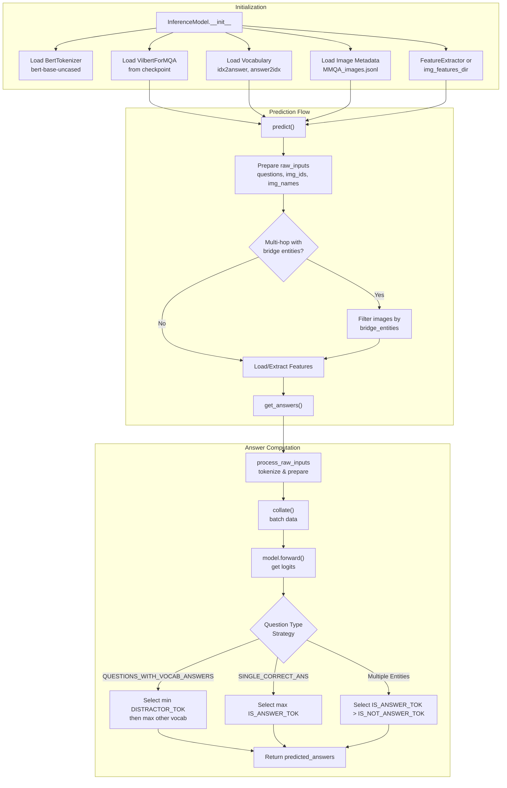
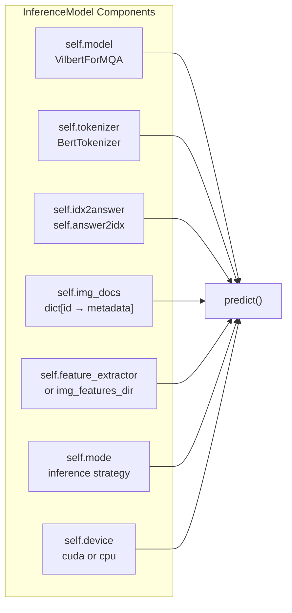
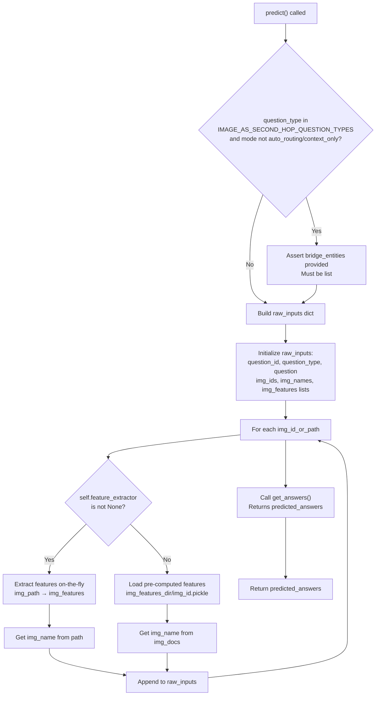
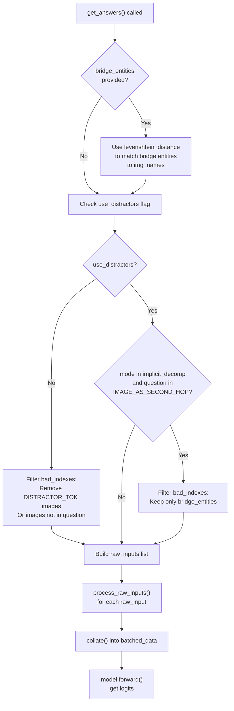
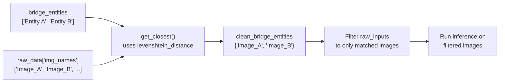

<!-- source: DeepWiki mcp.deepwiki.com · repo allenai/multimodalqa · extra page Image QA Inference · fetched 2026-10-26 -->

# Image QA Inference

<details>
<summary>Relevant source files</summary>

The following files were used as context for generating this wiki page:

- [baselines/image_qa/inference.py](baselines/image_qa/inference.py)

</details>


## Purpose and Scope

This document describes the inference system for the VilBERT-based Image QA model, focusing on how predictions are generated at test time. The inference system loads trained model checkpoints, processes questions and images, and produces answers using different strategies based on question type and inference mode.

For information about training the Image QA model, see [Image QA Training](#5.1.3). For details about the underlying model architecture, see [Image QA Model Architecture](#5.1.2). For dataset preparation and feature extraction, see [Image QA Dataset Preparation](#5.1.1).

**Sources:** [baselines/image_qa/inference.py:1-253]()

---

## Inference Architecture Overview

The image QA inference system is implemented in the `InferenceModel` class, which orchestrates model loading, feature extraction, prediction, and answer selection. The system supports three inference modes (`implicit_decomp`, `auto_routing`, `context_only`) and handles both single-hop and multi-hop questions with bridge entities.



**Diagram: End-to-End Inference Pipeline from Initialization to Answer Selection**

**Sources:** [baselines/image_qa/inference.py:161-233](), [baselines/image_qa/inference.py:37-159]()

---

## InferenceModel Class

The `InferenceModel` class encapsulates all components required for inference, including model weights, tokenizer, vocabulary, and feature extraction.

### Initialization Parameters

| Parameter | Type | Description |
|-----------|------|-------------|
| `checkpoint_path` | str | Path to trained model checkpoint (`.pt` file) |
| `vilbert_dir` | str | Directory containing VilBERT pre-trained weights |
| `img_info_path` | str | Path to `MMQA_images.jsonl` containing image metadata |
| `vocab_path` | str | Path to pickled vocabulary (`vocab.pickle`) |
| `device` | str | PyTorch device (e.g., `'cuda:0'`, `'cpu'`) |
| `mode` | str | Inference mode: `'auto_routing'`, `'implicit_decomp'`, or `'context_only'` |
| `img_features_dir` | str (optional) | Directory with pre-extracted image features |
| `use_distractors` | bool | Whether to use distractor images during inference |

### Initialization Process

The initialization process [baselines/image_qa/inference.py:162-195]() performs the following steps:

1. **Tokenizer Setup**: Loads `bert-base-uncased` tokenizer and sets pad token ID
2. **Image Metadata Loading**: Reads `MMQA_images.jsonl` into a dictionary keyed by image ID
3. **Vocabulary Loading**: Unpickles `idx2answer` and `answer2idx` mappings
4. **Model Instantiation**: Creates `VilbertForMQA` with pre-trained VilBERT weights
5. **Checkpoint Loading**: Loads fine-tuned weights from checkpoint if provided
6. **Model Preparation**: Sets model to evaluation mode and moves to device
7. **Feature Extractor**: Initializes either `FeatureExtractor` (for on-the-fly extraction) or uses pre-computed features directory



**Diagram: InferenceModel Class Attributes and Dependencies**

**Sources:** [baselines/image_qa/inference.py:161-195]()

---

## Prediction Workflow

The `predict` method [baselines/image_qa/inference.py:197-232]() is the main entry point for generating predictions on a single question.

### Method Signature

```python
def predict(self, question, img_ids_or_paths, question_type, bridge_entities=None)
```

### Parameters

- **`question`** (str): The question text
- **`img_ids_or_paths`** (list): List of image IDs (strings) or file paths
- **`question_type`** (str): One of the 16 question types (e.g., `'ImageQ'`, `'Compose(ImageQ,TextQ)'`)
- **`bridge_entities`** (list, optional): List of bridge entity names for multi-hop questions

### Input Processing



**Diagram: predict() Method Workflow**

The method constructs a `raw_inputs` dictionary containing:
- `question_id`: Empty string (not used in inference)
- `question_type`: The provided question type
- `question`: The question text
- `img_ids`: List of image IDs
- `img_names`: List of human-readable image names (titles)
- `img_features`: List of extracted feature dictionaries

**Sources:** [baselines/image_qa/inference.py:197-232]()

---

## Answer Computation Strategies

The `get_answers` function [baselines/image_qa/inference.py:37-159]() implements different answer selection strategies based on question type. It processes the raw inputs, runs forward pass, and applies type-specific logic to extract answers from model logits.

### Pre-processing: Filtering by Bridge Entities and Distractors

Before computing predictions, the function filters images based on the inference mode and question type:



**Diagram: Pre-processing and Filtering Logic**

**Sources:** [baselines/image_qa/inference.py:40-94]()

### Strategy 1: Vocabulary-Based Answers

For questions in `QUESTIONS_WITH_VOCAB_ANSWERS` [baselines/image_qa/inference.py:127-138]():

1. Compute probability of `DISTRACTOR_TOK` for each image
2. Select image with minimum `DISTRACTOR_TOK` probability
3. For that image's logits, suppress `DISTRACTOR_TOK`, `IS_ANSWER_TOK`, `IS_NOT_ANSWER_TOK`
4. Return vocabulary item with highest remaining logit

**Example Question Types**: Questions where the answer is a specific term from the vocabulary (e.g., colors, shapes)

### Strategy 2: Single Correct Image

For questions in `QUESTION_TYPES_WITH_SINGLE_CORRECT_ANS` [baselines/image_qa/inference.py:139-144]():

1. Compute probability of `IS_ANSWER_TOK` for each image
2. Return the image name with highest `IS_ANSWER_TOK` probability

**Example Question Types**: `ImageQ`, where exactly one image is correct

### Strategy 3: Multiple Entity Answers

For all other question types [baselines/image_qa/inference.py:145-154]():

1. For each image, compare `IS_ANSWER_TOK` vs `IS_NOT_ANSWER_TOK` logits
2. Return all image names where `IS_ANSWER_TOK` > `IS_NOT_ANSWER_TOK`

**Example Question Types**: `ImageListQ`, `Intersect(ImageListQ,TextQ)`, where multiple images can be correct

### Answer Strategy Comparison

| Strategy | Question Types | Selection Logic | Return Type |
|----------|---------------|-----------------|-------------|
| Vocabulary | `QUESTIONS_WITH_VOCAB_ANSWERS` | Min `DISTRACTOR_TOK`, then max vocab logit | Single vocabulary term |
| Single Image | `QUESTION_TYPES_WITH_SINGLE_CORRECT_ANS` | Max `IS_ANSWER_TOK` probability | Single image name |
| Multiple Entities | All others | `IS_ANSWER_TOK` > `IS_NOT_ANSWER_TOK` | List of image names |

**Sources:** [baselines/image_qa/inference.py:127-154]()

---

## Multi-Hop Reasoning with Bridge Entities

Multi-hop questions in the `IMAGE_AS_SECOND_HOP_QUESTION_TYPES` category require bridge entities from the first hop to guide the second hop prediction.

### Bridge Entity Matching

When bridge entities are provided [baselines/image_qa/inference.py:40-44](), the system:

1. Uses Levenshtein distance to fuzzy-match bridge entity strings to image names
2. Selects the closest matching image name for each bridge entity
3. Creates a deduplicated set of matched image names



**Diagram: Bridge Entity Fuzzy Matching Process**

### Multi-Hop Filtering Logic

For multi-hop questions in `implicit_decomp` mode [baselines/image_qa/inference.py:59-62]():

```
if question_type in IMAGE_AS_SECOND_HOP_QUESTION_TYPES and mode not in ['auto_routing', 'context_only']:
    assert bridge_entities is not None
    assert isinstance(bridge_entities, list)
    bad_indexes = [idx for idx, img_name in enumerate(raw_data['img_names']) if img_name not in bridge_entities]
```

This filters the candidate images to only those that match the bridge entities from the first hop, ensuring the second hop focuses on the correct context.

**Sources:** [baselines/image_qa/inference.py:20-36](), [baselines/image_qa/inference.py:40-62](), [baselines/image_qa/inference.py:198-201]()

---

## Usage Example

The script includes a self-contained example demonstrating typical usage [baselines/image_qa/inference.py:235-252]():

```python
mode = 'implicit_decomp'
checkpoint_filename = 'checkpoints/my_model.pt'
vocab_filename = '../../dataset/cache/vocab.pickle'
vilbert_dir = "../../deps/vilbert-multi-task"
img_info_path = '../../dataset/MMQA_images.jsonl'
img_features_dir = '../../dataset/img_features'
device = 'cuda:1'

question = "What shape is in the center of Viduthalal Chiruthaigal Katchi?"
question_type = "ImageQ"
img_ids_or_paths = ['e7a17bf9eb43fbe95843f682a03b0eb3']

inference_model = InferenceModel(
    checkpoint_filename, vilbert_dir, img_info_path, 
    vocab_filename, device, mode, img_features_dir)
    
pred = inference_model.predict(question, img_ids_or_paths, question_type)
```

### Integration with Pipeline

The `InferenceModel` is typically instantiated by the main pipeline orchestrator (see [Pipeline Implementation](#6.1)) which:

1. Loads the appropriate checkpoint based on inference mode
2. Processes questions from the dataset
3. Routes questions to the image QA model based on question type classification
4. Handles multi-hop decomposition and bridge entity passing
5. Collects predictions for evaluation

**Sources:** [baselines/image_qa/inference.py:235-252]()

---

## Key Design Decisions

### Separation of Feature Extraction

The inference model supports two modes for image features:
- **Pre-computed features** (`img_features_dir`): Fast, used in production pipeline
- **On-the-fly extraction** (`FeatureExtractor`): Flexible for new images, but slower

This design allows batch processing with cached features while maintaining flexibility for interactive use.

### Mode-Specific Logic

The `mode` parameter affects:
- Whether bridge entities are required for multi-hop questions
- Which images are included in the candidate set
- How the model processes questions (with/without decomposition)

This enables systematic comparison of different reasoning strategies using the same underlying model.

### Answer Type Handling

The three answer selection strategies correspond to different semantic question types:
- **Vocabulary answers**: Classifying image properties (colors, shapes, etc.)
- **Single entity**: Selecting the correct image from candidates
- **Multiple entities**: Finding all matching images (intersection, list operations)

This type-aware prediction logic ensures the model output format matches the expected answer format.

**Sources:** [baselines/image_qa/inference.py:1-253]()

---

