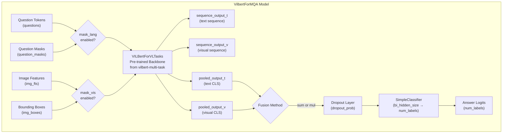
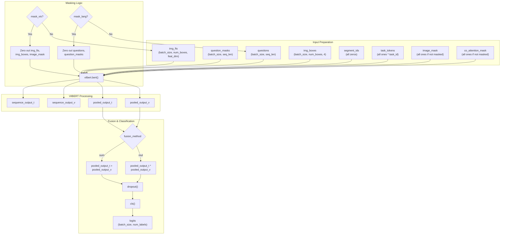
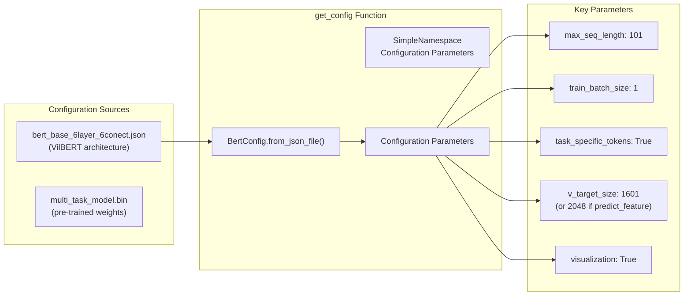
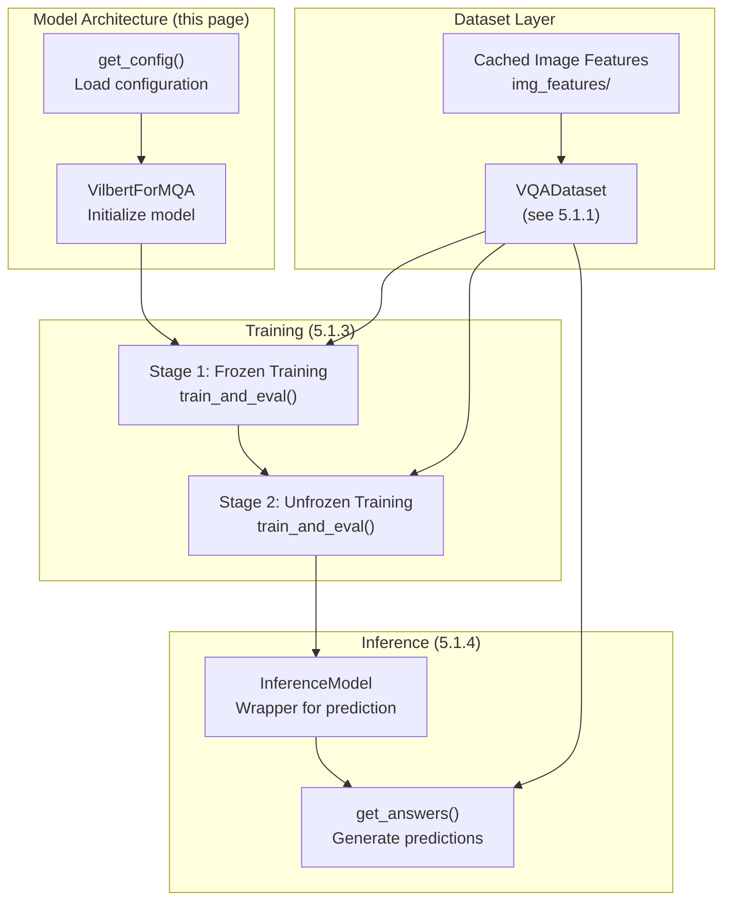

<!-- source: DeepWiki mcp.deepwiki.com · repo allenai/multimodalqa · extra page Image QA Model Architecture · fetched 2026-10-26 -->

# Image QA Model Architecture

<details>
<summary>Relevant source files</summary>

The following files were used as context for generating this wiki page:

- [baselines/image_qa/README.md](baselines/image_qa/README.md)
- [baselines/image_qa/main.py](baselines/image_qa/main.py)
- [baselines/image_qa/model.py](baselines/image_qa/model.py)

</details>


## Purpose and Scope

This document describes the `VilbertForMQA` model architecture used for visual question answering in the MultiModalQA system. It covers the model's structure, configuration, fusion methods, masking capabilities, and training utilities.

For information about how this model is trained, see [Image QA Training](#5.1.3). For details on how the model is used during inference, see [Image QA Inference](#5.1.4). For dataset preparation and feature extraction, see [Image QA Dataset Preparation](#5.1.1).

## Model Overview

The `VilbertForMQA` class is a wrapper around the pre-trained VilBERT model that adapts it for the MultiModalQA task. VilBERT is a vision-and-language BERT model that jointly processes image features and text through co-attentional transformer layers.



**Diagram: VilbertForMQA Model Architecture**

Sources: [baselines/image_qa/model.py:12-72]()

## Model Components

### VilbertForMQA Class

The `VilbertForMQA` class is defined at [baselines/image_qa/model.py:12-82]() and serves as the primary model for image question answering.

| Component | Type | Purpose |
|-----------|------|---------|
| `vilbert` | `VILBertForVLTasks` | Pre-trained VilBERT backbone for joint vision-language processing |
| `dropout` | `nn.Dropout` | Regularization layer applied after fusion |
| `cls` | `SimpleClassifier` | Final classification head mapping fused features to answer labels |

**Constructor Parameters:**

| Parameter | Type | Default | Description |
|-----------|------|---------|-------------|
| `vilbert_pretrained_model_name_or_path` | str | - | Path to pre-trained VilBERT weights |
| `config` | BertConfig | - | VilBERT configuration object |
| `num_labels` | int | - | Number of possible answer labels |
| `mask_vis` | bool | False | Whether to zero out visual information |
| `mask_lang` | bool | False | Whether to zero out language information |
| `dropout_prob` | float | 0.1 | Dropout probability |

Sources: [baselines/image_qa/model.py:13-28]()

### VilBERT Backbone

The VilBERT backbone is loaded from pre-trained weights using the `VILBertForVLTasks.from_pretrained()` method [baselines/image_qa/model.py:20-23](). This backbone performs:

1. **Textual Processing**: BERT-style encoding of question tokens
2. **Visual Processing**: Processing of image region features and bounding boxes
3. **Co-Attention**: Cross-modal attention between text and visual modalities
4. **Pooling**: Extraction of CLS token representations for both modalities

The model uses `task_id = 1` to enable task-specific tokens in the VilBERT architecture [baselines/image_qa/model.py:18]().

Sources: [baselines/image_qa/model.py:20-61]()

### Classification Head

The classification head is a `SimpleClassifier` instance [baselines/image_qa/model.py:25-27]() that maps the fused representation to answer logits:

- **Input dimension**: `config.bi_hidden_size` (the fused pooled output)
- **Hidden dimension**: `config.bi_hidden_size * 2`
- **Output dimension**: `num_labels` (vocabulary size of possible answers)
- **Dropout**: 0.5 (hardcoded in the SimpleClassifier)

Sources: [baselines/image_qa/model.py:25-27]()

## Forward Pass



**Diagram: VilbertForMQA Forward Pass Data Flow**

The forward pass implements the following logic at [baselines/image_qa/model.py:30-72]():

1. **Device placement**: Move all inputs to the model's device
2. **Auxiliary tensors**: Create segment IDs (all zeros) and task tokens (all `task_id`)
3. **Masking**: Apply visual and/or language masking if enabled
4. **VilBERT processing**: Pass all inputs through the VilBERT backbone
5. **Fusion**: Combine text and visual pooled outputs using the configured fusion method
6. **Dropout**: Apply regularization
7. **Classification**: Map fused features to answer logits

Sources: [baselines/image_qa/model.py:30-72]()

## Fusion Methods

The model supports two fusion methods for combining text and visual representations, configured via `config.fusion_method` [baselines/image_qa/model.py:28]():

| Fusion Method | Operation | Formula | Use Case |
|---------------|-----------|---------|----------|
| `"sum"` | Element-wise addition | `pooled_output_t + pooled_output_v` | Default method; treats modalities symmetrically |
| `"mul"` | Element-wise multiplication | `pooled_output_t * pooled_output_v` | Alternative fusion; emphasizes joint activation patterns |

The fusion is applied at [baselines/image_qa/model.py:63-68]() before dropout and classification.

Sources: [baselines/image_qa/model.py:63-68]()

## Masking Capabilities

The model supports ablation studies through masking capabilities:

### Visual Masking (`mask_vis`)

When `mask_vis=True` [baselines/image_qa/model.py:34-37]():
- Image features (`img_fts`) are zeroed out
- Bounding boxes (`img_boxes`) are zeroed out  
- Image attention mask is set to all zeros
- Co-attention mask is set to all zeros

This effectively removes all visual information, testing the model's reliance on textual context alone.

### Language Masking (`mask_lang`)

When `mask_lang=True` [baselines/image_qa/model.py:40-42]():
- Question tokens (`questions`) are zeroed out
- Question attention masks are zeroed out
- Co-attention mask is set to all zeros

This removes textual information, testing whether the model can answer questions using only visual context.

Sources: [baselines/image_qa/model.py:34-48]()

## Model Configuration



**Diagram: Model Configuration Flow**

The `get_config()` function at [baselines/image_qa/model.py:85-127]() creates the VilBERT configuration:

| Parameter | Value | Description |
|-----------|-------|-------------|
| `bert_model` | `"bert-base-uncased"` | Base BERT architecture |
| `config_file` | `bert_base_6layer_6conect.json` | VilBERT architecture specification |
| `max_seq_length` | 101 | Maximum question token length |
| `task_specific_tokens` | True | Enable task-specific token embeddings |
| `v_target_size` | 1601 | Visual feature dimension (or 2048 if predicting features) |
| `visualization` | True | Enable attention visualization |
| `dynamic_attention` | False | Disable dynamic attention |
| `predict_feature` | False | Use classification targets, not feature prediction |

Sources: [baselines/image_qa/model.py:85-127]()

## Training Support

### Two-Stage Training

The model provides methods to support two-stage training (frozen then unfrozen):

#### Freeze Method

```python
def freeze(self):
    for name, p in self.named_parameters():
        if 'vilbert' in name:
            p.requires_grad = False
```

The `freeze()` method at [baselines/image_qa/model.py:74-77]() disables gradient updates for all VilBERT backbone parameters while keeping the classification head trainable. This is used in Stage 1 of training.

#### Unfreeze Method

```python
def unfreeze(self):
    for name, p in self.named_parameters():
        p.requires_grad = True
```

The `unfreeze()` method at [baselines/image_qa/model.py:79-81]() enables gradient updates for all parameters, used in Stage 2 for end-to-end fine-tuning.

Sources: [baselines/image_qa/model.py:74-81]()

### Training Configuration from main.py

The model is typically instantiated with these hyperparameters [baselines/image_qa/main.py:102-190]():

| Hyperparameter | Default | Description |
|----------------|---------|-------------|
| `dropout_prob` | 0.01 | Dropout rate for the model |
| `frozen_epochs` | 25 | Number of epochs with frozen backbone |
| `frozen_lr` | 2e-5 | Learning rate during frozen stage |
| `unfrozen_epochs` | 50 | Number of epochs with unfrozen backbone |
| `unfrozen_lr` | 2e-6 | Learning rate during unfrozen stage |
| `mask_vis` | False | Enable visual masking |
| `mask_lang` | False | Enable language masking |

Sources: [baselines/image_qa/main.py:102-190]()

## Integration with the Pipeline

The `VilbertForMQA` model is used within the broader MultiModalQA system:



**Diagram: Model Integration in the Image QA Pipeline**

The model architecture documented here forms the core component that connects dataset preparation, training, and inference stages of the image QA system.

Sources: [baselines/image_qa/model.py:1-128](), [baselines/image_qa/main.py:1-278]()

---

