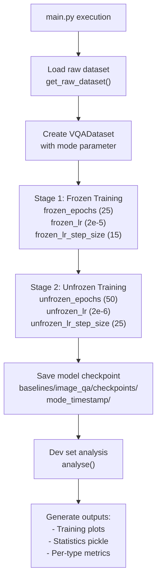
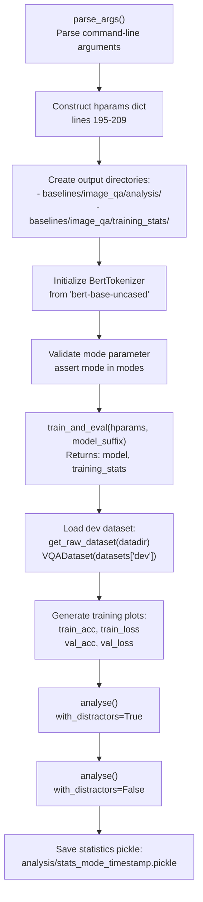
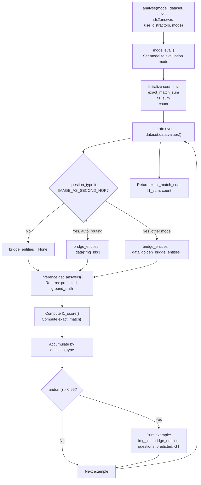

<!-- source: DeepWiki mcp.deepwiki.com · repo allenai/multimodalqa · extra page Image QA Training · fetched 2026-10-26 -->

# Image QA Training

<details>
<summary>Relevant source files</summary>

The following files were used as context for generating this wiki page:

- [baselines/image_qa/README.md](baselines/image_qa/README.md)
- [baselines/image_qa/main.py](baselines/image_qa/main.py)

</details>


## Purpose and Scope

This page documents the training process for the VilBERT-based image QA model. It covers the two-stage training procedure (frozen and unfrozen), hyperparameter configuration, the main training script workflow, and post-training analysis procedures.

For information about dataset preparation and feature extraction, see [Image QA Dataset Preparation](#5.1.1). For details about the model architecture, see [Image QA Model Architecture](#5.1.2). For running inference with trained models, see [Image QA Inference](#5.1.4).

## Training Overview

The image QA training follows a two-stage transfer learning approach:

1. **Stage 1 (Frozen)**: Train only the task-specific heads while keeping the pre-trained VilBERT backbone frozen
2. **Stage 2 (Unfrozen)**: Fine-tune the entire model end-to-end

This staged approach prevents catastrophic forgetting of the pre-trained representations while adapting the model to the MultiModalQA task. Training is orchestrated by the `main.py` script, which handles dataset construction, model training, and post-training analysis.

**Two-Stage Training Strategy**



Sources: [baselines/image_qa/main.py:193-233](), [baselines/image_qa/README.md:13-19]()

## Hyperparameters

The training process is controlled by multiple hyperparameters specified via command-line arguments. These parameters control batch size, learning rates, training duration, and data sampling strategies.

| Parameter | Default | Description |
|-----------|---------|-------------|
| `batch_size` | 12 | Training batch size |
| `device` | `cuda:0` | PyTorch device for training |
| `dropout_prob` | 0.01 | Dropout probability in model layers |
| `frozen_epochs` | 25 | Number of epochs with frozen VilBERT backbone |
| `frozen_lr` | 2e-5 | Learning rate during frozen stage |
| `frozen_lr_step_size` | 15 | LR scheduler step size (frozen stage) |
| `unfrozen_epochs` | 50 | Number of epochs with full fine-tuning |
| `unfrozen_lr` | 2e-6 | Learning rate during unfrozen stage |
| `unfrozen_lr_step_size` | 25 | LR scheduler step size (unfrozen stage) |
| `sample_distractor_prob` | 0.3 | Probability of sampling distractor images |
| `mask_vis` | False | Whether to mask visual features (ablation) |
| `mask_lang` | False | Whether to mask language features (ablation) |
| `mode` | `implicit_decomp` | Training mode: `implicit_decomp`, `auto_routing`, or `context_only` |
| `data_dir` | `../../dataset` | Directory containing MultiModalQA data |

Sources: [baselines/image_qa/main.py:102-190]()

## Main Training Script Workflow

The `main.py` script orchestrates the complete training pipeline, from dataset preparation to post-training analysis.

**Training Script Execution Flow**



Sources: [baselines/image_qa/main.py:193-278]()

### Training Mode Selection

The `mode` parameter determines how questions are processed during training and evaluation:

- **`implicit_decomp`**: Uses ground truth bridge entities for multi-hop questions. This mode explicitly decomposes multi-hop reasoning by using only the correct intermediate entities.
  
- **`auto_routing`**: Uses all available candidate entities as bridge entities. This mode provides the model with all potential bridge entities without gold supervision.

- **`context_only`**: Baseline mode that ignores question types and uses all available context.

The mode parameter is validated at [baselines/image_qa/main.py:226]() and passed to both the training function and dataset construction.

Sources: [baselines/image_qa/main.py:177-181](), [baselines/image_qa/main.py:226-229]()

## Two-Stage Training Process

The actual model training is delegated to the `train_and_eval()` function (not shown in provided files, but referenced at [baselines/image_qa/main.py:233]()). This function implements the two-stage training strategy:

### Stage 1: Frozen Backbone Training

In the first stage, the pre-trained VilBERT backbone parameters are frozen, and only the task-specific answer classification head is trained. This stage uses:

- Higher learning rate (`frozen_lr = 2e-5`)
- Fewer epochs (`frozen_epochs = 25`)
- Larger learning rate decay steps (`frozen_lr_step_size = 15`)

This approach allows the model to quickly adapt its output layer to the MultiModalQA task without destroying the pre-trained visual-linguistic representations.

### Stage 2: Full Model Fine-Tuning

In the second stage, all parameters are unfrozen and fine-tuned end-to-end:

- Lower learning rate (`unfrozen_lr = 2e-6`) - 10x smaller than frozen stage
- More epochs (`unfrozen_epochs = 50`) - 2x more than frozen stage
- Larger learning rate decay steps (`unfrozen_lr_step_size = 25`)

The lower learning rate and longer training allow for careful adaptation of the entire model while maintaining the useful pre-trained features.

Sources: [baselines/image_qa/main.py:123-157]()

## Post-Training Analysis

After training completes, the script performs comprehensive analysis on the development set using the `analyse()` function.

**Analysis Workflow**



Sources: [baselines/image_qa/main.py:48-99]()

### Analysis Runs

The script performs analysis twice:

1. **With distractors** (`use_distractors=True`): Includes randomly sampled distractor images in the context, testing robustness
2. **Without distractors** (`use_distractors=False`): Uses only relevant images, measuring ideal performance

For each run, metrics are computed and aggregated by question type, providing fine-grained performance breakdown.

Sources: [baselines/image_qa/main.py:248-273]()

### Evaluation Metrics

Two metrics are computed for each example:

**F1 Score**: Measures token-level overlap between predicted and ground truth answer lists
```python
# Simplified logic from main.py:26-41
recall = average([1.0 if gt in predictions else 0.0 for gt in ground_truths])
precision = average([1.0 if pred in ground_truths else 0.0 for pred in predictions])
f1 = (2 * precision * recall) / (precision + recall)
```

**Exact Match**: Binary indicator of whether predicted and ground truth lists match exactly
```python
# From main.py:43-45
match = (sorted(predictions) == sorted(ground_truths))
```

Sources: [baselines/image_qa/main.py:26-45]()

## Output Artifacts

The training process generates multiple output files for model checkpoints, training statistics, and analysis results.

### Directory Structure

```
baselines/image_qa/
├── checkpoints/
│   └── {mode}_{timestamp}/
│       └── [model checkpoint files]
├── training_stats/
│   ├── train_acc_{mode}_{timestamp}.png
│   ├── train_loss_{mode}_{timestamp}.png
│   ├── val_acc_{mode}_{timestamp}.png
│   └── val_loss_{mode}_{timestamp}.png
└── analysis/
    └── stats_{mode}_{timestamp}.pickle
```

### Checkpoint Files

Model checkpoints are saved to `baselines/image_qa/checkpoints/` with a suffix combining the training mode and timestamp (e.g., `implicit_decomp_15|12|2020_14:30:45`). These checkpoints can be loaded for inference using the `InferenceModel` class.

Sources: [baselines/image_qa/main.py:224-233](), [baselines/image_qa/README.md:19]()

### Training Statistics Plots

Four plots are generated showing training progress over epochs:

| Plot | Description |
|------|-------------|
| `train_acc_{suffix}.png` | Training set accuracy |
| `train_loss_{suffix}.png` | Training set loss |
| `val_acc_{suffix}.png` | Validation set accuracy |
| `val_loss_{suffix}.png` | Validation set loss |

These plots are saved to `baselines/image_qa/training_stats/` directory.

Sources: [baselines/image_qa/main.py:239-244]()

### Analysis Statistics

The analysis statistics are saved as a pickle file containing:

- **`with_distractors`**: Metrics with distractor images included
  - `exact_match_sum`: Dict mapping question type to EM sum
  - `f1_sum`: Dict mapping question type to F1 sum
  - `count`: Dict mapping question type to example count
  
- **`no_distractors`**: Metrics without distractor images

- **`training_statistics`**: Training curves and metadata from `train_and_eval()`

The console output displays per-question-type breakdown:
```
Stats breakdown: (with_distractors)
  TextQ: F1=75.23, EM=68.45 (1234 occurrences)
  ImageQ: F1=62.15, EM=58.32 (987 occurrences)
  ...
  TOTAL: F1=68.50, EM=62.10 (5432 occurrences)
```

Sources: [baselines/image_qa/main.py:248-278]()

## Running Training

To train an image QA model, execute the main training script:

```bash
python baselines/image_qa/main.py \
  --mode implicit_decomp \
  --batch_size 12 \
  --frozen_epochs 25 \
  --frozen_lr 2e-5 \
  --unfrozen_epochs 50 \
  --unfrozen_lr 2e-6 \
  --device cuda:0
```

The script will:
1. Load and cache the dataset if not already done
2. Train the model in two stages
3. Generate training plots
4. Perform dev set analysis
5. Save all outputs to the respective directories

For training different modes, change the `--mode` parameter to `auto_routing` or `context_only`.

Sources: [baselines/image_qa/README.md:13-19](), [baselines/image_qa/main.py:193-233]()

---

