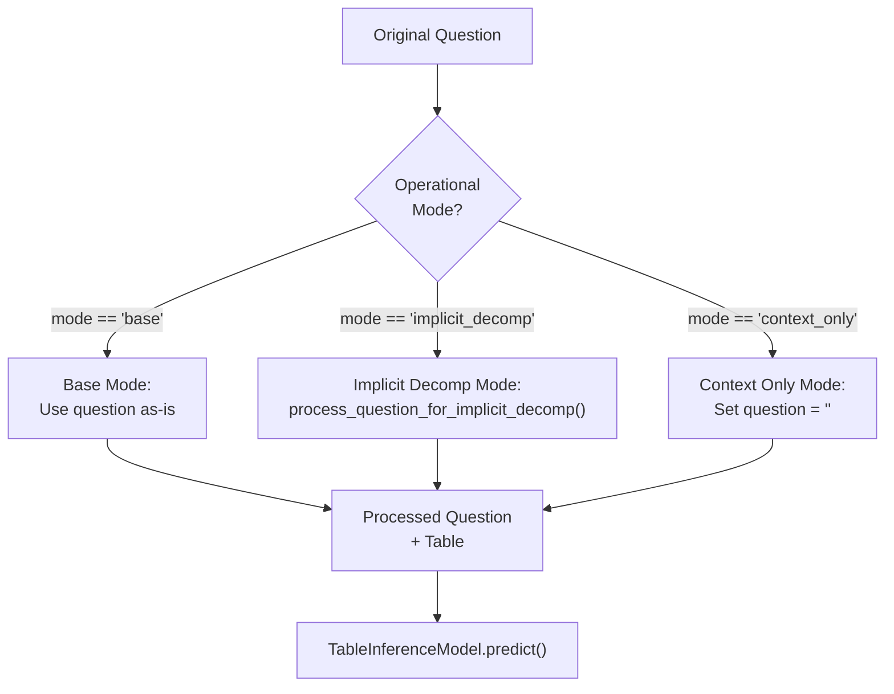
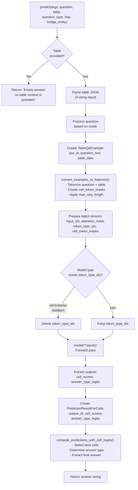
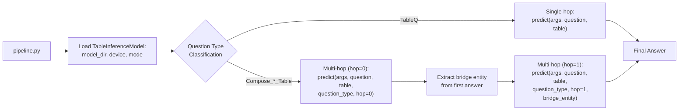

<!-- source: DeepWiki mcp.deepwiki.com · repo allenai/multimodalqa · extra page Table QA Inference · fetched 2026-10-26 -->

# Table QA Inference

<details>
<summary>Relevant source files</summary>

The following files were used as context for generating this wiki page:

- [baselines/table_qa/inference.py](baselines/table_qa/inference.py)

</details>


## Purpose and Scope

This document describes the inference system for the table-based question answering (QA) model in the MultiModalQA framework. The table QA model processes questions over structured tabular data and generates answers by selecting relevant table cells and determining answer types (yes/no, count, sum, mean, or cell content).

For information about the table QA model's prediction logic and cell selection algorithm, see [Table QA Prediction Logic](#5.2.2). For the overall inference pipeline orchestration, see [Pipeline Implementation](#6.1). For training table QA models, see [Training Text and Table QA Models](#7.2).

**Sources:** [baselines/table_qa/inference.py:1-156]()

## TableInferenceModel Class

The `TableInferenceModel` class provides the primary interface for table-based question answering. It encapsulates model loading, device management, and the complete inference workflow for answering questions over tabular data.

### Initialization

The model is initialized by loading a pre-trained checkpoint and configuring the operational mode:

```python
model = TableInferenceModel(model_dir, device=None, mode="base")
```

| Parameter | Type | Description |
|-----------|------|-------------|
| `model_dir` | str | Directory containing model checkpoint, config, and tokenizer files |
| `device` | torch.device | Target device (CPU/GPU); defaults to CPU if not specified |
| `mode` | str | Operational mode: `"base"`, `"implicit_decomp"`, or `"context_only"` |

The initialization process performs the following steps:

1. **Load Configuration**: Uses `AutoConfig.from_pretrained()` to load model configuration from the checkpoint directory
2. **Load Tokenizer**: Uses `AutoTokenizer.from_pretrained()` to load the appropriate tokenizer (BERT or RoBERTa)
3. **Instantiate Model**: Determines model type from config and loads either `BertQaForTable` or `RobertaQaForTable`
4. **Device Transfer**: Moves model to specified device and sets to evaluation mode

**Sources:** [baselines/table_qa/inference.py:14-31]()

### Model Architecture Support

The inference system supports two transformer architectures:

- **BERT**: Uses `BertQaForTable` class when `config.model_type == "bert"`
- **RoBERTa**: Uses `RobertaQaForTable` class when `config.model_type == "roberta"`

Both models are specialized variants that output cell-level logits rather than traditional span predictions, enabling selection of individual table cells as answers.

**Sources:** [baselines/table_qa/inference.py:18-23]()

## Operational Modes

The `TableInferenceModel` supports three distinct operational modes that control how questions are processed before inference:



**Diagram: Question Processing by Operational Mode**

### Base Mode

In base mode, questions are passed directly to the model without modification. This represents the standard single-hop QA scenario where the question is answered using only the provided table context.

**Sources:** [baselines/table_qa/inference.py:30-31]()

### Implicit Decomposition Mode

In implicit decomposition mode (`mode == "implicit_decomp"`), questions are reformulated to support multi-hop reasoning:

- Calls `process_question_for_implicit_decomp()` with question type, hop index, and bridge entity
- The function appends structured metadata to the question using separator tokens
- For second-hop questions, the bridge entity from the first hop is incorporated into the question

Example transformation:
```
Original: "What is the population?"
With bridge entity "New York": "What is the population? [SEP] New York [SEP] hop: 1"
```

**Sources:** [baselines/table_qa/inference.py:44-47]()

### Context Only Mode

In context only mode (`mode == "context_only"`), the question is replaced with an empty string. This baseline tests whether the model can extract meaningful information from context alone without question guidance.

**Sources:** [baselines/table_qa/inference.py:48-49]()

## Inference Workflow

The `predict` method implements the complete inference pipeline from question and table to answer prediction:



**Diagram: Table QA Inference Workflow**

**Sources:** [baselines/table_qa/inference.py:33-108]()

### Step-by-Step Process

#### 1. Input Validation and Parsing

The method first validates that table context is provided and parses JSON string inputs if necessary:

```python
if not table:
    return "Empty answer: no table context is provided."

if isinstance(table, str):
    try:
        table = json.loads(table)
    except:
        return "Cannot parse the table string into json object."
```

**Sources:** [baselines/table_qa/inference.py:34-42]()

#### 2. Question Processing

Based on the operational mode, the question is processed using the appropriate strategy:

- **implicit_decomp**: Reformulates question with metadata using `process_question_for_implicit_decomp()`
- **context_only**: Replaces question with empty string
- **base**: Uses original question unchanged

**Sources:** [baselines/table_qa/inference.py:44-49]()

#### 3. Feature Conversion

The question and table are converted into model-ready features using `convert_examples_to_features()`:

```python
example = TableQaExample(
    qas_id=qas_id,
    question_text=question,
    table_data=table
)
features, dataset = convert_examples_to_features(
    [example], 
    self.tokenizer,
    max_seq_length=args.max_seq_length,
    doc_stride=args.doc_stride,
    max_query_length=args.max_query_length,
    is_training=False, 
    verbose=False
)
```

This step performs:
- Tokenization of question and table cells
- Creation of `cell_token_masks` to identify token positions corresponding to each table cell
- Application of sequence length constraints
- Generation of attention masks and token type IDs

**Sources:** [baselines/table_qa/inference.py:51-61]()

#### 4. Batch Preparation

The features are converted to tensors and transferred to the target device:

```python
batch = tuple(t.to(self.device) for t in dataset.tensors)

inputs = {
    "input_ids": batch[0],
    "attention_mask": batch[1],
    "token_type_ids": batch[2],
    "cell_token_masks": batch[3],
}

if self.config.model_type in ["xlm", "roberta", "distilbert", "camembert"]:
    del inputs["token_type_ids"]
```

Model-specific adjustments are made:
- RoBERTa and similar models do not use `token_type_ids`, so they are removed
- XLNet and XLM models require additional inputs (currently unsupported)

**Sources:** [baselines/table_qa/inference.py:63-80]()

#### 5. Model Forward Pass

The model processes the inputs to generate cell scores and answer type logits:

```python
with torch.no_grad():
    outputs = self.model(**inputs)
```

The model outputs:
- **cell_scores**: Logits for each table cell indicating selection confidence
- **answer_type_logits**: Logits for answer type classification (yes/no/count/sum/mean/cell)

**Sources:** [baselines/table_qa/inference.py:65-82]()

#### 6. Result Extraction

For each example in the batch, results are extracted and packaged:

```python
for i, example_index in enumerate(example_indices):
    eval_feature = features[example_index.item()]
    unique_id = int(eval_feature.unique_id)
    
    output = [to_list(output[i]) for output in outputs]
    cell_scores, answer_type_logits = output
    cell_scores = cell_scores[: len(eval_feature.cell_spans)]
    result = PredictionResultForCells(unique_id, cell_scores, answer_type_logits)
    all_results.append(result)
```

Cell scores are truncated to match the actual number of cells in the table to avoid including padding tokens.

**Sources:** [baselines/table_qa/inference.py:84-99]()

#### 7. Prediction Computation

The final answer is computed using `compute_predictions_with_cell_logits()`, which:
- Selects the most confident cells based on scores
- Determines the answer type (yes/no/count/sum/mean/cell content)
- Applies aggregation operations if needed (counting, summing, averaging)
- Formats the final answer string

For details on this algorithm, see [Table QA Prediction Logic](#5.2.2).

**Sources:** [baselines/table_qa/inference.py:101-108]()

## Integration with Pipeline

The `TableInferenceModel` is integrated into the overall MultiModalQA pipeline for routing table-based questions:



**Diagram: Table QA Integration in Inference Pipeline**

The pipeline orchestrator:
1. Initializes `TableInferenceModel` with appropriate mode (implicit_decomp/auto_routing/context_only)
2. Routes questions classified as table-based to the table QA model
3. For multi-hop questions, performs two-stage inference with bridge entity extraction
4. Aggregates results for evaluation

**Sources:** [baselines/table_qa/inference.py:14-108]()

## Command-Line Interface

The module provides a standalone command-line interface for batch inference:

```bash
python baselines/table_qa/inference.py \
    --model_dir <checkpoint_directory> \
    --input <input_jsonl_file> \
    --max_seq_length 384 \
    --doc_stride 128 \
    --max_query_length 64 \
    --max_answer_length 30
```

### Command-Line Arguments

| Argument | Type | Default | Description |
|----------|------|---------|-------------|
| `--model_dir` | str | Required | Directory containing model checkpoint, config, and tokenizer |
| `--input` | str | Required | Path to input JSONL file with questions and tables |
| `--do_lower_case` | bool | True | Whether to lowercase input text (for uncased models) |
| `--max_seq_length` | int | 384 | Maximum total input sequence length after tokenization |
| `--doc_stride` | int | 128 | Stride for splitting long documents into chunks |
| `--max_query_length` | int | 64 | Maximum number of tokens for the question |
| `--max_answer_length` | int | 30 | Maximum length of generated answer |
| `--no_cuda` | bool | False | Disable CUDA even if available |

**Sources:** [baselines/table_qa/inference.py:111-134]()

### Batch Processing

The `main()` function demonstrates batch processing of questions from a JSONL file:

```python
def main():
    args = parse_args()
    device = torch.device("cuda" if torch.cuda.is_available() and not args.no_cuda else "cpu")
    model = TableInferenceModel(args.model_dir, device)

    with open(args.input) as fin:
        for line in fin:
            obj = json.loads(line)
            table = obj["context"]["documents"][0]["table"]
            for qa in obj["qas"]:
                question = qa["question"]
                answer_text = extract_answer(qa)[2]
                pred_answer = model.predict(args, question, table)
                print("=" * 10)
                print(pred_answer)
                print(answer_text)
```

This interface:
1. Loads a single model instance
2. Processes each line of the input JSONL file
3. Extracts table context and questions from the MultiModalQA format
4. Generates predictions for each question
5. Prints predictions alongside gold answers for comparison

**Sources:** [baselines/table_qa/inference.py:137-153]()

## Key Dependencies

The table QA inference system depends on several external modules:

| Module | Purpose | Key Functions/Classes |
|--------|---------|----------------------|
| `transformers` | Transformer models and tokenizers | `AutoConfig`, `AutoTokenizer` |
| `models` | Custom QA model implementations | `BertQaForTable`, `RobertaQaForTable` |
| `data_reader` | Data processing utilities | `convert_examples_to_features`, `extract_answer`, `TableQaExample` |
| `table_qa_utils` | Prediction computation | `compute_predictions_with_cell_logits`, `PredictionResultForCells` |
| `common_utils` | Shared utilities | `process_question_for_implicit_decomp` |
| `run_table_qa` | Training utilities | `to_list` |

**Sources:** [baselines/table_qa/inference.py:1-11]()

---

