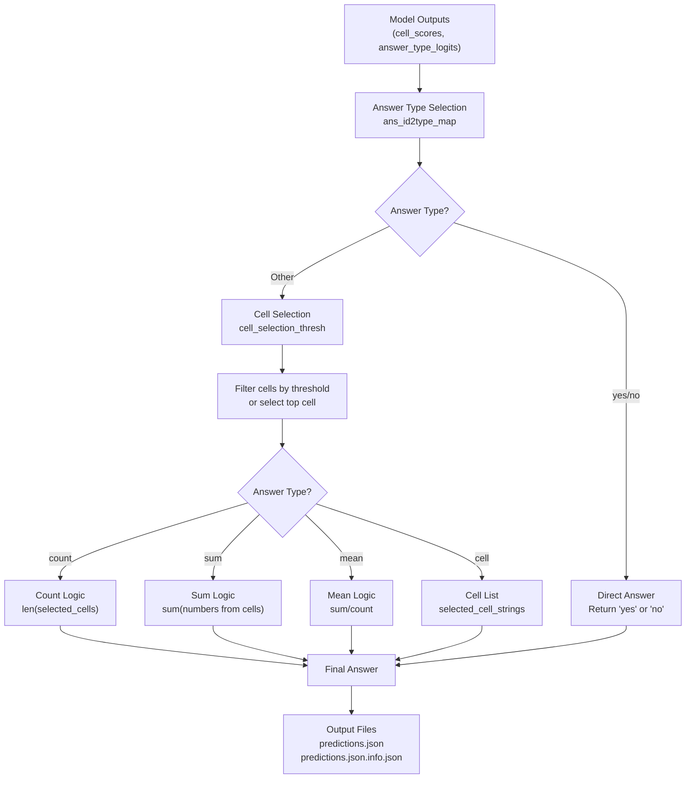
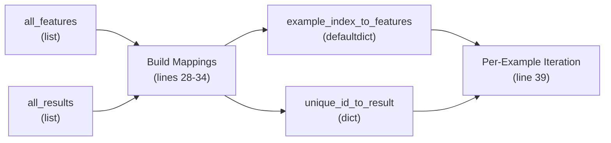
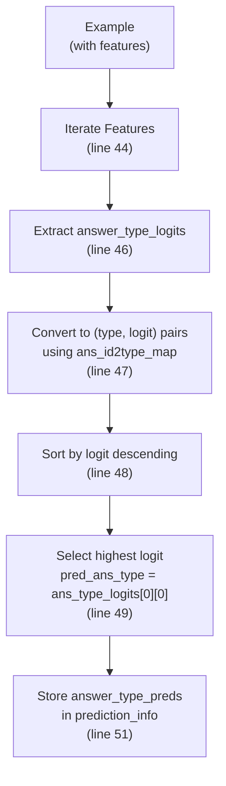
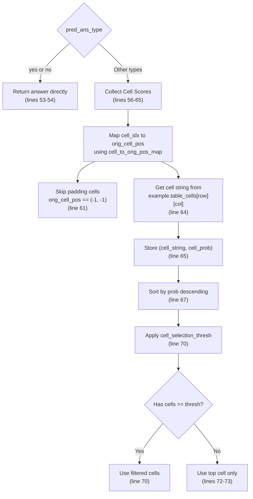
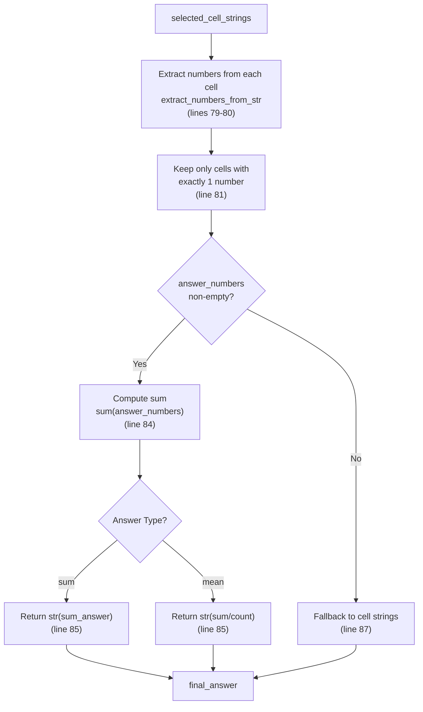
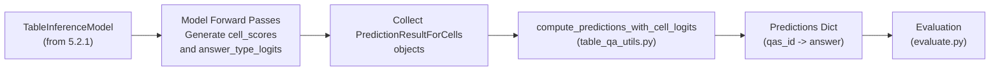

<!-- source: DeepWiki mcp.deepwiki.com · repo allenai/multimodalqa · extra page Table QA Prediction Logic · fetched 2026-10-26 -->

# Table QA Prediction Logic

<details>
<summary>Relevant source files</summary>

The following files were used as context for generating this wiki page:

- [baselines/table_qa/table_qa_utils.py](baselines/table_qa/table_qa_utils.py)

</details>


## Purpose and Scope

This document explains the prediction logic used by the Table QA model to convert raw model outputs (cell scores and answer type logits) into final answers. It covers the `compute_predictions_with_cell_logits` function and associated logic in [baselines/table_qa/table_qa_utils.py]().

For information about the Table QA model's inference interface and operational modes, see [Table QA Inference](#5.2.1). For the broader context of how Table QA fits into the system, see [Baseline Models](#5).

**Sources:** [baselines/table_qa/table_qa_utils.py:1-104]()

---

## Overview

The Table QA prediction logic transforms model outputs into structured answers through a multi-stage process:

1. **Answer Type Selection**: Determine whether the answer is yes/no, count, sum, mean, or cell selection
2. **Cell Selection**: Identify relevant table cells based on probability thresholds
3. **Answer Construction**: Apply answer-type-specific logic to produce the final answer
4. **Output Generation**: Write predictions and diagnostic information to JSON files



**Diagram: Table QA Prediction Pipeline**

**Sources:** [baselines/table_qa/table_qa_utils.py:17-104]()

---

## Data Structures

### PredictionResultForCells

The `PredictionResultForCells` class encapsulates the raw outputs from the Table QA model for a single example.

| Field | Type | Description |
|-------|------|-------------|
| `unique_id` | int | Identifier linking result to feature/example |
| `cell_scores` | list[float] | Probability scores for each table cell |
| `answer_type_logits` | list[float] | Logits for each answer type |

This class serves as an intermediate representation between model outputs and final predictions. It is instantiated during inference and passed to `compute_predictions_with_cell_logits`.

**Sources:** [baselines/table_qa/table_qa_utils.py:10-14]()

---

## Main Prediction Function

### Function Signature

```python
compute_predictions_with_cell_logits(
    all_examples,
    all_features,
    all_results,
    output_prediction_file=None,
    cell_selection_thresh=0.5
)
```

### Parameters

| Parameter | Type | Default | Description |
|-----------|------|---------|-------------|
| `all_examples` | list | Required | Dataset examples with table cells and metadata |
| `all_features` | list | Required | Tokenized features with cell position mappings |
| `all_results` | list[PredictionResultForCells] | Required | Model outputs (cell scores, answer type logits) |
| `output_prediction_file` | str | None | Path to write predictions JSON |
| `cell_selection_thresh` | float | 0.5 | Threshold for cell selection (probability cutoff) |

### Return Value

Returns an `OrderedDict` mapping `qas_id` to final answer strings or lists.

**Sources:** [baselines/table_qa/table_qa_utils.py:17-23]()

---

## Prediction Processing Flow

### Index Mapping Construction

The function begins by constructing lookup structures to efficiently access features and results:



**Diagram: Index Mapping Construction**

These mappings enable efficient lookup during the per-example processing loop:
- `example_index_to_features`: Maps example indices to their associated features (handles cases where one example maps to multiple features)
- `unique_id_to_result`: Maps feature unique IDs to their prediction results

**Sources:** [baselines/table_qa/table_qa_utils.py:28-34]()

---

## Answer Type Determination

For each example, the system first determines the predicted answer type by aggregating logits across all features:



**Diagram: Answer Type Selection Process**

The `ans_id2type_map` (defined at [baselines/table_qa/table_qa_utils.py:7]()) maps integer indices to answer type strings from the `data_reader` module. Supported types include:
- `"yes"` - Binary affirmative
- `"no"` - Binary negative  
- `"count"` - Count of matching cells
- `"sum"` - Sum of numeric values
- `"mean"` - Average of numeric values
- Cell selection (implicit default)

**Sources:** [baselines/table_qa/table_qa_utils.py:43-51](), [baselines/table_qa/table_qa_utils.py:7]()

---

## Cell Selection Logic

For non-yes/no answers, the system selects relevant table cells based on their probability scores:



**Diagram: Cell Selection and Filtering Process**

### Cell Selection Threshold

The `cell_selection_thresh` parameter (default 0.5) acts as a probability cutoff:
- Cells with `prob >= cell_selection_thresh` are selected
- If no cells meet the threshold, the single highest-probability cell is selected as a fallback

This threshold provides a tunable trade-off between precision (high threshold) and recall (low threshold).

**Sources:** [baselines/table_qa/table_qa_utils.py:53-74]()

---

## Answer Type-Specific Processing

After cell selection, the final answer is constructed based on the predicted answer type:

### Yes/No Answers

```python
if pred_ans_type in ["yes", "no"]:
    final_answer = pred_ans_type
```

These answers bypass cell selection entirely and return the type name directly.

### Count Answers

```python
if pred_ans_type == "count":
    final_answer = str(len(selected_cell_strings))
```

Count answers return the number of selected cells as a string.

### Sum and Mean Answers



**Diagram: Sum and Mean Answer Processing**

The `extract_numbers_from_str` function (from `common_utils`) extracts numeric values from cell text. Key behaviors:
- Only cells with exactly one number are included (avoids ambiguity)
- If no valid numbers are found, falls back to returning the cell strings
- Mean is computed as `sum / len(answer_numbers)`

### Cell List Answers (Default)

```python
else:
    final_answer = selected_cell_strings
```

When the answer type is not recognized or indicates direct cell selection, the list of selected cell strings is returned.

**Sources:** [baselines/table_qa/table_qa_utils.py:75-90]()

---

## Output Format

### Predictions File

The main predictions file (`output_prediction_file`) contains a JSON mapping of question IDs to answers:

```json
{
    "qid_12345": "yes",
    "qid_12346": "42",
    "qid_12347": ["New York", "Los Angeles"],
    "qid_12348": "125.5"
}
```

Answers may be:
- Strings (for yes/no, count, sum, mean)
- Lists of strings (for cell selection)

### Prediction Info File

A companion file (`output_prediction_file + ".info.json"`) stores detailed diagnostic information:

```json
{
    "qid_12345": {
        "answer_type_preds": [
            ["yes", 4.23],
            ["no", -1.45],
            ["count", -2.78],
            ...
        ],
        "cell_probs": [
            ["Cell Value A", 0.85],
            ["Cell Value B", 0.72],
            ...
        ],
        "final_answer": "yes"
    }
}
```

| Field | Description |
|-------|-------------|
| `answer_type_preds` | Sorted list of (type, logit) pairs |
| `cell_probs` | Sorted list of (cell_string, probability) pairs |
| `final_answer` | The computed final answer |

This information is valuable for error analysis and debugging model predictions.

**Sources:** [baselines/table_qa/table_qa_utils.py:91-102]()

---

## Integration with Inference Pipeline

The `compute_predictions_with_cell_logits` function is called from the Table QA inference pipeline after model forward passes are complete. The typical call flow is:



**Diagram: Integration with Inference Pipeline**

The function decouples model architecture from answer construction logic, allowing the same prediction logic to be used across different model variants or training configurations.

**Sources:** [baselines/table_qa/table_qa_utils.py:17-104]()

---

## Key Design Decisions

### Threshold-Based Cell Selection

The `cell_selection_thresh` parameter enables flexible cell selection strategies:
- **Higher thresholds (0.7-0.9)**: More precise, fewer cells selected
- **Default threshold (0.5)**: Balanced precision/recall
- **Lower thresholds (0.2-0.4)**: Higher recall, more cells selected

The fallback to the top cell ensures the system always produces an answer.

### Answer Type Hierarchy

The answer type determination uses a strict priority order based on model logits, not heuristics. This ensures:
- Consistent behavior across examples
- Model-driven decisions (the model learns when to use each type)
- Explicit type prediction in training data guides the model

### Number Extraction Strictness

The sum/mean logic only considers cells with exactly one number to avoid ambiguity. For example:
- `"42"` → Valid, extracts 42
- `"42.5 million"` → Valid if extractor handles it
- `"42 and 43"` → Invalid, skipped (ambiguous)

This conservative approach prioritizes correctness over recall.

**Sources:** [baselines/table_qa/table_qa_utils.py:17-90]()

---

