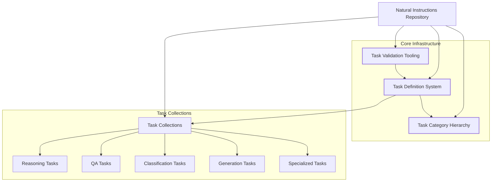
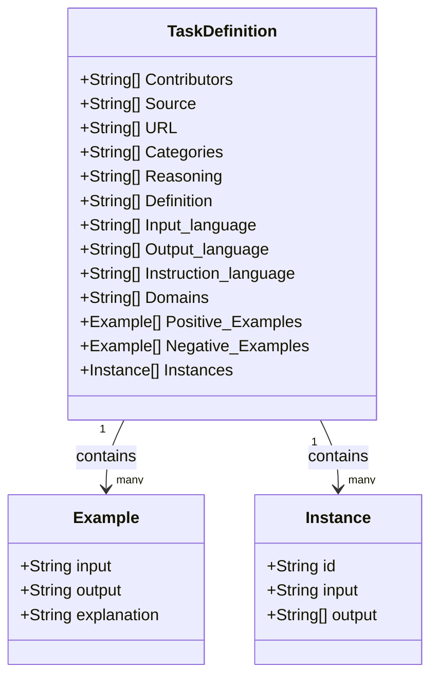
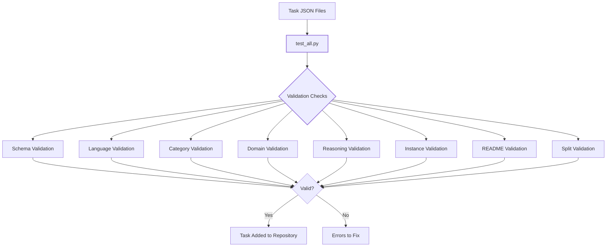
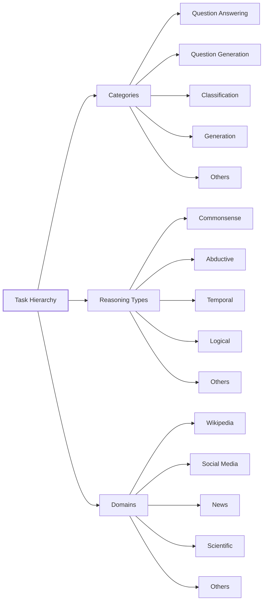
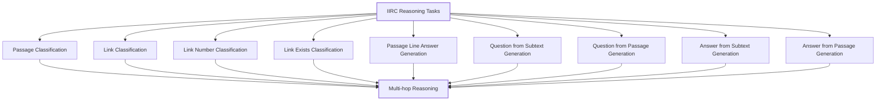
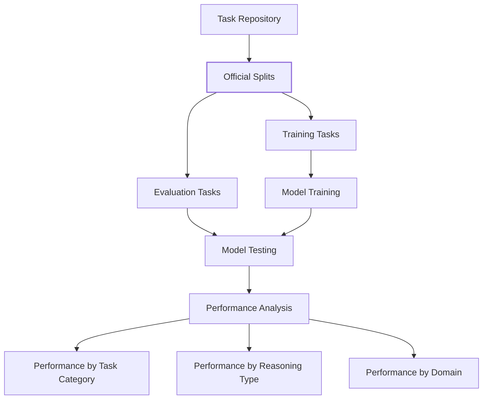

<!-- source: DeepWiki mcp.deepwiki.com · repo allenai/natural-instructions · page 1 Overview · fetched 2026-10-26 -->

# Overview

Relevant source files

The following files were used as context for generating this wiki page:

- [README.md](README.md)
- [doc/categories_map.json](doc/categories_map.json)
- [doc/crowdsourcing.md](doc/crowdsourcing.md)
- [doc/domains_map.json](doc/domains_map.json)
- [doc/emailing-authors.md](doc/emailing-authors.md)
- [doc/reasonings_map.json](doc/reasonings_map.json)
- [doc/task-hierarchy.md](doc/task-hierarchy.md)
- [src/sparsifying_fields.py](src/sparsifying_fields.py)
- [src/test_all.py](src/test_all.py)
- [src/update_category_assignment.py](src/update_category_assignment.py)
- [tasks/README.md](tasks/README.md)
- [tasks/task074_squad1.1_question_generation.json](tasks/task074_squad1.1_question_generation.json)
- [tasks/task075_squad1.1_answer_generation.json](tasks/task075_squad1.1_answer_generation.json)
- [tasks/task170_hotpotqa_answer_generation.json](tasks/task170_hotpotqa_answer_generation.json)
- [tasks/task191_hotpotqa_question_generation.json](tasks/task191_hotpotqa_question_generation.json)
- [tasks/task192_hotpotqa_sentence_generation.json](tasks/task192_hotpotqa_sentence_generation.json)
- [tasks/task195_sentiment140_classification.json](tasks/task195_sentiment140_classification.json)
- [tasks/task196_sentiment140_answer_generation.json](tasks/task196_sentiment140_answer_generation.json)
- [tasks/task230_iirc_passage_classification.json](tasks/task230_iirc_passage_classification.json)
- [tasks/task231_iirc_link_classification.json](tasks/task231_iirc_link_classification.json)
- [tasks/task232_iirc_link_number_classification.json](tasks/task232_iirc_link_number_classification.json)
- [tasks/task233_iirc_link_exists_classification.json](tasks/task233_iirc_link_exists_classification.json)
- [tasks/task234_iirc_passage_line_answer_generation.json](tasks/task234_iirc_passage_line_answer_generation.json)
- [tasks/task235_iirc_question_from_subtext_answer_generation.json](tasks/task235_iirc_question_from_subtext_answer_generation.json)
- [tasks/task236_iirc_question_from_passage_answer_generation.json](tasks/task236_iirc_question_from_passage_answer_generation.json)
- [tasks/task237_iirc_answer_from_subtext_answer_generation.json](tasks/task237_iirc_answer_from_subtext_answer_generation.json)
- [tasks/task238_iirc_answer_from_passage_answer_generation.json](tasks/task238_iirc_answer_from_passage_answer_generation.json)

Natural Instructions is a repository dedicated to creating a large collection of NLP tasks defined through natural language instructions. It serves as a benchmark for evaluating language models' ability to follow instructions and generalize across different tasks without task-specific training. This page provides a high-level overview of the repository structure, components, and purpose.

## Purpose and Scope

The primary aim of Natural Instructions is to enable the study of cross-task generalization in NLP by providing a standardized framework where tasks are defined through natural language instructions rather than examples alone. The repository contains:

1. A collection of over 1,600 diverse NLP tasks with natural language definitions
2. A standardized schema for defining tasks
3. Validation tools to ensure task quality and conformity
4. A hierarchical categorization system for tasks

The key hypothesis behind this project is that models capable of understanding natural language instructions should be able to generalize to unseen tasks, performing them without task-specific training data.

Sources: [README.md:18-32]()

## Repository Structure

The repository is organized around several core components that work together to provide a comprehensive framework for natural language instruction-based task definition and validation.

### Core Components

1. **Task Definition System**: Provides a standardized schema for defining tasks with natural language instructions
2. **Task Validation Tooling**: Ensures tasks conform to the required schema and quality standards
3. **Task Category Hierarchy**: Organizes tasks into categories, reasoning types, and domains
4. **Task Collections**: The actual task definitions grouped by type and purpose

Sources: [README.md:35-70](), [src/test_all.py:1-50]()

## Task Definition Structure

Each task in the repository follows a standardized JSON schema that includes metadata, instructions, examples, and instances. This structured format ensures consistency across tasks and facilitates automated processing.

The key components of a task definition include:

1. **Metadata Fields**:
   - `Contributors`: People who created the task
   - `Source`: Original dataset or inspiration
   - `URL`: Reference links

2. **Categorization Fields**:
   - `Categories`: Task types (e.g., Question Answering, Text Classification)
   - `Reasoning`: Reasoning types required (e.g., Commonsense, Multihop)
   - `Domains`: Subject domains (e.g., Wikipedia, Social Media)

3. **Language Fields**:
   - `Input_language`, `Output_language`, `Instruction_language`: Languages used

4. **Content Fields**:
   - `Definition`: Natural language instructions for the task
   - `Positive_Examples`: Examples of correct task execution
   - `Negative_Examples`: Examples of incorrect task execution
   - `Instances`: Actual task instances

Sources: [README.md:35-70](), [tasks/task234_iirc_passage_line_answer_generation.json:1-20]()

## Task Validation System

The repository includes a robust validation system that ensures all tasks conform to the required format and quality standards. This system runs a series of checks on each task file.

The validation system performs the following checks:

1. **Schema Validation**: Ensures all required fields are present
2. **Language Validation**: Checks for valid language names using ISO standards
3. **Category Validation**: Verifies that categories match the predefined set
4. **Domain Validation**: Validates domains against the taxonomy
5. **Reasoning Validation**: Checks reasoning types against the defined options
6. **Instance Validation**: Ensures instances have unique IDs and proper format
7. **README Validation**: Confirms task is documented in the main README
8. **Split Validation**: Verifies task is included in the defined splits

Sources: [src/test_all.py:28-106](), [src/test_all.py:113-282]()

## Task Hierarchy and Categorization

Tasks are organized using a hierarchical categorization system with three primary dimensions: task categories, reasoning types, and domains. This categorization helps in organizing the repository and facilitates analysis of model performance across different task types.

### Task Categories

Tasks are categorized by the type of NLP operation they require, such as:
- Question Answering
- Question Generation
- Text Classification
- Text Generation
- Coreference Resolution
- And many more

### Reasoning Types

The reasoning dimension describes the cognitive processes needed to complete the task:
- Commonsense Reasoning
- Abductive Reasoning
- Multihop Reasoning
- Temporal Reasoning
- And others

### Domains

The domain dimension specifies the subject area of the task:
- Wikipedia
- Social Media
- News
- Scientific
- And many more

Sources: [doc/task-hierarchy.md:9-86](), [doc/task-hierarchy.md:88-134](), [doc/task-hierarchy.md:136-258]()

## Task Collections

The repository contains a diverse collection of NLP tasks, organized into several major categories.

| Task Type | Description | Example Tasks |
|-----------|-------------|---------------|
| Question Answering | Tasks that require finding answers to questions | SQuAD, IIRC QA, GAP |
| Question Generation | Tasks that involve creating questions | IIRC Question Gen, MCTACO |
| Classification | Tasks that categorize text | Toxic Language Detection, MNLI |
| Generation | Tasks that generate text | CommonGen, PIQA |
| Specialized | Unique task types | SQL Tasks, Jeopardy |

### IIRC Reasoning Tasks

A particularly important collection in the repository are the IIRC (Incomplete Information Reading Comprehension) reasoning tasks, which focus on multi-hop reasoning across documents.

These tasks require complex reasoning capabilities:
- Cross-document reasoning
- Discrete reasoning
- Numerical reasoning
- Temporal reasoning

Sources: [tasks/task230_iirc_passage_classification.json:1-20](), [tasks/task231_iirc_link_classification.json:1-20](), [tasks/task232_iirc_link_number_classification.json:1-20](), [tasks/task233_iirc_link_exists_classification.json:1-20](), [tasks/task234_iirc_passage_line_answer_generation.json:1-20](), [tasks/task235_iirc_question_from_subtext_answer_generation.json:1-20](), [tasks/task236_iirc_question_from_passage_answer_generation.json:1-20](), [tasks/task237_iirc_answer_from_subtext_answer_generation.json:1-20](), [tasks/task238_iirc_answer_from_passage_answer_generation.json:1-20]()

## Cross-Task Generalization Benchmark

The repository provides official splits for benchmarking cross-task generalization: training on a subset of tasks and evaluating on unseen ones. This enables systematic research on how well models can transfer knowledge between tasks.

The benchmark is designed to evaluate:
1. How well models can generalize instructions to unseen tasks
2. The effect of increasing the number of training tasks on generalization
3. The types of tasks that are most challenging for generalization

Sources: [README.md:96-100]()

## Contributing New Tasks

The repository is designed as a community effort, with clear guidelines for adding new tasks:

1. Each task must follow the standardized JSON schema
2. Tasks must include proper categorization (categories, reasoning, domains)
3. Tasks need positive and negative examples with explanations
4. Each task should include at least 25 instances
5. Tasks must pass validation checks

The validation script `test_all.py` ensures that new contributions meet all requirements before being added to the repository.

Sources: [README.md:72-95](), [src/test_all.py:1-50]()

## Conclusion

Natural Instructions provides a comprehensive framework for defining, categorizing, and validating NLP tasks through natural language instructions. This approach facilitates research on cross-task generalization and instruction following in language models. The repository's standardized structure and extensive validation ensure high-quality task definitions that can be used across different research projects.

---

