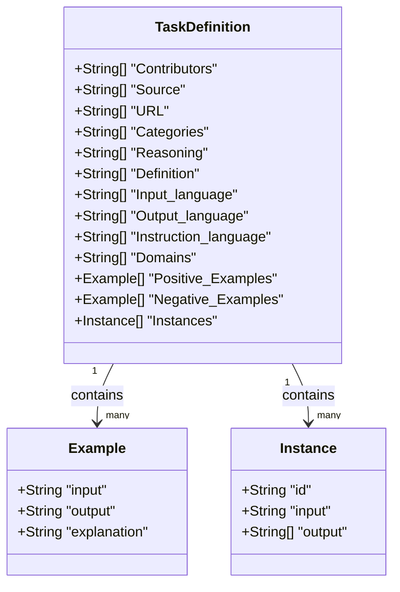
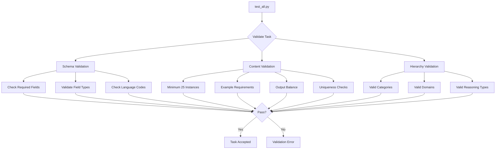
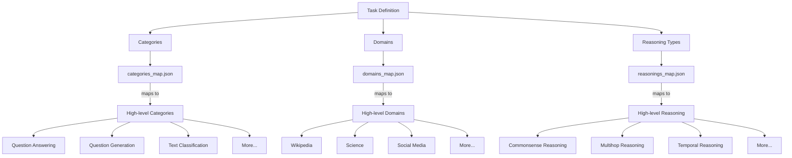
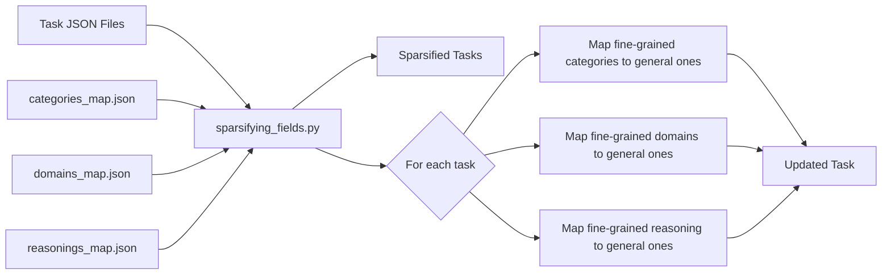
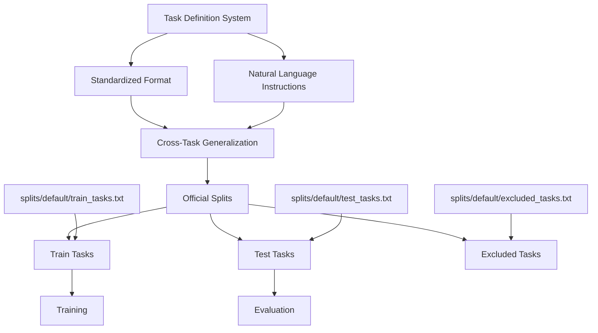

<!-- source: DeepWiki mcp.deepwiki.com · repo allenai/natural-instructions · page 2 Task Definition System · fetched 2026-10-26 -->

# Task Definition System

<details>
<summary>Relevant source files</summary>

The following files were used as context for generating this wiki page:

- [README.md](README.md)
- [doc/categories_map.json](doc/categories_map.json)
- [doc/crowdsourcing.md](doc/crowdsourcing.md)
- [doc/domains_map.json](doc/domains_map.json)
- [doc/emailing-authors.md](doc/emailing-authors.md)
- [doc/reasonings_map.json](doc/reasonings_map.json)
- [doc/task-hierarchy.md](doc/task-hierarchy.md)
- [src/sparsifying_fields.py](src/sparsifying_fields.py)
- [src/test_all.py](src/test_all.py)
- [src/update_category_assignment.py](src/update_category_assignment.py)
- [tasks/task074_squad1.1_question_generation.json](tasks/task074_squad1.1_question_generation.json)
- [tasks/task075_squad1.1_answer_generation.json](tasks/task075_squad1.1_answer_generation.json)
- [tasks/task170_hotpotqa_answer_generation.json](tasks/task170_hotpotqa_answer_generation.json)
- [tasks/task191_hotpotqa_question_generation.json](tasks/task191_hotpotqa_question_generation.json)
- [tasks/task192_hotpotqa_sentence_generation.json](tasks/task192_hotpotqa_sentence_generation.json)
- [tasks/task195_sentiment140_classification.json](tasks/task195_sentiment140_classification.json)
- [tasks/task196_sentiment140_answer_generation.json](tasks/task196_sentiment140_answer_generation.json)

</details>


The Task Definition System is the core infrastructure of the Natural Instructions repository, providing a standardized format for defining NLP tasks with natural language instructions. This system enables consistent representation, validation, and organization of diverse tasks to facilitate research in cross-task generalization.

For information about the task validation process, see [Task Validation](#2.1).
For details on task categorization, see [Task Hierarchy](#2.2).

## Schema Overview

The Task Definition System defines a precise JSON schema that all tasks must follow. Each task is represented as a JSON file in the `tasks/` directory with a standardized structure.



Sources: [README.md:35-70](). [src/test_all.py:32-45]()

## Required Fields

Each task JSON file must include the following fields:

| Field | Type | Description |
|-------|------|-------------|
| `Contributors` | String[] | People who contributed to the task |
| `Source` | String[] | Origins of the task (dataset names or "synthetic") |
| `URL` | String[] | Relevant URLs for the task source |
| `Categories` | String[] | Task categories from the defined hierarchy |
| `Reasoning` | String[] | Reasoning types from the defined hierarchy |
| `Definition` | String[] | Natural language description of the task |
| `Input_language` | String[] | Languages of the task inputs |
| `Output_language` | String[] | Languages of the task outputs |
| `Instruction_language` | String[] | Languages of the instructions |
| `Domains` | String[] | Subject domains from the defined hierarchy |
| `Positive_Examples` | Object[] | Examples showing correct task execution |
| `Negative_Examples` | Object[] | Examples showing incorrect task execution |
| `Instances` | Object[] | Task instances for training/evaluation |

Sources: [src/test_all.py:32-45](), [README.md:54-69]()

## Examples and Instances Structure

The task definition includes both examples for human understanding and instances for model training/evaluation:

### Examples
Each example (both positive and negative) contains:
- `input`: The input text for the task
- `output`: The expected (for positive) or incorrect (for negative) output
- `explanation`: Reasoning about why the example is correct or incorrect

### Instances
Each instance contains:
- `id`: A unique identifier (task number plus a UUID)
- `input`: The input text
- `output`: An array of acceptable outputs

Sources: [README.md:82](), [tasks/task075_squad1.1_answer_generation.json:30-225]()

## Task Naming and Organization

Tasks follow a structured naming convention:

```
task{NNN}_{source_dataset}_{task_type}.json
```

For example: `task075_squad1.1_answer_generation.json`

Each task must be added to the tasks README.md file and have a unique task number. Task numbers are sequentially assigned.

Sources: [README.md:84-92]()

## Integration with Validation System

The Task Definition System is tightly integrated with the validation system, which ensures all tasks follow the required format and meet quality standards.



Sources: [src/test_all.py:139-302]()

## Relationships to Task Hierarchy

Tasks are organized according to hierarchical categorization systems:



Sources: [doc/task-hierarchy.md:9-257](), [doc/categories_map.json](), [doc/domains_map.json](), [doc/reasonings_map.json]()

## Task Instances Examples

Here is a simplified example of a task definition (partial):

```json
{
  "Contributors": ["Shailaja Keyur Sampat"],
  "Source": ["squad_1.1"],
  "URL": ["https://rajpurkar.github.io/SQuAD-explorer/"],
  "Categories": ["Question Answering"],
  "Reasoning": [],
  "Definition": ["This task is about writing a correct answer for the reading comprehension task..."],
  "Input_language": ["English"],
  "Output_language": ["English"],
  "Instruction_language": ["English"],
  "Domains": ["Wikipedia"],
  "Positive_Examples": [
    {
      "input": "Passage: The French and Indian War (1754–1763) was... Question: When was the French and Indian War?",
      "output": "1754-1763",
      "explanation": "It is a common convention to write (start year-end year) beside a historical event..."
    }
  ],
  "Negative_Examples": [
    {
      "input": "Passage: The French and Indian War (1754–1763) was... Question: When was the French and Indian War?",
      "output": "1756",
      "explanation": "It is a common convention to write (start year-end year) beside a historical event..."
    }
  ],
  "Instances": [
    {
      "id": "task075-592460b351c247c4ad80960adce72716",
      "input": "Passage: While the Armenian Apostolic Church... Question: Which Armenian church is the most popular in Armenia?",
      "output": ["Armenian Apostolic Church"]
    }
  ]
}
```

Sources: [tasks/task075_squad1.1_answer_generation.json:1-105]()

## Sparsification and Mapping

The Task Definition System supports sparsification of categories, domains, and reasoning types through mapping files that define hierarchical relationships:



The sparsification process maps fine-grained categories, domains, and reasoning types to more general ones to facilitate experiments with different levels of specificity.

Sources: [src/sparsifying_fields.py:1-71]()

## Cross-Task Generalization Support

A key feature of the Task Definition System is enabling cross-task generalization experiments:



The repository provides official splits (train/test/excluded) for cross-task generalization experiments. These splits are validated to ensure no task appears in multiple sets.

Sources: [README.md:96-100](), [src/test_all.py:284-299]()

## Task Types and Examples

The Task Definition System supports a wide variety of task types, including:

1. **Question Answering**: Generate answers given a context and question
   - Example: SQuAD 1.1 Answer Generation (`task075_squad1.1_answer_generation.json`)

2. **Question Generation**: Generate questions based on context
   - Example: SQuAD 1.1 Question Generation (`task074_squad1.1_question_generation.json`)

3. **Multi-hop Question Answering**: Answer questions requiring multiple reasoning steps
   - Example: HotpotQA Answer Generation (`task170_hotpotqa_answer_generation.json`)

4. **Sentiment Analysis**: Classify text sentiment
   - Example: Sentiment140 Classification (`task195_sentiment140_classification.json`)

Each task type follows the same underlying schema but differs in the specific instructions, examples, and instances provided.

Sources: [tasks/task075_squad1.1_answer_generation.json](), [tasks/task074_squad1.1_question_generation.json](), [tasks/task170_hotpotqa_answer_generation.json](), [tasks/task195_sentiment140_classification.json]()

## Contributing Tasks

The Task Definition System is designed to be extensible, with clear guidelines for contributing new tasks:

1. Create a properly formatted JSON file following the schema
2. Include at least 25 instances
3. Provide positive and negative examples with explanations
4. Add the task to tasks/README.md
5. Run validation using `src/test_all.py`

For tasks based on existing datasets, additional guidelines are available in `doc/crowdsourcing.md`.

Sources: [README.md:72-94](), [doc/crowdsourcing.md:1-63]()

## Conclusion

The Task Definition System is a robust framework for defining, validating, and organizing NLP tasks with natural language instructions. Its standardized format enables systematic research on cross-task generalization, allowing models to learn from instructions and generalize to unseen tasks. The system's flexibility supports a wide range of task types while maintaining consistency and quality through comprehensive validation.

---

