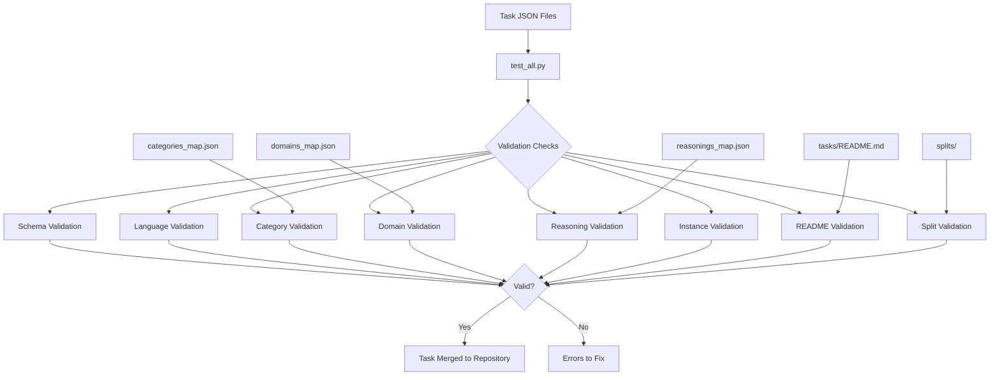
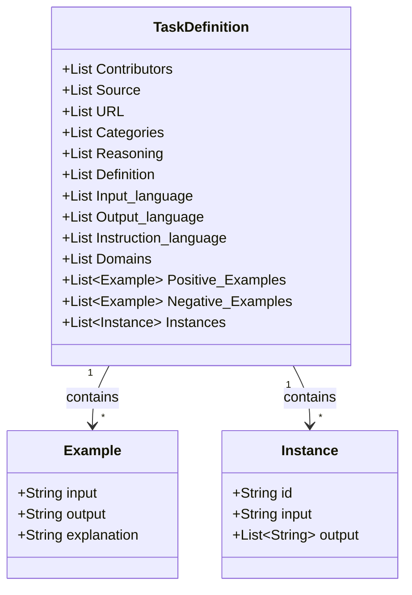
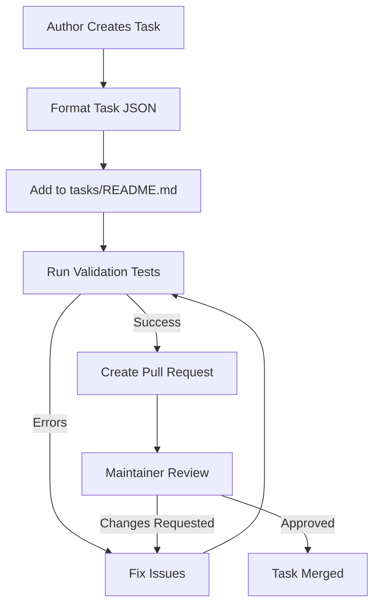
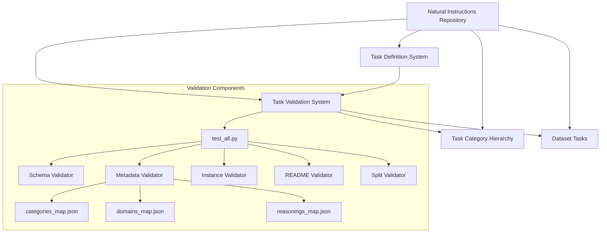

<!-- source: DeepWiki mcp.deepwiki.com · repo allenai/natural-instructions · page 2.1 Task Validation · fetched 2026-10-26 -->

# Task Validation

<details>
<summary>Relevant source files</summary>

The following files were used as context for generating this wiki page:

- [README.md](README.md)
- [doc/categories_map.json](doc/categories_map.json)
- [doc/crowdsourcing.md](doc/crowdsourcing.md)
- [doc/domains_map.json](doc/domains_map.json)
- [doc/emailing-authors.md](doc/emailing-authors.md)
- [doc/reasonings_map.json](doc/reasonings_map.json)
- [src/sparsifying_fields.py](src/sparsifying_fields.py)
- [src/test_all.py](src/test_all.py)
- [src/update_category_assignment.py](src/update_category_assignment.py)

</details>


This document describes the automated validation system for tasks in the Natural Instructions repository. Task validation ensures all contributed tasks maintain consistent quality, format, and metadata structure before being accepted into the repository.

## Purpose and Scope

The task validation system provides an automated way to verify that tasks:
- Follow the required JSON schema
- Contain valid metadata (languages, categories, domains, reasoning types)
- Have sufficient, high-quality examples and instances
- Maintain balanced class distributions
- Are properly documented

For information about the task definition format itself, see [Task Definition System](#2).

## Validation Process

Task validation is performed by the `test_all.py` script, which runs a comprehensive series of checks on task files. Contributors must pass these validation checks before their tasks can be merged into the repository.



Sources: [src/test_all.py:10-46](), [README.md:72-94]()

## Running Validation Tests

To validate all tasks in the repository:

```bash
python src/test_all.py
```

To validate a specific range of tasks:

```bash
python src/test_all.py --task <begin_task_number> <end_task_number>
```

For example, to test tasks 5 through 10:

```bash
python src/test_all.py --task 5 10
```

Sources: [src/test_all.py:10-22]()

## Validation Checks

### 1. Schema Validation

Each task file must include all required fields with the correct data types:



Sources: [src/test_all.py:32-45](), [src/test_all.py:139-154]()

### 2. Language Validation

All language codes in `Input_language`, `Output_language`, and `Instruction_language` must be valid ISO-639 language names.

```python
def assert_language_name(name):
    assert name in language_names, f"Did not find `{name}` among iso639 language names: {language_names}"
```

Sources: [src/test_all.py:47-54](), [src/test_all.py:179-189]()

### 3. Category Validation

All categories specified in the task must be from the predefined list in `doc/task-hierarchy.md` and mapped in `doc/categories_map.json`.

```python
for c in data['Categories']:
    assert c in all_categories, f'Did not find category `{c}`'
```

Sources: [src/test_all.py:156-161](), [doc/categories_map.json:1-583]()

### 4. Domain Validation

All domains specified in the task must be valid domains from the predefined list in `doc/domains_map.json`.

```python
for d in data['Domains']:
    assert d in hierarchy_content, f'Did not find domain `{d}`'
```

Sources: [src/test_all.py:163-167](), [doc/domains_map.json:1-349]()

### 5. Reasoning Validation

All reasoning types specified in the task must be valid reasoning types from the predefined list in `doc/reasonings_map.json`.

```python
for r in data['Reasoning']:
    assert r in hierarchy_content, f'Did not find reasoning `{r}`'
```

Sources: [src/test_all.py:169-173](), [doc/reasonings_map.json:1-124]()

### 6. Instance Validation

Tasks must meet specific requirements for their instances:

1. Each task must have at least 25 and at most 6,500 instances
2. Each instance must have a unique ID, input, and at least one output
3. No duplicate instances are allowed
4. Class distribution should be balanced (entropy > 0.8)
5. URLs in instance inputs are flagged with warnings

```python
assert len(data['Instances']) > 25, "there must be at least 25 instances"
assert len(data['Instances']) <= 6500, "there must be at most 6.5k instances"

# Check class balance
norm_counts = counts / counts.sum()
entropy = -(norm_counts * np.log(norm_counts) / np.log(len(value))).sum()
assert entropy > 0.8, f"Looks like this task is heavily skewed!"
```

Sources: [src/test_all.py:143-146](), [src/test_all.py:191-203](), [src/test_all.py:214-234](), [src/test_all.py:236-250]()

### 7. Examples Validation

Tasks must have sufficient positive and negative examples, properly formatted:

1. At least 2 positive examples
2. At least 1 negative example
3. Each example must have an input, output, and explanation
4. Examples must not be repeated in the instances

Sources: [src/test_all.py:203-211](), [src/test_all.py:251-259]()

### 8. README Validation

Each task must be properly documented in the `tasks/README.md` file, and the tasks should be listed in ascending order by task number.

```python
if true_file not in task_readme_content:
    raise Exception(f' * Looks like the task name `{true_file}` is not included '
                    f'in the task file `tasks/README.md`')
```

Sources: [src/test_all.py:266-278](), [src/test_all.py:92-102]()

### 9. Split Validation

The validation system checks that each task appears in exactly one of the official splits:
- `splits/<split_name>/train_tasks.txt`
- `splits/<split_name>/test_tasks.txt`
- `splits/<split_name>/excluded_tasks.txt`

```python
for split_name in ["default", "xlingual"]:
    train_tasks = [l.strip() for l in open(f"splits/{split_name}/train_tasks.txt")]
    test_tasks = [l.strip() for l in open(f"splits/{split_name}/test_tasks.txt")]
    excluded_tasks = [l.strip() for l in open(f"splits/{split_name}/excluded_tasks.txt")]
    
    # Make sure each task appears in the split
    for task in task_names:
        assert task in train_tasks + test_tasks + excluded_tasks
```

Sources: [src/test_all.py:284-299]()

## Integration with Repository Workflow

The task validation system is a critical component in the Natural Instructions contribution workflow:



Sources: [README.md:72-94]()

## Common Validation Errors and Solutions

| Error | Solution |
|-------|----------|
| Missing required fields | Add all fields specified in the schema |
| Invalid categories/domains/reasoning | Check valid values in `doc/task-hierarchy.md`, `doc/domains_map.json`, and `doc/reasonings_map.json` |
| Insufficient instances | Add more instances (at least 25) |
| Too many instances | Reduce to at most 6,500 instances |
| Imbalanced class distribution | Add more examples of underrepresented classes |
| Task not in README | Add your task to `tasks/README.md` |
| Duplicate instances | Remove duplicates |
| Non-unique instance IDs | Ensure each instance has a unique ID |
| Uppercase letters in filename | Use lowercase only in task filename |

Sources: [src/test_all.py:139-278]()

## Stats Collection

After validation, the system collects and displays statistics about:
- Contributors
- Categories
- Domains
- Reasoning types
- Average number of instances per task

These statistics help maintain a balanced and diverse task repository.

Sources: [src/test_all.py:303-326]()

## Task Validation in the Repository Architecture



Sources: [src/test_all.py:1-327]()

## Sparsifying Task Metadata

The repository provides utility scripts to "sparsify" the fine-grained categories, domains, and reasoning fields to more general high-frequency categories:

```python
# From sparsifying_fields.py
new_categories = [category_map[category] for category in data['Categories']]
data['Categories'] = list(set(sum(new_categories, [])))
```

This is useful for running experiments with fewer general categories instead of fine-grained ones.

Sources: [src/sparsifying_fields.py:1-71]()

---

