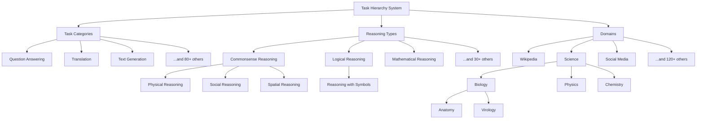
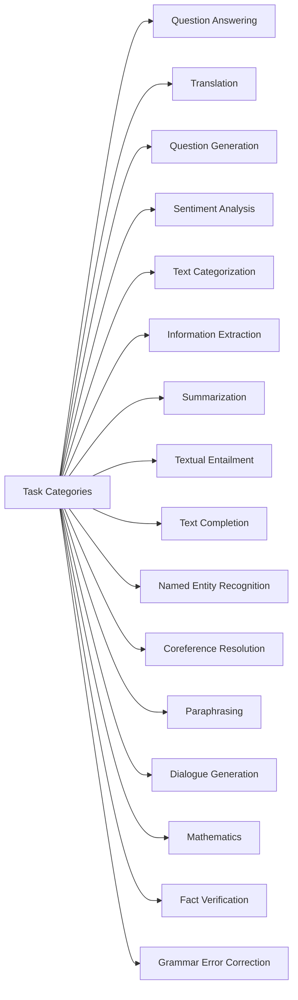
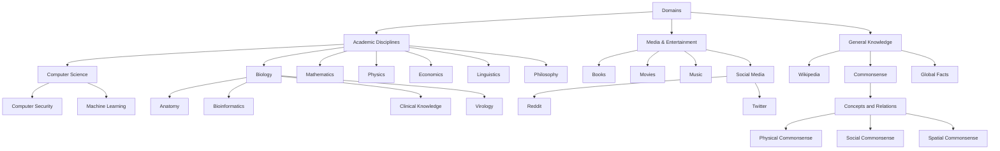
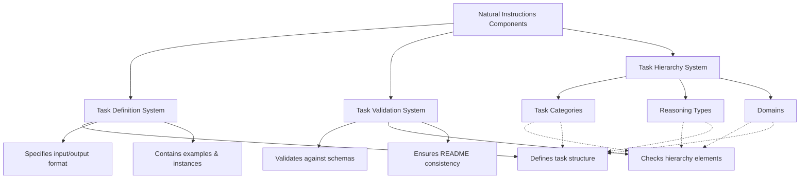

<!-- source: DeepWiki mcp.deepwiki.com · repo allenai/natural-instructions · page 2.2 Task Hierarchy · fetched 2026-10-26 -->

# Task Hierarchy

<details>
<summary>Relevant source files</summary>

The following files were used as context for generating this wiki page:

- [doc/task-hierarchy.md](doc/task-hierarchy.md)
- [tasks/task074_squad1.1_question_generation.json](tasks/task074_squad1.1_question_generation.json)
- [tasks/task075_squad1.1_answer_generation.json](tasks/task075_squad1.1_answer_generation.json)
- [tasks/task170_hotpotqa_answer_generation.json](tasks/task170_hotpotqa_answer_generation.json)
- [tasks/task191_hotpotqa_question_generation.json](tasks/task191_hotpotqa_question_generation.json)
- [tasks/task192_hotpotqa_sentence_generation.json](tasks/task192_hotpotqa_sentence_generation.json)
- [tasks/task195_sentiment140_classification.json](tasks/task195_sentiment140_classification.json)
- [tasks/task196_sentiment140_answer_generation.json](tasks/task196_sentiment140_answer_generation.json)

</details>


This wiki page documents the categorization system for tasks in the Natural Instructions repository. The system provides a structured way to categorize tasks according to their type, reasoning requirements, and domain knowledge. This taxonomy enables systematic organization, filtering, and analysis of the diverse task collection.

For information about how tasks are validated against this hierarchy, see [Task Validation](#2.1).

## Overview of the Task Hierarchy System

The Natural Instructions repository implements a multi-dimensional categorization system for tasks, consisting of three main hierarchical structures:

1. **Task Categories** - Classifies tasks by their fundamental operation (e.g., Question Answering, Text Generation)
2. **Reasoning Types** - Identifies cognitive reasoning operations required to complete tasks
3. **Domains** - Specifies the subject area knowledge relevant to tasks

Each task in the repository must be classified according to these three dimensions, enabling precise filtering and organization of the task collection.



Sources: [doc/task-hierarchy.md:1-258]()

## Implementation in Task Definition Files

Tasks are defined in JSON files where each task specifies its place in the hierarchy through three key fields:

```json
{
    "Categories": ["Question Answering"],
    "Reasoning": ["Commonsense Reasoning", "Spatial Reasoning"],
    "Domains": ["Wikipedia", "Biology"]
}
```

The hierarchical organization allows for both broad and specific categorization. For example, a task might be categorized under "Commonsense Reasoning -> Physical Reasoning" to indicate a subcategory relationship.

Sources: [tasks/task075_squad1.1_answer_generation.json:11-28](), [tasks/task074_squad1.1_question_generation.json:11-28]()

## Task Categories

The repository defines over 80 distinct task categories that classify tasks according to their fundamental nature. Below is a representative subset of major task categories:



Task categories serve as the primary means of organizing and retrieving tasks based on their high-level function.

Sources: [doc/task-hierarchy.md:9-86]()

## Reasoning Types

Reasoning types specify the cognitive processes required to complete a task. The repository defines over 30 distinct reasoning types, many of which include subcategories for finer-grained classification.

```mermaid
graph TD
    A["Reasoning Types"] --> B["Commonsense Reasoning"]
    A --> C["Logical Reasoning"]
    A --> D["Mathematics"]
    A --> E["Multihop Reasoning"]
    A --> F["Abductive Reasoning"]
    A --> G["Causal Reasoning"]
    A --> H["Numerical Reasoning"]
    A --> I["Temporal Reasoning"]
    A --> J["Textual Entailment"]
    A --> K["Ethics"]
    
    B --> B1["Physical Reasoning"]
    B --> B2["Social Situations"]
    B --> B3["Spatial Reasoning"]
    B --> B4["Numerical Commonsense Reasoning"]
    
    C --> C1["Reasoning with Symbols"]
    
    D --> D1["Algebra"]
    D --> D2["Arithmetic"]
    D --> D3["Combinatorics"]
    D --> D4["Counting"]
    D --> D5["Geometry"]
    D --> D6["Statistics"]
    
    J --> J1["Abductive Reasoning"]
    J --> J2["Analogical Reasoning"]
    J --> J3["Deductive Reasoning"]
    J --> J4["Inductive Reasoning"]
```



This detailed reasoning taxonomy helps identify tasks that require specific cognitive skills, enabling targeted evaluation of language models on specific reasoning capabilities.

Sources: [doc/task-hierarchy.md:88-133]()

## Domains

Domains categorize tasks based on the subject area knowledge they require. The repository defines over 120 domains, organized in a hierarchical structure to represent both broad and specific knowledge areas.



The domain hierarchy enables tasks to be organized by the specific knowledge areas they target, facilitating domain-specific evaluation of language models.

Sources: [doc/task-hierarchy.md:135-257]()

## Using the Task Hierarchy

### In Task Definition

When creating a new task, authors must specify where it fits in the hierarchy:

```json
{
    "Categories": ["Question Answering"],
    "Reasoning": ["Multihop Reasoning", "Textual Entailment"],
    "Domains": ["Wikipedia"]
}
```

Tasks can belong to multiple categories, reasoning types, and domains, allowing for flexible categorization.

### Language Representation

Task input and output languages are also tracked through separate fields in task definitions:

```json
{
    "Input_language": ["English"],
    "Output_language": ["English"],
    "Instruction_language": ["English"]
}
```

The language field accepts standard ISO language names as defined in the ISO 639-1 codes specification.

Sources: [doc/task-hierarchy.md:259-262](), [tasks/task075_squad1.1_answer_generation.json:18-28]()

## Task Hierarchy Usage in the Repository

The task hierarchy serves several critical functions within the Natural Instructions repository:

```mermaid
flowchart TD
    A["Task Hierarchy"] --> B["Task Organization"]
    A --> C["Task Search & Filtering"]
    A --> D["Task Validation"]
    A --> E["Evaluation Groups"]
    
    B --> B1["Categorizes tasks by function"]
    B --> B2["Groups tasks by reasoning type"]
    B --> B3["Organizes tasks by domain knowledge"]
    
    C --> C1["Find tasks requiring specific reasoning"]
    C --> C2["Filter tasks by domain relevance"]
    C --> C3["Select tasks by category for evaluation"]
    
    D --> D1["Validates task categories against known list"]
    D --> D2["Ensures reasoning types are valid"]
    D --> D3["Verifies domains match allowed values"]
    
    E --> E1["Creates balanced test suites"]
    E --> E2["Enables targeted capability evaluation"]
    E --> E3["Supports domain-specific benchmarking"]
```



The hierarchy provides a structured way to organize the diverse collection of tasks in the repository, facilitating both task discovery and systematic evaluation.

Sources: [doc/task-hierarchy.md:1-10]()

## Guidelines for Contributors

When adding new tasks to the repository, contributors should follow these guidelines:

1. Select appropriate categories, reasoning types, and domains from the existing hierarchy
2. Tasks can belong to multiple categories, reasoning types, and domains
3. When appropriate, specify subcategories using the arrow notation (e.g., "Commonsense Reasoning -> Physical Reasoning")
4. If necessary, propose new hierarchy elements through the contribution process

The `auto_add_domain.py` script in the `src` directory assists with adding domain information to tasks from a particular dataset.

Sources: [doc/task-hierarchy.md:4-7]()

## Relationship to Other Repository Components

The Task Hierarchy works in conjunction with other core components of the Natural Instructions repository:



The Task Hierarchy provides the taxonomic framework that the Task Definition System uses to classify tasks, and that the Task Validation System verifies during quality control.

Sources: [doc/task-hierarchy.md:4-7]()

---

