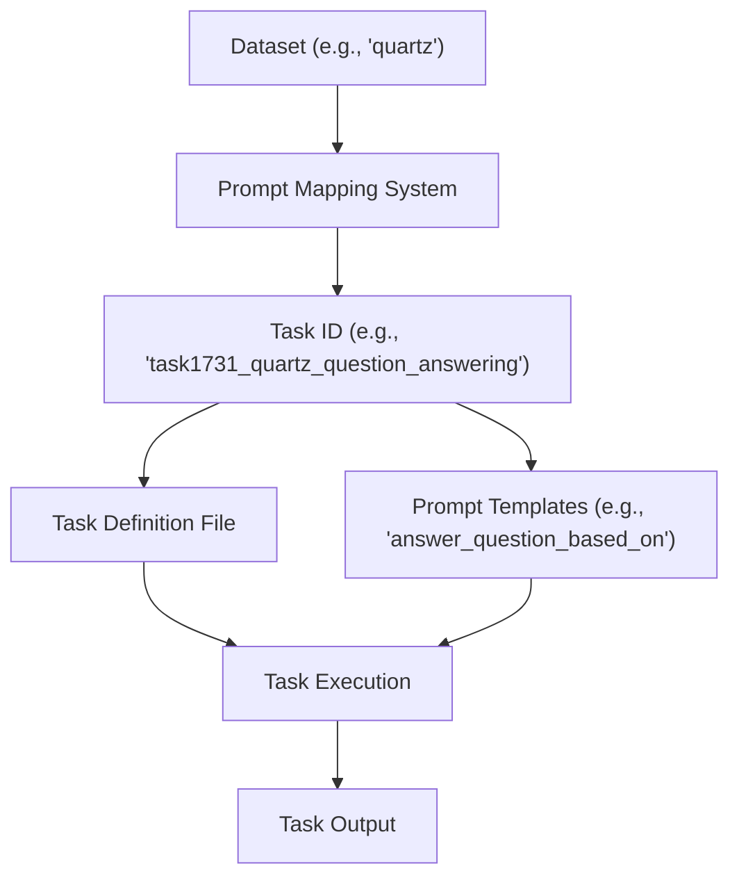
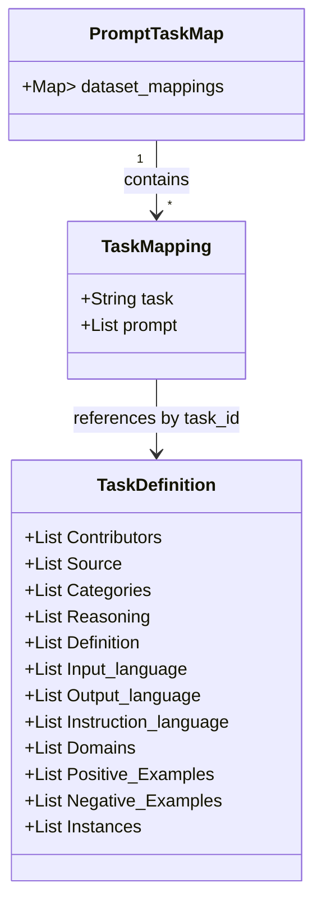
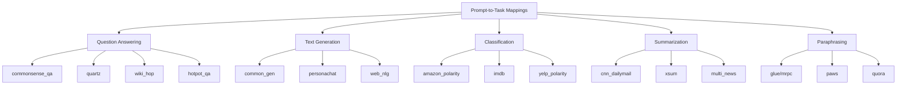
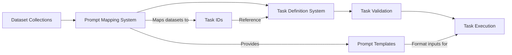

<!-- source: DeepWiki mcp.deepwiki.com · repo allenai/natural-instructions · page 2.3 Prompt Mapping · fetched 2026-10-26 -->

# Prompt Mapping

<details>
<summary>Relevant source files</summary>

The following files were used as context for generating this wiki page:

- [doc/prompt_task_map.json](doc/prompt_task_map.json)
- [tasks/task1293_kilt_tasks_hotpotqa_question_answering.json](tasks/task1293_kilt_tasks_hotpotqa_question_answering.json)
- [tasks/task1294_wiki_qa_answer_verification.json](tasks/task1294_wiki_qa_answer_verification.json)
- [tasks/task1296_wiki_hop_question_answering.json](tasks/task1296_wiki_hop_question_answering.json)
- [tasks/task1297_qasc_question_answering.json](tasks/task1297_qasc_question_answering.json)
- [tasks/task1727_wiqa_what_is_the_effect.json](tasks/task1727_wiqa_what_is_the_effect.json)
- [tasks/task1728_web_nlg_data_to_text.json](tasks/task1728_web_nlg_data_to_text.json)
- [tasks/task1729_personachat_generate_next.json](tasks/task1729_personachat_generate_next.json)
- [tasks/task1730_personachat_choose_next.json](tasks/task1730_personachat_choose_next.json)
- [tasks/task1731_quartz_question_answering.json](tasks/task1731_quartz_question_answering.json)

</details>


Prompt Mapping is a system within the Natural Instructions repository that establishes connections between datasets, task definitions, and prompt templates. It serves as a bridge from raw datasets to structured task formats, enabling standardized processing of natural language instructions across varied data sources.

For information about task definitions and validation, see [Task Definition System](#2) and [Task Validation](#2.1).

## Purpose and Function

The primary purpose of Prompt Mapping is to provide a structured way to identify which task definitions and prompt templates should be used when processing different datasets. This mapping creates a standardized approach to applying natural language instructions across diverse data sources.



Sources: [doc/prompt_task_map.json:1-913]()

## Structure of the Prompt Mapping

The core of the Prompt Mapping system is contained in `doc/prompt_task_map.json`, which follows a specific JSON structure:



The JSON structure maps dataset names to task IDs and associated prompt templates:

```json
{
    "dataset_name1": [
        {
            "task": "task_id1",
            "prompt": ["prompt_template1", "prompt_template2", ...]
        }
    ],
    "dataset_name2": [
        {
            "task": "task_id2",
            "prompt": ["prompt_template3", ...]
        }
    ]
}
```

Sources: [doc/prompt_task_map.json:1-913]()

## Dataset-to-Task Mappings

The `prompt_task_map.json` file includes mappings for a wide variety of datasets. Each dataset is associated with one or more tasks, and each task can have multiple prompt templates.

Here's a selection of dataset mappings:

| Dataset | Task ID | Prompt Templates |
|---------|---------|------------------|
| commonsense_qa | task073_commonsenseqa_answer_generation | most_suitable_answer, question_answering, question_to_answer_index |
| dream | task247_dream_answer_generation | baseline, read_the_following_conversation_and_answer_the_question |
| quartz | task1731_quartz_question_answering | answer_question_based_on, answer_question_below, having_read_above_passage, etc. |
| wiqa | task1727_wiqa_what_is_the_effect | effect_with_label_answer, effect_with_string_answer |
| hotpot_qa/distractor | task170_hotpotqa_answer_generation, task191_hotpotqa_question_generation, task192_hotpotqa_sentence_generation | generate_answer_affirmative, generate_question, generate_explanations_affirmative, etc. |

Sources: [doc/prompt_task_map.json:2-270](), [doc/prompt_task_map.json:271-457]()

## Example Detailed Mapping: Quartz Dataset

Let's examine the mapping for the "quartz" dataset:

```json
"quartz": [
    {
        "task": "task1731_quartz_question_answering",
        "prompt": [
            "answer_question_based_on",
            "answer_question_below",
            "given_the_fact_answer_the_q",
            "having_read_above_passage",
            "paragraph_question_plain_concat",
            "read_passage_below_choose",
            "use_info_from_paragraph_question",
            "use_info_from_question_paragraph"
        ]
    }
]
```

This maps the "quartz" dataset to the task `task1731_quartz_question_answering` and provides 8 different prompt templates for formatting inputs.

The referenced task file (`task1731_quartz_question_answering.json`) contains:

- Categories: Question Answering
- Reasoning Types: Relational Reasoning, Scientific Reasoning
- Definition: "You are given a short paragraph, a question and two choices to answer from. Choose the correct answer based on the paragraph and write the answer(not the key)."
- Examples and instances for the task

Sources: [doc/prompt_task_map.json:31-44](), [tasks/task1731_quartz_question_answering.json:1-390]()

## Mapping Coverage by Task Type

The prompt mappings cover a diverse range of NLP tasks:



Sources: [doc/prompt_task_map.json:1-913]()

## Task Definition Integration

Each task ID referenced in the prompt mapping corresponds to a task definition file in the repository. These task files follow a standardized structure and contain:

1. Metadata about the task (contributors, source, URL)
2. Task categorization (categories, reasoning types, domains)
3. Task definition and instructions
4. Input/output language specifications
5. Positive and negative examples
6. Task instances with inputs and expected outputs

Examples of task definition files referenced in prompt mappings include:
- `task1731_quartz_question_answering.json`
- `task1727_wiqa_what_is_the_effect.json`
- `task1729_personachat_generate_next.json`
- `task1296_wiki_hop_question_answering.json`

Sources: [tasks/task1731_quartz_question_answering.json:1-390](), [tasks/task1727_wiqa_what_is_the_effect.json:1-61](), [tasks/task1729_personachat_generate_next.json:1-33](), [tasks/task1296_wiki_hop_question_answering.json:1-47]()

## System Context and Integration

The Prompt Mapping system is part of the larger Natural Instructions framework. Here's how it fits into the overall architecture:



The Prompt Mapping system serves as an intermediary between raw datasets and the standardized task definitions, ensuring each dataset is processed appropriately within the Natural Instructions framework.

Sources: [doc/prompt_task_map.json:1-913]()

## Technical Implementation Considerations

The Prompt Mapping system offers several technical advantages:

1. **Separation of Concerns**: Task definitions, prompt templates, and dataset mappings are maintained separately, allowing each to evolve independently.

2. **Extensibility**: New datasets can be added by simply extending the `prompt_task_map.json` file, without modifying the underlying framework code.

3. **Standardization**: All datasets are processed through standardized task definitions, ensuring consistency in execution and evaluation.

4. **Flexibility**: Multiple prompt templates for each task allow for experimentation with different input formats, potentially improving task performance.

Sources: [doc/prompt_task_map.json:1-913]()

## Using Prompt Mapping in Practice

To use the Prompt Mapping system:

1. Identify the dataset you're working with
2. Look up the dataset in `prompt_task_map.json` to find:
   - The appropriate task ID(s)
   - Available prompt templates
3. Load the task definition from the corresponding task file
4. Select a prompt template to format your inputs
5. Execute the task according to the definition
6. Evaluate outputs against expected results

This standardized approach ensures consistent processing of diverse datasets, facilitating both development and evaluation of natural language processing models across a wide range of tasks.

Sources: [doc/prompt_task_map.json:1-913]()

---

