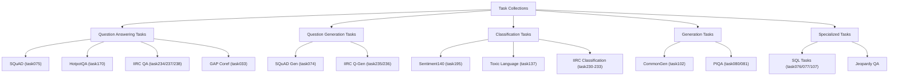
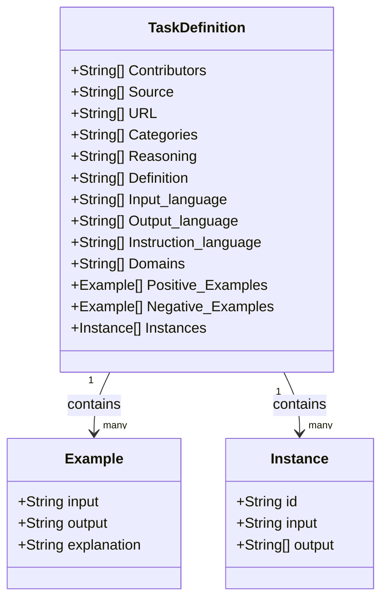
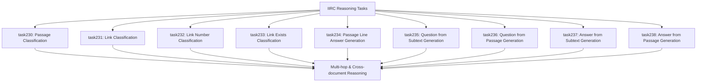

<!-- source: DeepWiki mcp.deepwiki.com · repo allenai/natural-instructions · page 3 Task Collections · fetched 2026-10-26 -->

# Task Collections

<details>
<summary>Relevant source files</summary>

The following files were used as context for generating this wiki page:

- [doc/task-hierarchy.md](doc/task-hierarchy.md)
- [tasks/README.md](tasks/README.md)
- [tasks/task074_squad1.1_question_generation.json](tasks/task074_squad1.1_question_generation.json)
- [tasks/task075_squad1.1_answer_generation.json](tasks/task075_squad1.1_answer_generation.json)
- [tasks/task170_hotpotqa_answer_generation.json](tasks/task170_hotpotqa_answer_generation.json)
- [tasks/task191_hotpotqa_question_generation.json](tasks/task191_hotpotqa_question_generation.json)
- [tasks/task192_hotpotqa_sentence_generation.json](tasks/task192_hotpotqa_sentence_generation.json)
- [tasks/task195_sentiment140_classification.json](tasks/task195_sentiment140_classification.json)
- [tasks/task196_sentiment140_answer_generation.json](tasks/task196_sentiment140_answer_generation.json)
- [tasks/task230_iirc_passage_classification.json](tasks/task230_iirc_passage_classification.json)
- [tasks/task231_iirc_link_classification.json](tasks/task231_iirc_link_classification.json)
- [tasks/task232_iirc_link_number_classification.json](tasks/task232_iirc_link_number_classification.json)
- [tasks/task233_iirc_link_exists_classification.json](tasks/task233_iirc_link_exists_classification.json)
- [tasks/task234_iirc_passage_line_answer_generation.json](tasks/task234_iirc_passage_line_answer_generation.json)
- [tasks/task235_iirc_question_from_subtext_answer_generation.json](tasks/task235_iirc_question_from_subtext_answer_generation.json)
- [tasks/task236_iirc_question_from_passage_answer_generation.json](tasks/task236_iirc_question_from_passage_answer_generation.json)
- [tasks/task237_iirc_answer_from_subtext_answer_generation.json](tasks/task237_iirc_answer_from_subtext_answer_generation.json)
- [tasks/task238_iirc_answer_from_passage_answer_generation.json](tasks/task238_iirc_answer_from_passage_answer_generation.json)

</details>


The Task Collections in the natural-instructions repository comprise a diverse set of NLP tasks organized into structured categories. This comprehensive collection serves as a standardized benchmark for evaluating and training language models across various capabilities including reasoning, generation, classification, and more. Each task is defined using a consistent JSON schema that captures task requirements, examples, and evaluation instances.

For information about how tasks are defined and validated, see [Task Definition System](#2).

## Task Organization and Statistics

The natural-instructions repository contains over 200 tasks spanning different categories, reasoning types, and domains. Tasks are organized hierarchically and accessible through standardized interfaces.



Sources: [tasks/README.md:1-208](), [doc/task-hierarchy.md:1-257]()

## Task Definition Structure

Each task in the collection is defined by a standardized JSON structure. This structure captures all necessary information for understanding, using, and evaluating the task.



Sources: [tasks/task234_iirc_passage_line_answer_generation.json:1-70]()

## Major Task Collections

The repository contains several significant task collections that assess different language model capabilities.

### IIRC Reasoning Tasks

The IIRC (Implicit Reasoning in Reading Comprehension) tasks stand out for their emphasis on multi-hop reasoning and cross-document reasoning. These tasks require models to connect information across different parts of text or multiple documents.



| Task ID | Name | Category | Description |
|---------|------|----------|-------------|
| task230 | IIRC Passage Classification | Question Answering | Identify which passage contains information to answer a question |
| task231 | IIRC Link Classification | Question Answering | Determine which linked term can help answer a question |
| task232 | IIRC Link Number Classification | Answerability Classification | Determine if multiple terms are needed to answer a question |
| task233 | IIRC Link Exists Classification | Answerability Classification | Determine if passage information can be used for answering |
| task234 | IIRC Passage Line Answer | Question Answering | Identify sentences that contain needed information |

Sources: [tasks/task230_iirc_passage_classification.json:1-45](), [tasks/task231_iirc_link_classification.json:1-68](), [tasks/task232_iirc_link_number_classification.json:1-168](), [tasks/task233_iirc_link_exists_classification.json:1-171](), [tasks/task234_iirc_passage_line_answer_generation.json:1-161]()

### Question Answering Tasks

The repository includes numerous question answering tasks that test a model's ability to extract and generate answers from context.

| Task ID | Name | Source | Description |
|---------|------|--------|-------------|
| task075 | SQuAD 1.1 Answer Generation | SQuAD 1.1 | Extract shortest text span that answers a question |
| task170 | HotpotQA Answer Generation | HotpotQA | Generate answers requiring multi-hop reasoning |
| task083 | BABI T1 Single Fact Answer | BABI | Generate answers from provided evidence sentences |
| task104 | SemEval Mathematical QA | SemEval | Answer mathematical problems with closed vocabulary |

Sources: [tasks/task075_squad1.1_answer_generation.json:1-140](), [tasks/task170_hotpotqa_answer_generation.json:1-148]()

### Sentiment and Classification Tasks

A significant portion of tasks focuses on classification, particularly sentiment analysis and toxicity detection.

| Task ID | Name | Category | Description |
|---------|------|----------|-------------|
| task195 | Sentiment140 Classification | Sentiment Analysis | Classify tweet sentiment as positive or negative |
| task196 | Sentiment140 Answer Generation | Sentiment Analysis | Answer yes/no questions about tweet sentiment |
| task137 | Detoxifying LMs Classification | Toxic Language Detection | Determine which completion is less toxic |

Sources: [tasks/task195_sentiment140_classification.json:1-165](), [tasks/task196_sentiment140_answer_generation.json:1-150]()

### Generation Tasks

Generation tasks test a model's ability to create coherent and contextually appropriate text based on provided input.

| Task ID | Name | Category | Description |
|---------|------|----------|-------------|
| task074 | SQuAD Question Generation | Question Generation | Create questions about information in passages |
| task191 | HotpotQA Question Generation | Question Generation | Generate questions requiring multi-hop reasoning |
| task192 | HotpotQA Sentence Generation | Explanation | Generate supporting facts for question answering |
| task102 | CommonGen Sentence Generation | Data to Text | Create coherent sentences from provided concepts |

Sources: [tasks/task074_squad1.1_question_generation.json:1-92](), [tasks/task191_hotpotqa_question_generation.json:1-89](), [tasks/task192_hotpotqa_sentence_generation.json:1-72]()

## Working with Task Collections

### Task Access Pattern

Tasks are accessed through their JSON definitions in the `tasks` directory. Each task follows a consistent naming pattern: `taskXXX_source_name.json`.

```python
import json

# Load a specific task definition
def load_task(task_id):
    with open(f'tasks/{task_id}.json', 'r') as f:
        return json.load(f)

# Example: Load SQuAD answer generation task
squad_task = load_task('task075_squad1.1_answer_generation')

# Access task components
definition = squad_task['Definition'][0]
categories = squad_task['Categories']
positive_examples = squad_task['Positive_Examples']
instances = squad_task['Instances']

# Use for model evaluation or training
for instance in instances:
    instance_id = instance['id']
    input_text = instance['input']
    gold_outputs = instance['output']
    # Process with model...
```

### Adding New Tasks

To add a new task to the repository:

1. Create a JSON file with the standardized schema
2. Name it following the pattern `taskXXX_source_name.json`
3. Place it in the `tasks` directory
4. Ensure it contains all required fields:
   - Metadata (Contributors, Source, URL)
   - Task definition fields (Categories, Reasoning)
   - Language specifications
   - Examples (both positive and negative)
   - Evaluation instances

The task will be automatically validated by the repository's validation system to ensure it meets all requirements.

Sources: [doc/task-hierarchy.md:4-7]()

## Task Statistics and Distribution

The natural-instructions repository contains tasks across numerous categories and domains. The distribution shows particular strength in question answering, generation, and classification tasks.

| Category | Count | Major Examples |
|----------|-------|----------------|
| Question Answering | 47+ | SQuAD, HotpotQA, IIRC, GAP Coreference |
| Question Generation | 26+ | SQuAD, IIRC, HotpotQA, McTaco |
| Classification | 35+ | Sentiment140, IIRC Classification, Toxic Detection |
| Generation | 21+ | CommonGen, Story Generation, Paraphrasing |
| Specialized | 78+ | SQL Tasks, Mathematics, Program Execution |

The tasks also span diverse domains including Wikipedia, News, Social Media, Scientific text, and many more. This variety ensures comprehensive evaluation of language model capabilities across different application areas.

Sources: [tasks/README.md:6-208]()

---

