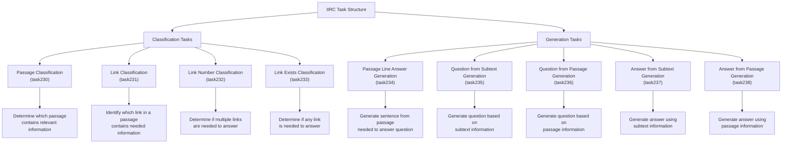
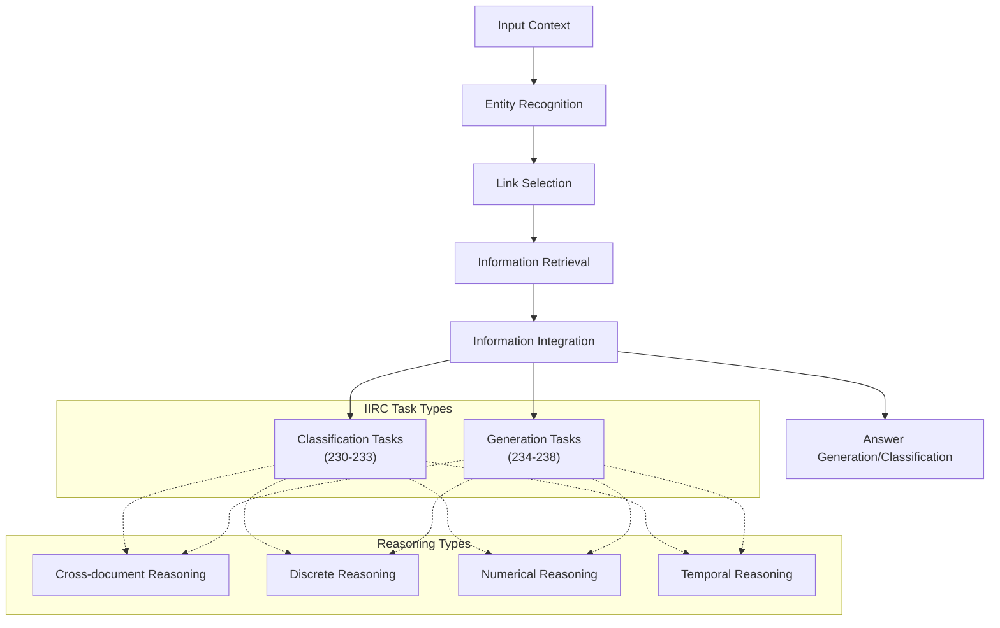
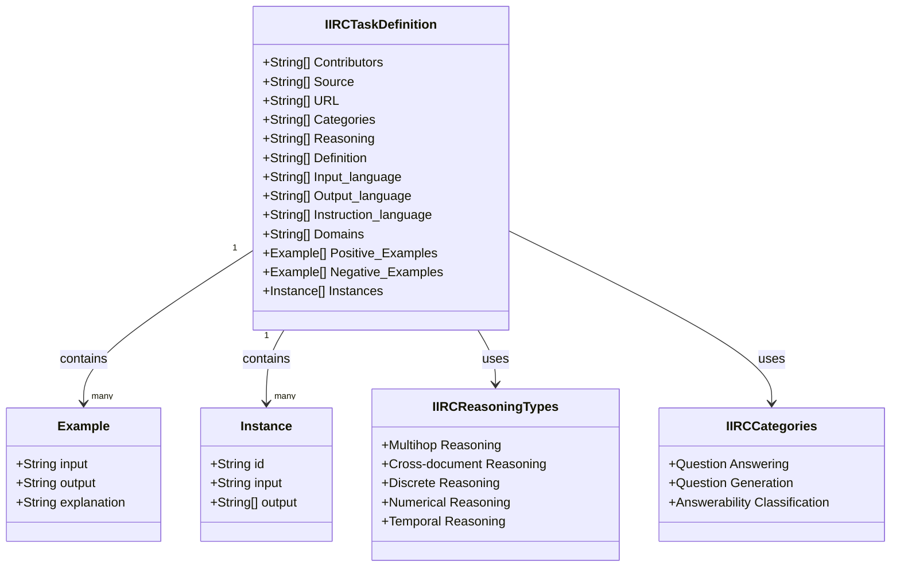
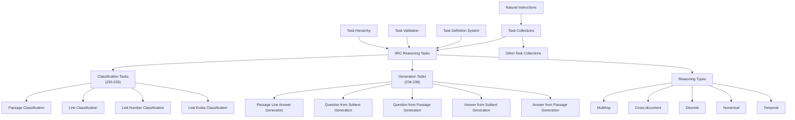

<!-- source: DeepWiki mcp.deepwiki.com · repo allenai/natural-instructions · page 3.1 IIRC Reasoning Tasks · fetched 2026-10-26 -->

# IIRC Reasoning Tasks

<details>
<summary>Relevant source files</summary>

The following files were used as context for generating this wiki page:

- [tasks/README.md](tasks/README.md)
- [tasks/task230_iirc_passage_classification.json](tasks/task230_iirc_passage_classification.json)
- [tasks/task231_iirc_link_classification.json](tasks/task231_iirc_link_classification.json)
- [tasks/task232_iirc_link_number_classification.json](tasks/task232_iirc_link_number_classification.json)
- [tasks/task233_iirc_link_exists_classification.json](tasks/task233_iirc_link_exists_classification.json)
- [tasks/task234_iirc_passage_line_answer_generation.json](tasks/task234_iirc_passage_line_answer_generation.json)
- [tasks/task235_iirc_question_from_subtext_answer_generation.json](tasks/task235_iirc_question_from_subtext_answer_generation.json)
- [tasks/task236_iirc_question_from_passage_answer_generation.json](tasks/task236_iirc_question_from_passage_answer_generation.json)
- [tasks/task237_iirc_answer_from_subtext_answer_generation.json](tasks/task237_iirc_answer_from_subtext_answer_generation.json)
- [tasks/task238_iirc_answer_from_passage_answer_generation.json](tasks/task238_iirc_answer_from_passage_answer_generation.json)

</details>


## Purpose and Scope

This document provides a comprehensive overview of IIRC (Incremental Information Retrieval for Comprehension) Reasoning Tasks within the Natural Instructions repository. IIRC tasks are designed to evaluate multi-hop reasoning capabilities across documents, where models must retrieve and integrate information from different sources to answer questions. These tasks focus on cross-document reasoning, temporal reasoning, numerical reasoning, and discrete reasoning capabilities.

## Overview of IIRC Tasks

IIRC tasks are designed to test a model's ability to reason across multiple pieces of information. Unlike single-document question answering, IIRC tasks require understanding when and how to retrieve additional information from linked entities mentioned in a passage to correctly answer questions.

### IIRC Task Structure



Sources: [tasks/task230_iirc_passage_classification.json](), [tasks/task231_iirc_link_classification.json](), [tasks/task232_iirc_link_number_classification.json](), [tasks/task233_iirc_link_exists_classification.json](), [tasks/task234_iirc_passage_line_answer_generation.json](), [tasks/task235_iirc_question_from_subtext_answer_generation.json](), [tasks/task236_iirc_question_from_passage_answer_generation.json](), [tasks/task237_iirc_answer_from_subtext_answer_generation.json](), [tasks/task238_iirc_answer_from_passage_answer_generation.json]()

## Classification Tasks

IIRC classification tasks require systems to identify whether and which information sources are needed to answer questions.

### Passage Classification

In passage classification (task230), the system needs to determine which passage among multiple options contains information that can be used to answer a question. This tests the ability to recognize relevant content across multiple passages.

**Example:**
```
Question: When did the operation during which the 704th dropped supplies to allied troops near Nijmegen begin?
[Three passages provided]
Output: 1 (indicating the first passage contains relevant information)
```

Sources: [tasks/task230_iirc_passage_classification.json]()

### Link Classification

Link classification (task231) requires identifying which specific entity mentioned in a passage would provide the information needed to answer a question if further information about that entity were retrieved.

**Example:**
```
Question: When did the operation during which the 704th dropped supplies to allied troops near Nijmegen begin?
Passage: [Text mentioning Operation Market Garden]
Links: a. Allies of World War II b. Wesel c. Operation Market Garden d. Air Support
Output: c (Operation Market Garden)
```

Sources: [tasks/task231_iirc_link_classification.json]()

### Link Number Classification

Link number classification (task232) determines whether information from multiple entities is required to answer a question.

**Example:**
```
Question: How old was Francis Ford when John Ford started his career in filmmaking?
Passage: [Text about John Ford and his brother Francis Ford]
Output: a (Yes, multiple entities are needed)
```

Sources: [tasks/task232_iirc_link_number_classification.json]()

### Link Exists Classification

Link exists classification (task233) determines whether any additional information beyond the given passage is needed to answer a question.

**Example:**
```
Question: When did the operation during which the 704th dropped supplies to allied troops near Nijmegen begin?
Passage: [Text mentioning Operation Market Garden]
Output: a (Yes, additional information is needed)
```

Sources: [tasks/task233_iirc_link_exists_classification.json]()

## Generation Tasks

IIRC generation tasks require systems to produce natural language responses based on information from passages and linked entities.

### Passage Line Answer Generation

Passage line answer generation (task234) involves identifying which sentence(s) from a passage can be used to search for further information needed to answer a question.

**Example:**
```
Question: When did the operation during which the 704th dropped supplies to allied troops near Nijmegen begin?
Passage: [Text mentioning Operation Market Garden]
Output: "During Operation Market Garden, the attempt to seize a bridgehead across the Rhine in the Netherlands, the 704th dropped supplies to allied troops near Nijmegen."
```

Sources: [tasks/task234_iirc_passage_line_answer_generation.json]()

### Question from Subtext Generation

Question from subtext generation (task235) involves creating a question that can be answered using the additional information provided about a linked entity.

**Example:**
```
Context: Fredell Lack was born in Tulsa, Oklahoma.
Link Information: Tulsa is the second-largest city in the state of Oklahoma and 45th-most populous city in the United States, the population was 403,035...
Answer: 403,035
Output: "What is the population of the city where Lack was born?"
```

Sources: [tasks/task235_iirc_question_from_subtext_answer_generation.json]()

### Question from Passage Generation

Question from passage generation (task236) involves creating a question that requires information from both the passage and additional linked information to be answered.

**Example:**
```
Passage: [Text about Washington Square Arch]
Link Information: In 1889, a large plaster and wood memorial arch was erected over Fifth Avenue...
Answer: a large plaster and wood memorial arch
Output: "What was replaced on the property by the Washington Square Arch?"
```

Sources: [tasks/task236_iirc_question_from_passage_answer_generation.json]()

### Answer from Subtext Generation

Answer from subtext generation (task237) involves generating answers based on information about linked entities when given a question.

**Example:**
```
Context: During Operation Market Garden, the attempt to seize a bridgehead across the Rhine in the Netherlands, the 704th dropped supplies to allied troops near Nijmegen.
Link Information: Operation Market Garden was a failed World War II military operation fought in the Netherlands from 17 to 25 September 1944.
Question: When did the operation during which the 704th dropped supplies to allied troops near Nijmegen begin?
Output: "from 17 to 25 September 1944"
```

Sources: [tasks/task237_iirc_answer_from_subtext_answer_generation.json]()

### Answer from Passage Generation

Answer from passage generation (task238) involves generating answers based on information from both the passage and linked entities.

**Example:**
```
Passage: [Text mentioning Washington Square Arch]
Link Information: In 1889, a large plaster and wood memorial arch was erected over Fifth Avenue...
Question: What was replaced on the property by the Washington Square Arch?
Output: "a large plaster and wood memorial arch"
```

Sources: [tasks/task238_iirc_answer_from_passage_answer_generation.json]()

## Task Architecture and Information Flow

The following diagram illustrates how IIRC tasks process information through a multi-hop reasoning process:



Sources: [tasks/task230_iirc_passage_classification.json](), [tasks/task231_iirc_link_classification.json](), [tasks/task232_iirc_link_number_classification.json](), [tasks/task233_iirc_link_exists_classification.json](), [tasks/task234_iirc_passage_line_answer_generation.json](), [tasks/task235_iirc_question_from_subtext_answer_generation.json](), [tasks/task236_iirc_question_from_passage_answer_generation.json](), [tasks/task237_iirc_answer_from_subtext_answer_generation.json](), [tasks/task238_iirc_answer_from_passage_answer_generation.json]()

## Task Definition Structure

IIRC tasks follow the standard task definition structure used in the Natural Instructions repository, with specific fields tailored to multi-hop reasoning:



Sources: [tasks/task234_iirc_passage_line_answer_generation.json:1-70](), [tasks/task233_iirc_link_exists_classification.json:1-70](), [tasks/task232_iirc_link_number_classification.json:1-70]()

## Comparison of IIRC Task Types

The following table compares the key features and requirements of different IIRC tasks:

| Task ID | Task Name | Input | Output | Reasoning Type |
|---------|-----------|-------|--------|---------------|
| 230 | Passage Classification | Question + Multiple Passages | Passage number | Cross-document |
| 231 | Link Classification | Question + Passage + Link Options | Link option | Discrete |
| 232 | Link Number Classification | Question + Passage | Yes/No | Cross-document |
| 233 | Link Exists Classification | Question + Passage | Yes/No | Discrete |
| 234 | Passage Line Answer Generation | Question + Passage | Sentence from passage | Multihop |
| 235 | Question from Subtext Generation | Context + Link Information + Answer | Question | Multihop |
| 236 | Question from Passage Generation | Passage + Link Information + Answer | Question | Cross-document |
| 237 | Answer from Subtext Generation | Context + Link Information + Question | Answer | Multihop |
| 238 | Answer from Passage Generation | Passage + Link Information + Question | Answer | Cross-document |

Sources: [tasks/task230_iirc_passage_classification.json](), [tasks/task231_iirc_link_classification.json](), [tasks/task232_iirc_link_number_classification.json](), [tasks/task233_iirc_link_exists_classification.json](), [tasks/task234_iirc_passage_line_answer_generation.json](), [tasks/task235_iirc_question_from_subtext_answer_generation.json](), [tasks/task236_iirc_question_from_passage_answer_generation.json](), [tasks/task237_iirc_answer_from_subtext_answer_generation.json](), [tasks/task238_iirc_answer_from_passage_answer_generation.json]()

## Common Patterns in IIRC Task Structure

Each IIRC task JSON file contains similar components, including:

1. **Contributors** - Individuals who contributed to the task
2. **Source** - Original source of the data, typically "iirc"
3. **URL** - Reference to the official IIRC dataset (https://allenai.org/data/iirc)
4. **Categories** - Task categories such as "Question Answering" or "Question Generation"
5. **Reasoning** - Types of reasoning required, including multihop, cross-document, etc.
6. **Definition** - Explanation of what the task involves
7. **Domains** - The domain of the task data, typically "Wikipedia"
8. **Positive Examples** - Examples of correctly performed tasks
9. **Negative Examples** - Examples of incorrectly performed tasks
10. **Instances** - The actual task instances

Sources: [tasks/task234_iirc_passage_line_answer_generation.json:1-70](), [tasks/task233_iirc_link_exists_classification.json:1-70](), [tasks/task232_iirc_link_number_classification.json:1-70]()

## Integration with Natural Instructions

IIRC tasks are integrated into the Natural Instructions framework, contributing to a comprehensive evaluation of language models' reasoning capabilities:



Sources: [tasks/README.md:1-211]()

## Conclusion

IIRC Reasoning Tasks represent a significant subset of the Natural Instructions repository focused on evaluating multi-hop and cross-document reasoning capabilities. These tasks are designed to test a model's ability to identify when additional information is needed, which sources to consult, and how to integrate information across multiple documents to answer questions.

The diverse set of classification and generation tasks provides a comprehensive evaluation framework for assessing different aspects of reasoning abilities, from simple determinations about information needs to complex answer generation requiring information integration from multiple sources.

---

