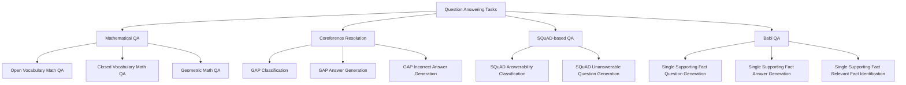
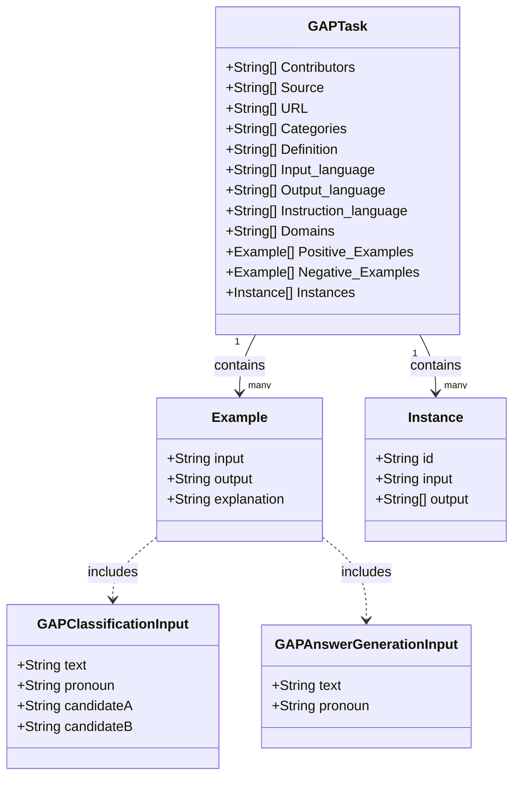
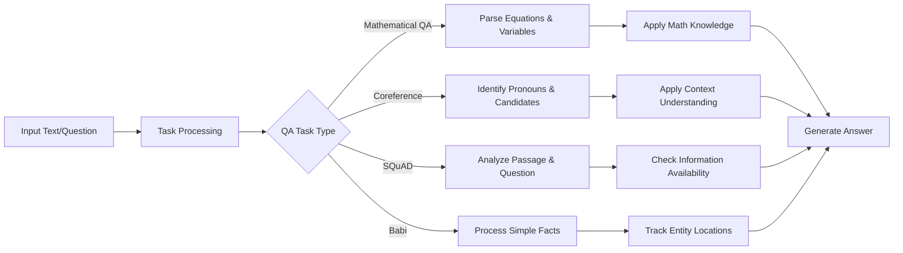
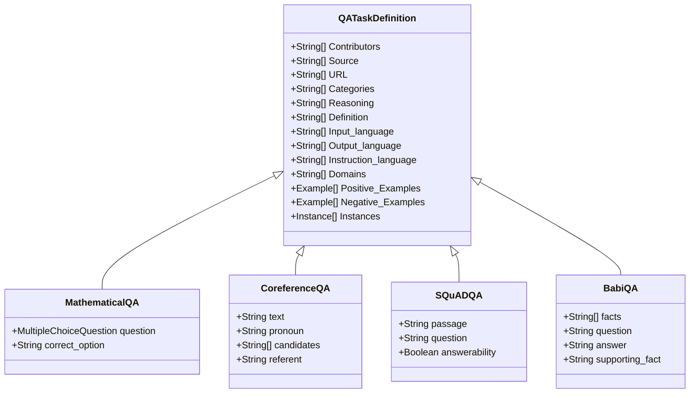

<!-- source: DeepWiki mcp.deepwiki.com · repo allenai/natural-instructions · page 3.2 Question Answering Tasks · fetched 2026-10-26 -->

# Question Answering Tasks

<details>
<summary>Relevant source files</summary>

The following files were used as context for generating this wiki page:

- [tasks/task067_abductivenli_answer_generation.json](tasks/task067_abductivenli_answer_generation.json)
- [tasks/task068_abductivenli_incorrect_answer_generation.json](tasks/task068_abductivenli_incorrect_answer_generation.json)
- [tasks/task069_abductivenli_classification.json](tasks/task069_abductivenli_classification.json)
- [tasks/task070_abductivenli_incorrect_classification.json](tasks/task070_abductivenli_incorrect_classification.json)
- [tasks/task071_abductivenli_answer_generation.json](tasks/task071_abductivenli_answer_generation.json)
- [tasks/task072_abductivenli_answer_generation.json](tasks/task072_abductivenli_answer_generation.json)
- [tasks/task082_babi_t1_single_supporting_fact_question_generation.json](tasks/task082_babi_t1_single_supporting_fact_question_generation.json)
- [tasks/task083_babi_t1_single_supporting_fact_answer_generation.json](tasks/task083_babi_t1_single_supporting_fact_answer_generation.json)
- [tasks/task084_babi_t1_single_supporting_fact_identify_relevant_fact.json](tasks/task084_babi_t1_single_supporting_fact_identify_relevant_fact.json)
- [tasks/task104_semeval_2019_task10_closed_vocabulary_mathematical_answer_generation.json](tasks/task104_semeval_2019_task10_closed_vocabulary_mathematical_answer_generation.json)
- [tasks/task106_scruples_ethical_judgment.json](tasks/task106_scruples_ethical_judgment.json)
- [tasks/task110_logic2text_sentence_generation.json](tasks/task110_logic2text_sentence_generation.json)
- [tasks/task118_semeval_2019_task10_open_vocabulary_mathematical_answer_generation.json](tasks/task118_semeval_2019_task10_open_vocabulary_mathematical_answer_generation.json)
- [tasks/task119_semeval_2019_task10_geometric_mathematical_answer_generation.json](tasks/task119_semeval_2019_task10_geometric_mathematical_answer_generation.json)
- [tasks/task120_zest_text_modification.json](tasks/task120_zest_text_modification.json)
- [tasks/task121_zest_text_modification.json](tasks/task121_zest_text_modification.json)
- [tasks/task200_mnli_entailment_classification.json](tasks/task200_mnli_entailment_classification.json)
- [tasks/task201_mnli_neutral_classification.json](tasks/task201_mnli_neutral_classification.json)
- [tasks/task202_mnli_contradiction_classification.json](tasks/task202_mnli_contradiction_classification.json)
- [tasks/task203_mnli_sentence_generation.json](tasks/task203_mnli_sentence_generation.json)
- [tasks/task204_mnli_same_genre_classification.json](tasks/task204_mnli_same_genre_classification.json)
- [tasks/task219_rocstories_title_answer_generation.json](tasks/task219_rocstories_title_answer_generation.json)
- [tasks/task226_english_language_answer_relevance_classification.json](tasks/task226_english_language_answer_relevance_classification.json)
- [tasks/task242_tweetqa_classification.json](tasks/task242_tweetqa_classification.json)
- [tasks/task249_enhanced_wsc_pronoun_disambiguation.json](tasks/task249_enhanced_wsc_pronoun_disambiguation.json)
- [tasks/task281_points_of_correspondence.json](tasks/task281_points_of_correspondence.json)
- [tasks/task301_record_question_generation.json](tasks/task301_record_question_generation.json)
- [tasks/task302_record_classification.json](tasks/task302_record_classification.json)
- [tasks/task303_record_incorrect_answer_generation.json](tasks/task303_record_incorrect_answer_generation.json)
- [tasks/task304_numeric_fused_head_resolution.json](tasks/task304_numeric_fused_head_resolution.json)
- [tasks/task309_race_answer_generation.json](tasks/task309_race_answer_generation.json)
- [tasks/task310_race_classification.json](tasks/task310_race_classification.json)
- [tasks/task311_race_question_generation.json](tasks/task311_race_question_generation.json)
- [tasks/task328_jigsaw_classification_insult.json](tasks/task328_jigsaw_classification_insult.json)
- [tasks/task329_gap_classification.json](tasks/task329_gap_classification.json)
- [tasks/task330_gap_answer_generation.json](tasks/task330_gap_answer_generation.json)
- [tasks/task331_gap_incorrect_answer_generation.json](tasks/task331_gap_incorrect_answer_generation.json)
- [tasks/task332_tellmewhy_answer_generation.json](tasks/task332_tellmewhy_answer_generation.json)
- [tasks/task333_hateeval_classification_hate_en.json](tasks/task333_hateeval_classification_hate_en.json)
- [tasks/task334_hateeval_classification_hate_es.json](tasks/task334_hateeval_classification_hate_es.json)
- [tasks/task335_hateeval_classification_aggresive_en.json](tasks/task335_hateeval_classification_aggresive_en.json)
- [tasks/task336_hateeval_classification_aggresive_es.json](tasks/task336_hateeval_classification_aggresive_es.json)
- [tasks/task337_hateeval_classification_individual_en.json](tasks/task337_hateeval_classification_individual_en.json)
- [tasks/task338_hateeval_classification_individual_es.json](tasks/task338_hateeval_classification_individual_es.json)
- [tasks/task339_record_answer_generation.json](tasks/task339_record_answer_generation.json)
- [tasks/task348_squad2.0_unanswerable_question_generation.json](tasks/task348_squad2.0_unanswerable_question_generation.json)
- [tasks/task349_squad2.0_answerable_unanswerable_question_classification.json](tasks/task349_squad2.0_answerable_unanswerable_question_classification.json)
- [tasks/task352_coda-19_classification.json](tasks/task352_coda-19_classification.json)
- [tasks/task362_spolin_yesand_prompt_response_sub_classification.json](tasks/task362_spolin_yesand_prompt_response_sub_classification.json)
- [tasks/task402_grailqa_paraphrase_generation.json](tasks/task402_grailqa_paraphrase_generation.json)
- [tasks/task418_persent_title_generation.json](tasks/task418_persent_title_generation.json)

</details>


This document provides an overview of the Question Answering (QA) tasks within the Natural Instructions framework. Question Answering tasks focus on evaluating a model's ability to understand context and provide accurate answers to questions in various domains. For information about specific reasoning tasks, see [IIRC Reasoning Tasks](#3.1). For information about generating questions, see [Question Generation Tasks](#3.3).

## QA Task Overview

Question Answering tasks in Natural Instructions cover several subdomains including:

1. **Mathematical QA**: Tasks that test reasoning on algebraic and geometric problems
2. **Coreference Resolution**: Tasks focused on identifying what pronouns refer to 
3. **SQuAD-based QA**: Tasks derived from the Stanford Question Answering Dataset
4. **Babi QA**: Simple reasoning tasks with single supporting facts

All QA tasks use the standardized task definition schema of Natural Instructions, but with specialized definitions and testing mechanisms specific to question answering contexts.

### QA Tasks Hierarchy



Sources: 
- tasks/task118_semeval_2019_task10_open_vocabulary_mathematical_answer_generation.json
- tasks/task104_semeval_2019_task10_closed_vocabulary_mathematical_answer_generation.json
- tasks/task119_semeval_2019_task10_geometric_mathematical_answer_generation.json
- tasks/task329_gap_classification.json
- tasks/task330_gap_answer_generation.json
- tasks/task331_gap_incorrect_answer_generation.json
- tasks/task349_squad2.0_answerable_unanswerable_question_classification.json
- tasks/task348_squad2.0_unanswerable_question_generation.json
- tasks/task082_babi_t1_single_supporting_fact_question_generation.json
- tasks/task083_babi_t1_single_supporting_fact_answer_generation.json
- tasks/task084_babi_t1_single_supporting_fact_identify_relevant_fact.json

## Mathematical Question Answering

The Mathematical QA tasks test a model's ability to solve math problems described in natural language. These tasks are derived from the SemEval 2019 Task 10 dataset.

### Types of Mathematical QA Tasks

| Task ID | Task Name | Description | Answer Format |
|---------|-----------|-------------|--------------|
| 104 | Closed Vocabulary | Math problems with circumscribed vocabulary using variables and equations | Multiple choice (A-E) |
| 118 | Open Vocabulary | Real-world math problems described with natural language | Multiple choice (A-E) |
| 119 | Geometric | Problems focused on geometry concepts and spatial relationships | Multiple choice (A-E) |

### Example of Mathematical QA

```
Question: If a, b, and x are positive integers and \triangle(a,x,b) is defined as the 
number of possible different triangles with sides of lengths a, b, and x, what is 
the value of \triangle(2,x,7)?
(A)2 (B)3 (C)4 (D)5 (E)6

Expected Answer: B
```

Mathematical QA tasks use LaTeX formatting to express equations and require models to output only a single letter corresponding to the correct answer choice.

Sources:
- tasks/task118_semeval_2019_task10_open_vocabulary_mathematical_answer_generation.json
- tasks/task104_semeval_2019_task10_closed_vocabulary_mathematical_answer_generation.json
- tasks/task119_semeval_2019_task10_geometric_mathematical_answer_generation.json

## Coreference Resolution (GAP)

Coreference resolution tasks use the GAP dataset to test a model's capability to determine what entity a pronoun refers to within a given text.

### GAP Task Types

| Task ID | Task Name | Description | Output Format |
|---------|-----------|-------------|--------------|
| 329 | GAP Classification | Identify if a pronoun refers to candidate A, B, or Neither | A, B, or Neither |
| 330 | GAP Answer Generation | Generate the name that a pronoun refers to | Text (entity name) |
| 331 | GAP Incorrect Answer Generation | Generate an implausible referent for a pronoun | Text (entity name) |

### GAP Task Structure



### Example of Coreference Resolution

```
Input: He grew up in Evanston, Illinois the second oldest of five children including his 
brothers, Fred and Gordon and sisters, Marge (Peppy) and Marilyn. His high school days were 
spent at New Trier High School in Winnetka, Illinois. MacKenzie studied with Bernard Leach 
from 1949 to 1952. _His_ simple, wheel-thrown functional pottery is heavily influenced by 
the oriental aesthetic of Shoji Hamada and Kanjiro Kawai. <sep>, Pronoun: His <sep>, 
A: MacKenzie <sep>, B: Bernard Leach

Expected Output (Task 329): A
Expected Output (Task 330): MacKenzie
Expected Output (Task 331): Bernard Leach
```

Sources:
- tasks/task329_gap_classification.json
- tasks/task330_gap_answer_generation.json
- tasks/task331_gap_incorrect_answer_generation.json

## SQuAD-based Question Answering

SQuAD-based tasks evaluate a model's ability to understand passages and determine whether questions can be answered from the given information.

### SQuAD Task Types

| Task ID | Task Name | Description | Output Format |
|---------|-----------|-------------|--------------|
| 349 | Answerability Classification | Determine if a question is answerable from a passage | True/False |
| 348 | Unanswerable Question Generation | Create questions that appear relevant but cannot be answered from the passage | Question text |

### Example of SQuAD-based QA

```
Passage: Harvard has the largest university endowment in the world. As of September 2011,
it had nearly regained the loss suffered during the 2008 recession. It was worth $32 billion
in 2011, up from $28 billion in September 2010 and $26 billion in 2009. It suffered about 30%
loss in 2008-09...

Question: What amount did Harvard cut from their 2012 financial aid reserve?

Expected Output (Task 349): False
```

The SQuAD-based tasks focus on the nuances of reading comprehension, including the ability to identify when information is missing from a text.

Sources:
- tasks/task349_squad2.0_answerable_unanswerable_question_classification.json
- tasks/task348_squad2.0_unanswerable_question_generation.json

## Babi Question Answering

Babi QA tasks focus on simple reasoning about facts, particularly spatial reasoning about the location of entities.

### Babi Task Types

| Task ID | Task Name | Description | Output Format |
|---------|-----------|-------------|--------------|
| 82 | Question Generation | Create "Where is X?" questions based on location facts | Question text |
| 83 | Answer Generation | Answer location questions based on facts | Location name |
| 84 | Relevant Fact Identification | Identify which fact answers a location question | Fact text |

### Example of Babi QA

```
Passage: Mary moved to the bathroom. John went to the hallway.

Task 82 Expected Output: Where is Mary?
Task 83 Input: Where is Mary? (Expected Output: bathroom)
Task 84 Input: Where is Mary? (Expected Output: Mary moved to the bathroom)
```

Babi tasks are simpler than other QA tasks but test fundamental reasoning abilities about tracking information in a narrative.

Sources:
- tasks/task082_babi_t1_single_supporting_fact_question_generation.json
- tasks/task083_babi_t1_single_supporting_fact_answer_generation.json
- tasks/task084_babi_t1_single_supporting_fact_identify_relevant_fact.json

## QA Task Processing Flow



Sources:
- tasks/task118_semeval_2019_task10_open_vocabulary_mathematical_answer_generation.json
- tasks/task329_gap_classification.json
- tasks/task349_squad2.0_answerable_unanswerable_question_classification.json
- tasks/task083_babi_t1_single_supporting_fact_answer_generation.json

## QA Task Implementation Details

All QA tasks in Natural Instructions follow the standardized task definition format with some task-specific adaptations:

1. **Task Definition**: Each task has a specific definition that describes what the model should do
2. **Categories**: Task is categorized as "Question Answering" or a related subcategory
3. **Reasoning Types**: Specifies reasoning skills required (e.g., "Numerical Reasoning")
4. **Examples**: Provides positive and negative examples with explanations
5. **Instances**: Contains test cases for evaluation

### Common Implementation Patterns



Sources:
- tasks/task118_semeval_2019_task10_open_vocabulary_mathematical_answer_generation.json
- tasks/task329_gap_classification.json
- tasks/task349_squad2.0_answerable_unanswerable_question_classification.json
- tasks/task082_babi_t1_single_supporting_fact_question_generation.json

## Domains and Reasoning Types

QA tasks in Natural Instructions cover various domains and require different types of reasoning:

| Task Type | Primary Domain | Reasoning Types |
|-----------|----------------|----------------|
| Mathematical QA | Mathematics | Numerical Reasoning, Quantitative Reasoning, Algebra, Geometry |
| Coreference Resolution | Wikipedia | Commonsense Reasoning |
| SQuAD-based QA | Wikipedia | Factual Reasoning, Information Retrieval |
| Babi QA | Synthetic Narratives | Spatial Reasoning, Commonsense Reasoning |

Across these task types, a variety of reasoning capabilities are tested, making QA tasks a comprehensive evaluation of language understanding and reasoning abilities.

Sources:
- tasks/task118_semeval_2019_task10_open_vocabulary_mathematical_answer_generation.json
- tasks/task329_gap_classification.json
- tasks/task349_squad2.0_answerable_unanswerable_question_classification.json
- tasks/task082_babi_t1_single_supporting_fact_question_generation.json

---

