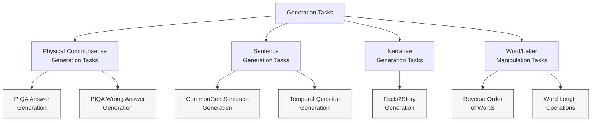
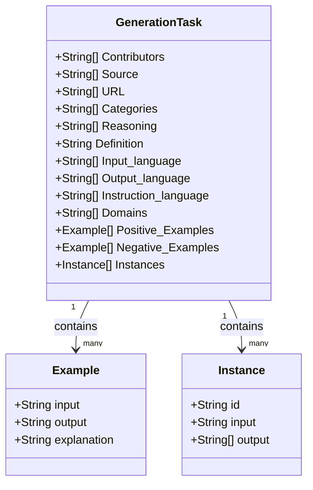
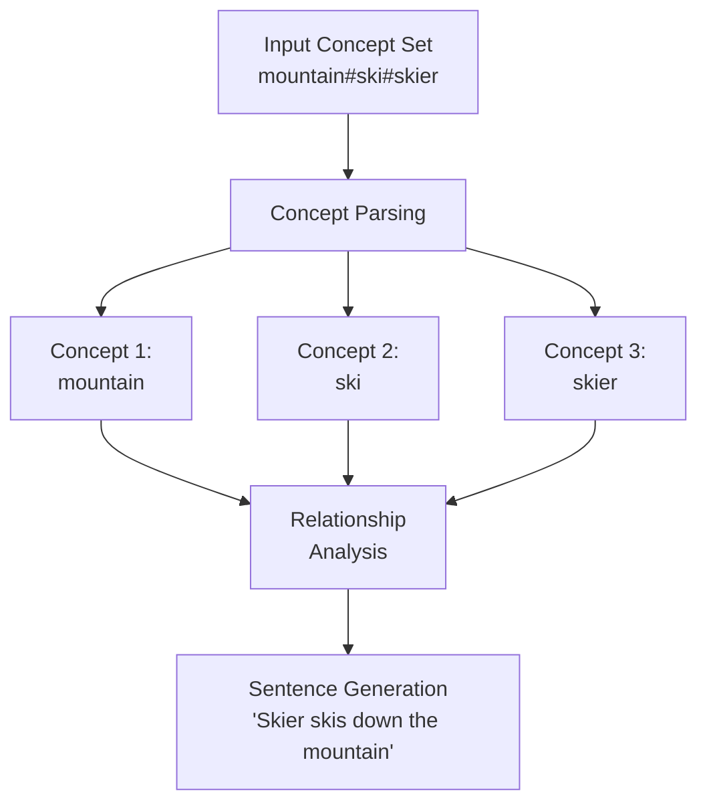
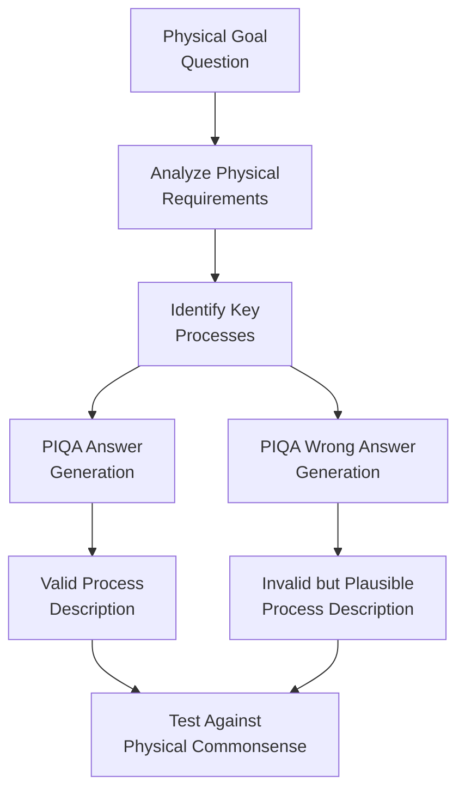
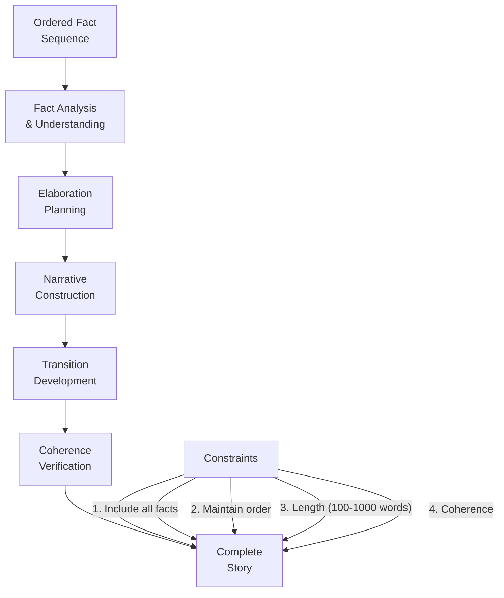
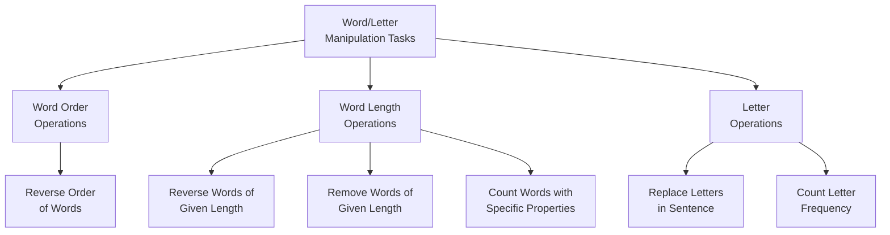
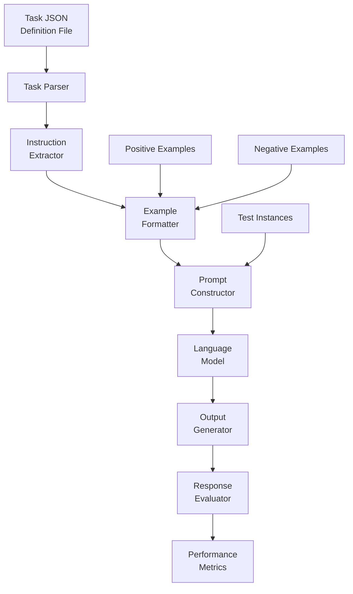
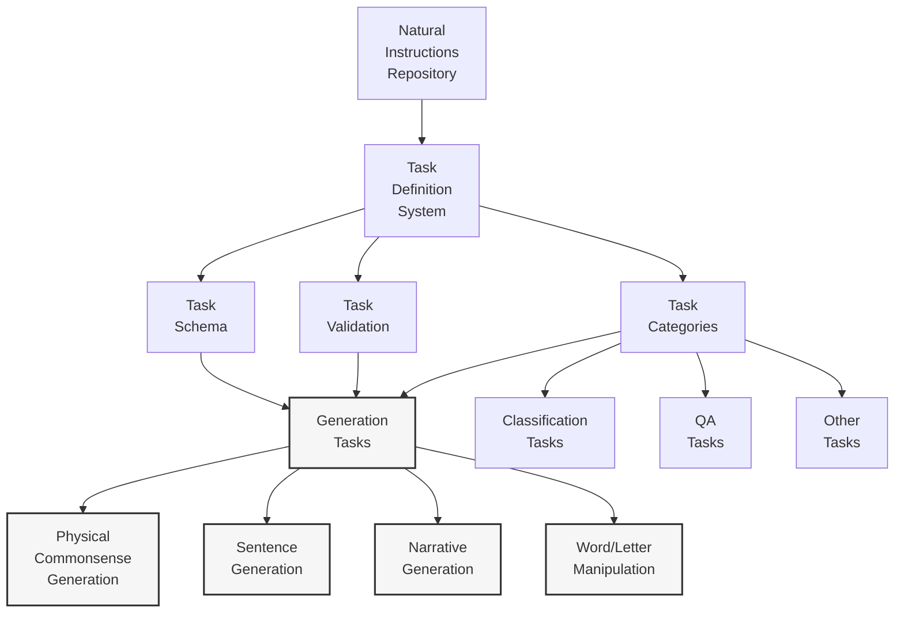

<!-- source: DeepWiki mcp.deepwiki.com · repo allenai/natural-instructions · page 3.3 Generation Tasks · fetched 2026-10-26 -->

# Generation Tasks

<details>
<summary>Relevant source files</summary>

The following files were used as context for generating this wiki page:

- [tasks/task080_piqa_answer_generation.json](tasks/task080_piqa_answer_generation.json)
- [tasks/task081_piqa_wrong_answer_generation.json](tasks/task081_piqa_wrong_answer_generation.json)
- [tasks/task102_commongen_sentence_generation.json](tasks/task102_commongen_sentence_generation.json)
- [tasks/task103_facts2story_long_text_generation.json](tasks/task103_facts2story_long_text_generation.json)
- [tasks/task113_count_frequency_of_letter.json](tasks/task113_count_frequency_of_letter.json)
- [tasks/task114_is_the_given_word_longest.json](tasks/task114_is_the_given_word_longest.json)
- [tasks/task155_count_nouns_verbs.json](tasks/task155_count_nouns_verbs.json)
- [tasks/task157_count_vowels_and_consonants.json](tasks/task157_count_vowels_and_consonants.json)
- [tasks/task158_count_frequency_of_words.json](tasks/task158_count_frequency_of_words.json)
- [tasks/task159_check_frequency_of_words_in_sentence_pair.json](tasks/task159_check_frequency_of_words_in_sentence_pair.json)
- [tasks/task160_replace_letter_in_a_sentence.json](tasks/task160_replace_letter_in_a_sentence.json)
- [tasks/task161_count_words_containing_letter.json](tasks/task161_count_words_containing_letter.json)
- [tasks/task162_count_words_starting_with_letter.json](tasks/task162_count_words_starting_with_letter.json)
- [tasks/task163_count_words_ending_with_letter.json](tasks/task163_count_words_ending_with_letter.json)
- [tasks/task375_classify_type_of_sentence_in_debate.json](tasks/task375_classify_type_of_sentence_in_debate.json)
- [tasks/task376_reverse_order_of_words.json](tasks/task376_reverse_order_of_words.json)
- [tasks/task377_remove_words_of_given_length.json](tasks/task377_remove_words_of_given_length.json)
- [tasks/task378_reverse_words_of_given_length.json](tasks/task378_reverse_words_of_given_length.json)
- [tasks/task379_agnews_topic_classification.json](tasks/task379_agnews_topic_classification.json)
- [tasks/task381_boolq_question_generation.json](tasks/task381_boolq_question_generation.json)
- [tasks/task384_socialiqa_question_classification.json](tasks/task384_socialiqa_question_classification.json)
- [tasks/task388_torque_token_classification.json](tasks/task388_torque_token_classification.json)
- [tasks/task389_torque_generate_temporal_question.json](tasks/task389_torque_generate_temporal_question.json)
- [tasks/task390_torque_text_span_selection.json](tasks/task390_torque_text_span_selection.json)
- [tasks/task619_ohsumed_abstract_title_generation.json](tasks/task619_ohsumed_abstract_title_generation.json)
- [tasks/task620_ohsumed_medical_subject_headings_answer_generation.json](tasks/task620_ohsumed_medical_subject_headings_answer_generation.json)
- [tasks/task623_ohsumed_yes_no_answer_generation.json](tasks/task623_ohsumed_yes_no_answer_generation.json)
- [tasks/task624_ohsumed_question_answering.json](tasks/task624_ohsumed_question_answering.json)
- [tasks/task640_esnli_classification.json](tasks/task640_esnli_classification.json)
- [tasks/task641_esnli_classification.json](tasks/task641_esnli_classification.json)
- [tasks/task642_esnli_classification.json](tasks/task642_esnli_classification.json)
- [tasks/task643_refresd_classification.json](tasks/task643_refresd_classification.json)
- [tasks/task644_refresd_translation.json](tasks/task644_refresd_translation.json)
- [tasks/task645_summarization.json](tasks/task645_summarization.json)
- [tasks/task647_answer_generation.json](tasks/task647_answer_generation.json)
- [tasks/task648_answer_generation.json](tasks/task648_answer_generation.json)
- [tasks/task670_ambigqa_question_generation.json](tasks/task670_ambigqa_question_generation.json)

</details>


This document describes generation tasks in the Natural Instructions framework. Generation tasks involve producing new text based on given prompts or instructions, as opposed to classification tasks or span selection tasks. These tasks test a model's ability to create coherent, contextually appropriate text following specific requirements.

For tasks related to classification and question answering, see [Classification Tasks](#3.4) and [Question Answering Tasks](#3.2).

## Overview of Generation Tasks

Generation tasks require models to produce novel text outputs rather than selecting from predefined choices. Unlike classification tasks where the output space is constrained (e.g., "yes"/"no" or predefined categories), generation tasks have an open-ended output space, making them particularly challenging for language models.

Within the Natural Instructions repository, generation tasks range from creating physical commonsense explanations (PIQA tasks) to constructing sentences from concept sets (CommonGen) to producing longer narratives from ordered facts (Facts2Story).



Sources: tasks/task081_piqa_wrong_answer_generation.json, tasks/task102_commongen_sentence_generation.json, tasks/task080_piqa_answer_generation.json, tasks/task103_facts2story_long_text_generation.json, tasks/task376_reverse_order_of_words.json

## Generation Task Structure

Generation tasks in Natural Instructions follow a standardized format defined in the task JSON files. Each task includes:

| Component | Description |
|-----------|-------------|
| Definition | Instructions that explain what the task requires |
| Input_language, Output_language | Language specifications for inputs and outputs |
| Categories, Reasoning, Domains | Metadata about task type and required reasoning |
| Positive Examples | Sample inputs with correct outputs and explanations |
| Negative Examples | Sample inputs with incorrect outputs and explanations |
| Instances | Test cases with inputs and reference outputs |

The following diagram illustrates the structure of a generation task:



Sources: tasks/task081_piqa_wrong_answer_generation.json, tasks/task102_commongen_sentence_generation.json

## Key Generation Task Types

### CommonGen Sentence Generation

CommonGen tasks require generating a coherent sentence that incorporates all concepts from a given set. This tests a model's ability to understand relationships between concepts and use them in a natural, fluent way.

**Example from task102_commongen_sentence_generation.json:**

```
Input: "mountain#ski#skier"
Output: "Skier skis down the mountain"
```

The task involves:
1. Parsing the concept set (words separated by '#')
2. Understanding the relationships between concepts
3. Generating a natural sentence incorporating all concepts



Sources: tasks/task102_commongen_sentence_generation.json

### PIQA Physical Commonsense Generation

The PIQA (Physical Interaction Question Answering) tasks test a model's understanding of physical commonsense knowledge. There are two complementary PIQA generation tasks:

#### PIQA Answer Generation
This task involves describing a process that would lead to a specified outcome, testing understanding of physical processes and cause-effect relationships.

**Example from task080_piqa_answer_generation.json:**
```
Input: "How do you remove keys from a computer keyboard for cleaning?"
Output: "Place the tip of a knife under the corner of a key and gently twist to pop it off."
```

#### PIQA Wrong Answer Generation
This task involves generating a process that seems related to the goal but would NOT achieve the desired outcome - testing the ability to generate plausible but incorrect procedures.

**Example from task081_piqa_wrong_answer_generation.json:**
```
Input: "How can you dry wet replacement computer keyboard keys?"
Output: "by arranging paper towels in the sink and evenly spacing out each key to dry, face side up, with the water running"
```

The contrast between these tasks demonstrates how subtle changes in procedure can lead to success or failure in physical tasks.



Sources: tasks/task081_piqa_wrong_answer_generation.json, tasks/task080_piqa_answer_generation.json

### Narrative Generation (Facts2Story)

The Facts2Story task involves generating a coherent narrative (100-1000 words) from a set of ordered key facts. This tests a model's ability to elaborate, connect ideas, and maintain narrative coherence while ensuring all key facts are incorporated.

**Example from task103_facts2story_long_text_generation.json:**
```
Input: "Fact1: Ning returns to home village, Fact2: home village has fallen on desperate times, Fact3: rebel sisters and Moon After discover Elder Chu's pendant short skirmish, Fact4: father is being transported to place of execution, Fact5: Imperial High Monk Before arrives with entourage long"

Output: [A 100-1000 word story incorporating all these facts in order]
```

This task requires:
1. Understanding each fact in sequence
2. Elaborating on each fact with additional contextual details
3. Creating smooth transitions between facts
4. Maintaining narrative consistency
5. Generating a complete story that adheres to all constraints



Sources: tasks/task103_facts2story_long_text_generation.json

### Word and Letter Manipulation Tasks

These tasks involve specific transformations of text, testing a model's ability to follow algorithmic procedures on textual data. Examples include:

1. **Reverse Order of Words** (task376) - Reversing the word order in a sentence
   ```
   Input: "a child is making a face with a large bull in the background"
   Output: "background the in bull large a with face a making is child a"
   ```

2. **Reverse Words of Given Length** (task378) - Reversing only words of a specified length
   ```
   Input: "Sentence: 'close up photograph of cows behind a barbed wire fence'. Reverse all words of length '5'"
   Output: "esolc up photograph of cows behind a barbed wire ecnef"
   ```

3. **Remove Words of Given Length** (task377) - Removing all words of a specified length
   ```
   Input: "Sentence: 'massive amount of bikes are lined up at a center'. Remove all words of length '1'"
   Output: "massive amount of bikes are lined up at center"
   ```

These tasks test precise text manipulation capabilities rather than broader linguistic understanding.



Sources: tasks/task376_reverse_order_of_words.json, tasks/task378_reverse_words_of_given_length.json, tasks/task377_remove_words_of_given_length.json

## Implementation and Processing

Generation tasks in the Natural Instructions framework follow a specific processing flow from task definition to model output evaluation. The repository uses the task definition files to construct prompts for language models and evaluate their responses.



For generation tasks, evaluation is typically more complex than for classification tasks. While exact match might work for some structured outputs (like word manipulation tasks), most generation tasks require semantic evaluation approaches such as:

1. N-gram overlap metrics (BLEU, ROUGE)
2. Semantic similarity metrics 
3. Human evaluation
4. Task-specific evaluation criteria

Sources: tasks/task080_piqa_answer_generation.json, tasks/task102_commongen_sentence_generation.json

## Generation Tasks Comparison

The following table compares key characteristics of the main generation tasks in the repository:

| Task | Description | Input Format | Output Format | Reasoning Types |
|------|-------------|--------------|---------------|-----------------|
| CommonGen | Generate a sentence from concept sets | Concepts separated by '#' | Natural sentence | Relational, Analogical, Commonsense |
| PIQA Answer | Generate physical process description | Question about goal | Step-by-step process | Commonsense, Spatial |
| PIQA Wrong Answer | Generate incorrect but plausible process | Question about goal | Plausible but ineffective process | Commonsense, Spatial |
| Facts2Story | Generate story from ordered facts | Ordered fact list | 100-1000 word narrative | Commonsense |
| Reverse Word Order | Reverse word sequence | Sentence | Reversed word sequence | Mathematical (Counting) |
| Word Length Operations | Manipulate words based on length | Sentence + instruction | Transformed sentence | Mathematical (Counting) |

Sources: tasks/task081_piqa_wrong_answer_generation.json, tasks/task102_commongen_sentence_generation.json, tasks/task080_piqa_answer_generation.json, tasks/task103_facts2story_long_text_generation.json, tasks/task376_reverse_order_of_words.json

## Relationships between Generation Tasks and the Natural Instructions Framework

Generation tasks represent a subset of the overall Natural Instructions task ecosystem. The following diagram illustrates how they relate to other components:



Sources: tasks/task081_piqa_wrong_answer_generation.json, tasks/task102_commongen_sentence_generation.json, tasks/task080_piqa_answer_generation.json, tasks/task103_facts2story_long_text_generation.json

## Summary

Generation tasks form a critical component of the Natural Instructions benchmark, testing language models' abilities to produce novel text based on specific instructions and constraints. These tasks vary widely in complexity and domain, from simple word manipulation to complex narrative construction, but all share the common requirement of generating coherent, contextually appropriate text.

The repository's standardized format for task definitions enables systematic evaluation of model performance across this diverse range of generation capabilities, contributing to a more comprehensive assessment of language model capabilities.

---

