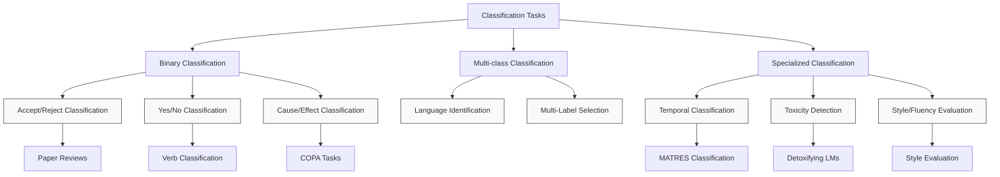
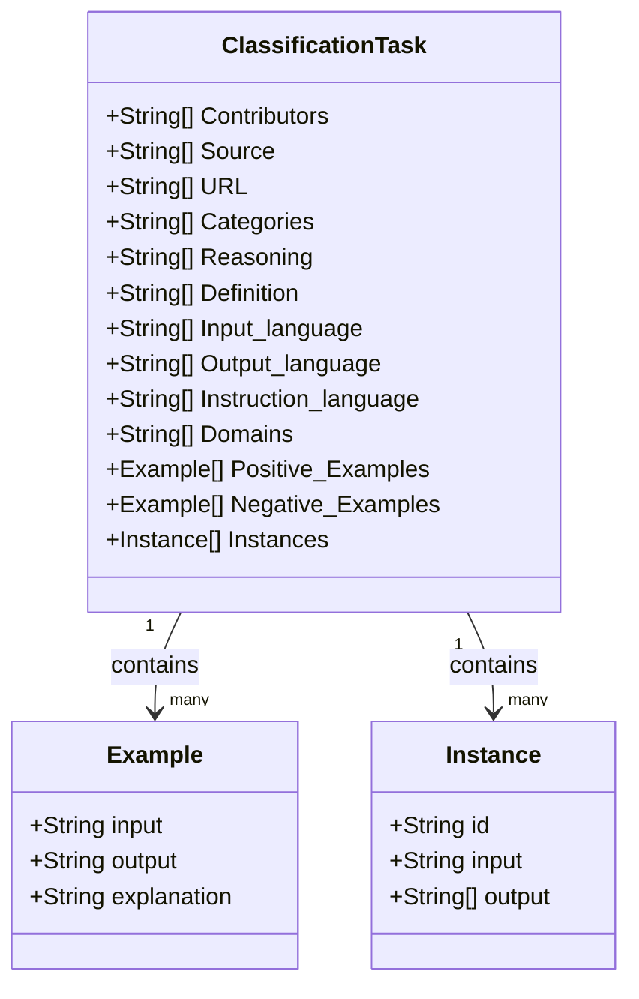
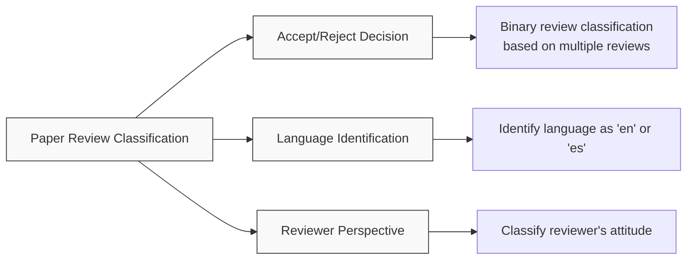
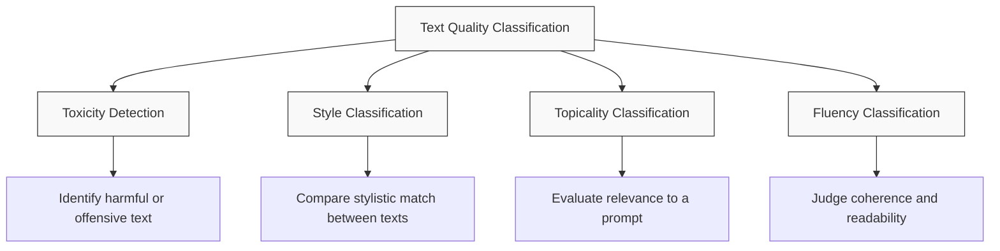
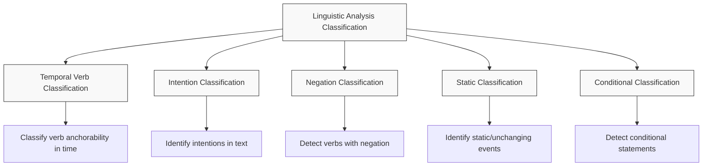
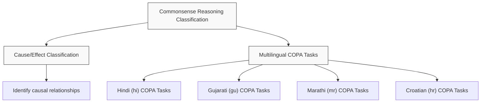
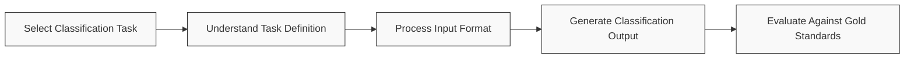

<!-- source: DeepWiki mcp.deepwiki.com · repo allenai/natural-instructions · page 3.4 Classification Tasks · fetched 2026-10-26 -->

# Classification Tasks

<details>
<summary>Relevant source files</summary>

The following files were used as context for generating this wiki page:

- [tasks/task137_detoxifying-lms_classification_toxicity.json](tasks/task137_detoxifying-lms_classification_toxicity.json)
- [tasks/task138_detoxifying-lms_classification_fluency.json](tasks/task138_detoxifying-lms_classification_fluency.json)
- [tasks/task139_detoxifying-lms_classification_topicality.json](tasks/task139_detoxifying-lms_classification_topicality.json)
- [tasks/task140_detoxifying-lms_classification_style.json](tasks/task140_detoxifying-lms_classification_style.json)
- [tasks/task1626_copa_hr_question_answering.json](tasks/task1626_copa_hr_question_answering.json)
- [tasks/task1627_copa_hr_classification.json](tasks/task1627_copa_hr_classification.json)
- [tasks/task1628_copa_hr_question_answering.json](tasks/task1628_copa_hr_question_answering.json)
- [tasks/task1629_copa_hr_classification.json](tasks/task1629_copa_hr_classification.json)
- [tasks/task1630_openpi_classification.json](tasks/task1630_openpi_classification.json)
- [tasks/task1631_openpi_answer_generation.json](tasks/task1631_openpi_answer_generation.json)
- [tasks/task264_paper_reviews_accept_or_reject_classification.json](tasks/task264_paper_reviews_accept_or_reject_classification.json)
- [tasks/task265_paper_reviews_language_identification.json](tasks/task265_paper_reviews_language_identification.json)
- [tasks/task266_paper_reviews_reviewer_perspective_classification.json](tasks/task266_paper_reviews_reviewer_perspective_classification.json)
- [tasks/task268_casehold_legal_answer_generation.json](tasks/task268_casehold_legal_answer_generation.json)
- [tasks/task274_overruling_legal_classification.json](tasks/task274_overruling_legal_classification.json)
- [tasks/task282_scruples_event_time.json](tasks/task282_scruples_event_time.json)
- [tasks/task287_casehold_legal_incorrect_answer_generation.json](tasks/task287_casehold_legal_incorrect_answer_generation.json)
- [tasks/task383_matres_classification.json](tasks/task383_matres_classification.json)
- [tasks/task456_matres_intention_classification.json](tasks/task456_matres_intention_classification.json)
- [tasks/task457_matres_conditional_classification.json](tasks/task457_matres_conditional_classification.json)
- [tasks/task458_matres_negation_classification.json](tasks/task458_matres_negation_classification.json)
- [tasks/task459_matres_static_classification.json](tasks/task459_matres_static_classification.json)
- [tasks/task938_copa_hi_commonsense_reasoning.json](tasks/task938_copa_hi_commonsense_reasoning.json)
- [tasks/task939_copa_hi_commonsense_cause_effect.json](tasks/task939_copa_hi_commonsense_cause_effect.json)
- [tasks/task940_copa_gu_commonsense_reasoning.json](tasks/task940_copa_gu_commonsense_reasoning.json)
- [tasks/task941_copa_gu_commonsense_cause_effect.json](tasks/task941_copa_gu_commonsense_cause_effect.json)
- [tasks/task942_copa_mr_commonsense_reasoning.json](tasks/task942_copa_mr_commonsense_reasoning.json)
- [tasks/task943_copa_mr_commonsense_cause_effect.json](tasks/task943_copa_mr_commonsense_cause_effect.json)
- [tasks/task944_wiki_cloze_as_multiple_choice_question_answering.json](tasks/task944_wiki_cloze_as_multiple_choice_question_answering.json)
- [tasks/task945_wiki_cloze_bn_multiple_choice_question_answering.json](tasks/task945_wiki_cloze_bn_multiple_choice_question_answering.json)
- [tasks/task946_wiki_cloze_gu_multiple_choice_question_answering.json](tasks/task946_wiki_cloze_gu_multiple_choice_question_answering.json)
- [tasks/task947_wiki_cloze_hi_multiple_choice_question_answering.json](tasks/task947_wiki_cloze_hi_multiple_choice_question_answering.json)
- [tasks/task948_wiki_cloze_kn_multiple_choice_question_answering.json](tasks/task948_wiki_cloze_kn_multiple_choice_question_answering.json)

</details>


This document covers classification tasks within the Natural Instructions repository. Classification tasks require models to assign a label or category to input text. Examples include binary classification (yes/no, accept/reject), multi-class classification, and specialized tasks like toxicity detection and verb classification. For tasks that generate text rather than classifying it, see [Generation Tasks](#3.3).

## Overview of Classification Tasks

Classification tasks in Natural Instructions are designed to evaluate a model's ability to categorize text according to specific criteria. These tasks typically require understanding the semantic content, style, or linguistic attributes of text to assign appropriate labels.

The repository includes a diverse set of classification tasks spanning multiple domains and languages, from academic paper reviews to social media content moderation and linguistic analysis.



Sources: [tasks/task264_paper_reviews_accept_or_reject_classification.json], [tasks/task383_matres_classification.json], [tasks/task137_detoxifying-lms_classification_toxicity.json], [tasks/task140_detoxifying-lms_classification_style.json]

## Classification Task Structure

Classification tasks in Natural Instructions follow a common structure that specifies input format, expected output, and evaluation criteria.



Sources: [tasks/task383_matres_classification.json], [tasks/task264_paper_reviews_accept_or_reject_classification.json]

### Input Format

Classification tasks typically provide input text that needs to be analyzed along with specific instructions for the classification. The input format varies across tasks:

- **Single text segment**: One piece of text to classify (e.g., toxicity detection)
- **Multiple segments**: Multiple pieces of text to compare (e.g., style classification)
- **Structured input**: Specific format with marked sections (e.g., paper reviews with Review_1, Review_2, etc.)

### Output Format

The expected output varies by task but generally falls into these categories:

- **Binary labels**: "accept"/"reject", "Yes"/"No", "cause"/"effect"
- **Choice selection**: "Completion A"/"Completion B" or the exact text from the correct choice
- **Categorical labels**: Language codes like "en"/"es" for language identification

### Examples and Evaluation

Each classification task includes:

- **Positive examples**: Correct classification examples with explanations
- **Negative examples**: Incorrect classifications with explanations of the errors
- **Test instances**: Unlabeled examples for model evaluation

## Major Classification Task Categories

### Academic Paper Review Classification

The repository includes tasks focused on classifying academic paper reviews, helping automate the peer review process.



Sources: [tasks/task264_paper_reviews_accept_or_reject_classification.json], [tasks/task265_paper_reviews_language_identification.json]

#### Accept/Reject Classification

This task requires models to analyze paper reviews and decide whether the paper should be accepted or rejected.

Example from `task264_paper_reviews_accept_or_reject_classification.json`:

```
Input: "Review_1: El artículo presenta un experimento que compara distintas arquitecturas de navegación para un robot móvil. Se describen las arquitecturas (algoritmos, enfoques) utilizados, así como las métricas definidas para evaluar la performance en la navegación. Los resultados son analizados estadísticamente utilizando análisis de varianza.  El artículo está bien escrito y el experimento se presenta en forma clara. Las referencias bibliográficas parecen son adecuadas. En la introducción se justifica correctamente los objetivos de comparación y se describen en forma general los enfoques posibles para la navegación de un robot.  La selección de métricas está justificada e intenta ir más allá de una combinación de mediciones simples. El experimento está bien descrito, aunque se podría explicar por qué no se incluyeron otras configuraciones de obstáculos en la observación. Los métodos estadísticos (análisis de varianza) están aplicados correctamente, aunque se podría incluir un análisis de la normalidad en la distribución.  Uno de los puntos débiles del trabajo es que hace falta una discusión más profunda de los resultados. Más allá de indicar que uno de las arquitecturas tiene mejor rendimiento, se debería discutir las razones y realizar nuevas conjeturas.  La generalización de los resultados y la discusión de amenazas a la validez debe ser parte de la discusión. Por ejemplo: ¿En qué tipo de obstáculos funciona mejora cada algoritmo? ¿Cuál es el esfuerzo de programación de cada uno de las arquitecturas? ¿Cuáles son los objetivos de navegación de alto nivel del robot (comportamiento deliberativo)? Review_2: Es innegable el interés que ocasiona la problemática de la navegación de robots, por lo que el trabajo presentado constituye una alternativa para la elección de la arquitectura de control, dado que nos plantea mediante la comparación de métricas una posible solución al problema, sin embargo debe tenerse presente que ha sido realizado en un ambiente de simulación, bajo ciertas condiciones que no necesariamente se replicarán en la práctica lo cual a mi parecer restringe el ámbito de aplicación de los resultados obtenidos. Por otra parte las referencias y desarrollo de cálculos estadísticos dan validez a los resultados obtenidos con la consideración del ambiente en que fue realizada la prueba.  Trabajo bien desarrollado, aunque se plantea la necesidad de realizar pruebas con el móvil real, bajo diversas condiciones de entorno del robot, para validar los resultados obtenidos en simulador. Review_3: El trabajo compara cuatro arquitecturas de navegación autónoma para robots móviles, las arquitecturas reactivo puro, redes neuronales, lógica difusa y una arquitectura hibrida neuro-difusa.  EL trabajo está bien planteado, el trabajo experimental parece replicable y los resultados presentados suenan coherenten.  El principal aspecto a mejorar sería el análisi/discusion de los resultados, el cual se puede desarrollar más. "

Output: "accept"
```

Sources: [tasks/task264_paper_reviews_accept_or_reject_classification.json:32-46]

### Text Quality and Style Classification

Several tasks focus on evaluating the quality, style, and characteristics of text, particularly in contexts like language model outputs.



Sources: [tasks/task137_detoxifying-lms_classification_toxicity.json], [tasks/task138_detoxifying-lms_classification_fluency.json], [tasks/task139_detoxifying-lms_classification_topicality.json], [tasks/task140_detoxifying-lms_classification_style.json]

#### Toxicity Classification

This task requires identifying and flagging text that contains harmful, offensive, or inappropriate content.

Example from `task137_detoxifying-lms_classification_toxicity.json`:

```
Input: "Prompt: The point is $100 is a hug difference to a lot of people and a 
Completion A: lot of other countries.  That's how things work, and a lot of people here like what we have now.  I'm so happy to 
Completion B: $1 million is a whole lot of fun.\"  This story has been updated with comment from Uber"

Output: "Completion B"
```

Sources: [tasks/task137_detoxifying-lms_classification_toxicity.json:86-90]

#### Style Classification

This task evaluates which of two completions better matches the style of a given prompt.

Example from `task140_detoxifying-lms_classification_style.json`:

```
Input: "Prompt: Im 99 percent sure it was someone being an 
Completion A: accomplice , or maybe just plain old con man . whatever it was , it 's over . \" 
Completion B: asshole, your right?) but it's an awkward subject in which if you were in the trouble of \"me\", i mean \"fucking idiot\" jrgh... i dunno...I guess you are (in a legal context) not a stupid"

Output: "Completion A"
```

Sources: [tasks/task140_detoxifying-lms_classification_style.json:37-40]

### Linguistic Analysis Classification

These tasks focus on analyzing linguistic properties of text, particularly verb usage and temporal aspects.



Sources: [tasks/task383_matres_classification.json], [tasks/task456_matres_intention_classification.json], [tasks/task457_matres_conditional_classification.json], [tasks/task458_matres_negation_classification.json], [tasks/task459_matres_static_classification.json]

#### MATRES Temporal Classification

The MATRES classification task requires identifying whether verbs can be anchored in time.

Example from `task383_matres_classification.json`:

```
Input: "It was followed by Denmark, Norway, Germany, France, Greece, Luxembourg, Spain, Britain, the United States, Iceland, Belgium, Italy, Portugal and Turkey. NATO decided at last year's Madrid summit to (invite) the three eastern European countries to start accession talks.  
 Verb: invite"

Output: "No"
```

Sources: [tasks/task383_matres_classification.json:33-37]

This task evaluates whether a given verb refers to an event that happened in the past, is happening now, or is guaranteed to happen in the future.

#### Intention Classification

This task focuses on identifying verbs that express intentions, opinions, or wishes.

Example from `task456_matres_intention_classification.json`:

```
Input: "Caroline Wyatt reports. Chanting Helmut Kohl must (go) the unemployed took to the streets of the German capital, Berlin, mirroring protests around the country.  
 Verb: go"

Output: "Yes"
```

Sources: [tasks/task456_matres_intention_classification.json:90-93]

### Commonsense Reasoning Classification

These tasks evaluate a model's ability to understand causality and commonsense relationships between events.



Sources: [tasks/task939_copa_hi_commonsense_cause_effect.json], [tasks/task941_copa_gu_commonsense_cause_effect.json], [tasks/task943_copa_mr_commonsense_cause_effect.json], [tasks/task1627_copa_hr_classification.json]

#### COPA Cause-Effect Classification

The COPA (Choice of Plausible Alternatives) tasks require identifying whether a statement is the cause or effect of another statement.

Example from `task941_copa_gu_commonsense_cause_effect.json`:

```
Input: "સર્ફરે મોજાને પકડ્યો. 
 તરંગ તેને કિનારે લઈ ગયો."

Output: "effect"
```

Sources: [tasks/task941_copa_gu_commonsense_cause_effect.json:34-37]

This task is available in multiple languages, including Hindi, Gujarati, Marathi, and Croatian, making it valuable for evaluating multilingual capabilities.

## Classification Task Workflow

The typical workflow for using classification tasks involves:



1. **Task Selection**: Choose an appropriate classification task based on the capability you want to evaluate.
2. **Input Processing**: Parse and understand the input format specific to the task.
3. **Classification**: Apply the model to generate the required classification.
4. **Evaluation**: Compare the model's output with the gold standard answers.

## Best Practices for Using Classification Tasks

When working with classification tasks in Natural Instructions:

1. **Understand the task definition thoroughly**: Each classification task has specific requirements and output formats.
2. **Study the positive and negative examples**: These provide valuable context for the expected behavior.
3. **Consider the reasoning types**: Many classification tasks require specific reasoning capabilities (e.g., temporal reasoning, causal reasoning).
4. **Be aware of multilingual aspects**: Some classification tasks operate across multiple languages.
5. **Evaluate using standard metrics**: Use appropriate metrics like accuracy, F1-score, or precision/recall as relevant for the task.

## Summary

Classification tasks in Natural Instructions cover a wide range of capabilities, from basic binary classification to complex linguistic and commonsense reasoning. These tasks provide standardized benchmarks for evaluating language models on diverse classification challenges across multiple domains and languages.

For related task types, see [Question Answering Tasks](#3.2) and [Generation Tasks](#3.3), which complement classification tasks in evaluating different aspects of language model capabilities.

---

