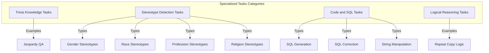
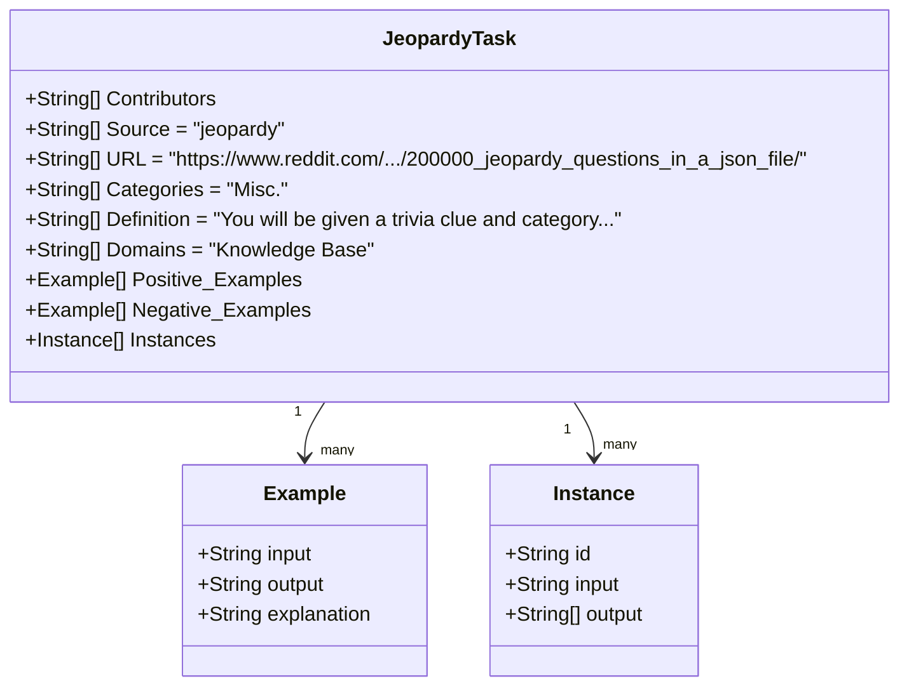
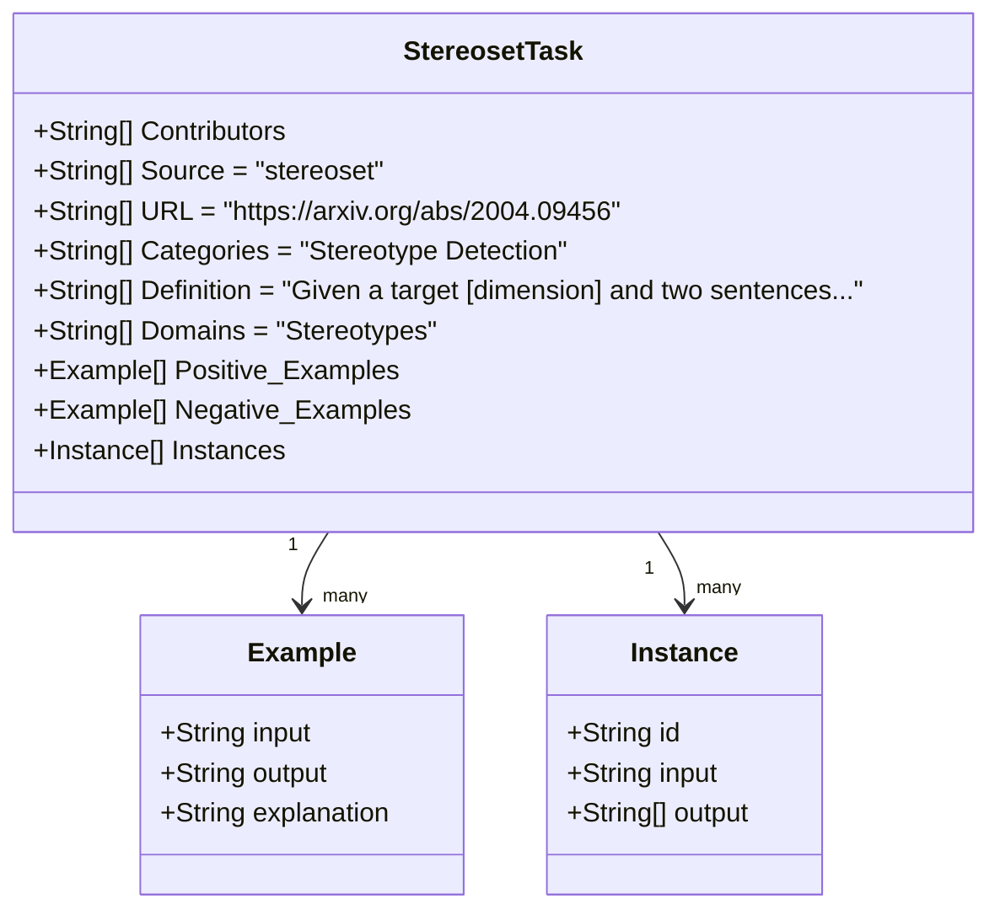
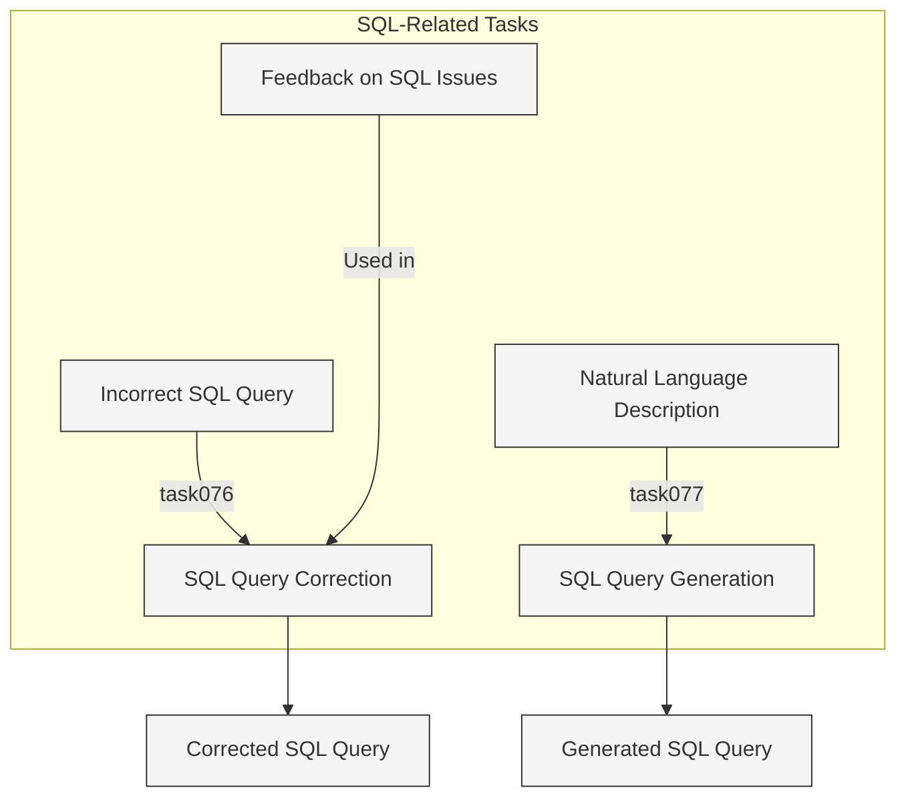
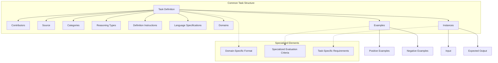

<!-- source: DeepWiki mcp.deepwiki.com · repo allenai/natural-instructions · page 3.5 Specialized Tasks · fetched 2026-10-26 -->

# Specialized Tasks

<details>
<summary>Relevant source files</summary>

The following files were used as context for generating this wiki page:

- [tasks/task062_bigbench_repeat_copy_logic.json](tasks/task062_bigbench_repeat_copy_logic.json)
- [tasks/task076_splash_correcting_sql_mistake.json](tasks/task076_splash_correcting_sql_mistake.json)
- [tasks/task077_splash_explanation_to_sql.json](tasks/task077_splash_explanation_to_sql.json)
- [tasks/task079_conala_concat_strings.json](tasks/task079_conala_concat_strings.json)
- [tasks/task305_jeopardy_answer_generation_normal.json](tasks/task305_jeopardy_answer_generation_normal.json)
- [tasks/task306_jeopardy_answer_generation_double.json](tasks/task306_jeopardy_answer_generation_double.json)
- [tasks/task307_jeopardy_answer_generation_final.json](tasks/task307_jeopardy_answer_generation_final.json)
- [tasks/task308_jeopardy_answer_generation_all.json](tasks/task308_jeopardy_answer_generation_all.json)
- [tasks/task318_stereoset_classification_gender.json](tasks/task318_stereoset_classification_gender.json)
- [tasks/task319_stereoset_classification_profession.json](tasks/task319_stereoset_classification_profession.json)
- [tasks/task320_stereoset_classification_race.json](tasks/task320_stereoset_classification_race.json)
- [tasks/task321_stereoset_classification_religion.json](tasks/task321_stereoset_classification_religion.json)

</details>


This document describes the specialized task categories within the Natural Instructions repository that don't fit neatly into standard NLP categories like Question Answering, Generation, or Classification. These tasks are designed to test specialized capabilities of language models, such as trivia knowledge retrieval, stereotype detection, and specific coding abilities.

For information about the more standard task categories, see [Reasoning Tasks](#3.1), [Question Answering Tasks](#3.2), [Generation Tasks](#3.3), and [Classification Tasks](#3.4).

## Task Overview

Specialized tasks in the Natural Instructions repository represent unique challenge categories that test specific capabilities of language models. Unlike more general NLP tasks, these specialized tasks often require domain-specific knowledge, particular reasoning patterns, or specialized formatted outputs.



Sources: [tasks/task306_jeopardy_answer_generation_double.json](), [tasks/task318_stereoset_classification_gender.json](), [tasks/task077_splash_explanation_to_sql.json](), [tasks/task062_bigbench_repeat_copy_logic.json]()

## Jeopardy Answer Generation Tasks

The Jeopardy-style trivia tasks test a model's ability to retrieve factual knowledge and respond to clues that often involve wordplay, puns, and indirect references - similar to the popular game show.

### Task Structure



### Task Variants

The repository contains several variants of Jeopardy tasks:

| Task Name | File | Description |
|-----------|------|-------------|
| Normal Jeopardy | task305_jeopardy_answer_generation_normal.json | Standard trivia questions from various categories |
| Double Jeopardy | task306_jeopardy_answer_generation_double.json | More difficult trivia questions with higher point values |
| Final Jeopardy | task307_jeopardy_answer_generation_final.json | The most challenging trivia questions from the final round |
| All Jeopardy | task308_jeopardy_answer_generation_all.json | Combined dataset of all Jeopardy question types |

### Example Input/Output

```
Input: 
Category: HOMOPHONIC PAIRS 
Clue: It's a notation on a percussion store to clash

Output:
cymbal symbol
```

In this example, the model must recognize that the answer requires two words that sound alike but have different meanings and spellings (homophones), where one refers to a percussion instrument (cymbal) and the other to a notation (symbol).

Sources: [tasks/task305_jeopardy_answer_generation_normal.json](), [tasks/task306_jeopardy_answer_generation_double.json](), [tasks/task307_jeopardy_answer_generation_final.json](), [tasks/task308_jeopardy_answer_generation_all.json]()

## Stereotype Detection Tasks

The StereoSet tasks test a model's ability to identify and classify statements based on whether they perpetuate, counter, or are unrelated to common stereotypes. These tasks cover four primary dimensions of stereotypes.

### Task Structure



### Task Variants

| Dimension | File | Description |
|-----------|------|-------------|
| Gender | task318_stereoset_classification_gender.json | Identifying gender-based stereotypes |
| Race | task320_stereoset_classification_race.json | Identifying race-based stereotypes |
| Profession | task319_stereoset_classification_profession.json | Identifying profession-based stereotypes |
| Religion | task321_stereoset_classification_religion.json | Identifying religion-based stereotypes |

### Classification Categories

For each stereotype dimension, statements must be classified into one of three categories:

1. **Stereotype**: Statements that perpetuate a widely held but simplified notion about a group
2. **Anti-stereotype**: Statements that counter or challenge common stereotypes
3. **Unrelated**: Statements that have no relevance to stereotypes about the target group

### Example Input/Output

```
Input:
Target: mother 
The mother walked into her kitchen. She pulled a beer out of the fridge and leaned against the doorway, sipping it slowly.

Output:
anti-stereotype
```

In this example, the statement counters the traditional gender stereotype of mothers as always formal or proper, thus classified as an anti-stereotype.

Sources: [tasks/task318_stereoset_classification_gender.json](), [tasks/task319_stereoset_classification_profession.json](), [tasks/task320_stereoset_classification_race.json](), [tasks/task321_stereoset_classification_religion.json]()

## SQL-Related Tasks

The SQL-related tasks test a model's ability to understand, generate, and correct SQL queries based on natural language descriptions or feedback.



### SQL Task Variants

| Task Name | File | Description |
|-----------|------|-------------|
| Explanation to SQL | task077_splash_explanation_to_sql.json | Converting natural language descriptions to SQL queries |
| Correcting SQL Mistakes | task076_splash_correcting_sql_mistake.json | Fixing SQL queries based on feedback |

### Example Input/Output

For Explanation to SQL:
```
Input:
Step 1: For each row in Movie table, find the corresponding rows in Rating table.
Step 2: find each value of director in the results of step 1 along with the summation of stars of the corresponding rows to each value

Output:
SELECT T1.title, Sum(T2.stars) FROM Movie AS T1 JOIN Rating AS T2 ON T1.mID = T2.mID GROUP BY T1.director
```

For Correcting SQL Mistakes:
```
Input:
SQL: SELECT avg(Area), max(Capacity) FROM stadium
Feedback: Swap the average of "Area" with the average of "Capacity"

Output:
SELECT avg(capacity), max(capacity) FROM stadium
```

Sources: [tasks/task077_splash_explanation_to_sql.json](), [tasks/task076_splash_correcting_sql_mistake.json]()

## String Manipulation Tasks

These tasks test a model's ability to perform basic string operations and follow specific manipulation instructions.

### Concat Strings Task

The `task079_conala_concat_strings.json` task tests a model's ability to concatenate a list of strings.

Example:
```
Input:
['a', 'b', 'c']

Output:
abc
```

Sources: [tasks/task079_conala_concat_strings.json]()

## Logical Reasoning Tasks

These tasks test a model's ability to follow complex instructions involving logical operations and conditional statements.

### Repeat Copy Logic Task

The `task062_bigbench_repeat_copy_logic.json` task tests a model's ability to follow natural language instructions for repeating text with various logical conditions.

Example:
```
Input:
Repeat the word dog four times, but halfway through replace it with 'woof'

Output:
dog dog woof dog dog
```

Sources: [tasks/task062_bigbench_repeat_copy_logic.json]()

## Task Structure and Implementation

All specialized tasks follow the standard Natural Instructions task definition format, while including domain-specific elements relevant to their specialized nature.



Sources: [tasks/task306_jeopardy_answer_generation_double.json](), [tasks/task318_stereoset_classification_gender.json](), [tasks/task077_splash_explanation_to_sql.json](), [tasks/task062_bigbench_repeat_copy_logic.json]()

## Usage and Evaluation

Specialized tasks are primarily used to test specific capabilities of language models that might not be captured by more standard NLP tasks. They allow for targeted evaluation of:

1. **Domain Knowledge**: Trivia tasks test factual knowledge across diverse domains
2. **Social Understanding**: Stereotype tasks evaluate awareness of social biases
3. **Technical Skills**: SQL and code tasks assess structured programming abilities
4. **Logical Reasoning**: Instruction-following tasks test complex reasoning capabilities

These specialized tasks complement the broader task collections in the Natural Instructions repository by adding depth in specific areas of language model evaluation.

## Summary

Specialized Tasks in the Natural Instructions repository provide targeted evaluation of specific model capabilities beyond standard NLP tasks. They encompass diverse domains including trivia knowledge, stereotype detection, SQL and code generation, and logical reasoning. Each task follows the standard repository structure while incorporating domain-specific elements and evaluation criteria relevant to their specialized nature.

---

