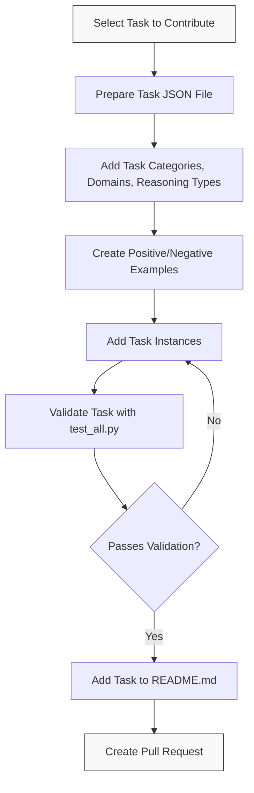
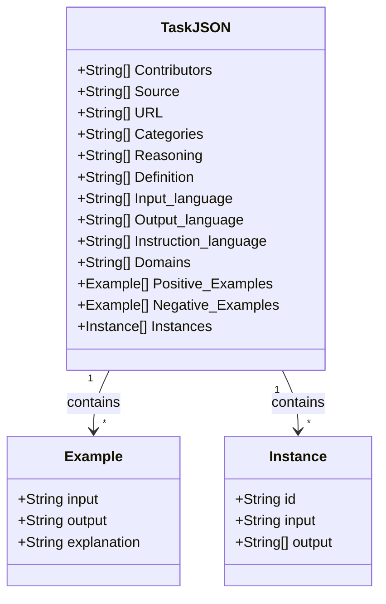
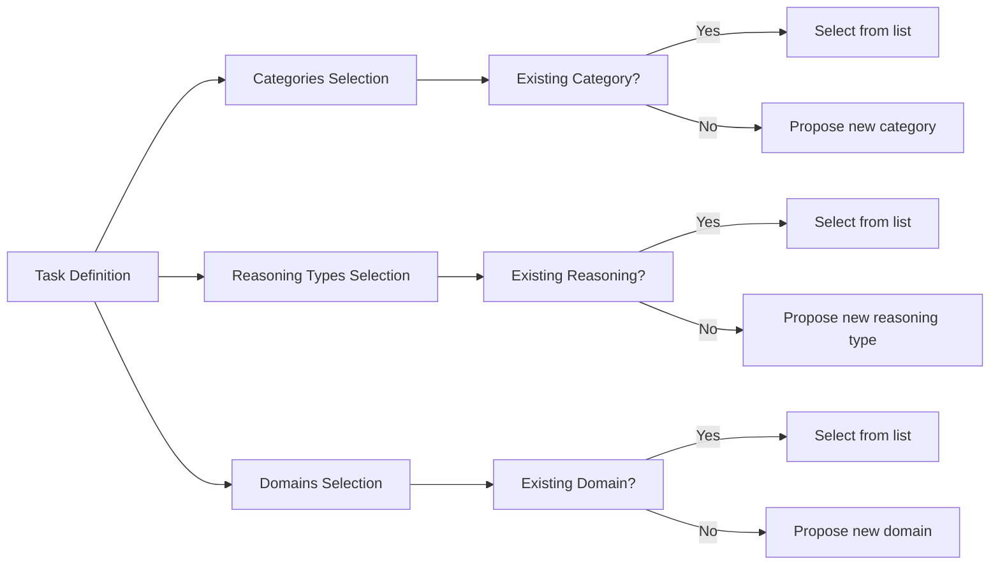
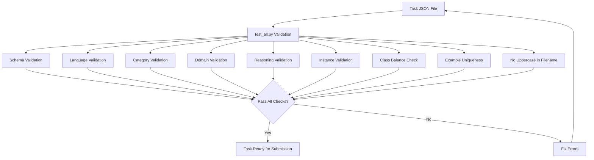
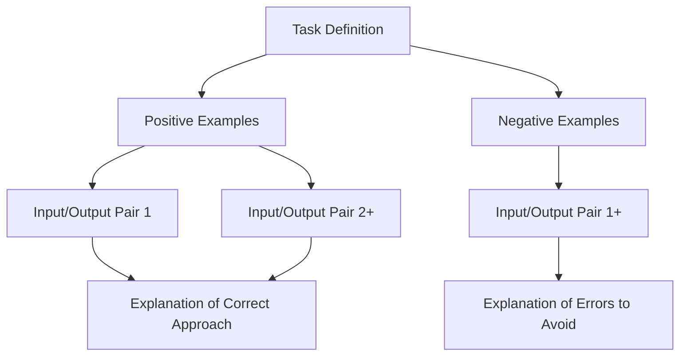
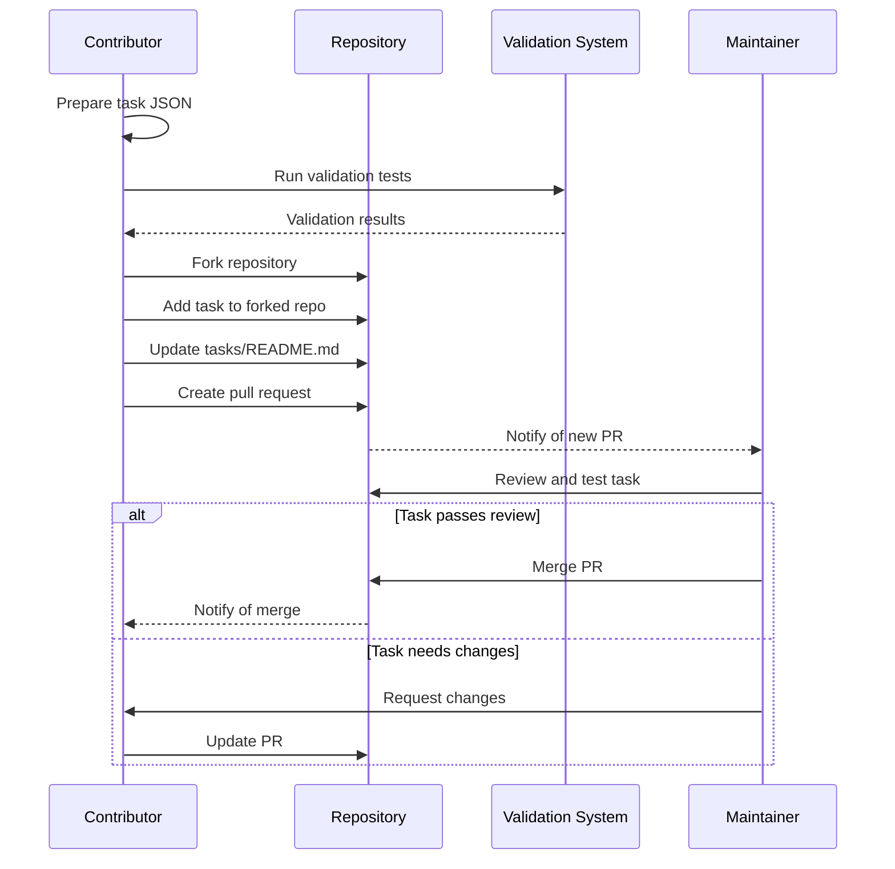

<!-- source: DeepWiki mcp.deepwiki.com · repo allenai/natural-instructions · page 4 Contributing · fetched 2026-10-26 -->

# Contributing

<details>
<summary>Relevant source files</summary>

The following files were used as context for generating this wiki page:

- [README.md](README.md)
- [doc/categories_map.json](doc/categories_map.json)
- [doc/crowdsourcing.md](doc/crowdsourcing.md)
- [doc/domains_map.json](doc/domains_map.json)
- [doc/emailing-authors.md](doc/emailing-authors.md)
- [doc/reasonings_map.json](doc/reasonings_map.json)
- [doc/task-hierarchy.md](doc/task-hierarchy.md)
- [src/sparsifying_fields.py](src/sparsifying_fields.py)
- [src/test_all.py](src/test_all.py)
- [src/update_category_assignment.py](src/update_category_assignment.py)
- [tasks/task074_squad1.1_question_generation.json](tasks/task074_squad1.1_question_generation.json)
- [tasks/task075_squad1.1_answer_generation.json](tasks/task075_squad1.1_answer_generation.json)
- [tasks/task170_hotpotqa_answer_generation.json](tasks/task170_hotpotqa_answer_generation.json)
- [tasks/task191_hotpotqa_question_generation.json](tasks/task191_hotpotqa_question_generation.json)
- [tasks/task192_hotpotqa_sentence_generation.json](tasks/task192_hotpotqa_sentence_generation.json)
- [tasks/task195_sentiment140_classification.json](tasks/task195_sentiment140_classification.json)
- [tasks/task196_sentiment140_answer_generation.json](tasks/task196_sentiment140_answer_generation.json)

</details>


This document provides comprehensive guidelines for contributing to the Natural Instructions repository. It covers the process of adding new tasks, validating them, and ensuring they adhere to the repository's standards and format. For information on the general structure of the Natural Instructions repository, see [Overview](#1).

## Table of Contents
1. [Contribution Process Overview](#contribution-process-overview)
2. [Task Structure and Requirements](#task-structure-and-requirements)
3. [Categorization Guidelines](#categorization-guidelines)
4. [Task Validation](#task-validation)
5. [Creating Positive and Negative Examples](#creating-positive-and-negative-examples)
6. [Submission Process](#submission-process)

## Contribution Process Overview

The Natural Instructions repository welcomes contributions in the form of new tasks. Each task consists of a standardized JSON file that includes definitions, examples, and instances of the task.



Contributors can add new tasks in several ways:
1. Converting existing datasets to the Natural Instructions format
2. Creating original tasks
3. Transforming crowdsourcing templates into tasks

Sources: [README.md:72-93]()

## Task Structure and Requirements

Each task must be defined in a JSON file with the following structure:



### Key Requirements

1. **File Naming**: Use the format `task<number>_<source_dataset>_<task_type>.json` (e.g., `task001_quoref_question_generation.json`)
2. **File Size**: Each JSON file must be less than 50MB
3. **Instances**: Each task must have between 25 and 6,500 instances
4. **Instance IDs**: Must be unique, using the format `task<number>-<uuid4.hex>` (e.g., `task1356-bb5ff013dc5d49d7a962e85ed1de526b`)
5. **JSON Formatting**: Human-readable with proper indentation
6. **Lowercase Filenames**: No uppercase letters allowed in filenames

Sources: [README.md:76-92](), [src/test_all.py:138-266]()

## Categorization Guidelines

Each task must be classified using three taxonomies: Categories, Reasoning types, and Domains.

### Task Categories

Tasks must be categorized using established categories from the task hierarchy. Common categories include:

- Question Answering
- Text Categorization
- Question Generation
- Sentiment Analysis
- Translation
- Summarization
- Information Extraction
- Many others...

### Reasoning Types

Tasks can involve various types of reasoning, including:

- Commonsense Reasoning
- Abductive Reasoning
- Logical Reasoning
- Multihop Reasoning
- Numerical Reasoning
- Temporal Reasoning
- Many others...

### Domains

Tasks should be associated with relevant domains such as:

- Wikipedia
- Social Media
- News
- Medicine
- Science
- Many others...



Sources: [doc/task-hierarchy.md:1-257](), [src/test_all.py:157-167]()

## Task Validation

Before submission, each task must be validated using the provided test script. The validation checks ensure that the task adheres to the repository's standards.

### Running Validation

To validate a task:

```bash
python src/test_all.py
```

To validate a specific range of tasks:

```bash
python src/test_all.py --task <begin_task_number> <end_task_number>
```

### Validation Checks

The validation process checks for:



The validation system enforces:
1. Required fields are present
2. Languages are valid ISO language names
3. Categories, domains, and reasoning types are from the approved lists
4. No duplicate instance IDs
5. Balanced class distribution (entropy > 0.8)
6. No overlapping examples between instances and positive examples
7. Task name is properly included in README.md

Sources: [src/test_all.py:29-326]()

## Creating Positive and Negative Examples

Each task requires both positive and negative examples to guide users on how to correctly perform the task.

### Positive Examples

At least 2 positive examples demonstrating correct task completion must be provided. Each example includes:
- Input: The task input
- Output: The correct response
- Explanation: Why the output is correct for this input

### Negative Examples

At least 1 negative example demonstrating incorrect task completion must be provided. Each example includes:
- Input: The task input
- Output: An incorrect response
- Explanation: Why the output is incorrect or what makes it a bad example



Sources: [src/test_all.py:203-211](), [tasks/task075_squad1.1_answer_generation.json:30-67]()

## Converting Crowdsourcing Templates

If you're converting a crowdsourcing template to a Natural Instructions task, follow these steps:

1. **Identify a dataset** and engage with its authors
2. **Understand the task** thoroughly by creating sample annotations
3. **Split complex templates** into subtasks
4. **Fill the task schema** with content from the template
5. **Refine the instructions** for clarity and conciseness
6. **Create negative examples** if not present in the original template
7. **Extract input/output instances** from raw annotations
8. **Validate** your JSON file

Sources: [doc/crowdsourcing.md:1-62]()

## Submission Process

Once your task is prepared and validated, follow these steps to submit it:

1. **Add your task to README.md** in the tasks directory
2. **Create a Pull Request** with your new task
3. **Respond to feedback** if reviewers request changes

### Pull Request Guidelines

- Use one pull request per dataset
- Name your PR as `Task Name <start_task_number>-<end_task_number>`
- Ensure your task has passed all validation tests



Sources: [README.md:72-94](), [doc/crowdsourcing.md:54-62]()

## Example Task Files

To better understand the expected structure, examine existing task files like:
- [tasks/task075_squad1.1_answer_generation.json:1-225]()
- [tasks/task074_squad1.1_question_generation.json:1-218]()

These files demonstrate proper formatting, examples, and instance structures.

Sources: [tasks/task075_squad1.1_answer_generation.json:1-225](), [tasks/task074_squad1.1_question_generation.json:1-218]()

---

By following these guidelines, you'll ensure that your contributions to the Natural Instructions repository are consistent with existing tasks and meet the quality standards expected by the project maintainers.