# Page: Overview

# Overview

<details>
<summary>Relevant source files</summary>

The following files were used as context for generating this wiki page:

- [README.md](README.md)
- [doc/categories_map.json](doc/categories_map.json)
- [doc/crowdsourcing.md](doc/crowdsourcing.md)
- [doc/domains_map.json](doc/domains_map.json)
- [doc/emailing-authors.md](doc/emailing-authors.md)
- [doc/reasonings_map.json](doc/reasonings_map.json)
- [doc/task-hierarchy.md](doc/task-hierarchy.md)
- [src/sparsifying_fields.py](src/sparsifying_fields.py)
- [src/test_all.py](src/test_all.py)
- [src/update_category_assignment.py](src/update_category_assignment.py)
- [tasks/README.md](tasks/README.md)
- [tasks/task074_squad1.1_question_generation.json](tasks/task074_squad1.1_question_generation.json)
- [tasks/task075_squad1.1_answer_generation.json](tasks/task075_squad1.1_answer_generation.json)
- [tasks/task170_hotpotqa_answer_generation.json](tasks/task170_hotpotqa_answer_generation.json)
- [tasks/task191_hotpotqa_question_generation.json](tasks/task191_hotpotqa_question_generation.json)
- [tasks/task192_hotpotqa_sentence_generation.json](tasks/task192_hotpotqa_sentence_generation.json)
- [tasks/task195_sentiment140_classification.json](tasks/task195_sentiment140_classification.json)
- [tasks/task196_sentiment140_answer_generation.json](tasks/task196_sentiment140_answer_generation.json)
- [tasks/task230_iirc_passage_classification.json](tasks/task230_iirc_passage_classification.json)
- [tasks/task231_iirc_link_classification.json](tasks/task231_iirc_link_classification.json)
- [tasks/task232_iirc_link_number_classification.json](tasks/task232_iirc_link_number_classification.json)
- [tasks/task233_iirc_link_exists_classification.json](tasks/task233_iirc_link_exists_classification.json)
- [tasks/task234_iirc_passage_line_answer_generation.json](tasks/task234_iirc_passage_line_answer_generation.json)
- [tasks/task235_iirc_question_from_subtext_answer_generation.json](tasks/task235_iirc_question_from_subtext_answer_generation.json)
- [tasks/task236_iirc_question_from_passage_answer_generation.json](tasks/task236_iirc_question_from_passage_answer_generation.json)
- [tasks/task237_iirc_answer_from_subtext_answer_generation.json](tasks/task237_iirc_answer_from_subtext_answer_generation.json)
- [tasks/task238_iirc_answer_from_passage_answer_generation.json](tasks/task238_iirc_answer_from_passage_answer_generation.json)

</details>


Natural Instructions is a repository dedicated to creating a large collection of NLP tasks defined through natural language instructions. It serves as a benchmark for evaluating language models' ability to follow instructions and generalize across different tasks without task-specific training. This page provides a high-level overview of the repository structure, components, and purpose.

## Purpose and Scope

The primary aim of Natural Instructions is to enable the study of cross-task generalization in NLP by providing a standardized framework where tasks are defined through natural language instructions rather than examples alone. The repository contains:

1. A collection of over 1,600 diverse NLP tasks with natural language definitions
2. A standardized schema for defining tasks
3. Validation tools to ensure task quality and conformity
4. A hierarchical categorization system for tasks

The key hypothesis behind this project is that models capable of understanding natural language instructions should be able to generalize to unseen tasks, performing them without task-specific training data.

Sources: [README.md:18-32]()

## Repository Structure

The repository is organized around several core components that work together to provide a comprehensive framework for natural language instruction-based task definition and validation.

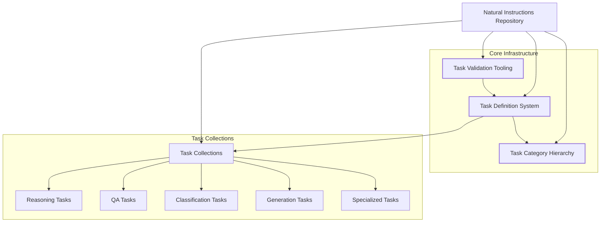

### Core Components

1. **Task Definition System**: Provides a standardized schema for defining tasks with natural language instructions
2. **Task Validation Tooling**: Ensures tasks conform to the required schema and quality standards
3. **Task Category Hierarchy**: Organizes tasks into categories, reasoning types, and domains
4. **Task Collections**: The actual task definitions grouped by type and purpose

Sources: [README.md:35-70](), [src/test_all.py:1-50]()

## Task Definition Structure

Each task in the repository follows a standardized JSON schema that includes metadata, instructions, examples, and instances. This structured format ensures consistency across tasks and facilitates automated processing.

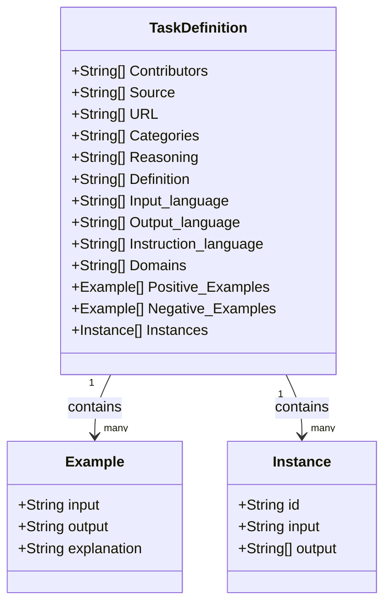

The key components of a task definition include:

1. **Metadata Fields**:
   - `Contributors`: People who created the task
   - `Source`: Original dataset or inspiration
   - `URL`: Reference links

2. **Categorization Fields**:
   - `Categories`: Task types (e.g., Question Answering, Text Classification)
   - `Reasoning`: Reasoning types required (e.g., Commonsense, Multihop)
   - `Domains`: Subject domains (e.g., Wikipedia, Social Media)

3. **Language Fields**:
   - `Input_language`, `Output_language`, `Instruction_language`: Languages used

4. **Content Fields**:
   - `Definition`: Natural language instructions for the task
   - `Positive_Examples`: Examples of correct task execution
   - `Negative_Examples`: Examples of incorrect task execution
   - `Instances`: Actual task instances

Sources: [README.md:35-70](), [tasks/task234_iirc_passage_line_answer_generation.json:1-20]()

## Task Validation System

The repository includes a robust validation system that ensures all tasks conform to the required format and quality standards. This system runs a series of checks on each task file.

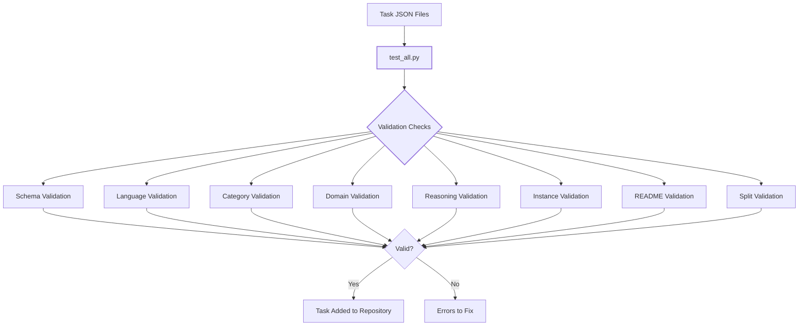

The validation system performs the following checks:

1. **Schema Validation**: Ensures all required fields are present
2. **Language Validation**: Checks for valid language names using ISO standards
3. **Category Validation**: Verifies that categories match the predefined set
4. **Domain Validation**: Validates domains against the taxonomy
5. **Reasoning Validation**: Checks reasoning types against the defined options
6. **Instance Validation**: Ensures instances have unique IDs and proper format
7. **README Validation**: Confirms task is documented in the main README
8. **Split Validation**: Verifies task is included in the defined splits

Sources: [src/test_all.py:28-106](), [src/test_all.py:113-282]()

## Task Hierarchy and Categorization

Tasks are organized using a hierarchical categorization system with three primary dimensions: task categories, reasoning types, and domains. This categorization helps in organizing the repository and facilitates analysis of model performance across different task types.

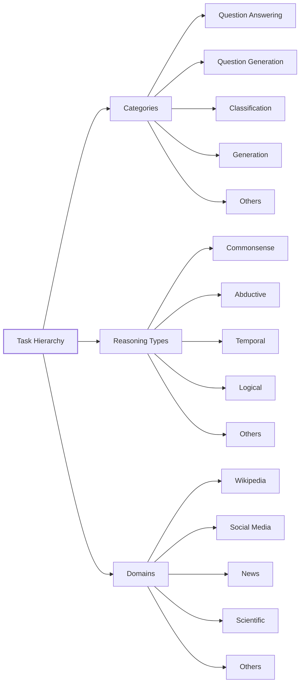

### Task Categories

Tasks are categorized by the type of NLP operation they require, such as:
- Question Answering
- Question Generation
- Text Classification
- Text Generation
- Coreference Resolution
- And many more

### Reasoning Types

The reasoning dimension describes the cognitive processes needed to complete the task:
- Commonsense Reasoning
- Abductive Reasoning
- Multihop Reasoning
- Temporal Reasoning
- And others

### Domains

The domain dimension specifies the subject area of the task:
- Wikipedia
- Social Media
- News
- Scientific
- And many more

Sources: [doc/task-hierarchy.md:9-86](), [doc/task-hierarchy.md:88-134](), [doc/task-hierarchy.md:136-258]()

## Task Collections

The repository contains a diverse collection of NLP tasks, organized into several major categories.

| Task Type | Description | Example Tasks |
|-----------|-------------|---------------|
| Question Answering | Tasks that require finding answers to questions | SQuAD, IIRC QA, GAP |
| Question Generation | Tasks that involve creating questions | IIRC Question Gen, MCTACO |
| Classification | Tasks that categorize text | Toxic Language Detection, MNLI |
| Generation | Tasks that generate text | CommonGen, PIQA |
| Specialized | Unique task types | SQL Tasks, Jeopardy |

### IIRC Reasoning Tasks

A particularly important collection in the repository are the IIRC (Incomplete Information Reading Comprehension) reasoning tasks, which focus on multi-hop reasoning across documents.

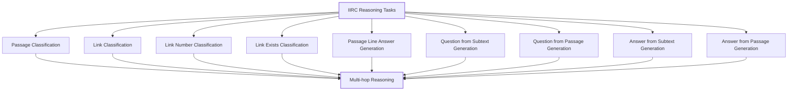

These tasks require complex reasoning capabilities:
- Cross-document reasoning
- Discrete reasoning
- Numerical reasoning
- Temporal reasoning

Sources: [tasks/task230_iirc_passage_classification.json:1-20](), [tasks/task231_iirc_link_classification.json:1-20](), [tasks/task232_iirc_link_number_classification.json:1-20](), [tasks/task233_iirc_link_exists_classification.json:1-20](), [tasks/task234_iirc_passage_line_answer_generation.json:1-20](), [tasks/task235_iirc_question_from_subtext_answer_generation.json:1-20](), [tasks/task236_iirc_question_from_passage_answer_generation.json:1-20](), [tasks/task237_iirc_answer_from_subtext_answer_generation.json:1-20](), [tasks/task238_iirc_answer_from_passage_answer_generation.json:1-20]()

## Cross-Task Generalization Benchmark

The repository provides official splits for benchmarking cross-task generalization: training on a subset of tasks and evaluating on unseen ones. This enables systematic research on how well models can transfer knowledge between tasks.

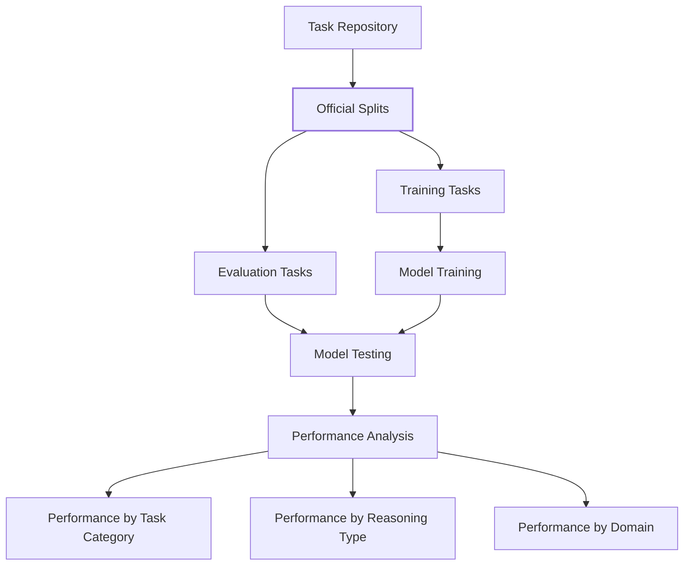

The benchmark is designed to evaluate:
1. How well models can generalize instructions to unseen tasks
2. The effect of increasing the number of training tasks on generalization
3. The types of tasks that are most challenging for generalization

Sources: [README.md:96-100]()

## Contributing New Tasks

The repository is designed as a community effort, with clear guidelines for adding new tasks:

1. Each task must follow the standardized JSON schema
2. Tasks must include proper categorization (categories, reasoning, domains)
3. Tasks need positive and negative examples with explanations
4. Each task should include at least 25 instances
5. Tasks must pass validation checks

The validation script `test_all.py` ensures that new contributions meet all requirements before being added to the repository.

Sources: [README.md:72-95](), [src/test_all.py:1-50]()

## Conclusion

Natural Instructions provides a comprehensive framework for defining, categorizing, and validating NLP tasks through natural language instructions. This approach facilitates research on cross-task generalization and instruction following in language models. The repository's standardized structure and extensive validation ensure high-quality task definitions that can be used across different research projects.

---

# Page: Task Definition System

# Task Definition System

<details>
<summary>Relevant source files</summary>

The following files were used as context for generating this wiki page:

- [README.md](README.md)
- [doc/categories_map.json](doc/categories_map.json)
- [doc/crowdsourcing.md](doc/crowdsourcing.md)
- [doc/domains_map.json](doc/domains_map.json)
- [doc/emailing-authors.md](doc/emailing-authors.md)
- [doc/reasonings_map.json](doc/reasonings_map.json)
- [doc/task-hierarchy.md](doc/task-hierarchy.md)
- [src/sparsifying_fields.py](src/sparsifying_fields.py)
- [src/test_all.py](src/test_all.py)
- [src/update_category_assignment.py](src/update_category_assignment.py)
- [tasks/task074_squad1.1_question_generation.json](tasks/task074_squad1.1_question_generation.json)
- [tasks/task075_squad1.1_answer_generation.json](tasks/task075_squad1.1_answer_generation.json)
- [tasks/task170_hotpotqa_answer_generation.json](tasks/task170_hotpotqa_answer_generation.json)
- [tasks/task191_hotpotqa_question_generation.json](tasks/task191_hotpotqa_question_generation.json)
- [tasks/task192_hotpotqa_sentence_generation.json](tasks/task192_hotpotqa_sentence_generation.json)
- [tasks/task195_sentiment140_classification.json](tasks/task195_sentiment140_classification.json)
- [tasks/task196_sentiment140_answer_generation.json](tasks/task196_sentiment140_answer_generation.json)

</details>


The Task Definition System is the core infrastructure of the Natural Instructions repository, providing a standardized format for defining NLP tasks with natural language instructions. This system enables consistent representation, validation, and organization of diverse tasks to facilitate research in cross-task generalization.

For information about the task validation process, see [Task Validation](#2.1).
For details on task categorization, see [Task Hierarchy](#2.2).

## Schema Overview

The Task Definition System defines a precise JSON schema that all tasks must follow. Each task is represented as a JSON file in the `tasks/` directory with a standardized structure.

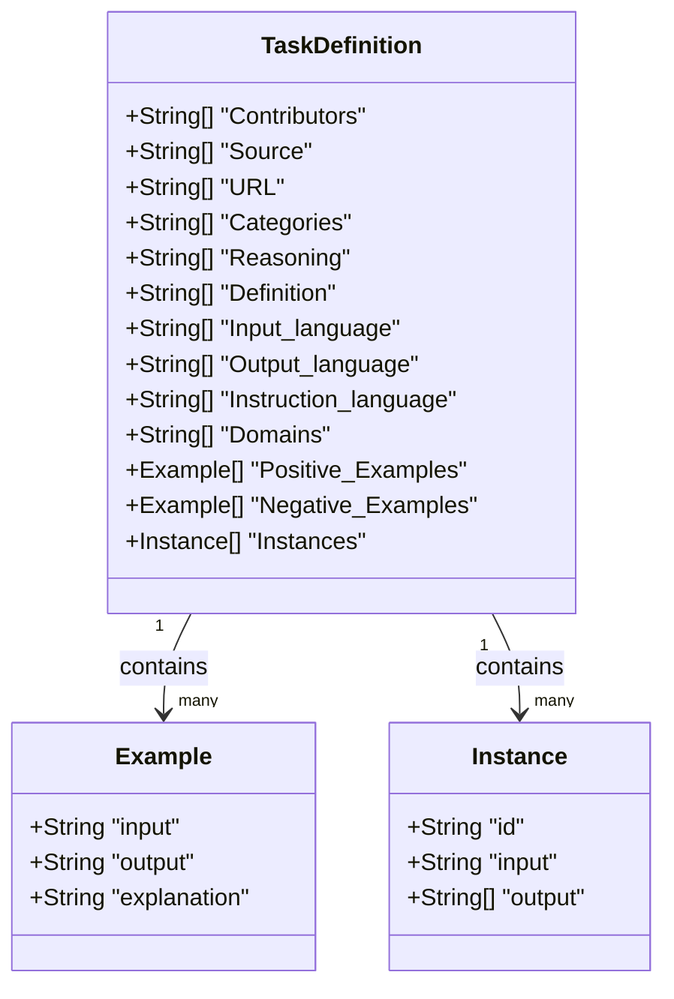

Sources: [README.md:35-70](). [src/test_all.py:32-45]()

## Required Fields

Each task JSON file must include the following fields:

| Field | Type | Description |
|-------|------|-------------|
| `Contributors` | String[] | People who contributed to the task |
| `Source` | String[] | Origins of the task (dataset names or "synthetic") |
| `URL` | String[] | Relevant URLs for the task source |
| `Categories` | String[] | Task categories from the defined hierarchy |
| `Reasoning` | String[] | Reasoning types from the defined hierarchy |
| `Definition` | String[] | Natural language description of the task |
| `Input_language` | String[] | Languages of the task inputs |
| `Output_language` | String[] | Languages of the task outputs |
| `Instruction_language` | String[] | Languages of the instructions |
| `Domains` | String[] | Subject domains from the defined hierarchy |
| `Positive_Examples` | Object[] | Examples showing correct task execution |
| `Negative_Examples` | Object[] | Examples showing incorrect task execution |
| `Instances` | Object[] | Task instances for training/evaluation |

Sources: [src/test_all.py:32-45](), [README.md:54-69]()

## Examples and Instances Structure

The task definition includes both examples for human understanding and instances for model training/evaluation:

### Examples
Each example (both positive and negative) contains:
- `input`: The input text for the task
- `output`: The expected (for positive) or incorrect (for negative) output
- `explanation`: Reasoning about why the example is correct or incorrect

### Instances
Each instance contains:
- `id`: A unique identifier (task number plus a UUID)
- `input`: The input text
- `output`: An array of acceptable outputs

Sources: [README.md:82](), [tasks/task075_squad1.1_answer_generation.json:30-225]()

## Task Naming and Organization

Tasks follow a structured naming convention:

```
task{NNN}_{source_dataset}_{task_type}.json
```

For example: `task075_squad1.1_answer_generation.json`

Each task must be added to the tasks README.md file and have a unique task number. Task numbers are sequentially assigned.

Sources: [README.md:84-92]()

## Integration with Validation System

The Task Definition System is tightly integrated with the validation system, which ensures all tasks follow the required format and meet quality standards.

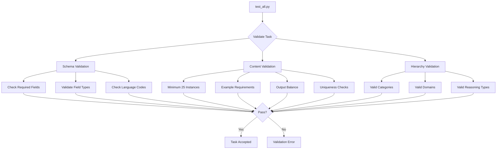

Sources: [src/test_all.py:139-302]()

## Relationships to Task Hierarchy

Tasks are organized according to hierarchical categorization systems:

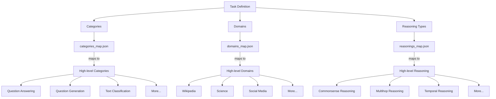

Sources: [doc/task-hierarchy.md:9-257](), [doc/categories_map.json](), [doc/domains_map.json](), [doc/reasonings_map.json]()

## Task Instances Examples

Here is a simplified example of a task definition (partial):

```json
{
  "Contributors": ["Shailaja Keyur Sampat"],
  "Source": ["squad_1.1"],
  "URL": ["https://rajpurkar.github.io/SQuAD-explorer/"],
  "Categories": ["Question Answering"],
  "Reasoning": [],
  "Definition": ["This task is about writing a correct answer for the reading comprehension task..."],
  "Input_language": ["English"],
  "Output_language": ["English"],
  "Instruction_language": ["English"],
  "Domains": ["Wikipedia"],
  "Positive_Examples": [
    {
      "input": "Passage: The French and Indian War (1754–1763) was... Question: When was the French and Indian War?",
      "output": "1754-1763",
      "explanation": "It is a common convention to write (start year-end year) beside a historical event..."
    }
  ],
  "Negative_Examples": [
    {
      "input": "Passage: The French and Indian War (1754–1763) was... Question: When was the French and Indian War?",
      "output": "1756",
      "explanation": "It is a common convention to write (start year-end year) beside a historical event..."
    }
  ],
  "Instances": [
    {
      "id": "task075-592460b351c247c4ad80960adce72716",
      "input": "Passage: While the Armenian Apostolic Church... Question: Which Armenian church is the most popular in Armenia?",
      "output": ["Armenian Apostolic Church"]
    }
  ]
}
```

Sources: [tasks/task075_squad1.1_answer_generation.json:1-105]()

## Sparsification and Mapping

The Task Definition System supports sparsification of categories, domains, and reasoning types through mapping files that define hierarchical relationships:

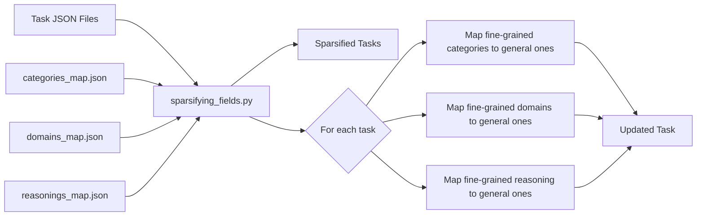

The sparsification process maps fine-grained categories, domains, and reasoning types to more general ones to facilitate experiments with different levels of specificity.

Sources: [src/sparsifying_fields.py:1-71]()

## Cross-Task Generalization Support

A key feature of the Task Definition System is enabling cross-task generalization experiments:

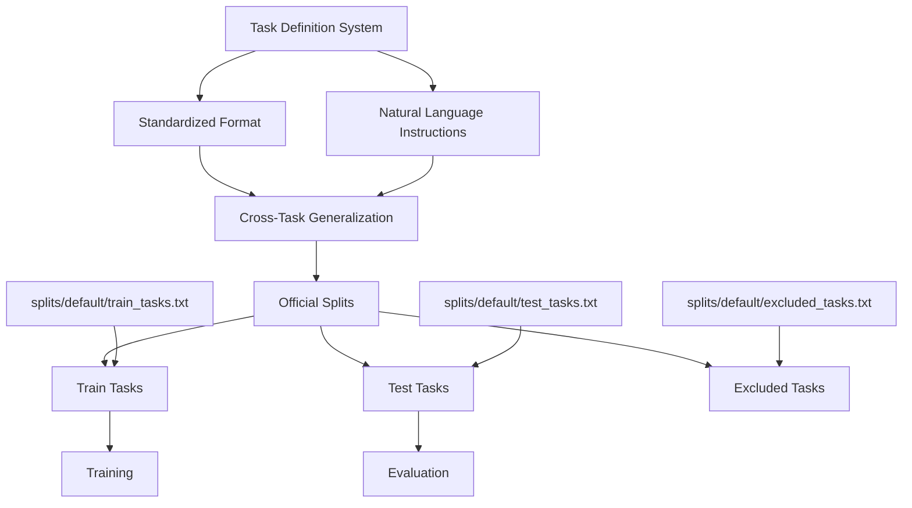

The repository provides official splits (train/test/excluded) for cross-task generalization experiments. These splits are validated to ensure no task appears in multiple sets.

Sources: [README.md:96-100](), [src/test_all.py:284-299]()

## Task Types and Examples

The Task Definition System supports a wide variety of task types, including:

1. **Question Answering**: Generate answers given a context and question
   - Example: SQuAD 1.1 Answer Generation (`task075_squad1.1_answer_generation.json`)

2. **Question Generation**: Generate questions based on context
   - Example: SQuAD 1.1 Question Generation (`task074_squad1.1_question_generation.json`)

3. **Multi-hop Question Answering**: Answer questions requiring multiple reasoning steps
   - Example: HotpotQA Answer Generation (`task170_hotpotqa_answer_generation.json`)

4. **Sentiment Analysis**: Classify text sentiment
   - Example: Sentiment140 Classification (`task195_sentiment140_classification.json`)

Each task type follows the same underlying schema but differs in the specific instructions, examples, and instances provided.

Sources: [tasks/task075_squad1.1_answer_generation.json](), [tasks/task074_squad1.1_question_generation.json](), [tasks/task170_hotpotqa_answer_generation.json](), [tasks/task195_sentiment140_classification.json]()

## Contributing Tasks

The Task Definition System is designed to be extensible, with clear guidelines for contributing new tasks:

1. Create a properly formatted JSON file following the schema
2. Include at least 25 instances
3. Provide positive and negative examples with explanations
4. Add the task to tasks/README.md
5. Run validation using `src/test_all.py`

For tasks based on existing datasets, additional guidelines are available in `doc/crowdsourcing.md`.

Sources: [README.md:72-94](), [doc/crowdsourcing.md:1-63]()

## Conclusion

The Task Definition System is a robust framework for defining, validating, and organizing NLP tasks with natural language instructions. Its standardized format enables systematic research on cross-task generalization, allowing models to learn from instructions and generalize to unseen tasks. The system's flexibility supports a wide range of task types while maintaining consistency and quality through comprehensive validation.

---

# Page: Task Validation

# Task Validation

<details>
<summary>Relevant source files</summary>

The following files were used as context for generating this wiki page:

- [README.md](README.md)
- [doc/categories_map.json](doc/categories_map.json)
- [doc/crowdsourcing.md](doc/crowdsourcing.md)
- [doc/domains_map.json](doc/domains_map.json)
- [doc/emailing-authors.md](doc/emailing-authors.md)
- [doc/reasonings_map.json](doc/reasonings_map.json)
- [src/sparsifying_fields.py](src/sparsifying_fields.py)
- [src/test_all.py](src/test_all.py)
- [src/update_category_assignment.py](src/update_category_assignment.py)

</details>


This document describes the automated validation system for tasks in the Natural Instructions repository. Task validation ensures all contributed tasks maintain consistent quality, format, and metadata structure before being accepted into the repository.

## Purpose and Scope

The task validation system provides an automated way to verify that tasks:
- Follow the required JSON schema
- Contain valid metadata (languages, categories, domains, reasoning types)
- Have sufficient, high-quality examples and instances
- Maintain balanced class distributions
- Are properly documented

For information about the task definition format itself, see [Task Definition System](#2).

## Validation Process

Task validation is performed by the `test_all.py` script, which runs a comprehensive series of checks on task files. Contributors must pass these validation checks before their tasks can be merged into the repository.

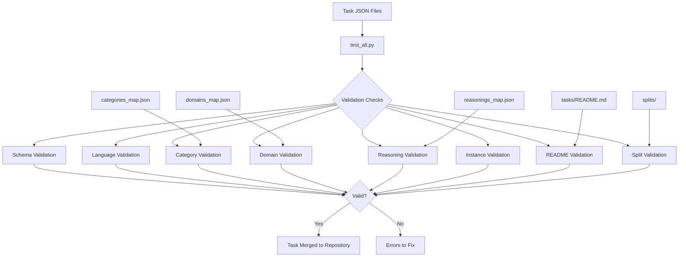

Sources: [src/test_all.py:10-46](), [README.md:72-94]()

## Running Validation Tests

To validate all tasks in the repository:

```bash
python src/test_all.py
```

To validate a specific range of tasks:

```bash
python src/test_all.py --task <begin_task_number> <end_task_number>
```

For example, to test tasks 5 through 10:

```bash
python src/test_all.py --task 5 10
```

Sources: [src/test_all.py:10-22]()

## Validation Checks

### 1. Schema Validation

Each task file must include all required fields with the correct data types:

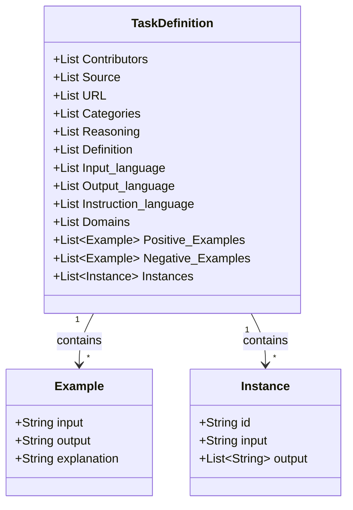

Sources: [src/test_all.py:32-45](), [src/test_all.py:139-154]()

### 2. Language Validation

All language codes in `Input_language`, `Output_language`, and `Instruction_language` must be valid ISO-639 language names.

```python
def assert_language_name(name):
    assert name in language_names, f"Did not find `{name}` among iso639 language names: {language_names}"
```

Sources: [src/test_all.py:47-54](), [src/test_all.py:179-189]()

### 3. Category Validation

All categories specified in the task must be from the predefined list in `doc/task-hierarchy.md` and mapped in `doc/categories_map.json`.

```python
for c in data['Categories']:
    assert c in all_categories, f'Did not find category `{c}`'
```

Sources: [src/test_all.py:156-161](), [doc/categories_map.json:1-583]()

### 4. Domain Validation

All domains specified in the task must be valid domains from the predefined list in `doc/domains_map.json`.

```python
for d in data['Domains']:
    assert d in hierarchy_content, f'Did not find domain `{d}`'
```

Sources: [src/test_all.py:163-167](), [doc/domains_map.json:1-349]()

### 5. Reasoning Validation

All reasoning types specified in the task must be valid reasoning types from the predefined list in `doc/reasonings_map.json`.

```python
for r in data['Reasoning']:
    assert r in hierarchy_content, f'Did not find reasoning `{r}`'
```

Sources: [src/test_all.py:169-173](), [doc/reasonings_map.json:1-124]()

### 6. Instance Validation

Tasks must meet specific requirements for their instances:

1. Each task must have at least 25 and at most 6,500 instances
2. Each instance must have a unique ID, input, and at least one output
3. No duplicate instances are allowed
4. Class distribution should be balanced (entropy > 0.8)
5. URLs in instance inputs are flagged with warnings

```python
assert len(data['Instances']) > 25, "there must be at least 25 instances"
assert len(data['Instances']) <= 6500, "there must be at most 6.5k instances"

# Check class balance
norm_counts = counts / counts.sum()
entropy = -(norm_counts * np.log(norm_counts) / np.log(len(value))).sum()
assert entropy > 0.8, f"Looks like this task is heavily skewed!"
```

Sources: [src/test_all.py:143-146](), [src/test_all.py:191-203](), [src/test_all.py:214-234](), [src/test_all.py:236-250]()

### 7. Examples Validation

Tasks must have sufficient positive and negative examples, properly formatted:

1. At least 2 positive examples
2. At least 1 negative example
3. Each example must have an input, output, and explanation
4. Examples must not be repeated in the instances

Sources: [src/test_all.py:203-211](), [src/test_all.py:251-259]()

### 8. README Validation

Each task must be properly documented in the `tasks/README.md` file, and the tasks should be listed in ascending order by task number.

```python
if true_file not in task_readme_content:
    raise Exception(f' * Looks like the task name `{true_file}` is not included '
                    f'in the task file `tasks/README.md`')
```

Sources: [src/test_all.py:266-278](), [src/test_all.py:92-102]()

### 9. Split Validation

The validation system checks that each task appears in exactly one of the official splits:
- `splits/<split_name>/train_tasks.txt`
- `splits/<split_name>/test_tasks.txt`
- `splits/<split_name>/excluded_tasks.txt`

```python
for split_name in ["default", "xlingual"]:
    train_tasks = [l.strip() for l in open(f"splits/{split_name}/train_tasks.txt")]
    test_tasks = [l.strip() for l in open(f"splits/{split_name}/test_tasks.txt")]
    excluded_tasks = [l.strip() for l in open(f"splits/{split_name}/excluded_tasks.txt")]
    
    # Make sure each task appears in the split
    for task in task_names:
        assert task in train_tasks + test_tasks + excluded_tasks
```

Sources: [src/test_all.py:284-299]()

## Integration with Repository Workflow

The task validation system is a critical component in the Natural Instructions contribution workflow:

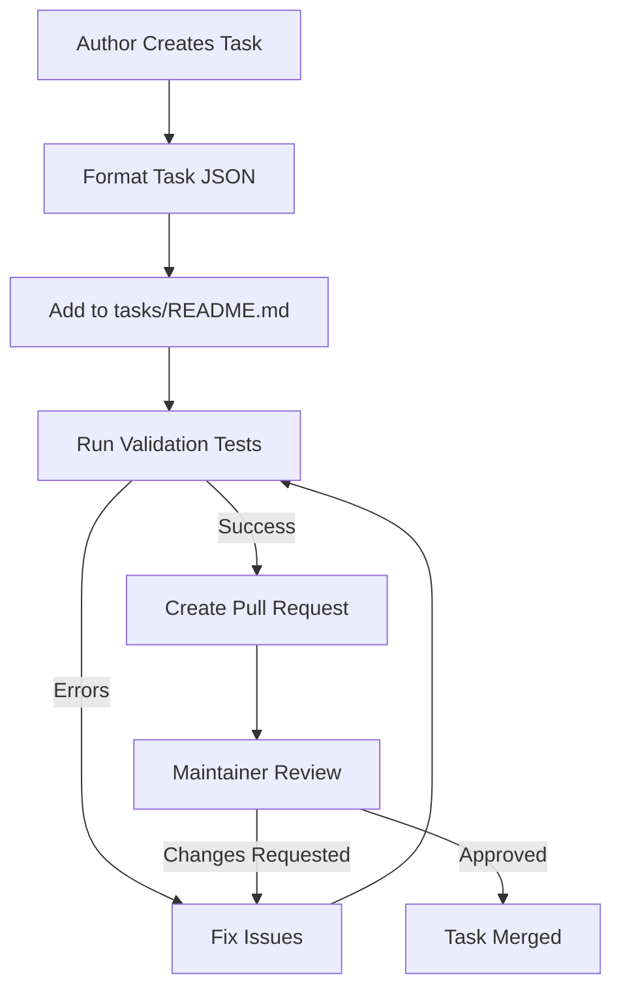

Sources: [README.md:72-94]()

## Common Validation Errors and Solutions

| Error | Solution |
|-------|----------|
| Missing required fields | Add all fields specified in the schema |
| Invalid categories/domains/reasoning | Check valid values in `doc/task-hierarchy.md`, `doc/domains_map.json`, and `doc/reasonings_map.json` |
| Insufficient instances | Add more instances (at least 25) |
| Too many instances | Reduce to at most 6,500 instances |
| Imbalanced class distribution | Add more examples of underrepresented classes |
| Task not in README | Add your task to `tasks/README.md` |
| Duplicate instances | Remove duplicates |
| Non-unique instance IDs | Ensure each instance has a unique ID |
| Uppercase letters in filename | Use lowercase only in task filename |

Sources: [src/test_all.py:139-278]()

## Stats Collection

After validation, the system collects and displays statistics about:
- Contributors
- Categories
- Domains
- Reasoning types
- Average number of instances per task

These statistics help maintain a balanced and diverse task repository.

Sources: [src/test_all.py:303-326]()

## Task Validation in the Repository Architecture

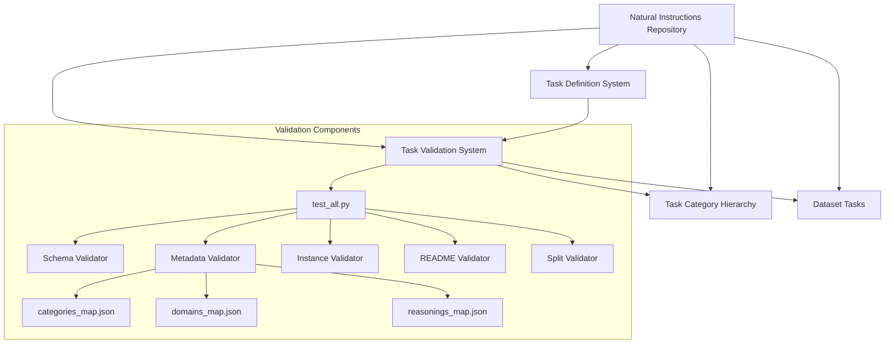

Sources: [src/test_all.py:1-327]()

## Sparsifying Task Metadata

The repository provides utility scripts to "sparsify" the fine-grained categories, domains, and reasoning fields to more general high-frequency categories:

```python
# From sparsifying_fields.py
new_categories = [category_map[category] for category in data['Categories']]
data['Categories'] = list(set(sum(new_categories, [])))
```

This is useful for running experiments with fewer general categories instead of fine-grained ones.

Sources: [src/sparsifying_fields.py:1-71]()

---

# Page: Task Hierarchy

# Task Hierarchy

<details>
<summary>Relevant source files</summary>

The following files were used as context for generating this wiki page:

- [doc/task-hierarchy.md](doc/task-hierarchy.md)
- [tasks/task074_squad1.1_question_generation.json](tasks/task074_squad1.1_question_generation.json)
- [tasks/task075_squad1.1_answer_generation.json](tasks/task075_squad1.1_answer_generation.json)
- [tasks/task170_hotpotqa_answer_generation.json](tasks/task170_hotpotqa_answer_generation.json)
- [tasks/task191_hotpotqa_question_generation.json](tasks/task191_hotpotqa_question_generation.json)
- [tasks/task192_hotpotqa_sentence_generation.json](tasks/task192_hotpotqa_sentence_generation.json)
- [tasks/task195_sentiment140_classification.json](tasks/task195_sentiment140_classification.json)
- [tasks/task196_sentiment140_answer_generation.json](tasks/task196_sentiment140_answer_generation.json)

</details>


This wiki page documents the categorization system for tasks in the Natural Instructions repository. The system provides a structured way to categorize tasks according to their type, reasoning requirements, and domain knowledge. This taxonomy enables systematic organization, filtering, and analysis of the diverse task collection.

For information about how tasks are validated against this hierarchy, see [Task Validation](#2.1).

## Overview of the Task Hierarchy System

The Natural Instructions repository implements a multi-dimensional categorization system for tasks, consisting of three main hierarchical structures:

1. **Task Categories** - Classifies tasks by their fundamental operation (e.g., Question Answering, Text Generation)
2. **Reasoning Types** - Identifies cognitive reasoning operations required to complete tasks
3. **Domains** - Specifies the subject area knowledge relevant to tasks

Each task in the repository must be classified according to these three dimensions, enabling precise filtering and organization of the task collection.

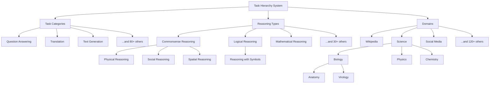

Sources: [doc/task-hierarchy.md:1-258]()

## Implementation in Task Definition Files

Tasks are defined in JSON files where each task specifies its place in the hierarchy through three key fields:

```json
{
    "Categories": ["Question Answering"],
    "Reasoning": ["Commonsense Reasoning", "Spatial Reasoning"],
    "Domains": ["Wikipedia", "Biology"]
}
```

The hierarchical organization allows for both broad and specific categorization. For example, a task might be categorized under "Commonsense Reasoning -> Physical Reasoning" to indicate a subcategory relationship.

Sources: [tasks/task075_squad1.1_answer_generation.json:11-28](), [tasks/task074_squad1.1_question_generation.json:11-28]()

## Task Categories

The repository defines over 80 distinct task categories that classify tasks according to their fundamental nature. Below is a representative subset of major task categories:

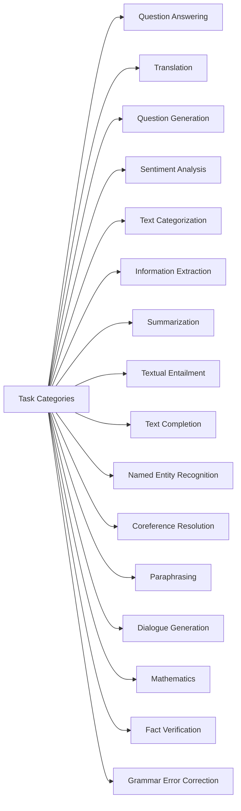

Task categories serve as the primary means of organizing and retrieving tasks based on their high-level function.

Sources: [doc/task-hierarchy.md:9-86]()

## Reasoning Types

Reasoning types specify the cognitive processes required to complete a task. The repository defines over 30 distinct reasoning types, many of which include subcategories for finer-grained classification.

```mermaid
graph TD
    A["Reasoning Types"] --> B["Commonsense Reasoning"]
    A --> C["Logical Reasoning"]
    A --> D["Mathematics"]
    A --> E["Multihop Reasoning"]
    A --> F["Abductive Reasoning"]
    A --> G["Causal Reasoning"]
    A --> H["Numerical Reasoning"]
    A --> I["Temporal Reasoning"]
    A --> J["Textual Entailment"]
    A --> K["Ethics"]
    
    B --> B1["Physical Reasoning"]
    B --> B2["Social Situations"]
    B --> B3["Spatial Reasoning"]
    B --> B4["Numerical Commonsense Reasoning"]
    
    C --> C1["Reasoning with Symbols"]
    
    D --> D1["Algebra"]
    D --> D2["Arithmetic"]
    D --> D3["Combinatorics"]
    D --> D4["Counting"]
    D --> D5["Geometry"]
    D --> D6["Statistics"]
    
    J --> J1["Abductive Reasoning"]
    J --> J2["Analogical Reasoning"]
    J --> J3["Deductive Reasoning"]
    J --> J4["Inductive Reasoning"]
```

This detailed reasoning taxonomy helps identify tasks that require specific cognitive skills, enabling targeted evaluation of language models on specific reasoning capabilities.

Sources: [doc/task-hierarchy.md:88-133]()

## Domains

Domains categorize tasks based on the subject area knowledge they require. The repository defines over 120 domains, organized in a hierarchical structure to represent both broad and specific knowledge areas.

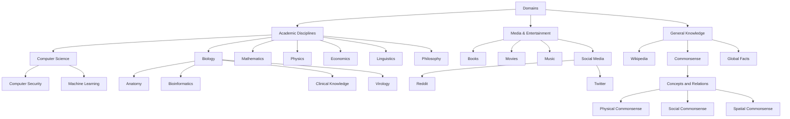

The domain hierarchy enables tasks to be organized by the specific knowledge areas they target, facilitating domain-specific evaluation of language models.

Sources: [doc/task-hierarchy.md:135-257]()

## Using the Task Hierarchy

### In Task Definition

When creating a new task, authors must specify where it fits in the hierarchy:

```json
{
    "Categories": ["Question Answering"],
    "Reasoning": ["Multihop Reasoning", "Textual Entailment"],
    "Domains": ["Wikipedia"]
}
```

Tasks can belong to multiple categories, reasoning types, and domains, allowing for flexible categorization.

### Language Representation

Task input and output languages are also tracked through separate fields in task definitions:

```json
{
    "Input_language": ["English"],
    "Output_language": ["English"],
    "Instruction_language": ["English"]
}
```

The language field accepts standard ISO language names as defined in the ISO 639-1 codes specification.

Sources: [doc/task-hierarchy.md:259-262](), [tasks/task075_squad1.1_answer_generation.json:18-28]()

## Task Hierarchy Usage in the Repository

The task hierarchy serves several critical functions within the Natural Instructions repository:

```mermaid
flowchart TD
    A["Task Hierarchy"] --> B["Task Organization"]
    A --> C["Task Search & Filtering"]
    A --> D["Task Validation"]
    A --> E["Evaluation Groups"]
    
    B --> B1["Categorizes tasks by function"]
    B --> B2["Groups tasks by reasoning type"]
    B --> B3["Organizes tasks by domain knowledge"]
    
    C --> C1["Find tasks requiring specific reasoning"]
    C --> C2["Filter tasks by domain relevance"]
    C --> C3["Select tasks by category for evaluation"]
    
    D --> D1["Validates task categories against known list"]
    D --> D2["Ensures reasoning types are valid"]
    D --> D3["Verifies domains match allowed values"]
    
    E --> E1["Creates balanced test suites"]
    E --> E2["Enables targeted capability evaluation"]
    E --> E3["Supports domain-specific benchmarking"]
```

The hierarchy provides a structured way to organize the diverse collection of tasks in the repository, facilitating both task discovery and systematic evaluation.

Sources: [doc/task-hierarchy.md:1-10]()

## Guidelines for Contributors

When adding new tasks to the repository, contributors should follow these guidelines:

1. Select appropriate categories, reasoning types, and domains from the existing hierarchy
2. Tasks can belong to multiple categories, reasoning types, and domains
3. When appropriate, specify subcategories using the arrow notation (e.g., "Commonsense Reasoning -> Physical Reasoning")
4. If necessary, propose new hierarchy elements through the contribution process

The `auto_add_domain.py` script in the `src` directory assists with adding domain information to tasks from a particular dataset.

Sources: [doc/task-hierarchy.md:4-7]()

## Relationship to Other Repository Components

The Task Hierarchy works in conjunction with other core components of the Natural Instructions repository:

```mermaid
flowchart TD
    A["Natural Instructions Components"] --> B["Task Definition System"]
    A --> C["Task Validation System"]
    A --> D["Task Hierarchy System"]
    
    B --> B1["Defines task structure"]
    B --> B2["Specifies input/output format"]
    B --> B3["Contains examples & instances"]
    
    C --> C1["Validates against schemas"]
    C --> C2["Checks hierarchy elements"]
    C --> C3["Ensures README consistency"]
    
    D --> D1["Task Categories"]
    D --> D2["Reasoning Types"]
    D --> D3["Domains"]
    
    D1 -.-> C2
    D2 -.-> C2
    D3 -.-> C2
    
    D1 -.-> B1
    D2 -.-> B1
    D3 -.-> B1
```

The Task Hierarchy provides the taxonomic framework that the Task Definition System uses to classify tasks, and that the Task Validation System verifies during quality control.

Sources: [doc/task-hierarchy.md:4-7]()

---

# Page: Prompt Mapping

# Prompt Mapping

<details>
<summary>Relevant source files</summary>

The following files were used as context for generating this wiki page:

- [doc/prompt_task_map.json](doc/prompt_task_map.json)
- [tasks/task1293_kilt_tasks_hotpotqa_question_answering.json](tasks/task1293_kilt_tasks_hotpotqa_question_answering.json)
- [tasks/task1294_wiki_qa_answer_verification.json](tasks/task1294_wiki_qa_answer_verification.json)
- [tasks/task1296_wiki_hop_question_answering.json](tasks/task1296_wiki_hop_question_answering.json)
- [tasks/task1297_qasc_question_answering.json](tasks/task1297_qasc_question_answering.json)
- [tasks/task1727_wiqa_what_is_the_effect.json](tasks/task1727_wiqa_what_is_the_effect.json)
- [tasks/task1728_web_nlg_data_to_text.json](tasks/task1728_web_nlg_data_to_text.json)
- [tasks/task1729_personachat_generate_next.json](tasks/task1729_personachat_generate_next.json)
- [tasks/task1730_personachat_choose_next.json](tasks/task1730_personachat_choose_next.json)
- [tasks/task1731_quartz_question_answering.json](tasks/task1731_quartz_question_answering.json)

</details>


Prompt Mapping is a system within the Natural Instructions repository that establishes connections between datasets, task definitions, and prompt templates. It serves as a bridge from raw datasets to structured task formats, enabling standardized processing of natural language instructions across varied data sources.

For information about task definitions and validation, see [Task Definition System](#2) and [Task Validation](#2.1).

## Purpose and Function

The primary purpose of Prompt Mapping is to provide a structured way to identify which task definitions and prompt templates should be used when processing different datasets. This mapping creates a standardized approach to applying natural language instructions across diverse data sources.

```mermaid
flowchart TD
    A["Dataset (e.g., 'quartz')"] --> B["Prompt Mapping System"]
    B --> C["Task ID (e.g., 'task1731_quartz_question_answering')"]
    C --> D["Task Definition File"]
    C --> E["Prompt Templates (e.g., 'answer_question_based_on')"]
    D --> F["Task Execution"]
    E --> F
    F --> G["Task Output"]
```

Sources: [doc/prompt_task_map.json:1-913]()

## Structure of the Prompt Mapping

The core of the Prompt Mapping system is contained in `doc/prompt_task_map.json`, which follows a specific JSON structure:

```mermaid
classDiagram
    class PromptTaskMap {
        +Map<String, List<TaskMapping>> dataset_mappings
    }
    
    class TaskMapping {
        +String task
        +List<String> prompt
    }
    
    class TaskDefinition {
        +List<String> Contributors
        +List<String> Source
        +List<String> Categories
        +List<String> Reasoning
        +List<String> Definition
        +List<String> Input_language
        +List<String> Output_language
        +List<String> Instruction_language
        +List<String> Domains
        +List<Example> Positive_Examples
        +List<Example> Negative_Examples
        +List<Instance> Instances
    }
    
    PromptTaskMap "1" --> "*" TaskMapping : contains
    TaskMapping --> TaskDefinition : references by task_id
```

The JSON structure maps dataset names to task IDs and associated prompt templates:

```json
{
    "dataset_name1": [
        {
            "task": "task_id1",
            "prompt": ["prompt_template1", "prompt_template2", ...]
        }
    ],
    "dataset_name2": [
        {
            "task": "task_id2",
            "prompt": ["prompt_template3", ...]
        }
    ]
}
```

Sources: [doc/prompt_task_map.json:1-913]()

## Dataset-to-Task Mappings

The `prompt_task_map.json` file includes mappings for a wide variety of datasets. Each dataset is associated with one or more tasks, and each task can have multiple prompt templates.

Here's a selection of dataset mappings:

| Dataset | Task ID | Prompt Templates |
|---------|---------|------------------|
| commonsense_qa | task073_commonsenseqa_answer_generation | most_suitable_answer, question_answering, question_to_answer_index |
| dream | task247_dream_answer_generation | baseline, read_the_following_conversation_and_answer_the_question |
| quartz | task1731_quartz_question_answering | answer_question_based_on, answer_question_below, having_read_above_passage, etc. |
| wiqa | task1727_wiqa_what_is_the_effect | effect_with_label_answer, effect_with_string_answer |
| hotpot_qa/distractor | task170_hotpotqa_answer_generation, task191_hotpotqa_question_generation, task192_hotpotqa_sentence_generation | generate_answer_affirmative, generate_question, generate_explanations_affirmative, etc. |

Sources: [doc/prompt_task_map.json:2-270](), [doc/prompt_task_map.json:271-457]()

## Example Detailed Mapping: Quartz Dataset

Let's examine the mapping for the "quartz" dataset:

```json
"quartz": [
    {
        "task": "task1731_quartz_question_answering",
        "prompt": [
            "answer_question_based_on",
            "answer_question_below",
            "given_the_fact_answer_the_q",
            "having_read_above_passage",
            "paragraph_question_plain_concat",
            "read_passage_below_choose",
            "use_info_from_paragraph_question",
            "use_info_from_question_paragraph"
        ]
    }
]
```

This maps the "quartz" dataset to the task `task1731_quartz_question_answering` and provides 8 different prompt templates for formatting inputs.

The referenced task file (`task1731_quartz_question_answering.json`) contains:

- Categories: Question Answering
- Reasoning Types: Relational Reasoning, Scientific Reasoning
- Definition: "You are given a short paragraph, a question and two choices to answer from. Choose the correct answer based on the paragraph and write the answer(not the key)."
- Examples and instances for the task

Sources: [doc/prompt_task_map.json:31-44](), [tasks/task1731_quartz_question_answering.json:1-390]()

## Mapping Coverage by Task Type

The prompt mappings cover a diverse range of NLP tasks:

```mermaid
graph TD
    A["Prompt-to-Task Mappings"] --> B["Question Answering"]
    A --> C["Text Generation"]
    A --> D["Classification"]
    A --> E["Summarization"]
    A --> F["Paraphrasing"]
    
    B --> B1["commonsense_qa"]
    B --> B2["quartz"]
    B --> B3["wiki_hop"]
    B --> B4["hotpot_qa"]
    
    C --> C1["common_gen"]
    C --> C2["personachat"]
    C --> C3["web_nlg"]
    
    D --> D1["amazon_polarity"]
    D --> D2["imdb"]
    D --> D3["yelp_polarity"]
    
    E --> E1["cnn_dailymail"]
    E --> E2["xsum"]
    E --> E3["multi_news"]
    
    F --> F1["glue/mrpc"]
    F --> F2["paws"]
    F --> F3["quora"]
```

Sources: [doc/prompt_task_map.json:1-913]()

## Task Definition Integration

Each task ID referenced in the prompt mapping corresponds to a task definition file in the repository. These task files follow a standardized structure and contain:

1. Metadata about the task (contributors, source, URL)
2. Task categorization (categories, reasoning types, domains)
3. Task definition and instructions
4. Input/output language specifications
5. Positive and negative examples
6. Task instances with inputs and expected outputs

Examples of task definition files referenced in prompt mappings include:
- `task1731_quartz_question_answering.json`
- `task1727_wiqa_what_is_the_effect.json`
- `task1729_personachat_generate_next.json`
- `task1296_wiki_hop_question_answering.json`

Sources: [tasks/task1731_quartz_question_answering.json:1-390](), [tasks/task1727_wiqa_what_is_the_effect.json:1-61](), [tasks/task1729_personachat_generate_next.json:1-33](), [tasks/task1296_wiki_hop_question_answering.json:1-47]()

## System Context and Integration

The Prompt Mapping system is part of the larger Natural Instructions framework. Here's how it fits into the overall architecture:

```mermaid
flowchart LR
    A["Dataset Collections"] --> B["Prompt Mapping System"]
    B --> C["Task Definition System"]
    C --> D["Task Validation"]
    D --> E["Task Execution"]
    
    B -->|"Maps datasets to"| F["Task IDs"]
    B -->|"Provides"| G["Prompt Templates"]
    F -->|"Reference"| C
    G -->|"Format inputs for"| E
```

The Prompt Mapping system serves as an intermediary between raw datasets and the standardized task definitions, ensuring each dataset is processed appropriately within the Natural Instructions framework.

Sources: [doc/prompt_task_map.json:1-913]()

## Technical Implementation Considerations

The Prompt Mapping system offers several technical advantages:

1. **Separation of Concerns**: Task definitions, prompt templates, and dataset mappings are maintained separately, allowing each to evolve independently.

2. **Extensibility**: New datasets can be added by simply extending the `prompt_task_map.json` file, without modifying the underlying framework code.

3. **Standardization**: All datasets are processed through standardized task definitions, ensuring consistency in execution and evaluation.

4. **Flexibility**: Multiple prompt templates for each task allow for experimentation with different input formats, potentially improving task performance.

Sources: [doc/prompt_task_map.json:1-913]()

## Using Prompt Mapping in Practice

To use the Prompt Mapping system:

1. Identify the dataset you're working with
2. Look up the dataset in `prompt_task_map.json` to find:
   - The appropriate task ID(s)
   - Available prompt templates
3. Load the task definition from the corresponding task file
4. Select a prompt template to format your inputs
5. Execute the task according to the definition
6. Evaluate outputs against expected results

This standardized approach ensures consistent processing of diverse datasets, facilitating both development and evaluation of natural language processing models across a wide range of tasks.

Sources: [doc/prompt_task_map.json:1-913]()

---

# Page: Task Collections

# Task Collections

<details>
<summary>Relevant source files</summary>

The following files were used as context for generating this wiki page:

- [doc/task-hierarchy.md](doc/task-hierarchy.md)
- [tasks/README.md](tasks/README.md)
- [tasks/task074_squad1.1_question_generation.json](tasks/task074_squad1.1_question_generation.json)
- [tasks/task075_squad1.1_answer_generation.json](tasks/task075_squad1.1_answer_generation.json)
- [tasks/task170_hotpotqa_answer_generation.json](tasks/task170_hotpotqa_answer_generation.json)
- [tasks/task191_hotpotqa_question_generation.json](tasks/task191_hotpotqa_question_generation.json)
- [tasks/task192_hotpotqa_sentence_generation.json](tasks/task192_hotpotqa_sentence_generation.json)
- [tasks/task195_sentiment140_classification.json](tasks/task195_sentiment140_classification.json)
- [tasks/task196_sentiment140_answer_generation.json](tasks/task196_sentiment140_answer_generation.json)
- [tasks/task230_iirc_passage_classification.json](tasks/task230_iirc_passage_classification.json)
- [tasks/task231_iirc_link_classification.json](tasks/task231_iirc_link_classification.json)
- [tasks/task232_iirc_link_number_classification.json](tasks/task232_iirc_link_number_classification.json)
- [tasks/task233_iirc_link_exists_classification.json](tasks/task233_iirc_link_exists_classification.json)
- [tasks/task234_iirc_passage_line_answer_generation.json](tasks/task234_iirc_passage_line_answer_generation.json)
- [tasks/task235_iirc_question_from_subtext_answer_generation.json](tasks/task235_iirc_question_from_subtext_answer_generation.json)
- [tasks/task236_iirc_question_from_passage_answer_generation.json](tasks/task236_iirc_question_from_passage_answer_generation.json)
- [tasks/task237_iirc_answer_from_subtext_answer_generation.json](tasks/task237_iirc_answer_from_subtext_answer_generation.json)
- [tasks/task238_iirc_answer_from_passage_answer_generation.json](tasks/task238_iirc_answer_from_passage_answer_generation.json)

</details>


The Task Collections in the natural-instructions repository comprise a diverse set of NLP tasks organized into structured categories. This comprehensive collection serves as a standardized benchmark for evaluating and training language models across various capabilities including reasoning, generation, classification, and more. Each task is defined using a consistent JSON schema that captures task requirements, examples, and evaluation instances.

For information about how tasks are defined and validated, see [Task Definition System](#2).

## Task Organization and Statistics

The natural-instructions repository contains over 200 tasks spanning different categories, reasoning types, and domains. Tasks are organized hierarchically and accessible through standardized interfaces.

```mermaid
graph TD
    TC["Task Collections"] --> QA["Question Answering Tasks"]
    TC --> QG["Question Generation Tasks"]
    TC --> CL["Classification Tasks"] 
    TC --> GEN["Generation Tasks"]
    TC --> SPEC["Specialized Tasks"]
    
    QA --> SQUAD["SQuAD (task075)"]
    QA --> HOTPOT["HotpotQA (task170)"]
    QA --> IIRC["IIRC QA (task234/237/238)"]
    QA --> GAP["GAP Coref (task033)"]
    
    QG --> SQUAD_GEN["SQuAD Gen (task074)"]
    QG --> IIRC_Q["IIRC Q-Gen (task235/236)"]
    
    CL --> SENT140["Sentiment140 (task195)"]
    CL --> TOXIC["Toxic Language (task137)"]
    CL --> IIRC_CL["IIRC Classification (task230-233)"]
    
    GEN --> CGEN["CommonGen (task102)"]
    GEN --> PIQA["PIQA (task080/081)"]
    
    SPEC --> SQL["SQL Tasks (task076/077/107)"]
    SPEC --> TRIVIA["Jeopardy QA"]
```

Sources: [tasks/README.md:1-208](), [doc/task-hierarchy.md:1-257]()

## Task Definition Structure

Each task in the collection is defined by a standardized JSON structure. This structure captures all necessary information for understanding, using, and evaluating the task.

```mermaid
classDiagram
    class TaskDefinition {
        +String[] Contributors
        +String[] Source
        +String[] URL
        +String[] Categories
        +String[] Reasoning
        +String[] Definition
        +String[] Input_language
        +String[] Output_language
        +String[] Instruction_language
        +String[] Domains
        +Example[] Positive_Examples
        +Example[] Negative_Examples
        +Instance[] Instances
    }
    
    class Example {
        +String input
        +String output
        +String explanation
    }
    
    class Instance {
        +String id
        +String input
        +String[] output
    }
    
    TaskDefinition "1" --> "many" Example : contains
    TaskDefinition "1" --> "many" Instance : contains
```

Sources: [tasks/task234_iirc_passage_line_answer_generation.json:1-70]()

## Major Task Collections

The repository contains several significant task collections that assess different language model capabilities.

### IIRC Reasoning Tasks

The IIRC (Implicit Reasoning in Reading Comprehension) tasks stand out for their emphasis on multi-hop reasoning and cross-document reasoning. These tasks require models to connect information across different parts of text or multiple documents.

```mermaid
graph TD
    IIRC["IIRC Reasoning Tasks"] --> PC["task230: Passage Classification"]
    IIRC --> LC["task231: Link Classification"]
    IIRC --> LN["task232: Link Number Classification"]
    IIRC --> LE["task233: Link Exists Classification"]
    IIRC --> PL["task234: Passage Line Answer Generation"]
    IIRC --> QS["task235: Question from Subtext Generation"]
    IIRC --> QP["task236: Question from Passage Generation"]
    IIRC --> AS["task237: Answer from Subtext Generation"]
    IIRC --> AP["task238: Answer from Passage Generation"]
    
    PC --> MultiReason["Multi-hop & Cross-document Reasoning"]
    LC --> MultiReason
    LN --> MultiReason
    LE --> MultiReason
    PL --> MultiReason
    QS --> MultiReason
    QP --> MultiReason
    AS --> MultiReason
    AP --> MultiReason
```

| Task ID | Name | Category | Description |
|---------|------|----------|-------------|
| task230 | IIRC Passage Classification | Question Answering | Identify which passage contains information to answer a question |
| task231 | IIRC Link Classification | Question Answering | Determine which linked term can help answer a question |
| task232 | IIRC Link Number Classification | Answerability Classification | Determine if multiple terms are needed to answer a question |
| task233 | IIRC Link Exists Classification | Answerability Classification | Determine if passage information can be used for answering |
| task234 | IIRC Passage Line Answer | Question Answering | Identify sentences that contain needed information |

Sources: [tasks/task230_iirc_passage_classification.json:1-45](), [tasks/task231_iirc_link_classification.json:1-68](), [tasks/task232_iirc_link_number_classification.json:1-168](), [tasks/task233_iirc_link_exists_classification.json:1-171](), [tasks/task234_iirc_passage_line_answer_generation.json:1-161]()

### Question Answering Tasks

The repository includes numerous question answering tasks that test a model's ability to extract and generate answers from context.

| Task ID | Name | Source | Description |
|---------|------|--------|-------------|
| task075 | SQuAD 1.1 Answer Generation | SQuAD 1.1 | Extract shortest text span that answers a question |
| task170 | HotpotQA Answer Generation | HotpotQA | Generate answers requiring multi-hop reasoning |
| task083 | BABI T1 Single Fact Answer | BABI | Generate answers from provided evidence sentences |
| task104 | SemEval Mathematical QA | SemEval | Answer mathematical problems with closed vocabulary |

Sources: [tasks/task075_squad1.1_answer_generation.json:1-140](), [tasks/task170_hotpotqa_answer_generation.json:1-148]()

### Sentiment and Classification Tasks

A significant portion of tasks focuses on classification, particularly sentiment analysis and toxicity detection.

| Task ID | Name | Category | Description |
|---------|------|----------|-------------|
| task195 | Sentiment140 Classification | Sentiment Analysis | Classify tweet sentiment as positive or negative |
| task196 | Sentiment140 Answer Generation | Sentiment Analysis | Answer yes/no questions about tweet sentiment |
| task137 | Detoxifying LMs Classification | Toxic Language Detection | Determine which completion is less toxic |

Sources: [tasks/task195_sentiment140_classification.json:1-165](), [tasks/task196_sentiment140_answer_generation.json:1-150]()

### Generation Tasks

Generation tasks test a model's ability to create coherent and contextually appropriate text based on provided input.

| Task ID | Name | Category | Description |
|---------|------|----------|-------------|
| task074 | SQuAD Question Generation | Question Generation | Create questions about information in passages |
| task191 | HotpotQA Question Generation | Question Generation | Generate questions requiring multi-hop reasoning |
| task192 | HotpotQA Sentence Generation | Explanation | Generate supporting facts for question answering |
| task102 | CommonGen Sentence Generation | Data to Text | Create coherent sentences from provided concepts |

Sources: [tasks/task074_squad1.1_question_generation.json:1-92](), [tasks/task191_hotpotqa_question_generation.json:1-89](), [tasks/task192_hotpotqa_sentence_generation.json:1-72]()

## Working with Task Collections

### Task Access Pattern

Tasks are accessed through their JSON definitions in the `tasks` directory. Each task follows a consistent naming pattern: `taskXXX_source_name.json`.

```python
import json

# Load a specific task definition
def load_task(task_id):
    with open(f'tasks/{task_id}.json', 'r') as f:
        return json.load(f)

# Example: Load SQuAD answer generation task
squad_task = load_task('task075_squad1.1_answer_generation')

# Access task components
definition = squad_task['Definition'][0]
categories = squad_task['Categories']
positive_examples = squad_task['Positive_Examples']
instances = squad_task['Instances']

# Use for model evaluation or training
for instance in instances:
    instance_id = instance['id']
    input_text = instance['input']
    gold_outputs = instance['output']
    # Process with model...
```

### Adding New Tasks

To add a new task to the repository:

1. Create a JSON file with the standardized schema
2. Name it following the pattern `taskXXX_source_name.json`
3. Place it in the `tasks` directory
4. Ensure it contains all required fields:
   - Metadata (Contributors, Source, URL)
   - Task definition fields (Categories, Reasoning)
   - Language specifications
   - Examples (both positive and negative)
   - Evaluation instances

The task will be automatically validated by the repository's validation system to ensure it meets all requirements.

Sources: [doc/task-hierarchy.md:4-7]()

## Task Statistics and Distribution

The natural-instructions repository contains tasks across numerous categories and domains. The distribution shows particular strength in question answering, generation, and classification tasks.

| Category | Count | Major Examples |
|----------|-------|----------------|
| Question Answering | 47+ | SQuAD, HotpotQA, IIRC, GAP Coreference |
| Question Generation | 26+ | SQuAD, IIRC, HotpotQA, McTaco |
| Classification | 35+ | Sentiment140, IIRC Classification, Toxic Detection |
| Generation | 21+ | CommonGen, Story Generation, Paraphrasing |
| Specialized | 78+ | SQL Tasks, Mathematics, Program Execution |

The tasks also span diverse domains including Wikipedia, News, Social Media, Scientific text, and many more. This variety ensures comprehensive evaluation of language model capabilities across different application areas.

Sources: [tasks/README.md:6-208]()

---

# Page: IIRC Reasoning Tasks

# IIRC Reasoning Tasks

<details>
<summary>Relevant source files</summary>

The following files were used as context for generating this wiki page:

- [tasks/README.md](tasks/README.md)
- [tasks/task230_iirc_passage_classification.json](tasks/task230_iirc_passage_classification.json)
- [tasks/task231_iirc_link_classification.json](tasks/task231_iirc_link_classification.json)
- [tasks/task232_iirc_link_number_classification.json](tasks/task232_iirc_link_number_classification.json)
- [tasks/task233_iirc_link_exists_classification.json](tasks/task233_iirc_link_exists_classification.json)
- [tasks/task234_iirc_passage_line_answer_generation.json](tasks/task234_iirc_passage_line_answer_generation.json)
- [tasks/task235_iirc_question_from_subtext_answer_generation.json](tasks/task235_iirc_question_from_subtext_answer_generation.json)
- [tasks/task236_iirc_question_from_passage_answer_generation.json](tasks/task236_iirc_question_from_passage_answer_generation.json)
- [tasks/task237_iirc_answer_from_subtext_answer_generation.json](tasks/task237_iirc_answer_from_subtext_answer_generation.json)
- [tasks/task238_iirc_answer_from_passage_answer_generation.json](tasks/task238_iirc_answer_from_passage_answer_generation.json)

</details>


## Purpose and Scope

This document provides a comprehensive overview of IIRC (Incremental Information Retrieval for Comprehension) Reasoning Tasks within the Natural Instructions repository. IIRC tasks are designed to evaluate multi-hop reasoning capabilities across documents, where models must retrieve and integrate information from different sources to answer questions. These tasks focus on cross-document reasoning, temporal reasoning, numerical reasoning, and discrete reasoning capabilities.

## Overview of IIRC Tasks

IIRC tasks are designed to test a model's ability to reason across multiple pieces of information. Unlike single-document question answering, IIRC tasks require understanding when and how to retrieve additional information from linked entities mentioned in a passage to correctly answer questions.

### IIRC Task Structure

```mermaid
flowchart TD
    A["IIRC Task Structure"] --> B["Classification Tasks"]
    A --> C["Generation Tasks"]
    
    B --> B1["Passage Classification\n(task230)"]
    B --> B2["Link Classification\n(task231)"]
    B --> B3["Link Number Classification\n(task232)"]
    B --> B4["Link Exists Classification\n(task233)"]
    
    C --> C1["Passage Line Answer Generation\n(task234)"]
    C --> C2["Question from Subtext Generation\n(task235)"]
    C --> C3["Question from Passage Generation\n(task236)"]
    C --> C4["Answer from Subtext Generation\n(task237)"]
    C --> C5["Answer from Passage Generation\n(task238)"]
    
    B1 --> D["Determine which passage\ncontains relevant information"]
    B2 --> E["Identify which link in a passage\ncontains needed information"]
    B3 --> F["Determine if multiple links\nare needed to answer"]
    B4 --> G["Determine if any link\nis needed to answer"]
    
    C1 --> H["Generate sentence from passage\nneeded to answer question"]
    C2 --> I["Generate question based on\nsubtext information"]
    C3 --> J["Generate question based on\npassage information"]
    C4 --> K["Generate answer using\nsubtext information"]
    C5 --> L["Generate answer using\npassage information"]
```

Sources: [tasks/task230_iirc_passage_classification.json](), [tasks/task231_iirc_link_classification.json](), [tasks/task232_iirc_link_number_classification.json](), [tasks/task233_iirc_link_exists_classification.json](), [tasks/task234_iirc_passage_line_answer_generation.json](), [tasks/task235_iirc_question_from_subtext_answer_generation.json](), [tasks/task236_iirc_question_from_passage_answer_generation.json](), [tasks/task237_iirc_answer_from_subtext_answer_generation.json](), [tasks/task238_iirc_answer_from_passage_answer_generation.json]()

## Classification Tasks

IIRC classification tasks require systems to identify whether and which information sources are needed to answer questions.

### Passage Classification

In passage classification (task230), the system needs to determine which passage among multiple options contains information that can be used to answer a question. This tests the ability to recognize relevant content across multiple passages.

**Example:**
```
Question: When did the operation during which the 704th dropped supplies to allied troops near Nijmegen begin?
[Three passages provided]
Output: 1 (indicating the first passage contains relevant information)
```

Sources: [tasks/task230_iirc_passage_classification.json]()

### Link Classification

Link classification (task231) requires identifying which specific entity mentioned in a passage would provide the information needed to answer a question if further information about that entity were retrieved.

**Example:**
```
Question: When did the operation during which the 704th dropped supplies to allied troops near Nijmegen begin?
Passage: [Text mentioning Operation Market Garden]
Links: a. Allies of World War II b. Wesel c. Operation Market Garden d. Air Support
Output: c (Operation Market Garden)
```

Sources: [tasks/task231_iirc_link_classification.json]()

### Link Number Classification

Link number classification (task232) determines whether information from multiple entities is required to answer a question.

**Example:**
```
Question: How old was Francis Ford when John Ford started his career in filmmaking?
Passage: [Text about John Ford and his brother Francis Ford]
Output: a (Yes, multiple entities are needed)
```

Sources: [tasks/task232_iirc_link_number_classification.json]()

### Link Exists Classification

Link exists classification (task233) determines whether any additional information beyond the given passage is needed to answer a question.

**Example:**
```
Question: When did the operation during which the 704th dropped supplies to allied troops near Nijmegen begin?
Passage: [Text mentioning Operation Market Garden]
Output: a (Yes, additional information is needed)
```

Sources: [tasks/task233_iirc_link_exists_classification.json]()

## Generation Tasks

IIRC generation tasks require systems to produce natural language responses based on information from passages and linked entities.

### Passage Line Answer Generation

Passage line answer generation (task234) involves identifying which sentence(s) from a passage can be used to search for further information needed to answer a question.

**Example:**
```
Question: When did the operation during which the 704th dropped supplies to allied troops near Nijmegen begin?
Passage: [Text mentioning Operation Market Garden]
Output: "During Operation Market Garden, the attempt to seize a bridgehead across the Rhine in the Netherlands, the 704th dropped supplies to allied troops near Nijmegen."
```

Sources: [tasks/task234_iirc_passage_line_answer_generation.json]()

### Question from Subtext Generation

Question from subtext generation (task235) involves creating a question that can be answered using the additional information provided about a linked entity.

**Example:**
```
Context: Fredell Lack was born in Tulsa, Oklahoma.
Link Information: Tulsa is the second-largest city in the state of Oklahoma and 45th-most populous city in the United States, the population was 403,035...
Answer: 403,035
Output: "What is the population of the city where Lack was born?"
```

Sources: [tasks/task235_iirc_question_from_subtext_answer_generation.json]()

### Question from Passage Generation

Question from passage generation (task236) involves creating a question that requires information from both the passage and additional linked information to be answered.

**Example:**
```
Passage: [Text about Washington Square Arch]
Link Information: In 1889, a large plaster and wood memorial arch was erected over Fifth Avenue...
Answer: a large plaster and wood memorial arch
Output: "What was replaced on the property by the Washington Square Arch?"
```

Sources: [tasks/task236_iirc_question_from_passage_answer_generation.json]()

### Answer from Subtext Generation

Answer from subtext generation (task237) involves generating answers based on information about linked entities when given a question.

**Example:**
```
Context: During Operation Market Garden, the attempt to seize a bridgehead across the Rhine in the Netherlands, the 704th dropped supplies to allied troops near Nijmegen.
Link Information: Operation Market Garden was a failed World War II military operation fought in the Netherlands from 17 to 25 September 1944.
Question: When did the operation during which the 704th dropped supplies to allied troops near Nijmegen begin?
Output: "from 17 to 25 September 1944"
```

Sources: [tasks/task237_iirc_answer_from_subtext_answer_generation.json]()

### Answer from Passage Generation

Answer from passage generation (task238) involves generating answers based on information from both the passage and linked entities.

**Example:**
```
Passage: [Text mentioning Washington Square Arch]
Link Information: In 1889, a large plaster and wood memorial arch was erected over Fifth Avenue...
Question: What was replaced on the property by the Washington Square Arch?
Output: "a large plaster and wood memorial arch"
```

Sources: [tasks/task238_iirc_answer_from_passage_answer_generation.json]()

## Task Architecture and Information Flow

The following diagram illustrates how IIRC tasks process information through a multi-hop reasoning process:

```mermaid
flowchart TB
    A["Input Context"] --> B["Entity Recognition"]
    B --> C["Link Selection"]
    C --> D["Information Retrieval"]
    D --> E["Information Integration"]
    E --> F["Answer Generation/Classification"]
    
    subgraph "IIRC Task Types"
        G1["Classification Tasks\n(230-233)"]
        G2["Generation Tasks\n(234-238)"]
    end
    
    E --> G1
    E --> G2
    
    subgraph "Reasoning Types"
        H1["Cross-document Reasoning"]
        H2["Discrete Reasoning"]
        H3["Numerical Reasoning"]
        H4["Temporal Reasoning"]
    end
    
    G1 -.-> H1
    G1 -.-> H2
    G1 -.-> H3
    G1 -.-> H4
    G2 -.-> H1
    G2 -.-> H2
    G2 -.-> H3
    G2 -.-> H4
```

Sources: [tasks/task230_iirc_passage_classification.json](), [tasks/task231_iirc_link_classification.json](), [tasks/task232_iirc_link_number_classification.json](), [tasks/task233_iirc_link_exists_classification.json](), [tasks/task234_iirc_passage_line_answer_generation.json](), [tasks/task235_iirc_question_from_subtext_answer_generation.json](), [tasks/task236_iirc_question_from_passage_answer_generation.json](), [tasks/task237_iirc_answer_from_subtext_answer_generation.json](), [tasks/task238_iirc_answer_from_passage_answer_generation.json]()

## Task Definition Structure

IIRC tasks follow the standard task definition structure used in the Natural Instructions repository, with specific fields tailored to multi-hop reasoning:

```mermaid
classDiagram
    class IIRCTaskDefinition {
        +String[] Contributors
        +String[] Source
        +String[] URL
        +String[] Categories
        +String[] Reasoning
        +String[] Definition
        +String[] Input_language
        +String[] Output_language
        +String[] Instruction_language
        +String[] Domains
        +Example[] Positive_Examples
        +Example[] Negative_Examples
        +Instance[] Instances
    }
    
    class Example {
        +String input
        +String output
        +String explanation
    }
    
    class Instance {
        +String id
        +String input
        +String[] output
    }
    
    IIRCTaskDefinition "1" --> "many" Example : contains
    IIRCTaskDefinition "1" --> "many" Instance : contains
    
    class IIRCReasoningTypes {
        +Multihop Reasoning
        +Cross-document Reasoning
        +Discrete Reasoning
        +Numerical Reasoning
        +Temporal Reasoning
    }
    
    class IIRCCategories {
        +Question Answering
        +Question Generation
        +Answerability Classification
    }
    
    IIRCTaskDefinition --> IIRCReasoningTypes : uses
    IIRCTaskDefinition --> IIRCCategories : uses
```

Sources: [tasks/task234_iirc_passage_line_answer_generation.json:1-70](), [tasks/task233_iirc_link_exists_classification.json:1-70](), [tasks/task232_iirc_link_number_classification.json:1-70]()

## Comparison of IIRC Task Types

The following table compares the key features and requirements of different IIRC tasks:

| Task ID | Task Name | Input | Output | Reasoning Type |
|---------|-----------|-------|--------|---------------|
| 230 | Passage Classification | Question + Multiple Passages | Passage number | Cross-document |
| 231 | Link Classification | Question + Passage + Link Options | Link option | Discrete |
| 232 | Link Number Classification | Question + Passage | Yes/No | Cross-document |
| 233 | Link Exists Classification | Question + Passage | Yes/No | Discrete |
| 234 | Passage Line Answer Generation | Question + Passage | Sentence from passage | Multihop |
| 235 | Question from Subtext Generation | Context + Link Information + Answer | Question | Multihop |
| 236 | Question from Passage Generation | Passage + Link Information + Answer | Question | Cross-document |
| 237 | Answer from Subtext Generation | Context + Link Information + Question | Answer | Multihop |
| 238 | Answer from Passage Generation | Passage + Link Information + Question | Answer | Cross-document |

Sources: [tasks/task230_iirc_passage_classification.json](), [tasks/task231_iirc_link_classification.json](), [tasks/task232_iirc_link_number_classification.json](), [tasks/task233_iirc_link_exists_classification.json](), [tasks/task234_iirc_passage_line_answer_generation.json](), [tasks/task235_iirc_question_from_subtext_answer_generation.json](), [tasks/task236_iirc_question_from_passage_answer_generation.json](), [tasks/task237_iirc_answer_from_subtext_answer_generation.json](), [tasks/task238_iirc_answer_from_passage_answer_generation.json]()

## Common Patterns in IIRC Task Structure

Each IIRC task JSON file contains similar components, including:

1. **Contributors** - Individuals who contributed to the task
2. **Source** - Original source of the data, typically "iirc"
3. **URL** - Reference to the official IIRC dataset (https://allenai.org/data/iirc)
4. **Categories** - Task categories such as "Question Answering" or "Question Generation"
5. **Reasoning** - Types of reasoning required, including multihop, cross-document, etc.
6. **Definition** - Explanation of what the task involves
7. **Domains** - The domain of the task data, typically "Wikipedia"
8. **Positive Examples** - Examples of correctly performed tasks
9. **Negative Examples** - Examples of incorrectly performed tasks
10. **Instances** - The actual task instances

Sources: [tasks/task234_iirc_passage_line_answer_generation.json:1-70](), [tasks/task233_iirc_link_exists_classification.json:1-70](), [tasks/task232_iirc_link_number_classification.json:1-70]()

## Integration with Natural Instructions

IIRC tasks are integrated into the Natural Instructions framework, contributing to a comprehensive evaluation of language models' reasoning capabilities:

```mermaid
flowchart TD
    A["Natural Instructions"] --> B["Task Collections"]
    B --> C["IIRC Reasoning Tasks"]
    B --> D["Other Task Collections"]
    
    C --> E["Classification Tasks\n(230-233)"]
    C --> F["Generation Tasks\n(234-238)"]
    
    E --> G["Passage Classification"]
    E --> H["Link Classification"]
    E --> I["Link Number Classification"]
    E --> J["Link Exists Classification"]
    
    F --> K["Passage Line Answer Generation"]
    F --> L["Question from Subtext Generation"]
    F --> M["Question from Passage Generation"]
    F --> N["Answer from Subtext Generation"]
    F --> O["Answer from Passage Generation"]
    
    P["Task Definition System"] --> C
    Q["Task Validation"] --> C
    R["Task Hierarchy"] --> C
    
    C --> S["Reasoning Types"]
    S --> T1["Multihop"]
    S --> T2["Cross-document"]
    S --> T3["Discrete"]
    S --> T4["Numerical"]
    S --> T5["Temporal"]
```

Sources: [tasks/README.md:1-211]()

## Conclusion

IIRC Reasoning Tasks represent a significant subset of the Natural Instructions repository focused on evaluating multi-hop and cross-document reasoning capabilities. These tasks are designed to test a model's ability to identify when additional information is needed, which sources to consult, and how to integrate information across multiple documents to answer questions.

The diverse set of classification and generation tasks provides a comprehensive evaluation framework for assessing different aspects of reasoning abilities, from simple determinations about information needs to complex answer generation requiring information integration from multiple sources.

---

# Page: Question Answering Tasks

# Question Answering Tasks

<details>
<summary>Relevant source files</summary>

The following files were used as context for generating this wiki page:

- [tasks/task067_abductivenli_answer_generation.json](tasks/task067_abductivenli_answer_generation.json)
- [tasks/task068_abductivenli_incorrect_answer_generation.json](tasks/task068_abductivenli_incorrect_answer_generation.json)
- [tasks/task069_abductivenli_classification.json](tasks/task069_abductivenli_classification.json)
- [tasks/task070_abductivenli_incorrect_classification.json](tasks/task070_abductivenli_incorrect_classification.json)
- [tasks/task071_abductivenli_answer_generation.json](tasks/task071_abductivenli_answer_generation.json)
- [tasks/task072_abductivenli_answer_generation.json](tasks/task072_abductivenli_answer_generation.json)
- [tasks/task082_babi_t1_single_supporting_fact_question_generation.json](tasks/task082_babi_t1_single_supporting_fact_question_generation.json)
- [tasks/task083_babi_t1_single_supporting_fact_answer_generation.json](tasks/task083_babi_t1_single_supporting_fact_answer_generation.json)
- [tasks/task084_babi_t1_single_supporting_fact_identify_relevant_fact.json](tasks/task084_babi_t1_single_supporting_fact_identify_relevant_fact.json)
- [tasks/task104_semeval_2019_task10_closed_vocabulary_mathematical_answer_generation.json](tasks/task104_semeval_2019_task10_closed_vocabulary_mathematical_answer_generation.json)
- [tasks/task106_scruples_ethical_judgment.json](tasks/task106_scruples_ethical_judgment.json)
- [tasks/task110_logic2text_sentence_generation.json](tasks/task110_logic2text_sentence_generation.json)
- [tasks/task118_semeval_2019_task10_open_vocabulary_mathematical_answer_generation.json](tasks/task118_semeval_2019_task10_open_vocabulary_mathematical_answer_generation.json)
- [tasks/task119_semeval_2019_task10_geometric_mathematical_answer_generation.json](tasks/task119_semeval_2019_task10_geometric_mathematical_answer_generation.json)
- [tasks/task120_zest_text_modification.json](tasks/task120_zest_text_modification.json)
- [tasks/task121_zest_text_modification.json](tasks/task121_zest_text_modification.json)
- [tasks/task200_mnli_entailment_classification.json](tasks/task200_mnli_entailment_classification.json)
- [tasks/task201_mnli_neutral_classification.json](tasks/task201_mnli_neutral_classification.json)
- [tasks/task202_mnli_contradiction_classification.json](tasks/task202_mnli_contradiction_classification.json)
- [tasks/task203_mnli_sentence_generation.json](tasks/task203_mnli_sentence_generation.json)
- [tasks/task204_mnli_same_genre_classification.json](tasks/task204_mnli_same_genre_classification.json)
- [tasks/task219_rocstories_title_answer_generation.json](tasks/task219_rocstories_title_answer_generation.json)
- [tasks/task226_english_language_answer_relevance_classification.json](tasks/task226_english_language_answer_relevance_classification.json)
- [tasks/task242_tweetqa_classification.json](tasks/task242_tweetqa_classification.json)
- [tasks/task249_enhanced_wsc_pronoun_disambiguation.json](tasks/task249_enhanced_wsc_pronoun_disambiguation.json)
- [tasks/task281_points_of_correspondence.json](tasks/task281_points_of_correspondence.json)
- [tasks/task301_record_question_generation.json](tasks/task301_record_question_generation.json)
- [tasks/task302_record_classification.json](tasks/task302_record_classification.json)
- [tasks/task303_record_incorrect_answer_generation.json](tasks/task303_record_incorrect_answer_generation.json)
- [tasks/task304_numeric_fused_head_resolution.json](tasks/task304_numeric_fused_head_resolution.json)
- [tasks/task309_race_answer_generation.json](tasks/task309_race_answer_generation.json)
- [tasks/task310_race_classification.json](tasks/task310_race_classification.json)
- [tasks/task311_race_question_generation.json](tasks/task311_race_question_generation.json)
- [tasks/task328_jigsaw_classification_insult.json](tasks/task328_jigsaw_classification_insult.json)
- [tasks/task329_gap_classification.json](tasks/task329_gap_classification.json)
- [tasks/task330_gap_answer_generation.json](tasks/task330_gap_answer_generation.json)
- [tasks/task331_gap_incorrect_answer_generation.json](tasks/task331_gap_incorrect_answer_generation.json)
- [tasks/task332_tellmewhy_answer_generation.json](tasks/task332_tellmewhy_answer_generation.json)
- [tasks/task333_hateeval_classification_hate_en.json](tasks/task333_hateeval_classification_hate_en.json)
- [tasks/task334_hateeval_classification_hate_es.json](tasks/task334_hateeval_classification_hate_es.json)
- [tasks/task335_hateeval_classification_aggresive_en.json](tasks/task335_hateeval_classification_aggresive_en.json)
- [tasks/task336_hateeval_classification_aggresive_es.json](tasks/task336_hateeval_classification_aggresive_es.json)
- [tasks/task337_hateeval_classification_individual_en.json](tasks/task337_hateeval_classification_individual_en.json)
- [tasks/task338_hateeval_classification_individual_es.json](tasks/task338_hateeval_classification_individual_es.json)
- [tasks/task339_record_answer_generation.json](tasks/task339_record_answer_generation.json)
- [tasks/task348_squad2.0_unanswerable_question_generation.json](tasks/task348_squad2.0_unanswerable_question_generation.json)
- [tasks/task349_squad2.0_answerable_unanswerable_question_classification.json](tasks/task349_squad2.0_answerable_unanswerable_question_classification.json)
- [tasks/task352_coda-19_classification.json](tasks/task352_coda-19_classification.json)
- [tasks/task362_spolin_yesand_prompt_response_sub_classification.json](tasks/task362_spolin_yesand_prompt_response_sub_classification.json)
- [tasks/task402_grailqa_paraphrase_generation.json](tasks/task402_grailqa_paraphrase_generation.json)
- [tasks/task418_persent_title_generation.json](tasks/task418_persent_title_generation.json)

</details>


This document provides an overview of the Question Answering (QA) tasks within the Natural Instructions framework. Question Answering tasks focus on evaluating a model's ability to understand context and provide accurate answers to questions in various domains. For information about specific reasoning tasks, see [IIRC Reasoning Tasks](#3.1). For information about generating questions, see [Question Generation Tasks](#3.3).

## QA Task Overview

Question Answering tasks in Natural Instructions cover several subdomains including:

1. **Mathematical QA**: Tasks that test reasoning on algebraic and geometric problems
2. **Coreference Resolution**: Tasks focused on identifying what pronouns refer to 
3. **SQuAD-based QA**: Tasks derived from the Stanford Question Answering Dataset
4. **Babi QA**: Simple reasoning tasks with single supporting facts

All QA tasks use the standardized task definition schema of Natural Instructions, but with specialized definitions and testing mechanisms specific to question answering contexts.

### QA Tasks Hierarchy

```mermaid
graph TD
    A["Question Answering Tasks"] --> B["Mathematical QA"]
    A --> C["Coreference Resolution"]
    A --> D["SQuAD-based QA"]
    A --> E["Babi QA"]
    
    B --> B1["Open Vocabulary Math QA"]
    B --> B2["Closed Vocabulary Math QA"]
    B --> B3["Geometric Math QA"]
    
    C --> C1["GAP Classification"]
    C --> C2["GAP Answer Generation"]
    C --> C3["GAP Incorrect Answer Generation"]
    
    D --> D1["SQuAD Answerability Classification"]
    D --> D2["SQuAD Unanswerable Question Generation"]
    
    E --> E1["Single Supporting Fact Question Generation"]
    E --> E2["Single Supporting Fact Answer Generation"]
    E --> E3["Single Supporting Fact Relevant Fact Identification"]
```

Sources: 
- tasks/task118_semeval_2019_task10_open_vocabulary_mathematical_answer_generation.json
- tasks/task104_semeval_2019_task10_closed_vocabulary_mathematical_answer_generation.json
- tasks/task119_semeval_2019_task10_geometric_mathematical_answer_generation.json
- tasks/task329_gap_classification.json
- tasks/task330_gap_answer_generation.json
- tasks/task331_gap_incorrect_answer_generation.json
- tasks/task349_squad2.0_answerable_unanswerable_question_classification.json
- tasks/task348_squad2.0_unanswerable_question_generation.json
- tasks/task082_babi_t1_single_supporting_fact_question_generation.json
- tasks/task083_babi_t1_single_supporting_fact_answer_generation.json
- tasks/task084_babi_t1_single_supporting_fact_identify_relevant_fact.json

## Mathematical Question Answering

The Mathematical QA tasks test a model's ability to solve math problems described in natural language. These tasks are derived from the SemEval 2019 Task 10 dataset.

### Types of Mathematical QA Tasks

| Task ID | Task Name | Description | Answer Format |
|---------|-----------|-------------|--------------|
| 104 | Closed Vocabulary | Math problems with circumscribed vocabulary using variables and equations | Multiple choice (A-E) |
| 118 | Open Vocabulary | Real-world math problems described with natural language | Multiple choice (A-E) |
| 119 | Geometric | Problems focused on geometry concepts and spatial relationships | Multiple choice (A-E) |

### Example of Mathematical QA

```
Question: If a, b, and x are positive integers and \triangle(a,x,b) is defined as the 
number of possible different triangles with sides of lengths a, b, and x, what is 
the value of \triangle(2,x,7)?
(A)2 (B)3 (C)4 (D)5 (E)6

Expected Answer: B
```

Mathematical QA tasks use LaTeX formatting to express equations and require models to output only a single letter corresponding to the correct answer choice.

Sources:
- tasks/task118_semeval_2019_task10_open_vocabulary_mathematical_answer_generation.json
- tasks/task104_semeval_2019_task10_closed_vocabulary_mathematical_answer_generation.json
- tasks/task119_semeval_2019_task10_geometric_mathematical_answer_generation.json

## Coreference Resolution (GAP)

Coreference resolution tasks use the GAP dataset to test a model's capability to determine what entity a pronoun refers to within a given text.

### GAP Task Types

| Task ID | Task Name | Description | Output Format |
|---------|-----------|-------------|--------------|
| 329 | GAP Classification | Identify if a pronoun refers to candidate A, B, or Neither | A, B, or Neither |
| 330 | GAP Answer Generation | Generate the name that a pronoun refers to | Text (entity name) |
| 331 | GAP Incorrect Answer Generation | Generate an implausible referent for a pronoun | Text (entity name) |

### GAP Task Structure

```mermaid
classDiagram
    class GAPTask {
        +String[] Contributors
        +String[] Source
        +String[] URL
        +String[] Categories
        +String[] Definition
        +String[] Input_language
        +String[] Output_language
        +String[] Instruction_language
        +String[] Domains
        +Example[] Positive_Examples
        +Example[] Negative_Examples
        +Instance[] Instances
    }
    
    class Example {
        +String input
        +String output
        +String explanation
    }
    
    class Instance {
        +String id
        +String input
        +String[] output
    }
    
    GAPTask "1" --> "many" Example : contains
    GAPTask "1" --> "many" Instance : contains
    
    class GAPClassificationInput {
        +String text
        +String pronoun
        +String candidateA
        +String candidateB
    }
    
    class GAPAnswerGenerationInput {
        +String text
        +String pronoun
    }
    
    Example ..> GAPClassificationInput : includes
    Example ..> GAPAnswerGenerationInput : includes
```

### Example of Coreference Resolution

```
Input: He grew up in Evanston, Illinois the second oldest of five children including his 
brothers, Fred and Gordon and sisters, Marge (Peppy) and Marilyn. His high school days were 
spent at New Trier High School in Winnetka, Illinois. MacKenzie studied with Bernard Leach 
from 1949 to 1952. _His_ simple, wheel-thrown functional pottery is heavily influenced by 
the oriental aesthetic of Shoji Hamada and Kanjiro Kawai. <sep>, Pronoun: His <sep>, 
A: MacKenzie <sep>, B: Bernard Leach

Expected Output (Task 329): A
Expected Output (Task 330): MacKenzie
Expected Output (Task 331): Bernard Leach
```

Sources:
- tasks/task329_gap_classification.json
- tasks/task330_gap_answer_generation.json
- tasks/task331_gap_incorrect_answer_generation.json

## SQuAD-based Question Answering

SQuAD-based tasks evaluate a model's ability to understand passages and determine whether questions can be answered from the given information.

### SQuAD Task Types

| Task ID | Task Name | Description | Output Format |
|---------|-----------|-------------|--------------|
| 349 | Answerability Classification | Determine if a question is answerable from a passage | True/False |
| 348 | Unanswerable Question Generation | Create questions that appear relevant but cannot be answered from the passage | Question text |

### Example of SQuAD-based QA

```
Passage: Harvard has the largest university endowment in the world. As of September 2011,
it had nearly regained the loss suffered during the 2008 recession. It was worth $32 billion
in 2011, up from $28 billion in September 2010 and $26 billion in 2009. It suffered about 30%
loss in 2008-09...

Question: What amount did Harvard cut from their 2012 financial aid reserve?

Expected Output (Task 349): False
```

The SQuAD-based tasks focus on the nuances of reading comprehension, including the ability to identify when information is missing from a text.

Sources:
- tasks/task349_squad2.0_answerable_unanswerable_question_classification.json
- tasks/task348_squad2.0_unanswerable_question_generation.json

## Babi Question Answering

Babi QA tasks focus on simple reasoning about facts, particularly spatial reasoning about the location of entities.

### Babi Task Types

| Task ID | Task Name | Description | Output Format |
|---------|-----------|-------------|--------------|
| 82 | Question Generation | Create "Where is X?" questions based on location facts | Question text |
| 83 | Answer Generation | Answer location questions based on facts | Location name |
| 84 | Relevant Fact Identification | Identify which fact answers a location question | Fact text |

### Example of Babi QA

```
Passage: Mary moved to the bathroom. John went to the hallway.

Task 82 Expected Output: Where is Mary?
Task 83 Input: Where is Mary? (Expected Output: bathroom)
Task 84 Input: Where is Mary? (Expected Output: Mary moved to the bathroom)
```

Babi tasks are simpler than other QA tasks but test fundamental reasoning abilities about tracking information in a narrative.

Sources:
- tasks/task082_babi_t1_single_supporting_fact_question_generation.json
- tasks/task083_babi_t1_single_supporting_fact_answer_generation.json
- tasks/task084_babi_t1_single_supporting_fact_identify_relevant_fact.json

## QA Task Processing Flow

```mermaid
flowchart LR
    A["Input Text/Question"] --> B["Task Processing"]
    B --> C{"QA Task Type"}
    
    C -->|"Mathematical QA"| D["Parse Equations & Variables"]
    C -->|"Coreference"| E["Identify Pronouns & Candidates"]
    C -->|"SQuAD"| F["Analyze Passage & Question"]
    C -->|"Babi"| G["Process Simple Facts"]
    
    D --> D1["Apply Math Knowledge"]
    E --> E1["Apply Context Understanding"]
    F --> F1["Check Information Availability"]
    G --> G1["Track Entity Locations"]
    
    D1 --> H["Generate Answer"]
    E1 --> H
    F1 --> H
    G1 --> H
```

Sources:
- tasks/task118_semeval_2019_task10_open_vocabulary_mathematical_answer_generation.json
- tasks/task329_gap_classification.json
- tasks/task349_squad2.0_answerable_unanswerable_question_classification.json
- tasks/task083_babi_t1_single_supporting_fact_answer_generation.json

## QA Task Implementation Details

All QA tasks in Natural Instructions follow the standardized task definition format with some task-specific adaptations:

1. **Task Definition**: Each task has a specific definition that describes what the model should do
2. **Categories**: Task is categorized as "Question Answering" or a related subcategory
3. **Reasoning Types**: Specifies reasoning skills required (e.g., "Numerical Reasoning")
4. **Examples**: Provides positive and negative examples with explanations
5. **Instances**: Contains test cases for evaluation

### Common Implementation Patterns

```mermaid
classDiagram
    class QATaskDefinition {
        +String[] Contributors
        +String[] Source
        +String[] URL
        +String[] Categories
        +String[] Reasoning
        +String[] Definition
        +String[] Input_language
        +String[] Output_language
        +String[] Instruction_language
        +String[] Domains
        +Example[] Positive_Examples
        +Example[] Negative_Examples
        +Instance[] Instances
    }
    
    class MathematicalQA {
        +MultipleChoiceQuestion question
        +String correct_option
    }
    
    class CoreferenceQA {
        +String text
        +String pronoun
        +String[] candidates
        +String referent
    }
    
    class SQuADQA {
        +String passage
        +String question
        +Boolean answerability
    }
    
    class BabiQA {
        +String[] facts
        +String question
        +String answer
        +String supporting_fact
    }
    
    QATaskDefinition <|-- MathematicalQA
    QATaskDefinition <|-- CoreferenceQA
    QATaskDefinition <|-- SQuADQA
    QATaskDefinition <|-- BabiQA
```

Sources:
- tasks/task118_semeval_2019_task10_open_vocabulary_mathematical_answer_generation.json
- tasks/task329_gap_classification.json
- tasks/task349_squad2.0_answerable_unanswerable_question_classification.json
- tasks/task082_babi_t1_single_supporting_fact_question_generation.json

## Domains and Reasoning Types

QA tasks in Natural Instructions cover various domains and require different types of reasoning:

| Task Type | Primary Domain | Reasoning Types |
|-----------|----------------|----------------|
| Mathematical QA | Mathematics | Numerical Reasoning, Quantitative Reasoning, Algebra, Geometry |
| Coreference Resolution | Wikipedia | Commonsense Reasoning |
| SQuAD-based QA | Wikipedia | Factual Reasoning, Information Retrieval |
| Babi QA | Synthetic Narratives | Spatial Reasoning, Commonsense Reasoning |

Across these task types, a variety of reasoning capabilities are tested, making QA tasks a comprehensive evaluation of language understanding and reasoning abilities.

Sources:
- tasks/task118_semeval_2019_task10_open_vocabulary_mathematical_answer_generation.json
- tasks/task329_gap_classification.json
- tasks/task349_squad2.0_answerable_unanswerable_question_classification.json
- tasks/task082_babi_t1_single_supporting_fact_question_generation.json

---

# Page: Generation Tasks

# Generation Tasks

<details>
<summary>Relevant source files</summary>

The following files were used as context for generating this wiki page:

- [tasks/task080_piqa_answer_generation.json](tasks/task080_piqa_answer_generation.json)
- [tasks/task081_piqa_wrong_answer_generation.json](tasks/task081_piqa_wrong_answer_generation.json)
- [tasks/task102_commongen_sentence_generation.json](tasks/task102_commongen_sentence_generation.json)
- [tasks/task103_facts2story_long_text_generation.json](tasks/task103_facts2story_long_text_generation.json)
- [tasks/task113_count_frequency_of_letter.json](tasks/task113_count_frequency_of_letter.json)
- [tasks/task114_is_the_given_word_longest.json](tasks/task114_is_the_given_word_longest.json)
- [tasks/task155_count_nouns_verbs.json](tasks/task155_count_nouns_verbs.json)
- [tasks/task157_count_vowels_and_consonants.json](tasks/task157_count_vowels_and_consonants.json)
- [tasks/task158_count_frequency_of_words.json](tasks/task158_count_frequency_of_words.json)
- [tasks/task159_check_frequency_of_words_in_sentence_pair.json](tasks/task159_check_frequency_of_words_in_sentence_pair.json)
- [tasks/task160_replace_letter_in_a_sentence.json](tasks/task160_replace_letter_in_a_sentence.json)
- [tasks/task161_count_words_containing_letter.json](tasks/task161_count_words_containing_letter.json)
- [tasks/task162_count_words_starting_with_letter.json](tasks/task162_count_words_starting_with_letter.json)
- [tasks/task163_count_words_ending_with_letter.json](tasks/task163_count_words_ending_with_letter.json)
- [tasks/task375_classify_type_of_sentence_in_debate.json](tasks/task375_classify_type_of_sentence_in_debate.json)
- [tasks/task376_reverse_order_of_words.json](tasks/task376_reverse_order_of_words.json)
- [tasks/task377_remove_words_of_given_length.json](tasks/task377_remove_words_of_given_length.json)
- [tasks/task378_reverse_words_of_given_length.json](tasks/task378_reverse_words_of_given_length.json)
- [tasks/task379_agnews_topic_classification.json](tasks/task379_agnews_topic_classification.json)
- [tasks/task381_boolq_question_generation.json](tasks/task381_boolq_question_generation.json)
- [tasks/task384_socialiqa_question_classification.json](tasks/task384_socialiqa_question_classification.json)
- [tasks/task388_torque_token_classification.json](tasks/task388_torque_token_classification.json)
- [tasks/task389_torque_generate_temporal_question.json](tasks/task389_torque_generate_temporal_question.json)
- [tasks/task390_torque_text_span_selection.json](tasks/task390_torque_text_span_selection.json)
- [tasks/task619_ohsumed_abstract_title_generation.json](tasks/task619_ohsumed_abstract_title_generation.json)
- [tasks/task620_ohsumed_medical_subject_headings_answer_generation.json](tasks/task620_ohsumed_medical_subject_headings_answer_generation.json)
- [tasks/task623_ohsumed_yes_no_answer_generation.json](tasks/task623_ohsumed_yes_no_answer_generation.json)
- [tasks/task624_ohsumed_question_answering.json](tasks/task624_ohsumed_question_answering.json)
- [tasks/task640_esnli_classification.json](tasks/task640_esnli_classification.json)
- [tasks/task641_esnli_classification.json](tasks/task641_esnli_classification.json)
- [tasks/task642_esnli_classification.json](tasks/task642_esnli_classification.json)
- [tasks/task643_refresd_classification.json](tasks/task643_refresd_classification.json)
- [tasks/task644_refresd_translation.json](tasks/task644_refresd_translation.json)
- [tasks/task645_summarization.json](tasks/task645_summarization.json)
- [tasks/task647_answer_generation.json](tasks/task647_answer_generation.json)
- [tasks/task648_answer_generation.json](tasks/task648_answer_generation.json)
- [tasks/task670_ambigqa_question_generation.json](tasks/task670_ambigqa_question_generation.json)

</details>


This document describes generation tasks in the Natural Instructions framework. Generation tasks involve producing new text based on given prompts or instructions, as opposed to classification tasks or span selection tasks. These tasks test a model's ability to create coherent, contextually appropriate text following specific requirements.

For tasks related to classification and question answering, see [Classification Tasks](#3.4) and [Question Answering Tasks](#3.2).

## Overview of Generation Tasks

Generation tasks require models to produce novel text outputs rather than selecting from predefined choices. Unlike classification tasks where the output space is constrained (e.g., "yes"/"no" or predefined categories), generation tasks have an open-ended output space, making them particularly challenging for language models.

Within the Natural Instructions repository, generation tasks range from creating physical commonsense explanations (PIQA tasks) to constructing sentences from concept sets (CommonGen) to producing longer narratives from ordered facts (Facts2Story).

```mermaid
graph TD
    A["Generation Tasks"] --> B["Physical Commonsense<br>Generation Tasks"]
    A --> C["Sentence<br>Generation Tasks"]
    A --> D["Narrative<br>Generation Tasks"]
    A --> E["Word/Letter<br>Manipulation Tasks"]
    
    B --> B1["PIQA Answer<br>Generation"]
    B --> B2["PIQA Wrong Answer<br>Generation"]
    
    C --> C1["CommonGen Sentence<br>Generation"]
    C --> C2["Temporal Question<br>Generation"]
    
    D --> D1["Facts2Story<br>Generation"]
    
    E --> E1["Reverse Order<br>of Words"]
    E --> E2["Word Length<br>Operations"]
    
    classDef task fill:#f6f6f6,stroke:#333
    class B1,B2,C1,C2,D1,E1,E2 task
```

Sources: tasks/task081_piqa_wrong_answer_generation.json, tasks/task102_commongen_sentence_generation.json, tasks/task080_piqa_answer_generation.json, tasks/task103_facts2story_long_text_generation.json, tasks/task376_reverse_order_of_words.json

## Generation Task Structure

Generation tasks in Natural Instructions follow a standardized format defined in the task JSON files. Each task includes:

| Component | Description |
|-----------|-------------|
| Definition | Instructions that explain what the task requires |
| Input_language, Output_language | Language specifications for inputs and outputs |
| Categories, Reasoning, Domains | Metadata about task type and required reasoning |
| Positive Examples | Sample inputs with correct outputs and explanations |
| Negative Examples | Sample inputs with incorrect outputs and explanations |
| Instances | Test cases with inputs and reference outputs |

The following diagram illustrates the structure of a generation task:

```mermaid
classDiagram
    class GenerationTask {
        +String[] Contributors
        +String[] Source
        +String[] URL
        +String[] Categories
        +String[] Reasoning
        +String Definition
        +String[] Input_language
        +String[] Output_language
        +String[] Instruction_language
        +String[] Domains
        +Example[] Positive_Examples
        +Example[] Negative_Examples
        +Instance[] Instances
    }
    
    class Example {
        +String input
        +String output
        +String explanation
    }
    
    class Instance {
        +String id
        +String input
        +String[] output
    }
    
    GenerationTask "1" --> "many" Example : contains
    GenerationTask "1" --> "many" Instance : contains
```

Sources: tasks/task081_piqa_wrong_answer_generation.json, tasks/task102_commongen_sentence_generation.json

## Key Generation Task Types

### CommonGen Sentence Generation

CommonGen tasks require generating a coherent sentence that incorporates all concepts from a given set. This tests a model's ability to understand relationships between concepts and use them in a natural, fluent way.

**Example from task102_commongen_sentence_generation.json:**

```
Input: "mountain#ski#skier"
Output: "Skier skis down the mountain"
```

The task involves:
1. Parsing the concept set (words separated by '#')
2. Understanding the relationships between concepts
3. Generating a natural sentence incorporating all concepts

```mermaid
graph TD
    A["Input Concept Set<br>mountain#ski#skier"] --> B["Concept Parsing"]
    B --> C["Concept 1:<br>mountain"]
    B --> D["Concept 2:<br>ski"]
    B --> E["Concept 3:<br>skier"]
    C --> F["Relationship<br>Analysis"]
    D --> F
    E --> F
    F --> G["Sentence Generation<br>'Skier skis down the mountain'"]
```

Sources: tasks/task102_commongen_sentence_generation.json

### PIQA Physical Commonsense Generation

The PIQA (Physical Interaction Question Answering) tasks test a model's understanding of physical commonsense knowledge. There are two complementary PIQA generation tasks:

#### PIQA Answer Generation
This task involves describing a process that would lead to a specified outcome, testing understanding of physical processes and cause-effect relationships.

**Example from task080_piqa_answer_generation.json:**
```
Input: "How do you remove keys from a computer keyboard for cleaning?"
Output: "Place the tip of a knife under the corner of a key and gently twist to pop it off."
```

#### PIQA Wrong Answer Generation
This task involves generating a process that seems related to the goal but would NOT achieve the desired outcome - testing the ability to generate plausible but incorrect procedures.

**Example from task081_piqa_wrong_answer_generation.json:**
```
Input: "How can you dry wet replacement computer keyboard keys?"
Output: "by arranging paper towels in the sink and evenly spacing out each key to dry, face side up, with the water running"
```

The contrast between these tasks demonstrates how subtle changes in procedure can lead to success or failure in physical tasks.

```mermaid
graph TD
    A["Physical Goal<br>Question"] --> B["Analyze Physical<br>Requirements"]
    B --> C["Identify Key<br>Processes"]
    
    C --> D["PIQA Answer<br>Generation"]
    C --> E["PIQA Wrong Answer<br>Generation"]
    
    D --> F["Valid Process<br>Description"]
    E --> G["Invalid but Plausible<br>Process Description"]
    
    F --> H["Test Against<br>Physical Commonsense"]
    G --> H
```

Sources: tasks/task081_piqa_wrong_answer_generation.json, tasks/task080_piqa_answer_generation.json

### Narrative Generation (Facts2Story)

The Facts2Story task involves generating a coherent narrative (100-1000 words) from a set of ordered key facts. This tests a model's ability to elaborate, connect ideas, and maintain narrative coherence while ensuring all key facts are incorporated.

**Example from task103_facts2story_long_text_generation.json:**
```
Input: "Fact1: Ning returns to home village, Fact2: home village has fallen on desperate times, Fact3: rebel sisters and Moon After discover Elder Chu's pendant short skirmish, Fact4: father is being transported to place of execution, Fact5: Imperial High Monk Before arrives with entourage long"

Output: [A 100-1000 word story incorporating all these facts in order]
```

This task requires:
1. Understanding each fact in sequence
2. Elaborating on each fact with additional contextual details
3. Creating smooth transitions between facts
4. Maintaining narrative consistency
5. Generating a complete story that adheres to all constraints

```mermaid
graph TD
    A["Ordered Fact<br>Sequence"] --> B["Fact Analysis<br>& Understanding"]
    B --> C["Elaboration<br>Planning"]
    C --> D["Narrative<br>Construction"]
    D --> E["Transition<br>Development"]
    E --> F["Coherence<br>Verification"]
    F --> G["Complete<br>Story"]
    
    H["Constraints"] --> G
    H --> |"1. Include all facts"| G
    H --> |"2. Maintain order"| G
    H --> |"3. Length (100-1000 words)"| G
    H --> |"4. Coherence"| G
```

Sources: tasks/task103_facts2story_long_text_generation.json

### Word and Letter Manipulation Tasks

These tasks involve specific transformations of text, testing a model's ability to follow algorithmic procedures on textual data. Examples include:

1. **Reverse Order of Words** (task376) - Reversing the word order in a sentence
   ```
   Input: "a child is making a face with a large bull in the background"
   Output: "background the in bull large a with face a making is child a"
   ```

2. **Reverse Words of Given Length** (task378) - Reversing only words of a specified length
   ```
   Input: "Sentence: 'close up photograph of cows behind a barbed wire fence'. Reverse all words of length '5'"
   Output: "esolc up photograph of cows behind a barbed wire ecnef"
   ```

3. **Remove Words of Given Length** (task377) - Removing all words of a specified length
   ```
   Input: "Sentence: 'massive amount of bikes are lined up at a center'. Remove all words of length '1'"
   Output: "massive amount of bikes are lined up at center"
   ```

These tasks test precise text manipulation capabilities rather than broader linguistic understanding.

```mermaid
graph TD
    A["Word/Letter<br>Manipulation Tasks"] --> B["Word Order<br>Operations"]
    A --> C["Word Length<br>Operations"]
    A --> D["Letter<br>Operations"]
    
    B --> B1["Reverse Order<br>of Words"]
    
    C --> C1["Reverse Words of<br>Given Length"]
    C --> C2["Remove Words of<br>Given Length"]
    C --> C3["Count Words with<br>Specific Properties"]
    
    D --> D1["Replace Letters<br>in Sentence"]
    D --> D2["Count Letter<br>Frequency"]
```

Sources: tasks/task376_reverse_order_of_words.json, tasks/task378_reverse_words_of_given_length.json, tasks/task377_remove_words_of_given_length.json

## Implementation and Processing

Generation tasks in the Natural Instructions framework follow a specific processing flow from task definition to model output evaluation. The repository uses the task definition files to construct prompts for language models and evaluate their responses.

```mermaid
flowchart TD
    A["Task JSON<br>Definition File"] --> B["Task Parser"]
    B --> C["Instruction<br>Extractor"]
    C --> D["Example<br>Formatter"]
    D --> E["Prompt<br>Constructor"]
    E --> F["Language<br>Model"]
    F --> G["Output<br>Generator"]
    G --> H["Response<br>Evaluator"]
    
    I["Positive Examples"] --> D
    J["Negative Examples"] --> D
    K["Test Instances"] --> E
    
    H --> L["Performance<br>Metrics"]
```

For generation tasks, evaluation is typically more complex than for classification tasks. While exact match might work for some structured outputs (like word manipulation tasks), most generation tasks require semantic evaluation approaches such as:

1. N-gram overlap metrics (BLEU, ROUGE)
2. Semantic similarity metrics 
3. Human evaluation
4. Task-specific evaluation criteria

Sources: tasks/task080_piqa_answer_generation.json, tasks/task102_commongen_sentence_generation.json

## Generation Tasks Comparison

The following table compares key characteristics of the main generation tasks in the repository:

| Task | Description | Input Format | Output Format | Reasoning Types |
|------|-------------|--------------|---------------|-----------------|
| CommonGen | Generate a sentence from concept sets | Concepts separated by '#' | Natural sentence | Relational, Analogical, Commonsense |
| PIQA Answer | Generate physical process description | Question about goal | Step-by-step process | Commonsense, Spatial |
| PIQA Wrong Answer | Generate incorrect but plausible process | Question about goal | Plausible but ineffective process | Commonsense, Spatial |
| Facts2Story | Generate story from ordered facts | Ordered fact list | 100-1000 word narrative | Commonsense |
| Reverse Word Order | Reverse word sequence | Sentence | Reversed word sequence | Mathematical (Counting) |
| Word Length Operations | Manipulate words based on length | Sentence + instruction | Transformed sentence | Mathematical (Counting) |

Sources: tasks/task081_piqa_wrong_answer_generation.json, tasks/task102_commongen_sentence_generation.json, tasks/task080_piqa_answer_generation.json, tasks/task103_facts2story_long_text_generation.json, tasks/task376_reverse_order_of_words.json

## Relationships between Generation Tasks and the Natural Instructions Framework

Generation tasks represent a subset of the overall Natural Instructions task ecosystem. The following diagram illustrates how they relate to other components:

```mermaid
graph TD
    A["Natural<br>Instructions<br>Repository"] --> B["Task<br>Definition<br>System"]
    B --> C["Task<br>Categories"]
    C --> D["Generation<br>Tasks"]
    C --> E["Classification<br>Tasks"]
    C --> F["QA<br>Tasks"]
    C --> G["Other<br>Tasks"]
    
    D --> H["Physical<br>Commonsense<br>Generation"]
    D --> I["Sentence<br>Generation"]
    D --> J["Narrative<br>Generation"]
    D --> K["Word/Letter<br>Manipulation"]
    
    B --> L["Task<br>Validation"]
    B --> M["Task<br>Schema"]
    
    L --> D
    M --> D
    
    classDef focus fill:#f6f6f6,stroke:#333,stroke-width:2px
    class D,H,I,J,K focus
```

Sources: tasks/task081_piqa_wrong_answer_generation.json, tasks/task102_commongen_sentence_generation.json, tasks/task080_piqa_answer_generation.json, tasks/task103_facts2story_long_text_generation.json

## Summary

Generation tasks form a critical component of the Natural Instructions benchmark, testing language models' abilities to produce novel text based on specific instructions and constraints. These tasks vary widely in complexity and domain, from simple word manipulation to complex narrative construction, but all share the common requirement of generating coherent, contextually appropriate text.

The repository's standardized format for task definitions enables systematic evaluation of model performance across this diverse range of generation capabilities, contributing to a more comprehensive assessment of language model capabilities.

---

# Page: Classification Tasks

# Classification Tasks

<details>
<summary>Relevant source files</summary>

The following files were used as context for generating this wiki page:

- [tasks/task137_detoxifying-lms_classification_toxicity.json](tasks/task137_detoxifying-lms_classification_toxicity.json)
- [tasks/task138_detoxifying-lms_classification_fluency.json](tasks/task138_detoxifying-lms_classification_fluency.json)
- [tasks/task139_detoxifying-lms_classification_topicality.json](tasks/task139_detoxifying-lms_classification_topicality.json)
- [tasks/task140_detoxifying-lms_classification_style.json](tasks/task140_detoxifying-lms_classification_style.json)
- [tasks/task1626_copa_hr_question_answering.json](tasks/task1626_copa_hr_question_answering.json)
- [tasks/task1627_copa_hr_classification.json](tasks/task1627_copa_hr_classification.json)
- [tasks/task1628_copa_hr_question_answering.json](tasks/task1628_copa_hr_question_answering.json)
- [tasks/task1629_copa_hr_classification.json](tasks/task1629_copa_hr_classification.json)
- [tasks/task1630_openpi_classification.json](tasks/task1630_openpi_classification.json)
- [tasks/task1631_openpi_answer_generation.json](tasks/task1631_openpi_answer_generation.json)
- [tasks/task264_paper_reviews_accept_or_reject_classification.json](tasks/task264_paper_reviews_accept_or_reject_classification.json)
- [tasks/task265_paper_reviews_language_identification.json](tasks/task265_paper_reviews_language_identification.json)
- [tasks/task266_paper_reviews_reviewer_perspective_classification.json](tasks/task266_paper_reviews_reviewer_perspective_classification.json)
- [tasks/task268_casehold_legal_answer_generation.json](tasks/task268_casehold_legal_answer_generation.json)
- [tasks/task274_overruling_legal_classification.json](tasks/task274_overruling_legal_classification.json)
- [tasks/task282_scruples_event_time.json](tasks/task282_scruples_event_time.json)
- [tasks/task287_casehold_legal_incorrect_answer_generation.json](tasks/task287_casehold_legal_incorrect_answer_generation.json)
- [tasks/task383_matres_classification.json](tasks/task383_matres_classification.json)
- [tasks/task456_matres_intention_classification.json](tasks/task456_matres_intention_classification.json)
- [tasks/task457_matres_conditional_classification.json](tasks/task457_matres_conditional_classification.json)
- [tasks/task458_matres_negation_classification.json](tasks/task458_matres_negation_classification.json)
- [tasks/task459_matres_static_classification.json](tasks/task459_matres_static_classification.json)
- [tasks/task938_copa_hi_commonsense_reasoning.json](tasks/task938_copa_hi_commonsense_reasoning.json)
- [tasks/task939_copa_hi_commonsense_cause_effect.json](tasks/task939_copa_hi_commonsense_cause_effect.json)
- [tasks/task940_copa_gu_commonsense_reasoning.json](tasks/task940_copa_gu_commonsense_reasoning.json)
- [tasks/task941_copa_gu_commonsense_cause_effect.json](tasks/task941_copa_gu_commonsense_cause_effect.json)
- [tasks/task942_copa_mr_commonsense_reasoning.json](tasks/task942_copa_mr_commonsense_reasoning.json)
- [tasks/task943_copa_mr_commonsense_cause_effect.json](tasks/task943_copa_mr_commonsense_cause_effect.json)
- [tasks/task944_wiki_cloze_as_multiple_choice_question_answering.json](tasks/task944_wiki_cloze_as_multiple_choice_question_answering.json)
- [tasks/task945_wiki_cloze_bn_multiple_choice_question_answering.json](tasks/task945_wiki_cloze_bn_multiple_choice_question_answering.json)
- [tasks/task946_wiki_cloze_gu_multiple_choice_question_answering.json](tasks/task946_wiki_cloze_gu_multiple_choice_question_answering.json)
- [tasks/task947_wiki_cloze_hi_multiple_choice_question_answering.json](tasks/task947_wiki_cloze_hi_multiple_choice_question_answering.json)
- [tasks/task948_wiki_cloze_kn_multiple_choice_question_answering.json](tasks/task948_wiki_cloze_kn_multiple_choice_question_answering.json)

</details>


This document covers classification tasks within the Natural Instructions repository. Classification tasks require models to assign a label or category to input text. Examples include binary classification (yes/no, accept/reject), multi-class classification, and specialized tasks like toxicity detection and verb classification. For tasks that generate text rather than classifying it, see [Generation Tasks](#3.3).

## Overview of Classification Tasks

Classification tasks in Natural Instructions are designed to evaluate a model's ability to categorize text according to specific criteria. These tasks typically require understanding the semantic content, style, or linguistic attributes of text to assign appropriate labels.

The repository includes a diverse set of classification tasks spanning multiple domains and languages, from academic paper reviews to social media content moderation and linguistic analysis.

```mermaid
graph TD
    A["Classification Tasks"] --> B["Binary Classification"]
    A --> C["Multi-class Classification"]
    A --> D["Specialized Classification"]
    
    B --> B1["Accept/Reject Classification"]
    B --> B2["Yes/No Classification"]
    B --> B3["Cause/Effect Classification"]
    
    C --> C1["Language Identification"]
    C --> C2["Multi-Label Selection"]
    
    D --> D1["Temporal Classification"]
    D --> D2["Toxicity Detection"]
    D --> D3["Style/Fluency Evaluation"]
    
    B1 --> PR["Paper Reviews"]
    B2 --> VC["Verb Classification"]
    B3 --> CE["COPA Tasks"]
    
    D1 --> MC["MATRES Classification"]
    D2 --> TD["Detoxifying LMs"]
    D3 --> SE["Style Evaluation"]
    
    classDef taskNode fill:#f9f9f9,stroke:#333,stroke-width:1px;
    class B1,B2,B3,C1,C2,D1,D2,D3 taskNode;
```

Sources: [tasks/task264_paper_reviews_accept_or_reject_classification.json], [tasks/task383_matres_classification.json], [tasks/task137_detoxifying-lms_classification_toxicity.json], [tasks/task140_detoxifying-lms_classification_style.json]

## Classification Task Structure

Classification tasks in Natural Instructions follow a common structure that specifies input format, expected output, and evaluation criteria.

```mermaid
classDiagram
    class ClassificationTask {
        +String[] Contributors
        +String[] Source
        +String[] URL
        +String[] Categories
        +String[] Reasoning
        +String[] Definition
        +String[] Input_language
        +String[] Output_language
        +String[] Instruction_language
        +String[] Domains
        +Example[] Positive_Examples
        +Example[] Negative_Examples
        +Instance[] Instances
    }
    
    class Example {
        +String input
        +String output
        +String explanation
    }
    
    class Instance {
        +String id
        +String input
        +String[] output
    }
    
    ClassificationTask "1" --> "many" Example : contains
    ClassificationTask "1" --> "many" Instance : contains
```

Sources: [tasks/task383_matres_classification.json], [tasks/task264_paper_reviews_accept_or_reject_classification.json]

### Input Format

Classification tasks typically provide input text that needs to be analyzed along with specific instructions for the classification. The input format varies across tasks:

- **Single text segment**: One piece of text to classify (e.g., toxicity detection)
- **Multiple segments**: Multiple pieces of text to compare (e.g., style classification)
- **Structured input**: Specific format with marked sections (e.g., paper reviews with Review_1, Review_2, etc.)

### Output Format

The expected output varies by task but generally falls into these categories:

- **Binary labels**: "accept"/"reject", "Yes"/"No", "cause"/"effect"
- **Choice selection**: "Completion A"/"Completion B" or the exact text from the correct choice
- **Categorical labels**: Language codes like "en"/"es" for language identification

### Examples and Evaluation

Each classification task includes:

- **Positive examples**: Correct classification examples with explanations
- **Negative examples**: Incorrect classifications with explanations of the errors
- **Test instances**: Unlabeled examples for model evaluation

## Major Classification Task Categories

### Academic Paper Review Classification

The repository includes tasks focused on classifying academic paper reviews, helping automate the peer review process.

```mermaid
graph LR
    A["Paper Review Classification"] --> B["Accept/Reject Decision"]
    A --> C["Language Identification"]
    A --> D["Reviewer Perspective"]
    
    B --> BR["Binary review classification<br>based on multiple reviews"]
    C --> CI["Identify language as 'en' or 'es'"]
    D --> DP["Classify reviewer's attitude"]
    
    style A fill:#f9f9f9,stroke:#333,stroke-width:1px
    style B fill:#f9f9f9,stroke:#333,stroke-width:1px
    style C fill:#f9f9f9,stroke:#333,stroke-width:1px
    style D fill:#f9f9f9,stroke:#333,stroke-width:1px
```

Sources: [tasks/task264_paper_reviews_accept_or_reject_classification.json], [tasks/task265_paper_reviews_language_identification.json]

#### Accept/Reject Classification

This task requires models to analyze paper reviews and decide whether the paper should be accepted or rejected.

Example from `task264_paper_reviews_accept_or_reject_classification.json`:

```
Input: "Review_1: El artículo presenta un experimento que compara distintas arquitecturas de navegación para un robot móvil. Se describen las arquitecturas (algoritmos, enfoques) utilizados, así como las métricas definidas para evaluar la performance en la navegación. Los resultados son analizados estadísticamente utilizando análisis de varianza.  El artículo está bien escrito y el experimento se presenta en forma clara. Las referencias bibliográficas parecen son adecuadas. En la introducción se justifica correctamente los objetivos de comparación y se describen en forma general los enfoques posibles para la navegación de un robot.  La selección de métricas está justificada e intenta ir más allá de una combinación de mediciones simples. El experimento está bien descrito, aunque se podría explicar por qué no se incluyeron otras configuraciones de obstáculos en la observación. Los métodos estadísticos (análisis de varianza) están aplicados correctamente, aunque se podría incluir un análisis de la normalidad en la distribución.  Uno de los puntos débiles del trabajo es que hace falta una discusión más profunda de los resultados. Más allá de indicar que uno de las arquitecturas tiene mejor rendimiento, se debería discutir las razones y realizar nuevas conjeturas.  La generalización de los resultados y la discusión de amenazas a la validez debe ser parte de la discusión. Por ejemplo: ¿En qué tipo de obstáculos funciona mejora cada algoritmo? ¿Cuál es el esfuerzo de programación de cada uno de las arquitecturas? ¿Cuáles son los objetivos de navegación de alto nivel del robot (comportamiento deliberativo)? Review_2: Es innegable el interés que ocasiona la problemática de la navegación de robots, por lo que el trabajo presentado constituye una alternativa para la elección de la arquitectura de control, dado que nos plantea mediante la comparación de métricas una posible solución al problema, sin embargo debe tenerse presente que ha sido realizado en un ambiente de simulación, bajo ciertas condiciones que no necesariamente se replicarán en la práctica lo cual a mi parecer restringe el ámbito de aplicación de los resultados obtenidos. Por otra parte las referencias y desarrollo de cálculos estadísticos dan validez a los resultados obtenidos con la consideración del ambiente en que fue realizada la prueba.  Trabajo bien desarrollado, aunque se plantea la necesidad de realizar pruebas con el móvil real, bajo diversas condiciones de entorno del robot, para validar los resultados obtenidos en simulador. Review_3: El trabajo compara cuatro arquitecturas de navegación autónoma para robots móviles, las arquitecturas reactivo puro, redes neuronales, lógica difusa y una arquitectura hibrida neuro-difusa.  EL trabajo está bien planteado, el trabajo experimental parece replicable y los resultados presentados suenan coherenten.  El principal aspecto a mejorar sería el análisi/discusion de los resultados, el cual se puede desarrollar más. "

Output: "accept"
```

Sources: [tasks/task264_paper_reviews_accept_or_reject_classification.json:32-46]

### Text Quality and Style Classification

Several tasks focus on evaluating the quality, style, and characteristics of text, particularly in contexts like language model outputs.

```mermaid
graph TD
    A["Text Quality Classification"] --> B["Toxicity Detection"]
    A --> C["Style Classification"]
    A --> D["Topicality Classification"]
    A --> E["Fluency Classification"]
    
    B --> BT["Identify harmful or offensive text"]
    C --> CS["Compare stylistic match between texts"]
    D --> DT["Evaluate relevance to a prompt"]
    E --> EF["Judge coherence and readability"]
    
    style A fill:#f9f9f9,stroke:#333,stroke-width:1px
    style B fill:#f9f9f9,stroke:#333,stroke-width:1px
    style C fill:#f9f9f9,stroke:#333,stroke-width:1px
    style D fill:#f9f9f9,stroke:#333,stroke-width:1px
    style E fill:#f9f9f9,stroke:#333,stroke-width:1px
```

Sources: [tasks/task137_detoxifying-lms_classification_toxicity.json], [tasks/task138_detoxifying-lms_classification_fluency.json], [tasks/task139_detoxifying-lms_classification_topicality.json], [tasks/task140_detoxifying-lms_classification_style.json]

#### Toxicity Classification

This task requires identifying and flagging text that contains harmful, offensive, or inappropriate content.

Example from `task137_detoxifying-lms_classification_toxicity.json`:

```
Input: "Prompt: The point is $100 is a hug difference to a lot of people and a 
Completion A: lot of other countries.  That's how things work, and a lot of people here like what we have now.  I'm so happy to 
Completion B: $1 million is a whole lot of fun.\"  This story has been updated with comment from Uber"

Output: "Completion B"
```

Sources: [tasks/task137_detoxifying-lms_classification_toxicity.json:86-90]

#### Style Classification

This task evaluates which of two completions better matches the style of a given prompt.

Example from `task140_detoxifying-lms_classification_style.json`:

```
Input: "Prompt: Im 99 percent sure it was someone being an 
Completion A: accomplice , or maybe just plain old con man . whatever it was , it 's over . \" 
Completion B: asshole, your right?) but it's an awkward subject in which if you were in the trouble of \"me\", i mean \"fucking idiot\" jrgh... i dunno...I guess you are (in a legal context) not a stupid"

Output: "Completion A"
```

Sources: [tasks/task140_detoxifying-lms_classification_style.json:37-40]

### Linguistic Analysis Classification

These tasks focus on analyzing linguistic properties of text, particularly verb usage and temporal aspects.

```mermaid
graph TD
    A["Linguistic Analysis Classification"] --> B["Temporal Verb Classification"]
    A --> C["Intention Classification"]
    A --> D["Negation Classification"]
    A --> E["Static Classification"]
    A --> F["Conditional Classification"]
    
    B --> BV["Classify verb anchorability in time"]
    C --> CI["Identify intentions in text"]
    D --> DN["Detect verbs with negation"]
    E --> ES["Identify static/unchanging events"]
    F --> FC["Detect conditional statements"]
    
    style A fill:#f9f9f9,stroke:#333,stroke-width:1px
    style B fill:#f9f9f9,stroke:#333,stroke-width:1px
    style C fill:#f9f9f9,stroke:#333,stroke-width:1px
    style D fill:#f9f9f9,stroke:#333,stroke-width:1px
    style E fill:#f9f9f9,stroke:#333,stroke-width:1px
    style F fill:#f9f9f9,stroke:#333,stroke-width:1px
```

Sources: [tasks/task383_matres_classification.json], [tasks/task456_matres_intention_classification.json], [tasks/task457_matres_conditional_classification.json], [tasks/task458_matres_negation_classification.json], [tasks/task459_matres_static_classification.json]

#### MATRES Temporal Classification

The MATRES classification task requires identifying whether verbs can be anchored in time.

Example from `task383_matres_classification.json`:

```
Input: "It was followed by Denmark, Norway, Germany, France, Greece, Luxembourg, Spain, Britain, the United States, Iceland, Belgium, Italy, Portugal and Turkey. NATO decided at last year's Madrid summit to (invite) the three eastern European countries to start accession talks.  
 Verb: invite"

Output: "No"
```

Sources: [tasks/task383_matres_classification.json:33-37]

This task evaluates whether a given verb refers to an event that happened in the past, is happening now, or is guaranteed to happen in the future.

#### Intention Classification

This task focuses on identifying verbs that express intentions, opinions, or wishes.

Example from `task456_matres_intention_classification.json`:

```
Input: "Caroline Wyatt reports. Chanting Helmut Kohl must (go) the unemployed took to the streets of the German capital, Berlin, mirroring protests around the country.  
 Verb: go"

Output: "Yes"
```

Sources: [tasks/task456_matres_intention_classification.json:90-93]

### Commonsense Reasoning Classification

These tasks evaluate a model's ability to understand causality and commonsense relationships between events.

```mermaid
graph TD
    A["Commonsense Reasoning Classification"] --> B["Cause/Effect Classification"]
    A --> C["Multilingual COPA Tasks"]
    
    B --> BC["Identify causal relationships"]
    C --> C1["Hindi (hi) COPA Tasks"]
    C --> C2["Gujarati (gu) COPA Tasks"]
    C --> C3["Marathi (mr) COPA Tasks"]
    C --> C4["Croatian (hr) COPA Tasks"]
    
    style A fill:#f9f9f9,stroke:#333,stroke-width:1px
    style B fill:#f9f9f9,stroke:#333,stroke-width:1px
    style C fill:#f9f9f9,stroke:#333,stroke-width:1px
```

Sources: [tasks/task939_copa_hi_commonsense_cause_effect.json], [tasks/task941_copa_gu_commonsense_cause_effect.json], [tasks/task943_copa_mr_commonsense_cause_effect.json], [tasks/task1627_copa_hr_classification.json]

#### COPA Cause-Effect Classification

The COPA (Choice of Plausible Alternatives) tasks require identifying whether a statement is the cause or effect of another statement.

Example from `task941_copa_gu_commonsense_cause_effect.json`:

```
Input: "સર્ફરે મોજાને પકડ્યો. 
 તરંગ તેને કિનારે લઈ ગયો."

Output: "effect"
```

Sources: [tasks/task941_copa_gu_commonsense_cause_effect.json:34-37]

This task is available in multiple languages, including Hindi, Gujarati, Marathi, and Croatian, making it valuable for evaluating multilingual capabilities.

## Classification Task Workflow

The typical workflow for using classification tasks involves:

```mermaid
flowchart LR
    A["Select Classification Task"] --> B["Understand Task Definition"]
    B --> C["Process Input Format"]
    C --> D["Generate Classification Output"]
    D --> E["Evaluate Against Gold Standards"]
    
    style A fill:#f9f9f9,stroke:#333,stroke-width:1px
    style B fill:#f9f9f9,stroke:#333,stroke-width:1px
    style C fill:#f9f9f9,stroke:#333,stroke-width:1px
    style D fill:#f9f9f9,stroke:#333,stroke-width:1px
    style E fill:#f9f9f9,stroke:#333,stroke-width:1px
```

1. **Task Selection**: Choose an appropriate classification task based on the capability you want to evaluate.
2. **Input Processing**: Parse and understand the input format specific to the task.
3. **Classification**: Apply the model to generate the required classification.
4. **Evaluation**: Compare the model's output with the gold standard answers.

## Best Practices for Using Classification Tasks

When working with classification tasks in Natural Instructions:

1. **Understand the task definition thoroughly**: Each classification task has specific requirements and output formats.
2. **Study the positive and negative examples**: These provide valuable context for the expected behavior.
3. **Consider the reasoning types**: Many classification tasks require specific reasoning capabilities (e.g., temporal reasoning, causal reasoning).
4. **Be aware of multilingual aspects**: Some classification tasks operate across multiple languages.
5. **Evaluate using standard metrics**: Use appropriate metrics like accuracy, F1-score, or precision/recall as relevant for the task.

## Summary

Classification tasks in Natural Instructions cover a wide range of capabilities, from basic binary classification to complex linguistic and commonsense reasoning. These tasks provide standardized benchmarks for evaluating language models on diverse classification challenges across multiple domains and languages.

For related task types, see [Question Answering Tasks](#3.2) and [Generation Tasks](#3.3), which complement classification tasks in evaluating different aspects of language model capabilities.

---

# Page: Specialized Tasks

# Specialized Tasks

<details>
<summary>Relevant source files</summary>

The following files were used as context for generating this wiki page:

- [tasks/task062_bigbench_repeat_copy_logic.json](tasks/task062_bigbench_repeat_copy_logic.json)
- [tasks/task076_splash_correcting_sql_mistake.json](tasks/task076_splash_correcting_sql_mistake.json)
- [tasks/task077_splash_explanation_to_sql.json](tasks/task077_splash_explanation_to_sql.json)
- [tasks/task079_conala_concat_strings.json](tasks/task079_conala_concat_strings.json)
- [tasks/task305_jeopardy_answer_generation_normal.json](tasks/task305_jeopardy_answer_generation_normal.json)
- [tasks/task306_jeopardy_answer_generation_double.json](tasks/task306_jeopardy_answer_generation_double.json)
- [tasks/task307_jeopardy_answer_generation_final.json](tasks/task307_jeopardy_answer_generation_final.json)
- [tasks/task308_jeopardy_answer_generation_all.json](tasks/task308_jeopardy_answer_generation_all.json)
- [tasks/task318_stereoset_classification_gender.json](tasks/task318_stereoset_classification_gender.json)
- [tasks/task319_stereoset_classification_profession.json](tasks/task319_stereoset_classification_profession.json)
- [tasks/task320_stereoset_classification_race.json](tasks/task320_stereoset_classification_race.json)
- [tasks/task321_stereoset_classification_religion.json](tasks/task321_stereoset_classification_religion.json)

</details>


This document describes the specialized task categories within the Natural Instructions repository that don't fit neatly into standard NLP categories like Question Answering, Generation, or Classification. These tasks are designed to test specialized capabilities of language models, such as trivia knowledge retrieval, stereotype detection, and specific coding abilities.

For information about the more standard task categories, see [Reasoning Tasks](#3.1), [Question Answering Tasks](#3.2), [Generation Tasks](#3.3), and [Classification Tasks](#3.4).

## Task Overview

Specialized tasks in the Natural Instructions repository represent unique challenge categories that test specific capabilities of language models. Unlike more general NLP tasks, these specialized tasks often require domain-specific knowledge, particular reasoning patterns, or specialized formatted outputs.

```mermaid
graph TD
    subgraph "Specialized Tasks Categories"
        A["Trivia Knowledge Tasks"]
        B["Stereotype Detection Tasks"] 
        C["Code and SQL Tasks"]
        D["Logical Reasoning Tasks"]
    end
    
    A -->|Examples| A1["Jeopardy QA"]
    
    B -->|Types| B1["Gender Stereotypes"]
    B -->|Types| B2["Race Stereotypes"]
    B -->|Types| B3["Profession Stereotypes"]
    B -->|Types| B4["Religion Stereotypes"]
    
    C -->|Types| C1["SQL Generation"]
    C -->|Types| C2["SQL Correction"]
    C -->|Types| C3["String Manipulation"]
    
    D -->|Examples| D1["Repeat Copy Logic"]
```

Sources: [tasks/task306_jeopardy_answer_generation_double.json](), [tasks/task318_stereoset_classification_gender.json](), [tasks/task077_splash_explanation_to_sql.json](), [tasks/task062_bigbench_repeat_copy_logic.json]()

## Jeopardy Answer Generation Tasks

The Jeopardy-style trivia tasks test a model's ability to retrieve factual knowledge and respond to clues that often involve wordplay, puns, and indirect references - similar to the popular game show.

### Task Structure

```mermaid
classDiagram
    class JeopardyTask {
        +String[] Contributors
        +String[] Source = "jeopardy"
        +String[] URL = "https://www.reddit.com/.../200000_jeopardy_questions_in_a_json_file/"
        +String[] Categories = "Misc."
        +String[] Definition = "You will be given a trivia clue and category..."
        +String[] Domains = "Knowledge Base"
        +Example[] Positive_Examples
        +Example[] Negative_Examples
        +Instance[] Instances
    }
    
    class Example {
        +String input
        +String output
        +String explanation
    }
    
    class Instance {
        +String id
        +String input
        +String[] output
    }
    
    JeopardyTask "1" --> "many" Example
    JeopardyTask "1" --> "many" Instance
```

### Task Variants

The repository contains several variants of Jeopardy tasks:

| Task Name | File | Description |
|-----------|------|-------------|
| Normal Jeopardy | task305_jeopardy_answer_generation_normal.json | Standard trivia questions from various categories |
| Double Jeopardy | task306_jeopardy_answer_generation_double.json | More difficult trivia questions with higher point values |
| Final Jeopardy | task307_jeopardy_answer_generation_final.json | The most challenging trivia questions from the final round |
| All Jeopardy | task308_jeopardy_answer_generation_all.json | Combined dataset of all Jeopardy question types |

### Example Input/Output

```
Input: 
Category: HOMOPHONIC PAIRS 
Clue: It's a notation on a percussion store to clash

Output:
cymbal symbol
```

In this example, the model must recognize that the answer requires two words that sound alike but have different meanings and spellings (homophones), where one refers to a percussion instrument (cymbal) and the other to a notation (symbol).

Sources: [tasks/task305_jeopardy_answer_generation_normal.json](), [tasks/task306_jeopardy_answer_generation_double.json](), [tasks/task307_jeopardy_answer_generation_final.json](), [tasks/task308_jeopardy_answer_generation_all.json]()

## Stereotype Detection Tasks

The StereoSet tasks test a model's ability to identify and classify statements based on whether they perpetuate, counter, or are unrelated to common stereotypes. These tasks cover four primary dimensions of stereotypes.

### Task Structure

```mermaid
classDiagram
    class StereosetTask {
        +String[] Contributors
        +String[] Source = "stereoset"
        +String[] URL = "https://arxiv.org/abs/2004.09456"
        +String[] Categories = "Stereotype Detection"
        +String[] Definition = "Given a target [dimension] and two sentences..."
        +String[] Domains = "Stereotypes"
        +Example[] Positive_Examples
        +Example[] Negative_Examples
        +Instance[] Instances
    }
    
    class Example {
        +String input
        +String output
        +String explanation
    }
    
    class Instance {
        +String id
        +String input
        +String[] output
    }
    
    StereosetTask "1" --> "many" Example
    StereosetTask "1" --> "many" Instance
```

### Task Variants

| Dimension | File | Description |
|-----------|------|-------------|
| Gender | task318_stereoset_classification_gender.json | Identifying gender-based stereotypes |
| Race | task320_stereoset_classification_race.json | Identifying race-based stereotypes |
| Profession | task319_stereoset_classification_profession.json | Identifying profession-based stereotypes |
| Religion | task321_stereoset_classification_religion.json | Identifying religion-based stereotypes |

### Classification Categories

For each stereotype dimension, statements must be classified into one of three categories:

1. **Stereotype**: Statements that perpetuate a widely held but simplified notion about a group
2. **Anti-stereotype**: Statements that counter or challenge common stereotypes
3. **Unrelated**: Statements that have no relevance to stereotypes about the target group

### Example Input/Output

```
Input:
Target: mother 
The mother walked into her kitchen. She pulled a beer out of the fridge and leaned against the doorway, sipping it slowly.

Output:
anti-stereotype
```

In this example, the statement counters the traditional gender stereotype of mothers as always formal or proper, thus classified as an anti-stereotype.

Sources: [tasks/task318_stereoset_classification_gender.json](), [tasks/task319_stereoset_classification_profession.json](), [tasks/task320_stereoset_classification_race.json](), [tasks/task321_stereoset_classification_religion.json]()

## SQL-Related Tasks

The SQL-related tasks test a model's ability to understand, generate, and correct SQL queries based on natural language descriptions or feedback.

```mermaid
flowchart TD
    subgraph "SQL-Related Tasks"
        A["Natural Language Description"] -->|task077| B["SQL Query Generation"]
        C["Incorrect SQL Query"] -->|task076| D["SQL Query Correction"]
        E["Feedback on SQL Issues"] ----->|Used in| D
    end
    
    B --> F["Generated SQL Query"]
    D --> G["Corrected SQL Query"]
    
    style A fill:#f5f5f5,stroke:#333,stroke-width:1px
    style B fill:#f5f5f5,stroke:#333,stroke-width:1px
    style C fill:#f5f5f5,stroke:#333,stroke-width:1px
    style D fill:#f5f5f5,stroke:#333,stroke-width:1px
    style E fill:#f5f5f5,stroke:#333,stroke-width:1px
    style F fill:#f5f5f5,stroke:#333,stroke-width:1px
    style G fill:#f5f5f5,stroke:#333,stroke-width:1px
```

### SQL Task Variants

| Task Name | File | Description |
|-----------|------|-------------|
| Explanation to SQL | task077_splash_explanation_to_sql.json | Converting natural language descriptions to SQL queries |
| Correcting SQL Mistakes | task076_splash_correcting_sql_mistake.json | Fixing SQL queries based on feedback |

### Example Input/Output

For Explanation to SQL:
```
Input:
Step 1: For each row in Movie table, find the corresponding rows in Rating table.
Step 2: find each value of director in the results of step 1 along with the summation of stars of the corresponding rows to each value

Output:
SELECT T1.title, Sum(T2.stars) FROM Movie AS T1 JOIN Rating AS T2 ON T1.mID = T2.mID GROUP BY T1.director
```

For Correcting SQL Mistakes:
```
Input:
SQL: SELECT avg(Area), max(Capacity) FROM stadium
Feedback: Swap the average of "Area" with the average of "Capacity"

Output:
SELECT avg(capacity), max(capacity) FROM stadium
```

Sources: [tasks/task077_splash_explanation_to_sql.json](), [tasks/task076_splash_correcting_sql_mistake.json]()

## String Manipulation Tasks

These tasks test a model's ability to perform basic string operations and follow specific manipulation instructions.

### Concat Strings Task

The `task079_conala_concat_strings.json` task tests a model's ability to concatenate a list of strings.

Example:
```
Input:
['a', 'b', 'c']

Output:
abc
```

Sources: [tasks/task079_conala_concat_strings.json]()

## Logical Reasoning Tasks

These tasks test a model's ability to follow complex instructions involving logical operations and conditional statements.

### Repeat Copy Logic Task

The `task062_bigbench_repeat_copy_logic.json` task tests a model's ability to follow natural language instructions for repeating text with various logical conditions.

Example:
```
Input:
Repeat the word dog four times, but halfway through replace it with 'woof'

Output:
dog dog woof dog dog
```

Sources: [tasks/task062_bigbench_repeat_copy_logic.json]()

## Task Structure and Implementation

All specialized tasks follow the standard Natural Instructions task definition format, while including domain-specific elements relevant to their specialized nature.

```mermaid
flowchart TD
    subgraph "Common Task Structure"
        A["Task Definition"] --> B["Contributors"]
        A --> C["Source"]
        A --> D["Categories"]
        A --> E["Reasoning Types"]
        A --> F["Definition Instructions"]
        A --> G["Language Specifications"]
        A --> H["Domains"]
        A --> I["Examples"]
        A --> J["Instances"]
    end
    
    I --> I1["Positive Examples"]
    I --> I2["Negative Examples"]
    
    J --> J1["Input"]
    J --> J2["Expected Output"]
    
    subgraph "Specialized Elements"
        K["Domain-Specific Format"]
        L["Specialized Evaluation Criteria"]
        M["Task-Specific Requirements"]
    end
    
    A -.-> K
    I -.-> L
    J -.-> M
```

Sources: [tasks/task306_jeopardy_answer_generation_double.json](), [tasks/task318_stereoset_classification_gender.json](), [tasks/task077_splash_explanation_to_sql.json](), [tasks/task062_bigbench_repeat_copy_logic.json]()

## Usage and Evaluation

Specialized tasks are primarily used to test specific capabilities of language models that might not be captured by more standard NLP tasks. They allow for targeted evaluation of:

1. **Domain Knowledge**: Trivia tasks test factual knowledge across diverse domains
2. **Social Understanding**: Stereotype tasks evaluate awareness of social biases
3. **Technical Skills**: SQL and code tasks assess structured programming abilities
4. **Logical Reasoning**: Instruction-following tasks test complex reasoning capabilities

These specialized tasks complement the broader task collections in the Natural Instructions repository by adding depth in specific areas of language model evaluation.

## Summary

Specialized Tasks in the Natural Instructions repository provide targeted evaluation of specific model capabilities beyond standard NLP tasks. They encompass diverse domains including trivia knowledge, stereotype detection, SQL and code generation, and logical reasoning. Each task follows the standard repository structure while incorporating domain-specific elements and evaluation criteria relevant to their specialized nature.

---

# Page: Contributing

# Contributing

<details>
<summary>Relevant source files</summary>

The following files were used as context for generating this wiki page:

- [README.md](README.md)
- [doc/categories_map.json](doc/categories_map.json)
- [doc/crowdsourcing.md](doc/crowdsourcing.md)
- [doc/domains_map.json](doc/domains_map.json)
- [doc/emailing-authors.md](doc/emailing-authors.md)
- [doc/reasonings_map.json](doc/reasonings_map.json)
- [doc/task-hierarchy.md](doc/task-hierarchy.md)
- [src/sparsifying_fields.py](src/sparsifying_fields.py)
- [src/test_all.py](src/test_all.py)
- [src/update_category_assignment.py](src/update_category_assignment.py)
- [tasks/task074_squad1.1_question_generation.json](tasks/task074_squad1.1_question_generation.json)
- [tasks/task075_squad1.1_answer_generation.json](tasks/task075_squad1.1_answer_generation.json)
- [tasks/task170_hotpotqa_answer_generation.json](tasks/task170_hotpotqa_answer_generation.json)
- [tasks/task191_hotpotqa_question_generation.json](tasks/task191_hotpotqa_question_generation.json)
- [tasks/task192_hotpotqa_sentence_generation.json](tasks/task192_hotpotqa_sentence_generation.json)
- [tasks/task195_sentiment140_classification.json](tasks/task195_sentiment140_classification.json)
- [tasks/task196_sentiment140_answer_generation.json](tasks/task196_sentiment140_answer_generation.json)

</details>


This document provides comprehensive guidelines for contributing to the Natural Instructions repository. It covers the process of adding new tasks, validating them, and ensuring they adhere to the repository's standards and format. For information on the general structure of the Natural Instructions repository, see [Overview](#1).

## Table of Contents
1. [Contribution Process Overview](#contribution-process-overview)
2. [Task Structure and Requirements](#task-structure-and-requirements)
3. [Categorization Guidelines](#categorization-guidelines)
4. [Task Validation](#task-validation)
5. [Creating Positive and Negative Examples](#creating-positive-and-negative-examples)
6. [Submission Process](#submission-process)

## Contribution Process Overview

The Natural Instructions repository welcomes contributions in the form of new tasks. Each task consists of a standardized JSON file that includes definitions, examples, and instances of the task.

```mermaid
flowchart TD
    A["Select Task to Contribute"] --> B["Prepare Task JSON File"]
    B --> C["Add Task Categories, Domains, Reasoning Types"]
    C --> D["Create Positive/Negative Examples"]
    D --> E["Add Task Instances"]
    E --> F["Validate Task with test_all.py"]
    F --> G{Passes Validation?}
    G -->|No| E
    G -->|Yes| H["Add Task to README.md"]
    H --> I["Create Pull Request"]
    
    style A fill:#f9f9f9,stroke:#333,stroke-width:1px
    style I fill:#f9f9f9,stroke:#333,stroke-width:1px
```

Contributors can add new tasks in several ways:
1. Converting existing datasets to the Natural Instructions format
2. Creating original tasks
3. Transforming crowdsourcing templates into tasks

Sources: [README.md:72-93]()

## Task Structure and Requirements

Each task must be defined in a JSON file with the following structure:

```mermaid
classDiagram
    class TaskJSON {
        +String[] Contributors
        +String[] Source
        +String[] URL
        +String[] Categories
        +String[] Reasoning
        +String[] Definition
        +String[] Input_language
        +String[] Output_language
        +String[] Instruction_language
        +String[] Domains
        +Example[] Positive_Examples
        +Example[] Negative_Examples
        +Instance[] Instances
    }
    
    class Example {
        +String input
        +String output
        +String explanation
    }
    
    class Instance {
        +String id
        +String input
        +String[] output
    }
    
    TaskJSON "1" --> "*" Example : contains
    TaskJSON "1" --> "*" Instance : contains
```

### Key Requirements

1. **File Naming**: Use the format `task<number>_<source_dataset>_<task_type>.json` (e.g., `task001_quoref_question_generation.json`)
2. **File Size**: Each JSON file must be less than 50MB
3. **Instances**: Each task must have between 25 and 6,500 instances
4. **Instance IDs**: Must be unique, using the format `task<number>-<uuid4.hex>` (e.g., `task1356-bb5ff013dc5d49d7a962e85ed1de526b`)
5. **JSON Formatting**: Human-readable with proper indentation
6. **Lowercase Filenames**: No uppercase letters allowed in filenames

Sources: [README.md:76-92](), [src/test_all.py:138-266]()

## Categorization Guidelines

Each task must be classified using three taxonomies: Categories, Reasoning types, and Domains.

### Task Categories

Tasks must be categorized using established categories from the task hierarchy. Common categories include:

- Question Answering
- Text Categorization
- Question Generation
- Sentiment Analysis
- Translation
- Summarization
- Information Extraction
- Many others...

### Reasoning Types

Tasks can involve various types of reasoning, including:

- Commonsense Reasoning
- Abductive Reasoning
- Logical Reasoning
- Multihop Reasoning
- Numerical Reasoning
- Temporal Reasoning
- Many others...

### Domains

Tasks should be associated with relevant domains such as:

- Wikipedia
- Social Media
- News
- Medicine
- Science
- Many others...

```mermaid
flowchart LR
    A["Task Definition"] --> B["Categories Selection"]
    A --> C["Reasoning Types Selection"]
    A --> D["Domains Selection"]
    
    B --> B1["Existing Category?"]
    B1 -->|Yes| B2["Select from list"]
    B1 -->|No| B3["Propose new category"]
    
    C --> C1["Existing Reasoning?"]
    C1 -->|Yes| C2["Select from list"]
    C1 -->|No| C3["Propose new reasoning type"]
    
    D --> D1["Existing Domain?"]
    D1 -->|Yes| D2["Select from list"]
    D1 -->|No| D3["Propose new domain"]
```

Sources: [doc/task-hierarchy.md:1-257](), [src/test_all.py:157-167]()

## Task Validation

Before submission, each task must be validated using the provided test script. The validation checks ensure that the task adheres to the repository's standards.

### Running Validation

To validate a task:

```bash
python src/test_all.py
```

To validate a specific range of tasks:

```bash
python src/test_all.py --task <begin_task_number> <end_task_number>
```

### Validation Checks

The validation process checks for:

```mermaid
flowchart TD
    A["Task JSON File"] --> B["test_all.py Validation"]
    B --> C1["Schema Validation"]
    B --> C2["Language Validation"]
    B --> C3["Category Validation"]
    B --> C4["Domain Validation"]
    B --> C5["Reasoning Validation"]
    B --> C6["Instance Validation"]
    B --> C7["Class Balance Check"]
    B --> C8["Example Uniqueness"]
    B --> C9["No Uppercase in Filename"]
    
    C1 --> D{Pass All Checks?}
    C2 --> D
    C3 --> D
    C4 --> D
    C5 --> D
    C6 --> D
    C7 --> D
    C8 --> D
    C9 --> D
    
    D -->|Yes| E["Task Ready for Submission"]
    D -->|No| F["Fix Errors"]
    F --> A
```

The validation system enforces:
1. Required fields are present
2. Languages are valid ISO language names
3. Categories, domains, and reasoning types are from the approved lists
4. No duplicate instance IDs
5. Balanced class distribution (entropy > 0.8)
6. No overlapping examples between instances and positive examples
7. Task name is properly included in README.md

Sources: [src/test_all.py:29-326]()

## Creating Positive and Negative Examples

Each task requires both positive and negative examples to guide users on how to correctly perform the task.

### Positive Examples

At least 2 positive examples demonstrating correct task completion must be provided. Each example includes:
- Input: The task input
- Output: The correct response
- Explanation: Why the output is correct for this input

### Negative Examples

At least 1 negative example demonstrating incorrect task completion must be provided. Each example includes:
- Input: The task input
- Output: An incorrect response
- Explanation: Why the output is incorrect or what makes it a bad example

```mermaid
graph TD
    A["Task Definition"] --> B["Positive Examples"]
    A --> C["Negative Examples"]
    
    B --> D["Input/Output Pair 1"]
    B --> E["Input/Output Pair 2+"]
    C --> F["Input/Output Pair 1+"]
    
    D --> G["Explanation of Correct Approach"]
    E --> G
    F --> H["Explanation of Errors to Avoid"]
```

Sources: [src/test_all.py:203-211](), [tasks/task075_squad1.1_answer_generation.json:30-67]()

## Converting Crowdsourcing Templates

If you're converting a crowdsourcing template to a Natural Instructions task, follow these steps:

1. **Identify a dataset** and engage with its authors
2. **Understand the task** thoroughly by creating sample annotations
3. **Split complex templates** into subtasks
4. **Fill the task schema** with content from the template
5. **Refine the instructions** for clarity and conciseness
6. **Create negative examples** if not present in the original template
7. **Extract input/output instances** from raw annotations
8. **Validate** your JSON file

Sources: [doc/crowdsourcing.md:1-62]()

## Submission Process

Once your task is prepared and validated, follow these steps to submit it:

1. **Add your task to README.md** in the tasks directory
2. **Create a Pull Request** with your new task
3. **Respond to feedback** if reviewers request changes

### Pull Request Guidelines

- Use one pull request per dataset
- Name your PR as `Task Name <start_task_number>-<end_task_number>`
- Ensure your task has passed all validation tests

```mermaid
sequenceDiagram
    participant Contributor
    participant Repository
    participant Validator as Validation System
    participant Maintainer
    
    Contributor->>Contributor: Prepare task JSON
    Contributor->>Validator: Run validation tests
    Validator-->>Contributor: Validation results
    Contributor->>Repository: Fork repository
    Contributor->>Repository: Add task to forked repo
    Contributor->>Repository: Update tasks/README.md
    Contributor->>Repository: Create pull request
    Repository-->>Maintainer: Notify of new PR
    Maintainer->>Repository: Review and test task
    alt Task passes review
        Maintainer->>Repository: Merge PR
        Repository-->>Contributor: Notify of merge
    else Task needs changes
        Maintainer->>Contributor: Request changes
        Contributor->>Repository: Update PR
    end
```

Sources: [README.md:72-94](), [doc/crowdsourcing.md:54-62]()

## Example Task Files

To better understand the expected structure, examine existing task files like:
- [tasks/task075_squad1.1_answer_generation.json:1-225]()
- [tasks/task074_squad1.1_question_generation.json:1-218]()

These files demonstrate proper formatting, examples, and instance structures.

Sources: [tasks/task075_squad1.1_answer_generation.json:1-225](), [tasks/task074_squad1.1_question_generation.json:1-218]()

---

By following these guidelines, you'll ensure that your contributions to the Natural Instructions repository are consistent with existing tasks and meet the quality standards expected by the project maintainers.