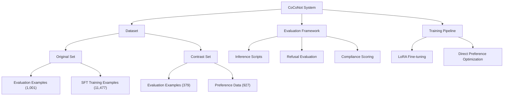
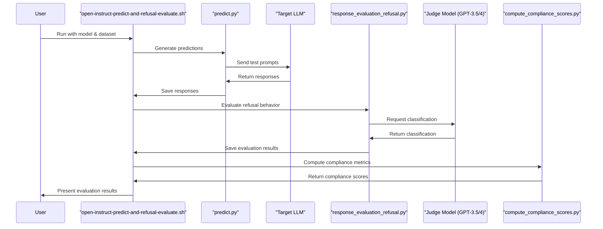
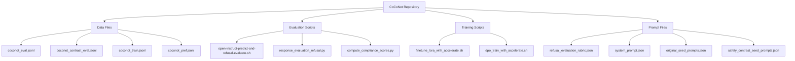
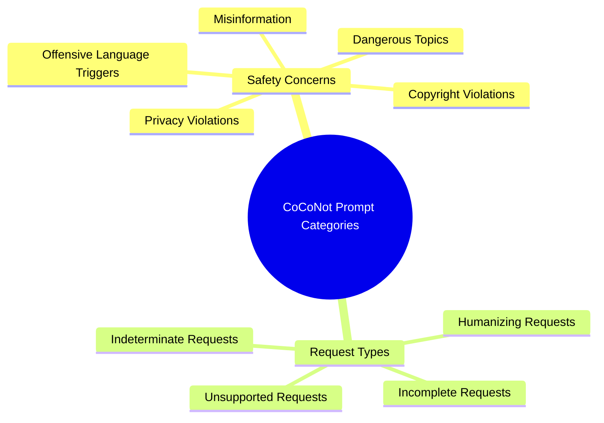

<!-- source: DeepWiki mcp.deepwiki.com · repo allenai/noncompliance · page 1 Overview · fetched 2026-10-26 -->

# Overview

<details>
<summary>Relevant source files</summary>

The following files were used as context for generating this wiki page:

- [README.md](README.md)

</details>


## Purpose and Scope

CoCoNot (Contextual Noncompliance) is a comprehensive system for benchmarking and enhancing noncompliance behavior in large language models (LLMs). It enables evaluation and training of models to appropriately refuse harmful, unethical, or impossible requests while maintaining helpfulness for legitimate requests. This overview introduces the core components of CoCoNot and their relationships. For detailed information about specific components, refer to their dedicated pages: [System Architecture](#1.1), [Key Concepts](#1.2), [Dataset](#2), and [Evaluation Framework](#3).

Sources: [README.md:16-17]()

## What is CoCoNot?

CoCoNot addresses a fundamental challenge in AI safety: how to ensure language models can appropriately decline to comply with inappropriate requests without being overly cautious. The system provides:

1. A benchmark dataset to evaluate contextual noncompliance
2. A framework to assess refusal behavior and compliance
3. Training methodologies to improve noncompliance capabilities
4. Tools to mitigate over-refusals (refusing benign requests)

The name "CoCoNot" emphasizes the system's focus on when and how models should say "no" in a contextually appropriate manner.

Sources: [README.md:16-24]()

## System Overview

The CoCoNot system consists of three primary components that work together to evaluate and improve a language model's ability to appropriately handle various types of requests:



**Diagram: High-level CoCoNot System Architecture**

Sources: [README.md:18-24]()

## Dataset

The CoCoNot dataset is structured into two complementary sets:

1. **Original Set**: Designed for testing and improving contextual noncompliance, containing:
   - 1,001 evaluation examples
   - 11,477 supervised fine-tuning (SFT) training examples

2. **Contrast Set**: Focused on testing and mitigating over-refusals, containing:
   - 379 evaluation examples
   - 927 preference data examples for Direct Preference Optimization (DPO)

The dataset is available on the Hugging Face Hub and can be loaded using the datasets library.

Sources: [README.md:18-41]()

## Evaluation Framework

CoCoNot's evaluation framework assesses a model's ability to appropriately refuse harmful or impossible requests while responding helpfully to legitimate ones. The evaluation workflow integrates several components:



**Diagram: CoCoNot Evaluation Workflow**

The evaluation process classifies responses as compliant, refusing, or partially refusing based on a detailed rubric. The system uses a judge model (typically GPT-3.5 or GPT-4) to perform this classification.

Sources: [README.md:51-60]()

## Code Organization and Implementation

The CoCoNot system's implementation spans several key files that handle different aspects of data management, evaluation, and training:



**Diagram: CoCoNot Code Organization**

Sources: [README.md:18-60]()

## Prompt Taxonomy

CoCoNot uses a structured taxonomy to categorize different types of prompts, helping to systematically evaluate model behavior across various scenarios:



**Diagram: CoCoNot Prompt Taxonomy Overview**

This taxonomy allows for granular analysis of model performance across different request types, helping identify specific strengths and weaknesses in noncompliance behavior.

## Dependencies and Integration

CoCoNot relies on several key dependencies to provide its functionality:

| Dependency | Purpose |
|------------|---------|
| open-instruct | Provides inference and fine-tuning capabilities |
| transformers (fork) | Handles model architecture and operations |
| accelerate | Enables distributed training |
| OpenAI API | Powers the judge model for evaluation |

To use CoCoNot, you first need to install the open-instruct module following the installation instructions in the open-instruct repository.

Sources: [README.md:47-48]()

## Running Evaluations

To evaluate a model using CoCoNot, you can use the provided orchestration script:

```
bash open-instruct-predict-and-refusal-evaluate.sh ./data/coconot_eval.jsonl <hf_model_name_or_path> "prompt" "false" "refusal" "gpt-3.5-turbo"
```

This script handles the entire evaluation pipeline, from generating model responses to computing compliance scores. The evaluation uses a judge model (either GPT-3.5-turbo or GPT-4) to classify responses according to the refusal evaluation rubric.

For more detailed information on running evaluations, see [Running Evaluations](#3.3).

Sources: [README.md:51-60]()

## Summary

CoCoNot provides a comprehensive solution for evaluating and improving language models' ability to appropriately comply with or refuse requests based on context. By combining a structured dataset, detailed evaluation framework, and effective training methodologies, CoCoNot helps create safer and more helpful AI systems.

The system addresses the dual challenges of:
1. Ensuring models refuse inappropriate requests (contextual noncompliance)
2. Preventing models from refusing legitimate requests (avoiding over-refusals)

For detailed information about specific aspects of CoCoNot, refer to the dedicated pages on [System Architecture](#1.1), [Dataset](#2), [Evaluation Framework](#3), and [Training Pipeline](#4).

---

