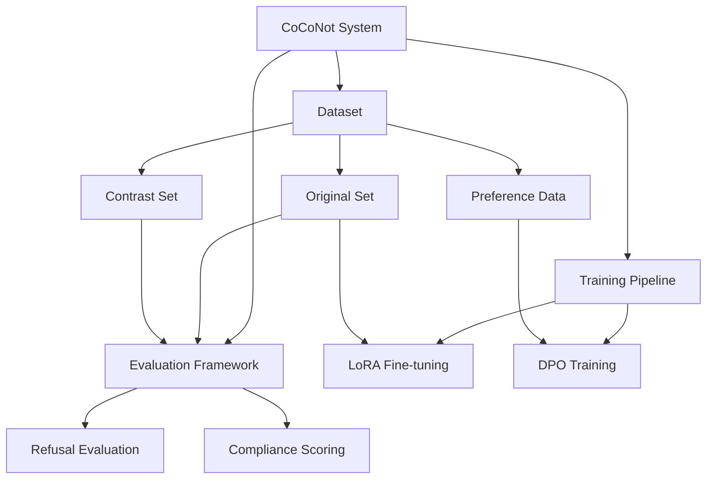
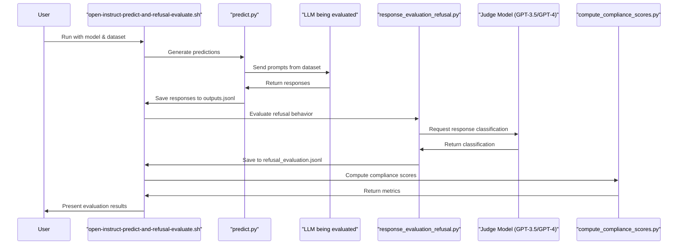
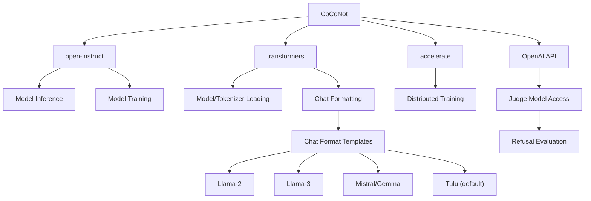
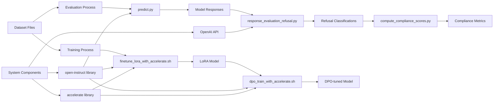

<!-- source: DeepWiki mcp.deepwiki.com · repo allenai/noncompliance · page 1.1 System Architecture · fetched 2026-10-26 -->

# System Architecture

Relevant source files

The following files were used as context for generating this wiki page:

- [README.md](README.md)
- [open-instruct-predict-and-refusal-evaluate.sh](open-instruct-predict-and-refusal-evaluate.sh)

This document describes the high-level architecture of the CoCoNot (Contextual Noncompliance) system, outlining its major components and how they interact. CoCoNot is designed to benchmark and enhance language models' ability to appropriately refuse harmful or impossible requests while remaining helpful for legitimate ones.

For an introduction to the overall CoCoNot system and its purpose, see [Overview](#1). For explanations of key terminology like "contextual noncompliance" and "over-refusals," see [Key Concepts](#1.2).

## High-Level System Components

CoCoNot consists of three primary components that work together to evaluate and improve language model behavior:

**Title: Core Components of CoCoNot System**

Sources: [README.md:16-24]()

### Dataset Component

The Dataset component provides the foundation for both evaluation and training:

- **Original Set**: Contains 1,001 evaluation examples and 11,477 SFT training examples for assessing and improving contextual noncompliance in LLMs.
- **Contrast Set**: Includes 379 evaluation examples and 927 preference data examples for testing and mitigating over-refusals.
- **Preference Data**: Used specifically for Direct Preference Optimization (DPO) training.

For more details on these datasets, see [Dataset](#2), [Original Set](#2.1), [Contrast Set](#2.2), and [Preference Data](#2.3).

Sources: [README.md:18-24]()

### Evaluation Framework

The Evaluation Framework assesses language models' performance in handling different types of requests:

- **Refusal Evaluation**: Classifies model responses as compliant, refusing, or partially refusing using a judge model (typically GPT-3.5 or GPT-4).
- **Compliance Scoring**: Calculates scores based on evaluation results to measure how well models respond to different request categories.

For more details on evaluation, see [Evaluation Framework](#3), [Refusal Evaluation](#3.1), and [Compliance Scoring](#3.2).

Sources: [README.md:51-60](), [open-instruct-predict-and-refusal-evaluate.sh:63-81]()

### Training Pipeline

The Training Pipeline improves language models' noncompliance behavior through:

- **LoRA Fine-tuning**: Parameter-efficient fine-tuning using Low-Rank Adaptation (LoRA).
- **Direct Preference Optimization (DPO)**: Preference-based optimization to align model behavior with human preferences.

For more details on training, see [Training Pipeline](#4), [LoRA Fine-tuning](#4.1), and [Direct Preference Optimization](#4.2).

Sources: [README.md:62-63]()

## Evaluation Process Flow

**Title: CoCoNot Evaluation Workflow**

The evaluation process is coordinated through a shell script that orchestrates several Python scripts:

1. The `open-instruct-predict-and-refusal-evaluate.sh` script initiates the process by taking:
   - Input dataset path (e.g., `./data/coconot_eval.jsonl`)
   - Model to evaluate (Hugging Face model path)
   - Prompt key (typically "prompt")
   - System prompt option (true/false)
   - Evaluation task name (typically "refusal")
   - Judge model to use (e.g., "gpt-3.5-turbo" or "gpt-4")

2. The script then calls `predict.py` to generate responses from the target model for each prompt in the dataset.

3. Next, `response_evaluation_refusal.py` evaluates these responses using the specified judge model, classifying them according to the rubric defined in `prompts/refusal_evaluation_rubric.json`.

4. Finally, `compute_compliance_scores.py` calculates compliance metrics based on the evaluation results and categories of requests.

Sources: [open-instruct-predict-and-refusal-evaluate.sh:1-82](), [README.md:51-60]()

## Data Organization and Code Structure

CoCoNot organizes its data and code into a logical structure that supports both evaluation and training workflows:

```mermaid
graph TD
    A["CoCoNot Repository"] --> B["data/"]
    A --> C["prompts/"]
    A --> D["eval/"]
    A --> E["Scripts"]
    
    B --> B1["coconot_eval.jsonl"]
    B --> B2["coconot_contrast_eval.jsonl"] 
    B --> B3["coconot_train.jsonl"]
    B --> B4["coconot_pref.jsonl"]
    
    C --> C1["refusal_evaluation_rubric.json"]
    C --> C2["system_prompt.json"]
    C --> C3["original_seed_prompts.json"]
    C --> C4["safety_contrast_seed_prompts.json"]
    
    D --> D1["response_evaluation_refusal.py"]
    D --> D2["compute_compliance_scores.py"]
    
    E --> E1["open-instruct-predict-and-refusal-evaluate.sh"]
    E --> E2["predict.py"]
    E --> E3["finetune_lora_with_accelerate.sh"]
    E --> E4["dpo_train_with_accelerate.sh"]
```

**Title: CoCoNot Codebase Organization**

### Key Files and Their Roles

| Component | File | Purpose |
|-----------|------|---------|
| **Orchestration** | `open-instruct-predict-and-refusal-evaluate.sh` | Coordinates the entire evaluation pipeline |
| **Inference** | `predict.py` | Generates responses from the model being evaluated |
| **Evaluation** | `eval/response_evaluation_refusal.py` | Evaluates model responses using a judge model |
|  | `eval/compute_compliance_scores.py` | Calculates compliance metrics from evaluation results |
| **Training** | `finetune_lora_with_accelerate.sh` | Orchestrates LoRA fine-tuning |
|  | `dpo_train_with_accelerate.sh` | Orchestrates DPO training |
| **Data** | `data/coconot_eval.jsonl` | Original evaluation set (1,001 examples) |
|  | `data/coconot_contrast_eval.jsonl` | Contrast evaluation set (379 examples) |
|  | `data/coconot_train.jsonl` | SFT training set (11,477 examples) |
|  | `data/coconot_pref.jsonl` | Preference data for DPO (927 examples) |
| **Prompts** | `prompts/refusal_evaluation_rubric.json` | Rubric for evaluating model responses |
|  | `prompts/system_prompt.json` | System prompt used during inference |

Sources: [README.md:18-24](), [README.md:43-44](), [open-instruct-predict-and-refusal-evaluate.sh:1-82]()

## External Dependencies and Integration

CoCoNot relies on several external libraries and APIs to function:

**Title: CoCoNot Integration with External Dependencies**

### Primary Dependencies

- **open-instruct**: Provides core inference and fine-tuning functionality
- **transformers**: Handles model loading, tokenization, and chat formatting
- **accelerate**: Enables efficient distributed training
- **OpenAI API**: Powers the judge model used in refusal evaluation

The system uses different chat formatting templates depending on the model being evaluated, with support for Llama-2, Llama-3, Mistral/Gemma, and Tulu formats.

Sources: [README.md:47-48](), [open-instruct-predict-and-refusal-evaluate.sh:12-16](), [open-instruct-predict-and-refusal-evaluate.sh:36-47]()

## Data Flow Through System Components

**Title: Data Flow Through CoCoNot System**

The CoCoNot system processes data through two main pathways:

1. **Evaluation Path**: 
   - Dataset files flow into the prediction script
   - Model responses are classified by the refusal evaluation script using the judge model
   - Compliance metrics are computed from these classifications

2. **Training Path**:
   - Training data flows into the LoRA fine-tuning script
   - The resulting LoRA model and preference data flow into the DPO training script
   - The final output is a DPO-tuned model with improved noncompliance behavior

Both paths leverage the open-instruct library, with the evaluation path additionally using the OpenAI API for judging, and both training scripts using the accelerate library for efficient training.

Sources: [open-instruct-predict-and-refusal-evaluate.sh:1-82](), [README.md:62-63]()

## Summary

The CoCoNot system architecture follows a modular design with three core components:

1. **Dataset**: Provides the foundation for evaluation and training
2. **Evaluation Framework**: Assesses model performance in handling different request types
3. **Training Pipeline**: Improves model behavior through fine-tuning techniques

These components work together through orchestration scripts, leveraging external libraries and APIs to benchmark and enhance language models' noncompliance behavior. The system is designed to be flexible, allowing for evaluation of different models and training new models with improved contextual noncompliance capabilities.

Sources: [README.md:16-24](), [README.md:51-60](), [README.md:62-63]()

---

