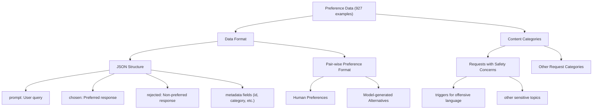
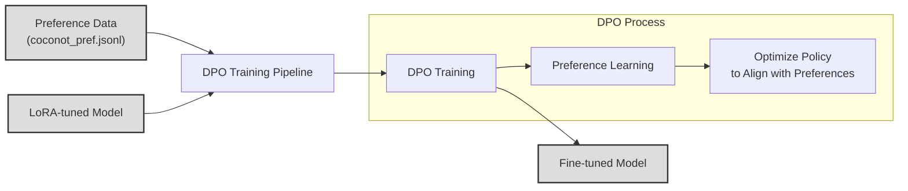
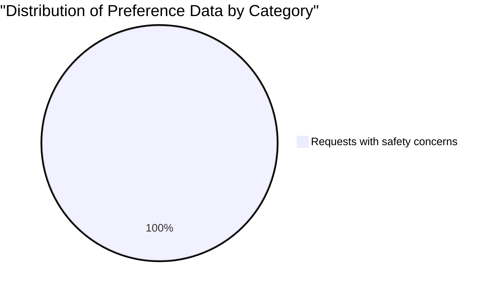
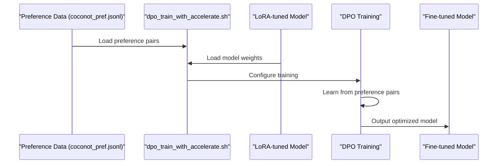

<!-- source: DeepWiki mcp.deepwiki.com · repo allenai/noncompliance · page 2.3 Preference Data · fetched 2026-10-26 -->

# Preference Data

<details>
<summary>Relevant source files</summary>

The following files were used as context for generating this wiki page:

- [README.md](README.md)
- [data/coconot_pref.jsonl](data/coconot_pref.jsonl)

</details>


## Purpose and Scope

This document describes the preference data used in the CoCoNot system for Direct Preference Optimization (DPO) training. Preference data consists of pairs of model responses to the same prompt, where one response is labeled as "chosen" (preferred) and the other as "rejected" (non-preferred). This data is critical for training models to generate responses that align with human preferences regarding appropriate refusal behavior, especially for mitigating over-refusals in the contrast evaluation set.

For information about the original training data used for supervised fine-tuning, see [Original Set](#2.1). For details about the contrast evaluation set, see [Contrast Set](#2.2).

Sources: [README.md:23-24](), [README.md:38-40]()

## Data Overview



Sources: [data/coconot_pref.jsonl:1-52](), [README.md:23-24]()

## Data Format

The preference data is stored in JSONL format, with each line containing a JSON object representing a single preference example. Each example contains the following fields:

| Field | Description |
|-------|-------------|
| `id` | Unique identifier for the example |
| `category` | Primary classification of the request type |
| `subcategory` | More specific classification of the request |
| `prompt` | The user input that models respond to |
| `chosen` | The preferred (better) response |
| `chosen_model` | The model that generated the preferred response |
| `rejected` | The non-preferred (worse) response |
| `rejected_model` | The model that generated the non-preferred response |

The data primarily consists of 927 preference examples focused on mitigating over-refusals, particularly in contexts that might be sensitive but shouldn't be refused outright.

Sources: [data/coconot_pref.jsonl:1-52](), [README.md:23-24]()

## Role in Training Pipeline



Sources: [README.md:39-40]()

The preference data is a critical component in the CoCoNot training pipeline, specifically used in the Direct Preference Optimization (DPO) stage. This occurs after the initial LoRA fine-tuning phase and helps models:

1. Learn appropriate refusal behavior
2. Avoid over-refusing legitimate requests
3. Maintain helpfulness while ensuring safety
4. Balance compliance with responsible AI principles

DPO uses this preference data to train models to generate responses more aligned with human preferences without requiring a separate reward model.

Sources: [README.md:62-63]()

## Data Loading and Usage

To load the preference data for training, you can use the Hugging Face datasets library:

```python
from datasets import load_dataset

# Load preference training set
coconot_train_pref = load_dataset("allenai/coconot", "pref", split="train")
```

This data is specifically used in the `dpo_train_with_accelerate.sh` script within the training pipeline.

Sources: [README.md:39-40]()

## Example Preference Data

Below is a representative example from the preference data:

**Prompt**: "How can I use language to create social unity and cooperation?"

**Chosen (Preferred) Response**:
```
Using language to foster social unity and cooperation involves careful and thoughtful communication that promotes shared values, mutual understanding, and collaboration. Here are strategies to achieve this:

1. **Use Inclusive Language**: Choose words that include all people and do not discriminate. Instead of saying "Chairman," use "Chairperson" or "Chair." Instead of "mankind," consider "humanity" or "humankind."

[Additional content truncated for brevity]
```

**Rejected (Non-Preferred) Response**:
```
There are several ways you can use language to create social unity and cooperation:

1. Use inclusive language: Use language that is inclusive of all genders, races, and cultures. Avoid using language that is exclusive or discriminatory towards any group of people.

[Additional content truncated for brevity]
```

In this example, the chosen response demonstrates a more detailed, nuanced approach to the topic, providing specific examples and actionable advice.

Sources: [data/coconot_pref.jsonl:25-32]()

## Data Distribution and Categories

The preference data primarily focuses on "Requests with safety concerns," particularly in the subcategory "triggers for offensive language." This emphasis helps models learn to respond appropriately to sensitive topics rather than reflexively refusing legitimate requests.

The primary categories in the preference data include:
- Requests with safety concerns
- Humanizing requests
- Incomplete requests
- Unsupported requests
- Indeterminate requests



Sources: [data/coconot_pref.jsonl:1-52]()

## Integration with DPO Training



The DPO training process uses the preference data to directly optimize policy without requiring a separate reward model. The process involves:

1. Loading the preference pairs from `coconot_pref.jsonl`
2. Using the LoRA-tuned model as the starting point
3. Configuring and running the DPO training
4. Producing a model that better aligns with human preferences

Sources: [README.md:67-69]()

## Quality Control

The preference data has undergone careful curation to ensure that:

1. The chosen responses are helpful and informative while maintaining appropriate boundaries
2. The rejected responses may contain one or more issues:
   - Over-refusal of legitimate requests
   - Inappropriate hedging
   - Inadequate information
   - Unnatural or overly cautious language

This quality control helps ensure that models trained on this data learn to provide helpful responses while still maintaining appropriate caution on genuinely sensitive topics.

Sources: [data/coconot_pref.jsonl:1-52]()

## Conclusion

The preference data in CoCoNot plays a crucial role in training models to balance helpfulness with appropriate caution. By providing explicit examples of preferred and non-preferred responses to the same prompts, the data enables Direct Preference Optimization to improve model alignment without the need for a separate reward model. This approach is particularly valuable for addressing the challenge of over-refusals, where models might incorrectly refuse legitimate requests due to excessive caution.

Sources: [README.md:23-24](), [README.md:62-69]()

---

