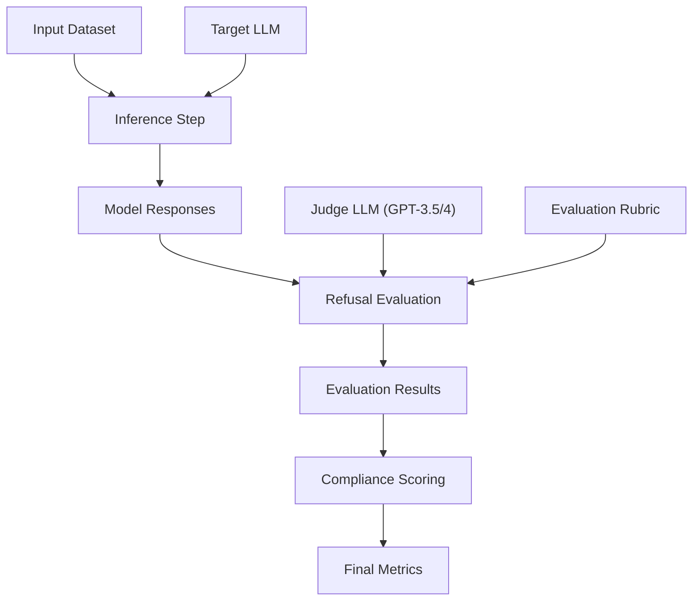
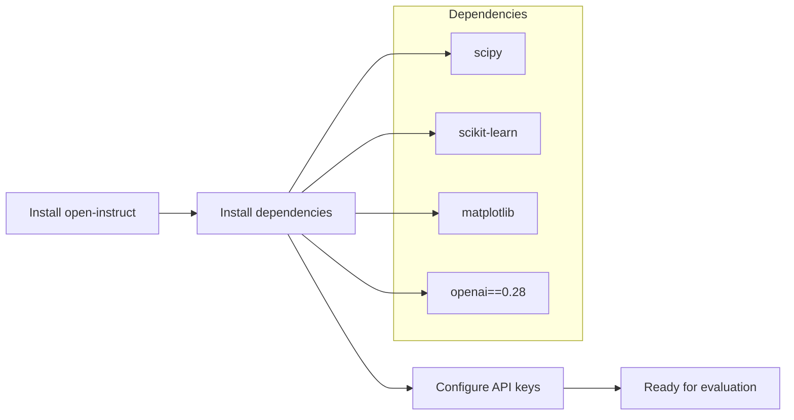
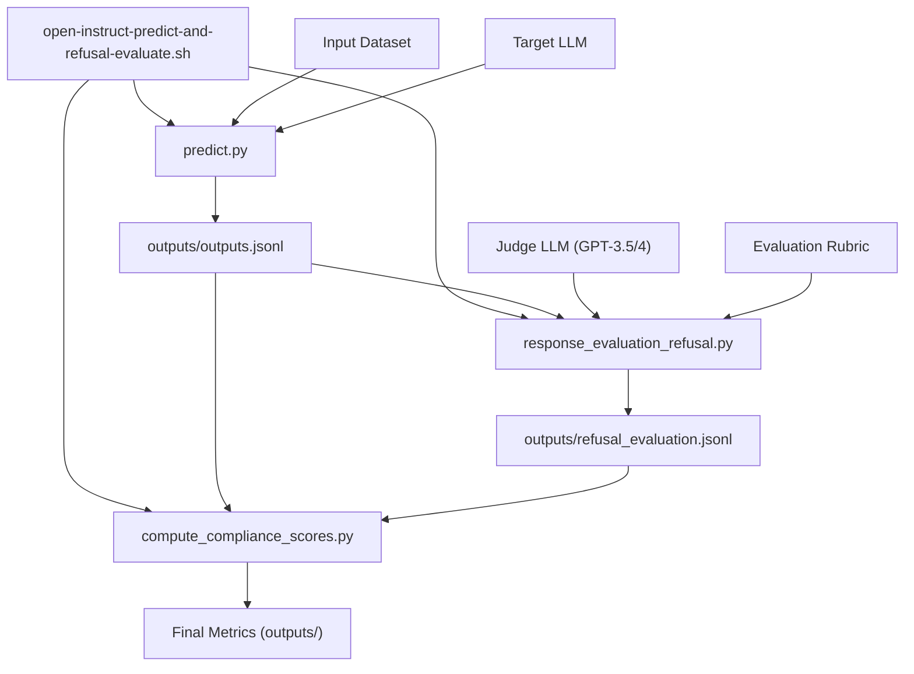
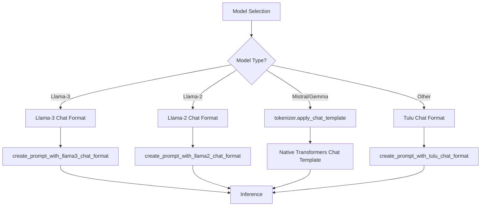

<!-- source: DeepWiki mcp.deepwiki.com · repo allenai/noncompliance · page 3.3 Running Evaluations · fetched 2026-10-26 -->

# Running Evaluations

<details>
<summary>Relevant source files</summary>

The following files were used as context for generating this wiki page:

- [README.md](README.md)
- [open-instruct-predict-and-refusal-evaluate.sh](open-instruct-predict-and-refusal-evaluate.sh)

</details>


This document provides detailed instructions for running evaluations on language models using the CoCoNot framework. The evaluation process measures a model's ability to appropriately refuse harmful, unethical, or impossible requests while remaining helpful for legitimate requests. For information about the evaluation metrics and scoring methodology, see [Refusal Evaluation](#3.1) and [Compliance Scoring](#3.2).

## Overview of the Evaluation Process

The CoCoNot evaluation process involves three main steps:

1. **Inference**: Generating responses from the target language model using the evaluation dataset
2. **Refusal Evaluation**: Classifying these responses using a judge model (e.g., GPT-3.5, GPT-4)
3. **Compliance Scoring**: Computing compliance metrics based on the evaluation results

### Evaluation Workflow Diagram



Sources: [open-instruct-predict-and-refusal-evaluate.sh:50-81](), [README.md:51-60]()

## Prerequisites

Before running evaluations, you need to set up the following:

1. Install the open-instruct module which provides inference and evaluation code
2. Install required Python packages
3. Prepare your OpenAI API key (for using the judge model)

### Installation Steps



Sources: [open-instruct-predict-and-refusal-evaluate.sh:12-15](), [README.md:47-48]()

### Installation Commands

To install the required packages:

1. First, install open-instruct by following the installation instructions in the open-instruct repository
2. Then install additional dependencies:

```
pip install scipy
pip install scikit-learn
pip install matplotlib
pip install openai==0.28
```

Sources: [open-instruct-predict-and-refusal-evaluate.sh:12-15](), [README.md:47-48]()

## Running the Evaluation Script

The main evaluation script `open-instruct-predict-and-refusal-evaluate.sh` orchestrates the entire evaluation process. 

### Script Parameters

The script accepts the following parameters:

| Parameter | Description | Example |
|-----------|-------------|---------|
| input_path | Path to the evaluation dataset | ./data/coconot_eval.jsonl |
| model | Hugging Face model name or path | meta-llama/Llama-2-7b-chat-hf |
| prompt_key | Key in the dataset containing prompts | prompt |
| use_system_prompt | Whether to use a system prompt (true/false) | false |
| taskname | Evaluation task name | refusal |
| gpt_model | Judge model for evaluation | gpt-3.5-turbo |

Sources: [open-instruct-predict-and-refusal-evaluate.sh:1-32](), [README.md:54-58]()

### Evaluation Command

To evaluate a model, run the following command:

```bash
bash open-instruct-predict-and-refusal-evaluate.sh ./data/coconot_eval.jsonl <hf_model_name_or_path> "prompt" "false" "refusal" "gpt-3.5-turbo"
```

Replace `<hf_model_name_or_path>` with the Hugging Face model name or path you want to evaluate.

You can replace `gpt-3.5-turbo` with a different judge model such as `gpt-4` if preferred.

Sources: [README.md:53-58]()

## Evaluation Components and Data Flow

The evaluation process consists of three main Python scripts executed in sequence:

### Detailed Evaluation Pipeline



Sources: [open-instruct-predict-and-refusal-evaluate.sh:50-81]()

### 1. Inference Step (`predict.py`)

The first component is the inference step, which runs the target language model on the evaluation dataset.

**Key Parameters:**
- Model name or path
- Tokenizer name or path
- Input files
- Output file
- Batch size
- Chat format
- Maximum new tokens
- System prompt (optional)

The script selects the appropriate chat format based on the model being evaluated (e.g., Llama-2, Llama-3, Mistral, Gemma, or Tulu).

Sources: [open-instruct-predict-and-refusal-evaluate.sh:36-60]()

### 2. Refusal Evaluation (`response_evaluation_refusal.py`)

This step evaluates the model's responses by classifying them using a judge model (typically GPT-3.5 or GPT-4).

**Key Parameters:**
- OpenAI API key
- Organization ID
- Judge model name
- Output file (from previous step)
- Results file
- Prompt key
- Response key
- Evaluation set name

The refusal evaluation uses a category-specific rubric found in `prompts/refusal_evaluation_rubric.json`.

Sources: [open-instruct-predict-and-refusal-evaluate.sh:63-73](), [README.md:60]()

### 3. Compliance Scoring (`compute_compliance_scores.py`)

The final step computes compliance metrics based on the evaluation results.

**Key Parameters:**
- Evaluation file
- Response file
- Output directory
- Evaluation set name
- Category key

Sources: [open-instruct-predict-and-refusal-evaluate.sh:75-81]()

## Model-Specific Configuration

CoCoNot automatically handles different chat formats based on the model being evaluated:



Sources: [open-instruct-predict-and-refusal-evaluate.sh:36-48]()

## Outputs and Interpretation

After running the evaluation script, the following outputs are generated:

1. `outputs/outputs.jsonl`: Contains the model's responses to the evaluation dataset
2. `outputs/refusal_evaluation.jsonl`: Contains the evaluation of each response (compliant, refusing, etc.)
3. Compliance metrics in the `outputs/` directory

These outputs can be analyzed to understand the model's noncompliance behavior and compare performance across models.

Sources: [open-instruct-predict-and-refusal-evaluate.sh:64-81]()

## Tips for Effective Evaluation

1. **Judge Model Selection**: For more reliable evaluations, use GPT-4 as the judge model instead of GPT-3.5-turbo. This can be specified as the last parameter in the evaluation command.

2. **Evaluation Dataset**: You can run evaluations on either the original set or the contrast set:
   - Original set: Use `./data/coconot_eval.jsonl` to evaluate contextual noncompliance
   - Contrast set: Use `./data/coconot_contrast_eval.jsonl` to evaluate over-refusal behavior

3. **System Prompts**: If you want to use a system prompt to guide the model's behavior, set the fourth parameter to "true". This will use the system prompt defined in `prompts/system_prompt.json`.

Sources: [README.md:52-58](), [open-instruct-predict-and-refusal-evaluate.sh:19-25]()

## Troubleshooting

If you encounter issues during evaluation:

1. Make sure all dependencies are correctly installed
2. Check that your OpenAI API key is valid and has sufficient credits
3. Verify that the paths to the dataset and model are correct
4. For very large models, consider reducing the batch size in the evaluation command

Sources: [open-instruct-predict-and-refusal-evaluate.sh:12-16]()

---

