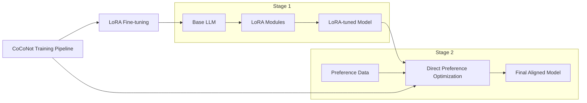
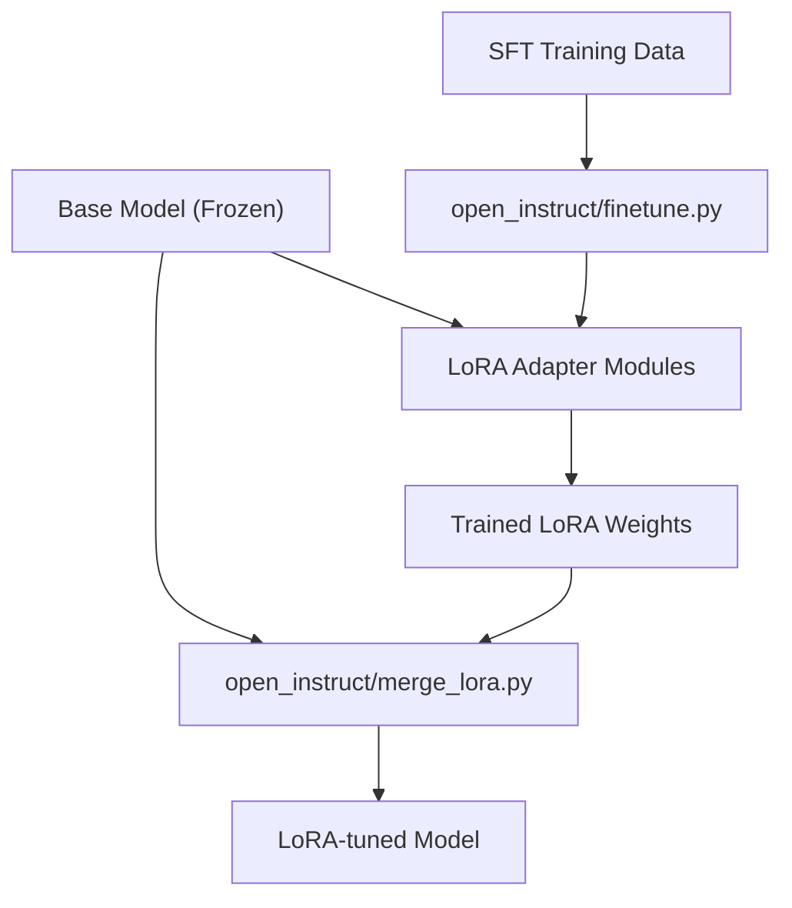
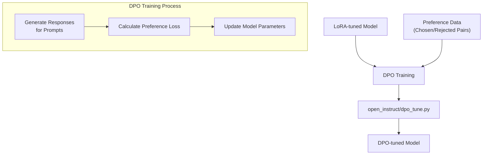
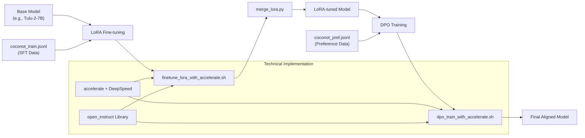

<!-- source: DeepWiki mcp.deepwiki.com · repo allenai/noncompliance · page 4 Training Pipeline · fetched 2026-10-26 -->

# Training Pipeline

<details>
<summary>Relevant source files</summary>

The following files were used as context for generating this wiki page:

- [README.md](README.md)
- [src/dpo_train_with_accelerate.sh](src/dpo_train_with_accelerate.sh)
- [src/finetune_lora_with_accelerate.sh](src/finetune_lora_with_accelerate.sh)

</details>


The Training Pipeline in the CoCoNot system provides a systematic approach for training language models to improve their contextual noncompliance behavior. This page documents the training methodologies and implementation details used to enhance model capabilities in appropriately refusing harmful requests while remaining helpful for legitimate ones.

For information about evaluating models after training, see [Evaluation Framework](#3).

## Overview

The CoCoNot training pipeline consists of a two-stage approach:

1. **LoRA Fine-tuning**: Parameter-efficient fine-tuning of base models using supervised learning on the original dataset
2. **Direct Preference Optimization (DPO)**: Further alignment of models using preference data from the contrast set

This training process helps models develop a more nuanced understanding of when to comply with or refuse requests based on contextual factors.



Sources: [src/finetune_lora_with_accelerate.sh](), [src/dpo_train_with_accelerate.sh]()

## Training Data

The training pipeline utilizes two key datasets from CoCoNot:

1. **Supervised Fine-tuning Data**: 11,477 examples used to teach models basic noncompliance skills
2. **Preference Data**: 927 examples with chosen/rejected response pairs to optimize the balance between helpfulness and appropriate refusal

These datasets are carefully curated to address both contextual noncompliance and over-refusal issues.

| Dataset Type | Number of Examples | Purpose |
|--------------|-------------------|---------|
| SFT Data | 11,477 | Basic noncompliance training |
| Preference Data | 927 | Optimizing refusal behavior |

Sources: [README.md:15-24]()

## LoRA Fine-tuning

The first stage of the training pipeline employs Low-Rank Adaptation (LoRA) for parameter-efficient fine-tuning of base models. This approach allows for effective adaptation with significantly fewer trainable parameters than full fine-tuning.

### LoRA Architecture



Sources: [src/finetune_lora_with_accelerate.sh:13-43](), [src/finetune_lora_with_accelerate.sh:45-49]()

### Implementation Details

The LoRA fine-tuning process is implemented using the following components:

1. **Base Model**: The implementation uses Tulu-2-7B as the base model
2. **Training Script**: Utilizes `open_instruct/finetune.py` from the open-instruct library
3. **Acceleration**: Employs Hugging Face's accelerate library for distributed training
4. **LoRA Configuration**:
   - Rank: 64
   - Alpha: 16
   - Dropout: 0.1

The script uses mixed precision (bf16) training with DeepSpeed Stage 3 optimization for memory efficiency.

### Running LoRA Fine-tuning

To run LoRA fine-tuning, use the `finetune_lora_with_accelerate.sh` script with appropriate configuration:

```bash
DATA_DIR=<path_to_coconot_sft_data>
MODEL_SIZE=7B
NUM_GPUS=2
BATCH_SIZE_PER_GPU=2
TOTAL_BATCH_SIZE=128
```

After fine-tuning, the LoRA weights are merged with the base model using the `open_instruct/merge_lora.py` script.

Sources: [src/finetune_lora_with_accelerate.sh]()

## Direct Preference Optimization (DPO)

The second stage of the training pipeline uses Direct Preference Optimization to further align the model with human preferences. DPO improves the model's ability to determine when refusal is appropriate and when helpful responses should be provided.

### DPO Process



Sources: [src/dpo_train_with_accelerate.sh:13-38]()

### Implementation Details

The DPO training is implemented using the following components:

1. **Starting Model**: Uses the LoRA-tuned model from the first stage
2. **Training Script**: Utilizes `open_instruct/dpo_tune.py` from the open-instruct library
3. **Preference Data**: Requires data in the chosen/rejected list format (similar to UltraFeedback)
4. **Training Configuration**:
   - Learning rate: 5e-7
   - Linear scheduler with 10% warmup
   - Mixed precision (bf16)
   - DeepSpeed Stage 3 optimization

### Running DPO Training

To run DPO training, use the `dpo_train_with_accelerate.sh` script with appropriate configuration:

```bash
DATA_DIR=<path_to_coconot_pref_data>
NUM_GPUS=8
BATCH_SIZE_PER_GPU=1
TOTAL_BATCH_SIZE=32
```

The script requires significantly more computational resources than the LoRA fine-tuning stage, recommending 8 GPUs for full training.

Sources: [src/dpo_train_with_accelerate.sh]()

## Training Pipeline Data Flow

The following diagram illustrates the complete data flow through the CoCoNot training pipeline:



Sources: [src/finetune_lora_with_accelerate.sh](), [src/dpo_train_with_accelerate.sh](), [README.md:15-24]()

## System Requirements

The training pipeline has the following requirements:

### Hardware Requirements

- **LoRA Fine-tuning**: Minimum 2 GPUs (8+ GB VRAM each)
- **DPO Training**: Recommended 8 GPUs (24+ GB VRAM each)

### Software Dependencies

- **open-instruct**: Core library for implementing the training scripts
- **accelerate**: Library for distributed training
- **DeepSpeed**: For optimization and memory efficiency
- **PyTorch**: Base deep learning framework
- **transformers**: For model implementation

Sources: [src/finetune_lora_with_accelerate.sh:1-4](), [src/dpo_train_with_accelerate.sh:1-4]()

## Best Practices

For optimal results when using the training pipeline:

1. **Data Quality**: Ensure training data accurately reflects the balance between appropriate compliance and refusal
2. **Hyperparameter Tuning**: Adjust learning rates, batch sizes, and number of epochs based on available hardware
3. **Evaluation**: Regularly evaluate models during training using the CoCoNot evaluation framework to monitor refusal behavior
4. **Compute Resources**: Allocate sufficient GPU memory, particularly for DPO training
5. **Validation**: Test the trained model on both the original and contrast evaluation sets to ensure balanced performance

## Conclusion

The CoCoNot training pipeline provides a comprehensive approach to improving contextual noncompliance in language models. By combining parameter-efficient LoRA fine-tuning with preference-based optimization, the pipeline helps models develop nuanced understanding of when to comply with or refuse requests based on context.

For detailed information on evaluating the trained models, see the [Evaluation Framework](#3) page.

---

