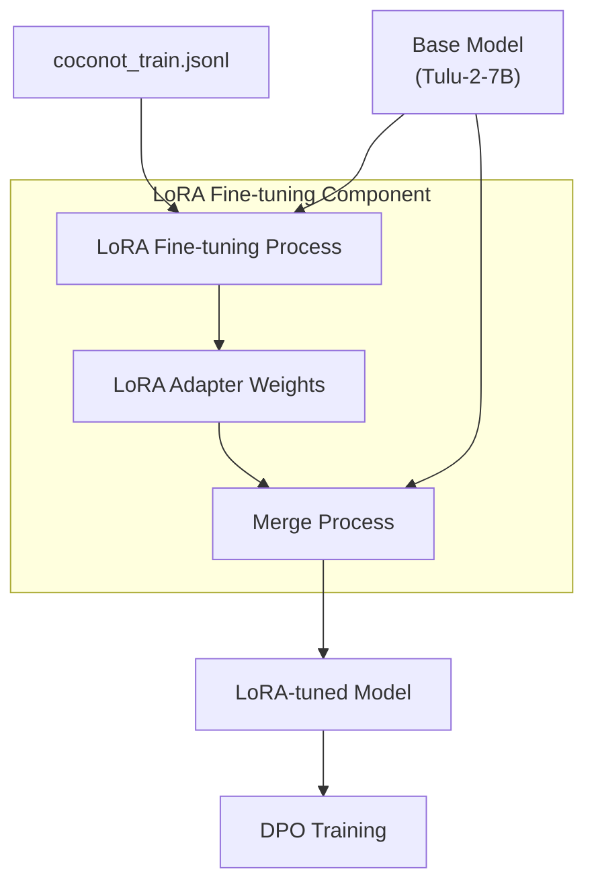
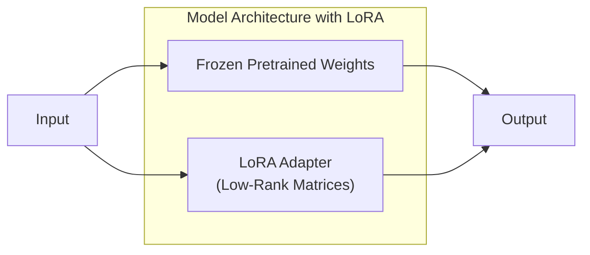
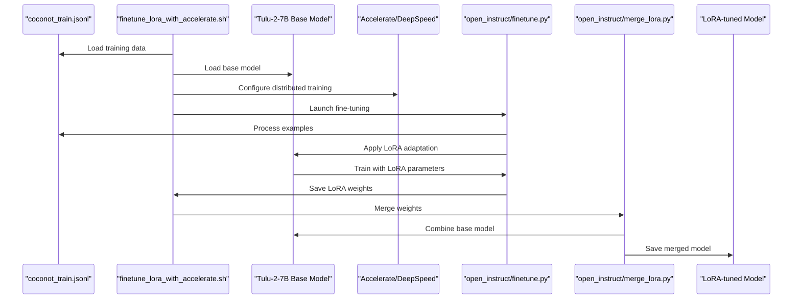
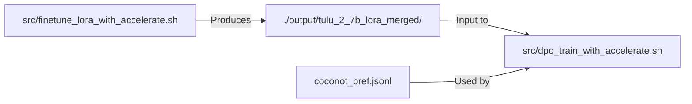

<!-- source: DeepWiki mcp.deepwiki.com · repo allenai/noncompliance · page 4.1 LoRA Fine-tuning · fetched 2026-10-26 -->

# LoRA Fine-tuning

Relevant source files

The following files were used as context for generating this wiki page:

- [src/dpo_train_with_accelerate.sh](src/dpo_train_with_accelerate.sh)
- [src/finetune_lora_with_accelerate.sh](src/finetune_lora_with_accelerate.sh)

## Purpose and Scope

This documentation describes the Low-Rank Adaptation (LoRA) fine-tuning component of the CoCoNot training pipeline. LoRA fine-tuning is the first stage in the CoCoNot training process, where a base language model is efficiently tuned on the supervised fine-tuning (SFT) dataset to enhance its capability for appropriate contextual noncompliance. For information about the subsequent Direct Preference Optimization (DPO) training stage, see [Direct Preference Optimization](#4.2).

## Overview of LoRA in CoCoNot

LoRA is a parameter-efficient fine-tuning technique that significantly reduces computational resources required for adapting large language models. In CoCoNot, LoRA fine-tuning serves as the foundation for improving a model's ability to appropriately refuse harmful requests while remaining helpful for legitimate ones.

Sources: [src/finetune_lora_with_accelerate.sh:1-49]()

## LoRA Technical Fundamentals

LoRA (Low-Rank Adaptation) enables efficient fine-tuning by adding trainable rank decomposition matrices to frozen weights of the pretrained model. This approach significantly reduces the number of trainable parameters while preserving model quality.

Sources: [src/finetune_lora_with_accelerate.sh:38-42]()

## Implementation Details

### Base Model and Libraries

The CoCoNot implementation utilizes:
- Base model: Tulu-2-7B (`allenai/tulu-2-7b`)
- Libraries:
  - `open-instruct` for fine-tuning functionality
  - `accelerate` for distributed training
  - `DeepSpeed` for optimization

### LoRA Configuration

The LoRA adapter in CoCoNot is configured with the following parameters:

| Parameter | Value | Description |
|-----------|-------|-------------|
| `lora_rank` | 64 | Rank of the low-rank decomposition matrices |
| `lora_alpha` | 16 | Scaling factor for the LoRA adaptation |
| `lora_dropout` | 0.1 | Dropout probability for LoRA layers |

Sources: [src/finetune_lora_with_accelerate.sh:39-42]()

### Training Parameters

The training process uses these hyperparameters:

| Parameter | Value | Description |
|-----------|-------|-------------|
| Learning rate | 1e-5 | Initial learning rate |
| LR scheduler | cosine | Learning rate decay schedule |
| Warmup ratio | 0.03 | Portion of training steps for LR warmup |
| Weight decay | 0 | L2 regularization strength |
| Max sequence length | 2048 | Maximum token length per example |
| Training epochs | 1 | Number of passes through the dataset |
| Mixed precision | bf16 | BFloat16 for memory efficiency |

Sources: [src/finetune_lora_with_accelerate.sh:14-34]()

## LoRA Fine-tuning Workflow

Sources: [src/finetune_lora_with_accelerate.sh:13-49]()

### Input Data

The input for LoRA fine-tuning is `coconot_train.jsonl`, which contains 11,477 supervised fine-tuning examples. These examples provide instruction-response pairs that teach the model when to comply with or refuse requests based on their context and safety considerations.

### Training Process

The training process consists of the following steps:

1. **Data Preparation**: Loading and preprocessing the CoCoNot SFT dataset
2. **Model Initialization**: Loading the Tulu-2-7B base model and configuring LoRA adapters
3. **Distributed Training Setup**: Configuring DeepSpeed and Accelerate for efficient multi-GPU training
4. **Fine-tuning**: Training the LoRA adapters while keeping base model weights frozen
5. **Checkpointing**: Saving training progress at the end of each epoch

Sources: [src/finetune_lora_with_accelerate.sh:13-42]()

### Weight Merging

After training the LoRA adapters, a separate step merges the adapter weights with the base model:

1. The base model weights are loaded
2. LoRA adapter weights are applied to create a fully fine-tuned model
3. The resulting merged model is saved, ready for use in evaluation or further training (DPO)

Sources: [src/finetune_lora_with_accelerate.sh:45-49]()

## Usage Guide

### Running LoRA Fine-tuning

The fine-tuning process is orchestrated by the `finetune_lora_with_accelerate.sh` script. To run this script:

1. Install the `open-instruct` module from GitHub: https://github.com/allenai/open-instruct
2. Ensure you have GPUs available (the script uses 2 GPUs by default)
3. Set the `DATA_DIR` variable to point to your CoCoNot SFT data
4. Adjust GPU configuration with `CUDA_VISIBLE_DEVICES` and `NUM_GPUS` if needed
5. Run the script to start fine-tuning

### Resource Requirements

LoRA fine-tuning is designed to be computationally efficient compared to full fine-tuning:

| Configuration | Full Fine-tuning | LoRA Fine-tuning |
|---------------|------------------|------------------|
| Recommended GPUs | 8 | 2-4 |
| GPU Memory | High (~80GB total) | Moderate (~24GB total) |
| Training Time | Longer | Shorter |

The script automatically calculates the appropriate gradient accumulation steps based on the available GPUs and desired total batch size (128 by default).

Sources: [src/finetune_lora_with_accelerate.sh:2-10]()

## Integration with Training Pipeline

The LoRA-tuned model serves as input to the DPO training stage. After merging, the model path is provided to the DPO training script (`dpo_train_with_accelerate.sh`) as shown below:

Sources: [src/finetune_lora_with_accelerate.sh:45-49](), [src/dpo_train_with_accelerate.sh:20-21]()

---

