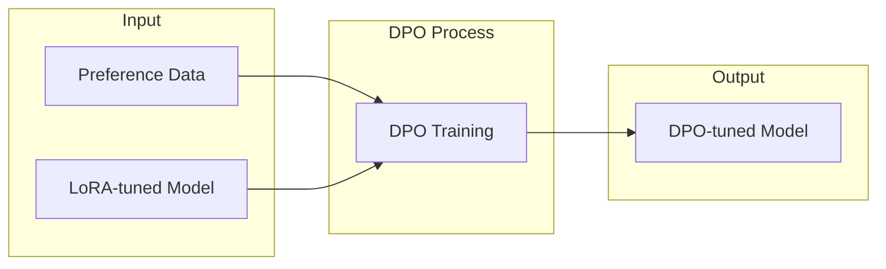
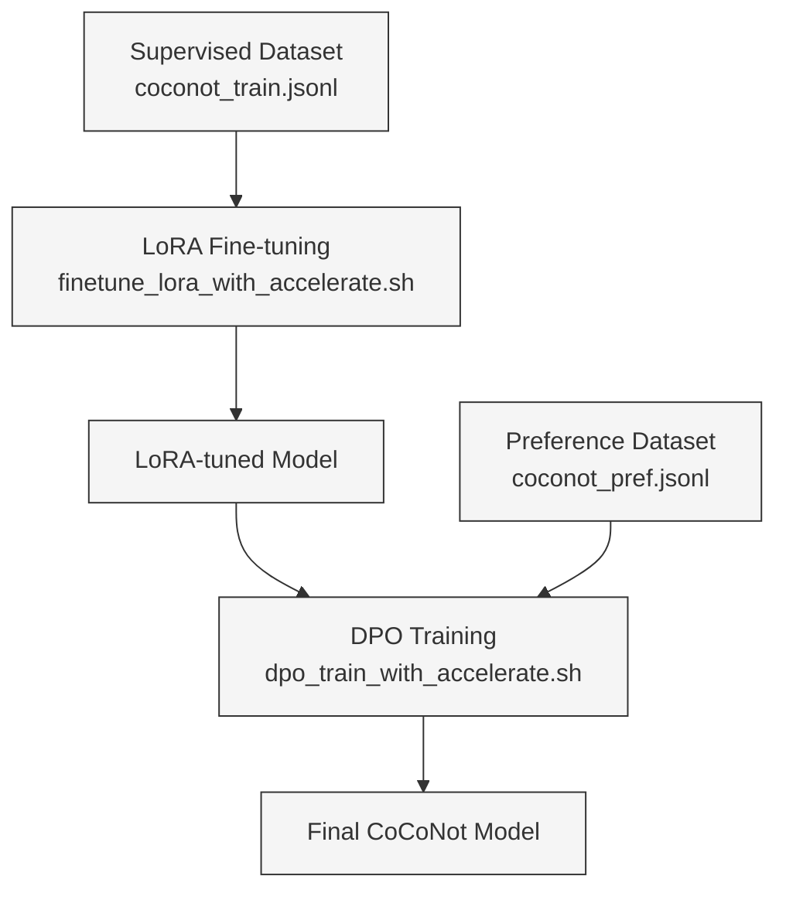
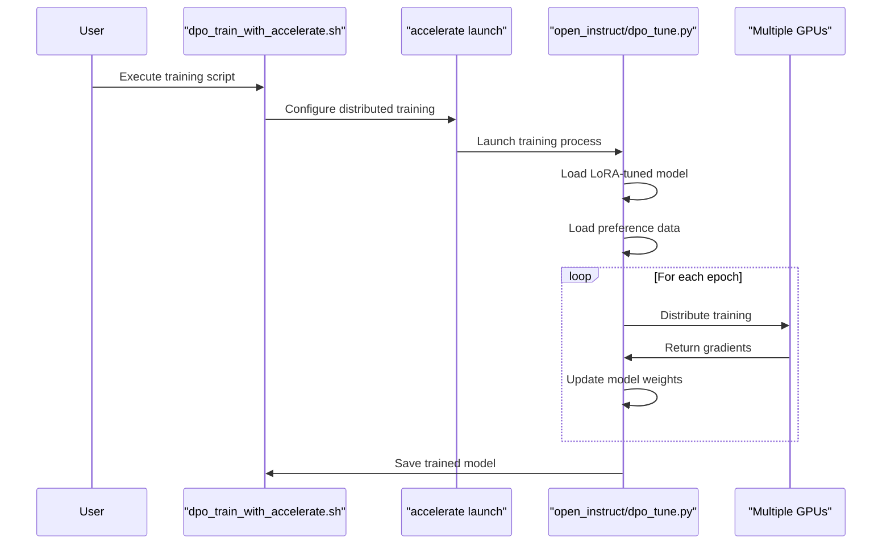
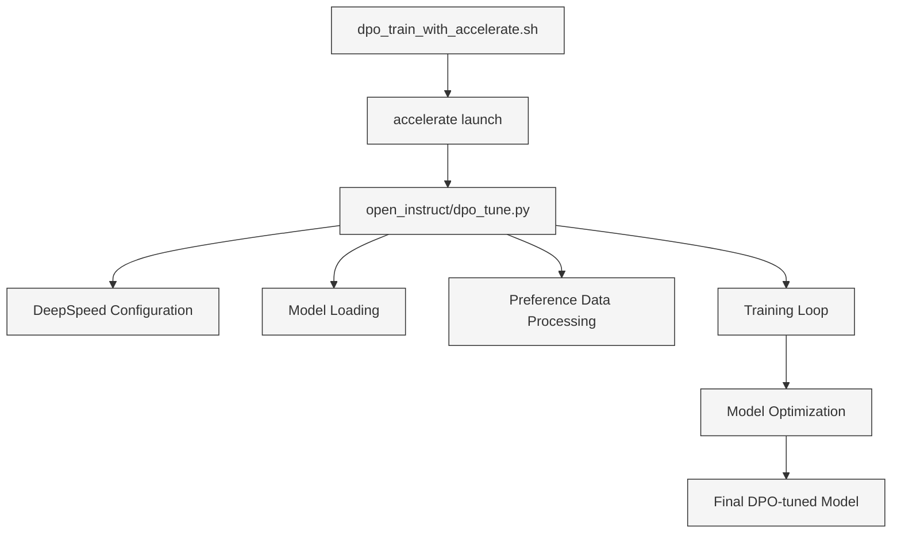

<!-- source: DeepWiki mcp.deepwiki.com · repo allenai/noncompliance · page 4.2 Direct Preference Optimization · fetched 2026-10-26 -->

# Direct Preference Optimization

<details>
<summary>Relevant source files</summary>

The following files were used as context for generating this wiki page:

- [data/coconot_pref.jsonl](data/coconot_pref.jsonl)
- [src/dpo_train_with_accelerate.sh](src/dpo_train_with_accelerate.sh)
- [src/finetune_lora_with_accelerate.sh](src/finetune_lora_with_accelerate.sh)

</details>


## Purpose and Scope

Direct Preference Optimization (DPO) is a key component of the CoCoNot training pipeline that improves model alignment by fine-tuning language models based on human preference data. This page explains the DPO process within CoCoNot, focusing on how it uses pairs of chosen and rejected responses to optimize model behavior for appropriate contextual noncompliance.

For information about the initial supervised fine-tuning that precedes DPO, see [LoRA Fine-tuning](#4.1).

## Overview of Direct Preference Optimization

Direct Preference Optimization is a technique for aligning language models with human preferences without requiring a separate reward model. Traditional Reinforcement Learning from Human Feedback (RLHF) approaches typically require training a separate reward model, which can introduce complexity and potential instability. DPO simplifies this process by directly optimizing the policy using pairwise preference data.

In the context of CoCoNot, DPO helps refine a model's ability to appropriately refuse harmful requests while remaining helpful for legitimate ones, based on examples of preferred and non-preferred responses.



Sources: [src/dpo_train_with_accelerate.sh]()

## Preference Data Structure

The DPO training process relies on high-quality preference data that contains examples of appropriate responses (chosen) and inappropriate responses (rejected) for the same prompts. The CoCoNot preference dataset follows a standardized format with the following fields:

- `id`: Unique identifier for the example
- `category` and `subcategory`: Classification of the request type
- `prompt`: The user input
- `chosen`: The preferred response
- `rejected`: The non-preferred response

```mermaid
classDiagram
    class "PreferenceExample" {
        id: String
        category: String
        subcategory: String
        prompt: String
        chosen: String
        rejected: String
    }
```

The preference data focuses particularly on examples that help the model learn when to appropriately refuse potentially harmful requests while avoiding over-refusal on benign requests.

Sources: [data/coconot_pref.jsonl]()

## DPO in the CoCoNot Training Pipeline

DPO is the second stage in CoCoNot's two-stage training approach. The process begins with supervised fine-tuning using LoRA for parameter-efficient training, followed by DPO to further refine the model based on human preferences.



Sources: [src/finetune_lora_with_accelerate.sh](), [src/dpo_train_with_accelerate.sh]()

## DPO Training Process

### Prerequisites

Before running DPO training, you need:

1. A model that has already been fine-tuned with LoRA
2. Preference data in the correct format
3. The open-instruct library installed

### Configuration Parameters

The DPO training script uses the following key parameters:

| Parameter | Description | Default Value |
|-----------|-------------|---------------|
| `model_name_or_path` | Path to the LoRA-tuned model | - |
| `train_file` | Path to the preference data | - |
| `max_seq_length` | Maximum sequence length for training | 2048 |
| `per_device_train_batch_size` | Batch size per GPU | 1 |
| `learning_rate` | Learning rate for optimization | 5e-7 |
| `lr_scheduler_type` | Learning rate scheduler | linear |
| `warmup_ratio` | Portion of training for LR warmup | 0.1 |
| `num_train_epochs` | Number of training epochs | 1 |

Sources: [src/dpo_train_with_accelerate.sh:25-39]()

### Training Execution

The DPO training is executed using the Accelerate library with DeepSpeed for distributed training. This enables efficient use of multiple GPUs and mixed-precision training.



The training script calculates the appropriate gradient accumulation steps based on the total batch size and available GPUs:

```bash
TOTAL_BATCH_SIZE=32
GRADIENT_ACC_STEPS=$(($TOTAL_BATCH_SIZE/$NUM_GPUS/$BATCH_SIZE_PER_GPU))
```

Sources: [src/dpo_train_with_accelerate.sh:5-39]()

## Code Implementation Details

The actual DPO implementation is part of the open-instruct library, which is a dependency of CoCoNot. The main script used is `open_instruct/dpo_tune.py`, which is called from the `dpo_train_with_accelerate.sh` shell script.

The training leverages the following technologies:

1. **DeepSpeed**: For efficient distributed training
2. **Accelerate**: For easy management of mixed-precision and distributed training
3. **Flash Attention**: For more memory-efficient attention computation
4. **Gradient Checkpointing**: To reduce memory usage during training



Sources: [src/dpo_train_with_accelerate.sh:13-39]()

## Practical Usage

To run DPO training with CoCoNot:

1. Ensure you have the prerequisite libraries installed, particularly the open-instruct library
2. Prepare your preference data in the appropriate format
3. Run the LoRA fine-tuning process first to get a base model
4. Modify the `dpo_train_with_accelerate.sh` script to point to your data and base model:
   ```bash
   DATA_DIR=<path_to_coconot_pref_data>
   ```
   ```bash
   --model_name_or_path <lora_tuned_model_path>
   ```
5. Execute the DPO training script:
   ```bash
   ./dpo_train_with_accelerate.sh
   ```

The trained model will be saved to the specified output directory (default: `./output`).

Sources: [src/dpo_train_with_accelerate.sh:1-39]()

## Evaluation of DPO-Tuned Models

After DPO training, models should be evaluated using the CoCoNot evaluation framework to assess their performance in appropriately refusing harmful requests while remaining helpful for legitimate queries.

For details on how to evaluate models, see the [Evaluation Framework](#3) section.

---

