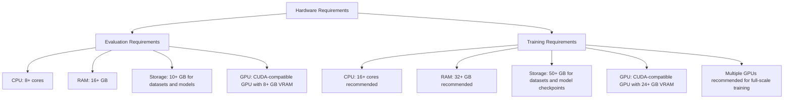
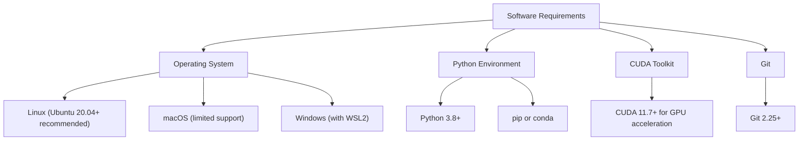
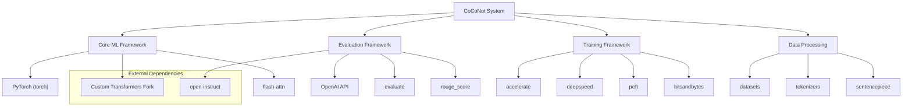
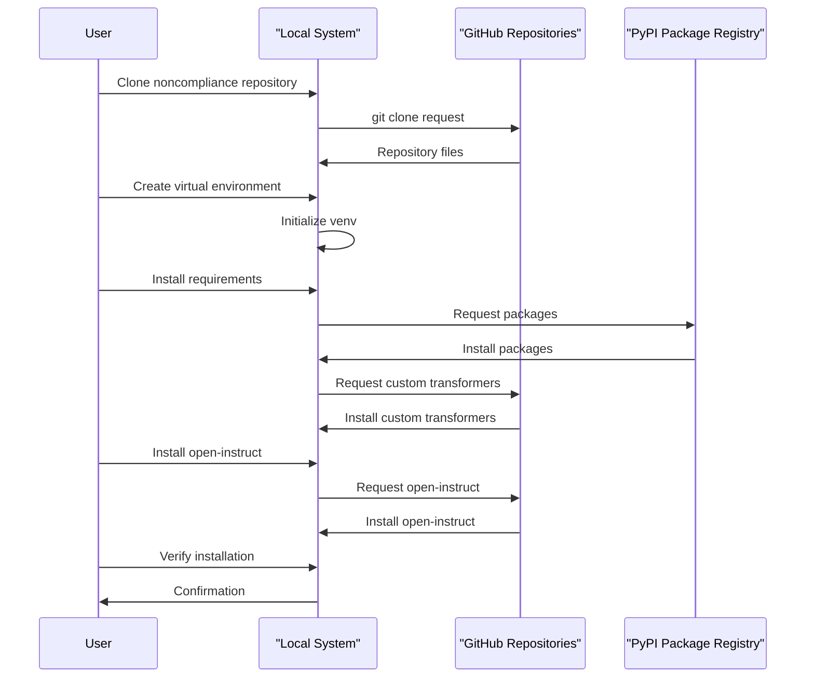
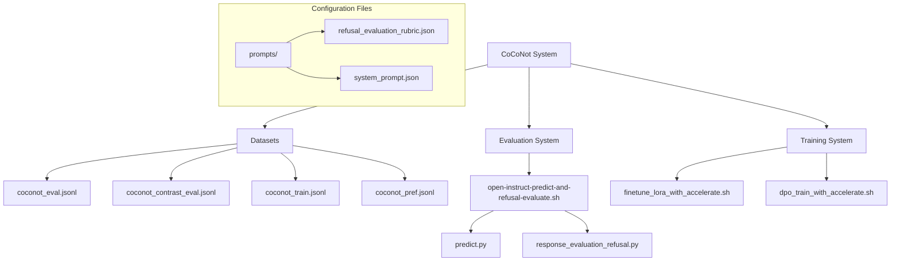
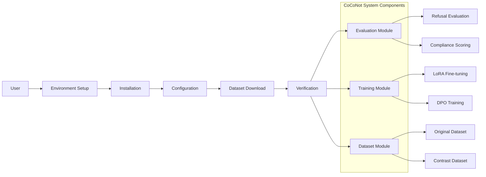

<!-- source: DeepWiki mcp.deepwiki.com · repo allenai/noncompliance · page 6 Installation and Setup · fetched 2026-10-26 -->

# Installation and Setup

<details>
<summary>Relevant source files</summary>

The following files were used as context for generating this wiki page:

- [README.md](README.md)
- [requirements.txt](requirements.txt)

</details>


This page provides comprehensive instructions for installing and setting up the CoCoNot (Contextual Noncompliance) system. It covers environment requirements, dependencies, installation steps, and configuration options to get the system running properly.

For information about running evaluations on language models, see [Running Evaluations](#3.3). For training models, see [Training Pipeline](#4).

## System Requirements

CoCoNot is designed to work with modern machine learning frameworks and may require substantial computational resources for certain operations, particularly during model training and evaluation.

### Hardware Requirements



Sources: [README.md:47-48](), [requirements.txt:1-37]()

### Software Requirements



Sources: [requirements.txt:1-37]()

## Dependencies

CoCoNot relies on several key libraries and frameworks to function properly. The system's dependencies can be divided into several categories:

### Core Dependencies

| Dependency | Version | Purpose |
|------------|---------|---------|
| torch | <=2.0.1 | Deep learning framework |
| scipy | - | Scientific computing |
| datasets | - | Data loading and processing |
| accelerate | >=0.21.0,<0.23.0 | Distributed training toolkit |
| peft | >=0.4.0 | Parameter-efficient fine-tuning |
| bitsandbytes | >=0.41.1 | Quantization support |
| transformers | Custom fork | Hugging Face Transformers library |
| openai | >=1.5.0 | OpenAI API access for evaluations |
| vllm | - | Efficient LLM inference |

Sources: [requirements.txt:1-37]()

### Specialized Dependencies

The system uses a fork of the Transformers library to fix left padding bugs that affect inference performance. This is installed directly from GitHub:

```
git+https://github.com/yizhongw/transformers.git@left_padding
```

Sources: [requirements.txt:19]()

### Dependency Relationships



Sources: [requirements.txt:1-37](), [README.md:47-48]()

## Installation Process

### Setting Up the Environment

1. Clone the repository:

```bash
git clone https://github.com/allenai/noncompliance.git
cd noncompliance
```

2. Create and activate a virtual environment:

```bash
python -m venv coconot-env
source coconot-env/bin/activate  # On Windows: coconot-env\Scripts\activate
```

### Installing Dependencies

1. Install the required packages from requirements.txt:

```bash
pip install -r requirements.txt
```

2. Install open-instruct, which provides inference and finetuning code:

Follow the installation instructions available in the open-instruct repository: [https://github.com/allenai/open-instruct](https://github.com/allenai/open-instruct)

Sources: [README.md:47-48](), [requirements.txt:1-37]()

### Installation Flow



Sources: [README.md:47-48]()

## Downloading the Dataset

CoCoNot provides datasets for evaluation and training. You can download them using the Hugging Face datasets library:

```python
from datasets import load_dataset

# Load original test set
coconot_eval = load_dataset("allenai/coconot", "original", split="test")

# Load contrast test set
coconot_contrast_eval = load_dataset("allenai/coconot", "contrast", split="test")

# Load preference training set
coconot_train_pref = load_dataset("allenai/coconot", "pref", split="train")
```

Sources: [README.md:27-41]()

## Configuration

### OpenAI API Setup

For refusal evaluation using OpenAI models (GPT-3.5-Turbo or GPT-4), you need to set up your OpenAI API key:

```bash
export OPENAI_API_KEY=your_api_key_here
```

### System Components and Configuration



Sources: [README.md:44-60]()

## Verifying Installation

To verify that your installation is working properly, you can run a simple evaluation on a test model:

```bash
bash open-instruct-predict-and-refusal-evaluate.sh ./data/coconot_eval.jsonl <hf_model_name_or_path> "prompt" "false" "refusal" "gpt-3.5-turbo"
```

Replace `<hf_model_name_or_path>` with a Hugging Face model name or local path.

Sources: [README.md:51-58]()

## Troubleshooting Common Issues

### CUDA Compatibility

If you encounter CUDA-related errors, ensure your CUDA drivers match the version required by PyTorch (<=2.0.1 as specified in requirements.txt).

### Transformers Library Conflicts

The custom fork of the transformers library may conflict with an existing installation. If you encounter issues, try:

```bash
pip uninstall transformers
pip install git+https://github.com/yizhongw/transformers.git@left_padding
```

### Memory Issues

For out-of-memory errors during evaluation or training:
- Reduce batch sizes
- Use parameter-efficient methods (LoRA)
- Use 8-bit or 4-bit quantization via bitsandbytes

Sources: [requirements.txt:13-19]()

## System Integration Overview



Sources: [README.md:16-44](), [README.md:47-64]()

This installation and setup guide should provide all the necessary steps to get started with the CoCoNot system. For more information about using the system for evaluations, refer to the [Evaluation Framework](#3) page, and for training models, see the [Training Pipeline](#4) page.

---

