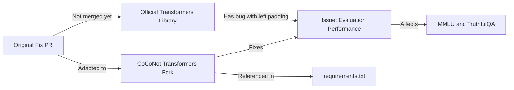
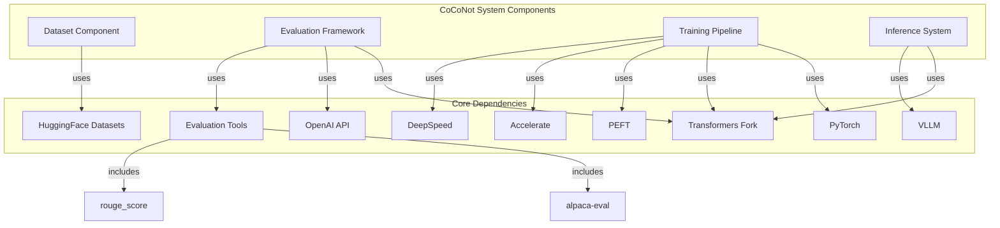

<!-- source: DeepWiki mcp.deepwiki.com · repo allenai/noncompliance · page 6.1 Dependencies · fetched 2026-10-26 -->

# Dependencies

<details>
<summary>Relevant source files</summary>

The following files were used as context for generating this wiki page:

- [requirements.txt](requirements.txt)

</details>


This document outlines all dependencies required to run the CoCoNot (Contextual Noncompliance Evaluation and Training) system. It details the core Python packages, custom forks, and system libraries necessary for successful installation and operation. For information about hardware and software system requirements, see [System Requirements](#6.2).

## Core Dependencies Overview

CoCoNot relies on several key Python libraries and frameworks, which can be categorized as follows:

```mermaid
flowchart TD
    subgraph "CoCoNot Dependencies"
        A["ML/DL Frameworks"] 
        B["HuggingFace Ecosystem"]
        C["Evaluation Tools"]
        D["Training Utilities"]
        E["OpenAI Integration"]
        F["Web & Interface Tools"]
    end
    
    A --> A1["PyTorch (≤2.0.1)"]
    A --> A2["DeepSpeed (≥0.10.0)"]
    A --> A3["Accelerate (≥0.21.0, <0.23.0)"]
    A --> A4["PEFT (≥0.4.0)"]
    A --> A5["Flash-Attention (2.2.2)"]
    A --> A6["bitsandbytes (≥0.41.1)"]
    
    B --> B1["Datasets"]
    B --> B2["Custom Transformers Fork"]
    B --> B3["Tokenizers (≥0.13.3)"]
    B --> B4["Evaluate (≥0.4.0)"]
    
    C --> C1["alpaca-eval (0.5.3)"]
    C --> C2["rouge_score"]
    
    D --> D1["wandb"]
    D --> D2["tensorboard"]
    D --> D3["vllm"]
    
    E --> E1["openai (≥1.5.0)"]
    E --> E2["tiktoken"]
    
    F --> F1["gradio (3.50.2)"]
    F --> F2["flask"]
```



Sources: [requirements.txt:1-37]()

## Dependency List and Versions

The following table details all required dependencies with their specified version constraints:

| Category | Package | Version Constraint | Purpose |
|----------|---------|-------------------|---------|
| ML/DL Frameworks | torch | ≤2.0.1 | Deep learning framework |
| | scipy | - | Scientific computing |
| | deepspeed | ≥0.10.0 | Distributed training |
| | accelerate | ≥0.21.0, <0.23.0 | Training optimization |
| | peft | ≥0.4.0 | Parameter-efficient fine-tuning |
| | bitsandbytes | ≥0.41.1 | Quantization support |
| | flash-attn | 2.2.2 | Efficient attention computation |
| | auto-gptq | - | Quantization tools |
| | einops | - | Tensor operations |
| HuggingFace | datasets | - | Dataset handling |
| | tokenizers | ≥0.13.3 | Text tokenization |
| | evaluate | ≥0.4.0 | Evaluation utilities |
| | transformers (fork) | - | LLM interface and utilities |
| OpenAI | openai | ≥1.5.0 | OpenAI API integration |
| | tiktoken | - | OpenAI tokenization |
| Evaluation | rouge_score | - | Text evaluation metrics |
| | alpaca-eval | 0.5.3 | LLM evaluation framework |
| Tracking | tensorboard | - | Training visualization |
| | wandb | - | Experiment tracking |
| Web & UI | gradio | 3.50.2 | Demo interfaces |
| | flask | - | Web application framework |
| | fire | - | Command-line interface |
| Utilities | jsonlines | - | JSONL file handling |
| | packaging | - | Package utilities |
| | sentencepiece | - | Tokenization |
| | protobuf | - | Serialization |
| | termcolor | - | Terminal coloring |
| | vllm | - | Efficient inference engine |
| | openpyxl | - | Excel file handling |
| | unidic-lite | - | Japanese tokenization |

Sources: [requirements.txt:1-37]()

## Custom Transformers Fork

CoCoNot uses a custom fork of the Transformers library to address a critical bug with left padding that affects inference and evaluation performance.



The custom fork is installed via:
```
git+https://github.com/yizhongw/transformers.git@left_padding
```

This fork fixes a significant bug in the original Transformers library (v4.34.0) that affects left padding, which is particularly important for evaluation benchmarks like MMLU and TruthfulQA.

Sources: [requirements.txt:13-19]()

## Dependency Relationships with CoCoNot Components

The following diagram illustrates how key dependencies interact with the main components of the CoCoNot system:



Sources: [requirements.txt:1-37]()

## Installation Instructions

All required dependencies can be installed using pip with the provided requirements.txt file:

```bash
pip install -r requirements.txt
```

### GPU-specific Dependencies

Several dependencies have specific requirements for GPU usage:

1. **PyTorch**: The installation will vary based on your CUDA version. CoCoNot is constrained to PyTorch ≤2.0.1.
2. **Flash Attention**: Version 2.2.2 is specified for compatibility.
3. **bitsandbytes**: Requires CUDA for quantization operations.

### Accelerate Configuration

The Accelerate library (used for distributed training) requires configuration before use:

```bash
accelerate config
```

This setup is particularly important for the LoRA fine-tuning and DPO training scripts.

Sources: [requirements.txt:6-7]()

## Dependency Groups by Function

```mermaid
graph TD
    subgraph "CoCoNot Functional Areas"
        A["Training Dependencies"]
        B["Evaluation Dependencies"]
        C["Inference Dependencies"]
        D["Interface Dependencies"]
    end
    
    A --> A1["torch"]
    A --> A2["accelerate"]
    A --> A3["deepspeed"]
    A --> A4["peft"]
    A --> A5["transformers-fork"]
    A --> A6["bitsandbytes"]
    A --> A7["wandb"]
    A --> A8["tensorboard"]
    
    B --> B1["openai"]
    B --> B2["tiktoken"]
    B --> B3["alpaca-eval"]
    B --> B4["rouge_score"]
    B --> B5["transformers-fork"]
    
    C --> C1["transformers-fork"]
    C --> C2["torch"]
    C --> C3["vllm"]
    C --> C4["flash-attn"]
    
    D --> D1["gradio"]
    D --> D2["flask"]
    D --> D3["fire"]
```



Sources: [requirements.txt:1-37]()

## Important Version Constraints

Some dependencies have specific version constraints that are critical for proper operation:

1. **PyTorch** (≤2.0.1): Later versions may cause compatibility issues with other components.

2. **Accelerate** (≥0.21.0, <0.23.0): Version 0.23.0 causes incorrect learning rate scheduling when using DeepSpeed, due to [code changes in the Accelerate library](https://github.com/huggingface/accelerate/commit/727d624322c67db66a43c559d8c86414d5ffb537).

3. **Gradio** (3.50.2): Pinned to ensure consistent web interface behavior.

4. **Flash-Attention** (2.2.2): Specific version for compatibility with the rest of the stack.

Sources: [requirements.txt:1-30]()

## Optional Dependencies

The following dependencies are included for specific features but may not be required for all use cases:

1. **Web application and human evaluation**:
   - flask
   - openpyxl

2. **Visualization and experiment tracking**:
   - wandb
   - tensorboard

3. **Japanese language support**:
   - unidic-lite

Sources: [requirements.txt:24-37]()

---

