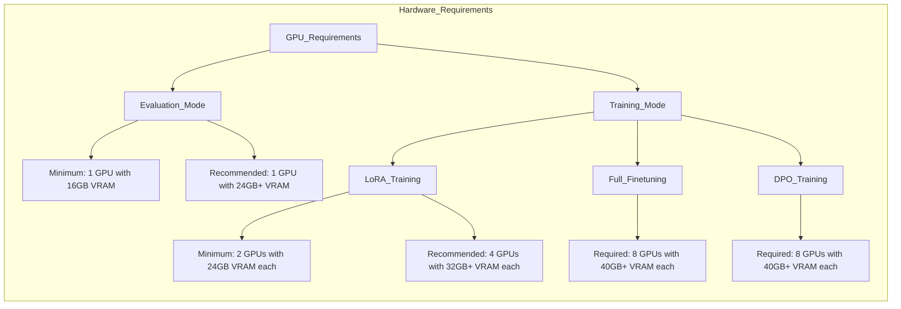
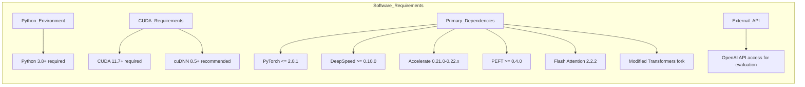
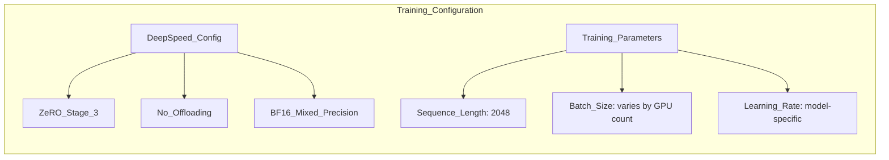

<!-- source: DeepWiki mcp.deepwiki.com · repo allenai/noncompliance · page 6.2 System Requirements · fetched 2026-10-26 -->

# System Requirements

<details>
<summary>Relevant source files</summary>

The following files were used as context for generating this wiki page:

- [requirements.txt](requirements.txt)
- [src/dpo_train_with_accelerate.sh](src/dpo_train_with_accelerate.sh)
- [src/finetune_lora_with_accelerate.sh](src/finetune_lora_with_accelerate.sh)

</details>


This document outlines the hardware and software requirements for running the CoCoNot (Contextual Noncompliance Evaluation and Training) system. These requirements ensure optimal performance for both evaluation and training workflows. For installation instructions and setup procedures, see [Installation and Setup](#6).

## Hardware Requirements

### GPU Requirements



- **Evaluation Mode**: 
  - **Minimum**: Single GPU with 16GB VRAM
  - **Recommended**: Single GPU with 24GB+ VRAM, especially for larger models

- **Training Mode**:
  - **LoRA Fine-tuning**:
    - **Minimum**: 2 GPUs with 24GB VRAM each
    - **Recommended**: 4+ GPUs with 32GB+ VRAM each
  - **Full Fine-tuning or DPO Training**:
    - **Required**: 8 GPUs with 40GB+ VRAM each

- **GPU Architecture**:
  - NVIDIA GPUs with CUDA support
  - Ampere (RTX 30xx, A100) or newer architecture recommended for optimal Flash Attention performance

Sources: [src/finetune_lora_with_accelerate.sh:2-9](), [src/dpo_train_with_accelerate.sh:2-9]()

### CPU and RAM Requirements

- **CPU**: 
  - 16+ cores recommended for efficient data preprocessing
  - High-speed processors (3.5GHz+) recommended for data loading and preprocessing

- **RAM**:
  - **Minimum**: 32GB system RAM
  - **Recommended**: 64GB+ system RAM for handling large datasets and preprocessing

- **Storage**:
  - At least 100GB for code, dependencies, and datasets
  - 500GB+ SSD storage recommended for model checkpoints and intermediate outputs
  - High-speed SSD (NVMe) recommended for faster data loading

## Software Requirements

### Python Environment



- **Python**: Version 3.8 or higher

### Required Libraries and Dependencies

The system relies on several key libraries:

| Category | Package | Version | Purpose |
|----------|---------|---------|---------|
| Deep Learning | PyTorch | ≤ 2.0.1 | Core deep learning framework |
| Distributed Training | DeepSpeed | ≥ 0.10.0 | Distributed training optimization |
| Training Utilities | Accelerate | ≥ 0.21.0, < 0.23.0 | Training acceleration and distribution |
| Parameter-Efficient Training | PEFT | ≥ 0.4.0 | Parameter-efficient fine-tuning techniques |
| Mixed Precision | bitsandbytes | ≥ 0.41.1 | Quantization support |
| Attention Optimization | flash-attn | 2.2.2 | Flash Attention implementation |
| Model Handling | Transformers | Custom fork | Fixed left padding issues |
| Evaluation | OpenAI | ≥ 1.5.0 | Access to evaluation models |

**Note**: The system uses a custom fork of the Transformers library to address left padding issues that affect evaluation performance:
```
git+https://github.com/yizhongw/transformers.git@left_padding
```

Sources: [requirements.txt:1-37]()

### CUDA Requirements

- **CUDA**: Version 11.7 or higher
- **cuDNN**: Version 8.5 or higher (recommended)

## Configuration Requirements

### DeepSpeed Configuration

The system uses DeepSpeed for efficient training with configuration specified in `ds_configs/stage3_no_offloading_accelerate.conf`.



### Training-Specific Requirements

- **LoRA Fine-tuning**:
  - Memory-efficient parameter-efficient fine-tuning
  - Configuration parameters include rank (64), alpha (16), and dropout (0.1)
  - Uses gradient accumulation to achieve effective batch sizes
  
- **DPO Training**:
  - Higher GPU memory requirements
  - Gradient checkpointing enabled to reduce memory usage
  - Specific learning rate scheduling and warm-up parameters

Sources: [src/finetune_lora_with_accelerate.sh:13-43](), [src/dpo_train_with_accelerate.sh:13-38]()

## Recommended System Configurations

### Minimal Evaluation Setup
- 1 GPU with 16GB VRAM (NVIDIA RTX 3090 or similar)
- 32GB system RAM
- 100GB SSD storage
- Python 3.8+, CUDA 11.7+
- All dependencies installed via requirements.txt

### Standard Training Setup
- 4 GPUs with 32GB VRAM each (NVIDIA A100 or similar)
- 64GB system RAM
- 500GB SSD storage
- Python 3.8+, CUDA 11.7+
- All dependencies installed via requirements.txt

### Large-Scale Training Setup
- 8 GPUs with 40GB+ VRAM each (NVIDIA A100 or H100)
- 128GB system RAM
- 1TB NVMe SSD storage
- Python 3.8+, CUDA 11.7+
- High-speed interconnect between GPUs (NVLink or equivalent)
- All dependencies installed via requirements.txt

## External API Requirements

- **OpenAI API**:
  - Valid API key with sufficient quota
  - Access to GPT models for refusal evaluation (typically gpt-3.5-turbo or gpt-4)

Sources: [requirements.txt:20-21]()

---

