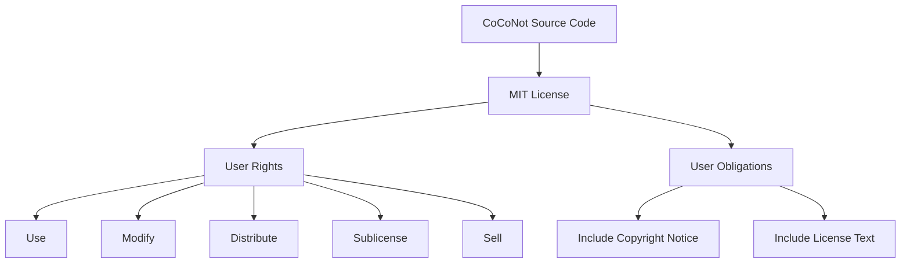
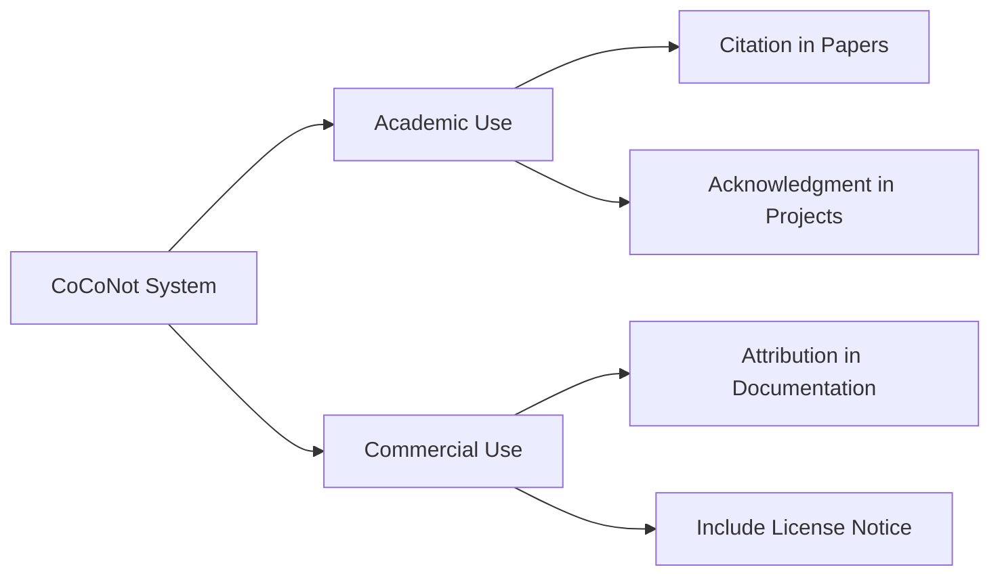
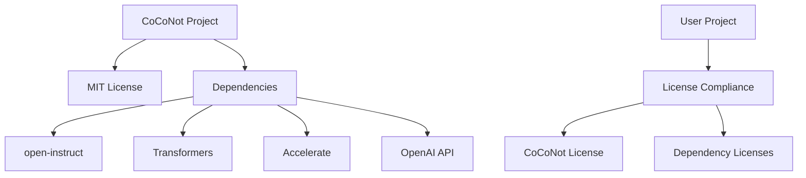

<!-- source: DeepWiki mcp.deepwiki.com · repo allenai/noncompliance · page 7 License and Citation · fetched 2026-10-26 -->

# License and Citation

<details>
<summary>Relevant source files</summary>

The following files were used as context for generating this wiki page:

- [LICENSE](LICENSE)
- [paper.pdf](paper.pdf)

</details>


This document outlines the licensing terms for the CoCoNot system and provides guidance on how to properly cite this work in academic publications or other contexts. For information about installing and setting up the system, please refer to [Installation and Setup](#6).

## License Information

CoCoNot is released under the MIT License, a permissive free software license that provides minimal restrictions on reuse.



### License Terms

The key terms of the MIT License include:

- Permission to use, copy, modify, merge, publish, distribute, sublicense, and/or sell copies of the software
- The software is provided "as is" without warranty of any kind
- Authors or copyright holders are not liable for any claims, damages or other liability
- The original copyright notice and license must be included in all copies or substantial portions of the software

The full text of the license can be found in the LICENSE file in the repository root.

Sources: [LICENSE:1-21]()

## How to Cite CoCoNot

When using CoCoNot in academic research, please cite it as follows:

```
@inproceedings{coconot2024,
  title={CoCoNot: Contextual Noncompliance Evaluation and Training},
  author={AI2 Team},
  booktitle={},
  year={2024},
  url={https://github.com/allenai/noncompliance}
}
```

> **Note**: The citation details above are placeholders. Please check the repository's README or official documentation for the most up-to-date citation information.



## Attribution Requirements

### When Using the Code

If you use, modify, or distribute CoCoNot code:

1. Retain the original copyright notice in all copies or substantial portions of the software
2. Include the full MIT license text in your distribution
3. While not required by the license, it's good practice to acknowledge the use of CoCoNot in your documentation

### When Using the Dataset

When using the CoCoNot dataset in your research or applications:

1. Cite the CoCoNot paper as specified above
2. Acknowledge the source of the dataset in your methodology section
3. Be aware of and respect any additional terms that may apply specifically to the dataset components

### Third-Party Dependencies

CoCoNot relies on several external libraries and tools, each with their own licenses. When using CoCoNot, you should be aware of and comply with the licensing terms of these dependencies:

- open-instruct library
- Transformers library
- Accelerate library
- OpenAI API (if used for evaluation)



## Acknowledgments

When publishing results obtained using CoCoNot, we recommend acknowledging the Allen Institute for AI (AI2) and any specific grants or funding that supported the development of CoCoNot.

## License Disclaimer

This license information is provided for guidance only and does not constitute legal advice. For specific legal questions regarding the use of CoCoNot, please consult with a legal professional.

Sources: [LICENSE:1-21]()