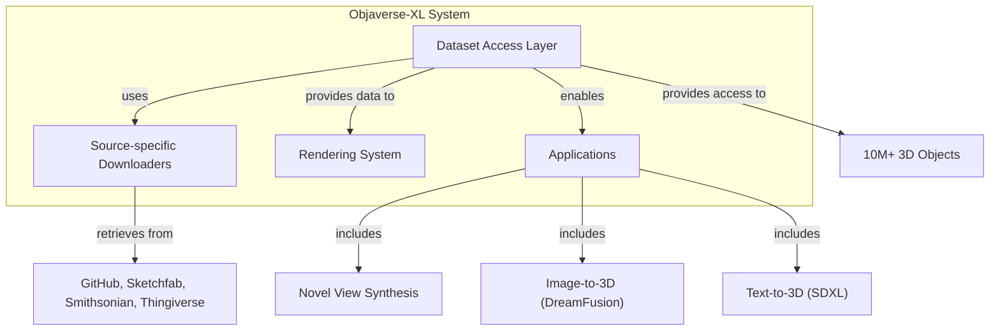
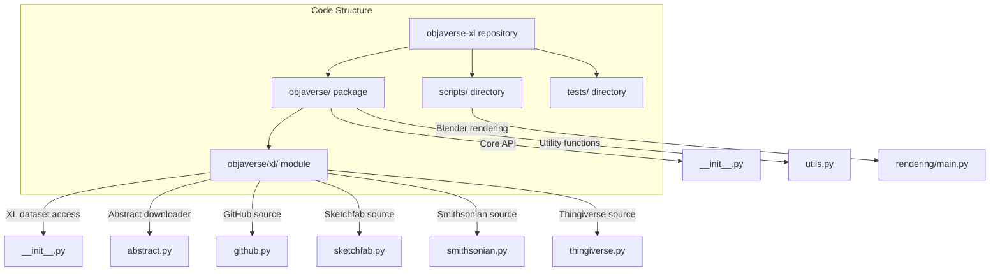
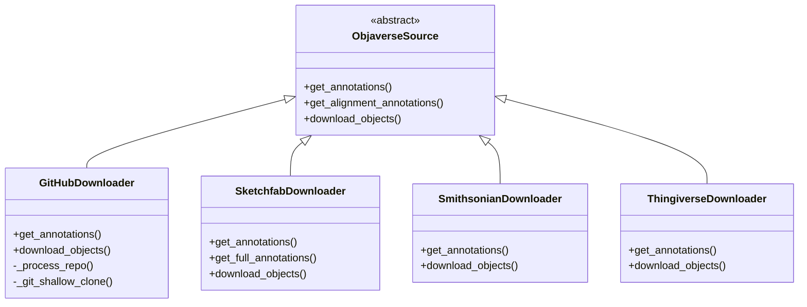
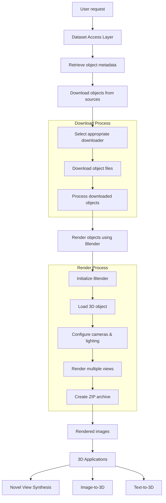

<!-- source: DeepWiki mcp.deepwiki.com · repo allenai/objaverse-xl · page 1 Overview · fetched 2026-10-26 -->

# Overview

Relevant source files

The following files were used as context for generating this wiki page:

- [README.md](README.md)

This document provides an introduction to the Objaverse-XL repository, which offers tools for accessing, downloading, and rendering a large-scale 3D object dataset. It covers the purpose of the repository, key components, system architecture, and primary functionalities. For detailed information about the dataset itself, see [Dataset Description](#1.1). For practical usage instructions, see [Using Objaverse-XL](#3).

## Introduction to Objaverse-XL

Objaverse-XL is an open dataset containing over 10 million 3D objects, representing a significant advancement in scale compared to its predecessor, Objaverse 1.0 (which contained approximately 800,000 objects). The repository provides tools to access and work with this massive collection of 3D assets from various sources including GitHub, Sketchfab, Smithsonian Institution, and Thingiverse.

The codebase offers functionality for:
- Downloading 3D objects from multiple sources
- Processing and organizing the objects
- Rendering the 3D objects using Blender
- Supporting various 3D applications like novel view synthesis, image-to-3D, and text-to-3D generation

Sources: [README.md:1-7](), [README.md:11-15]()

## System Architecture

The Objaverse-XL system consists of several interconnected components organized in a modular architecture:

### Code Structure to Component Mapping

The repository's code structure directly maps to the system components:

Sources: [README.md:3]()

## Core Components

### Dataset Access Layer

The Dataset Access Layer provides interfaces to access the 3D objects in the Objaverse-XL collection. It consists of:

1. Core dataset access (`objaverse/__init__.py`)
2. Objaverse-XL specific access (`objaverse/xl/__init__.py`)

These components allow users to query and retrieve objects from the dataset, access metadata, and manage downloads.

### Downloaders

The system implements a class hierarchy for downloading 3D objects from different sources:

Each downloader is specialized for retrieving objects from a specific source while adhering to a common interface defined by the abstract `ObjaverseSource` class.

Sources: [objaverse/xl/abstract.py](), [objaverse/xl/github.py](), [objaverse/xl/sketchfab.py](), [objaverse/xl/smithsonian.py](), [objaverse/xl/thingiverse.py]()

### Rendering System

The rendering system is primarily implemented in the scripts directory and provides functionality to:

1. Process downloaded 3D objects
2. Generate renders using Blender
3. Capture multiple views of objects
4. Package renders as ZIP archives

The rendering pipeline is designed to handle large batches of objects efficiently, with support for parallel processing.

Sources: [README.md:51-55](), [scripts/rendering/main.py]()

## Data Flow

The following diagram illustrates the typical data flow when working with Objaverse-XL:

Sources: [objaverse/xl/__init__.py](), [scripts/rendering/main.py]()

## Applications and Use Cases

Objaverse-XL enables several important applications in 3D computer vision:

1. **Novel View Synthesis**: Generate new viewpoints of 3D objects
   - Zero123-XL model trained on Objaverse-XL shows remarkable 0-shot generalization abilities
   - Can synthesize novel views of sketches, cartoons, and people

2. **Image-to-3D**: Create 3D models from single images
   - Combines Zero123-XL with DreamFusion to guide NeRF generation
   - Produces high-quality 3D models from single reference images

3. **Text-to-3D**: Generate 3D models from text descriptions
   - Works with text-to-image models like SDXL to provide initial images
   - Enables creative generation of 3D content from textual descriptions

4. **Research and Development**: The large-scale dataset supports research in 3D vision, including:
   - 3D model generation and editing
   - View synthesis and novel view interpolation
   - 3D scene understanding

For more details on applications and use cases, see [Use Cases and Applications](#1.2).

Sources: [README.md:19-37](), [README.md:39-43]()

## Summary

Objaverse-XL repository provides a comprehensive system for working with a massive dataset of 10+ million 3D objects. It includes components for:

1. Dataset access and metadata retrieval
2. Source-specific object downloading
3. 3D object rendering using Blender
4. Support for various 3D vision applications

The system is designed to be modular, extensible, and efficient, allowing researchers and developers to harness the power of this large-scale 3D dataset. For practical guides on using Objaverse-XL, see [Installation and Setup](#3.1), [Downloading Objects](#3.2), and [Rendering Objects](#3.3).

Sources: [README.md:1-7]()

---

