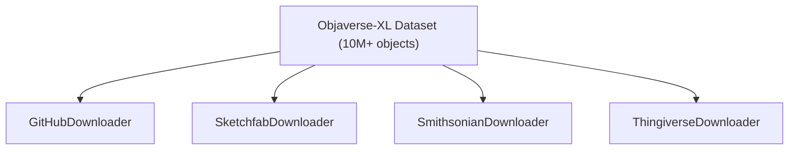
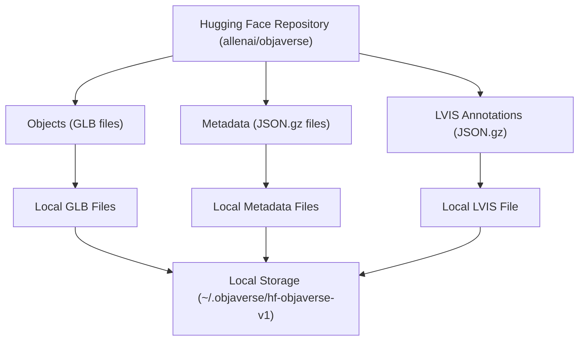
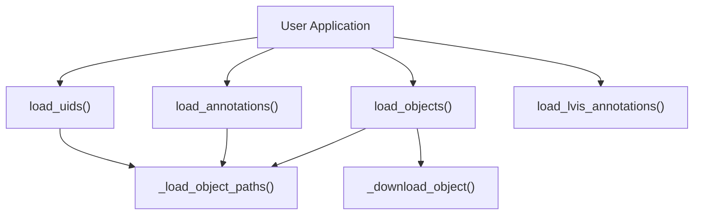

<!-- source: DeepWiki mcp.deepwiki.com · repo allenai/objaverse-xl · page 1.1 Dataset Description · fetched 2026-10-26 -->

# Dataset Description

Relevant source files

The following files were used as context for generating this wiki page:

- [.github/workflows/pypi-publish.yaml](.github/workflows/pypi-publish.yaml)
- [README.md](README.md)
- [objaverse/__init__.py](objaverse/__init__.py)

This document provides a detailed description of the Objaverse-XL dataset, its composition, structure, and technical characteristics. For information about use cases and applications of the dataset, see [Use Cases and Applications](#1.2).

## Overview

Objaverse-XL is a large-scale open dataset containing over 10 million 3D objects. It represents a significant expansion from the original Objaverse 1.0, which contained approximately 800,000 objects. The dataset aggregates 3D objects from multiple sources and provides a standardized interface for accessing them.

Sources: [README.md:3-7]()

## Dataset Scale and Composition

Objaverse-XL contains 3D objects sourced from multiple platforms, each accessible through dedicated downloader classes in the codebase. The dataset represents more than an order of magnitude increase in scale compared to its predecessor.

### Dataset Scale Comparison

| Dataset | Size | Release Date |
|---------|------|--------------|
| Objaverse-XL | 10M+ 3D objects | 2023 |
| Objaverse 1.0 | 800K 3D objects | December 2022 |

Sources: [README.md:11-15]()

### Data Source Architecture

The diagram below illustrates the different sources of 3D objects in Objaverse-XL and their corresponding downloader implementations in the codebase:

Sources: [README.md:7](), [objaverse/__init__.py:87-193]()

## Object Formats and Structure

Objects in Objaverse-XL are primarily stored as GLB files, which is a binary format for 3D scenes and models. Each object in the dataset:

1. Has a unique identifier (UID)
2. Is stored in a structured file path organization
3. Contains associated metadata
4. May have category annotations (LVIS annotations)

### Data Hosting and Access Structure

The dataset is hosted on Hugging Face and accessed through the Objaverse package's API, which downloads objects and metadata to a local directory structure:

Sources: [objaverse/__init__.py:14-17](), [objaverse/__init__.py:66-76]()

## Metadata and Annotations

Each object in Objaverse-XL has associated metadata that provides additional information about the object. The metadata is organized in gzipped JSON files, with each file containing information for multiple objects. 

### LVIS Annotations

The dataset includes LVIS (Large Vocabulary Instance Segmentation) annotations, which categorize objects according to a common vocabulary. These annotations can be loaded using the `load_lvis_annotations()` function.

Sources: [objaverse/__init__.py:20-55](), [objaverse/__init__.py:196-211]()

## Dataset Access API

The Objaverse package provides several functions for accessing the dataset, as illustrated in the diagram below:

The primary functions for accessing the dataset include:

1. `load_uids()`: Returns a list of all unique identifiers in the dataset
2. `load_annotations(uids)`: Retrieves metadata for specified objects
3. `load_objects(uids, download_processes)`: Downloads and returns paths to the 3D object files
4. `load_lvis_annotations()`: Retrieves category annotations for objects

Sources: [objaverse/__init__.py:20-193]()

## Object Download Process

When requesting objects through the API, the system:

1. Checks if the objects already exist locally
2. Downloads missing objects from Hugging Face to the local storage directory
3. Handles parallel downloads when multiple processes are specified
4. Returns paths to the downloaded objects

The download process supports multiple download processes for parallel retrieval, significantly speeding up the acquisition of large numbers of objects.

Sources: [objaverse/__init__.py:88-193]()

## Licensing

The Objaverse-XL dataset as a whole is licensed under the ODC-By v1.0 license. However, individual objects within the dataset may have their own specific licenses depending on their source. Users should be aware of these licensing considerations when using objects for specific applications.

Sources: [README.md:57-59]()

## Polycam Data Access

In addition to the publicly available data, Polycam data is available to academic researchers for non-commercial use upon request and approval from Polycam. Access requires filling out a request form.

Sources: [README.md:49]()

---

