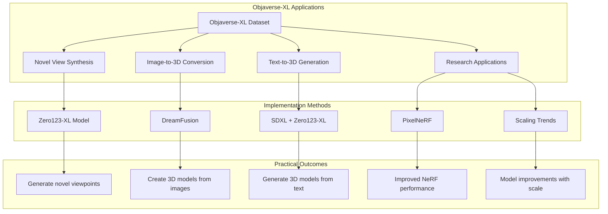
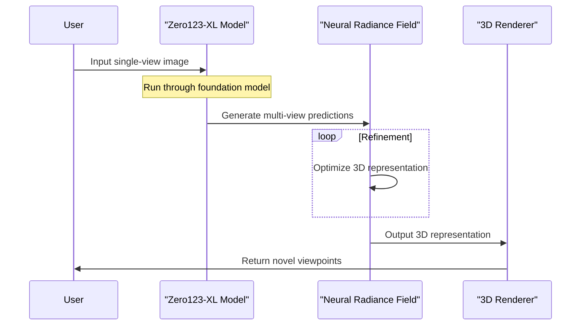
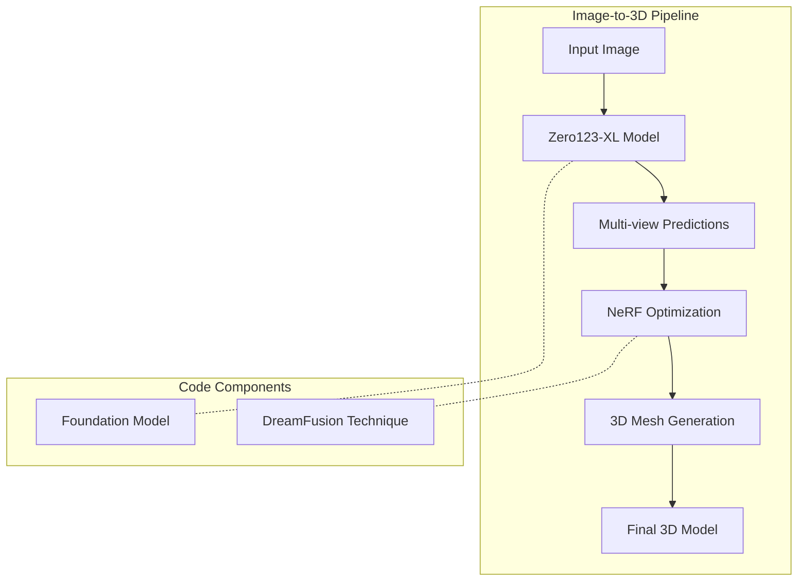
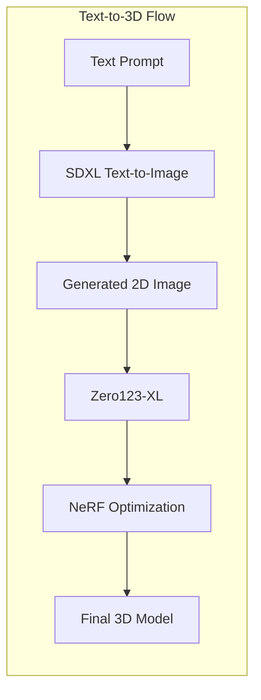
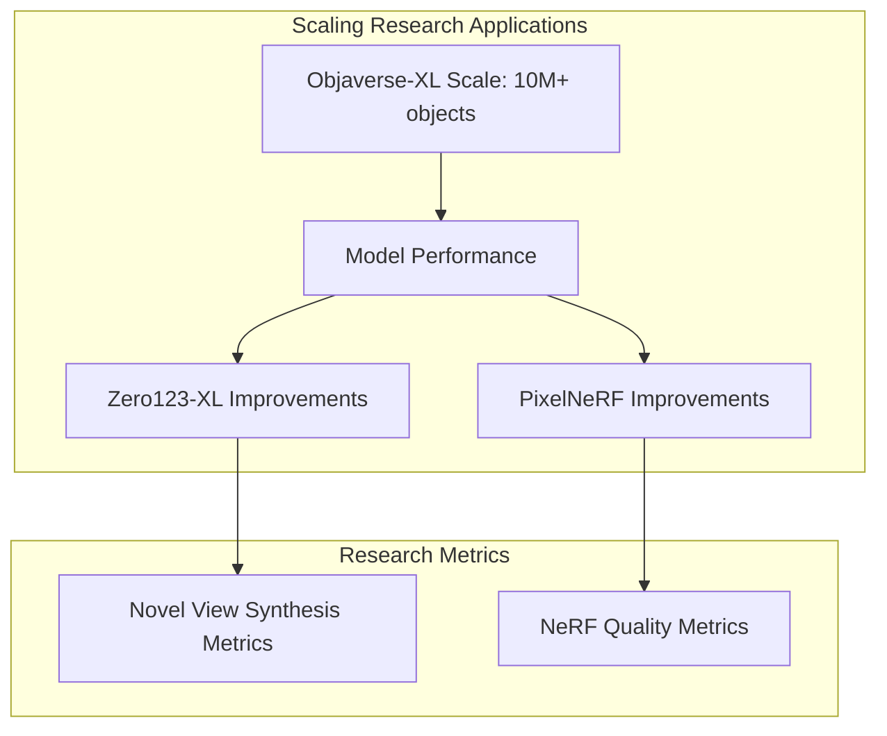
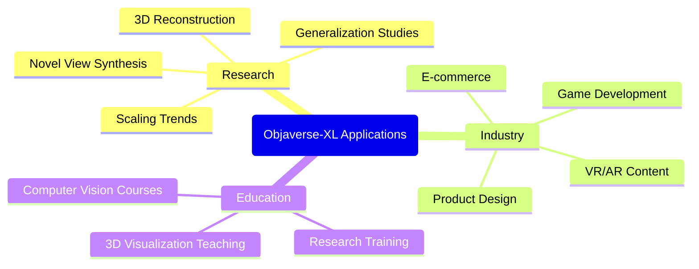
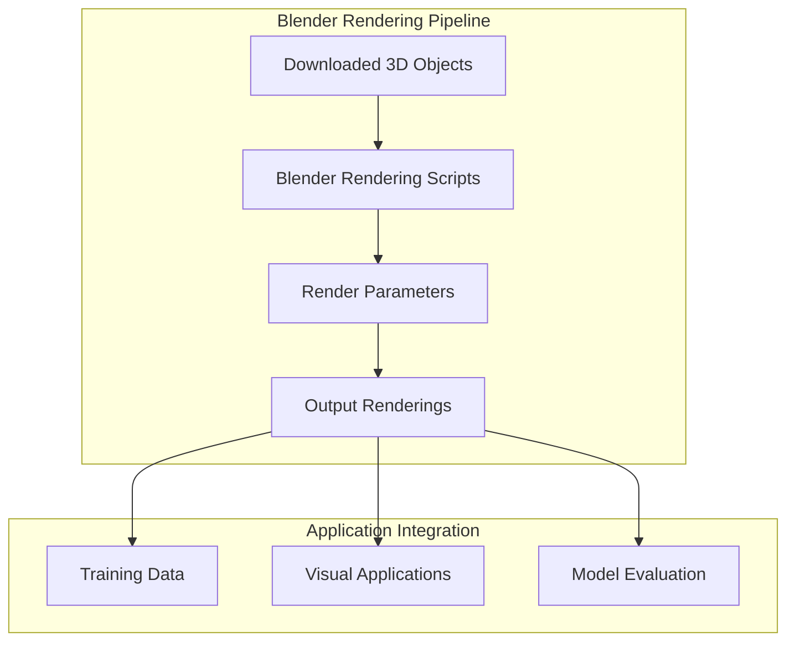

<!-- source: DeepWiki mcp.deepwiki.com · repo allenai/objaverse-xl · page 1.2 Use Cases and Applications · fetched 2026-10-26 -->

# Use Cases and Applications

Relevant source files

The following files were used as context for generating this wiki page:

- [README.md](README.md)

## Purpose

This document outlines the primary applications and use cases of Objaverse-XL, a large-scale 3D object dataset containing over 10 million 3D objects. It explains how researchers and developers can leverage this dataset for various 3D computer vision tasks, focusing on practical implementations and research opportunities. For information about the dataset itself, see [Dataset Description](#1.1), and for system architecture details, see [System Architecture](#2).

## Overview of Applications

Objaverse-XL enables several groundbreaking applications in 3D vision and generation tasks, powered by its unprecedented scale and diversity of 3D objects.

Sources: README.md

## Novel View Synthesis

Novel view synthesis refers to the task of generating new viewpoints of a 3D object given one or more images from different perspectives. Objaverse-XL has enabled significant improvements in this domain through the Zero123-XL model.

### Zero123-XL Capabilities

Zero123-XL, trained on Objaverse-XL, demonstrates remarkable zero-shot generalization abilities compared to its predecessor:

- Performs novel view synthesis on diverse visual domains
- Successfully handles sketches, cartoons, and even human figures
- Maintains consistency across generated views
- Preserves fine details of complex objects

Sources: README.md:19-25

## Image-to-3D Conversion

Objaverse-XL enables high-quality image-to-3D conversion through integration with the DreamFusion methodology.

### How It Works

The system leverages Zero123-XL as a foundation model to guide Neural Radiance Fields (NeRF) optimization:

1. A single image is provided as input
2. Zero123-XL generates multi-view predictions from the single input view
3. These predictions guide the optimization of a NeRF
4. The optimized NeRF represents a complete 3D model that can be rendered from any viewpoint

Sources: README.md:27-31

## Text-to-3D Generation

Objaverse-XL's capabilities extend to text-to-3D generation by leveraging text-to-image models in conjunction with the image-to-3D pipeline.

### Pipeline Process

1. Text prompt is provided by the user
2. A text-to-image model (such as SDXL) generates an initial 2D image
3. The generated image is fed into the Zero123-XL pipeline
4. Zero123-XL guides a NeRF to create a consistent 3D model
5. The final 3D model is rendered and can be viewed from any angle

Sources: README.md:33-37

## Research Applications

### Scaling Trends

Objaverse-XL demonstrates clear scaling trends that show improved performance as the dataset size increases:

- Both Zero123-XL and PixelNeRF models show substantial improvements with larger training datasets
- Performance metrics continue to improve without plateauing, suggesting further potential gains with even larger datasets

Sources: README.md:39-43

### Cross-Domain Generalization

The scale and diversity of Objaverse-XL enable unprecedented generalization capabilities:

- Models trained on Objaverse-XL can perform novel view synthesis on domains never seen during training
- Generalization to sketches, cartoons, paintings, and real-world photographs
- Ability to handle complex human figures and articulated objects

## Industrial and Educational Applications

### Industry Use Cases

Objaverse-XL enables various industrial applications:

- **Game Development**: Rapid creation and transformation of 3D assets
- **Virtual/Augmented Reality**: Generation of realistic 3D environments from limited inputs
- **E-commerce**: Creating 3D models from product images for immersive shopping experiences
- **Architecture and Design**: Converting concept sketches to 3D visualizations

### Educational Applications

- **Teaching 3D Concepts**: Accessible way to demonstrate 3D principles
- **Research Resource**: Benchmark dataset for 3D vision tasks
- **Training Platform**: Dataset for developing new 3D generative models and techniques

Sources: README.md

## Usage with Blender Rendering

Objaverse-XL provides Blender rendering scripts that allow users to create high-quality renderings of 3D objects in the dataset. These renderings can be used as inputs for the applications described above or for creating training data for new models.

The rendering scripts can be found in the [scripts/rendering directory](scripts/rendering/main.py) and allow for customization of rendering parameters to suit different application needs.

Sources: README.md:51-55

## Conclusion

Objaverse-XL provides a foundation for numerous 3D computer vision applications, from novel view synthesis to text-to-3D generation. Its unprecedented scale has enabled significant improvements in model performance and generalization capabilities. 

The applications outlined in this document represent the current state of research and development using Objaverse-XL, but the dataset's potential extends far beyond these examples. As research continues and new techniques emerge, Objaverse-XL is positioned to support further breakthroughs in 3D vision and generation tasks.

Sources: README.md

---

