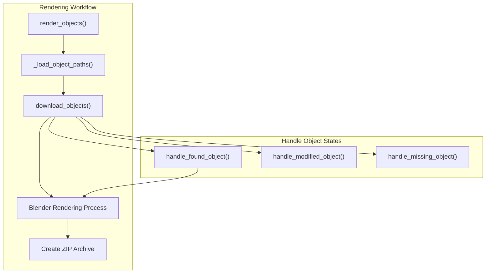
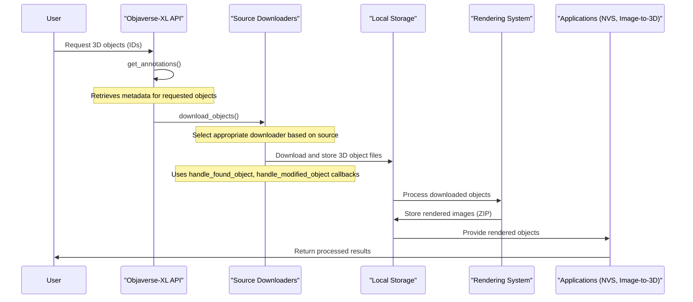
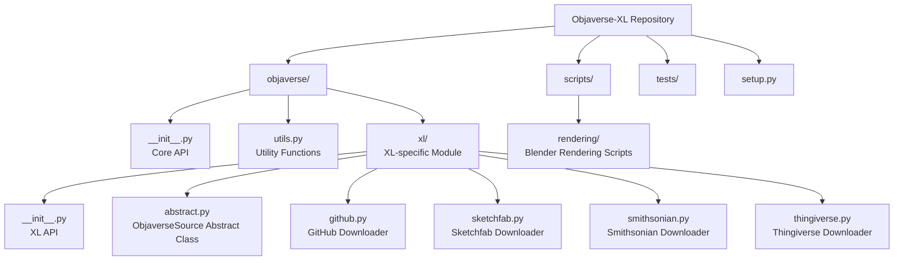
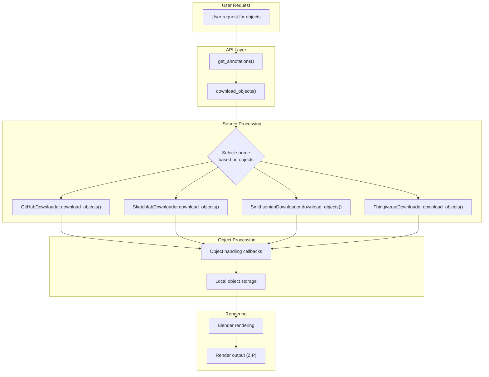

<!-- source: DeepWiki mcp.deepwiki.com · repo allenai/objaverse-xl · page 2 System Architecture · fetched 2026-10-26 -->

# System Architecture

<details>
<summary>Relevant source files</summary>

The following files were used as context for generating this wiki page:

- [.github/workflows/pypi-publish.yaml](.github/workflows/pypi-publish.yaml)
- [README.md](README.md)
- [objaverse/__init__.py](objaverse/__init__.py)
- [objaverse/xl/__init__.py](objaverse/xl/__init__.py)
- [objaverse/xl/abstract.py](objaverse/xl/abstract.py)

</details>


This page provides a comprehensive overview of the Objaverse-XL architecture, detailing the core components and their interactions that enable the system to manage, access, and process a dataset of over 10 million 3D objects. The architecture is designed to efficiently handle large-scale 3D data operations, including downloading from multiple sources, metadata management, and rendering.

For information about the dataset itself and its applications, see [Overview](#1). For details on how to use the system, see [Using Objaverse-XL](#3).

## High-Level Architecture Overview

The following diagram illustrates the main components of the Objaverse-XL system and their relationships:

```mermaid
graph TD
    subgraph "Dataset Layer"
        Dataset["Objaverse-XL Dataset<br>10M+ 3D objects"]
        Metadata["Object Metadata"]
    end
    
    subgraph "Access Layer"
        CoreAPI["objaverse/__init__.py<br>Core API"]
        XLAPI["objaverse/xl/__init__.py<br>XL-specific API"]
    end
    
    subgraph "Source Layer"
        AbstractSource["ObjaverseSource<br>Abstract Base Class"]
        Github["GitHubDownloader"]
        Sketchfab["SketchfabDownloader"]
        Smithsonian["SmithsonianDownloader"]
        Thingiverse["ThingiverseDownloader"]
    end
    
    subgraph "Processing Layer"
        Rendering["Rendering System"]
        ObjectProcessing["Object Processing<br>& Transformation"]
    end
    
    subgraph "Application Layer"
        NVS["Novel View Synthesis"]
        Image2_3D["Image-to-3D<br>DreamFusion"]
        Text2_3D["Text-to-3D<br>SDXL"]
    end
    
    Dataset --- Metadata
    Metadata --> CoreAPI
    Metadata --> XLAPI
    
    CoreAPI --> Rendering
    XLAPI --> AbstractSource
    
    AbstractSource --> Github
    AbstractSource --> Sketchfab
    AbstractSource --> Smithsonian
    AbstractSource --> Thingiverse
    
    Github --> ObjectProcessing
    Sketchfab --> ObjectProcessing
    Smithsonian --> ObjectProcessing
    Thingiverse --> ObjectProcessing
    
    ObjectProcessing --> Rendering
    Rendering --> NVS
    Rendering --> Image2_3D
    Rendering --> Text2_3D
```



Sources: [objaverse/xl/__init__.py:12-17](), [objaverse/__init__.py:1-196](), [README.md:1-78]()

## Core Components

The Objaverse-XL system consists of four principal components:

| Component | Purpose | Key Files |
|-----------|---------|-----------|
| Dataset Access Layer | Provides interfaces to access 3D objects and metadata | `objaverse/__init__.py`, `objaverse/xl/__init__.py` |
| Downloaders | Source-specific implementation for retrieving 3D objects | `objaverse/xl/github.py`, `objaverse/xl/sketchfab.py`, etc. |
| Rendering System | Processes 3D objects to generate image renders | `scripts/rendering/main.py` |
| Applications | Uses rendered objects for 3D vision tasks | Various application-specific implementations |

Sources: [objaverse/xl/__init__.py:1-158](), [objaverse/__init__.py:1-212]()

### Dataset Access Layer

The Dataset Access Layer provides a unified interface to retrieve metadata and 3D objects from the Objaverse-XL dataset. This layer abstracts away the complexities of accessing different data sources.

```mermaid
classDiagram
    class "objaverse/__init__.py" {
        +load_annotations(uids)
        +load_objects(uids, download_processes)
        +load_uids()
        +load_lvis_annotations()
        -_load_object_paths()
        -_download_object()
    }
    
    class "objaverse/xl/__init__.py" {
        +get_annotations(download_dir, refresh)
        +get_alignment_annotations(download_dir, refresh)
        +download_objects(objects, download_dir, processes, ...)
        -downloaders: Dict
    }
    
    "objaverse/__init__.py" -- "objaverse/xl/__init__.py" : extends functionality
```

The Dataset Access Layer exposes several key functions:

- `get_annotations()`: Retrieves metadata for all 3D objects in the dataset
- `get_alignment_annotations()`: Gets metadata for objects used in alignment fine-tuning
- `download_objects()`: Downloads 3D objects based on source and identifier
- `load_objects()`: Loads 3D objects from the dataset (original API)
- `load_uids()`: Retrieves all unique identifiers in the dataset

Sources: [objaverse/xl/__init__.py:20-66](), [objaverse/__init__.py:20-86]()

### Downloader System

The Downloader System consists of an abstract base class (`ObjaverseSource`) and several concrete implementations for different data sources. Each downloader is responsible for retrieving objects from its specific source.

```mermaid
classDiagram
    class "ObjaverseSource" {
        <<abstract>>
        +get_annotations(download_dir, refresh)
        +get_alignment_annotations(download_dir, refresh)
        +download_objects(objects, download_dir, processes, ...)
    }
    
    class "GitHubDownloader" {
        +get_annotations()
        +get_alignment_annotations()
        +download_objects()
        -_process_repo()
        -_git_shallow_clone()
        -_pull_lfs_files()
    }
    
    class "SketchfabDownloader" {
        +get_annotations()
        +get_alignment_annotations()
        +get_full_annotations()
        +get_uids()
        +download_objects()
        +get_lvis_annotations()
    }
    
    class "SmithsonianDownloader" {
        +get_annotations()
        +get_alignment_annotations()
        +download_objects()
        -_download_smithsonian_object()
    }
    
    class "ThingiverseDownloader" {
        +get_annotations()
        +download_objects()
    }
    
    ObjaverseSource <|-- GitHubDownloader
    ObjaverseSource <|-- SketchfabDownloader
    ObjaverseSource <|-- SmithsonianDownloader
    ObjaverseSource <|-- ThingiverseDownloader
```

The downloaders are initialized and stored in a dictionary in the XL module:

```python
downloaders = {
    "github": GitHubDownloader(),
    "thingiverse": ThingiverseDownloader(),
    "smithsonian": SmithsonianDownloader(),
    "sketchfab": SketchfabDownloader(),
}
```

Sources: [objaverse/xl/__init__.py:12-17](), [objaverse/xl/abstract.py:1-124]()

### Rendering System

The Rendering System processes downloaded 3D objects using Blender to generate multi-view renders. It supports parallel rendering on multiple GPUs and handles different object scenarios.



Sources: [objaverse/xl/__init__.py:69-158](), [README.md:51-55]()

## Data Flow

The data flow in Objaverse-XL follows a clear path from object identification to processing and application use:



The key processing stages are:

1. **Metadata Retrieval**: The system retrieves object metadata using `get_annotations()` or `get_alignment_annotations()`
2. **Object Download**: Objects are downloaded using the appropriate downloader based on their source
3. **Object Processing**: Downloaded objects are processed through callback functions that handle different scenarios
4. **Rendering**: Objects are rendered using Blender to generate multi-view images
5. **Application**: Rendered objects are used in various 3D applications

Sources: [objaverse/xl/__init__.py:20-42](), [objaverse/xl/__init__.py:69-158]()

## Package Structure

The Objaverse-XL codebase is organized into a modular structure, with clear separation of concerns:



This structure follows a clear pattern:

1. The root `objaverse` package contains core API functions for accessing the original Objaverse dataset
2. The `objaverse/xl` subpackage extends this functionality for the larger XL dataset
3. Source-specific downloaders are implemented in dedicated modules
4. Rendering scripts are kept in a separate directory

Sources: [objaverse/xl/__init__.py:1-158](), [objaverse/__init__.py:1-212](), [objaverse/xl/abstract.py:1-124]()

## Component Interaction Model

The following diagram shows how the different components interact when a user wants to download and render 3D objects:



This illustrates the full lifecycle of an object request, from user initiation through source-specific downloading to final rendering.

Sources: [objaverse/xl/__init__.py:69-158](), [objaverse/xl/abstract.py:54-123]()

## Technical Specifications

| Component | Features |
|-----------|----------|
| Dataset Size | Over 10 million 3D objects |
| Data Sources | GitHub, Sketchfab, Smithsonian, Thingiverse |
| Object Formats | GLB, OBJ, and other 3D file formats |
| Storage | Local storage with user-configurable paths |
| Parallelism | Multi-process downloading and rendering |
| Callbacks | Configurable callbacks for object handling |
| Rendering | Blender-based rendering with customizable parameters |

Sources: [README.md:1-17](), [objaverse/xl/__init__.py:69-136]()

---

