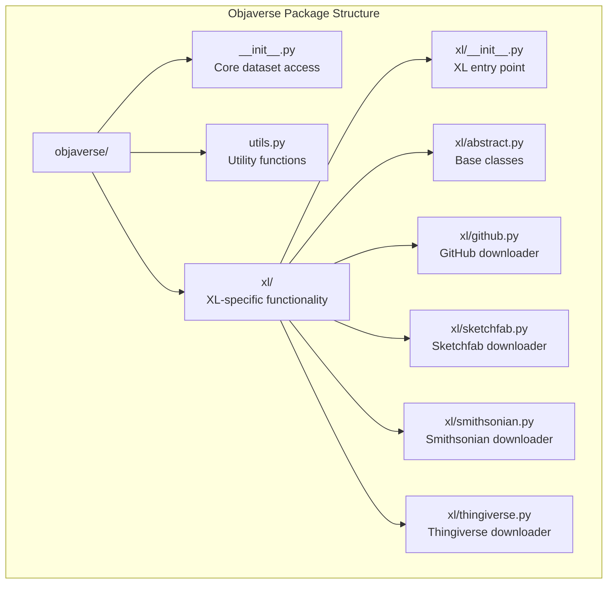
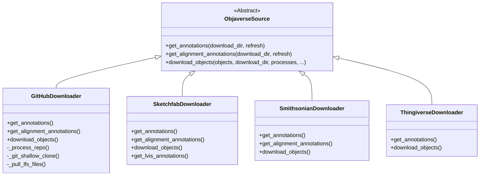
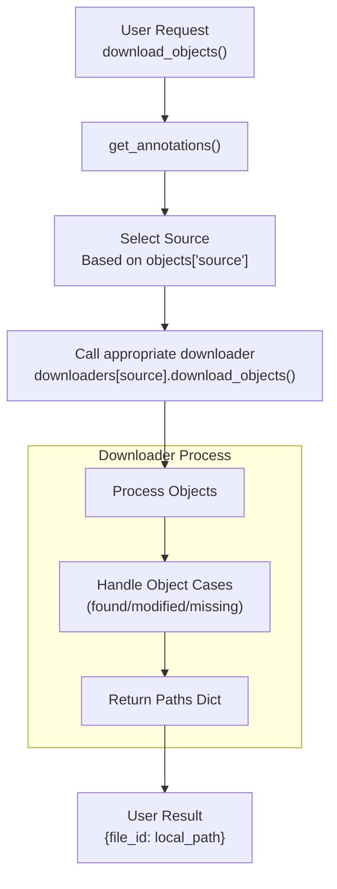

<!-- source: DeepWiki mcp.deepwiki.com · repo allenai/objaverse-xl · page 2.1 Package Structure · fetched 2026-10-26 -->

# Package Structure

<details>
<summary>Relevant source files</summary>

The following files were used as context for generating this wiki page:

- [.github/workflows/pypi-publish.yaml](.github/workflows/pypi-publish.yaml)
- [objaverse/__init__.py](objaverse/__init__.py)
- [objaverse/xl/__init__.py](objaverse/xl/__init__.py)
- [setup.py](setup.py)
- [tests/test_api.py](tests/test_api.py)

</details>


This page documents the organization of the Objaverse-XL codebase, detailing the main packages, modules, and their functions. For information about core components and their interactions, see [Core Components](#2.2).

## Overview

Objaverse-XL is organized as a Python package with several submodules designed to facilitate access to over 10 million 3D objects from multiple sources. The package structure follows a modular design that separates the core functionality (base objaverse package) from the Objaverse-XL specific extensions.



Sources: [objaverse/__init__.py:1-211](), [objaverse/xl/__init__.py:1-158](), [setup.py:1-27]()

## Main Package Components

The Objaverse-XL codebase consists of the following main components:

| Component | Description | Key Files |
|-----------|-------------|-----------|
| Core Package | Base functionality for accessing the original Objaverse dataset | `objaverse/__init__.py` |
| XL Package | Extended functionality for Objaverse-XL dataset | `objaverse/xl/__init__.py` |
| Downloaders | Source-specific implementations for retrieving 3D objects | `objaverse/xl/{github,sketchfab,smithsonian,thingiverse}.py` |
| Tests | Test cases for API functionality | `tests/test_api.py` |
| Setup | Package installation configuration | `setup.py` |

Sources: [objaverse/__init__.py:1-211](), [objaverse/xl/__init__.py:1-158](), [setup.py:1-27](), [tests/test_api.py:1-554]()

## Package Hierarchy and Dependencies

The package uses a hierarchical structure with the following dependencies and relationships:

```mermaid
classDiagram
    class objaverse {
        +__init__.py
        +utils.py
        +xl/
        +BASE_PATH
        +load_annotations()
        +load_uids()
        +load_objects()
        +load_lvis_annotations()
    }
    
    class objaverse_xl {
        +__init__.py
        +abstract.py
        +github.py
        +sketchfab.py
        +smithsonian.py
        +thingiverse.py
        +downloaders{}
        +get_annotations()
        +get_alignment_annotations()
        +download_objects()
    }
    
    class GitHubDownloader {
        +get_annotations()
        +get_alignment_annotations()
        +download_objects()
        -_process_repo()
    }
    
    class SketchfabDownloader {
        +get_annotations()
        +get_alignment_annotations()
        +download_objects()
    }
    
    class SmithsonianDownloader {
        +get_annotations()
        +get_alignment_annotations()
        +download_objects()
    }
    
    class ThingiverseDownloader {
        +get_annotations()
        +download_objects()
    }
    
    objaverse --> objaverse_xl : contains
    objaverse_xl --> GitHubDownloader : initializes
    objaverse_xl --> SketchfabDownloader : initializes
    objaverse_xl --> SmithsonianDownloader : initializes
    objaverse_xl --> ThingiverseDownloader : initializes
```

Sources: [objaverse/__init__.py:1-211](), [objaverse/xl/__init__.py:1-158]()

## Core Package (objaverse)

The core objaverse package provides basic functionality for accessing and downloading objects from the original Objaverse dataset.

### Key Functions

- `load_annotations(uids=None)`: Loads metadata for objects
- `_load_object_paths()`: Internal function to load object paths from the dataset
- `load_uids()`: Returns a list of all UIDs in the dataset
- `load_objects(uids, download_processes=1)`: Downloads objects for the given UIDs
- `load_lvis_annotations()`: Loads LVIS (Large Vocabulary Instance Segmentation) annotations

### Constants

- `BASE_PATH`: Default path for storing downloaded data (`~/.objaverse`)
- `__version__`: Package version
- `_VERSIONED_PATH`: Version-specific storage path

Sources: [objaverse/__init__.py:1-211]()

## XL Package (objaverse.xl)

The objaverse.xl package extends the core functionality to support the larger Objaverse-XL dataset with multiple sources.

### Downloader Registry

The `downloaders` dictionary maps source names to their respective downloader instances:

```python
downloaders = {
    "github": GitHubDownloader(),
    "thingiverse": ThingiverseDownloader(),
    "smithsonian": SmithsonianDownloader(),
    "sketchfab": SketchfabDownloader(),
}
```

### Key Functions

- `get_annotations(download_dir="~/.objaverse", refresh=False)`: Retrieves metadata for all objects from all sources
- `get_alignment_annotations(download_dir="~/.objaverse", refresh=False)`: Gets metadata for objects used in alignment fine-tuning
- `download_objects(objects, download_dir="~/.objaverse", processes=None, ...)`: Downloads objects with customizable callback handling

Sources: [objaverse/xl/__init__.py:1-158]()

## Downloader Classes

The downloaders follow a common interface for retrieving objects from different sources:



Sources: [objaverse/xl/__init__.py:7-10](), [tests/test_api.py:7-10]()

## Package Installation and Setup

The `setup.py` file configures package installation with the following properties:

- **Name**: objaverse
- **Version**: 0.1.7
- **Description**: "Objaverse is an open dataset with over 10 million 3D objects"
- **Dependencies**: Listed in requirements.txt
- **Additional Dependencies**: S3 optional dependency (`s3fs==0.4.2`)

Sources: [setup.py:1-27](), [.github/workflows/pypi-publish.yaml:1-42]()

## Data Flow Process

The following diagram illustrates how data flows through the package from user request to object retrieval:



Sources: [objaverse/xl/__init__.py:69-158]()

## Testing Structure

The test directory contains comprehensive tests for:

- Testing individual downloaders (GitHub, Sketchfab, Smithsonian, Thingiverse)
- Testing various object handling scenarios (new, found, modified, missing)
- Testing caching behavior
- Testing annotation retrieval

Tests ensure that all downloaders conform to the expected interface with proper column names and return values.

Sources: [tests/test_api.py:1-554]()

## Release Process

The package uses GitHub Actions for automated releases and PyPI publishing when a commit message follows the pattern `Release X.Y.Z`:

1. The workflow identifies release commits
2. Updates the version in `__init__.py`
3. Creates a GitHub release
4. Builds and publishes the package to PyPI

Sources: [.github/workflows/pypi-publish.yaml:1-42]()

---

