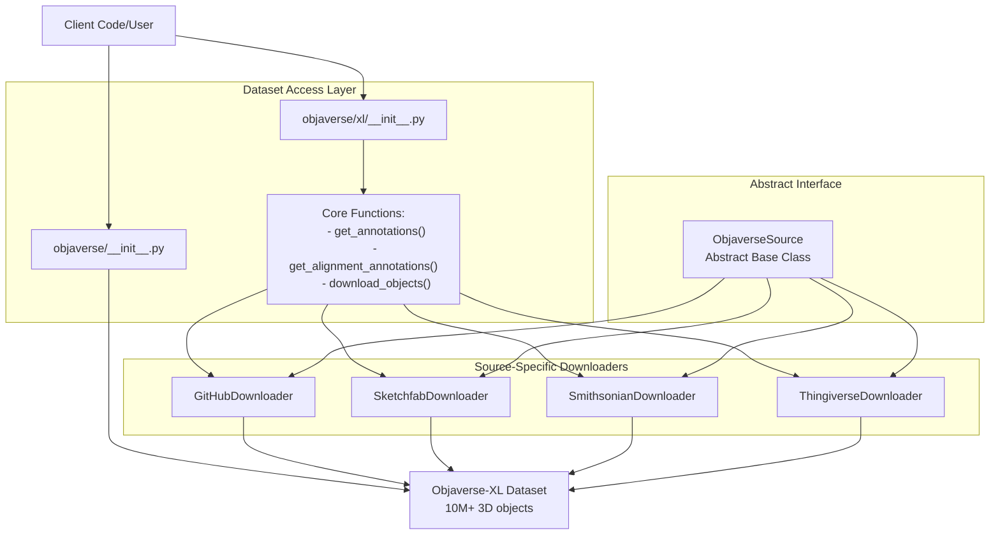
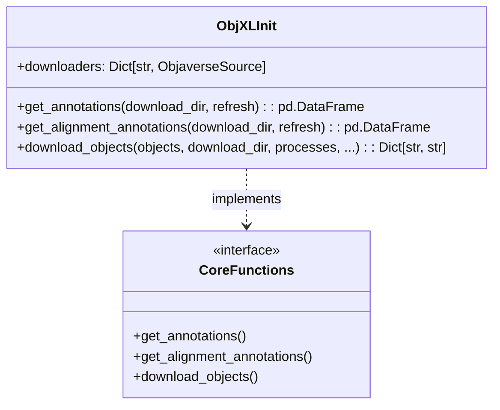
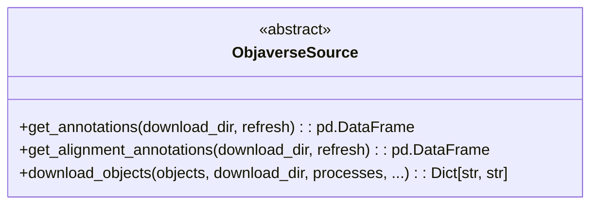
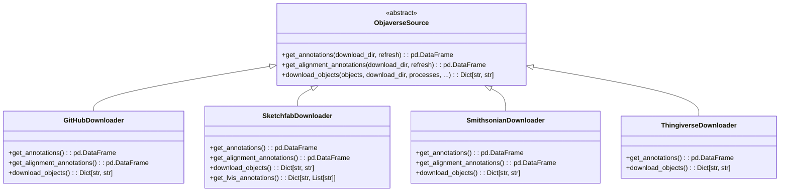
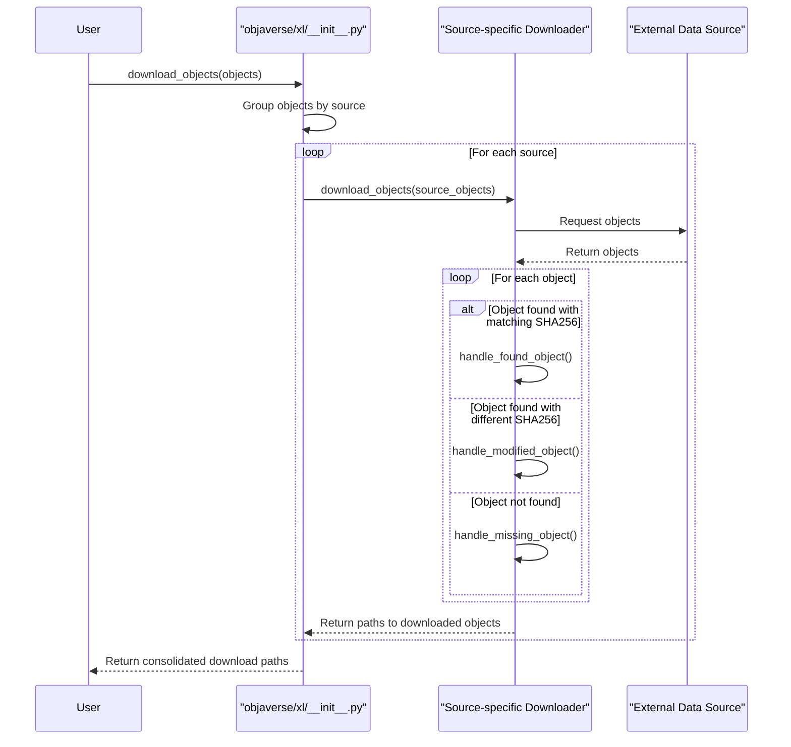

<!-- source: DeepWiki mcp.deepwiki.com · repo allenai/objaverse-xl · page 2.2 Core Components · fetched 2026-10-26 -->

# Core Components

<details>
<summary>Relevant source files</summary>

The following files were used as context for generating this wiki page:

- [.github/workflows/pypi-publish.yaml](.github/workflows/pypi-publish.yaml)
- [objaverse/__init__.py](objaverse/__init__.py)
- [objaverse/xl/__init__.py](objaverse/xl/__init__.py)
- [objaverse/xl/abstract.py](objaverse/xl/abstract.py)

</details>


This page describes the essential components that make up the Objaverse-XL system, their responsibilities, and how they interact. It focuses on the core building blocks that enable the functionality for accessing, downloading, and processing the 10+ million 3D objects in the dataset.

For information about the overall system architecture, see [System Architecture](#2), and for package structure details, see [Package Structure](#2.1).

## Component Overview

The Objaverse-XL system consists of several essential components that work together to provide access to the dataset:



Sources: [objaverse/xl/__init__.py:1-158](), [objaverse/__init__.py:1-211](), [objaverse/xl/abstract.py:1-124]()

## 1. Dataset Access Layer

The Dataset Access Layer provides the primary interfaces for accessing and interacting with the Objaverse-XL dataset. It consists of two main modules:

### 1.1 Basic Dataset Access (objaverse)

The `objaverse` package provides basic functions for accessing the original Objaverse dataset:

- `load_annotations()`: Loads metadata for all objects or specific UIDs
- `load_uids()`: Returns a list of all UIDs in the dataset
- `load_objects()`: Returns paths to object files (downloading if necessary)
- `load_lvis_annotations()`: Loads LVIS annotations mapping categories to UIDs

These functions are focused on the original Objaverse dataset structure, working with UIDs and pulling from Hugging Face.

Sources: [objaverse/__init__.py:20-211]()

### 1.2 Objaverse-XL Specific Access (xl)

The `objaverse.xl` package extends this functionality for the much larger Objaverse-XL dataset with source-specific downloaders:



The XL-specific module initializes a dictionary of downloaders and provides three core functions that delegate to the appropriate downloader based on the source of each object.

Sources: [objaverse/xl/__init__.py:12-158]()

## 2. Abstract Source Interface

The abstract base class `ObjaverseSource` defines the interface that all downloaders must implement:



This abstract class ensures that all source-specific downloaders implement the necessary methods:

- `get_annotations()`: Loads 3D object metadata as a pandas DataFrame
- `get_alignment_annotations()`: Loads metadata for objects used in alignment fine-tuning
- `download_objects()`: Downloads objects from the specific source

Each method has parameters for customizing behavior, such as download location and callback functions for handling different download scenarios (found objects, modified objects, missing objects).

Sources: [objaverse/xl/abstract.py:9-124]()

## 3. Source-Specific Downloaders

Objaverse-XL includes multiple downloader classes that implement the `ObjaverseSource` interface. Each is specialized for retrieving objects from a specific platform:



These downloaders handle the specific requirements for each source:

- **GitHubDownloader**: Clones Git repositories and handles LFS files
- **SketchfabDownloader**: Interacts with Sketchfab's APIs to retrieve 3D models
- **SmithsonianDownloader**: Downloads from the Smithsonian Institution's collections
- **ThingiverseDownloader**: Obtains objects from Thingiverse's platform

Each downloader implements the common interface but adds source-specific logic for efficiently retrieving 3D objects from its platform.

Sources: [objaverse/xl/__init__.py:7-17](), [objaverse/xl/abstract.py:9-124]()

## 4. Core Functions

The three primary functions that users interact with are implemented in `objaverse/xl/__init__.py`:

### 4.1 `get_annotations()`

```python
def get_annotations(download_dir: str = "~/.objaverse", refresh: bool = False) -> pd.DataFrame:
```

This function retrieves metadata for all 3D objects in the dataset, aggregating data from all sources. It returns a pandas DataFrame containing object details such as `fileIdentifier`, `license`, `source`, `fileType`, `sha256`, and `metadata`.

The function delegates to each downloader's `get_annotations()` method and concatenates the results.

Sources: [objaverse/xl/__init__.py:20-41]()

### 4.2 `get_alignment_annotations()`

```python
def get_alignment_annotations(download_dir: str = "~/.objaverse", refresh: bool = False) -> pd.DataFrame:
```

This function retrieves metadata specifically for objects used during alignment fine-tuning. It's similar to `get_annotations()` but focuses on a subset of objects from GitHub and Sketchfab sources.

Sources: [objaverse/xl/__init__.py:44-66]()

### 4.3 `download_objects()`

```python
def download_objects(
    objects: pd.DataFrame,
    download_dir: Optional[str] = "~/.objaverse",
    processes: Optional[int] = None,
    handle_found_object: Optional[Callable] = None,
    handle_modified_object: Optional[Callable] = None,
    handle_missing_object: Optional[Callable] = None,
    **kwargs,
) -> Dict[str, str]:
```

This function downloads 3D objects specified in the provided DataFrame. It has several key features:
- Selects the appropriate downloader based on the object's source
- Supports parallel downloads with a configurable number of processes
- Provides callback functions for handling different download scenarios
- Returns a mapping of file identifiers to local paths of downloaded objects

Sources: [objaverse/xl/__init__.py:69-158]()

## 5. Component Interactions

The interaction between these components follows a clear pattern:



This workflow allows for efficient handling of large numbers of 3D objects from multiple sources, with customizable behavior for different download scenarios.

Sources: [objaverse/xl/__init__.py:69-158](), [objaverse/xl/abstract.py:54-124]()

## 6. Component Initialization

The downloaders are initialized as a dictionary in `objaverse/xl/__init__.py`:

```python
downloaders = {
    "github": GitHubDownloader(),
    "thingiverse": ThingiverseDownloader(),
    "smithsonian": SmithsonianDownloader(),
    "sketchfab": SketchfabDownloader(),
}
```

This structure allows the system to easily select the appropriate downloader based on an object's source.

Sources: [objaverse/xl/__init__.py:12-17]()

## Summary

The core components of Objaverse-XL work together to provide a comprehensive system for accessing, downloading, and processing a vast dataset of 3D objects. The abstract interface ensures consistent behavior across different data sources, while the source-specific downloaders handle the unique requirements of each platform. The core functions provide a simple API for users to interact with the system.

These components form the foundation of the Objaverse-XL system, enabling applications in novel view synthesis, image-to-3D generation, and text-to-3D generation.

---

