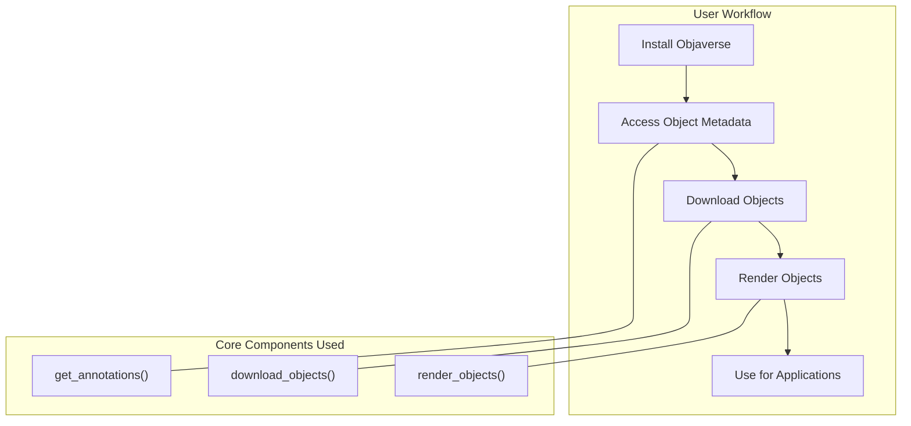
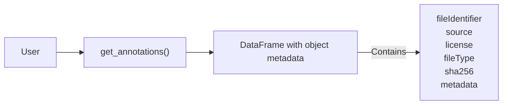
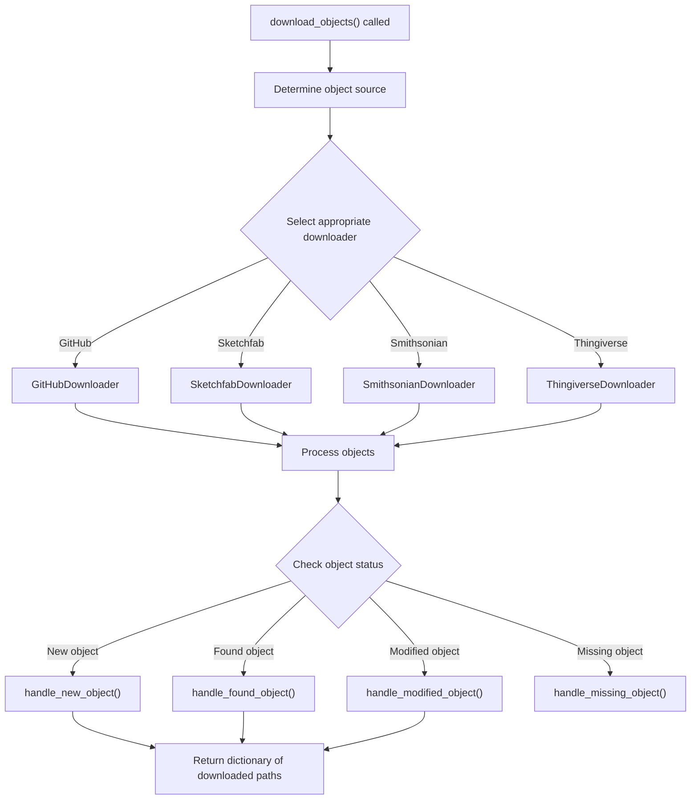
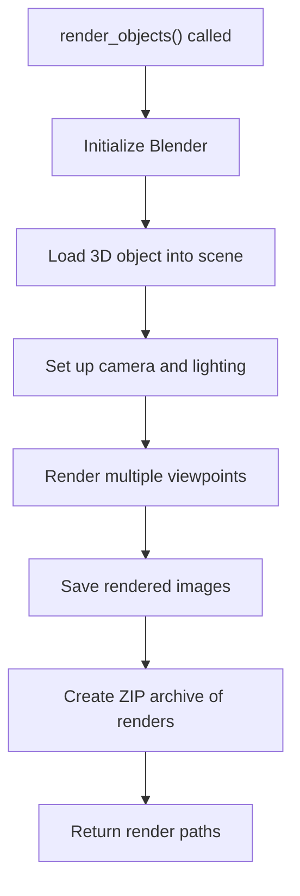
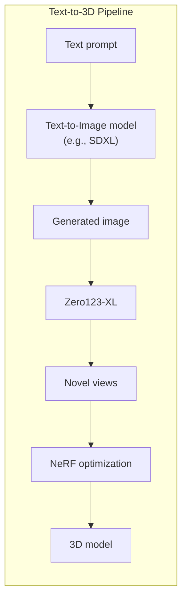

<!-- source: DeepWiki mcp.deepwiki.com · repo allenai/objaverse-xl · page 3 Using Objaverse-XL · fetched 2026-10-26 -->

# Using Objaverse-XL

<details>
<summary>Relevant source files</summary>

The following files were used as context for generating this wiki page:

- [README.md](README.md)
- [setup.py](setup.py)
- [tests/test_api.py](tests/test_api.py)

</details>


This document provides a comprehensive guide for using the Objaverse-XL system to access, download, and render 3D objects from the dataset containing over 10 million 3D objects. For information about the dataset itself and its contents, see [Dataset Description](#1.1). For details about system architecture, see [System Architecture](#2).

## Overview

Objaverse-XL offers a Python API that enables you to:
1. Access metadata about 3D objects
2. Download objects from various sources (GitHub, Sketchfab, Smithsonian, Thingiverse)
3. Render downloaded objects using Blender
4. Use the objects for 3D computer vision applications

The following diagram illustrates the typical user workflow when working with Objaverse-XL:



Sources: [setup.py:11-27](), [README.md:1-26]()

## Installation and Setup

To install Objaverse-XL, you can use pip:

```bash
pip install objaverse
```

For S3 support (optional):

```bash
pip install objaverse[s3]
```

The package has several dependencies that will be automatically installed. For rendering, you'll also need Blender installed on your system.

Default storage locations:
- Downloaded objects: `~/.objaverse/`
- Rendered images: `~/.objaverse/renders/`

These paths can be customized during API calls.

Sources: [setup.py:11-27]()

## Accessing Object Metadata

Objaverse-XL provides functions to access metadata about available 3D objects:



Example usage:

```python
import objaverse

# Get annotations for all objects
annotations = objaverse.xl.get_annotations()

# Filter objects by source or file type
github_objects = annotations[annotations['source'] == 'github']
obj_files = annotations[annotations['fileType'] == 'obj']
```

Sources: [tests/test_api.py:514-531]()

## Downloading Objects

Objaverse-XL provides a unified interface for downloading 3D objects from various sources. Under the hood, the system uses source-specific downloaders to handle objects from different platforms.

```mermaid
classDiagram
    class "ObjaverseSource" {
        <<abstract>>
        +get_annotations() DataFrame
        +get_alignment_annotations() DataFrame
        +download_objects() Dict[str, str]
    }
    
    class "GitHubDownloader" {
        +download_objects()
        -_process_repo()
        -_git_shallow_clone()
    }
    
    class "SketchfabDownloader" {
        +download_objects()
        +get_full_annotations()
    }
    
    class "SmithsonianDownloader" {
        +download_objects()
        -_download_smithsonian_object()
    }
    
    class "ThingiverseDownloader" {
        +download_objects()
    }
    
    ObjaverseSource <|-- GitHubDownloader
    ObjaverseSource <|-- SketchfabDownloader
    ObjaverseSource <|-- SmithsonianDownloader
    ObjaverseSource <|-- ThingiverseDownloader
```

Sources: [tests/test_api.py:7-10](), [tests/test_api.py:532-554]()

### Basic Download Example

```python
import objaverse

# Get annotations for all objects
annotations = objaverse.xl.get_annotations()

# Download a subset of objects
subset = annotations.head(10)  # first 10 objects
downloaded_paths = objaverse.xl.download_objects(
    objects=subset,
    download_dir="~/.objaverse/downloads",
    processes=4  # parallel downloads
)
```

### Object Download Workflow

The `download_objects` function handles different scenarios when processing objects:



Sources: [tests/test_api.py:82-231](), [tests/test_api.py:234-388]()

### Source-Specific Download Features

1. **GitHub Downloader**
   - Downloads 3D models from GitHub repositories
   - Supports shallow cloning to minimize download size
   - Can handle Git LFS files
   - Offers various formats for saving repos (tar, tar.gz, zip, files)

2. **Sketchfab Downloader**
   - Downloads models from Sketchfab
   - Provides access to full annotations including metadata
   - Supports LVIS annotations

3. **Smithsonian Downloader**
   - Downloads models from the Smithsonian Institution
   - Handles specialized metadata structure

4. **Thingiverse Downloader**
   - Downloads models from Thingiverse

Sources: [tests/test_api.py:13-80](), [tests/test_api.py:391-512]()

## Rendering Objects

Objaverse-XL provides functionality to render downloaded 3D objects using Blender. The rendering scripts are located in the `scripts/rendering` directory.



### Basic Rendering Example

```python
import objaverse

# Path to downloaded objects
object_paths = {
    "object1": "/path/to/object1.obj",
    "object2": "/path/to/object2.glb"
}

# Render the objects
render_results = objaverse.render_objects(
    object_paths=object_paths,
    render_dir="~/.objaverse/renders",
    num_views=12,  # number of viewpoints
    gpu_ids=[0],   # GPU IDs to use
)
```

The rendering system supports:
- Multi-view rendering (different camera angles)
- Parallel rendering across multiple GPUs
- Various output formats
- Customizable rendering parameters

Sources: [README.md:51-55]()

## Applications

Objaverse-XL enables several 3D computer vision applications:

### 1. Novel View Synthesis

Creating new viewpoints of objects using models like Zero123-XL trained on Objaverse-XL.

### 2. Image-to-3D

Converting a single image to a 3D model using techniques like DreamFusion combined with Zero123-XL.

### 3. Text-to-3D

Generating 3D models from text descriptions, typically by first generating an image with a text-to-image model like SDXL, then converting to 3D.



Sources: [README.md:27-37]()

## Advanced Usage

### Working with Specific Sources

You can work directly with source-specific downloaders:

```python
from objaverse.xl.github import GitHubDownloader
from objaverse.xl.sketchfab import SketchfabDownloader

# GitHub specific operations
github_downloader = GitHubDownloader()
github_annotations = github_downloader.get_annotations()

# Sketchfab specific operations
sketchfab_downloader = SketchfabDownloader()
sketchfab_full_annotations = sketchfab_downloader.get_full_annotations()
```

### Customizing Object Processing

When downloading objects, you can customize how different object states are handled:

```python
def handle_found_object(local_path, file_identifier, sha256, metadata):
    print(f"Found object: {file_identifier}")
    # Custom processing for found objects

def handle_new_object(local_path, file_identifier, sha256, metadata):
    print(f"New object: {file_identifier}")
    # Custom processing for new objects

# Use these handlers when downloading
downloaded_paths = downloader.download_objects(
    objects=objects,
    download_dir="~/.objaverse/downloads",
    handle_found_object=handle_found_object,
    handle_new_object=handle_new_object
)
```

Sources: [tests/test_api.py:82-154](), [tests/test_api.py:157-231]()

## Troubleshooting

Common issues and solutions:

| Issue | Solution |
|-------|----------|
| Download failures | Check network connection and file permissions |
| Missing dependencies | Install all required packages (`pip install -r requirements.txt`) |
| Rendering errors | Ensure Blender is correctly installed and accessible |
| Out of memory | Reduce batch size or number of parallel processes |
| Slow downloads | Consider using a cache or downloading in smaller batches |

For more detailed information about the API and its components, see [API Reference](#5).

Sources: [README.md:45-49]()

---

