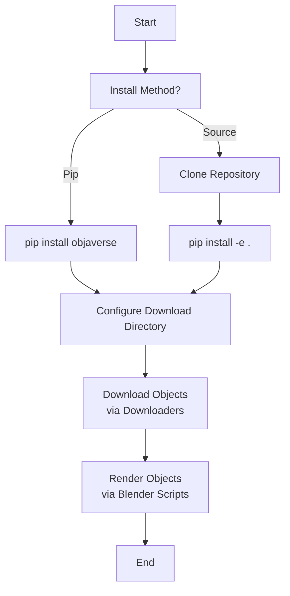
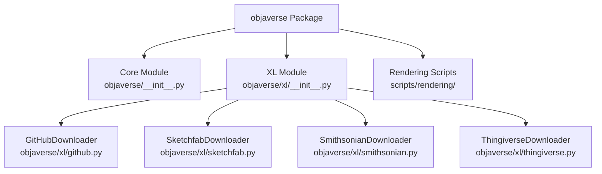

<!-- source: DeepWiki mcp.deepwiki.com · repo allenai/objaverse-xl · page 3.1 Installation and Setup · fetched 2026-10-26 -->

# Installation and Setup

<details>
<summary>Relevant source files</summary>

The following files were used as context for generating this wiki page:

- [Makefile](Makefile)
- [README.md](README.md)
- [setup.py](setup.py)
- [tests/test_api.py](tests/test_api.py)

</details>


This page provides comprehensive instructions for installing and setting up the Objaverse-XL package, which allows you to access the dataset of over 10 million 3D objects. It covers both standard installation for users and development setup for contributors.

For information about downloading objects after installation, see [Downloading Objects](#3.2). For details on rendering 3D objects, see [Rendering Objects](#3.3).

Sources: [README.md:1-7](), [setup.py:11-27]()

## System Requirements

- Python 3.6 or higher
- Pip package manager
- Sufficient storage space for downloaded objects and renders (potentially hundreds of GB)
- For rendering: Blender 3.2.2 (automatically downloaded by the rendering scripts)

Sources: [README.md:52-55]()

## Regular Installation

The simplest way to install Objaverse-XL is via pip:

```bash
pip install objaverse
```

For S3 support (optional), which enables working with objects stored in S3 buckets:

```bash
pip install objaverse[s3]
```

Sources: [setup.py:11-27](), [setup.py:26]()

## Development Installation

For development purposes or to access the latest features:

1. Clone the repository:
```bash
git clone https://github.com/allenai/objaverse-xl.git
cd objaverse-xl
```

2. Install the package in development mode:
```bash
pip install -e .
```

Alternatively, use the provided Makefile which also updates pip:
```bash
make install
```

3. Install development dependencies:
```bash
make install-dev
```

4. Run tests to verify your setup:
```bash
make test
```

5. Ensure code quality with linting:
```bash
make lint
```

Sources: [Makefile:1-23](), [setup.py:11-27]()

## Installation Workflow

### Installation Process Diagram



Sources: [setup.py:11-27](), [Makefile:1-3]()

### Package Component Structure



Sources: [tests/test_api.py:7-10](), [README.md:52-55]()

## Download Directory Configuration

Objaverse-XL downloads and stores 3D objects in a specified directory. By default, it uses `~/.objaverse` but you can customize this:

```python
import objaverse as obv

# Custom download directory
download_dir = "/path/to/your/directory"
objects = obv.xl.download_objects(objects, download_dir=download_dir)
```

The download directory will contain subdirectories for each source:
- `github/` - Objects downloaded from GitHub
- `sketchfab/` - Objects from Sketchfab
- `smithsonian/` - Objects from the Smithsonian Institution
- `thingiverse/` - Objects from Thingiverse

Sources: [tests/test_api.py:497-502]()

## Verification

### Verifying Installation

To verify your installation, import the package and retrieve annotations:

```python
import objaverse as obv

# Get annotations for XL objects
annotations = obv.xl.get_annotations()
print(f"Found {len(annotations)} objects in Objaverse-XL")

# Check the structure of the annotations
print(annotations.columns)
```

The annotations DataFrame should have columns including `fileIdentifier`, `source`, `license`, `fileType`, `sha256`, and `metadata`.

### Testing Specific Downloaders

You can test individual downloaders to ensure they're working correctly:

```python
from objaverse.xl.github import GitHubDownloader
from objaverse.xl.sketchfab import SketchfabDownloader

# Test GitHub downloader
github_downloader = GitHubDownloader()
github_annotations = github_downloader.get_annotations()
print(f"Found {len(github_annotations)} GitHub objects")

# Test Sketchfab downloader
sketchfab_downloader = SketchfabDownloader()
sketchfab_annotations = sketchfab_downloader.get_annotations()
print(f"Found {len(sketchfab_annotations)} Sketchfab objects")
```

Sources: [tests/test_api.py:515-528]()

## Additional Resources

### Google Colab Tutorial

For a quick start, check out the [Google Colab tutorial](https://colab.research.google.com/drive/15XpZMjrHXuky0IgBbXcsUtb_0g-XWYmN?usp=sharing) referenced in the README. This tutorial guides you through downloading and using Objaverse-XL.

### Polycam Data Access

Polycam data is available to academic researchers for non-commercial use upon request and approval from Polycam. For access, fill out the form mentioned in the README.

### Blender Setup for Rendering

The rendering scripts in the `scripts/rendering` directory use Blender. The scripts automatically download and set up Blender 3.2.2, so no manual installation is required.

Sources: [README.md:45-55]()

## Troubleshooting

### Common Issues

| Issue | Solution |
|-------|----------|
| Insufficient disk space | Free up space or specify an alternative download directory |
| Network connectivity problems | Check your internet connection and firewall settings |
| Missing dependencies | Install required dependencies manually or check error messages |
| Permission errors | Run with appropriate permissions for the download directory |

### Enabling Logging

For detailed error messages, enable logging:

```python
import logging
logging.basicConfig(level=logging.INFO)
```

### Save Format Options for GitHub

When downloading from GitHub, you can specify different save formats:

```python
from objaverse.xl.github import GitHubDownloader

github_downloader = GitHubDownloader()
objects = pd.DataFrame([...])  # Your objects dataframe

# Available formats: "tar", "tar.gz", "zip", "files"
downloaded_objects = github_downloader.download_objects(
    objects=objects,
    download_dir="~/.objaverse",
    save_repo_format="zip"
)
```

Sources: [tests/test_api.py:1-554](), [tests/test_api.py:493-511]()

## Next Steps

After installation, you can:
- [Download Objects](#3.2) from various sources
- [Render Objects](#3.3) using the Blender scripts
- Explore the [API Reference](#5) for detailed usage information

Sources: [README.md:1-7]()

---

