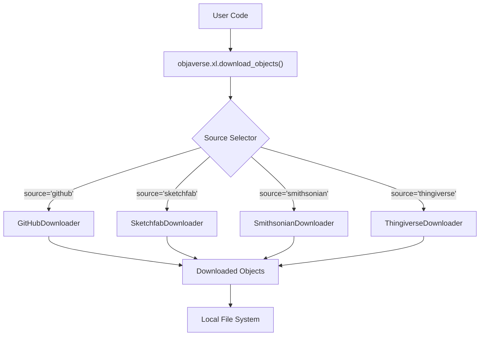
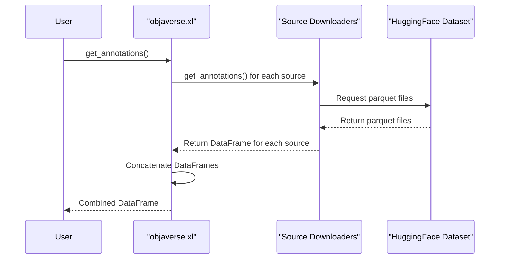
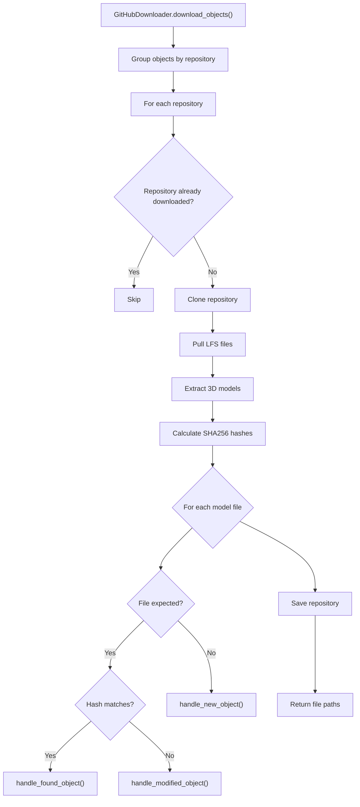
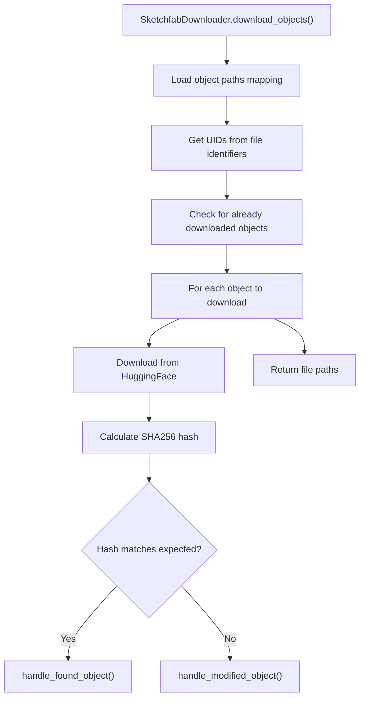

<!-- source: DeepWiki mcp.deepwiki.com · repo allenai/objaverse-xl · page 3.2 Downloading Objects · fetched 2026-10-26 -->

# Downloading Objects

<details>
<summary>Relevant source files</summary>

The following files were used as context for generating this wiki page:

- [.github/workflows/pypi-publish.yaml](.github/workflows/pypi-publish.yaml)
- [objaverse/__init__.py](objaverse/__init__.py)
- [objaverse/xl/__init__.py](objaverse/xl/__init__.py)
- [objaverse/xl/github.py](objaverse/xl/github.py)
- [objaverse/xl/sketchfab.py](objaverse/xl/sketchfab.py)

</details>


This page explains how to download 3D objects from the Objaverse-XL dataset, which contains over 10 million 3D models collected from various sources. For information about rendering these objects after downloading them, see [Rendering Objects](#3.3).

## Overview

The Objaverse-XL system provides a unified interface for downloading 3D objects from multiple sources, including GitHub, Sketchfab, Smithsonian, and Thingiverse. Each source has its own downloader implementation that handles the specific requirements for retrieving objects from that platform.


**Diagram: Download Process Overview**

Sources: [objaverse/xl/__init__.py:69-158](), [objaverse/xl/github.py:468-659](), [objaverse/xl/sketchfab.py:384-561]()

## Basic Usage

To download objects from Objaverse-XL, you first need to get the metadata for the objects you want to download using the `get_annotations()` function, and then pass a filtered version of this metadata to the `download_objects()` function.

```python
import objaverse.xl as oxl

# Get metadata for all objects
annotations = oxl.get_annotations()

# Select objects to download (for example, the first 10)
objects_to_download = annotations.head(10)

# Download the selected objects
downloaded_objects = oxl.download_objects(
    objects=objects_to_download,
    download_dir="~/my_downloads"
)

# downloaded_objects is a dictionary mapping file identifiers to local paths
print(f"Downloaded {len(downloaded_objects)} objects")
```

Sources: [objaverse/xl/__init__.py:20-41](), [objaverse/xl/__init__.py:69-158]()

## Download API

### Getting Object Metadata

Before downloading objects, you need to retrieve their metadata, which includes information like source, file identifier, SHA256 hash, and more.


**Diagram: Metadata Retrieval Process**

Sources: [objaverse/xl/__init__.py:20-41](), [objaverse/xl/github.py:77-100](), [objaverse/xl/sketchfab.py:67-88]()

The main functions for getting metadata are:

- `get_annotations()`: Returns metadata for all objects in the dataset
- `get_alignment_annotations()`: Returns metadata for objects used in alignment fine-tuning

Both functions accept the following parameters:

| Parameter | Type | Default | Description |
|-----------|------|---------|-------------|
| download_dir | str | "~/.objaverse" | Directory to download metadata files |
| refresh | bool | False | Whether to refresh metadata by re-downloading |

Sources: [objaverse/xl/__init__.py:20-66]()

### Downloading Objects

The main function for downloading objects is `download_objects()`:

```python
def download_objects(
    objects: pd.DataFrame,
    download_dir: Optional[str] = "~/.objaverse",
    processes: Optional[int] = None,
    handle_found_object: Optional[Callable] = None,
    handle_modified_object: Optional[Callable] = None,
    handle_missing_object: Optional[Callable] = None,
    **kwargs,
) -> Dict[str, str]:
    # Implementation details...
```

Sources: [objaverse/xl/__init__.py:69-158]()

Parameters:

| Parameter | Type | Default | Description |
|-----------|------|---------|-------------|
| objects | pd.DataFrame | Required | Objects to download, obtained from `get_annotations()` |
| download_dir | str | "~/.objaverse" | Directory to download objects |
| processes | int | None (uses CPU count) | Number of parallel download processes |
| handle_found_object | Callable | None | Callback for successfully downloaded objects |
| handle_modified_object | Callable | None | Callback for objects with changed hashes |
| handle_missing_object | Callable | None | Callback for objects not found |
| save_repo_format | str | None | Format for GitHub repos ("zip", "tar", "tar.gz", "files") |

The function returns a dictionary mapping file identifiers to local paths of downloaded objects.

Sources: [objaverse/xl/__init__.py:69-158](), [objaverse/xl/github.py:468-553]()

## Downloader Architecture

The Objaverse-XL downloader system uses a class hierarchy with an abstract base class `ObjaverseSource` that defines the interface implemented by each source-specific downloader.

```mermaid
classDiagram
    class "ObjaverseSource" {
        <<abstract>>
        +get_annotations(download_dir, refresh)
        +get_alignment_annotations(download_dir, refresh)
        +download_objects(objects, download_dir, processes, ...)
    }
    
    class "GitHubDownloader" {
        +get_annotations(download_dir, refresh)
        +get_alignment_annotations(download_dir, refresh)
        +download_objects(objects, download_dir, processes, ...)
        -_process_repo(repo_id, ...)
        -_git_shallow_clone(repo_url, target_directory)
        -_pull_lfs_files(repo_dir)
    }
    
    class "SketchfabDownloader" {
        +get_annotations(download_dir, refresh)
        +get_alignment_annotations(download_dir, refresh)
        +get_full_annotations(uids, download_dir)
        +get_uids()
        +download_objects(objects, download_dir, processes, ...)
        -_download_object(file_identifier, ...)
    }
    
    class "SmithsonianDownloader" {
        +get_annotations(download_dir, refresh)
        +get_alignment_annotations(download_dir, refresh)
        +download_objects(objects, download_dir, processes, ...)
    }
    
    class "ThingiverseDownloader" {
        +get_annotations(download_dir, refresh)
        +download_objects(objects, download_dir, processes, ...)
    }
    
    ObjaverseSource <|-- GitHubDownloader
    ObjaverseSource <|-- SketchfabDownloader
    ObjaverseSource <|-- SmithsonianDownloader
    ObjaverseSource <|-- ThingiverseDownloader
```
**Diagram: Downloader Class Hierarchy**

Sources: [objaverse/xl/__init__.py:12-17](), [objaverse/xl/github.py:38-659](), [objaverse/xl/sketchfab.py:22-602]()

## Source-Specific Downloaders

### GitHub Downloader

The `GitHubDownloader` retrieves 3D models from GitHub repositories. It handles cloning repositories, processing Git LFS files, and extracting 3D models.


**Diagram: GitHub Download Process Flow**

Sources: [objaverse/xl/github.py:468-659](), [objaverse/xl/github.py:178-382]()

Key features:

- Uses shallow cloning to minimize download size
- Supports Git LFS for large files
- Can save repositories in various formats (zip, tar, tar.gz, or individual files)
- Parallelizes downloads using multiple processes

Sources: [objaverse/xl/github.py:134-176](), [objaverse/xl/github.py:393-406]()

### Sketchfab Downloader

The `SketchfabDownloader` retrieves 3D models from Sketchfab via the Hugging Face dataset cache.


**Diagram: Sketchfab Download Process Flow**

Sources: [objaverse/xl/sketchfab.py:384-561](), [objaverse/xl/sketchfab.py:243-348]()

Key features:

- Retrieves models from the Hugging Face dataset repository
- Supports batch downloading with multiple processes
- Caches metadata and objects locally

Sources: [objaverse/xl/sketchfab.py:200-232](), [objaverse/xl/sketchfab.py:115-197]()

### Other Downloaders

Objaverse-XL also includes downloaders for the Smithsonian and Thingiverse platforms, which follow a similar pattern to the GitHub and Sketchfab downloaders.

Sources: [objaverse/xl/__init__.py:12-17]()

## Advanced Usage

### Custom Callbacks

You can provide custom callback functions to handle different download scenarios:

```python
def handle_found(local_path, file_identifier, sha256, metadata):
    print(f"Found object: {file_identifier} at {local_path}")
    # Process the found object

def handle_missing(file_identifier, sha256, metadata):
    print(f"Missing object: {file_identifier}")
    # Log the missing object

# Use the callbacks in download_objects
downloaded_objects = oxl.download_objects(
    objects=objects_to_download,
    handle_found_object=handle_found,
    handle_missing_object=handle_missing
)
```

Sources: [objaverse/xl/__init__.py:95-131](), [objaverse/xl/github.py:496-527]()

### Parallel Downloads

To speed up downloads, you can specify the number of parallel processes:

```python
# Use 8 parallel processes for downloading
downloaded_objects = oxl.download_objects(
    objects=objects_to_download,
    processes=8
)
```

For very large downloads, it's recommended to set this to a reasonable value based on your system's capabilities.

Sources: [objaverse/xl/__init__.py:87-89](), [objaverse/xl/github.py:557-658](), [objaverse/xl/sketchfab.py:549-556]()

### GitHub-Specific Options

When downloading from GitHub, you can specify the format for saving repositories:

```python
# Download GitHub objects and save repositories as zip files
downloaded_objects = oxl.download_objects(
    objects=github_objects,
    save_repo_format="zip"
)
```

Valid formats are:
- `"zip"`: Save as a ZIP archive
- `"tar"`: Save as a TAR archive
- `"tar.gz"`: Save as a compressed TAR archive
- `"files"`: Save individual files

Sources: [objaverse/xl/github.py:528-544](), [objaverse/xl/github.py:324-369]()

## Example Workflows

### Filtering Objects by Source

```python
import objaverse.xl as oxl

# Get all annotations
annotations = oxl.get_annotations()

# Filter for objects from GitHub only
github_objects = annotations[annotations["source"] == "github"]

# Download GitHub objects
downloaded_github_objects = oxl.download_objects(
    objects=github_objects,
    download_dir="~/objaverse_github"
)
```

Sources: [objaverse/xl/__init__.py:137-155]()

### Handling Large Downloads

For very large downloads, it's recommended to implement custom callbacks that process objects as they are downloaded, rather than waiting for the entire download to complete:

```python
import objaverse.xl as oxl

processed_objects = []

def process_object(local_path, file_identifier, sha256, metadata):
    # Do something with the downloaded object
    processed_objects.append(file_identifier)
    print(f"Processed {len(processed_objects)} objects")

# Download all objects with custom processing
oxl.download_objects(
    objects=oxl.get_annotations(),
    handle_found_object=process_object
)
```

Sources: [objaverse/xl/github.py:496-527](), [objaverse/xl/sketchfab.py:409-445]()

## Common Issues and Solutions

### Missing Objects

If an object can't be found, the `handle_missing_object` callback will be invoked. This can happen if:
- The repository was deleted or renamed (for GitHub)
- The object was removed from the source platform
- The object path has changed

### Modified Objects

If an object's hash doesn't match the expected value, the `handle_modified_object` callback will be invoked. This can happen if:
- The object was updated on the source platform
- There was data corruption during download

### Storage Requirements

Downloading the entire Objaverse-XL dataset requires significant storage space (several terabytes). It's recommended to:
- Filter objects before downloading
- Use a storage location with ample free space
- Consider using cloud storage with the `fsspec` interface

Sources: [objaverse/xl/github.py:484-494](), [objaverse/xl/sketchfab.py:402-408]()

---

